# Weaviate 生产运维与性能调优

> [!abstract] 文档定位
> 本文是 Weaviate 系列第 9 篇，面向运维工程师和后端工程师。重点解决一个核心问题：**如何在生产环境稳定、高效地运行 Weaviate**。涵盖资源规划、权限管理、备份恢复、监控告警、性能调优、故障排查和版本升级七个核心主题。

## 目录

- [[#1. 生产部署架构]]
- [[#2. RBAC 权限管理]]
- [[#3. 备份与恢复]]
- [[#4. 监控与可观测性]]
- [[#5. 性能调优]]
- [[#6. 故障排查]]
- [[#7. 版本升级]]

---

## 1. 生产部署架构

### 1.1 单节点 vs 集群：如何选择

生产环境的第一个决策是部署形态。下表是待评估的示例划分，2000万向量不是通用阈值；高可用要求、向量维度、对象大小和实际负载也会改变选择：

| 维度 | 单节点 | 多节点集群 |
|------|--------|------------|
| 向量规模 | < 2000 万 | >= 2000 万 |
| 典型场景 | 中小规模应用、RAG 系统 | 企业级搜索、大规模推荐 |
| 运维复杂度 | 低 | 高 |
| HA 支持 | 无（单点故障） | 有（副本机制） |
| 水平扩展 | 不支持 | 支持分片扩容 |

> [!tip] 经验判断
> 可将100万和500万向量作为容量规划的示例规模，而非通用部署阈值；是否采用单节点或集群，还需结合向量维度、对象大小、并发、延迟目标和高可用要求进行评估。

### 1.2 集群分片与副本配置

Weaviate 集群通过两个参数控制数据分布：

- **`desiredCount`（分片数）**：决定数据如何分布到节点，影响并行写入能力和存储均衡
- **副本因子（`replication_config`中的`factor`）**：配置数据副本数量；不要将分片配置中的`actualCount`解释为副本数。

```python
import weaviate

client = weaviate.connect_to_local()

# 创建 Collection 时指定分片和副本
client.collections.create(
    name="Article",
    replication_config=weaviate.classes.config.Configure.replication(
        factor=2  # 每个分片保留 2 个副本（生产建议 >= 2）
    ),
    sharding_config=weaviate.classes.config.Configure.sharding(
        desired_count=3,    # 期望 3 个分片
        desired_virtual_count=128  # 虚拟分片数（影响负载均衡均匀度）
    )
)
```

> [!note] 副本因子 vs 分片数
> - 副本因子 = 2：配置两份数据副本；单节点故障下的数据安全与服务可用性还取决于副本状态、写入确认条件及故障情形，不能仅凭副本因子保证。
> - 分片数 = 3：配置三个分片；分片放置和并行写入收益取决于集群拓扑及负载，可将吞吐3x作为待压测假设，不能视为保证。
> - 两者叠加：`分片数 × 副本因子`表示分片副本总数，不等同于必须使用的节点数；节点数量需结合副本放置、容量及性能目标确定。

### 1.3 资源规划

生产环境资源规划的核心是**内存**，因为 Weaviate 的 HNSW 索引全部常驻内存。

#### 内存估算公式

```text
HNSW 内存 ≈ 向量数 × 维度 × 4字节 × (1 + maxConnections × 2 / 向量数的对数)
```

更实用的简化版本：

```text
每百万向量内存消耗（维度1536，maxConnections=64）≈ 6.5 GB
每百万向量内存消耗（维度768，maxConnections=64）≈ 3.5 GB
```

| 向量规模 | 维度 | 建议内存 |
|----------|------|----------|
| 100 万 | 1536 | 16 GB |
| 500 万 | 1536 | 64 GB |
| 1000 万 | 768 | 待压测确定；按上文简化示例已约35 GB，另需对象、索引及运行余量 |
| 2000 万 | 768 | 待压测确定；按上文简化示例已约70 GB，另需对象、索引及运行余量 |

> [!warning] 与 Qdrant 的内存效率对比
> Qdrant 支持内存映射文件（mmap），向量数据可以部分存储在磁盘上按需加载。Weaviate v1.x 的 HNSW 索引不支持 DiskANN 式的磁盘索引，**全量加载到内存**。超过 5000 万向量时内存消耗非常可观，必须启用量化压缩。

#### 磁盘规划

```text
磁盘需求 = 向量数据（向量数 × 维度 × 4字节）
         + 对象数据（向量数 × 平均对象大小）
         + BM25 倒排索引（约为文本数据的 1.5-3x）
         + 预留空间（建议 30% 余量）
```

#### CPU 规划

- **写入场景**：本地向量化模块（text2vec-transformers）是 CPU 瓶颈，建议配备 8+ 核心；使用外部 embedding API 时 CPU 压力小
- **查询场景**：HNSW 查询相对轻量，可将4核、100 QPS作为压测起点，是否足够取决于数据规模、查询条件、向量维度和延迟目标

### 1.4 量化压缩（大规模必备）

启用 Product Quantization (PQ) 可降低向量存储开销；4-16x压缩和1-5%精度损失仅作为待验证的示例假设，实际结果取决于量化配置、数据分布和评价指标：

```python
from weaviate.classes.config import Configure, VectorDistances

client.collections.create(
    name="LargeScaleArticle",
    vector_index_config=Configure.VectorIndex.hnsw(
        distance_metric=VectorDistances.COSINE,
        ef_construction=128,
        max_connections=64,
        # 启用 PQ 量化压缩
        quantizer=Configure.VectorIndex.Quantizer.pq(
            segments=96,           # 压缩段数，通常设为 维度/16 或 维度/32
            centroids=256,         # 聚类中心数，默认 256
            training_limit=100000, # 训练样本数，需先写入足够数据
            encoder=Configure.VectorIndex.Quantizer.PQEncoder(
                type=weaviate.classes.config.PQEncoderType.KMEANS,
                distribution=weaviate.classes.config.PQEncoderDistribution.LOG_NORMAL
            )
        )
    ),
    properties=[
        weaviate.classes.config.Property(name="content", data_type=weaviate.classes.config.DataType.TEXT),
    ]
)
```

> [!tip] PQ 启用时机
> PQ 需要在数据写入后训练，建议先写入至少 `training_limit` 条数据再启用。已有 Collection 也可以通过更新 Schema 开启 PQ，Weaviate 会自动后台训练。

Binary Quantization (BQ) 是更激进的压缩方案（32x 压缩），适合对精度要求不高的场景：

```python
quantizer=Configure.VectorIndex.Quantizer.bq(
    cache=True  # 缓存原始向量用于重排序，提升精度
)
```

---

## 2. RBAC 权限管理

### 2.1 为什么 RBAC 很重要

v1.28 之前，Weaviate 的认证主要依赖 API Key，所有持有有效 Key 的调用方拥有相同权限——任何人都可以删除 Schema、修改数据。这在多租户 SaaS 场景或多团队共享集群时是巨大的安全隐患。

**v1.28 引入完整的 RBAC**，核心概念：

- **User**：可以是 DB 用户（用户名 + 密码）或 API Key
- **Role**：权限的集合，可复用
- **Permission**：对特定资源（Collection、Tenant）的具体操作权限

### 2.2 启用 RBAC

在 docker-compose.yml 中开启：

```yaml
services:
  weaviate:
    image: semitechnologies/weaviate:1.28.0
    environment:
      # 认证配置
      AUTHENTICATION_APIKEY_ENABLED: "true"
      AUTHENTICATION_APIKEY_ALLOWED_KEYS: "admin-secret-key"
      AUTHENTICATION_APIKEY_USERS: "admin"
      # 开启 RBAC
      AUTHORIZATION_ENABLE_RBAC: "true"
      # 初始 admin 用户（拥有全部权限）
      AUTHORIZATION_ADMINLIST_USERS: "admin"
    ports:
      - "8080:8080"
```

### 2.3 RBAC 配置实践

```python
import weaviate
from weaviate.classes.rbac import Permissions, Actions

# 以 admin 身份连接
client = weaviate.connect_to_local(
    auth_credentials=weaviate.auth.AuthApiKey("admin-secret-key")
)

# --- 创建只读角色（仅允许查询，不允许写入和 Schema 变更）---
client.roles.create(
    role_name="readonly_role",
    permissions=[
        # 允许读取所有 Collection 的数据
        Permissions.data(
            collection="*",
            read=True,
            create=False,
            update=False,
            delete=False
        ),
        # 允许读取 Schema（查询时需要）
        Permissions.collections(
            collection="*",
            read_config=True,
            create_collection=False,
            update_config=False,
            delete_collection=False
        )
    ]
)

# --- 创建读写角色（允许数据读写，不允许 Schema 变更）---
client.roles.create(
    role_name="readwrite_role",
    permissions=[
        Permissions.data(
            collection="*",
            read=True,
            create=True,
            update=True,
            delete=True
        ),
        Permissions.collections(
            collection="*",
            read_config=True,
            create_collection=False,
            update_config=False,
            delete_collection=False
        )
    ]
)

# --- 创建 Schema 管理角色（授予下列数据和 Collection 操作权限，不代表全部管理权限）---
client.roles.create(
    role_name="schema_admin_role",
    permissions=[
        Permissions.data(collection="*", read=True, create=True, update=True, delete=True),
        Permissions.collections(
            collection="*",
            read_config=True,
            create_collection=True,
            update_config=True,
            delete_collection=True
        )
    ]
)

# --- 创建 API Key 用户并分配角色 ---
# 创建只读用户
client.users.db.create(user_id="service_readonly", password="readonly_password_123")
client.users.db.assign_roles(user_id="service_readonly", role_names=["readonly_role"])

# 创建读写用户
client.users.db.create(user_id="service_readwrite", password="readwrite_password_123")
client.users.db.assign_roles(user_id="service_readwrite", role_names=["readwrite_role"])
```

### 2.4 多租户场景的细粒度权限

结合[[【技术与工具】/向量数据库/Weaviate/07B-多租户与数据隔离]]的多租户架构，可以实现每个 API Key 只能访问特定 Tenant：

```python
# 为特定租户创建隔离角色
client.roles.create(
    role_name="tenant_a_role",
    permissions=[
        # 只允许访问 tenant_a 的数据
        Permissions.data(
            collection="Article",
            read=True,
            create=True,
            update=True,
            delete=False,
            # 限定特定 Tenant（v1.28+ 支持）
            tenant="tenant_a"
        ),
    ]
)

# 创建专属 API Key 用户
client.users.db.create(user_id="tenant_a_service", password="tenant_a_secret")
client.users.db.assign_roles(user_id="tenant_a_service", role_names=["tenant_a_role"])
```

---

## 3. 备份与恢复

### 3.1 快照备份机制

Weaviate 提供原生快照备份，支持多种存储后端：

| 后端 | 适用场景 | 配置环境变量 |
|------|----------|-------------|
| 本地文件系统 | 开发/测试 | `BACKUP_FILESYSTEM_PATH` |
| AWS S3 | 生产首选 | `BACKUP_S3_BUCKET` + `BACKUP_S3_PATH` |
| Google GCS | GCP 环境 | `BACKUP_GCS_BUCKET` |
| Azure Blob | Azure 环境 | `BACKUP_AZURE_CONTAINER` |

### 3.2 配置 S3 备份

```yaml
# docker-compose.yml
services:
  weaviate:
    image: semitechnologies/weaviate:1.28.0
    environment:
      # 开启 S3 备份模块
      ENABLE_MODULES: "backup-s3"
      # S3 配置
      BACKUP_S3_BUCKET: "my-weaviate-backups"
      BACKUP_S3_PATH: "prod/weaviate"
      AWS_ACCESS_KEY_ID: "${AWS_ACCESS_KEY_ID}"
      AWS_SECRET_ACCESS_KEY: "${AWS_SECRET_ACCESS_KEY}"
      AWS_REGION: "ap-northeast-1"
```

### 3.3 Python 执行备份

```python
import weaviate
from datetime import datetime

client = weaviate.connect_to_local(
    auth_credentials=weaviate.auth.AuthApiKey("admin-secret-key")
)

# 生成带时间戳的备份 ID
backup_id = f"backup-{datetime.now().strftime('%Y%m%d-%H%M%S')}"

# --- 备份全部 Collections ---
result = client.backup.create(
    backup_id=backup_id,
    backend="s3",
    wait_for_completion=True  # 等待备份完成（生产建议异步）
)
print(f"备份完成: {result.status}")

# --- 只备份指定 Collections ---
result = client.backup.create(
    backup_id=f"article-backup-{datetime.now().strftime('%Y%m%d')}",
    backend="s3",
    include_collections=["Article", "Document"],  # 只备份这两个
    wait_for_completion=True
)

# --- 异步备份（大数据量推荐）---
result = client.backup.create(
    backup_id=backup_id,
    backend="s3",
    wait_for_completion=False  # 立即返回
)

# 稍后检查状态
import time
while True:
    status = client.backup.get_create_status(backup_id=backup_id, backend="s3")
    print(f"备份状态: {status.status}")
    if status.status in ["SUCCESS", "FAILED"]:
        break
    time.sleep(5)
```

### 3.4 从备份恢复

```python
# --- 查看所有可用备份 ---
backups = client.backup.list_backups(backend="s3")
for backup in backups:
    print(f"ID: {backup.id}, 状态: {backup.status}, 时间: {backup.start_time}")

# --- 恢复整个备份 ---
result = client.backup.restore(
    backup_id="backup-20260311-020000",
    backend="s3",
    wait_for_completion=True
)
print(f"恢复状态: {result.status}")

# --- 只恢复指定 Collections ---
result = client.backup.restore(
    backup_id="backup-20260311-020000",
    backend="s3",
    include_collections=["Article"],  # 只恢复 Article
    wait_for_completion=True
)

# --- 多租户备份恢复（v1.26+）---
# 以下调用仅指定 Collection，未实现特定 Tenant 的选择性备份
result = client.backup.create(
    backup_id="tenant-a-backup",
    backend="s3",
    # 注意：多租户备份需要指定 Collection + Tenant 组合
    include_collections=["Article"],
    wait_for_completion=True
)
```

### 3.5 跨集群数据迁移

当快照备份无法使用时（如跨大版本迁移），使用 Cursor API 逐页读取后重新写入：

```python
def migrate_collection(source_client, target_client, collection_name: str, batch_size: int = 1000):
    """跨集群迁移 Collection 数据"""
    source_collection = source_client.collections.get(collection_name)
    target_collection = target_client.collections.get(collection_name)

    total = 0
    # 使用 Cursor API 分批读取，避免内存溢出
    with source_collection.query.fetch_objects(
        limit=batch_size,
        include_vector=True,    # 带上向量，避免重新向量化
        return_properties=["content", "title", "created_at"]
    ) as cursor:
        for batch in cursor:
            objects_to_insert = []
            for obj in batch.objects:
                objects_to_insert.append(
                    weaviate.classes.data.DataObject(
                        properties=obj.properties,
                        vector=obj.vector["default"] if obj.vector else None,
                        uuid=obj.uuid  # 保留原有 UUID
                    )
                )
            # 批量写入目标集群
            target_collection.data.insert_many(objects_to_insert)
            total += len(objects_to_insert)
            print(f"已迁移: {total} 条")

    return total
```

---

## 4. 监控与可观测性

### 4.1 启用 Prometheus 指标

```yaml
# docker-compose.yml
services:
  weaviate:
    image: semitechnologies/weaviate:1.28.0
    environment:
      # 开启 Prometheus 监控
      PROMETHEUS_MONITORING_ENABLED: "true"
      PROMETHEUS_MONITORING_PORT: "2112"
    ports:
      - "8080:8080"
      - "2112:2112"  # Prometheus 指标端口

  prometheus:
    image: prom/prometheus:latest
    volumes:
      - ./prometheus.yml:/etc/prometheus/prometheus.yml
    ports:
      - "9090:9090"

  grafana:
    image: grafana/grafana:latest
    environment:
      GF_SECURITY_ADMIN_PASSWORD: "admin_password"
    ports:
      - "3000:3000"
    volumes:
      - grafana-data:/var/lib/grafana

volumes:
  grafana-data:
```

Prometheus 抓取配置 (`prometheus.yml`)：

```yaml
global:
  scrape_interval: 15s

scrape_configs:
  - job_name: 'weaviate'
    static_configs:
      - targets: ['weaviate:2112']
    metrics_path: '/metrics'
```

### 4.2 核心监控指标

**数据量指标**

| 指标名 | 含义 | 告警建议 |
|--------|------|----------|
| `weaviate_objects_total` | 各 Collection 对象总数 | 监控增长趋势 |
| `weaviate_vector_index_tombstones_total` | 待清理的墓碑向量数 | > 10% 总量时触发清理 |

**性能指标**

| 指标名 | 含义 | 告警建议 |
|--------|------|----------|
| `weaviate_queries_durations_ms` | 查询延迟分布（P50/P95/P99） | P99 > 500ms 告警 |
| `weaviate_batch_durations_ms` | 批量写入延迟 | P95 > 2000ms 告警 |
| `weaviate_vector_index_operations_total` | 向量索引操作计数 | 监控写入速率 |

**资源指标**

| 指标名 | 含义 | 告警建议 |
|--------|------|----------|
| `go_memstats_heap_alloc_bytes` | 堆内存使用量 | > 80% 物理内存告警 |
| `go_memstats_sys_bytes` | 系统内存申请量 | 持续增长时检查内存泄漏 |
| `process_cpu_seconds_total` | CPU 使用时间 | 结合负载判断 |

> [!tip] Grafana Dashboard
> 官方提供预制 Grafana Dashboard，ID 为 **14358**，可直接在 Grafana 的 Import 功能中输入此 ID 导入，涵盖上述所有核心指标。

### 4.3 健康检查端点

```bash
# 版本和模块信息
curl http://localhost:8080/v1/meta

# 存活检查（返回 200 表示进程存活）
curl http://localhost:8080/v1/.well-known/live

# 就绪检查（返回 200 表示可以接受请求，含集群初始化状态）
curl http://localhost:8080/v1/.well-known/ready
```

### 4.4 Kubernetes 健康探针配置

```yaml
# kubernetes/weaviate-deployment.yaml
apiVersion: apps/v1
kind: Deployment
metadata:
  name: weaviate
spec:
  replicas: 1
  selector:
    matchLabels:
      app: weaviate
  template:
    metadata:
      labels:
        app: weaviate
    spec:
      containers:
        - name: weaviate
          image: semitechnologies/weaviate:1.28.0
          ports:
            - containerPort: 8080
            - containerPort: 2112  # Prometheus

          # 存活探针：检测进程是否挂死
          livenessProbe:
            httpGet:
              path: /v1/.well-known/live
              port: 8080
            initialDelaySeconds: 30   # 启动后 30s 开始检查
            periodSeconds: 10          # 每 10s 检查一次
            failureThreshold: 3        # 连续 3 次失败才重启
            timeoutSeconds: 5

          # 就绪探针：检测是否可以接受流量
          readinessProbe:
            httpGet:
              path: /v1/.well-known/ready
              port: 8080
            initialDelaySeconds: 10   # 比 liveness 早，快速感知就绪
            periodSeconds: 5
            failureThreshold: 3
            timeoutSeconds: 3

          # 启动探针：给大规模数据加载预留时间
          startupProbe:
            httpGet:
              path: /v1/.well-known/ready
              port: 8080
            initialDelaySeconds: 60    # 等待 HNSW 索引加载
            periodSeconds: 10
            failureThreshold: 30       # 最多等 60+300=360s

          resources:
            requests:
              memory: "8Gi"
              cpu: "2"
            limits:
              memory: "16Gi"
              cpu: "4"

          env:
            - name: PROMETHEUS_MONITORING_ENABLED
              value: "true"
            - name: QUERY_DEFAULTS_LIMIT
              value: "25"

          volumeMounts:
            - name: weaviate-data
              mountPath: /var/lib/weaviate

      volumes:
        - name: weaviate-data
          persistentVolumeClaim:
            claimName: weaviate-pvc
```

### 4.5 告警规则配置

```yaml
# prometheus-alerts.yml
groups:
  - name: weaviate_alerts
    rules:
      # 内存使用超过 80%
      - alert: WeaviateHighMemoryUsage
        expr: go_memstats_heap_alloc_bytes / node_memory_MemTotal_bytes > 0.8
        for: 5m
        labels:
          severity: warning
        annotations:
          summary: "Weaviate 内存使用率超过 80%"
          description: "当前内存使用: {{ $value | humanizePercentage }}"

      # 查询 P99 延迟过高
      - alert: WeaviateHighQueryLatency
        expr: histogram_quantile(0.99, rate(weaviate_queries_durations_ms_bucket[5m])) > 500
        for: 2m
        labels:
          severity: warning
        annotations:
          summary: "Weaviate 查询 P99 延迟超过 500ms"

      # 实例不可用
      - alert: WeaviateDown
        expr: up{job="weaviate"} == 0
        for: 1m
        labels:
          severity: critical
        annotations:
          summary: "Weaviate 实例不可用"
```

---

## 5. 性能调优

### 5.1 写入性能优化

**批量写入通常适合大规模导入**；可将单条写入性能为批量的1/10到1/50作为待验证的性能假设，实际差异取决于对象大小、网络、向量化方式和服务负载：

```python
import weaviate
from weaviate.classes.data import DataObject
from typing import List
import time

def batch_insert_optimized(
    client: weaviate.WeaviateClient,
    collection_name: str,
    data: List[dict],
    vectors: List[List[float]],
    batch_size: int = 500
) -> dict:
    """
    优化的批量写入实现

    batch_size 选择原则：
    - 对象较小（< 1KB）：500-1000
    - 对象较大（1-10KB）：100-300
    - 超大对象（> 10KB）：50-100
    """
    collection = client.collections.get(collection_name)

    total_inserted = 0
    errors = []
    start_time = time.time()

    for i in range(0, len(data), batch_size):
        batch_data = data[i:i + batch_size]
        batch_vectors = vectors[i:i + batch_size]

        objects = [
            DataObject(
                properties=item,
                vector=vec
            )
            for item, vec in zip(batch_data, batch_vectors)
        ]

        # insert_many 返回批量结果，包含每条的成功/失败状态
        response = collection.data.insert_many(objects)

        if response.has_errors:
            for idx, error in response.errors.items():
                errors.append(f"Batch {i}, Item {idx}: {error.message}")

        total_inserted += len(batch_data) - len(response.errors)

        # 日志写入速率（每 10 批打印一次）
        if (i // batch_size) % 10 == 0:
            elapsed = time.time() - start_time
            rate = total_inserted / elapsed if elapsed > 0 else 0
            print(f"进度: {total_inserted}/{len(data)}, 速率: {rate:.0f} 条/秒")

    return {
        "total": len(data),
        "inserted": total_inserted,
        "errors": len(errors),
        "error_details": errors[:10]  # 只返回前 10 个错误
    }


# --- 使用外部 Embedding 时的优化写入 ---
def batch_insert_with_external_embeddings(
    client: weaviate.WeaviateClient,
    collection_name: str,
    texts: List[str],
    embed_function,      # 外部 embedding 函数
    batch_size: int = 500,
    embed_batch_size: int = 100   # embedding 批次可以更小
):
    """
    使用外部 embedding 服务时的最佳实践：
    1. 先批量生成所有 embedding
    2. 再批量写入 Weaviate
    """
    collection = client.collections.get(collection_name)

    for i in range(0, len(texts), batch_size):
        batch_texts = texts[i:i + batch_size]

        # 1. 批量生成 embedding
        vectors = []
        for j in range(0, len(batch_texts), embed_batch_size):
            sub_batch = batch_texts[j:j + embed_batch_size]
            vecs = embed_function(sub_batch)
            vectors.extend(vecs)

        # 2. 写入 Weaviate（不需要 Weaviate 再次调用外部 API）
        objects = [
            DataObject(
                properties={"content": text},
                vector=vec
            )
            for text, vec in zip(batch_texts, vectors)
        ]
        collection.data.insert_many(objects)
```

### 5.2 查询性能优化

**HNSW ef 参数的动态调整**

`ef` 决定了 HNSW 搜索时探索的候选节点数，是**精度 vs 速度**的核心权衡：

```python
from weaviate.classes.query import MetadataQuery

collection = client.collections.get("Article")

# 高精度查询（重要业务，可接受 100-200ms）
result = collection.query.near_vector(
    near_vector=query_vector,
    limit=10,
    return_metadata=MetadataQuery(distance=True),
    # 设置较大的 ef：更高精度，更慢
    vector_search_params=weaviate.classes.query.HybridFusion(
        # ef 在 Schema 级别配置，也可以通过 query 级别覆盖
    )
)

# 查询 ef 建议值
# - 在线服务（要求 < 50ms）：ef = 64-128
# - 离线分析（要求精度）：ef = 256-512
# - Collection 级别默认配置
from weaviate.classes.config import Configure

client.collections.create(
    name="Article",
    vector_index_config=Configure.VectorIndex.hnsw(
        ef=128,              # 查询时的 ef，-1 表示动态（= 2 * limit）
        ef_construction=200, # 建索引时的 ef，越大索引质量越高（但建索引越慢）
        max_connections=64   # 每个节点的最大连接数（M 参数）
    )
)
```

**ACORN 过滤器（v1.26+ 性能重点）**

传统的 post-filtering 方案：先做向量搜索，再按条件过滤，当过滤比例较高时精度损失严重。ACORN 在 HNSW 搜索过程中集成了过滤条件，大幅提升过滤场景的召回率：

```python
from weaviate.classes.query import Filter

# 有效利用 ACORN 过滤的查询
# ACORN 在 v1.26+ 中自动生效，不需要额外配置
result = collection.query.near_vector(
    near_vector=query_vector,
    limit=10,
    # 过滤条件：ACORN 会在向量搜索过程中就考虑这些条件
    # 而不是先搜出 10000 个再过滤
    filters=Filter.by_property("category").equal("technology"),
    return_properties=["title", "content", "category"]
)

# 组合过滤
result = collection.query.near_vector(
    near_vector=query_vector,
    limit=10,
    filters=(
        Filter.by_property("published_at").greater_than("2025-01-01") &
        Filter.by_property("language").equal("zh")
    )
)
```

> [!warning] 避免超大 limit
> `limit > 1000` 的查询会触发大量 HNSW 节点遍历，性能急剧下降。如果需要获取大量相似结果，考虑分批次查询或使用游标分页。

### 5.3 内存优化

**多租户冷归档策略（参考[[【技术与工具】/向量数据库/Weaviate/07B-多租户与数据隔离]]）**

非活跃租户降为 COLD 或 FROZEN 状态，释放内存：

```python
# 将不活跃的 Tenant 降级为 COLD（磁盘存储，需要时再激活）
collection = client.collections.get("Article")
collection.tenants.update(
    tenants=[
        weaviate.classes.tenants.TenantUpdate(
            name="inactive_tenant_001",
            activity_status=weaviate.classes.tenants.TenantActivityStatus.COLD
        )
    ]
)

# 需要访问时激活
collection.tenants.update(
    tenants=[
        weaviate.classes.tenants.TenantUpdate(
            name="inactive_tenant_001",
            activity_status=weaviate.classes.tenants.TenantActivityStatus.HOT
        )
    ]
)
```

**限制并发导入的内存消耗**

```yaml
# docker-compose.yml
environment:
  # 限制并发导入 goroutine 数，防止大批量导入时内存爆炸
  GOROUTINES_MAX_IMPORT: "4"
```

---

## 6. 故障排查

### 6.1 常见故障速查表

| 症状 | 可能原因 | 解决方案 |
|------|----------|----------|
| Pod OOM Killed | HNSW 索引超出内存限制 | 增加内存 / 启用 PQ 压缩 / 减少向量数 |
| 查询超时（> 5s） | ef 值过大 / 数据量暴增 / 并发过高 | 降低 ef / 扩容节点 / 添加副本 |
| 写入速度突然下降 | 批量大小不当 / 向量化成为瓶颈 / HNSW 重建 | 调整 batch size / 换用外部 embedding / 等待重建完成 |
| 向量化失败（批量报错） | 外部 embedding API 限流 / 网络超时 | 添加重试机制 / 降低并发 / 换用本地模型 |
| Tenant 查询返回空 | Tenant 处于 COLD/FROZEN 状态 | 先将 Tenant 激活（HOT）再查询 |
| Schema 创建失败 | Collection 名称冲突 / 属性类型不兼容 | 检查命名 / 确认数据类型 |
| 集群节点失联 | 网络分区 / 节点宕机 | 检查网络 / 查看节点日志 / 确认副本因子 |
| 备份失败 | S3 权限不足 / 磁盘空间不足 | 检查 IAM 权限 / 清理磁盘 |
| 指标不更新 | Prometheus 模块未开启 | 确认 `PROMETHEUS_MONITORING_ENABLED=true` |

### 6.2 日志分析

```bash
# 开启 DEBUG 级别日志（生产环境用 INFO，排障时临时开 DEBUG）
# docker-compose.yml
environment:
  LOG_LEVEL: "debug"

# 查看实时日志
docker logs -f weaviate --tail=100

# 过滤关键错误
docker logs weaviate 2>&1 | grep -E "(ERROR|WARN|panic|OOM)"

# 查看向量化相关日志
docker logs weaviate 2>&1 | grep -i "vectorize"

# 查看 HNSW 索引操作
docker logs weaviate 2>&1 | grep -i "hnsw"
```

关键日志模式对照：

```markdown
# 内存压力信号
"runtime: out of memory"  → 立即增加内存或启用 PQ
"GC forced"               → 内存使用频繁触发 GC，需优化

# 向量化错误
"failed to vectorize"     → 外部 embedding 服务故障
"context deadline exceeded" → embedding 服务超时，调大超时时间

# 索引问题
"building hnsw index"     → 正在重建索引，写入会变慢，属于正常现象
"tombstone cleanup"       → 后台清理删除的向量，I/O 可能升高
```

### 6.3 性能诊断脚本

```python
def diagnose_collection_health(client: weaviate.WeaviateClient, collection_name: str):
    """诊断 Collection 的健康状态"""
    collection = client.collections.get(collection_name)

    # 1. 获取对象数量
    result = collection.aggregate.over_all(total_count=True)
    total_count = result.total_count
    print(f"对象总数: {total_count:,}")

    # 2. 测试查询延迟
    import time
    import random

    test_vector = [random.random() for _ in range(1536)]  # 测试向量

    latencies = []
    for _ in range(10):
        start = time.time()
        collection.query.near_vector(near_vector=test_vector, limit=10)
        latencies.append((time.time() - start) * 1000)

    latencies.sort()
    print(f"查询延迟 - P50: {latencies[4]:.1f}ms, P95: {latencies[9]:.1f}ms")

    # 3. 检查 Schema 配置
    config = collection.config.get()
    print(f"向量索引类型: {config.vector_index_type}")
    print(f"向量化模块: {config.vectorizer}")

    return {
        "total_count": total_count,
        "p50_latency_ms": latencies[4],
        "p95_latency_ms": latencies[9],
    }
```

---

## 7. 版本升级

### 7.1 重要版本里程碑

了解关键版本的特性变化，有助于规划升级路径：

| 版本 | 核心新特性 | 升级注意事项 |
|------|-----------|-------------|
| v1.22 | 多向量命名空间预览 | - |
| v1.23 | 增量备份支持 | 备份格式变更 |
| v1.24 | **Named Vectors**（多向量正式版） | Schema 结构变化 |
| v1.25 | 动态索引（HNSW + Flat 自动切换） | 小数据集性能改善 |
| v1.26 | **FROZEN Tenant**（冷归档）、**ACORN 过滤** | 多租户运维改变 |
| v1.27 | 稳定性和性能优化 | - |
| v1.28 | **RBAC 正式支持** | 安全配置需要更新 |

### 7.2 升级前准备清单

```markdown
升级检查清单：

[ ] 1. 阅读目标版本的 Release Notes，关注 Breaking Changes
[ ] 2. 在测试环境验证升级流程（与生产环境配置一致）
[ ] 3. 确认客户端 SDK 版本与服务端兼容
    - weaviate-client v4.x 对应 server v1.23+
    - weaviate-client v3.x 对应 server v1.17+
[ ] 4. 执行完整备份（快照备份到 S3/GCS）
[ ] 5. 通知下游服务升级窗口（停止写入时间）
[ ] 6. 准备回滚方案（保留旧版本镜像）
```

### 7.3 Docker 单节点升级步骤

```bash
# 1. 执行备份（用 Python 客户端或 REST API）
curl -X POST \
  http://localhost:8080/v1/backups/s3 \
  -H "Content-Type: application/json" \
  -d '{"id": "pre-upgrade-backup"}'

# 等待备份完成
curl http://localhost:8080/v1/backups/s3/pre-upgrade-backup

# 2. 停止写入（可选：在应用层将 Weaviate 设为只读模式）

# 3. 更新 docker-compose.yml 中的镜像版本
# 将 semitechnologies/weaviate:1.27.0 改为 semitechnologies/weaviate:1.28.0

# 4. 重启容器（须确认持久化卷配置和版本兼容性，并已完成可恢复备份；仅重启容器不构成数据不丢失的保证）
docker compose down
docker compose up -d

# 5. 验证升级成功
curl http://localhost:8080/v1/meta | python3 -m json.tool | grep version

# 6. 健康检查
curl http://localhost:8080/v1/.well-known/ready

# 7. 冒烟测试（执行基本的增删查操作）
```

### 7.4 客户端版本兼容性

```python
# 检查服务端版本（升级后必做）
meta = client.get_meta()
print(f"服务端版本: {meta['version']}")
print(f"客户端版本: {weaviate.__version__}")

# 升级到 RBAC（v1.28）时的配置迁移示例
# 旧方式：仅 API Key 认证
old_client = weaviate.connect_to_local(
    auth_credentials=weaviate.auth.AuthApiKey("my-secret-key")
)

# 新方式：API Key + RBAC
new_client = weaviate.connect_to_local(
    auth_credentials=weaviate.auth.AuthApiKey("my-secret-key")
    # RBAC 在服务端配置，客户端无需额外改动
)
```

---

## 总结

生产环境 Weaviate 的稳定运行依赖以下七个维度的协同：

```mermaid
%%{init: {"theme":"base","themeVariables":{"fontFamily":"PingFang SC, -apple-system, Source Han Serif SC, serif","fontSize":"16px","background":"#FDFBF5","primaryColor":"#FDFBF5","primaryTextColor":"#2D2A26","primaryBorderColor":"#6E6A60","secondaryColor":"#E8EFE8","secondaryBorderColor":"#8FA890","secondaryTextColor":"#2D2A26","tertiaryColor":"#FDFBF5","tertiaryBorderColor":"#9A9488","tertiaryTextColor":"#6E6A60","lineColor":"#6E6A60","textColor":"#2D2A26","mainBkg":"#FDFBF5","nodeBorder":"#2D5A3D","clusterBkg":"#F3EEDF","clusterBorder":"#9A9488","edgeLabelBackground":"#FDFBF5"},"flowchart":{"htmlLabels":true,"curve":"basis","padding":20,"nodeSpacing":60,"rankSpacing":70,"useMaxWidth":false},"themeCSS":".node rect, .node polygon, .node circle { stroke-width: 1.5px; } .edgePath .path { stroke-width: 1.5px; } .cluster-label .nodeLabel, .cluster-label foreignObject { color: #2D2A26 !important; } .edgeLabel, .edgeLabel foreignObject { color: #2D2A26 !important; background-color: #FDFBF5; } .edgeLabel rect { fill: #FDFBF5; }"}}%%
graph TD
    classDef default fill:#FDFBF5,stroke:#6E6A60,color:#2D2A26,stroke-width:1.5px
    classDef startend fill:#2D2A26,stroke:#2D2A26,color:#FDFBF5,font-weight:bold
    classDef decision fill:#F6EAD8,stroke:#C08A1A,color:#2D2A26,font-weight:bold
    classDef hub fill:#3B5A80,stroke:#3B5A80,color:#FDFBF5,font-weight:bold
    classDef io fill:#E5EAF0,stroke:#3B5A80,color:#2D2A26
    classDef accent fill:#A6432C,stroke:#A6432C,color:#FDFBF5,font-weight:bold
    classDef storage fill:#F3EEDF,stroke:#9A9488,color:#2D2A26
    A[生产 Weaviate] --> B[架构规划]
    A --> C[权限安全]
    A --> D[数据保护]
    A --> E[可观测性]
    A --> F[性能调优]
    A --> G[故障响应]
    A --> H[版本管理]

    B --> B1["单节点 < 2000万向量<br>集群 ≥ 2000万向量"]
    C --> C1["v1.28+ RBAC<br>最小权限原则"]
    D --> D1["S3 每日快照备份<br>保留 7-30 天"]
    E --> E1["Prometheus + Grafana<br>Dashboard 14358"]
    F --> F1["批量写入必须 batch<br>大规模启用 PQ 压缩"]
    G --> G1["故障速查表<br>DEBUG 日志分析"]
    H --> H1["测试环境验证<br>升级前必须备份"]
    class A,B,C,D,E,F,G,H,B1,C1,D1,E1,F1,G1,H1 default
```



**关键原则速记**：
- **内存第一**：HNSW 全量加载，大规模数据需评估量化、容量和召回率，不以1000万向量作为必须启用PQ的通用阈值
- **批量写入**：大规模导入优先评估批量写入，batch_size可从100-500开始压测；低频或实时单条写入并非一律禁止
- **权限最小化**：v1.28+ 使用 RBAC，不同服务使用不同角色
- **备份优先**：升级和变更前必须备份，S3是可选的生产备份后端，可靠性取决于权限、保留策略、存储配置和恢复演练
- **告警前置**：内存80%、P99 > 500ms、写入失败率 > 1%可作为告警阈值的起始假设，需结合资源限制、业务SLO和实际指标调整

## 相关文档

- [[【技术与工具】/向量数据库/Weaviate/02-Weaviate架构深度解析]] - 了解 HNSW 索引和内存模型的底层原理
- 04-安装与部署 - 初始部署配置参考
- [[【技术与工具】/向量数据库/Weaviate/06-Modules模块系统详解]] - 向量化模块选择和配置
- [[【技术与工具】/向量数据库/Weaviate/07B-多租户与数据隔离]] - 多租户架构与 COLD/FROZEN 状态管理
- 10-RAG集成实战 - 生产 RAG 系统的完整实现

#向量数据库 #Weaviate #生产运维 #性能调优 #RBAC #监控 #备份恢复 #技术与工具
