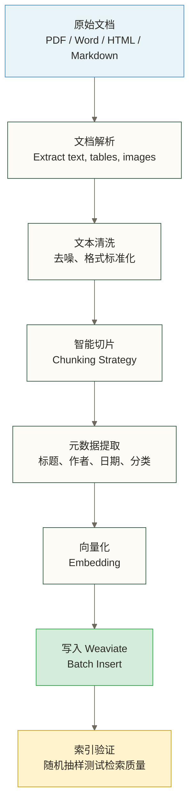
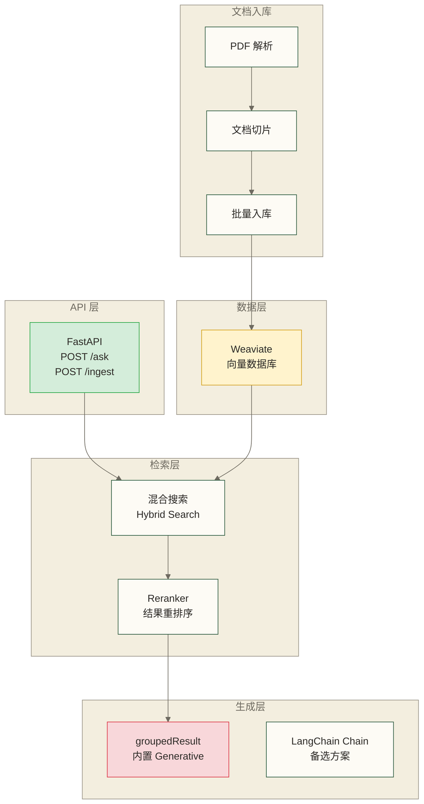

# Weaviate RAG 集成实战

> 大多数向量数据库做 RAG 是"存数据 → 检索 → 调 LLM"三步走，每一步都在你自己的代码里串联。Weaviate 的野心更大——它想让你用一条查询同时完成检索和生成。这体现了检索与生成编排位置的差异，可简化应用侧代码；是否降低端到端延迟，取决于部署位置、网络路径、模型响应时间和检索配置，需在同等条件下测量。

## 目录

- [[#一、RAG 基础与 Weaviate 的核心优势]]
- [[#二、内置 Generative 模块 RAG（重点）]]
- [[#三、LangChain 集成]]
- [[#四、LlamaIndex 集成]]
- [[#五、生产级 RAG 架构设计]]
- [[#六、完整项目实战：企业知识问答助手]]
- [[#七、与其他向量数据库的 RAG 对比]]
- [[#八、Weaviate 系列学习路径回顾]]

---

## 一、RAG 基础与 Weaviate 的核心优势

### 1.1 什么是 RAG

RAG（Retrieval-Augmented Generation，检索增强生成）是一种把**向量数据库的检索能力**和**LLM 的生成能力**结合起来的技术范式。它通过引入外部文档补充模型训练知识，并可在文档可靠、检索有效的条件下缓解幻觉问题，但不能保证消除幻觉。

标准 RAG 的三步流程：

```mermaid
%%{init: {"theme":"base","themeVariables":{"fontFamily":"PingFang SC, -apple-system, Source Han Serif SC, serif","fontSize":"16px","background":"#FDFBF5","primaryColor":"#FDFBF5","primaryTextColor":"#2D2A26","primaryBorderColor":"#6E6A60","secondaryColor":"#E8EFE8","secondaryBorderColor":"#8FA890","secondaryTextColor":"#2D2A26","tertiaryColor":"#FDFBF5","tertiaryBorderColor":"#9A9488","tertiaryTextColor":"#6E6A60","lineColor":"#6E6A60","textColor":"#2D2A26","mainBkg":"#FDFBF5","nodeBorder":"#2D5A3D","clusterBkg":"#F3EEDF","clusterBorder":"#9A9488","edgeLabelBackground":"#FDFBF5"},"flowchart":{"htmlLabels":true,"curve":"basis","padding":20,"nodeSpacing":60,"rankSpacing":70,"useMaxWidth":false},"themeCSS":".node rect, .node polygon, .node circle { stroke-width: 1.5px; } .edgePath .path { stroke-width: 1.5px; } .cluster-label .nodeLabel, .cluster-label foreignObject { color: #2D2A26 !important; } .edgeLabel, .edgeLabel foreignObject { color: #2D2A26 !important; background-color: #FDFBF5; } .edgeLabel rect { fill: #FDFBF5; }"}}%%
flowchart LR
    A[用户提问] --> B[检索 Retrieve\n在向量数据库中找相关文档]
    B --> C[增强 Augment\n把检索结果注入 Prompt]
    C --> D[生成 Generate\nLLM 基于上下文回答]

    style A fill:#e8f4f8,stroke:#4a90d9
    style B fill:#fff3cd,stroke:#d4a017
    style C fill:#d4edda,stroke:#28a745
    style D fill:#f8d7da,stroke:#dc3545
```



**为什么需要 RAG？**

纯 LLM 的局限：
- 知识截止于训练时间，不知道最新信息
- 对私有数据（公司内部文档、产品手册）完全无知
- 容易产生幻觉（编造听起来合理但错误的答案）

RAG 的价值：
- 把最新、最准确的文档注入 LLM 的上下文
- LLM 基于事实回答，大幅减少幻觉
- 可以追溯答案来源，具备可解释性

### 1.2 Weaviate 的内置 RAG 优势

大多数向量数据库的 RAG 实现需要三次独立的网络调用：

```text
应用代码 → Embedding API（生成查询向量）
应用代码 → 向量数据库（检索文档）
应用代码 → LLM API（生成答案）
```

Weaviate 的 Generative Search 把后两步合并了：

```text
应用代码 → Embedding API（生成查询向量）
应用代码 → Weaviate（检索 + 调用 LLM + 返回答案）
```

这带来了三个实质性好处：

| 优势 | 具体体现 |
|------|---------|
| **应用侧调用更少** | 将检索与生成编排移至 Weaviate 服务端；服务端仍需调用 LLM，端到端延迟需在同等条件下测量 |
| **更简单的代码** | 一次查询返回检索结果 + 生成内容，不需要手动拼装 Prompt |
| **统一 Pipeline** | 语义搜索和生成在同一个 Module 生命周期里，[[【技术与工具】/向量数据库/Weaviate/06-Modules模块系统详解]] 中的配置即生效 |

> [!note] 内置 RAG vs 外部框架 RAG
> 内置 RAG（Generative Search）和 LangChain/LlamaIndex 集成不是互斥的。内置方式胜在应用侧编排简洁，外部框架胜在灵活（支持 Agent、多步推理、复杂 Chain）；延迟差异取决于部署与调用路径。根据你的场景选择，或者混合使用。

---

## 二、内置 Generative 模块 RAG（重点）

### 2.1 前置配置

内置 RAG 依赖 [[【技术与工具】/向量数据库/Weaviate/06-Modules模块系统详解]] 中介绍的 Generative 模块。使用前需要：

**第一步：部署时启用模块**

在 Docker Compose 的环境变量中指定：

```yaml
# docker-compose.yml
version: '3.4'
services:
  weaviate:
    image: cr.weaviate.io/semitechnologies/weaviate:1.28.0
    environment:
      # 同时启用向量化和生成模块
      ENABLE_MODULES: "text2vec-openai,generative-openai"
      DEFAULT_VECTORIZER_MODULE: "text2vec-openai"
      OPENAI_APIKEY: "${OPENAI_API_KEY}"
    ports:
      - "8080:8080"
```

**第二步：Collection Schema 中声明 generativeConfig**

```python
import weaviate
import weaviate.classes.config as wvc
from weaviate.classes.config import Configure, Property, DataType

client = weaviate.connect_to_weaviate_cloud(
    cluster_url="your-cluster-url",
    auth_credentials=weaviate.auth.AuthApiKey("your-api-key"),
    headers={"X-OpenAI-Api-Key": "your-openai-key"},
)

client.collections.create(
    name="Article",
    # 向量化：自动把 text 字段转为向量
    vector_config=Configure.Vectors.text2vec_openai(
        model="text-embedding-3-small",
    ),
    # 生成：内置 RAG 的 LLM 配置
    generative_config=Configure.Generative.openai(
        model="gpt-4o-mini",
        temperature=0.2,    # RAG 场景建议低温，减少幻觉
        max_tokens=1024,
    ),
    properties=[
        Property(name="title", data_type=DataType.TEXT),
        Property(name="content", data_type=DataType.TEXT),
        Property(name="source", data_type=DataType.TEXT, skip_vectorization=True),
    ],
)
```

### 2.2 singleResult 模式：对每条文档独立生成

`single_prompt` 模式对每条检索结果**分别调用 LLM**，生成 N 个独立的回答。

**适用场景**：批量摘要生成、对每条文档做独立分析、内容标注。

```python
import weaviate
import weaviate.classes.config as wvc

client = weaviate.connect_to_weaviate_cloud(
    cluster_url="your-cluster-url",
    auth_credentials=weaviate.auth.AuthApiKey("your-api-key"),
    headers={"X-OpenAI-Api-Key": "your-openai-key"},
)

collection = client.collections.get("Article")

# single_prompt：对每条文档分别生成摘要
# Prompt 模板中用 {字段名} 引用文档字段
response = collection.generate.near_text(
    query="量子计算的应用",
    limit=3,
    single_prompt=(
        "请用中文为以下文章生成一段 50 字以内的摘要。\n"
        "标题：{title}\n"
        "内容：{content}"
    ),
)

# 每条检索结果都有独立的生成内容
for obj in response.objects:
    print(f"文章：{obj.properties['title']}")
    print(f"AI 摘要：{obj.generated}")  # 每条文档独立的生成结果
    print("---")

client.close()
```

> [!tip] single_prompt 的 Prompt 模板语法
> 用 `{字段名}` 引用 Collection 中定义的 property。如 `{title}`、`{content}`、`{source}` 等。字段名必须和 Schema 中的 property name 完全一致（区分大小写）。

### 2.3 groupedResult 模式：标准 RAG 问答

`grouped_task` 模式把**所有检索结果合并**成一个上下文，LLM 综合生成一个统一的回答。这才是典型的 RAG 场景。

**适用场景**：知识问答（Q&A）、综合摘要、基于文档库的智能助手。

```python
collection = client.collections.get("Article")

question = "量子计算在密码学领域有哪些应用？"

# grouped_task：把所有检索结果合并给 LLM，生成一个综合答案
response = collection.generate.hybrid(
    query=question,
    alpha=0.75,         # 0=纯关键词，1=纯向量，0.75 偏向语义
    limit=5,            # 检索 Top-5 作为上下文
    grouped_task=(
        f"你是一个专业的技术问答助手。请根据以下检索到的文档内容，回答用户问题。\n"
        f"要求：\n"
        f"1. 答案必须基于提供的文档，不要编造\n"
        f"2. 如文档中没有相关信息，明确说明'未找到相关内容'\n"
        f"3. 回答简洁，不超过 300 字\n\n"
        f"用户问题：{question}"
    ),
    grouped_properties=["title", "content"],  # 传给 LLM 的字段
    return_metadata=wvc.query.MetadataQuery(score=True),
)

# grouped_task 的生成内容在 response.generated 里（整个请求只有一个）
print(f"AI 回答：\n{response.generated}")
print(f"\n参考来源（共 {len(response.objects)} 条）：")
for i, obj in enumerate(response.objects, 1):
    score = obj.metadata.score if obj.metadata else "N/A"
    print(f"  {i}. {obj.properties['title']} (相关度: {score:.3f})")

client.close()
```

### 2.4 generative-ollama：完全本地化 RAG 方案

不想依赖 OpenAI API？用 `text2vec-transformers` + `generative-ollama` 实现无需外部推理 API 的本地 RAG；容器和模型准备完成后可离线运行，但仍有硬件、存储和运行成本。

**完整 docker-compose 配置：**

```yaml
# docker-compose-local-rag.yml
version: '3.4'
services:
  weaviate:
    image: cr.weaviate.io/semitechnologies/weaviate:1.28.0
    ports:
      - "8080:8080"
      - "50051:50051"
    environment:
      # 使用本地推理容器，不依赖任何外部 API
      ENABLE_MODULES: "text2vec-transformers,generative-ollama"
      DEFAULT_VECTORIZER_MODULE: "text2vec-transformers"
      TRANSFORMERS_INFERENCE_API: "http://t2v-transformers:8080"
      GENERATIVE_OLLAMA_APIENDPOINT: "http://ollama:11434"
      CLUSTER_HOSTNAME: "node1"
    volumes:
      - weaviate_data:/var/lib/weaviate
    depends_on:
      - t2v-transformers
      - ollama

  # 本地 Embedding 推理容器（Chinese-optimized BERT）
  t2v-transformers:
    image: cr.weaviate.io/semitechnologies/transformers-inference:sentence-transformers-paraphrase-multilingual-mpnet-base-v2
    environment:
      ENABLE_CUDA: "0"    # 有 GPU 改为 "1"
    # 如果用中文场景，推荐换成：
    # image: cr.weaviate.io/semitechnologies/transformers-inference:sentence-transformers-paraphrase-multilingual-MiniLM-L12-v2

  # 本地 LLM 服务（Ollama）
  ollama:
    image: ollama/ollama:latest
    ports:
      - "11434:11434"
    volumes:
      - ollama_data:/root/.ollama
    # 启动后需要手动拉取模型：
    # docker exec -it ollama ollama pull qwen2.5:7b

volumes:
  weaviate_data:
  ollama_data:
```

**启动并初始化：**

```bash
# 启动所有服务
docker compose -f docker-compose-local-rag.yml up -d

# 等待服务就绪后，拉取本地 LLM
# Qwen2.5-7B 中文效果好，约 4GB
docker exec -it <ollama-container-id> ollama pull qwen2.5:7b

# 或者 Llama3-8B（英文场景）
docker exec -it <ollama-container-id> ollama pull llama3:8b
```

**本地 RAG 的 Python 代码：**

```python
import weaviate
from weaviate.classes.config import Configure, Property, DataType

# 连接本地 Weaviate（无需任何 API Key）
client = weaviate.connect_to_local(
    host="localhost",
    port=8080,
)

# 创建使用本地模型的 Collection
client.collections.create(
    name="LocalKnowledgeBase",
    # text2vec-transformers 使用本地推理容器，零 API 成本
    vector_config=Configure.Vectors.text2vec_transformers(),
    # generative-ollama 使用本地 Qwen2.5
    generative_config=Configure.Generative.ollama(
        api_endpoint="http://ollama:11434",
        model="qwen2.5:7b",
    ),
    properties=[
        Property(name="title", data_type=DataType.TEXT),
        Property(name="content", data_type=DataType.TEXT),
        Property(name="source", data_type=DataType.TEXT, skip_vectorization=True),
    ],
)

# 入库和查询方式与云端版本完全相同
collection = client.collections.get("LocalKnowledgeBase")

response = collection.generate.near_text(
    query="数据仓库的分层设计",
    limit=3,
    grouped_task="请用中文综合以下文档内容，回答：数据仓库分层设计的核心原则是什么？",
    grouped_properties=["title", "content"],
)

print(response.generated)
client.close()
```

> [!tip] 本地 LLM 选型建议
> - **中文场景**：Qwen2.5-7B（效果好，7B 参数在 CPU 上可运行）
> - **英文场景**：Llama3-8B 或 Mistral-7B
> - **硬件要求**：7B 模型建议至少 16GB RAM；有 GPU（NVIDIA）效果提升明显
> - **更大模型**：Qwen2.5-14B 效果更好，需要 32GB RAM

---

## 三、LangChain 集成

LangChain 给了你更高的灵活性：自定义 Prompt、构建多步 Chain、接入 Agent 系统。

### 3.1 安装依赖

```bash
pip install langchain-weaviate langchain-openai langchain-community
pip install langchain pypdf
```

### 3.2 初始化 WeaviateVectorStore

```python
import weaviate
from langchain_weaviate import WeaviateVectorStore
from langchain_openai import OpenAIEmbeddings

# 连接 Weaviate
weaviate_client = weaviate.connect_to_weaviate_cloud(
    cluster_url="your-cluster-url",
    auth_credentials=weaviate.auth.AuthApiKey("your-weaviate-api-key"),
)

# 初始化 Embedding 模型
embeddings = OpenAIEmbeddings(
    model="text-embedding-3-small",
    openai_api_key="your-openai-api-key",
)

# 创建 WeaviateVectorStore（对接已有的 Collection）
vector_store = WeaviateVectorStore(
    client=weaviate_client,
    index_name="Article",        # Weaviate Collection 名称
    text_key="content",          # 存储文本的字段名
    embedding=embeddings,
    attributes=["title", "source"],  # 额外返回的元数据字段
)
```

### 3.3 从文档构建索引

```python
from langchain.text_splitter import RecursiveCharacterTextSplitter
from langchain_community.document_loaders import PyPDFLoader, DirectoryLoader

# 加载 PDF 文档
loader = DirectoryLoader(
    "./documents/",
    glob="**/*.pdf",
    loader_cls=PyPDFLoader,
)
raw_docs = loader.load()

# 文本切片：默认按字符长度计算，块大小为 512，相邻块重叠 64；不是 token 计数
splitter = RecursiveCharacterTextSplitter(
    chunk_size=512,
    chunk_overlap=64,
    separators=["\n\n", "\n", "。", "！", "？", ".", "!", "?", " ", ""],
)
docs = splitter.split_documents(raw_docs)

print(f"原始文档：{len(raw_docs)} 篇 → 切片后：{len(docs)} 个 chunk")

# 批量入库（自动调用 Embedding，自动写入 Weaviate）
vector_store.add_documents(docs)
print("入库完成")
```

### 3.4 构建完整 RAG Chain（LCEL 语法）

LangChain Expression Language（LCEL）是 LangChain 推荐的 Chain 构建方式，用管道符 `|` 串联各个组件。

```python
from langchain_openai import ChatOpenAI
from langchain.prompts import ChatPromptTemplate
from langchain_core.output_parsers import StrOutputParser
from langchain_core.runnables import RunnablePassthrough

# 1. 构建 Retriever：从 Weaviate 检索 Top-5 相关文档
retriever = vector_store.as_retriever(
    search_type="hybrid",           # 混合搜索（向量 + BM25）
    search_kwargs={
        "k": 5,                     # 返回 Top-5
        "alpha": 0.75,              # 向量权重（0=纯关键词，1=纯向量）
        "score_threshold": 0.5,     # 相关度阈值，过滤低质量结果
    },
)

# 2. 定义 Prompt 模板
prompt_template = ChatPromptTemplate.from_template(
    """你是一个专业的技术问答助手。请根据以下检索到的上下文回答问题。

上下文：
{context}

用户问题：{question}

要求：
- 答案必须基于提供的上下文，不要凭空编造
- 如果上下文中没有相关信息，明确回答"根据现有文档，未找到相关信息"
- 回答简洁清晰，不超过 400 字
- 如有多个文档提供了不同角度的信息，请综合说明"""
)

# 3. LLM 配置
llm = ChatOpenAI(
    model="gpt-4o-mini",
    temperature=0.2,
    openai_api_key="your-openai-api-key",
)

# 4. 构建辅助函数：格式化检索到的文档
def format_docs(docs):
    formatted = []
    for i, doc in enumerate(docs, 1):
        title = doc.metadata.get("title", f"文档 {i}")
        source = doc.metadata.get("source", "未知来源")
        formatted.append(f"[{i}] {title}\n来源：{source}\n{doc.page_content}")
    return "\n\n".join(formatted)

# 5. 用 LCEL 管道符组装完整 RAG Chain
rag_chain = (
    {
        "context": retriever | format_docs,   # 检索 → 格式化
        "question": RunnablePassthrough(),    # 问题直接透传
    }
    | prompt_template                          # 注入 Prompt 模板
    | llm                                      # 调用 LLM
    | StrOutputParser()                        # 解析输出为字符串
)

# 6. 调用 Chain
answer = rag_chain.invoke("数据仓库的 ODS 层和 DWD 层有什么区别？")
print(answer)
```

### 3.5 带来源引用的增强版 Chain

生产环境中，用户往往需要知道答案来自哪里。以下是返回引用来源的版本：

```python
from langchain_core.runnables import RunnableParallel

# 并行运行：同时保留检索文档和最终答案
rag_chain_with_sources = RunnableParallel(
    {
        "answer": rag_chain,
        "sources": retriever,    # 同时返回原始检索结果
    }
)

result = rag_chain_with_sources.invoke("Kafka 的分区策略有哪些？")

print(f"回答：\n{result['answer']}")
print(f"\n参考来源（{len(result['sources'])} 条）：")
for i, doc in enumerate(result["sources"], 1):
    title = doc.metadata.get("title", f"文档 {i}")
    source = doc.metadata.get("source", "")
    print(f"  {i}. {title} — {source}")
```

### 3.6 内置 Generative 模块 vs LangChain 对比

| 维度 | 内置 Generative 模块 | LangChain 集成 |
|------|---------------------|----------------|
| 代码量 | 少，10-20 行完成 RAG | 多，需要组装 Chain |
| 灵活性 | 中（固定 Pipeline） | 高（完全自定义）|
| 延迟 | 应用侧编排调用较少，端到端延迟需测量 | 调用路径可自定义，端到端延迟需测量 |
| 多步推理 | 不支持 | 支持（Agent）|
| LLM 选择 | 依赖 Weaviate Module 支持 | 任意 LLM |
| 本地 LLM | generative-ollama | 任意本地 LLM |
| 适合场景 | 简单 Q&A、快速原型 | 复杂工作流、Agent 系统 |

---

## 四、LlamaIndex 集成

LlamaIndex 在文档解析和索引构建方面比 LangChain 更专注，适合以文档为中心的 RAG 场景。

### 4.1 安装依赖

```bash
pip install llama-index llama-index-vector-stores-weaviate
pip install llama-index-embeddings-openai llama-index-llms-openai
```

### 4.2 构建 VectorStoreIndex

```python
import weaviate
from llama_index.core import VectorStoreIndex, SimpleDirectoryReader, Settings
from llama_index.vector_stores.weaviate import WeaviateVectorStore
from llama_index.embeddings.openai import OpenAIEmbedding
from llama_index.llms.openai import OpenAI

# 全局配置 LLM 和 Embedding
Settings.llm = OpenAI(model="gpt-4o-mini", temperature=0.2)
Settings.embed_model = OpenAIEmbedding(model="text-embedding-3-small")

# 连接 Weaviate
weaviate_client = weaviate.connect_to_weaviate_cloud(
    cluster_url="your-cluster-url",
    auth_credentials=weaviate.auth.AuthApiKey("your-api-key"),
)

# 创建 WeaviateVectorStore
vector_store = WeaviateVectorStore(
    weaviate_client=weaviate_client,
    index_name="LlamaIndexDocs",    # Weaviate Collection 名称
    text_key="content",
)

# 加载文档并构建索引（自动切片、向量化、入库）
documents = SimpleDirectoryReader("./documents/").load_data()
index = VectorStoreIndex.from_documents(
    documents,
    vector_store=vector_store,
    show_progress=True,
)

print(f"索引构建完成，共 {len(documents)} 篇文档")
```

### 4.3 作为 QueryEngine 进行问答

```python
# 从已有索引创建 QueryEngine（不重新入库）
index = VectorStoreIndex.from_vector_store(
    vector_store=vector_store,
)

query_engine = index.as_query_engine(
    similarity_top_k=5,         # 检索 Top-5
    streaming=False,
)

# 执行问答
response = query_engine.query("数据湖和数据仓库的核心区别是什么？")
print(f"回答：{response.response}")
print(f"\n参考节点数：{len(response.source_nodes)}")
for node in response.source_nodes:
    print(f"  - 相关度：{node.score:.3f} | {node.metadata.get('file_name', 'unknown')}")
```

### 4.4 多文档问答（SubQuestion 模式）

LlamaIndex 的 SubQuestionQueryEngine 可以把一个复杂问题分解为多个子问题，分别查询，再综合回答。

```python
from llama_index.core.query_engine import SubQuestionQueryEngine
from llama_index.core.tools import QueryEngineTool

# 创建工具
query_engine_tool = QueryEngineTool.from_defaults(
    query_engine=query_engine,
    name="knowledge_base",
    description="包含企业内部技术文档、产品手册和最佳实践的知识库",
)

# SubQuestion 引擎：自动分解问题，多路检索
sub_question_engine = SubQuestionQueryEngine.from_defaults(
    query_engine_tools=[query_engine_tool],
    verbose=True,    # 显示子问题分解过程
)

# 复杂问题：引擎会自动分解
response = sub_question_engine.query(
    "比较数据湖和数据仓库的适用场景，并说明什么情况下应该选择 Lakehouse 架构"
)
print(response.response)
```

---

## 五、生产级 RAG 架构设计

### 5.1 文档处理 Pipeline

文档处理质量是影响 RAG 效果的重要因素。“80%”只能作为说明其重要性的假设性比例，不是本文提供证据支持的测量结论；具体影响需结合语料、检索配置和评估集判断。



**切片策略选择：**

| 策略 | 切片方式 | 适用场景 | 推荐参数 |
|------|---------|---------|---------|
| 固定大小切片 | 按字符数/token 数 | 结构均匀的文档 | 512 tokens，64 重叠 |
| 按段落切片 | 按换行符/段落标记 | 结构化文档（文章、报告）| 保留语义完整性 |
| 语义切片 | 按语义相似度分组 | 复杂多主题文档 | 需要额外 Embedding 开销 |
| 父子切片 | 小切片搜索 + 大切片上下文 | 需要精准检索 + 完整上下文 | 搜索 256 tokens，上下文 1024 tokens |

> [!tip] 切片大小的黄金法则
> - 太小（< 256 tokens）：检索精准但上下文不够，LLM 无法充分理解
> - 太大（> 1024 tokens）：上下文丰富但向量模糊，检索召回率下降
> - 推荐区间：**512-1024 tokens**，根据文档类型调整
> - 中文场景：1 个汉字约等于 1.5 个 token，512 tokens ≈ 340 个汉字

**父子切片（Parent-Child Chunking）实现：**

```python
from langchain.text_splitter import RecursiveCharacterTextSplitter

def create_parent_child_chunks(text: str, source: str) -> tuple[list, list]:
    """
    父子切片策略：
    - 子切片（child）：按默认字符长度切分，chunk_size=256，用于语义检索
    - 父切片（parent）：按默认字符长度切分，chunk_size=1024，包含更多上下文，传给 LLM
    """
    # 子切片：小而精，用于检索
    child_splitter = RecursiveCharacterTextSplitter(
        chunk_size=256,
        chunk_overlap=32,
        separators=["\n\n", "\n", "。", ".", " "],
    )

    # 父切片：大而全，用于生成上下文
    parent_splitter = RecursiveCharacterTextSplitter(
        chunk_size=1024,
        chunk_overlap=128,
        separators=["\n\n", "\n", "。", ".", " "],
    )

    parent_chunks = parent_splitter.split_text(text)
    all_child_chunks = []

    for parent_idx, parent_chunk in enumerate(parent_chunks):
        child_chunks = child_splitter.split_text(parent_chunk)
        for child_idx, child_chunk in enumerate(child_chunks):
            all_child_chunks.append({
                "content": child_chunk,           # 存入 Weaviate，用于检索
                "parent_content": parent_chunk,   # 对应的父切片，传给 LLM
                "source": source,
                "parent_index": parent_idx,
                "child_index": child_idx,
            })

    return parent_chunks, all_child_chunks
```

### 5.2 检索策略进阶

RAG 的检索质量决定了生成质量的上限。三种递进的检索策略：

**基础语义搜索 → 混合搜索 → 带 Reranker 的混合搜索**

参考 08-查询与搜索详解 中的检索详解，生产环境建议使用**混合搜索 + Reranker** 的组合，在召回率和精准度之间取得最优平衡。

**HyDE（假设文档嵌入）技术：**

对于模糊或简短的查询，直接 Embedding 效果差。HyDE 让 LLM 先"假设"一篇相关文档，用这篇假设文档的向量去检索，效果通常更好。

```python
from langchain_openai import ChatOpenAI

def hyde_query(question: str, collection) -> list:
    """
    HyDE：先让 LLM 生成假设文档，再用假设文档向量检索
    适合：模糊问题、专业术语不明确的查询
    """
    llm = ChatOpenAI(model="gpt-4o-mini", temperature=0.7)

    # 第一步：让 LLM 生成一篇假设性回答文档
    hypothetical_doc = llm.predict(
        f"请写一段关于以下问题的技术说明（不需要完全准确，150字以内）：\n{question}"
    )

    # 第二步：用假设文档的向量去检索（near_text 会自动向量化）
    response = collection.query.near_text(
        query=hypothetical_doc,  # 用假设文档代替原始问题
        limit=5,
    )

    return response.objects
```

**多路召回（Multi-Query）：**

```python
def multi_query_retrieval(question: str, collection) -> list:
    """
    多路召回：同一问题生成多个查询角度，扩大召回范围
    """
    llm = ChatOpenAI(model="gpt-4o-mini")

    # 生成 3 个不同角度的查询
    query_prompt = f"""请从以下三个角度重新表达这个问题（每行一个，不要编号）：
    1. 更专业的技术角度
    2. 更简单的日常表达
    3. 相关但不同的侧面

    问题：{question}
    """
    queries_text = llm.predict(query_prompt)
    queries = [q.strip() for q in queries_text.strip().split("\n") if q.strip()]
    queries.append(question)  # 加上原始问题

    # 多路检索，合并去重
    all_results = {}
    for query in queries:
        response = collection.query.near_text(query=query, limit=3)
        for obj in response.objects:
            obj_id = str(obj.uuid)
            if obj_id not in all_results:
                all_results[obj_id] = obj

    return list(all_results.values())
```

### 5.3 RAG 效果评估：RAGAS 框架

评估 RAG 系统不能只看"感觉回答得不错"，需要量化指标。本文使用 RAGAS 作为 RAG 评估框架示例，不据此判断其市场地位。

**RAGAS 的四个核心指标：**

| 指标 | 含义 | 计算方式 |
|------|------|---------|
| **Context Recall** | 上下文召回率：检索结果覆盖了多少正确信息 | 需要参考答案 |
| **Context Precision** | 上下文精准率：检索结果中有多少是真正有用的 | 需要参考答案 |
| **Answer Relevancy** | 答案相关性：生成答案与问题的相关程度 | 不需要参考答案 |
| **Faithfulness** | 忠实度：生成答案是否基于检索到的上下文（不幻觉）| 不需要参考答案 |

```bash
pip install ragas
```

```python
from ragas import evaluate
from ragas.metrics import (
    context_recall,
    context_precision,
    answer_relevancy,
    faithfulness,
)
from datasets import Dataset

# 准备评估数据集
# 每条数据需要：question（问题）、answer（生成答案）、contexts（检索上下文）
# ground_truth（参考答案）用于 context_recall 和 context_precision
eval_data = {
    "question": ["数据仓库分层的目的是什么？"],
    "answer": ["数据仓库分层是为了..."],           # 你的 RAG 系统的回答
    "contexts": [["ODS 层是原始数据层...", "DWD 层是明细数据层..."]],  # 检索到的上下文
    "ground_truth": ["数据仓库分层是为了解耦业务逻辑..."],  # 标准答案
}

dataset = Dataset.from_dict(eval_data)

result = evaluate(
    dataset=dataset,
    metrics=[context_recall, context_precision, answer_relevancy, faithfulness],
)

print(result)
# 输出格式：{'context_recall': 0.85, 'context_precision': 0.72, ...}
```

**常见 RAG 失败模式及解决方案：**

| 失败模式 | 现象 | 解决方案 |
|---------|------|---------|
| 上下文不够（Low Context Recall）| 答案缺失关键信息 | 增加 Top-K、改用父子切片、调整混合搜索 alpha |
| 幻觉（Low Faithfulness）| 答案超出上下文范围 | 降低 LLM temperature、在 Prompt 中严格要求引用来源 |
| 答非所问（Low Answer Relevancy）| 回答跑题 | 改进 Prompt 模板、使用 HyDE 改善检索 |
| 上下文噪音（Low Context Precision）| 检索结果不相关 | 加入 Reranker、提高相关度阈值 |

---

## 六、完整项目实战：企业知识问答助手

把前面知识整合为企业知识问答原型的项目示例；当前代码仍存在维护说明所列缺陷，不应按原样视为完整可运行交付。

### 6.1 项目架构



### 6.2 项目结构

| 文件/目录 | 说明 |
|----------|------|
| `main.py` | FastAPI 主程序 |
| `ingest.py` | 文档入库 Pipeline |
| `retriever.py` | 检索模块 |
| `generator.py` | 生成模块 |
| `models.py` | Pydantic 数据模型 |
| `config.py` | 配置管理 |
| `documents/` | 待入库的文档目录 |
| `requirements.txt` | 依赖清单 |

### 6.3 配置管理（config.py）

```python
# config.py
import os
from dataclasses import dataclass

@dataclass
class Config:
    # Weaviate
    weaviate_url: str = os.getenv("WEAVIATE_URL", "http://localhost:8080")
    weaviate_api_key: str = os.getenv("WEAVIATE_API_KEY", "")
    collection_name: str = os.getenv("COLLECTION_NAME", "EnterpriseKB")

    # OpenAI
    openai_api_key: str = os.getenv("OPENAI_API_KEY", "")
    embedding_model: str = "text-embedding-3-small"
    llm_model: str = "gpt-4o-mini"
    llm_temperature: float = 0.2

    # 检索参数
    top_k: int = 5
    hybrid_alpha: float = 0.75      # 向量权重
    score_threshold: float = 0.5    # 最低相关度

    # 切片参数
    chunk_size: int = 512
    chunk_overlap: int = 64

config = Config()
```

### 6.4 文档入库 Pipeline（ingest.py）

```python
# ingest.py
import weaviate
from weaviate.classes.config import Configure, Property, DataType
from langchain_community.document_loaders import PyPDFLoader, DirectoryLoader
from langchain.text_splitter import RecursiveCharacterTextSplitter
from datetime import datetime, timezone
import hashlib
from config import config


def get_client() -> weaviate.WeaviateClient:
    """初始化 Weaviate 客户端"""
    if config.weaviate_api_key:
        return weaviate.connect_to_weaviate_cloud(
            cluster_url=config.weaviate_url,
            auth_credentials=weaviate.auth.AuthApiKey(config.weaviate_api_key),
            headers={"X-OpenAI-Api-Key": config.openai_api_key},
        )
    else:
        return weaviate.connect_to_local(host="localhost", port=8080)


def ensure_collection(client: weaviate.WeaviateClient) -> None:
    """确保 Collection 存在（不存在则创建）"""
    if client.collections.exists(config.collection_name):
        print(f"Collection '{config.collection_name}' 已存在，跳过创建")
        return

    client.collections.create(
        name=config.collection_name,
        description="企业内部知识库，用于 RAG 问答",
        vector_config=Configure.Vectors.text2vec_openai(
            model=config.embedding_model,
        ),
        generative_config=Configure.Generative.openai(
            model=config.llm_model,
            temperature=config.llm_temperature,
            max_tokens=1024,
        ),
        properties=[
            Property(name="title", data_type=DataType.TEXT),
            Property(name="content", data_type=DataType.TEXT),
            Property(
                name="source",
                data_type=DataType.TEXT,
                skip_vectorization=True,
            ),
            Property(
                name="doc_id",
                data_type=DataType.TEXT,
                skip_vectorization=True,
            ),
            Property(
                name="chunk_index",
                data_type=DataType.INT,
                skip_vectorization=True,
            ),
            Property(
                name="created_at",
                data_type=DataType.DATE,
                skip_vectorization=True,
            ),
        ],
    )
    print(f"Collection '{config.collection_name}' 创建成功")


def load_and_chunk_documents(doc_dir: str) -> list[dict]:
    """加载目录中的所有 PDF 并切片"""
    loader = DirectoryLoader(
        doc_dir,
        glob="**/*.pdf",
        loader_cls=PyPDFLoader,
        show_progress=True,
    )
    raw_docs = loader.load()
    print(f"加载 {len(raw_docs)} 页原始文档")

    splitter = RecursiveCharacterTextSplitter(
        chunk_size=config.chunk_size,
        chunk_overlap=config.chunk_overlap,
        separators=["\n\n", "\n", "。", "！", "？", ".", "!", "?", " ", ""],
    )
    chunks = splitter.split_documents(raw_docs)
    print(f"切片完成：共 {len(chunks)} 个 chunk")

    result = []
    for i, chunk in enumerate(chunks):
        source = chunk.metadata.get("source", "unknown")
        doc_id = hashlib.md5(source.encode()).hexdigest()[:8]
        result.append({
            "title": f"{source.split('/')[-1]} - 片段 {i+1}",
            "content": chunk.page_content,
            "source": source,
            "doc_id": doc_id,
            "chunk_index": i,
            "created_at": datetime.now(timezone.utc).isoformat(),
        })

    return result


def batch_ingest(doc_dir: str = "./documents") -> dict:
    """完整入库流程：加载 → 切片 → 写入 Weaviate"""
    client = get_client()

    try:
        ensure_collection(client)
        chunks = load_and_chunk_documents(doc_dir)

        collection = client.collections.get(config.collection_name)
        success_count = 0
        error_count = 0

        # 动态批处理：自动调节 batch size
        with collection.batch.dynamic() as batch:
            for chunk in chunks:
                try:
                    batch.add_object(properties=chunk)
                    success_count += 1
                except Exception as e:
                    error_count += 1
                    print(f"入库失败：{chunk['source']} - {e}")

        return {
            "total": len(chunks),
            "success": success_count,
            "errors": error_count,
        }
    finally:
        client.close()


if __name__ == "__main__":
    result = batch_ingest()
    print(f"\n入库完成：总计 {result['total']} 条，成功 {result['success']} 条，失败 {result['errors']} 条")
```

### 6.5 检索模块（retriever.py）

```python
# retriever.py
import weaviate
import weaviate.classes.config as wvc
from dataclasses import dataclass
from config import config


@dataclass
class RetrievedDoc:
    title: str
    content: str
    source: str
    score: float


def retrieve(
    client: weaviate.WeaviateClient,
    question: str,
    top_k: int = None,
    alpha: float = None,
) -> list[RetrievedDoc]:
    """
    混合搜索检索：向量搜索 + BM25 关键词搜索

    alpha 参数：
    - 0.0：纯 BM25 关键词搜索（精确匹配优先）
    - 1.0：纯向量搜索（语义相似优先）
    - 0.75：偏向语义，同时保留关键词匹配（推荐）
    """
    top_k = top_k or config.top_k
    alpha = config.hybrid_alpha if alpha is None else alpha

    collection = client.collections.get(config.collection_name)

    response = collection.query.hybrid(
        query=question,
        alpha=alpha,
        limit=top_k,
        return_metadata=wvc.query.MetadataQuery(score=True),
        return_properties=["title", "content", "source"],
    )

    results = []
    for obj in response.objects:
        score = obj.metadata.score if obj.metadata else 0.0
        # 过滤低相关度结果
        if score >= config.score_threshold:
            results.append(RetrievedDoc(
                title=obj.properties.get("title", ""),
                content=obj.properties.get("content", ""),
                source=obj.properties.get("source", ""),
                score=score,
            ))

    return results
```

### 6.6 生成模块（generator.py）

```python
# generator.py
import weaviate
import weaviate.classes.config as wvc
from dataclasses import dataclass
from retriever import RetrievedDoc
from config import config


@dataclass
class QAResult:
    answer: str
    sources: list[RetrievedDoc]
    question: str


def generate_answer_builtin(
    client: weaviate.WeaviateClient,
    question: str,
) -> QAResult:
    """
    使用 Weaviate 内置 Generative 模块回答问题（应用侧编排简单，延迟需结合部署条件测量）
    """
    collection = client.collections.get(config.collection_name)

    prompt = (
        f"你是一个企业知识问答助手。请根据以下检索到的文档内容，用中文回答问题。\n"
        f"要求：基于文档内容作答，不要编造信息；如果文档中没有相关内容，说明'文档中未找到相关信息'。\n\n"
        f"用户问题：{question}"
    )

    response = collection.generate.hybrid(
        query=question,
        alpha=config.hybrid_alpha,
        limit=config.top_k,
        grouped_task=prompt,
        grouped_properties=["title", "content"],
        return_metadata=wvc.query.MetadataQuery(score=True),
    )

    sources = []
    for obj in response.objects:
        score = obj.metadata.score if obj.metadata else 0.0
        sources.append(RetrievedDoc(
            title=obj.properties.get("title", ""),
            content=obj.properties.get("content", ""),
            source=obj.properties.get("source", ""),
            score=score,
        ))

    return QAResult(
        answer=response.generated or "未能生成回答",
        sources=sources,
        question=question,
    )
```

### 6.7 FastAPI 接口（main.py）

```python
# main.py
from fastapi import FastAPI, HTTPException, BackgroundTasks
from fastapi.middleware.cors import CORSMiddleware
from pydantic import BaseModel
from contextlib import asynccontextmanager
import weaviate
from generator import generate_answer_builtin, QAResult
from ingest import batch_ingest, get_client
from config import config

# ---- 数据模型 ----

class AskRequest(BaseModel):
    question: str
    top_k: int = 5

class SourceItem(BaseModel):
    title: str
    source: str
    score: float

class AskResponse(BaseModel):
    answer: str
    sources: list[SourceItem]
    question: str

class IngestRequest(BaseModel):
    doc_dir: str = "./documents"

class IngestResponse(BaseModel):
    total: int
    success: int
    errors: int
    message: str


# ---- 应用生命周期管理 ----

weaviate_client: weaviate.WeaviateClient = None

@asynccontextmanager
async def lifespan(app: FastAPI):
    # 启动：初始化 Weaviate 连接
    global weaviate_client
    weaviate_client = get_client()
    print("Weaviate 连接已建立")
    yield
    # 关闭：释放连接
    if weaviate_client:
        weaviate_client.close()
    print("Weaviate 连接已关闭")


# ---- FastAPI 应用 ----

app = FastAPI(
    title="企业知识问答助手",
    description="基于 Weaviate RAG 的企业内部知识问答 API",
    version="1.0.0",
    lifespan=lifespan,
)

app.add_middleware(
    CORSMiddleware,
    allow_origins=["*"],
    allow_methods=["*"],
    allow_headers=["*"],
)


# ---- 接口定义 ----

@app.post("/ask", response_model=AskResponse)
async def ask(request: AskRequest) -> AskResponse:
    """
    知识问答接口

    输入：用户问题
    输出：AI 生成的答案 + 参考来源列表
    """
    if not request.question.strip():
        raise HTTPException(status_code=400, detail="问题不能为空")

    if len(request.question) > 500:
        raise HTTPException(status_code=400, detail="问题过长，请控制在 500 字以内")

    try:
        result = generate_answer_builtin(
            client=weaviate_client,
            question=request.question,
        )

        return AskResponse(
            answer=result.answer,
            sources=[
                SourceItem(
                    title=src.title,
                    source=src.source,
                    score=round(src.score, 4),
                )
                for src in result.sources
            ],
            question=result.question,
        )
    except Exception as e:
        raise HTTPException(status_code=500, detail=f"问答服务出错：{str(e)}")


@app.post("/ingest", response_model=IngestResponse)
async def ingest_documents(
    request: IngestRequest,
    background_tasks: BackgroundTasks,
) -> IngestResponse:
    """
    文档入库接口

    输入：文档目录路径
    输出：入库统计（后台异步执行）
    """
    def run_ingest():
        result = batch_ingest(request.doc_dir)
        print(f"后台入库完成：{result}")

    background_tasks.add_task(run_ingest)

    return IngestResponse(
        total=0,
        success=0,
        errors=0,
        message=f"入库任务已启动，正在处理 {request.doc_dir} 目录下的文档",
    )


@app.get("/health")
async def health_check():
    """健康检查"""
    try:
        is_ready = weaviate_client.is_ready()
        return {"status": "ok", "weaviate_ready": is_ready}
    except Exception as e:
        raise HTTPException(status_code=503, detail=f"服务不可用：{str(e)}")


# ---- 启动命令 ----
# uvicorn main:app --host 0.0.0.0 --port 8000 --reload
```

### 6.8 生产注意事项

> [!warning] 并发控制：LLM API 有 QPS 限制
> 若将 GPT-4o-mini 的请求额度假设为 500 RPM，可据此设计限流示例；实际额度以所用账号和模型的当前配额为准，本文不将该数字作为统一的 Tier 1 限制。高并发场景需要：
> - 接入请求队列（推荐 Redis + Celery）
> - 设置 FastAPI 的并发限制（`asyncio.Semaphore`）
> - 监控 API 限流错误，自动退避重试

```python
# 并发限制示例：最多同时 10 个 LLM 请求
import asyncio

llm_semaphore = asyncio.Semaphore(10)

async def ask_with_rate_limit(question: str):
    async with llm_semaphore:
        return generate_answer_builtin(weaviate_client, question)
```

> [!tip] 缓存策略：相同问题不重复计算
> - **Embedding 缓存**：相同查询的向量不重复计算，用 Redis 缓存
> - **答案缓存**：相同问题（语义相似）的答案缓存，适合 FAQ 类场景
> - **简单实现**：用 `functools.lru_cache` 或 Redis 的 TTL 缓存

```python
import hashlib
import json
from functools import lru_cache

@lru_cache(maxsize=1000)  # 缓存最近 1000 个问题的答案
def cached_answer(question_hash: str, question: str) -> str:
    result = generate_answer_builtin(weaviate_client, question)
    return result.answer

def ask_with_cache(question: str) -> str:
    question_hash = hashlib.md5(question.encode()).hexdigest()
    return cached_answer(question_hash, question)
```

> [!note] 引用来源：增加答案可信度
> 在回答中附上原文引用是生产级 RAG 系统的标配。在 Prompt 中明确要求 LLM 标注引用：
>
> ```text
> 请在回答末尾用 [参考1]、[参考2] 的格式标注所用文档，然后列出参考文档的标题。
> ```

---

## 七、与其他向量数据库的 RAG 对比

| 维度 | Weaviate 内置 RAG | Milvus + LangChain | Qdrant + LangChain |
|-----|-----------------|-------------------|-------------------|
| **实现复杂度** | 低（内置，一次 API 调用）| 高（需组装 Chain）| 高（同 Milvus）|
| **代码量** | 约 20 行完成 RAG | 约 50-80 行 | 约 50-80 行 |
| **灵活性** | 中（固定 Pipeline）| 高（完全自定义）| 高 |
| **延迟** | 应用侧一次编排调用，端到端延迟需测量 | 取决于框架编排、部署与模型响应，需测量 | 取决于框架编排、部署与模型响应，需测量 |
| **本地化支持** | 好（generative-ollama）| 好（任意本地 LLM）| 好 |
| **多步推理** | 不支持 | 支持（Agent）| 支持 |
| **混合搜索** | 原生支持 | 需要额外配置 | 原生支持 |
| **适合场景** | 快速原型、标准 Q&A | 复杂工作流、Agent | 复杂工作流 |

**选型建议：**

- 需要**快速构建原型**：可考虑 Weaviate 内置 RAG；“一周内上线 MVP”可作为语料、环境和接口需求已准备就绪时的计划目标，不是交付保证
- 需要**Agent / 多步推理**：LangChain + 任意向量数据库
- 需要**极致定制 Prompt**：外部框架（LangChain / LlamaIndex）
- 需要**完全本地化**：Weaviate + generative-ollama（最简配置）或 Qdrant + Ollama

---

## 八、Weaviate 系列学习路径回顾

你完成了 Weaviate 系列全部 10 篇的学习。回顾一下走过的路径：

```mermaid
%%{init: {"theme":"base","themeVariables":{"fontFamily":"PingFang SC, -apple-system, Source Han Serif SC, serif","fontSize":"16px","background":"#FDFBF5","primaryColor":"#FDFBF5","primaryTextColor":"#2D2A26","primaryBorderColor":"#6E6A60","secondaryColor":"#E8EFE8","secondaryBorderColor":"#8FA890","secondaryTextColor":"#2D2A26","tertiaryColor":"#FDFBF5","tertiaryBorderColor":"#9A9488","tertiaryTextColor":"#6E6A60","lineColor":"#6E6A60","textColor":"#2D2A26","mainBkg":"#FDFBF5","nodeBorder":"#2D5A3D","clusterBkg":"#F3EEDF","clusterBorder":"#9A9488","edgeLabelBackground":"#FDFBF5"},"flowchart":{"htmlLabels":true,"curve":"basis","padding":20,"nodeSpacing":60,"rankSpacing":70,"useMaxWidth":false},"themeCSS":".node rect, .node polygon, .node circle { stroke-width: 1.5px; } .edgePath .path { stroke-width: 1.5px; } .cluster-label .nodeLabel, .cluster-label foreignObject { color: #2D2A26 !important; } .edgeLabel, .edgeLabel foreignObject { color: #2D2A26 !important; background-color: #FDFBF5; } .edgeLabel rect { fill: #FDFBF5; }"}}%%
flowchart LR
    subgraph "入门阶段"
        A1["01 概述与核心定位\nAI-Native 设计哲学"]
        A2["02 架构深度解析\nHNSW + 分片机制"]
        A3["03 核心概念详解\nClass / Property / Object"]
    end

    subgraph "动手阶段"
        B1["04 安装与部署\nWCS / Docker / K8s"]
        B2["05 第一个应用\n端到端跑通"]
        B3["06 Modules 系统\nVectorizer + Generative"]
        B4["07 Schema 设计\n数据建模最佳实践"]
    end

    subgraph "生产阶段"
        C1["08 查询与搜索\n混合搜索 + Reranker"]
        C2["09 生产运维\nRBAC + 监控 + 调优"]
    end

    subgraph "专家阶段"
        D1["10 RAG 集成实战\n本篇，系列终篇"]
    end

    A1 --> A2 --> A3 --> B1 --> B2 --> B3 --> B4 --> C1 --> C2 --> D1

    style D1 fill:#fce7f3,stroke:#db2777
```



**你在本系列中学到的核心能力：**

| 能力 | 对应篇章 |
|------|---------|
| 理解 AI-Native 设计哲学，正确选型 | 01、02 |
| 搭建完整 Weaviate 环境（云 / 本地）| 03、04 |
| 配置 Modules 实现自动向量化 | 06 |
| 设计高质量的 RAG Schema | 02、07 |
| 混合搜索 + Reranker 精准检索 | 08 |
| 生产环境调优和运维 | 09 |
| 构建 RAG 原型并识别生产化所需能力 | 10（本篇）|

### 下一步推荐

完成 Weaviate 系列后，根据你的方向选择下一步：

**方向一：扩展向量数据库视野**
- Milvus 学习路线图 — 了解云原生架构、超大规模向量存储
- Qdrant 学习路线图 — 深入量化压缩、Rust 实现的性能优势
- 向量数据库选型指南 — 综合选型决策框架

**方向二：深入 RAG 和 AI 应用工程**
- LangChain 进阶：Agent、Tool Calling、多步推理
- LlamaIndex 进阶：知识图谱、结构化数据问答
- RAG 评估体系：RAGAS 框架的深度使用，建立 RAG 质量基准

**方向三：生产化和 MLOps**
- 向量数据库的监控方案（Prometheus + Grafana）
- RAG 系统的 A/B 测试方法论
- 大规模 RAG 的成本优化策略

> [!quote] 系列结语
> Weaviate 的独特性在于它试图回答一个问题：如果数据库本身能理解数据的语义，世界会变成什么样？从 Modules 系统的自动向量化，到 Generative Search 的内置 RAG，Weaviate 始终在把 AI 能力往数据库这一层推。这是一个值得关注的方向——不是因为它一定是最终答案，而是因为它在探索一条真正不同的路。
>
> 学完这个系列，你可以尝试从零构建 RAG 原型，并通过真实项目检验所学；生产级交付仍需结合访问控制、并发与限流、评估、监控和故障处理等要求验证。接下来，去构建真实的东西吧。

---

#Weaviate #RAG #向量数据库 #LangChain #LlamaIndex #生成式AI #AI工程 #生产实践
