# pgvector 架构深度解析

> [!quote] 写在前面
> pgvector 不是一个独立的系统。它是一个**寄生**在 PostgreSQL 身上的扩展——这个"寄生"不是贬义，而是一种聪明的设计哲学：**不重复造轮子，借用宿主二十年积累的能力**。要真正理解 pgvector 的架构，必须先理解 PostgreSQL 的扩展机制；要理解 pgvector 的局限，必须明白它"寄生"这一本质决定了哪些事它天生做不到。

## 目录

- [[#一、设计哲学：为什么选择"寄生"而不是独立？]]
- [[#二、PostgreSQL 扩展机制：pgvector 的生存基础]]
- [[#三、pgvector 的存储结构：向量是怎么存进堆表的]]
- [[#四、索引架构：IVFFlat 和 HNSW 如何作为 Access Method 实现]]
- [[#五、查询执行路径：一条 SQL 从入口到结果的完整旅程]]
- [[#六、与事务系统的集成：向量写入如何参与 MVCC]]
- [[#七、WAL 与复制：数据持久性的保障机制]]
- #八、内存管理：work_mem 与向量查询的微妙关系
- [[#九、pgvector 的局限性根源：单机架构的天花板]]
- [[#十、与 Milvus 的本质差异：选型决策的底层逻辑]]
- [[#十一、架构总结：设计决策一览]]

---

## 一、设计哲学：为什么选择"寄生"而不是独立？

### 1.1 两条路的选择

2021 年，当向量数据库这个赛道开始热闹起来，工程师们面前有两条路：

**路一（独立系统）**：从头构建一个专门为向量搜索优化的系统，自己管理存储、自己实现分布式、自己设计查询引擎。Milvus、Weaviate、Qdrant 走的都是这条路。

**路二（扩展现有系统）**：找一个已经被大量生产环境验证过的数据库，把向量能力"插进去"。pgvector 走的是这条路。

两条路没有绝对的优劣，但选择背后的哲学值得细品：

> **pgvector 的赌注是**：大多数应用不需要专用向量数据库级别的规模，但所有应用都需要数据库级别的可靠性——事务、备份、权限、SQL 生态。与其为向量搜索单独维护一套基础设施，不如把向量能力加到你已有的 PostgreSQL 里。

这个判断在实际工程中得到了大量验证。很多 RAG 应用的向量数据不超过几百万条，根本用不上分布式向量数据库，但需要向量检索结果和业务数据（用户表、订单表）做 JOIN——而 pgvector 天然支持这种操作，Milvus 不行。

### 1.2 "寄生"带来了什么

通过扩展机制挂载在 PostgreSQL 上，pgvector 直接获得了：

| 能力 | 具体收益 |
|------|----------|
| 事务支持 | 向量写入参与 MVCC，天然支持原子操作 |
| WAL 机制 | 向量数据自动纳入 Write-Ahead Log，支持 point-in-time recovery |
| 流复制 | pgvector 的索引和数据随 PG 主从复制一起同步 |
| 权限体系 | 直接复用 PostgreSQL 的 RBAC，无需单独管理 |
| SQL 生态 | 所有 ORM、BI 工具、数据管道天然兼容 |
| 备份工具 | `pg_dump`、`pgbackup`、云数据库快照全部适用 |
| 监控生态 | pg_stat、Prometheus exporter、各种 APM 直接使用 |

> [!tip] 工程师视角
> 一个实际的工程问题：你的 RAG 应用上线了，向量数据库里的数据需要备份。如果用 Milvus，你要额外学习 Milvus 的备份方案，配置 MinIO/S3 的备份策略，维护备份恢复流程。如果用 pgvector，你的运维团队已经熟悉 PostgreSQL，直接用 `pg_dump` 就能搞定，学习成本为零。

---

## 二、PostgreSQL 扩展机制：pgvector 的生存基础

要理解 pgvector 怎么工作，必须先理解 PostgreSQL 是怎么让扩展工作的。

### 2.1 PostgreSQL 的可扩展性设计

PostgreSQL 从设计之初就是一个"可编程数据库"。它提供了一套完整的扩展接口，允许第三方代码注册新的数据类型、操作符、函数、索引方法、统计方法，甚至修改查询规划器的行为。

**类比：手机操作系统和 App**

把 PostgreSQL 比作 iOS 系统，pgvector 就是一个安装在 iOS 上的 App。iOS 提供了相机、GPS、推送通知等系统能力，App 通过 API 调用这些能力，而不是自己从头实现一套相机驱动。pgvector 借用的"系统能力"包括：存储引擎、事务管理器、查询规划器、缓冲区管理器。

### 2.2 扩展的注册机制

当你执行 `CREATE EXTENSION vector` 时，PostgreSQL 做了什么？

```sql
CREATE EXTENSION vector;
```

这条 SQL 触发了以下操作链：

```javascript
1. PostgreSQL 在 extension 目录查找 vector.control 文件
   → 获取版本信息、依赖关系、默认 schema

2. 执行 SQL 安装脚本（vector--0.8.0.sql）
   → 在系统目录（pg_catalog）注册：
     - 新数据类型: vector、halfvec、sparsevec
     - 新操作符: <->、<#>、<=>、<+>
     - 新函数: vector_dims()、vector_norm()、l2_distance() 等
     - 新索引方法: ivfflat、hnsw（注册到 pg_am 系统表）

3. 加载共享库（vector.so）
   → 动态链接到 PostgreSQL 进程地址空间
   → C 语言实现的函数指针注册到系统表
```

执行完毕后，`pg_extension`、`pg_type`、`pg_operator`、`pg_am` 等系统表里都有了 pgvector 的条目，PostgreSQL 就像天然支持向量类型一样工作。

### 2.3 自定义数据类型：varlena 结构

PostgreSQL 的类型系统是开放的，任何扩展都可以注册新的基础类型（base type）。pgvector 注册的 `vector` 类型使用 PostgreSQL 的**可变长类型（varlena）**机制。

varlena 是 PostgreSQL 中所有可变长数据（text、bytea、jsonb 等）的通用存储格式：

| 字段 | 大小 | 说明 |
|------|------|------|
| 头部（varlena header） | 4 字节 | 存储长度信息 |
| 实际数据 | 变长 | 具体内容 |

对于 `vector(1536)` 类型，内存中的实际布局是：

| 字段 | 大小 | 说明 |
|------|------|------|
| varlena header | 4 bytes | 长度信息 |
| dimensions（int16） | 2 bytes | 向量维度数，值为 1536 |
| 保留字段 | 2 bytes | 结构中的保留字段 |
| float32 值数组 | N × 4 bytes | 每个维度值占 4 字节 |

> vector 结构还包含 2 字节保留字段；总大小 = 4 + 2 + 2 + N × 4 bytes。以 1536 维为例：8 + 1536 × 4 = 6152 bytes ≈ 6 KB，不含堆元组、对齐及其他字段开销。

> [!note] 为什么要记住这个大小？
> 一个 1536 维向量约占 6KB。如果你存了 100 万条，仅向量数据本身就是 6GB。加上索引（HNSW 通常是数据的 1.5-2x），你的数据库至少需要 15-20GB 内存才能保持良好的查询性能。规划容量时这是关键参数。

### 2.4 自定义操作符：距离函数注册

pgvector 向 PostgreSQL 注册了四个距离操作符，这些操作符有对应的 C 语言实现函数：

```sql
-- 操作符与底层函数的对应关系
<->  →  vector_l2_distance()    -- L2 欧氏距离
<#>  →  vector_negative_ip()    -- 内积（负值）
<=>  →  vector_cosine_distance() -- 余弦距离
<+>  →  vector_l1_distance()    -- L1 曼哈顿距离
```

这些操作符注册到 `pg_operator` 系统表后，PostgreSQL 的查询规划器在看到这些操作符时，就知道调用对应的 C 函数来计算距离，并且知道这些操作符可以配合相应的索引（ivfflat 或 hnsw）来加速查询。

---

## 三、pgvector 的存储结构：向量是怎么存进堆表的

### 3.1 PostgreSQL 堆存储回顾

PostgreSQL 把表数据存储在**堆文件（heap file）**中，每个文件由固定大小（默认 8KB）的**页（page）**组成，每个页存储多个**元组（tuple）**。

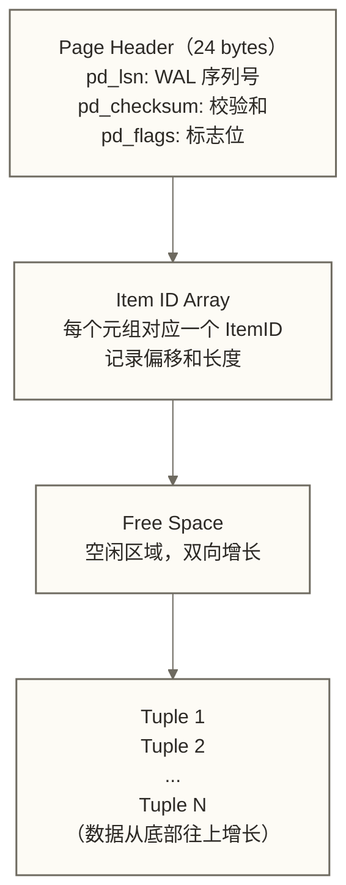

### 3.2 向量元组的存储布局

当你向一个含向量字段的表插入数据时：

```sql
CREATE TABLE documents (
    id      bigserial PRIMARY KEY,
    content text,
    embedding vector(1536)
);

INSERT INTO documents (content, embedding) VALUES ('...', '[0.1, 0.2, ...]');
```

在堆页中，这一行数据的元组结构如下：

| 区域 | 大小 | 说明 |
|------|------|------|
| Tuple Header | 23 bytes | t_xmin（插入事务 ID，用于 MVCC 可见性判断）<br>t_xmax（删除事务 ID，0 表示未被删除）<br>t_ctid（当前版本物理位置 page, offset） |
| NULL Bitmap | 可选 | 字段为 NULL 时使用 |
| id | 8 bytes | bigint 主键 |
| content | 变长 | text 类型，inline 存储或 Toast 指针 |
| embedding | 6152 bytes（1536 维，包含 2 字节保留字段） | varlena header（4 bytes）+ dimensions（2 bytes，值 1536）+ 保留字段（2 bytes）+ float32 values（6144 bytes = 1536 × 4） |

### 3.3 TOAST 机制：超大向量的处理

约 6KB 的向量本身可以放入默认 8KB 页面，但整行能否行内存储还取决于其他字段、元组开销与存储策略；TOAST 处理阈值不等于页面容量。PostgreSQL 有一套 TOAST（The Oversized-Attribute Storage Technique）机制来处理大字段：

当一条元组超过页面大小的约四分之一（约 2KB）时，PostgreSQL 会把大字段：
- **PLAIN**：不压缩、不移出行外
- **EXTENDED**：允许压缩与行外存储
- **EXTERNAL**：允许行外存储，不压缩
- **MAIN**：允许压缩，优先行内存储，必要时仍可移出行外

vector 类型默认采用 **EXTERNAL** 存储策略，允许 TOAST 行外存储但不压缩；是否移出行外取决于整行大小及实际列存储设置。

> [!warning] 实践注意
> 如果你的向量维度很高（比如 3072 维），单个向量占 12KB 多，必然触发 TOAST。每次访问向量都需要额外的 TOAST 表读取，会影响查询性能。这也是为什么 pgvector 支持 `halfvec`（半精度）——用 2 字节代替 4 字节，3072 维向量从约 12KB 降到约 6KB，减小了存储体积；能否行内存储、是否避免 TOAST 开销，仍取决于整行大小及列存储策略。

### 3.4 向量的序列化与反序列化

pgvector 为 `vector` 类型实现了 PostgreSQL 要求的几个关键函数：

```c
// 文本格式：从 '[0.1, 0.2, 0.3]' 解析为内存中的向量结构
Datum vector_in(PG_FUNCTION_ARGS);

// 文本格式：将内存中的向量结构序列化为 '[0.1, 0.2, 0.3]'
Datum vector_out(PG_FUNCTION_ARGS);

// 二进制格式：网络传输时使用（更高效）
Datum vector_recv(PG_FUNCTION_ARGS);
Datum vector_send(PG_FUNCTION_ARGS);
```

这些函数通过 PostgreSQL 的 Function Manager 调用，让 PG 能够处理 `vector` 类型的 I/O，就像处理 `int` 或 `text` 一样自然。

---

## 四、索引架构：IVFFlat 和 HNSW 如何作为 Access Method 实现

### 4.1 PostgreSQL 的 Index Access Method 接口

PostgreSQL 把索引访问方法（Index Access Method，AM）设计成可插拔接口。任何扩展都可以实现这个接口，注册自己的索引类型。这个接口定义了一组函数指针，PostgreSQL 通过这些函数指针与索引交互。

核心接口包括：

```c
// IndexAmRoutine 结构（简化版）
typedef struct IndexAmRoutine {
    // 索引构建
    ambuild_function         ambuild;      // 构建新索引
    ambuildempty_function    ambuildempty; // 创建空索引

    // 索引维护
    aminsert_function        aminsert;     // 插入一条数据
    ambulkdelete_function    ambulkdelete; // 批量删除
    amvacuumcleanup_function amvacuumcleanup; // VACUUM 清理

    // 索引扫描
    ambeginscan_function     ambeginscan;  // 开始扫描
    amgettuple_function      amgettuple;   // 获取下一个元组
    amendscan_function       amendscan;    // 结束扫描

    // 其他接口...
} IndexAmRoutine;
```

pgvector 分别为 IVFFlat 和 HNSW 实现了这套接口，注册为 `ivfflat` 和 `hnsw` 两种索引方法，存储在 `pg_am` 系统表中。

### 4.2 IVFFlat 索引的存储结构

IVFFlat（Inverted File with Flat compression）的核心思路是**先聚类，再建倒排索引**。

**类比：图书馆分区**

想象一个有 100 万本书的大图书馆。IVFFlat 的做法是：
1. 先按主题把书分成 1000 个区域（聚类），每个区域有一个"区域中心书目"（质心）
2. 每本书归入最近的区域，贴上区域标签
3. 查找时，先算出查询向量离哪几个区域中心最近，只翻那几个区域的书，而不是翻遍整个图书馆

**物理存储结构：**

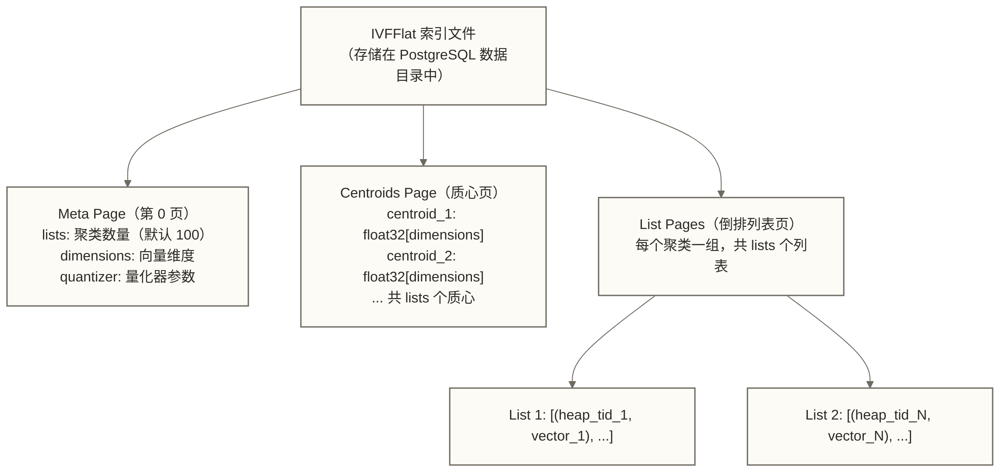

**索引构建过程：**

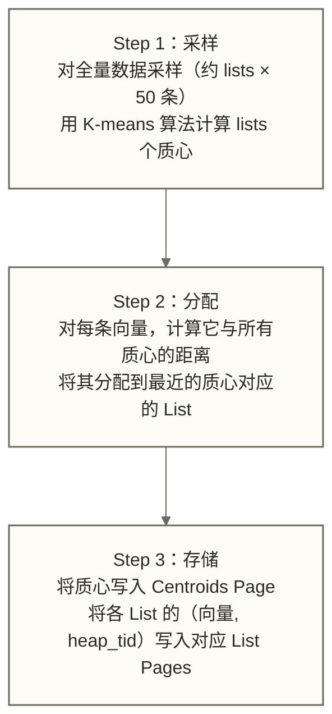

> [!warning] 关键限制
> IVFFlat 必须**先有数据，再建索引**。如果建完索引后继续写入新数据，新数据会被分配到最近的 List 中，但质心不会更新。随着数据分布变化，原来的聚类可能越来越不准确，查询召回率会下降。这就是为什么文档建议：数据量基本稳定后再建 IVFFlat 索引，或者定期重建。

### 4.3 HNSW 索引的存储结构

HNSW（Hierarchical Navigable Small World）是目前 pgvector 性能最好的索引。理解它的存储结构，需要先理解它的数据结构。

**HNSW 的数据结构：分层图**

```mermaid
%%{init: {"theme":"base","themeVariables":{"fontFamily":"PingFang SC, -apple-system, Source Han Serif SC, serif","fontSize":"16px","background":"#FDFBF5","primaryColor":"#FDFBF5","primaryTextColor":"#2D2A26","primaryBorderColor":"#6E6A60","secondaryColor":"#E8EFE8","secondaryBorderColor":"#8FA890","secondaryTextColor":"#2D2A26","tertiaryColor":"#FDFBF5","tertiaryBorderColor":"#9A9488","tertiaryTextColor":"#6E6A60","lineColor":"#6E6A60","textColor":"#2D2A26","mainBkg":"#FDFBF5","nodeBorder":"#2D5A3D","clusterBkg":"#F3EEDF","clusterBorder":"#9A9488","edgeLabelBackground":"#FDFBF5"},"flowchart":{"htmlLabels":true,"curve":"basis","padding":20,"nodeSpacing":60,"rankSpacing":70,"useMaxWidth":false},"themeCSS":".node rect, .node polygon, .node circle { stroke-width: 1.5px; } .edgePath .path { stroke-width: 1.5px; } .cluster-label .nodeLabel, .cluster-label foreignObject { color: #2D2A26 !important; } .edgeLabel, .edgeLabel foreignObject { color: #2D2A26 !important; background-color: #FDFBF5; } .edgeLabel rect { fill: #FDFBF5; }"}}%%
graph TD
    classDef default fill:#FDFBF5,stroke:#6E6A60,color:#2D2A26,stroke-width:1.5px
    classDef startend fill:#2D2A26,stroke:#2D2A26,color:#FDFBF5,font-weight:bold
    classDef decision fill:#F6EAD8,stroke:#C08A1A,color:#2D2A26,font-weight:bold
    classDef hub fill:#3B5A80,stroke:#3B5A80,color:#FDFBF5,font-weight:bold
    classDef io fill:#E5EAF0,stroke:#3B5A80,color:#2D2A26
    classDef accent fill:#A6432C,stroke:#A6432C,color:#FDFBF5,font-weight:bold
    classDef storage fill:#F3EEDF,stroke:#9A9488,color:#2D2A26
    subgraph "Layer 2（最稀疏，远程高速公路）"
        L2A["A"] --- L2F["F"]
    end
    subgraph "Layer 1（中等密度）"
        L1A["A"] --- L1C["C"] --- L1F["F"]
        L1A --- L1B["B"]
        L1C --- L1D["D"] --- L1E["E"]
    end
    subgraph "Layer 0（最密集，所有节点，小路）"
        L0A["A"] --- L0B["B"] --- L0C["C"] --- L0D["D"] --- L0E["E"] --- L0F["F"] --- L0G["G"] --- L0H["H ..."]
    end
    class L2A,L2F,L1A,L1C,L1F,L1B,L1D,L1E,L0A,L0B,L0C,L0D,L0E,L0F,L0G,L0H default
```

每个节点（向量）在每一层都有若干个邻居连接。层数越高，节点越稀疏，连接的"跨度"越大。搜索时从顶层入口进入，先沿着高速公路快速靠近目标区域，再逐层下降到底层，搜索近似最近邻；召回率取决于图结构、搜索参数与数据分布，并不保证得到精确最近邻。

**物理存储结构：**

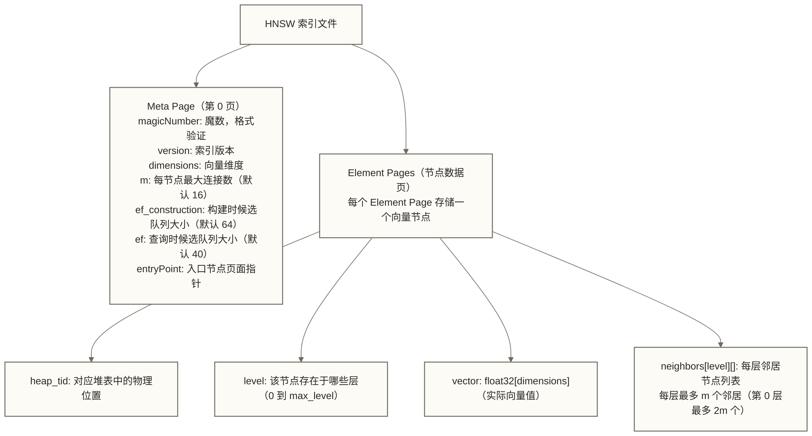

**索引构建过程（逐节点插入）：**

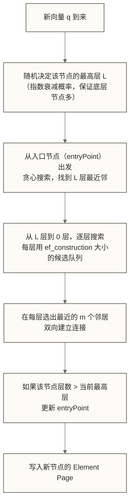

> [!tip] HNSW 与 IVFFlat 的维护差异
> IVFFlat 构建时通过聚类确定质心，后续插入会加入已有列表，但不会自动重新训练质心；数据分布显著变化时可评估重建。HNSW 支持增量插入并更新图连接，但这不保证精确最近邻或召回率始终不变。频繁更新时，可结合召回目标、维护成本和实际测试评估两类索引。

### 4.4 索引文件与堆文件的关系

```mermaid
%%{init: {"theme":"base","themeVariables":{"fontFamily":"PingFang SC, -apple-system, Source Han Serif SC, serif","fontSize":"16px","background":"#FDFBF5","primaryColor":"#FDFBF5","primaryTextColor":"#2D2A26","primaryBorderColor":"#6E6A60","secondaryColor":"#E8EFE8","secondaryBorderColor":"#8FA890","secondaryTextColor":"#2D2A26","tertiaryColor":"#FDFBF5","tertiaryBorderColor":"#9A9488","tertiaryTextColor":"#6E6A60","lineColor":"#6E6A60","textColor":"#2D2A26","mainBkg":"#FDFBF5","nodeBorder":"#2D5A3D","clusterBkg":"#F3EEDF","clusterBorder":"#9A9488","edgeLabelBackground":"#FDFBF5"},"flowchart":{"htmlLabels":true,"curve":"basis","padding":20,"nodeSpacing":60,"rankSpacing":70,"useMaxWidth":false},"themeCSS":".node rect, .node polygon, .node circle { stroke-width: 1.5px; } .edgePath .path { stroke-width: 1.5px; } .cluster-label .nodeLabel, .cluster-label foreignObject { color: #2D2A26 !important; } .edgeLabel, .edgeLabel foreignObject { color: #2D2A26 !important; background-color: #FDFBF5; } .edgeLabel rect { fill: #FDFBF5; }"}}%%
graph LR
    classDef default fill:#FDFBF5,stroke:#6E6A60,color:#2D2A26,stroke-width:1.5px
    classDef startend fill:#2D2A26,stroke:#2D2A26,color:#FDFBF5,font-weight:bold
    classDef decision fill:#F6EAD8,stroke:#C08A1A,color:#2D2A26,font-weight:bold
    classDef hub fill:#3B5A80,stroke:#3B5A80,color:#FDFBF5,font-weight:bold
    classDef io fill:#E5EAF0,stroke:#3B5A80,color:#2D2A26
    classDef accent fill:#A6432C,stroke:#A6432C,color:#FDFBF5,font-weight:bold
    classDef storage fill:#F3EEDF,stroke:#9A9488,color:#2D2A26
    subgraph "查询执行层"
        SQL["SELECT ... ORDER BY<br/>embedding <-> '[...]'<br/>LIMIT 10"]
    end

    subgraph "索引层（Index File）"
        HNSW["HNSW 索引<br/>存储图结构<br/>和向量值"]
    end

    subgraph "堆表层（Heap File）"
        HEAP["documents 表<br/>存储完整行数据<br/>id, content, embedding"]
    end

    SQL -->|"1、索引扫描<br/>找到 top-K 的 heap_tid"| HNSW
    HNSW -->|"2、通过 heap_tid<br/>回表取完整行"| HEAP
    class SQL,HNSW,HEAP default
```

pgvector 的 HNSW 索引在索引页中**同时存储了向量值和堆表指针（heap_tid）**。这与 B-tree 索引的设计类似——索引本身包含足够信息来完成 ANN 搜索，最后只需要用 heap_tid 回表获取其他字段。

---

## 五、查询执行路径：一条 SQL 从入口到结果的完整旅程

### 5.1 示例 SQL

```sql
SELECT id, content, embedding <-> '[0.1, 0.2, ...]'::vector AS distance
FROM documents
WHERE category = 'tech'
ORDER BY embedding <-> '[0.1, 0.2, ...]'::vector
LIMIT 10;
```

### 5.2 完整执行路径

```mermaid
%%{init: {"theme":"base","themeVariables":{"fontFamily":"PingFang SC, -apple-system, Source Han Serif SC, serif","fontSize":"16px","background":"#FDFBF5","primaryColor":"#FDFBF5","primaryTextColor":"#2D2A26","primaryBorderColor":"#6E6A60","secondaryColor":"#E8EFE8","secondaryBorderColor":"#8FA890","secondaryTextColor":"#2D2A26","tertiaryColor":"#FDFBF5","tertiaryBorderColor":"#9A9488","tertiaryTextColor":"#6E6A60","lineColor":"#6E6A60","textColor":"#2D2A26","mainBkg":"#FDFBF5","nodeBorder":"#2D5A3D","clusterBkg":"#F3EEDF","clusterBorder":"#9A9488","edgeLabelBackground":"#FDFBF5"},"flowchart":{"htmlLabels":true,"curve":"basis","padding":20,"nodeSpacing":60,"rankSpacing":70,"useMaxWidth":false},"themeCSS":".node rect, .node polygon, .node circle { stroke-width: 1.5px; } .edgePath .path { stroke-width: 1.5px; } .cluster-label .nodeLabel, .cluster-label foreignObject { color: #2D2A26 !important; } .edgeLabel, .edgeLabel foreignObject { color: #2D2A26 !important; background-color: #FDFBF5; } .edgeLabel rect { fill: #FDFBF5; }"}}%%
flowchart TD
    classDef default fill:#FDFBF5,stroke:#6E6A60,color:#2D2A26,stroke-width:1.5px
    classDef startend fill:#2D2A26,stroke:#2D2A26,color:#FDFBF5,font-weight:bold
    classDef decision fill:#F6EAD8,stroke:#C08A1A,color:#2D2A26,font-weight:bold
    classDef hub fill:#3B5A80,stroke:#3B5A80,color:#FDFBF5,font-weight:bold
    classDef io fill:#E5EAF0,stroke:#3B5A80,color:#2D2A26
    classDef accent fill:#A6432C,stroke:#A6432C,color:#FDFBF5,font-weight:bold
    classDef storage fill:#F3EEDF,stroke:#9A9488,color:#2D2A26
    A["SQL 文本到达 PostgreSQL"] --> B["词法解析 / 语法解析<br/>Parser：构建 AST"]
    B --> C["语义分析<br/>Analyzer：解析表名、列名、类型<br/>识别 <-> 为向量距离操作符"]
    C --> D["查询重写<br/>Rewriter：视图展开等"]
    D --> E["查询规划<br/>Planner / Optimizer"]

    E --> F{"存在适用索引，且规划器<br/>选择向量索引扫描？"}
    F -->|"是"| G["生成 Index Scan 计划<br/>使用向量索引搜索候选"]
    F -->|"否：以顺序扫描为例"| H["生成 Seq Scan 计划<br/>扫描可见行、应用过滤并计算距离"]

    G --> I["查询执行器<br/>Executor：索引扫描分支"]
    H --> P

    I --> J["IndexScan 节点执行"]
    J --> K["调用 hnsw_beginscan()<br/>初始化扫描状态"]
    K --> L["调用 hnsw_gettuple()<br/>从 HNSW 图中搜索 top-K"]

    L --> M["HNSW 搜索流程<br/>1、从 entryPoint 进入<br/>2、逐层贪心搜索<br/>3、底层用优先队列维护候选集<br/>4、返回 ef 个候选的 heap_tid"]

    M --> O["通过 heap_tid 回表<br/>读取元组并检查 MVCC 可见性"]
    O --> N["Filter：对可见行过滤 category = 'tech'<br/>候选不足时是否继续搜索取决于扫描配置和上限"]
    N --> P["按计划提供距离顺序<br/>必要时排序，并应用 LIMIT 10"]
    P --> Q["返回结果集"]
    class F decision
    class A,B,C,D,E,G,H,I,J,K,L,M,N,O,P,Q default
```

### 5.3 规划器如何选择索引

PostgreSQL 的查询规划器（Planner）使用基于代价的优化（Cost-Based Optimization）。它会估算索引扫描和全表扫描的代价，选择代价更低的方案。

对于向量查询，规划器依赖 pgvector 注册的**操作符类（Operator Class）**信息来判断某个索引是否能服务于当前查询。`<->` 操作符配合 `vector_l2_ops` 操作符类，告诉规划器："这个 HNSW 索引可以加速 L2 距离查询"。

> [!warning] 一个常见的坑
> ```sql
> -- 存在适用索引时，这种写法可支持 HNSW 索引扫描；实际是否采用由规划器决定
> SELECT * FROM docs ORDER BY embedding <-> query_vec LIMIT 10;
>
> -- 这个查询可能不使用索引（危险）
> SELECT * FROM docs WHERE embedding <-> query_vec < 0.5;
> ```
> 第二个查询用的是 WHERE 过滤而不是 ORDER BY + LIMIT，PostgreSQL 规划器无法确定要扫描多少行，可能退化为全表扫描。**希望利用 pgvector 的 ANN 索引进行 top-K 距离检索时，应采用符合索引要求的 ORDER BY ... LIMIT 模式；距离阈值过滤查询仍可执行，但不等同于这种索引检索模式**。

### 5.4 带标量过滤的查询：pgvector 的痛点

```sql
-- 先向量搜索，再过滤：pgvector 的实际执行方式
SELECT * FROM docs
WHERE category = 'tech'           -- 标量过滤
ORDER BY embedding <-> query_vec   -- 向量排序
LIMIT 10;
```

pgvector 目前处理这类查询的方式是：

```text
1. HNSW 搜索，找到最近的 ef 个候选（ef 由 hnsw.ef_search 控制）
2. 在这 ef 个候选中应用 WHERE 过滤
3. 过滤后可能不足 10 条；启用受支持的迭代扫描时可在配置上限内继续搜索，不能假定执行过程中会自动切换为 Seq Scan
```

这与 Milvus、Qdrant 等专用向量数据库的"过滤感知索引遍历"有本质差异——后者在索引搜索过程中就做过滤，可在索引搜索过程中结合过滤条件寻找候选，但返回数量仍受实际匹配数、搜索策略及资源限制影响，不保证一定返回 10 条；而 pgvector 是先搜索再过滤，在过滤率很高的场景（99% 数据被过滤掉）性能会大幅下降。

> [!note] pgvector 的改进方向
> pgvector 0.8.0 引入了更好的索引扫描与过滤协作机制，但与专用向量数据库相比，这仍然是一个显著差距。如果你的应用有大量带过滤条件的向量搜索，这个差距需要认真考量。

---

## 六、与事务系统的集成：向量写入如何参与 MVCC

### 6.1 MVCC 基础回顾

PostgreSQL 使用多版本并发控制（Multi-Version Concurrency Control，MVCC）来实现并发安全。其核心思路是：**不修改数据，而是创建新版本**。

每条元组都有两个事务 ID 字段：
- `t_xmin`：创建该版本的事务 ID
- `t_xmax`：删除该版本的事务 ID（0 表示未被删除）

当事务 T1 更新一行时，PG 不是真正修改原来的行，而是：
1. 将原行的 `t_xmax` 设置为 T1 的事务 ID（标记为"被 T1 删除"）
2. 创建新行（新版本），`t_xmin` 为 T1 的事务 ID

其他并发事务根据自己的快照（snapshot）来判断哪个版本对自己可见。

### 6.2 向量数据的 MVCC 行为

**类比：多稿件的文档编辑系统**

MVCC 就像一个保存了所有历史版本的文档系统。你在编辑第 5 版时，同事打开的还是第 4 版，两人互不干扰。向量数据也遵循同样的规则——你在插入新向量时，正在查询的用户看到的还是插入前的数据集。

```sql
-- 事务 T1 开始；快照获取时机取决于隔离级别，可见性不能仅按 xid 大小判断
BEGIN;

-- 插入一条向量（t_xmin = 1000，对其他并发事务不可见）
INSERT INTO documents (embedding) VALUES ('[0.1, 0.2, ...]');

-- 更新一条向量（实际是：旧版本 t_xmax = 1000，新版本 t_xmin = 1000）
UPDATE documents SET embedding = '[0.3, 0.4, ...]' WHERE id = 1;

COMMIT;
-- 提交后，该事务版本是否对其他事务可见，还取决于这些事务的隔离级别及所使用的快照
```

### 6.3 MVCC 与向量索引的配合

向量索引（HNSW、IVFFlat）中存储的是 `(向量值, heap_tid)` 对。当索引扫描返回一组候选 `heap_tid` 时，执行器还需要根据当前事务快照检查每条对应的堆表行是否对当前事务可见。

```text
索引扫描流程（含 MVCC 可见性检查）：

1. HNSW 搜索返回候选 heap_tid 列表：
   [tid_1, tid_2, tid_3, tid_4, tid_5, ...]

2. 对每个 tid，获取堆表中的元组，执行可见性检查：
   - tid_1 → t_xmin=500, t_xmax=0 → 对当前事务可见 ✓
   - tid_2 → t_xmin=999, t_xmax=0 → 事务 999 未提交 → 不可见 ✗
   - tid_3 → t_xmin=100, t_xmax=800 → 假设创建版本对当前快照可见，且事务 800 的删除已提交并对该快照生效 → 不可见 ✗
   - tid_4 → t_xmin=200, t_xmax=0 → 可见 ✓
   ...

3. 返回可见且满足过滤条件的行；达到 LIMIT 或扫描结束时停止，结果可能因候选不足或搜索上限少于 LIMIT
```

这个机制保证了向量查询的一致性：无论有多少并发写入，每个查询都能看到一个一致的数据快照。

### 6.4 DELETE 操作与向量索引的更新

当你删除一条向量时，会发生什么？

```sql
DELETE FROM documents WHERE id = 42;
```

- **堆表**：找到对应行，将 `t_xmax` 设置为当前事务 ID（逻辑删除，物理数据还在）
- **HNSW 索引**：索引中的节点**不会立即删除**。对应的条目在 HNSW 图中仍然存在，只是在回表时通过可见性检查被过滤掉

物理清理由 **VACUUM** 完成：
```text
VACUUM ANALYZE documents;
→ 清理已被删除的堆表行
→ 调用 amvacuumcleanup 更新 HNSW 索引
→ 标记死节点，后续插入可以重用这些空间
```

> [!warning] 高频更新向量的注意事项
> 频繁更新向量（embedding 字段）会产生大量"死元组"（dead tuples）。死元组占用索引空间，使 HNSW 图变得"胖而不精准"。建议：
> 1. 定期运行 `VACUUM`（PostgreSQL autovacuum 会自动执行，但可能不够及时）
> 2. 高频更新场景考虑用**批量替换**（截断重写）代替逐行 UPDATE
> 3. 监控 `pg_stat_user_tables` 中的 `n_dead_tup` 指标

---

## 七、WAL 与复制：数据持久性的保障机制

### 7.1 WAL 的核心作用

Write-Ahead Log（WAL）是 PostgreSQL 持久性保障的基石。所有的数据修改（包括索引修改）在写入数据文件之前，都先顺序追加到 WAL 文件中。

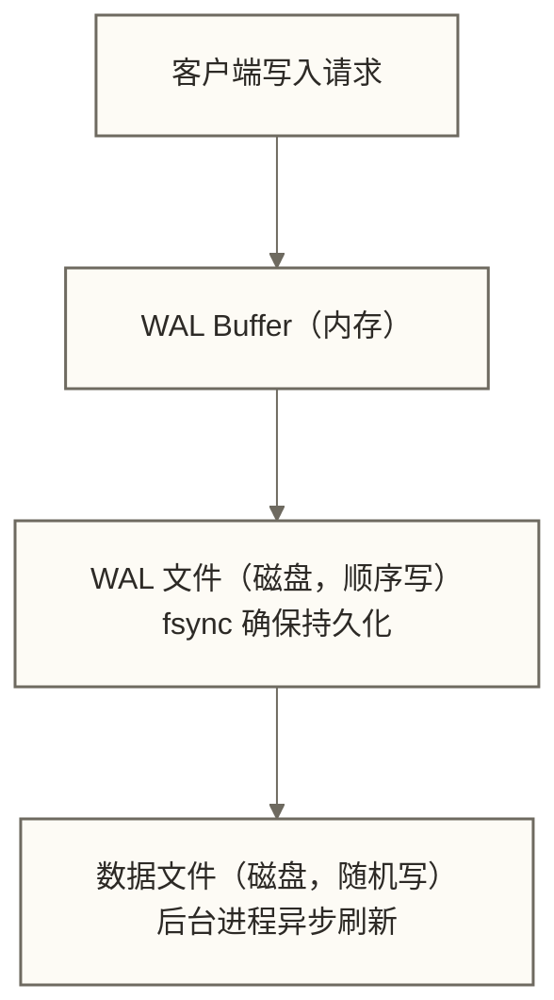

**pgvector 的所有写操作都自动纳入 WAL**：无论是堆表中的向量数据写入，还是 HNSW 索引的节点更新，都会记录到 WAL 中。这意味着：

- **崩溃恢复**：数据库崩溃重启后，通过 WAL 重放，向量数据和索引都能恢复到崩溃前的一致状态
- **流复制**：WAL 流式传输到 Standby 节点，Standby 上的 pgvector 索引与 Primary 保持同步
- **PITR**：Point-in-Time Recovery，可以把数据库（包括所有向量数据）恢复到任意历史时间点

### 7.2 索引构建期间的 WAL 行为

`CREATE INDEX` 构建大型 HNSW 索引时，会产生大量的 WAL 流量。下面的 max_wal_size 与 CONCURRENTLY 都不是关闭索引构建 WAL 的开关；普通持久表上的索引构建仍需考虑 WAL 流量和复制压力：

```sql
-- max_wal_size 影响检查点调度，不关闭 WAL，也不是普通会话 SET 参数。
-- 如需调整，应通过适当的服务器配置方式处理；这里不提供无 WAL 构建命令。

-- 对于初始大量数据导入后的索引构建，可以考虑：
CREATE INDEX CONCURRENTLY ON documents USING hnsw (embedding vector_cosine_ops);
-- CONCURRENTLY：允许并发写入的索引构建方式，仍会获取锁，并有事务及并发操作限制；通常构建成本更高
```

---

## 八、内存管理：work_mem 与向量查询的微妙关系

### 8.1 PostgreSQL 的内存体系

| 内存参数 | 作用范围 | 说明 |
|---------|---------|------|
| `shared_buffers` | 全局共享 | 数据页缓存、索引页缓存（默认 128MB，生产建议 25% RAM） |
| `work_mem` | 排序、哈希等操作的内存预算 | 不能直接等同于 HNSW 候选队列大小；单条查询可能包含多个内存操作，实际总占用还受并行执行、哈希设置及迭代扫描配置影响 |
| `maintenance_work_mem` | 维护操作独享 | CREATE INDEX 和 VACUUM 期间使用；建议设为 RAM 的 5-10%（索引构建性能关键参数） |

### 8.2 work_mem 对向量查询的影响

HNSW 搜索过程中维护一个**优先队列（priority queue）**，存放当前发现的最佳候选节点。`ef_search` 参数决定这个队列的大小。

不能把 HNSW 搜索候选集视为受 work_mem 控制、可自动 spill 到临时文件的排序结果。查询中的排序或哈希操作可能发生 spill；HNSW 搜索状态及迭代扫描内存限制需另行区分。

```sql
-- 不能用 ef_search × 向量大小直接计算 HNSW 查询的内存需求。
-- 搜索状态、访问记录、候选结构与迭代扫描设置均需分别考虑。
-- work_mem 主要限制查询中的排序、哈希等操作；
-- 受支持的 HNSW 迭代扫描还需结合 hnsw.scan_mem_multiplier 理解内存限制。
SET work_mem = '64MB';  -- 仅为配置示例，不代表多数场景的推荐值；需结合执行计划与并发预算评估

-- 索引构建时：
SET maintenance_work_mem = '2GB';  -- 示例值；需结合构建规模、总内存和并发维护操作确定，不能无限增大
```

### 8.3 索引缓存与 shared_buffers

HNSW 索引的"热数据"（高层节点、入口节点附近的页面）会被频繁访问。如果这些页面常驻 `shared_buffers`，每次查询只需内存读取；如果缓存不足，需要从磁盘读取，延迟会上升一个数量级。

一个简单的估算：

- HNSW 索引大小 ≈ 向量数据大小 × 1.5（m=16 时）= 向量数量 × 向量维度 × 4字节 × 1.5
- 100万条 × 1536维 × 4字节 × 1.5 ≈ 9 GB
- 建议 `shared_buffers` 至少能容纳索引大小的 25%，即至少 2.25 GB

---

## 九、pgvector 的局限性根源：单机架构的天花板

### 9.1 单机架构的本质

pgvector 运行在单个 PostgreSQL 实例上。这个决定从根本上决定了它的能力边界：

- pgvector 的资源上限 = 单台服务器的资源上限，约为 128 CPU cores / 数 TB RAM / 数十 TB 本地 SSD

当你的向量数据量超过单机能承载的范围时（通常是几亿到十亿级别），pgvector 就到了天花板。

### 9.2 无法水平扩展的根本原因

Milvus 这类分布式向量数据库可以水平扩展，是因为它的架构从一开始就是分布式的：

| 组件 | 扩展效果 |
|------|---------|
| 增加更多 QueryNode | 可增加查询资源；实际扩展收益取决于数据分片、负载及其他瓶颈，不保证线性增长 |
| 增加更多 DataNode | 可增加写入处理资源；实际扩展收益取决于消息链路、存储及其他瓶颈，不保证线性增长 |
| 增加更多 IndexNode | 可增加索引构建资源；实际扩展收益取决于任务并行度与资源瓶颈，不保证线性增长 |
| 对象存储（S3/MinIO） | 可扩展存储容量，但仍受服务配额、成本、吞吐及运维条件限制 |

而 pgvector 依附于 PostgreSQL 的单机存储引擎：
- 所有数据必须在同一台机器的数据目录中
- HNSW 图是一个不可分割的整体，无法切分到多台机器
- PostgreSQL 的 sharding 方案（Citus 等）可以水平扩展，但向量索引的跨节点搜索需要额外的工程工作

### 9.3 读写扩展的局限

PostgreSQL 的**流复制**可以把数据同步到多个 Standby 节点，可以做**读扩展**（把查询分流到 Standby）。但这有几个限制：

1. **Standby 节点是只读的**：所有写入必须走 Primary，写吞吐量是单机上限
2. **复制延迟**：Standby 的数据可能落后 Primary 几毫秒到几秒，对实时性要求高的场景是问题
3. **索引同步开销**：HNSW 索引的更新会产生大量 WAL，Standby 需要重放这些 WAL 才能保持同步

### 9.4 最大向量维度限制

pgvector 对向量维度有硬性限制：

| 数据类型 | 最大维度 | 索引支持的最大维度 |
|----------|----------|-------------------|
| vector   | 16,000   | 2,000             |
| halfvec  | 16,000   | 4,000             |
| bit      | 64,000   | 64,000            |
| sparsevec| 105,535  | 1,000（非零元素）  |

> [!warning] 常见误区
> `vector(3072)` 可以存储 3072 维向量（比如 OpenAI text-embedding-3-large 的全维度），但**不能直接建 HNSW 或 IVFFlat 索引**（超过 2000 维限制）。需要先用 `halfvec` 类型，或者在应用层做降维处理。

---

## 十、与 Milvus 的本质差异：选型决策的底层逻辑

### 10.1 架构对比

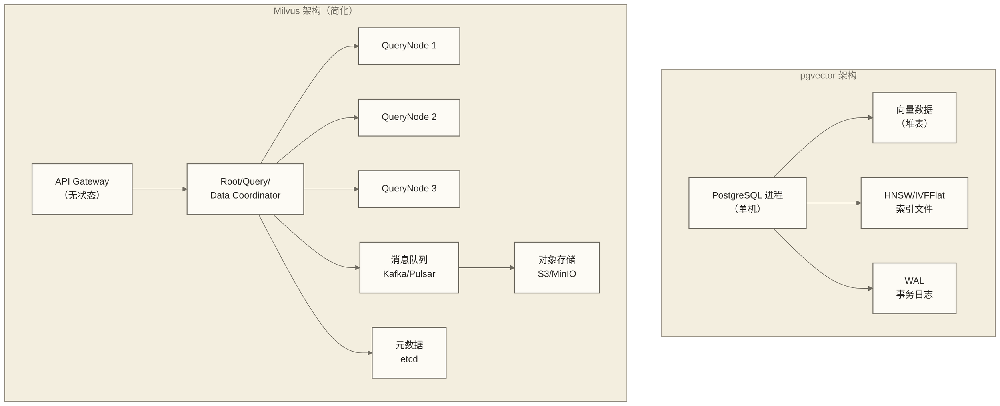

### 10.2 选型矩阵

| 维度 | pgvector | Milvus |
|------|----------|--------|
| 数据规模 | < 1亿条（建议 < 5000万） | 10亿条以上 |
| QPS 要求 | 中等（百到千） | 高（万级 QPS） |
| 基础设施复杂度 | 极低（已有 PG 则零成本） | 较高（需要运维分布式集群） |
| 向量+标量联合查询 | 天然支持（SQL JOIN） | 需要额外工程 |
| 事务支持 | 完整 ACID | 有限（Upsert/Delete 有延迟） |
| 数据一致性 | 强一致（MVCC） | 最终一致（可配置） |
| 运维复杂度 | 低（复用 PG 运维经验） | 高（多个组件独立运维） |
| 带过滤的向量搜索 | 性能较弱（后过滤） | 性能较好（索引内过滤） |
| 水平扩展 | 单实例无原生跨节点向量索引；分片需额外工程 | 分布式部署可扩展，收益受分片、负载与瓶颈限制，不保证线性增长 |
| 成本（小规模） | 低 | 依部署形态而定（需区分 standalone 与分布式集群，不能统一视为最少 3 节点） |

### 10.3 什么场景选 pgvector

> [!tip] 选 pgvector 的核心判断标准
> **以下条件可作为优先评估 pgvector 的信号，最终选择仍需结合工作负载与测试结果：**
> 1. 数据量在 5000 万条以内？
> 2. 你的业务数据已经在 PostgreSQL 里，需要向量和业务数据做 JOIN？
> 3. 团队没有运维分布式系统的经验？
> 4. 需要完整的事务支持（向量数据和业务数据的事务一致性）？
> 5. 快速原型 / 小型 RAG 应用？

---

## 十一、架构总结：设计决策一览

### 11.1 pgvector 的核心设计决策

| 设计决策 | 选择 | 带来的收益 | 付出的代价 |
|----------|------|-----------|-----------|
| 作为 PG 扩展而非独立系统 | 扩展 | 免费获得事务、WAL、复制、权限 | 受限于 PG 单机架构 |
| 向量存储为 varlena 类型 | varlena | 复用 PG 类型系统，与 SQL 天然集成 | TOAST 触发时额外 I/O |
| 实现 PG Index AM 接口 | AM 接口 | 复用 PG 的查询规划器和执行器 | 过滤优化受限，无法做索引内过滤 |
| 索引中存储向量值 | 索引携带数据 | 减少回表次数 | 索引体积较大 |
| HNSW 使用增量构建 | 增量 | 支持实时写入 | 构建时间比批量构建长 |
| 后过滤（post-filtering） | 后过滤 | 实现简单，与 PG 执行器集成 | 高过滤率场景性能差 |

### 11.2 架构全景图

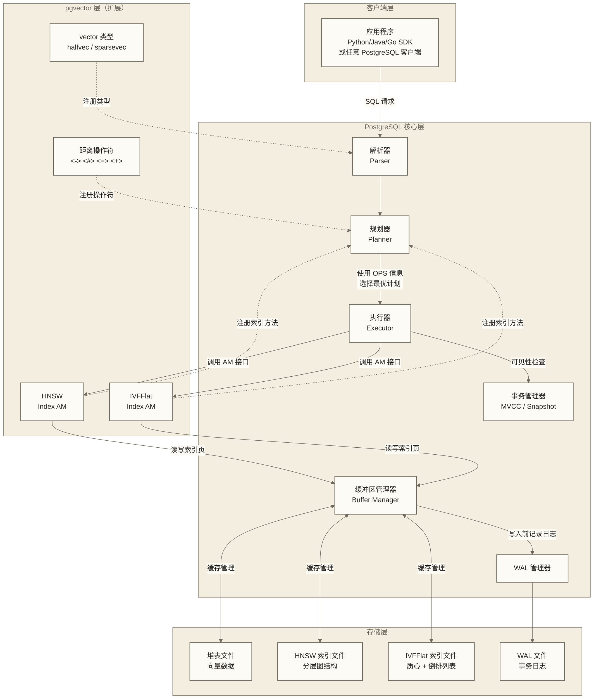

### 11.3 关键数字速查

| 参数 | 默认值 | 建议范围 | 说明 |
|------|--------|----------|------|
| `m`（HNSW 建索引选项） | 16 | 8-64 | 每个节点的连接数，越大精度越高内存越多 |
| `ef_construction`（HNSW 建索引选项） | 64 | 64-200 | 构建时候选队列，越大精度越高构建越慢 |
| `hnsw.ef_search` | 40 | 40-400 | 查询时候选队列，越大召回率越高越慢 |
| `lists`（IVFFlat 建索引选项） | 100 | rows/1000 或 sqrt(rows) | 聚类数量，影响索引精度和构建时间 |
| `ivfflat.probes` | 1 | sqrt(lists) | 查询时探测的聚类数，越大越准越慢 |
| `maintenance_work_mem` | 64MB | 1-8GB | 建索引时强烈建议调大 |
| `work_mem` | 4MB | 64MB-256MB（仅作为待评估的配置示例） | 排序、哈希等操作的内存预算，不是通用 HNSW 查询内存推荐；需结合并发与迭代扫描设置评估 |

---

> [!note] 延伸阅读
> - pgvector 核心概念详解：各个参数和类型的深度解析
> - pgvector 安装与部署：从零开始搭建 pgvector 环境
> - Milvus 架构对比：分布式向量数据库的设计哲学
> - [[【技术与工具】/向量数据库/通用知识/01-向量搜索原理与ANN算法|向量搜索原理与 ANN 算法]]：HNSW、IVFFlat 算法的数学基础
