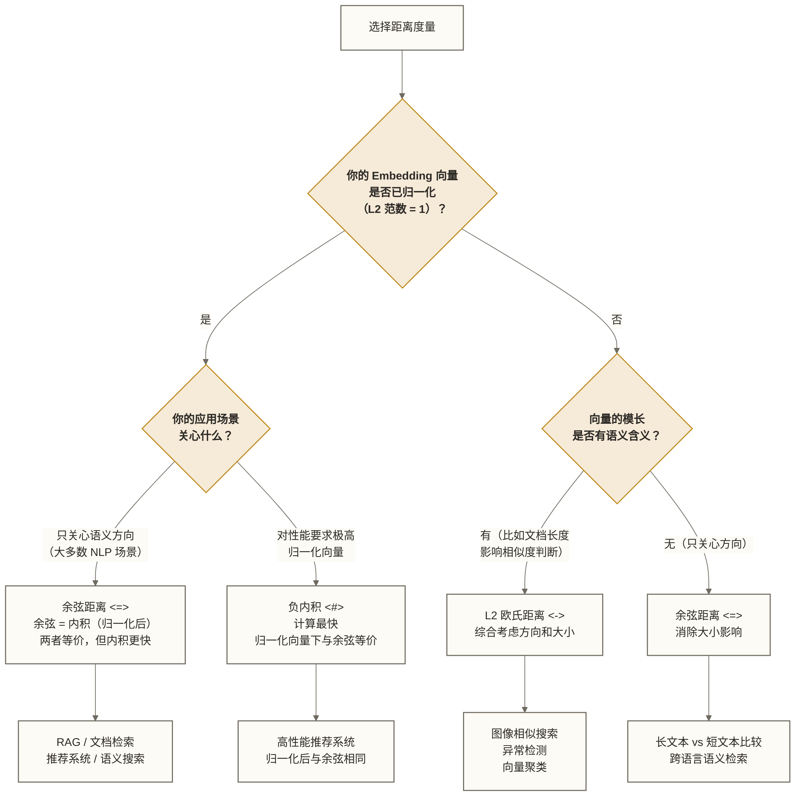
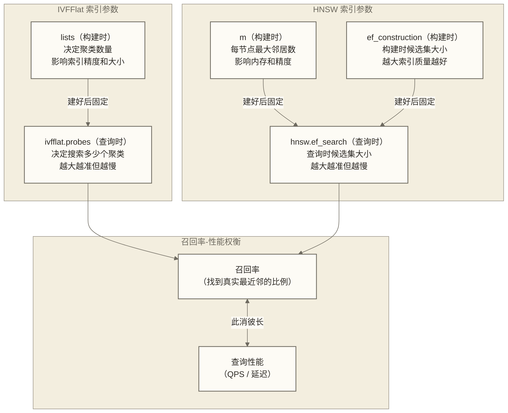
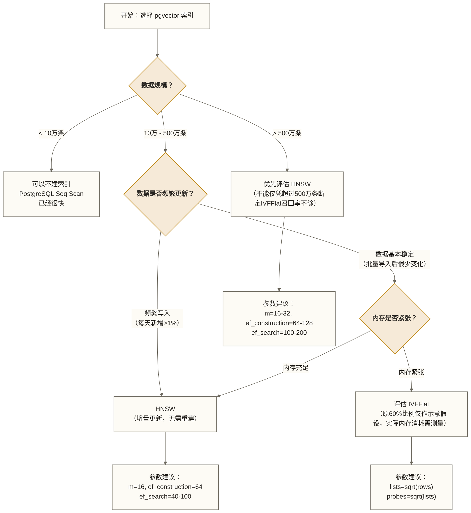

# pgvector 核心概念详解

> [!tip] 文档定位
> 这是 pgvector 的**概念字典**。它不是 API 文档的复制，而是用**生活化的语言**解释每个概念背后的设计意图。理解了"为什么这样设计"，你在面对各种参数选择时就有了判断依据，而不是靠记忆或猜测。

## 目录

- [[#一、vector 类型：你的"个人特征档案"]]
- [[#二、halfvec 和 sparsevec：节省内存的姊妹类型]]
- [[#三、距离操作符：相似度的三种量法]]
- [[#四、什么时候用哪个距离？]]
- [[#五、IVFFlat 索引：图书馆的分区管理员]]
- [[#六、HNSW 索引：预先绘制好的捷径地图]]
- [[#七、索引参数的直觉理解]]
- [[#八、关键 PostgreSQL 配置对向量查询的影响]]
- [[#九、操作符类（Operator Class）：索引与距离函数的配对]]
- [[#十、精确搜索 vs 近似搜索：召回率的权衡]]
- [[#十一、常用函数速查]]
- [[#十二、参数调优决策树]]

---

## 一、vector 类型：你的"个人特征档案"

### 1.1 什么是向量

在使用 pgvector 之前，必须先理解"向量"在这里是什么意思。

**类比：多维度的个人评分表**

想象你是一个招聘顾问，需要给每个候选人建立档案。你不只看学历，而是从 10 个维度给每人打分：

```text
候选人 A：
  编程能力: 9.2
  沟通能力: 7.5
  数据分析: 8.8
  英语水平: 6.3
  项目管理: 5.1
  ...（共 10 个维度）

这就是一个 10 维向量：[9.2, 7.5, 8.8, 6.3, 5.1, ...]
```

大语言模型做的事情类似，但维度要高得多——它用 1536 个（或 3072 个）数值来表达一段文字的"语义特征"：

```python
# OpenAI text-embedding-3-small 的输出
embedding = openai.embeddings.create(
    model="text-embedding-3-small",
    input="pgvector 是什么？"
)
# 得到一个长度为 1536 的浮点数列表
# [0.0234, -0.1823, 0.0091, ..., 0.0572]
#  ↑↑ 这 1536 个数字共同编码了"pgvector 是什么？"的语义
```

**每一个维度不直接对应"某种含义"**——这是 AI 模型自己学到的抽象特征表示，人类无法直接解读。但神奇之处在于：语义相近的文本，它们的向量在高维空间中距离很近。

### 1.2 `vector(N)` 的含义

```sql
-- 创建一个包含向量字段的表
CREATE TABLE documents (
    id        bigserial PRIMARY KEY,
    content   text,
    embedding vector(1536)  -- 存储 1536 维的向量
);
```

`vector(1536)` 的括号里的数字表示**维度数**——这个向量由多少个浮点数组成。

| 模型 | 维度 | 每个向量大小 |
|------|------|------------|
| OpenAI text-embedding-3-small | 1536 | ≈ 6 KB |
| OpenAI text-embedding-3-large | 3072 | ≈ 12 KB |
| OpenAI text-embedding-ada-002 | 1536 | ≈ 6 KB |
| Nomic embed-text | 768 | ≈ 3 KB |
| BGE-M3 | 1024 | ≈ 4 KB |
| Jina embeddings v3 | 1024 | ≈ 4 KB |

> [!warning] 维度必须统一
> 同一个字段里，**所有向量的维度必须相同**。你不能在一列 `vector(1536)` 里混存 1536 维和 768 维的向量。这和你用 `int` 类型只能存整数是一个道理——类型约束维度一致性。

### 1.3 向量的写入与查询

```sql
-- 插入一条向量数据（字符串格式自动转换）
INSERT INTO documents (content, embedding)
VALUES (
    'pgvector 是 PostgreSQL 的向量扩展',
    '[0.0234, -0.1823, 0.0091, ...]'::vector
);

-- 或者在 Python 中用参数化查询（推荐，避免 SQL 注入）
cursor.execute(
    "INSERT INTO documents (content, embedding) VALUES (%s, %s)",
    ("pgvector 是 PostgreSQL 的向量扩展", embedding_list)
)

-- 查询最相似的 5 条文档
SELECT content, embedding <=> query_vec AS similarity
FROM documents
ORDER BY embedding <=> query_vec
LIMIT 5;
```

---

## 二、halfvec 和 sparsevec：节省内存的姊妹类型

### 2.1 halfvec：用"半精度"换空间

`vector` 类型每个维度用 4 字节（32位浮点数，float32）存储。`halfvec` 把每个维度压缩到 2 字节（16位浮点数，float16）。

**类比：JPG 和 RAW 照片**

RAW 格式（float32）保留了最完整的数据，但文件很大。JPG（float16）用有损压缩换取更小的体积，绝大多数场景下肉眼看不出差别，但放大到像素级别会发现细微失真。

halfvec 也是这样的权衡：
- **内存节省 50%**：1536 维向量从 6KB 降到 3KB
- **精度损失需评估**：float16可能适用于部分ANN搜索场景，但需比较转换前后的近邻召回率和下游任务质量，不能保证精度已经足够
- **支持更高维度**：halfvec 可以建索引的最大维度是 4000（而 vector 只有 2000）

```sql
-- 创建 halfvec 列（适合高维向量或内存敏感场景）
CREATE TABLE documents (
    id        bigserial PRIMARY KEY,
    embedding halfvec(3072)   -- 3072维，每个向量只需 6KB 而非 12KB
);

-- 建索引
CREATE INDEX ON documents USING hnsw (embedding halfvec_cosine_ops);

-- 查询语法与 vector 完全相同
SELECT * FROM documents
ORDER BY embedding <=> '[0.1, 0.2, ...]'::halfvec
LIMIT 10;
```

> [!note] 何时选择 halfvec
> - 向量维度超过 2000（vector 索引的上限）
> - 数据量大，内存紧张（节省 50% 的存储和内存）
> - Embedding 模型本身用 float16 输出（避免无意义的精度升级）

### 2.2 sparsevec：稀疏向量的专用格式

**类比：只记非零分的成绩表**

假设有一个 10 万个词汇的词典，用 TF-IDF 表示一篇文章时，这篇文章只会用到其中几百个词，其余 99%+ 的维度都是 0。如果用 `vector(100000)` 存储，大量空间被 0 占据。

`sparsevec` 只存储非零元素：

```text
完整向量（vector 格式，10万维）：
[0, 0, 0, ..., 0.23, 0, 0, ..., 0.87, 0, 0, ..., 0.15, ...]
↑ 99%以上都是 0，浪费大量空间

稀疏向量（sparsevec 格式）：
{42: 0.23, 8834: 0.87, 63219: 0.15}
↑ 只记录"第42个维度是0.23，第8834个是0.87，第63219个是0.15"
```

```sql
-- 创建 sparsevec 列
CREATE TABLE tfidf_docs (
    id        bigserial PRIMARY KEY,
    embedding sparsevec(100000)  -- 10万维，但实际非零元素只有几百个
);

-- 插入时使用稀疏格式（{index:value, ...}/dimensions）
INSERT INTO tfidf_docs (embedding)
VALUES ('{42:0.23, 8834:0.87, 63219:0.15}/100000');

-- 或者用类型转换从密集向量转换
SELECT '[0, 0.23, 0, 0.87, 0, 0.15]'::vector::sparsevec;
```

| 类型 | 适用场景 | 最大维度（存储） | 最大维度（索引） |
|------|----------|----------------|----------------|
| vector | 通用密集向量（LLM embeddings） | 16,000 | 2,000 |
| halfvec | 高维密集向量，内存敏感 | 16,000 | 4,000 |
| bit | 二值向量（二进制哈希） | 64,000 | 64,000 |
| sparsevec | TF-IDF、BM25 等稀疏向量 | 105,535 | 1,000（非零元素数）|

---

## 三、距离操作符：相似度的三种量法

pgvector 提供了四个距离操作符。理解它们之前，先明确一点：**相似度越高，距离越小**。pgvector 的操作符返回的是距离，所以用 `ORDER BY distance ASC` 来找最相似的结果。

### 3.1 `<->` L2 欧氏距离（Euclidean Distance）

**类比：两点之间的直线距离**

在二维平面上，两点 A(1, 2) 和 B(4, 6) 之间的距离，就是用尺子量出来的那段线段的长度：

```ini
distance = sqrt((4-1)² + (6-2)²) = sqrt(9 + 16) = 5
```

推广到 N 维：
```text
L2(a, b) = sqrt(Σ(aᵢ - bᵢ)²)
```

**感性理解**：L2 距离关心的是两个向量在"绝对位置"上的差异。就像测量两座山峰的直线距离，不只考虑方向，也考虑高度（大小）的差异。

```sql
-- 语法：<->
SELECT *, embedding <-> '[0.1, 0.2, 0.3]'::vector AS l2_distance
FROM documents
ORDER BY embedding <-> '[0.1, 0.2, 0.3]'::vector
LIMIT 10;
```

**对应索引操作符类**：`vector_l2_ops`

### 3.2 `<#>` 负内积（Negative Inner Product）

**类比：两个方向向量"同向"的程度**

内积（点积）的计算：
```text
IP(a, b) = Σ(aᵢ × bᵢ)
```

如果两个向量长度都是 1（单位向量），内积就等于余弦相似度。内积越大，两个向量越"同向"（相似）。

pgvector 用**负内积** `<#>` 的原因：SQL 的 `ORDER BY ... ASC` 升序排列，而内积越大越相似，取负号后，负内积越小越相似，恰好与 `ORDER BY ASC` 的排序逻辑一致。

```sql
-- 语法：<#>（注意：返回的是负内积，返回负内积，排序值越小表示内积越大；不能仅凭正负号判断业务上的相似性）
SELECT *, (embedding <#> '[0.1, 0.2, 0.3]'::vector) * -1 AS inner_product
FROM documents
ORDER BY embedding <#> '[0.1, 0.2, 0.3]'::vector
LIMIT 10;
```

**对应索引操作符类**：`vector_ip_ops`

> [!warning] 内积的使用前提
> 内积的最大语义价值在于向量是**单位向量**（L2 范数为 1）的情况下。如果向量未归一化，内积同时受方向和大小影响，可能不符合你的语义意图。使用内积前，请确认你的 embedding 模型是否输出了归一化向量。OpenAI 的大多数模型输出的是归一化向量。

### 3.3 `<=>` 余弦距离（Cosine Distance）

**类比：忽略音量，只比较旋律**

两首歌，一首钢琴演奏（音量正常），一首耳机里的微弱版本（音量很小）。如果旋律相同，余弦相似度就是 1，尽管"音量"（向量的模长）差很多。

```text
余弦相似度 = IP(a,b) / (|a| × |b|)   → 范围 [-1, 1]
余弦距离 = 1 - 余弦相似度             → 范围 [0, 2]
```

余弦距离把两个向量归一化后再算内积，**消除了向量大小（模长）的影响，只关注方向的一致性**。

```sql
-- 语法：<=>
SELECT *, embedding <=> '[0.1, 0.2, 0.3]'::vector AS cosine_distance
FROM documents
ORDER BY embedding <=> '[0.1, 0.2, 0.3]'::vector
LIMIT 10;
```

**对应索引操作符类**：`vector_cosine_ops`

### 3.4 `<+>` L1 曼哈顿距离（Manhattan Distance）

**类比：城市街区里步行的路程**

在曼哈顿这样的方格城市里，从 A 点走到 B 点，只能沿街道行走（不能穿越建筑），总路程就是曼哈顿距离：

```text
L1(a, b) = Σ|aᵢ - bᵢ|
```

相较L2，L1距离对单个维度的大差值放大较少，对异常值（outlier）的鲁棒性比 L2 更强（L2 对大差值的平方放大了影响）。

```sql
-- 语法：<+>（pgvector 0.7+ 支持）
SELECT *, embedding <+> '[0.1, 0.2, 0.3]'::vector AS l1_distance
FROM documents
ORDER BY embedding <+> '[0.1, 0.2, 0.3]'::vector
LIMIT 10;
```

**对应索引操作符类**：`vector_l1_ops`

---

## 四、什么时候用哪个距离？

### 4.1 决策框架

这是实际工程中最常见的困惑。下面给一个清晰的决策框架：



### 4.2 RAG 场景实战：选余弦还是内积？

以最常见的 RAG（Retrieval-Augmented Generation）场景为例：

```python
# 场景：用户问"pgvector 怎么安装？"
# 你需要从知识库中找最相关的文档片段

# OpenAI 的 embedding 输出是归一化向量（|v| = 1）
# 在这种情况下，余弦距离和负内积等价
# 但负内积的计算略快（省去了计算模长的步骤）

# 方案 A：余弦距离（更语义化，不关心向量大小）
CREATE INDEX ON docs USING hnsw (embedding vector_cosine_ops);
SELECT content FROM docs
ORDER BY embedding <=> query_embedding LIMIT 5;

# 方案 B：负内积（性能略优，仅适用于归一化向量）
CREATE INDEX ON docs USING hnsw (embedding vector_ip_ops);
SELECT content FROM docs
ORDER BY embedding <#> query_embedding LIMIT 5;
```

**实践建议**：

| 场景 | 推荐距离 | 理由 |
|------|----------|------|
| RAG / 语义搜索（OpenAI embeddings） | 余弦 `<=>` 或内积 `<#>` | OpenAI 输出归一化向量，两者等价，内积稍快 |
| RAG / 语义搜索（Hugging Face 模型） | 余弦 `<=>` | 非归一化模型，余弦更稳定 |
| 图像特征相似搜索 | L2 `<->` | 图像特征向量的大小有语义含义 |
| 用户行为向量（推荐系统） | 内积 `<#>` | 行为频次高的用户向量更长，内积天然赋予更高权重 |
| TF-IDF / BM25 稀疏向量 | 内积 `<#>` | 稀疏向量的内积就是词项匹配的得分 |
| 异常检测 | L2 `<->` | 检测绝对位置的偏离 |

### 4.3 一个让人豁然开朗的例子

假设你在做简历推荐系统，用向量表示候选人的技能：

```text
候选人 A：[8.0, 7.0, 9.0]  # Python强, SQL中, 机器学习强
候选人 B：[4.0, 3.5, 4.5]  # Python中, SQL中, 机器学习中（整体能力一般）
目标岗位：[0.8, 0.7, 0.9]  # A 的等比例缩放版本，并非单位归一化向量
```

- **余弦距离**：A 和 B 与目标岗位的余弦距离相同（方向完全一致）——余弦认为两人同样合适
- **L2 距离**：按上述目标向量，A 的距离约为13.93，B的距离约为5.79，因此B更近；这说明L2衡量与目标绝对数值的接近程度，并不会自动偏好技能数值更高的人。

**哪个更对？** 取决于你的业务逻辑：
- 如果你认为"技能方向匹配比绝对水平更重要"（初级岗位也行），选余弦
- 如果你认为"技能水平高低也很重要"，可考虑L2，但目标向量必须采用与候选人一致的尺度，并表达岗位所需的绝对技能水平。

---

## 五、IVFFlat 索引：图书馆的分区管理员

### 5.1 核心思路

**类比：图书馆的分区管理**

设想一个有 100 万本书的大图书馆。要找一本书，有两个策略：

- **暴力搜索**：从第一本翻到最后一本（相当于 PostgreSQL 全表扫描）
- **IVFFlat**：先把书按主题分成 1000 个区，每个区有一个"区域中心书目"。找书时，先看查询词最接近哪几个区域，只在那几个区里翻。

```sql
-- 创建 IVFFlat 索引
CREATE INDEX ON documents USING ivfflat (embedding vector_cosine_ops)
WITH (lists = 100);

-- lists = 100 意味着：把所有向量聚成 100 个簇（100个"分区"）
```

### 5.2 `lists` 参数：分多少个区

`lists` 决定了 K-means 聚类的数量，也就是"图书馆分多少个区"。

**太少（lists 太小）**：
- 每个区里的书太多，每次搜索要翻的书太多
- 索引加速效果有限，类似于按大类分（"文学"、"科技"），范围太大

**太多（lists 太大）**：
- 每个区里的书很少，每次搜索又快又准
- 但构建索引慢，占用更多空间

**PostgreSQL 官方建议**：

```text
数据量 < 100万：   lists = rows / 1000
数据量 >= 100万：  lists = sqrt(rows)

例子：
- 10万条数据：   lists = 10万/1000 = 100
- 100万条数据：  lists = sqrt(100万) = 1000
- 1000万条数据： lists = sqrt(1000万) ≈ 3162
```

> [!tip] 经验规则
> 每个 list 平均 1000-5000 条向量时，IVFFlat 通常有最好的性价比。如果某个 list 里有几十万条向量，搜索性能就和全表扫描差不多了。

### 5.3 `probes` 参数：搜索时探测多少个区

构建索引时用 `lists`，**查询时用 `probes`** 控制探测多少个聚类：

```sql
-- 设置 probes（每次查询前设置，或在配置文件中设置）
SET ivfflat.probes = 10;

-- 事务级别设置（不影响其他会话）
BEGIN;
SET LOCAL ivfflat.probes = 20;
SELECT * FROM documents ORDER BY embedding <=> query_vec LIMIT 10;
COMMIT;
```

**probes 的权衡**：以下速度排序与召回率区间仅为示意假设，未提供实验依据；实际结果取决于数据分布、过滤条件、参数和执行计划，不保证达到表中数值。

```ini
probes = 1（默认）：
  只搜索最近的 1 个聚类，最快，但召回率最低

probes = sqrt(lists)（推荐起点）：
  搜索 sqrt(lists) 个聚类，平衡速度和召回率

probes = lists：
  覆盖所有聚类时不再通过减少探测聚类实现近似加速；规划器可能不使用IVFFlat索引，实际路径和耗时需查看执行计划，不能保证它总是最慢
```

**类比**：probes 就是你派出去"找书"的探员数量。派 1 个人只在最可能的区域找，快但可能漏掉。派所有人去每个区找，完整但慢。

| probes | 速度 | 召回率 |
|--------|------|--------|
| 1 | 极快 | 60-80%（粗略搜索） |
| sqrt(lists) | 快 | 90-95% |
| lists/2 | 中等 | 97-99% |
| lists | 最慢 | 100% |

### 5.4 IVFFlat 的重要限制

> [!warning] 建索引的时机
> **IVFFlat 必须在数据基本稳定后建索引**。原因：
>
> 1. 建索引时，K-means 聚类是基于当时的数据分布计算的
> 2. 之后插入的新数据会被分配到现有聚类中，但聚类中心不会更新
> 3. 如果新数据的分布与历史数据差异很大（比如换了 embedding 模型），原来的聚类会失效，召回率下降
>
> 建议：数据量变化超过 10-20% 时，考虑重建索引：
> ```sql
> REINDEX INDEX CONCURRENTLY idx_documents_embedding;
> ```

---

## 六、HNSW 索引：预先绘制好的捷径地图

### 6.1 核心思路

**类比：出行导航的层级路网**

古代没有地图，找路只能靠打听，一步步问到目的地（相当于暴力搜索）。有了地图和高速公路网络后：

- 先沿**高速公路**（HNSW 高层）快速到达目的地所在的大区域
- 再走**省道**（HNSW 中层）缩小到镇级范围
- 最后走**小路**（HNSW 底层）精确到达目的地

HNSW 就是预先为你画好的"导航图"，图中包含了各种层级的"快捷路径"。

```sql
-- 创建 HNSW 索引（推荐作为默认选择）
CREATE INDEX ON documents USING hnsw (embedding vector_cosine_ops)
WITH (m = 16, ef_construction = 64);
```

### 6.2 `m` 参数：每个节点画几条高速公路

`m` 是每个向量节点在图中最多能有多少个**邻居连接**（在底层是 2m）。

**类比：每座城市最多有几条高速公路出口**

```ini
m = 4：  每座城市只有 4 个高速出口，找路时选项少，可能走弯路
m = 16： 每座城市有 16 个出口，找路更灵活，精度更高
m = 64： 每座城市有 64 个出口，找路极其精准，但建路（建图）成本很高
```

**m 的影响**：

| m 值 | 索引内存 | 构建速度 | 查询精度 | 适用场景 |
|------|----------|----------|----------|----------|
| 4-8 | 小 | 快 | 较低 | 内存极度紧张 |
| 16（默认） | 中 | 中 | 良好 | 大多数场景 |
| 32-64 | 大 | 慢 | 很高 | 对精度要求极高 |

> [!note] 内存估算
> HNSW 索引的内存占用约等于：
> ```text
> 索引内存 ≈ 向量数量 × (向量大小 + m × 8字节)
>
> 100万条 × (6144字节 + 16 × 8字节) = 6.27 GB（m=16）
> 100万条 × (6144字节 + 64 × 8字节) = 6.65 GB（m=64）
> ```
> m 对内存的影响没有想象中大，因为向量本身的大小占主导。

### 6.3 `ef_construction` 参数：建图时的搜索精度

构建 HNSW 索引时，每插入一个新节点，需要为它在图中找到最近的邻居（用于建立连接）。`ef_construction` 控制这个"寻邻居"过程的候选集大小。

**类比：建公路时的"勘探队规模"**

建一条高速公路，要先勘探可能的路线。
- 勘探队只有 10 人：勘探范围小，可能错过更好的路线（但速度快）
- 勘探队有 200 人：覆盖更广，找到的路线质量更好（但耗时更长）

```ini
ef_construction = 64（默认）：
  构建速度快，索引质量良好

ef_construction = 128：
  构建稍慢，索引质量更好，适合对召回率要求高的场景

ef_construction = 200-400：
  构建很慢，索引质量最高，适合一次性建好后长期不变的场景
```

> [!warning] 注意区分两个 ef 参数
> - `ef_construction`：**建索引时**用，一旦索引建好就固定了，无法动态调整
> - `hnsw.ef_search`：**查询时**用，可以随时动态调整，影响每次查询的精度和速度

### 6.4 `hnsw.ef_search` 参数：查询时的搜索精度

查询时，HNSW 维护一个候选集来追踪"目前找到的最好结果"。`ef_search` 控制这个候选集的大小。

```sql
-- 全局设置（影响该连接的所有查询）
SET hnsw.ef_search = 100;

-- 事务级别设置（仅影响当前事务）
BEGIN;
SET LOCAL hnsw.ef_search = 200;
SELECT * FROM documents ORDER BY embedding <=> query LIMIT 10;
COMMIT;
```

**ef_search 的权衡**：

```ini
ef_search = 40（默认）：
  查询快，但如果你 LIMIT 10，候选集只有 40 个，不一定能找到全局最优的 10 个

ef_search = 100：
  候选集 100 个，从中选 LIMIT 10，精度提升，速度略下降

ef_search = 400：
  非常高精度，接近暴力搜索的召回率，速度明显下降
```

> [!tip] 实践建议
> `ef_search` 必须 ≥ `LIMIT` 值。如果你 `LIMIT 50`，`ef_search = 40` 是没有意义的。
> 通常 `ef_search = LIMIT × 3` 到 `LIMIT × 10` 是合理范围。

---

## 七、索引参数的直觉理解

### 7.1 参数关系全图



### 7.2 HNSW vs IVFFlat：一张表看清差异

| 对比维度 | HNSW | IVFFlat |
|----------|------|---------|
| 构建时间 | 慢（逐点插入） | 中等（K-means + 批量分配） |
| 构建内存 | 中等 | 小 |
| 索引大小 | 大（约 2x 数据） | 中（约 1.5x 数据） |
| 查询性能（QPS） | 高 | 中等 |
| 查询召回率 | 高 | 中等 |
| 实时写入 | 支持（增量更新） | 弱（需定期重建） |
| 参数调优难度 | 简单（ef_search） | 中等（probes） |
| 适用场景 | **生产首选** | 数据稳定的批量场景 |

**一句话总结**：
- **HNSW = 高精度、高性能、支持实时写入、但占内存大**
- **IVFFlat = 构建快、占内存小、但数据更新后需要重建**

---

## 八、关键 PostgreSQL 配置对向量查询的影响

### 8.1 `shared_buffers`：HNSW 索引的"热缓存"

**类比：工作台上放多少资料**

工人从仓库（磁盘）拿资料放到工作台（内存），工作台越大，常用资料都在手边，效率越高。`shared_buffers` 就是这个工作台的大小。

HNSW 搜索是从图的顶层开始，沿着边"走"到底层。如果这些节点（索引页）都在 `shared_buffers` 中，每次访问是纯内存操作（微秒级）；如果需要从磁盘读取（页 Cache Miss），延迟上升到毫秒级。

```sql
-- 查看当前配置
SHOW shared_buffers;

-- 建议：设置为可用 RAM 的 25%
-- 在 postgresql.conf 中修改：
-- shared_buffers = 8GB  （假设机器有 32GB RAM）
```

**向量场景的估算**：

```text
如果你的 HNSW 索引是 10 GB，
建议 shared_buffers ≥ 2.5 GB（能缓存 25% 的索引页）
理想情况是整个索引都在内存中，此时每次查询只需内存读取
```

### 8.2 `maintenance_work_mem`：索引构建的"施工预算"

这是 `CREATE INDEX` 操作可用的内存。建 HNSW 索引时，这个内存用于：
- 存放待处理的向量数据
- 维护临时的图结构
- 排序和候选集操作

**这个参数对索引构建速度影响极大**：

```sql
-- 建索引前临时调大（不影响全局）
SET maintenance_work_mem = '4GB';
CREATE INDEX ON documents USING hnsw (embedding vector_cosine_ops)
WITH (m = 16, ef_construction = 64);
-- SET为会话级设置，建完不会自动恢复；应显式恢复原值，或在事务中使用SET LOCAL
```

构建时间示意假设（100万条，1536维，m=16；下表保留原有数值，但未提供实验来源、硬件及测量条件，不代表已实测结果）：

| maintenance_work_mem | 构建时间 |
|---------------------|----------|
| 64 MB（默认） | 约 45 分钟 |
| 512 MB | 约 18 分钟 |
| 2 GB | 约 8 分钟 |
| 8 GB | 约 5 分钟 |

> [!warning] 不要永久设置太大
> `maintenance_work_mem` 是每个维护操作独占的内存。如果你设为 8GB，同时运行 5 个 autovacuum 进程，可能消耗 40GB 内存。只在需要建大索引时临时调大，建完恢复默认值。

### 8.3 `work_mem`：向量查询的"计算预算"

`work_mem` 是每个排序、哈希操作可用的内存。向量查询（`ORDER BY embedding <=> ... LIMIT N`）本质上是一个"在候选集中维护 top-K 的排序操作"，受 `work_mem` 影响。

```sql
-- 查看当前配置
SHOW work_mem;

-- 为向量查询调大（会话级）
SET work_mem = '128MB';
```

**影响场景**：

1. **HNSW 候选集**：ef_search 越大，候选集越大，需要更多 work_mem
2. **结果排序**：如果查询需要先 Seq Scan 再排序（没有索引的情况），需要更多 work_mem
3. **JOIN 操作**：向量结果与其他表做 JOIN 时，哈希操作需要 work_mem

```text
估算：
每个向量查询的 work_mem 需求
≈ ef_search × 向量大小 × 2（安全系数）
= 100 × 6150字节 × 2
≈ 1.2 MB

对于大多数场景，work_mem = 64MB 足够
并发查询很多时（>50），需要控制 work_mem，防止 OOM
```

### 8.4 `max_parallel_workers_per_gather`：并行扫描

PostgreSQL 支持并行查询。对于**没有索引的向量全表扫描**（Seq Scan），并行化能显著提升速度：

```sql
-- 允许 4 个并行 worker
SET max_parallel_workers_per_gather = 4;

-- 没有索引时，规划器可能选择并行全表扫描；是否并行及实际worker数需查看执行计划
-- 4个 worker 各扫描 1/4 的数据，最后合并结果
EXPLAIN SELECT * FROM documents ORDER BY embedding <=> query_vec LIMIT 10;
-- → Gather Merge → Parallel Seq Scan（4 workers）
```

> [!note] 索引扫描不需要并行
> 如果已经有 HNSW 索引，查询会走 Index Scan，Index Scan 通常是单线程的（pgvector 的 HNSW 实现目前不支持并行索引扫描）。并行查询对 Seq Scan 更有帮助。

### 8.5 配置速查表

```sql
-- 推荐配置（32GB RAM，向量数据库为主要用途）
-- postgresql.conf

shared_buffers = 8GB                    -- 25% 内存给 PG 缓存
effective_cache_size = 24GB             -- 帮助规划器估算可用缓存
maintenance_work_mem = 2GB              -- 建索引时使用，按需调大
work_mem = 128MB                        -- 每个查询的工作内存
max_worker_processes = 8                -- 并行 worker 数
max_parallel_workers = 8
max_parallel_workers_per_gather = 4     -- 每次 Gather 的并行度

-- 实时查看 HNSW 索引使用的缓存命中率
SELECT
    schemaname, relname AS tablename, indexrelname AS indexname,
    idx_blks_read, idx_blks_hit,
    round(idx_blks_hit::numeric / nullif(idx_blks_hit + idx_blks_read, 0) * 100, 2) AS cache_hit_ratio
FROM pg_statio_user_indexes
WHERE indexrelname LIKE '%embedding%';
```

---

## 九、操作符类（Operator Class）：索引与距离函数的配对

### 9.1 为什么需要操作符类

一个 HNSW 索引只能服务于**一种距离函数**。创建索引时必须指定操作符类，告诉 PostgreSQL"这个索引用于哪种距离的查询"。

```sql
-- 错误示例：创建了余弦索引，却用 L2 距离查询
CREATE INDEX ON docs USING hnsw (embedding vector_cosine_ops);  -- 余弦索引

-- 这个查询不会走 HNSW 索引（距离函数不匹配）
SELECT * FROM docs ORDER BY embedding <-> query_vec LIMIT 10;   -- L2 距离
-- → PostgreSQL 会退化为 Seq Scan
```

### 9.2 操作符类速查表

| 数据类型 | 距离函数 | 操作符 | 操作符类 |
|----------|----------|--------|---------|
| vector | L2 欧氏距离 | `<->` | `vector_l2_ops` |
| vector | 内积 | `<#>` | `vector_ip_ops` |
| vector | 余弦距离 | `<=>` | `vector_cosine_ops` |
| vector | L1 曼哈顿距离 | `<+>` | `vector_l1_ops` |
| halfvec | L2 欧氏距离 | `<->` | `halfvec_l2_ops` |
| halfvec | 内积 | `<#>` | `halfvec_ip_ops` |
| halfvec | 余弦距离 | `<=>` | `halfvec_cosine_ops` |
| halfvec | L1 曼哈顿距离 | `<+>` | `halfvec_l1_ops` |
| sparsevec | L2 欧氏距离 | `<->` | `sparsevec_l2_ops` |
| sparsevec | 内积 | `<#>` | `sparsevec_ip_ops` |
| sparsevec | 余弦距离 | `<=>` | `sparsevec_cosine_ops` |
| bit | Hamming 距离 | `<~>` | `bit_hamming_ops` |
| bit | Jaccard 距离 | `<%>` | `bit_jaccard_ops` |

### 9.3 多距离函数场景

如果你的应用同时用多种距离函数，需要为每种函数单独建索引：

```sql
-- 场景：同时需要余弦搜索和 L2 搜索
CREATE INDEX idx_cosine ON documents USING hnsw (embedding vector_cosine_ops);
CREATE INDEX idx_l2     ON documents USING hnsw (embedding vector_l2_ops);

-- 余弦查询 → 走 idx_cosine
SELECT * FROM documents ORDER BY embedding <=> query LIMIT 10;

-- L2 查询 → 走 idx_l2
SELECT * FROM documents ORDER BY embedding <-> query LIMIT 10;
```

> [!warning] 两个索引 = 两倍存储和维护成本
> 每个索引都需要存储和更新。如果你不确定需要哪种距离，先从**余弦距离**开始——它对大多数 NLP 场景都表现良好，且对向量是否归一化不敏感。

---

## 十、精确搜索 vs 近似搜索：召回率的权衡

### 10.1 什么是召回率

"召回率"在向量搜索中的含义：**在真实最近邻中，你找到了多少**。

```text
例子：数据库里有 100 万个向量
真实意义上最近的 10 个向量是 [A, B, C, D, E, F, G, H, I, J]
HNSW 搜索（ef_search=40）找到的 10 个是 [A, B, C, D, E, F, G, H, I, K]

召回率 = 找到的真实近邻数 / K = 9/10 = 90%
```

### 10.2 何时需要精确搜索（100% 召回率）

部分RAG和语义搜索场景可将90-95%的近邻召回率作为评估起点，但是否足够取决于关键文档遗漏的后果、下游回答质量和业务指标，不能保证漏掉一两个结果不影响效果。

但有些场景需要精确搜索：

```sql
-- 精确 KNN 搜索（不使用索引，暴力计算所有距离）
-- 适用于：数据量小（<10万），或对准确性要求极高

-- 方法1：禁用向量索引，强制全表扫描
SET enable_indexscan = off;
SELECT * FROM documents ORDER BY embedding <-> query LIMIT 10;
SET enable_indexscan = on;  -- 查询完记得恢复

-- 方法2：明确全表扫描（不推荐，可能影响规划器其他决策）
SELECT * FROM documents
ORDER BY embedding <-> query
LIMIT 10;
-- 如果没有索引，PostgreSQL 自动做精确 KNN
```

### 10.3 如何验证你的索引召回率

```sql
-- 评估 HNSW 召回率的方法（以余弦距离为例）

-- Step 1: 用 Seq Scan 找到精确最近邻（真实答案）
SET enable_indexscan = off;
CREATE TEMP TABLE exact_results AS
SELECT id, embedding <=> query_vec AS dist
FROM documents
ORDER BY dist LIMIT 100;
SET enable_indexscan = on;

-- Step 2: 查询近似最近邻；须先通过 EXPLAIN 确认实际使用匹配的 HNSW 索引
-- enable_indexscan = on 仅允许索引扫描，不保证本查询采用 HNSW
CREATE TEMP TABLE approx_results AS
SELECT id, embedding <=> query_vec AS dist
FROM documents
ORDER BY embedding <=> query_vec LIMIT 100;

-- Step 3: 计算交集（召回率）
SELECT
    COUNT(*) FILTER (WHERE a.id IN (SELECT id FROM exact_results)) AS matched,
    COUNT(*) AS total,
    round(COUNT(*) FILTER (WHERE a.id IN (SELECT id FROM exact_results))::numeric / NULLIF((SELECT COUNT(*) FROM exact_results), 0) * 100, 2) AS recall_rate
FROM approx_results a;
```

---

## 十一、常用函数速查

### 11.1 向量操作函数

```sql
-- 向量维度
SELECT vector_dims('[1, 2, 3]'::vector);  -- → 3

-- 向量的 L2 范数（模长）
SELECT vector_norm('[1, 2, 3]'::vector);  -- → sqrt(1+4+9) ≈ 3.742

-- 归一化（除以模长，使模长为1）
SELECT l2_normalize('[1, 2, 3]'::vector);  -- → [0.267, 0.535, 0.802]

-- 子向量（取向量的一部分）
SELECT subvector('[1, 2, 3, 4, 5]'::vector, 2, 3);  -- → [2, 3, 4]（从第2位开始取3个）

-- 向量转换
SELECT embedding::halfvec  FROM documents LIMIT 1;  -- vector 转 halfvec
SELECT embedding::vector   FROM docs_halfvec LIMIT 1;  -- halfvec 转 vector
```

### 11.2 聚合函数

```sql
-- 向量平均值（聚合多个向量）
SELECT avg(embedding) FROM documents WHERE category = 'tech';

-- 向量求和
SELECT sum(embedding) FROM documents WHERE category = 'tech';

-- 典型用途：用户历史兴趣向量的平均，作为用户偏好向量
SELECT avg(item_embedding) AS user_preference_vector
FROM user_clicks
WHERE user_id = 12345
GROUP BY user_id;
```

### 11.3 距离函数（函数调用形式）

```sql
-- 除了操作符，也可以用函数形式（结果相同）
SELECT l2_distance('[1,2,3]'::vector, '[4,5,6]'::vector);      -- → 5.196
SELECT inner_product('[1,2,3]'::vector, '[4,5,6]'::vector);    -- → 32
SELECT cosine_distance('[1,2,3]'::vector, '[4,5,6]'::vector);  -- → 0.025

-- 注意：函数形式不会走索引，只能用于计算
-- 索引加速必须用操作符形式（<->, <#>, <=>）
```

### 11.4 索引维护

```sql
-- 查看索引状态
SELECT indexrelname AS indexname, idx_scan, idx_tup_read, idx_tup_fetch
FROM pg_stat_user_indexes
WHERE relname = 'documents';

-- 查看索引大小
SELECT pg_size_pretty(pg_relation_size('idx_documents_embedding'));

-- 查看索引构建进度（PG 12+）
SELECT phase, blocks_done, blocks_total,
       round(blocks_done::numeric / nullif(blocks_total, 0) * 100, 2) AS progress_pct
FROM pg_stat_progress_create_index
WHERE relid = 'documents'::regclass;

-- 重建索引（不锁表）
REINDEX INDEX CONCURRENTLY idx_documents_embedding;
```

---

## 十二、参数调优决策树

### 12.1 选择索引类型



### 12.2 召回率不够怎么办

```text
症状：向量搜索返回的结果质量不高，用户反馈"找不到相关内容"

排查步骤：

Step 1: 验证是真的召回率低，还是 embedding 模型不好
  → 用精确搜索（禁用索引）找到的结果，质量是否更好？
  → 如果精确搜索也不好：问题在 embedding 模型或距离函数选择
  → 如果精确搜索明显更好：问题在索引参数

Step 2: 调整索引参数（不用重建索引）
  SET hnsw.ef_search = 200;    -- 从默认 40 调大
  -- 或者
  SET ivfflat.probes = 20;     -- 从默认 1 调大

Step 3: 如果调参后仍然不够，考虑重建索引
  -- 使用更大的 ef_construction
  DROP INDEX idx_embedding;
  SET maintenance_work_mem = '4GB';
  CREATE INDEX ON docs USING hnsw (embedding vector_cosine_ops)
  WITH (m=32, ef_construction=128);
```

### 12.3 查询速度太慢怎么办

```javascript
症状：向量查询 p99 延迟超过 100ms，不能接受

排查步骤：

Step 1: EXPLAIN ANALYZE 查看执行计划
  EXPLAIN (ANALYZE, BUFFERS)
  SELECT * FROM documents ORDER BY embedding <=> query LIMIT 10;

  → 如果是 Seq Scan：说明没走索引，检查操作符类是否匹配
  → 如果是 Index Scan：看 Buffers 信息，是否有大量磁盘读取

Step 2: 检查索引缓存命中率
  → 如果命中率低（<90%），考虑增大 shared_buffers

Step 3: 降低 ef_search（牺牲一些召回率换速度）
  SET hnsw.ef_search = 20;  -- 从 40 降到 20

Step 4: 检查是否有标量过滤导致的退化
  → 带 WHERE 过滤的查询，pgvector 可能退化到 Seq Scan
  → 考虑增大 ef_search 或在应用层做二次过滤
```

---

> [!note] 延伸阅读
> - [[【技术与工具】/向量数据库/pgvector/02-pgvector架构深度解析|pgvector 架构深度解析]]：理解参数背后的内部机制
> - pgvector 安装与部署：从零开始搭建环境
> - [[【技术与工具】/向量数据库/通用知识/01-向量搜索原理与ANN算法|向量搜索原理与 ANN 算法]]：HNSW 和 IVFFlat 的数学原理
> - [[【技术与工具】/向量数据库/00-向量数据库选型指南|向量数据库选型指南]]：pgvector vs Milvus vs Qdrant 的完整对比
