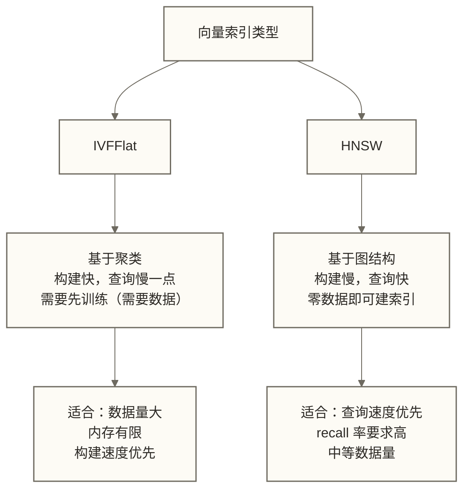

# 第一个 pgvector 应用 — 从零构建语义搜索

> [!tip] 本文定位
> 我们要做一个最简单的知识库语义检索——把几篇文章存进去，然后用自然语言找到相关的文章。用 Python 生成向量，再用 SQL 存储和检索；本文不包含生成回答步骤。没有魔法，没有黑盒，每一步都清清楚楚。

## 目录

- [[#你将学到什么]]
- [[#环境准备]]
- [[#第一步：连接数据库并启用 pgvector]]
- [[#第二步：设计表结构]]
- [[#第三步：生成 Embedding]]
- [[#第四步：插入数据]]
- [[#第五步：基础向量搜索]]
- [[#第六步：混合查询（向量 + SQL 过滤）]]
- [[#完整项目：文章语义搜索系统]]
- [[#pgvector 的杀手锏：JOIN 和事务]]
- [[#性能优化：添加索引]]
- [[#使用 SQLAlchemy ORM]]
- [[#常见问题与最佳实践]]

---

## 你将学到什么

读完这篇，你能独立完成：

1. 用 Python 连接 pgvector，写入向量数据
2. 用自然语言查询，找到语义最相关的内容
3. 把向量搜索和普通 SQL 条件混合使用
4. 理解 pgvector 相对于独立向量数据库的核心优势

我们的小项目：**一个文章语义搜索系统**。把 10 篇技术文章存进去，输入任意问题，返回最相关的文章。

---

## 环境准备

### 依赖安装

```bash
# 核心依赖
pip install pgvector psycopg[binary] python-dotenv

# 如果使用 OpenAI 生成 embedding
pip install openai

# 如果使用本地模型（无需 API 费用，推荐学习阶段使用）
pip install sentence-transformers

# 如果使用 SQLAlchemy ORM
pip install sqlalchemy psycopg[binary]
```

> [!note] psycopg2 vs psycopg3
> 本文使用 **psycopg3**（包名 `psycopg`），这是更现代的版本，支持异步和更好的类型处理。如果你的项目里还在用 psycopg2，代码有些差异，文末有说明。

### 确认数据库已就绪

参考 安装与部署 准备好 pgvector。如果你想快速启动，用这个：

```bash
docker run -d \
  --name pgvector-tutorial \
  -e POSTGRES_USER=postgres \
  -e POSTGRES_PASSWORD=postgres \
  -e POSTGRES_DB=tutorial \
  -p 5432:5432 \
  pgvector/pgvector:pg17
```

### 项目结构

我们的教程项目（根目录：`pgvector-tutorial/`）：

| 文件名 | 说明 |
|--------|------|
| `.env` | 数据库连接配置 |
| `01_setup.py` | 数据库初始化 |
| `02_embed_and_insert.py` | 生成 embedding 并插入 |
| `03_search.py` | 基础搜索 |
| `04_hybrid_search.py` | 混合查询 |
| `05_full_app.py` | 完整应用 |
| `utils.py` | 工具函数 |

### `.env` 配置文件

```dotenv
# 数据库连接
DB_HOST=localhost
DB_PORT=5432
DB_USER=postgres
DB_PASSWORD=postgres
DB_NAME=tutorial

# Embedding 模型配置（二选一）
OPENAI_API_KEY=sk-...           # 如果用 OpenAI
# 或者留空，用本地 sentence-transformers
USE_LOCAL_MODEL=true
```

---

## 第一步：连接数据库并启用 pgvector

### `utils.py`：封装数据库连接

```python
# utils.py
import os
import psycopg
from pgvector.psycopg import register_vector
from dotenv import load_dotenv

load_dotenv()

def get_connection():
    """
    获取 PostgreSQL 连接，并注册 pgvector 类型。
    register_vector 告诉 psycopg 如何处理 vector 类型，
    注册后，vector 查询结果通常解码为 NumPy 数组，而不是普通 Python 列表；类型注册不意味着普通列表参数会自动适配为 vector。
    """
    conn = psycopg.connect(
        host=os.getenv("DB_HOST", "localhost"),
        port=int(os.getenv("DB_PORT", 5432)),
        user=os.getenv("DB_USER", "postgres"),
        password=os.getenv("DB_PASSWORD", "postgres"),
        dbname=os.getenv("DB_NAME", "tutorial"),
        autocommit=False,
    )
    # 关键步骤：注册 vector 类型适配器
    register_vector(conn)
    return conn


def get_connection_string() -> str:
    """返回 PostgreSQL 连接字符串"""
    host = os.getenv("DB_HOST", "localhost")
    port = os.getenv("DB_PORT", 5432)
    user = os.getenv("DB_USER", "postgres")
    password = os.getenv("DB_PASSWORD", "postgres")
    dbname = os.getenv("DB_NAME", "tutorial")
    return f"postgresql://{user}:{password}@{host}:{port}/{dbname}"
```

### `01_setup.py`：初始化数据库

```python
# 01_setup.py
from utils import get_connection


def setup_database():
    """
    初始化数据库：启用 pgvector、创建表。
    这些操作幂等（可以重复执行而不出错）。
    """
    with get_connection() as conn:
        with conn.cursor() as cur:

            # ---- 1. 启用 pgvector 扩展 ----
            cur.execute("CREATE EXTENSION IF NOT EXISTS vector;")
            print("pgvector 扩展已就绪")

            # ---- 2. 查询已安装的版本 ----
            cur.execute(
                "SELECT extversion FROM pg_extension WHERE extname = 'vector';"
            )
            version = cur.fetchone()[0]
            print(f"pgvector 版本：{version}")

        conn.commit()
        print("数据库初始化完成！")


if __name__ == "__main__":
    setup_database()
```

运行试试：

```bash
python 01_setup.py
# pgvector 扩展已就绪
# pgvector 版本：0.8.0
# 数据库初始化完成！
```

---

## 第二步：设计表结构

这是 pgvector 和普通向量数据库的第一个本质区别：你的向量和业务数据住在**同一张表**里。

### 我们要存什么？

一篇文章有这些属性：
- `id`：主键
- `title`：标题
- `content`：正文内容
- `category`：分类（数据工程、机器学习、数据库……）
- `author`：作者
- `publish_date`：发布日期
- `view_count`：阅读量
- `embedding`：语义向量（这是新加的字段）

```sql
-- 用 SQL 描述这张表（你完全可以在 DBeaver 或 pgAdmin 里直接执行）
CREATE TABLE IF NOT EXISTS articles (
    id          BIGSERIAL PRIMARY KEY,
    title       TEXT NOT NULL,
    content     TEXT NOT NULL,
    category    TEXT,
    author      TEXT,
    publish_date DATE DEFAULT CURRENT_DATE,
    view_count  INTEGER DEFAULT 0,

    -- 核心字段：向量，1536 维（OpenAI text-embedding-3-small 的维度）
    -- 如果用本地模型 all-MiniLM-L6-v2，维度是 384
    embedding   VECTOR(1536)
);

-- 为文本字段建普通索引（用于混合查询里的过滤条件）
CREATE INDEX IF NOT EXISTS idx_articles_category ON articles (category);
CREATE INDEX IF NOT EXISTS idx_articles_author ON articles (author);
CREATE INDEX IF NOT EXISTS idx_articles_publish_date ON articles (publish_date);
```

把它放进我们的 Python 脚本：

```python
# 01_setup.py（更新版，加入建表逻辑）
from utils import get_connection

# 根据你使用的 embedding 模型选择维度
# OpenAI text-embedding-3-small：1536
# OpenAI text-embedding-ada-002：1536
# sentence-transformers/all-MiniLM-L6-v2：384
# sentence-transformers/all-mpnet-base-v2：768
EMBEDDING_DIM = 384  # 本教程用本地模型，384 维


def setup_database():
    with get_connection() as conn:
        with conn.cursor() as cur:
            # 启用 pgvector
            cur.execute("CREATE EXTENSION IF NOT EXISTS vector;")

            # 删除旧表（开发调试时方便重置，生产环境去掉这行！）
            # cur.execute("DROP TABLE IF EXISTS articles CASCADE;")

            # 创建文章表
            cur.execute(f"""
                CREATE TABLE IF NOT EXISTS articles (
                    id           BIGSERIAL PRIMARY KEY,
                    title        TEXT NOT NULL,
                    content      TEXT NOT NULL,
                    category     TEXT,
                    author       TEXT,
                    publish_date DATE DEFAULT CURRENT_DATE,
                    view_count   INTEGER DEFAULT 0,
                    embedding    VECTOR({EMBEDDING_DIM})
                );
            """)

            # 创建辅助索引
            cur.execute("""
                CREATE INDEX IF NOT EXISTS idx_articles_category
                ON articles (category);
            """)
            cur.execute("""
                CREATE INDEX IF NOT EXISTS idx_articles_author
                ON articles (author);
            """)

            # 查看创建结果
            cur.execute("""
                SELECT column_name, data_type
                FROM information_schema.columns
                WHERE table_name = 'articles'
                ORDER BY ordinal_position;
            """)
            columns = cur.fetchall()
            print("\n表结构：")
            for col_name, col_type in columns:
                print(f"  {col_name:15s} {col_type}")

        conn.commit()
        print("\n数据库初始化完成！")


if __name__ == "__main__":
    setup_database()
```

```bash
python 01_setup.py

# 表结构：
#   id              bigint
#   title           text
#   content         text
#   category        text
#   author          text
#   publish_date    date
#   view_count      integer
#   embedding       USER-DEFINED    ← 这就是 vector 类型
#
# 数据库初始化完成！
```

> [!note] vector 类型在系统视图里显示为 USER-DEFINED
> 这是正常的。PostgreSQL 把扩展定义的类型统一显示为 USER-DEFINED。你可以用 `\d articles` 在 psql 里看到更友好的展示，显示为 `vector(384)`。

---

## 第三步：生成 Embedding

Embedding 就是把文本转换成一组数字（向量），语义相近的文本，对应的向量在空间里也挨得近。

> [!tip] 类比理解
> 想象一张城市地图。"北京"和"故宫"在地图上离得很近，"北京"和"纽约"离得很远。Embedding 就是把文本放到这样一张"语义地图"上——语义相近的词，坐标也相近。

我们提供两种方案：本地模型（无需付费 API）和 OpenAI（通过收费 API 调用）；检索效果需使用实际语料和查询评估，不能据此断言哪种方案更好。

### `utils.py`：添加 Embedding 生成函数

```python
# utils.py（更新版）
import os
import numpy as np
import psycopg
from pgvector.psycopg import register_vector
from dotenv import load_dotenv
from typing import List, Union

load_dotenv()

# ---- 全局 embedding 模型实例（懒加载）----
_local_model = None
_openai_client = None


def get_embedding_local(text: str) -> List[float]:
    """
    使用本地 sentence-transformers 模型生成 embedding。
    优点：免费、无网络延迟、数据不出境
    限制：首次需要下载模型（约 100MB）；本模型主要面向英文语义表示，中文检索效果需另行评估，长输入还受模型最大序列长度限制并可能被截断
    """
    global _local_model
    if _local_model is None:
        from sentence_transformers import SentenceTransformer
        print("正在加载本地模型（首次加载需要下载，约 100MB）...")
        _local_model = SentenceTransformer("sentence-transformers/all-MiniLM-L6-v2")
        print("模型加载完成！")

    embedding = _local_model.encode(text, normalize_embeddings=True)
    return embedding.tolist()


def get_embedding_openai(text: str) -> List[float]:
    """
    使用 OpenAI API 生成 embedding。
    优点：效果好，支持多语言，1536 维
    缺点：需要付费，有网络延迟
    """
    global _openai_client
    if _openai_client is None:
        from openai import OpenAI
        _openai_client = OpenAI(api_key=os.getenv("OPENAI_API_KEY"))

    response = _openai_client.embeddings.create(
        model="text-embedding-3-small",   # 默认维度 1536；成本与效果需按实际任务评估
        input=text,
        encoding_format="float",
    )
    return response.data[0].embedding


def get_embedding(text: str) -> List[float]:
    """
    统一入口：根据环境变量选择使用本地模型还是 OpenAI。
    """
    use_local = os.getenv("USE_LOCAL_MODEL", "true").lower() == "true"
    if use_local:
        return get_embedding_local(text)
    else:
        return get_embedding_openai(text)


def get_embeddings_batch(texts: List[str]) -> List[List[float]]:
    """
    批量生成 embedding（比逐条生成高效得多）。
    """
    use_local = os.getenv("USE_LOCAL_MODEL", "true").lower() == "true"

    if use_local:
        global _local_model
        if _local_model is None:
            from sentence_transformers import SentenceTransformer
            _local_model = SentenceTransformer("sentence-transformers/all-MiniLM-L6-v2")
        embeddings = _local_model.encode(texts, normalize_embeddings=True, batch_size=32)
        return embeddings.tolist()
    else:
        global _openai_client
        if _openai_client is None:
            from openai import OpenAI
            _openai_client = OpenAI(api_key=os.getenv("OPENAI_API_KEY"))
        response = _openai_client.embeddings.create(
            model="text-embedding-3-small",
            input=texts,
        )
        return [item.embedding for item in response.data]


def get_connection():
    conn = psycopg.connect(
        host=os.getenv("DB_HOST", "localhost"),
        port=int(os.getenv("DB_PORT", 5432)),
        user=os.getenv("DB_USER", "postgres"),
        password=os.getenv("DB_PASSWORD", "postgres"),
        dbname=os.getenv("DB_NAME", "tutorial"),
        autocommit=False,
    )
    register_vector(conn)
    return conn
```

**快速测试 embedding 生成：**

```python
from utils import get_embedding

# 生成一个 embedding
vec = get_embedding("什么是数据仓库？")
print(f"向量维度：{len(vec)}")       # 384（本地模型）或 1536（OpenAI）
print(f"前 5 个值：{vec[:5]}")       # [-0.021, 0.043, -0.012, ...]
print(f"向量范数：{sum(x**2 for x in vec) ** 0.5:.4f}")  # 约 1.0（归一化后）
```

---

## 第四步：插入数据

### 准备示例数据

我们准备 10 篇技术文章作为知识库：

```python
# 02_embed_and_insert.py

ARTICLES = [
    {
        "title": "什么是数据仓库？从零理解 DWH 架构",
        "content": """数据仓库（Data Warehouse，DWH）是一个面向主题、集成的、随时间变化的、非易失性的数据集合，
        用于支持管理层的决策制定。与操作型数据库（OLTP）不同，数据仓库专为分析查询（OLAP）设计。
        现代数据仓库通常采用星型模型或雪花模型组织数据，包含事实表和维度表。
        代表产品有 Snowflake、BigQuery、Redshift、Hive 等。""",
        "category": "数据架构",
        "author": "张工",
        "view_count": 1520,
    },
    {
        "title": "Kafka 入门：消息队列为什么重要？",
        "content": """Apache Kafka 是一个分布式流处理平台，最初由 LinkedIn 开发，后来开源。
        Kafka 的核心概念包括 Topic（主题）、Partition（分区）、Producer（生产者）、Consumer（消费者）。
        它的高吞吐量来自于顺序写磁盘和零拷贝技术。
        常用场景：日志收集、实时数据管道、事件驱动架构、流处理。""",
        "category": "数据工程",
        "author": "李工",
        "view_count": 2340,
    },
    {
        "title": "Spark vs Flink：流批处理框架怎么选？",
        "content": """Spark 和 Flink 都是大数据处理框架，但有本质区别。
        Spark 以批处理为核心，通过 Micro-Batch 模拟流处理（Spark Streaming / Structured Streaming）。
        Flink 是真正的流处理引擎，以事件为单位处理，延迟更低（毫秒级）。
        选型建议：高吞吐批处理选 Spark，低延迟流处理选 Flink，两者都支持 SQL 接口。""",
        "category": "数据工程",
        "author": "李工",
        "view_count": 3100,
    },
    {
        "title": "PostgreSQL 索引设计最佳实践",
        "content": """PostgreSQL 提供多种索引类型：B-Tree（默认，适合等值和范围查询）、
        Hash（适合等值查询，比 B-Tree 更快）、GIN（适合全文搜索和数组）、
        GiST（适合地理空间和相似度搜索）、BRIN（适合有序大表，体积极小）。
        索引设计原则：选择性高的列优先建索引，避免在低选择性列上建索引（如性别字段）。
        复合索引遵循最左前缀原则。定期使用 ANALYZE 更新统计信息。""",
        "category": "数据库",
        "author": "王工",
        "view_count": 890,
    },
    {
        "title": "什么是 RAG？检索增强生成技术详解",
        "content": """RAG（Retrieval-Augmented Generation）是一种将信息检索与大语言模型结合的技术。
        传统 LLM 的知识截止到训练数据，无法获取最新信息。
        RAG 通过检索外部知识库来增强 LLM 的回答质量。
        基本流程：用户提问 → 将问题转换为 embedding → 在向量数据库中检索相关文档 →
        将检索结果作为上下文传给 LLM → 生成回答。
        核心组件：向量数据库（存储知识）、Embedding 模型（理解语义）、LLM（生成回答）。""",
        "category": "AI技术",
        "author": "陈工",
        "view_count": 5600,
    },
    {
        "title": "数据治理：企业如何管好自己的数据资产？",
        "content": """数据治理（Data Governance）是确保数据质量、安全性和合规性的一套管理框架。
        核心组成：数据目录（Data Catalog）、数据血缘（Data Lineage）、数据质量管理、
        主数据管理（MDM）、数据安全与访问控制。
        常见工具：Apache Atlas、Collibra、Alation、DataHub。
        推行数据治理的关键不在于工具，而在于组织文化和流程建设。""",
        "category": "数据治理",
        "author": "张工",
        "view_count": 1200,
    },
    {
        "title": "Python 数据分析入门：Pandas 核心操作",
        "content": """Pandas 是 Python 数据分析的基础库，核心数据结构是 DataFrame。
        常用操作：读取数据（read_csv、read_excel）、数据清洗（dropna、fillna、astype）、
        数据聚合（groupby、agg）、数据合并（merge、concat）、数据透视（pivot_table）。
        性能优化：使用 vectorized 操作代替 apply，注意 DataFrame 复制（copy）vs 视图的区别。
        大数据场景用 Dask（分布式 Pandas）或 Polars（更快的现代替代品）。""",
        "category": "数据分析",
        "author": "赵工",
        "view_count": 4200,
    },
    {
        "title": "向量数据库选型：Milvus vs Qdrant vs pgvector",
        "content": """向量数据库用于存储和检索高维向量（embedding），是 AI 应用的核心基础设施。
        Milvus：高性能、高扩展性，适合超大规模（亿级向量），运维复杂。
        Qdrant：Rust 实现，性能好，API 友好，中等规模首选。
        pgvector：PostgreSQL 扩展，与业务数据无缝集成，适合已有 PG 体系的团队。
        选型关键因素：数据规模、现有技术栈、是否需要与业务数据 JOIN、团队运维能力。""",
        "category": "数据库",
        "author": "陈工",
        "view_count": 3800,
    },
    {
        "title": "实时数仓：Flink + Paimon 架构实践",
        "content": """传统数仓以 T+1 批处理为主，实时性差。Flink + Paimon 提供了实时数仓的新方案。
        Paimon（原 Flink Table Store）是 Apache 孵化的流批统一存储，支持 ACID 事务和 CDC。
        架构要点：ODS 层用 Flink CDC 实时同步业务库数据，DWD/DWS 层用 Flink SQL 做实时计算，
        Paimon 作为存储层替代传统的 Hive，支持分钟级数据延迟。""",
        "category": "数据工程",
        "author": "李工",
        "view_count": 2700,
    },
    {
        "title": "机器学习模型评估：不只是看准确率",
        "content": """准确率（Accuracy）是最常见但也最容易误导人的指标，尤其在不平衡数据集上。
        分类任务常用指标：精确率（Precision）、召回率（Recall）、F1-Score、AUC-ROC。
        回归任务：MAE（平均绝对误差）、RMSE（均方根误差）、R²（决定系数）。
        关键原则：根据业务场景选择指标——欺诈检测重召回率（宁可误报也不漏报），
        垃圾邮件过滤重精确率（宁可漏报也不误报）。""",
        "category": "机器学习",
        "author": "赵工",
        "view_count": 1900,
    },
]
```

### 批量插入（含 embedding 生成）

```python
# 02_embed_and_insert.py（续）
import time
from utils import get_connection, get_embeddings_batch


def insert_articles(articles: list):
    """
    批量生成 embedding 并插入文章。
    关键点：批量生成比逐条生成快得多（减少 API 调用或模型推理次数）。
    """
    print(f"准备插入 {len(articles)} 篇文章...")

    # 准备用于生成 embedding 的文本
    # 注意：通常用 title + content 一起作为 embedding 的输入，语义更完整
    texts = [f"{a['title']}\n\n{a['content']}" for a in articles]

    # 批量生成 embedding
    print("正在生成 embedding（首次运行需要下载模型）...")
    start = time.time()
    embeddings = get_embeddings_batch(texts)
    elapsed = time.time() - start
    print(f"embedding 生成完成，耗时 {elapsed:.2f}s，共 {len(embeddings)} 个向量")
    print(f"每个向量维度：{len(embeddings[0])}")

    # 插入数据库
    with get_connection() as conn:
        with conn.cursor() as cur:
            inserted = 0
            for article, embedding in zip(articles, embeddings):
                cur.execute("""
                    INSERT INTO articles
                        (title, content, category, author, view_count, embedding)
                    VALUES
                        (%(title)s, %(content)s, %(category)s, %(author)s,
                         %(view_count)s, %(embedding)s)
                    ON CONFLICT DO NOTHING
                    RETURNING id;
                """, {
                    **article,
                    "embedding": embedding,  # psycopg3 + pgvector 自动处理列表转向量
                })

                row = cur.fetchone()
                if row:
                    inserted += 1
                    print(f"  已插入：[{row[0]}] {article['title'][:30]}...")

        conn.commit()
        print(f"\n插入完成！共插入 {inserted} 篇文章。")


def verify_insertion():
    """验证数据已正确插入"""
    with get_connection() as conn:
        with conn.cursor() as cur:
            cur.execute("""
                SELECT
                    COUNT(*) AS total,
                    COUNT(embedding) AS with_embedding,
                    COUNT(*) - COUNT(embedding) AS missing_embedding
                FROM articles;
            """)
            total, with_emb, missing = cur.fetchone()
            print(f"\n数据验证：")
            print(f"  总记录数：{total}")
            print(f"  含 embedding：{with_emb}")
            print(f"  缺少 embedding：{missing}")

            # 查看各分类的文章数量
            cur.execute("""
                SELECT category, COUNT(*) AS count
                FROM articles
                GROUP BY category
                ORDER BY count DESC;
            """)
            print("\n分类统计：")
            for category, count in cur.fetchall():
                print(f"  {category}: {count} 篇")


if __name__ == "__main__":
    insert_articles(ARTICLES)
    verify_insertion()
```

运行结果：

```text
准备插入 10 篇文章...
正在生成 embedding（首次运行需要下载模型）...
正在加载本地模型（首次加载需要下载，约 100MB）...
模型加载完成！
embedding 生成完成，耗时 1.23s，共 10 个向量
每个向量维度：384
  已插入：[1] 什么是数据仓库？从零理解 DWH 架构...
  已插入：[2] Kafka 入门：消息队列为什么重要？...
  ...

插入完成！共插入 10 篇文章。

数据验证：
  总记录数：10
  含 embedding：10
  缺少 embedding：0

分类统计：
  数据工程: 3 篇
  数据库: 2 篇
  ...
```

> [!tip] 用 DBeaver 看看你的向量数据
> 打开 DBeaver，连接 PostgreSQL，直接 `SELECT * FROM articles;`。你会看到 embedding 字段显示为一长串数字（如 `[0.021, -0.043, ...]`）。这就是 pgvector 的魅力——向量数据就像普通数据一样存储，用你熟悉的任何工具都能看。

---

## 第五步：基础向量搜索

数据有了，现在来查询。向量搜索的核心是"找到和查询向量最近的向量"。

### `03_search.py`：向量相似度搜索

```python
# 03_search.py
from utils import get_connection, get_embedding


def semantic_search(query: str, top_k: int = 3) -> list:
    """
    语义搜索：找到和查询问题最相关的文章。

    pgvector 支持三种距离操作符：
    - <->  L2 距离（欧几里得距离），越小越相似
    - <=>  余弦距离，越小越相似（常用于 NLP，因为它不受向量长度影响）
    - <#>  负内积，越小越相似（向量均归一化为单位向量后，与余弦距离排序等价，数值相差 1）
    """
    print(f"\n搜索：「{query}」")
    print("-" * 50)

    # 第一步：把查询文本转换成向量
    query_embedding = get_embedding(query)

    with get_connection() as conn:
        with conn.cursor() as cur:
            # 第二步：用向量距离排序，找最近的 K 个
            cur.execute("""
                SELECT
                    id,
                    title,
                    category,
                    author,
                    view_count,
                    -- 计算余弦距离（<=>），值越小说明越相似
                    embedding <=> %(query_vec)s AS distance,
                    -- 转换为余弦相似度（非零向量范围为 -1~1，越高越相似）
                    1 - (embedding <=> %(query_vec)s) AS similarity
                FROM articles
                ORDER BY distance ASC   -- 升序：最近的排最前
                LIMIT %(top_k)s;
            """, {
                "query_vec": query_embedding,
                "top_k": top_k,
            })

            results = cur.fetchall()

    # 格式化输出
    for rank, (id_, title, category, author, views, distance, similarity) in enumerate(results, 1):
        print(f"#{rank} [{category}] {title}")
        print(f"   作者：{author} | 阅读量：{views:,}")
        print(f"   相似度：{similarity:.4f} | 距离：{distance:.4f}")
        print()

    return results


def compare_distance_metrics(query: str):
    """
    对比三种距离度量的结果差异。
    对于归一化的 embedding，三种方式结果基本一致，但内部实现不同。
    """
    print(f"\n对比距离度量方式：「{query}」")
    query_embedding = get_embedding(query)

    with get_connection() as conn:
        with conn.cursor() as cur:
            cur.execute("""
                SELECT
                    title,
                    embedding <-> %(vec)s AS l2_distance,
                    embedding <=> %(vec)s AS cosine_distance,
                    (embedding <#> %(vec)s) * -1 AS inner_product
                FROM articles
                ORDER BY cosine_distance
                LIMIT 5;
            """, {"vec": query_embedding})

            print(f"\n{'标题':<30} {'L2距离':>10} {'余弦距离':>10} {'内积':>10}")
            print("-" * 65)
            for title, l2, cos, ip in cur.fetchall():
                print(f"{title[:28]:<30} {l2:>10.4f} {cos:>10.4f} {ip:>10.4f}")


if __name__ == "__main__":
    # 测试几种不同的查询
    queries = [
        "流处理和批处理有什么区别？",
        "如何管理企业数据质量？",
        "AI 应用需要什么数据库？",
        "Python 怎么做数据分析？",
    ]

    for query in queries:
        semantic_search(query, top_k=3)

    # 对比距离度量
    compare_distance_metrics("实时数据处理框架")
```

运行结果示例：

```text
搜索：「流处理和批处理有什么区别？」
--------------------------------------------------
#1 [数据工程] Spark vs Flink：流批处理框架怎么选？
   作者：李工 | 阅读量：3,100
   相似度：0.8923 | 距离：0.1077

#2 [数据工程] 实时数仓：Flink + Paimon 架构实践
   作者：李工 | 阅读量：2,700
   相似度：0.7654 | 距离：0.2346

#3 [数据工程] Kafka 入门：消息队列为什么重要？
   作者：李工 | 阅读量：2,340
   相似度：0.6891 | 距离：0.3109

搜索：「如何管理企业数据质量？」
--------------------------------------------------
#1 [数据治理] 数据治理：企业如何管好自己的数据资产？
   作者：张工 | 阅读量：1,200
   相似度：0.8712 | 距离：0.1288
...
```

以上为示例输出，假设“流处理和批处理”检索到了 Spark vs Flink 的文章，用于展示语义检索的输出形式；实际排序和分数取决于模型、语料及运行环境，不能据此保证检索正确。

### 纯 SQL 版本（可以在 DBeaver 里直接运行！）

pgvector 最酷的地方：你可以在任何 SQL 工具里写向量查询。

```sql
-- 这段 SQL 可以直接在 pgAdmin 或 DBeaver 里运行
-- 把下面的向量换成你自己生成的（用 Python 打印出来复制进来）

-- 示例：用一个假的查询向量（实际用模型生成）
WITH query AS (
    SELECT '[0.1, 0.2, 0.3, ...]'::vector(384) AS vec
    -- 实际使用时，这里放真实的 embedding 向量
)
SELECT
    a.id,
    a.title,
    a.category,
    a.embedding <=> q.vec AS distance,
    1 - (a.embedding <=> q.vec) AS similarity
FROM articles a, query q
ORDER BY distance ASC
LIMIT 5;
```

---

## 第六步：混合查询（向量 + SQL 过滤）

这是 pgvector 相对于独立向量数据库的**最大优势**。

在 Milvus 或 Qdrant 里，你能做的过滤很有限——只能过滤存储在向量库里的 metadata。但在 PostgreSQL 里，你可以用完整的 SQL 语法，和任何表 JOIN，加任意条件。

### `04_hybrid_search.py`：混合查询

```python
# 04_hybrid_search.py
from utils import get_connection, get_embedding


def search_with_category_filter(query: str, category: str, top_k: int = 3):
    """
    向量搜索 + 分类过滤
    场景：用户在「数据工程」分类下搜索相关文章
    """
    print(f"\n在「{category}」分类中搜索：「{query}」")
    print("-" * 50)

    query_embedding = get_embedding(query)

    with get_connection() as conn:
        with conn.cursor() as cur:
            cur.execute("""
                SELECT
                    id,
                    title,
                    category,
                    1 - (embedding <=> %(vec)s) AS similarity
                FROM articles
                WHERE category = %(category)s      -- SQL 过滤条件！
                  AND embedding IS NOT NULL         -- 排除没有 embedding 的记录
                ORDER BY embedding <=> %(vec)s
                LIMIT %(top_k)s;
            """, {
                "vec": query_embedding,
                "category": category,
                "top_k": top_k,
            })

            for id_, title, cat, sim in cur.fetchall():
                print(f"  [{cat}] {title}  (相似度: {sim:.4f})")


def search_with_popularity_boost(query: str, top_k: int = 5):
    """
    向量搜索 + 热度加权
    场景：相似度高但无人问津的文章，不如稍低相似度但很热门的文章
    这在推荐系统里很常见

    公式：final_score = similarity * 0.7 + normalized_views * 0.3
    """
    print(f"\n带热度加权搜索：「{query}」")
    print("-" * 50)

    query_embedding = get_embedding(query)

    with get_connection() as conn:
        with conn.cursor() as cur:
            # 先算归一化的阅读量
            cur.execute("""
                WITH max_views AS (
                    SELECT MAX(view_count) AS max_v FROM articles
                ),
                scored AS (
                    SELECT
                        id,
                        title,
                        category,
                        view_count,
                        1 - (embedding <=> %(vec)s) AS similarity,
                        -- 阅读量归一化到 0~1
                        COALESCE(view_count::float / NULLIF((SELECT max_v FROM max_views), 0), 0) AS norm_views
                    FROM articles
                    WHERE embedding IS NOT NULL
                )
                SELECT
                    id,
                    title,
                    category,
                    view_count,
                    similarity,
                    -- 最终得分：语义相关性 70% + 热度 30%
                    similarity * 0.7 + norm_views * 0.3 AS final_score
                FROM scored
                ORDER BY final_score DESC
                LIMIT %(top_k)s;
            """, {"vec": query_embedding, "top_k": top_k})

            print(f"{'标题':<35} {'类别':<10} {'相似度':>8} {'阅读量':>8} {'综合分':>8}")
            print("-" * 75)
            for id_, title, cat, views, sim, score in cur.fetchall():
                print(
                    f"{title[:33]:<35} {cat:<10} "
                    f"{sim:>8.4f} {views:>8,} {score:>8.4f}"
                )


def search_and_join(query: str, top_k: int = 5):
    """
    向量搜索 + 和其他表 JOIN
    这是独立向量数据库做不到的操作！
    场景：搜索相关文章，同时展示作者的其他文章数量
    """
    print(f"\n向量搜索 + JOIN 演示：「{query}」")
    print("-" * 50)

    query_embedding = get_embedding(query)

    with get_connection() as conn:
        with conn.cursor() as cur:
            # 注意：这里做了一个自 JOIN，在真实项目里通常是跨表 JOIN
            cur.execute("""
                WITH search_results AS (
                    SELECT
                        id,
                        title,
                        category,
                        author,
                        1 - (embedding <=> %(vec)s) AS similarity
                    FROM articles
                    WHERE embedding IS NOT NULL
                    ORDER BY embedding <=> %(vec)s
                    LIMIT %(top_k)s
                ),
                author_stats AS (
                    -- 统计每个作者的文章总数和总阅读量（模拟跨表 JOIN）
                    SELECT
                        author,
                        COUNT(*) AS article_count,
                        SUM(view_count) AS total_views
                    FROM articles
                    GROUP BY author
                )
                SELECT
                    sr.title,
                    sr.category,
                    sr.author,
                    sr.similarity,
                    ast.article_count AS author_articles,
                    ast.total_views AS author_total_views
                FROM search_results sr
                JOIN author_stats ast ON sr.author = ast.author
                ORDER BY sr.similarity DESC;
            """, {"vec": query_embedding, "top_k": top_k})

            print(f"{'标题':<35} {'作者':<6} {'相似度':>8} {'该作者文章数':>12} {'总阅读量':>10}")
            print("-" * 80)
            for title, cat, author, sim, articles, total_views in cur.fetchall():
                print(
                    f"{title[:33]:<35} {author:<6} "
                    f"{sim:>8.4f} {articles:>12} {total_views:>10,}"
                )


def search_with_date_range(query: str, days_back: int = 365):
    """
    向量搜索 + 时间范围过滤
    场景：只搜索最近一年发布的文章
    """
    print(f"\n最近 {days_back} 天的相关文章：「{query}」")
    print("-" * 50)

    query_embedding = get_embedding(query)

    with get_connection() as conn:
        with conn.cursor() as cur:
            cur.execute("""
                SELECT
                    id,
                    title,
                    publish_date,
                    1 - (embedding <=> %(vec)s) AS similarity
                FROM articles
                WHERE publish_date >= CURRENT_DATE - (%(days)s * INTERVAL '1 day')
                  AND embedding IS NOT NULL
                ORDER BY embedding <=> %(vec)s
                LIMIT 5;
            """, {"vec": query_embedding, "days": days_back})

            for id_, title, pub_date, sim in cur.fetchall():
                print(f"  [{pub_date}] {title}  (相似度: {sim:.4f})")


if __name__ == "__main__":
    search_with_category_filter("流处理框架", "数据工程")
    search_with_popularity_boost("数据库索引")
    search_and_join("向量搜索技术")
    search_with_date_range("数据仓库架构", days_back=365)
```

---

## 完整项目：文章语义搜索系统

把前面所有内容整合成一个完整的、可直接使用的应用：

### `05_full_app.py`：完整语义搜索应用

```python
# 05_full_app.py
"""
完整的文章语义搜索系统
功能：
1. 初始化数据库
2. 批量插入文章（自动生成 embedding）
3. 语义搜索
4. 混合查询（向量 + SQL 条件）
5. 交互式搜索 REPL
"""
import sys
from typing import Optional
from utils import get_connection, get_embedding, get_embeddings_batch


class ArticleSearchSystem:
    """文章语义搜索系统"""

    def __init__(self, embedding_dim: int = 384):
        self.embedding_dim = embedding_dim
        self._init_db()

    def _init_db(self):
        """初始化数据库和表结构"""
        with get_connection() as conn:
            with conn.cursor() as cur:
                cur.execute("CREATE EXTENSION IF NOT EXISTS vector;")
                cur.execute(f"""
                    CREATE TABLE IF NOT EXISTS articles (
                        id           BIGSERIAL PRIMARY KEY,
                        title        TEXT NOT NULL,
                        content      TEXT NOT NULL,
                        category     TEXT,
                        author       TEXT,
                        publish_date DATE DEFAULT CURRENT_DATE,
                        view_count   INTEGER DEFAULT 0,
                        embedding    VECTOR({self.embedding_dim})
                    );
                """)
                cur.execute("""
                    CREATE INDEX IF NOT EXISTS idx_articles_category
                    ON articles (category);
                """)
            conn.commit()

    def add_articles(self, articles: list) -> int:
        """
        批量添加文章。
        返回实际插入的数量。
        """
        texts = [f"{a['title']}\n\n{a['content']}" for a in articles]
        embeddings = get_embeddings_batch(texts)

        inserted = 0
        with get_connection() as conn:
            with conn.cursor() as cur:
                for article, embedding in zip(articles, embeddings):
                    cur.execute("""
                        INSERT INTO articles
                            (title, content, category, author, view_count, embedding)
                        VALUES
                            (%(title)s, %(content)s, %(category)s,
                             %(author)s, %(view_count)s, %(embedding)s)
                        ON CONFLICT DO NOTHING
                        RETURNING id;
                    """, {**article, "embedding": embedding})
                    if cur.fetchone():
                        inserted += 1
            conn.commit()
        return inserted

    def search(
        self,
        query: str,
        top_k: int = 5,
        category: Optional[str] = None,
        min_similarity: float = 0.0,
        author: Optional[str] = None,
    ) -> list:
        """
        语义搜索，支持多种过滤条件。

        参数：
            query: 搜索问题
            top_k: 返回结果数量
            category: 按分类过滤（None 表示不过滤）
            min_similarity: 最低余弦相似度阈值（-1~1；默认 0.0 排除负相似度结果）
            author: 按作者过滤
        """
        query_embedding = get_embedding(query)

        # 动态构建 WHERE 子句
        conditions = ["embedding IS NOT NULL"]
        params = {
            "vec": query_embedding,
            "top_k": top_k,
            "min_distance": 1 - min_similarity,  # 相似度转距离
        }

        if category:
            conditions.append("category = %(category)s")
            params["category"] = category

        if author:
            conditions.append("author = %(author)s")
            params["author"] = author

        where_clause = " AND ".join(conditions)

        with get_connection() as conn:
            with conn.cursor() as cur:
                cur.execute(f"""
                    SELECT
                        id,
                        title,
                        content,
                        category,
                        author,
                        view_count,
                        publish_date,
                        1 - (embedding <=> %(vec)s) AS similarity
                    FROM articles
                    WHERE {where_clause}
                      AND (embedding <=> %(vec)s) <= %(min_distance)s
                    ORDER BY embedding <=> %(vec)s
                    LIMIT %(top_k)s;
                """, params)

                columns = [desc[0] for desc in cur.description]
                rows = cur.fetchall()
                return [dict(zip(columns, row)) for row in rows]

    def get_stats(self) -> dict:
        """获取数据库统计信息"""
        with get_connection() as conn:
            with conn.cursor() as cur:
                cur.execute("""
                    SELECT
                        COUNT(*) AS total,
                        COUNT(embedding) AS with_embedding,
                        COUNT(DISTINCT category) AS categories,
                        COUNT(DISTINCT author) AS authors,
                        SUM(view_count) AS total_views
                    FROM articles;
                """)
                row = cur.fetchone()
                return {
                    "total": row[0],
                    "with_embedding": row[1],
                    "categories": row[2],
                    "authors": row[3],
                    "total_views": row[4],
                }

    def print_results(self, results: list, show_content: bool = False):
        """格式化打印搜索结果"""
        if not results:
            print("没有找到相关结果。")
            return

        for i, r in enumerate(results, 1):
            print(f"\n{'='*60}")
            print(f"#{i} {r['title']}")
            print(f"   分类：{r['category']} | 作者：{r['author']} | 阅读量：{r['view_count']:,}")
            print(f"   相似度：{r['similarity']:.4f} ({r['similarity']*100:.1f}%)")
            if show_content:
                content_preview = r['content'][:200].replace('\n', ' ')
                print(f"   摘要：{content_preview}...")

    def interactive_search(self):
        """交互式搜索 REPL"""
        print("\n" + "="*60)
        print("文章语义搜索系统 - 交互模式")
        print("输入搜索问题，按 Enter 搜索，输入 'quit' 退出")
        print("="*60)

        stats = self.get_stats()
        print(f"\n知识库状态：{stats['total']} 篇文章，{stats['categories']} 个分类")

        while True:
            print()
            query = input("搜索 > ").strip()

            if query.lower() in ("quit", "exit", "q"):
                print("再见！")
                break

            if not query:
                continue

            results = self.search(query, top_k=3, min_similarity=0.3)
            self.print_results(results, show_content=True)


def demo():
    """演示完整流程"""
    # 来自前面定义的 ARTICLES 数据（这里简化）
    from demo_data import ARTICLES

    print("=" * 60)
    print("pgvector 文章语义搜索演示")
    print("=" * 60)

    # 初始化系统
    system = ArticleSearchSystem(embedding_dim=384)

    # 插入数据
    print("\n[1] 插入文章数据...")
    count = system.add_articles(ARTICLES)
    print(f"插入 {count} 篇文章")

    # 显示统计
    stats = system.get_stats()
    print(f"\n[2] 知识库统计：")
    print(f"   总文章数：{stats['total']}")
    print(f"   含向量：{stats['with_embedding']}")
    print(f"   分类数：{stats['categories']}")

    # 基础搜索
    print("\n[3] 基础语义搜索演示：")
    queries = [
        ("流处理和批处理有什么区别？", {}),
        ("如何管好企业的数据？", {"category": "数据治理"}),
        ("AI 应用需要什么数据库？", {"min_similarity": 0.5}),
    ]

    for query, kwargs in queries:
        print(f"\n搜索：「{query}」" + (f" | 条件：{kwargs}" if kwargs else ""))
        results = system.search(query, top_k=3, **kwargs)
        system.print_results(results)

    # 进入交互模式（取消注释可用）
    # system.interactive_search()


if __name__ == "__main__":
    demo()
```

---

## pgvector 的杀手锏：JOIN 和事务

这是整篇文章最重要的部分。理解了这两点，你就真正理解了为什么 pgvector 存在。

### 场景一：和业务表 JOIN（Milvus/Qdrant 做不到的）

想象一个电商平台的推荐系统：

```sql
-- 场景：找到和当前商品语义相似的商品，
--       同时要求：同一品牌、库存大于 0、价格在区间内
-- 这是在 Milvus/Qdrant 里几乎不可能做到的

SELECT
    p.id,
    p.name,
    p.price,
    p.brand,
    p.stock,
    -- 向量相似度
    1 - (p.embedding <=> %(query_vec)s) AS similarity,
    -- 当前 WHERE 过滤结果内的同品牌平均价格（窗口聚合）
    AVG(p.price) OVER (PARTITION BY p.brand) AS brand_avg_price,
    -- 该商品的历史销量（来自 orders 表的 JOIN）
    COALESCE(o.total_sold, 0) AS total_sold
FROM products p
-- 和订单表 JOIN，获取销量数据
LEFT JOIN (
    SELECT product_id, SUM(quantity) AS total_sold
    FROM order_items
    WHERE order_date >= CURRENT_DATE - INTERVAL '30 days'
    GROUP BY product_id
) o ON p.id = o.product_id
-- SQL 过滤条件：业务约束
WHERE p.brand = %(brand)s
  AND p.stock > 0
  AND p.price BETWEEN %(min_price)s AND %(max_price)s
  AND p.status = 'active'
  AND p.id != %(current_product_id)s   -- 排除自身
-- 向量排序：语义相似度优先
ORDER BY p.embedding <=> %(query_vec)s
LIMIT 10;
```

这个查询同时做了：
- 向量相似度计算
- 跨表 JOIN（products + order_items）
- 窗口函数（品牌平均价格）
- 多个业务条件过滤

若向量与业务数据分属不同系统，可能需要先检索候选，再查询业务数据库并在应用层合并；请求次数与数据往返取决于具体实现，并非固定为三次和两次。

### 场景二：事务一致性（向量和业务数据一起提交）

```python
# 事务示例：新增文章和其 embedding 同时提交，保证一致性
def publish_article_with_embedding(article_data: dict):
    """
    发布文章：业务数据和向量在同一个事务里提交。
    要么全成功，要么全回滚——不会出现"有文章但没有 embedding"的中间态。
    """
    embedding = get_embedding(f"{article_data['title']}\n\n{article_data['content']}")

    with get_connection() as conn:
        try:
            with conn.cursor() as cur:
                # 1. 插入文章基础数据
                cur.execute("""
                    INSERT INTO articles (title, content, category, author, embedding)
                    VALUES (%(title)s, %(content)s, %(category)s, %(author)s, %(embedding)s)
                    RETURNING id;
                """, {**article_data, "embedding": embedding})
                article_id = cur.fetchone()[0]

                # 2. 更新作者的文章计数（假设有 authors 表）
                cur.execute("""
                    UPDATE authors
                    SET article_count = article_count + 1,
                        last_publish_date = CURRENT_DATE
                    WHERE name = %(author)s;
                """, {"author": article_data["author"]})

                # 3. 记录操作日志（假设有 audit_log 表）
                cur.execute("""
                    INSERT INTO audit_log (action, table_name, record_id, created_at)
                    VALUES ('INSERT', 'articles', %(article_id)s, NOW());
                """, {"article_id": article_id})

            # 三个操作一起提交——全部成功或全部回滚
            conn.commit()
            print(f"文章发布成功！ID: {article_id}")
            return article_id

        except Exception as e:
            # 出错时回滚所有操作
            conn.rollback()
            print(f"发布失败，已回滚：{e}")
            raise
```

在 Milvus 或 Qdrant 里，你没有跨数据库的事务。向量库和业务库是两个独立的系统，写入其中一个失败时，另一个不会自动回滚——你需要自己写补偿逻辑。

> [!note] 为什么这很重要？
> 在金融、医疗等场景里，数据一致性不是可选项，是必须保证的。pgvector 让你用同一套事务机制同时保护业务数据和向量数据，不需要额外的分布式事务方案。

---

## 性能优化：添加索引

没有索引的向量搜索是全表扫描（Seq Scan）——数据量小的时候感觉不出来，数据量一大就是灾难。

### 两种索引类型



### IVFFlat 索引

```sql
-- IVFFlat：先把向量聚类，查询时只搜索最近的几个聚类
-- lists：聚类数量，应按数据规模和检索测试选择；不要将 lists=100 直接套用于本文仅 10 条数据的练习
-- 注意：IVFFlat 需要有数据才能创建（它需要训练聚类中心）

-- 余弦距离索引（NLP 任务最常用）
CREATE INDEX articles_embedding_cosine_idx
ON articles
USING ivfflat (embedding vector_cosine_ops)
WITH (lists = 100);

-- L2 距离索引（图像搜索常用）
CREATE INDEX articles_embedding_l2_idx
ON articles
USING ivfflat (embedding vector_l2_ops)
WITH (lists = 100);
```

查询时指定搜索范围（probes 越大，精度越高但速度越慢）：

```sql
-- 设置 probes：检查的聚类数量，默认 1
-- 建议设置为 sqrt(lists)，即 lists=100 时 probes=10
SET ivfflat.probes = 10;

SELECT id, title, 1 - (embedding <=> %(vec)s) AS similarity
FROM articles
ORDER BY embedding <=> %(vec)s
LIMIT 5;
```

### HNSW 索引（推荐）

```sql
-- HNSW：分层导航小世界图，查询速度快，recall 率高
-- m：每个节点的最大连接数，影响内存和查询速度（默认 16）
-- ef_construction：构建时的搜索宽度，影响索引质量（默认 64）
CREATE INDEX articles_embedding_hnsw_idx
ON articles
USING hnsw (embedding vector_cosine_ops)
WITH (m = 16, ef_construction = 64);

-- 查询时设置搜索宽度（ef_search 越大，精度越高）
SET hnsw.ef_search = 100;  -- 默认 40

SELECT id, title, 1 - (embedding <=> %(vec)s) AS similarity
FROM articles
ORDER BY embedding <=> %(vec)s
LIMIT 5;
```

### Python 中管理索引

```python
# index_manager.py
from utils import get_connection


def create_hnsw_index(
    table: str = "articles",
    column: str = "embedding",
    metric: str = "cosine",    # cosine / l2 / ip
    m: int = 16,
    ef_construction: int = 64,
):
    """创建 HNSW 索引"""
    ops = {
        "cosine": "vector_cosine_ops",
        "l2": "vector_l2_ops",
        "ip": "vector_ip_ops",
    }[metric]

    index_name = f"{table}_{column}_{metric}_hnsw_idx"

    with get_connection() as conn:
        with conn.cursor() as cur:
            # 删除旧索引（如果存在）
            cur.execute(f"DROP INDEX IF EXISTS {index_name};")

            # 创建新索引（大数据集时这步会比较慢）
            print(f"正在创建 HNSW 索引（表：{table}，列：{column}，度量：{metric}）...")
            cur.execute(f"""
                CREATE INDEX {index_name}
                ON {table}
                USING hnsw ({column} {ops})
                WITH (m = {m}, ef_construction = {ef_construction});
            """)

        conn.commit()
        print(f"索引创建成功：{index_name}")


def check_query_plan(query_embedding: list):
    """查看查询执行计划，确认索引被使用"""
    with get_connection() as conn:
        with conn.cursor() as cur:
            cur.execute("""
                EXPLAIN (ANALYZE, BUFFERS, FORMAT TEXT)
                SELECT id, title, embedding <=> %(vec)s AS distance
                FROM articles
                ORDER BY distance
                LIMIT 5;
            """, {"vec": query_embedding})

            plan = "\n".join(row[0] for row in cur.fetchall())
            print("\n查询执行计划：")
            print(plan)

            # 判断是否使用了索引
            if "Index Scan" in plan or "hnsw" in plan.lower():
                print("\n✓ 使用了向量索引（高效）")
            else:
                print("\n⚠ 使用了顺序扫描（可能需要创建索引）")


if __name__ == "__main__":
    create_hnsw_index()
    from utils import get_embedding
    vec = get_embedding("测试查询")
    check_query_plan(vec)
```

### 什么时候需要索引？

| 数据量 | 建议 |
|---|---|
| < 1 万条 | 可先测试精确扫描是否满足延迟要求，不仅凭条数决定 |
| 1 万 ~ 100 万条 | 可比较 HNSW 与精确扫描的延迟、召回率和资源开销 |
| > 100 万条 | 评估 HNSW、IVFFlat；仅在业务分布和查询条件适合时考虑分区 |
| > 1 亿条 | 结合硬件、并发、运维和业务集成需求评估 pgvector、分布式 PostgreSQL 或独立向量数据库 |

> [!warning] 索引构建内存
> HNSW 索引构建时非常吃内存。建议在 `postgresql.conf` 里设置：
> ```ini
> maintenance_work_mem = 2GB  # 索引构建内存，越大越快
> ```
> 或者在 SESSION 级别设置：
> ```sql
> SET maintenance_work_mem = '2GB';
> CREATE INDEX ...;
> ```

---

## 使用 SQLAlchemy ORM

如果你的项目已经在用 SQLAlchemy，pgvector 也提供了原生支持：

```python
# models.py — SQLAlchemy 模型定义
from sqlalchemy import Column, Integer, Text, Date, BigInteger, create_engine
from sqlalchemy.orm import DeclarativeBase, Session
from pgvector.sqlalchemy import Vector
import os


class Base(DeclarativeBase):
    pass


class Article(Base):
    """文章模型"""
    __tablename__ = "articles"

    id = Column(BigInteger, primary_key=True, autoincrement=True)
    title = Column(Text, nullable=False)
    content = Column(Text, nullable=False)
    category = Column(Text)
    author = Column(Text)
    view_count = Column(Integer, default=0)
    # Vector 类型：指定维度
    embedding = Column(Vector(384))

    def __repr__(self):
        return f"<Article(id={self.id}, title='{self.title[:30]}...')>"


def get_engine():
    db_url = (
        f"postgresql+psycopg://"
        f"{os.getenv('DB_USER', 'postgres')}:"
        f"{os.getenv('DB_PASSWORD', 'postgres')}@"
        f"{os.getenv('DB_HOST', 'localhost')}:"
        f"{os.getenv('DB_PORT', 5432)}/"
        f"{os.getenv('DB_NAME', 'tutorial')}"
    )
    return create_engine(db_url, echo=False)


# sqlalchemy_app.py — 使用 ORM 进行操作
from sqlalchemy import text, select, func
from sqlalchemy.orm import Session
from models import Article, Base, get_engine
from utils import get_embedding, get_embeddings_batch


engine = get_engine()


def setup():
    """建表"""
    with engine.connect() as conn:
        conn.execute(text("CREATE EXTENSION IF NOT EXISTS vector;"))
        conn.commit()
    Base.metadata.create_all(engine)
    print("表结构创建完成")


def insert_with_orm(articles: list) -> int:
    """使用 ORM 插入文章"""
    texts = [f"{a['title']}\n\n{a['content']}" for a in articles]
    embeddings = get_embeddings_batch(texts)

    with Session(engine) as session:
        for article_data, embedding in zip(articles, embeddings):
            article = Article(
                title=article_data["title"],
                content=article_data["content"],
                category=article_data.get("category"),
                author=article_data.get("author"),
                view_count=article_data.get("view_count", 0),
                embedding=embedding,  # 直接传 list，pgvector 自动处理
            )
            session.add(article)
        session.commit()
        print(f"已插入 {len(articles)} 篇文章")


def search_with_orm(query: str, top_k: int = 5) -> list:
    """使用 ORM 进行向量搜索"""
    query_embedding = get_embedding(query)

    with Session(engine) as session:
        # SQLAlchemy 的向量距离操作
        results = (
            session.query(
                Article,
                Article.embedding.cosine_distance(query_embedding).label("distance"),
            )
            .order_by(Article.embedding.cosine_distance(query_embedding))
            .limit(top_k)
            .all()
        )

        return [
            {
                "title": article.title,
                "category": article.category,
                "similarity": 1 - distance,
            }
            for article, distance in results
        ]


def search_with_filter_orm(
    query: str,
    category: str,
    top_k: int = 5,
) -> list:
    """ORM 版本的混合查询"""
    query_embedding = get_embedding(query)

    with Session(engine) as session:
        results = (
            session.query(Article)
            .filter(Article.category == category)
            .filter(Article.embedding.isnot(None))
            .order_by(Article.embedding.cosine_distance(query_embedding))
            .limit(top_k)
            .all()
        )

        return [
            {"id": a.id, "title": a.title, "category": a.category}
            for a in results
        ]


if __name__ == "__main__":
    setup()
    from demo_data import ARTICLES
    insert_with_orm(ARTICLES)

    results = search_with_orm("流处理框架对比")
    for r in results:
        print(f"[{r['category']}] {r['title']}  相似度: {r['similarity']:.4f}")
```

---

## 常见问题与最佳实践

### Q1：embedding 维度不匹配

```text
ERROR: expected 384 dimensions, not 1536
```

**原因**：表定义的维度和实际 embedding 维度不一致。

**解决**：
```sql
-- 查看表的 embedding 维度
SELECT
    attname,
    atttypmod AS dimension
FROM pg_attribute
JOIN pg_class ON attrelid = pg_class.oid
WHERE relname = 'articles'
  AND attname = 'embedding';

-- 如果维度不对，重建列（注意：数据会丢失！）
ALTER TABLE articles DROP COLUMN embedding;
ALTER TABLE articles ADD COLUMN embedding VECTOR(1536);  -- 换成正确的维度
```

### Q2：`register_vector` 忘记调用

```python
# 未注册时，embedding 字段可能返回字符串
# 注册后，vector 结果通常为 NumPy 数组，而不是普通 Python 列表

# 原因：没有注册 vector 类型适配器
# 解决：确认当前数据库已启用 vector 扩展后，在连接上注册类型适配器
from pgvector.psycopg import register_vector
conn = psycopg.connect(...)
register_vector(conn)  # 必须！
```

### Q3：大批量插入太慢

```python
# 慢：逐条插入（每条都是一次网络往返）
for article in articles:
    cur.execute("INSERT INTO ...", article)

# 快：使用 executemany 或 COPY
# 方法 1：executemany
cur.executemany("""
    INSERT INTO articles (title, content, embedding)
    VALUES (%(title)s, %(content)s, %(embedding)s)
""", [{"title": a["title"], "content": a["content"], "embedding": e}
      for a, e in zip(articles, embeddings)])

# 方法 2：pgvector 支持的批量插入（psycopg3 的 copy）
with cur.copy("COPY articles (title, content, embedding) FROM STDIN") as copy:
    for article, embedding in zip(articles, embeddings):
        copy.write_row((article["title"], article["content"], embedding))
```

### Q4：余弦相似度返回负值

```python
# 余弦距离（<=>）范围是 0~2（而不是 0~1）
# 1 - 余弦距离 = 余弦相似度，范围是 -1~1
# 对于归一化的非零向量，余弦相似度范围仍是 -1~1

# 负相似度表示向量夹角大于 90 度，不能据此判断是否归一化
# 以下归一化操作不会消除负相似度
model.encode(texts, normalize_embeddings=True)  # sentence-transformers

# 或者用 OpenAI 时手动归一化
import numpy as np
embedding = np.array(response.data[0].embedding)
embedding = embedding / np.linalg.norm(embedding)
```

### Q5：索引创建很慢

```bash
# HNSW 索引构建是内存密集型操作
# 临时增加 maintenance_work_mem

psql -c "SET maintenance_work_mem = '4GB'; CREATE INDEX ..."
# 注意：SESSION 级别的设置只影响当前连接
```

### 最佳实践总结

| 建议 | 说明 |
|---|---|
| 批量生成 embedding | 可减少调用开销；加速幅度取决于批大小、模型、硬件和服务限制 |
| 归一化向量 | 使余弦相似度行为更直观 |
| 不要忘记 `register_vector` | 否则结果是字符串 |
| 随数据量增长评估向量索引 | 根据延迟、召回率、内存和实际执行计划比较 HNSW、IVFFlat 与精确扫描 |
| 索引构建时增加内存 | `maintenance_work_mem = 2GB+` |
| 用事务批量写入 | 避免每条都提交 |
| 向量和业务数据在同一事务 | 保证一致性 |
| 用 EXPLAIN ANALYZE 检查计划 | 确认索引被使用 |

---

## 小结

恭喜你完成了第一个 pgvector 应用！

我们做了什么：
1. 连接 PostgreSQL + pgvector，注册类型适配器
2. 设计了包含 `VECTOR` 字段的业务表
3. 用本地模型（或 OpenAI）生成 embedding
4. 批量插入数据
5. 用余弦距离进行语义搜索
6. 混合向量搜索和 SQL 条件（JOIN、过滤、排序）
7. 理解了事务一致性的重要性
8. 添加了 HNSW 索引进行性能优化
9. 用 SQLAlchemy ORM 实现了相同功能

pgvector 让向量搜索变得不再神秘——它就是数据库里的一个字段，用你熟悉的 SQL 工具操作，和业务数据住在一起，遵守同样的事务规则。

下一步，你可以探索：
- 索引设计与性能优化 — 深入了解 IVFFlat 和 HNSW 的参数调优
- RAG 应用开发实战 — 用 pgvector 构建真正的 RAG 问答系统
- 生产环境最佳实践 — 监控、备份、扩容策略

---

## 延伸阅读

- pgvector 安装与部署完全指南
- pgvector 数据类型与操作符
- [[【技术与工具】/向量数据库/00-向量数据库选型指南|向量数据库选型指南]]
- pgvector 核心概念

#pgvector #PostgreSQL #向量搜索 #语义搜索 #Python #RAG #embedding #psycopg #SQLAlchemy
