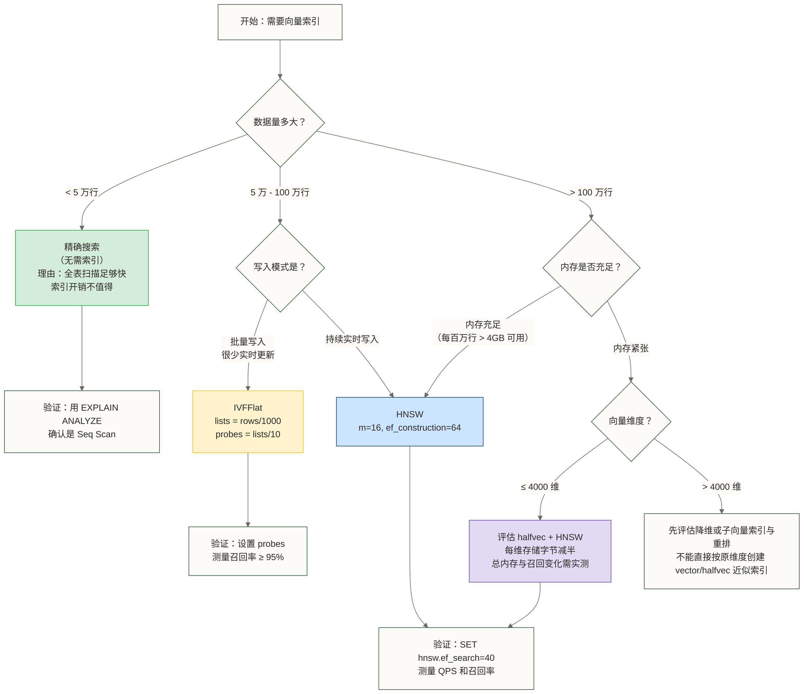

# pgvector 索引类型与选型指南

## 先讲一个故事，再讲技术

假设你是一个图书管理员，面前有 100 万本书，有读者来问："请帮我找 10 本和《人类简史》最相关的书。"

你有三种工作方式：

**方式一：逐本翻看。** 从第一本开始，每本都翻一下，记录相关性分数，翻完再排名。100 万本全看完，准确率 100%，但读者已经等了三天。

**方式二：先把书分成主题区。** 历史区、科学区、哲学区……先判断《人类简史》属于哪几个区，只去那几个区找，不看其他的。速度快了，但如果分类有点模糊，可能会漏掉一些隐藏在"社会学区"的好书。

**方式三：建一张多层"关系网络地图"。** 在这张地图里，每本书都和它最相关的几本书有"连线"。找的时候，先跳到大概位置，然后沿着连线不断接近，直到找不到更近的为止。速度快，而且很少漏掉好书。

这三种方式，对应的正是 pgvector 的三种查询策略：**精确搜索（无索引）、IVFFlat、HNSW**。

---

## 目录

- [[#三种策略全景对比]]
- [[#精确搜索：暴力的美学]]
- [[#IVFFlat：聪明的分区策略]]
- [[#HNSW：工业界的首选]]
- [[#halfvec 与新型向量类型]]
- [[#选型决策树]]
- [[#性能基准数据]]
- [[#常见误区与避坑指南]]

---

## 三种策略全景对比

在深入每种方式之前，先给你一张全景地图，知道自己在哪里：

| 维度 | 精确搜索（无索引） | IVFFlat | HNSW |
|------|------------------|---------|------|
| **召回率** | 100%（精确） | 中等（约 95-99%） | 高（约 97-99%+） |
| **查询速度** | 慢（线性扫描） | 中等 | 快 |
| **建索引速度** | 无需建索引 | 快（分钟级） | 慢（10x-40x IVFFlat） |
| **内存占用** | 小 | 小 | 大（约 IVFFlat 的 2-3x） |
| **实时写入** | 友好 | 不友好（需重建） | 友好 |
| **参数复杂度** | 无 | 低（2 个参数） | 中（2-3 个参数） |
| **适用数据量** | < 10 万行 | 10 万 - 500 万行 | 10 万 - 数千万行 |
| **推荐场景** | 原型验证、小数据 | 内存受限、写少读多 | 大多数生产场景 |

> [!tip] 快速结论
> 如果尚不确定，可先将 HNSW 作为候选方案，再结合内存、写入负载和召回率实测与 IVFFlat、精确搜索比较；这里不将其表述为官方与实践者的一致推荐。本文的其余部分解释为什么，以及什么时候应该做例外选择。

---

## 精确搜索：暴力的美学

### 什么是精确搜索

"精确搜索"听起来很奢侈，但它的实现方式非常朴素：**不建索引，直接全表扫描**。

```sql
-- 没有任何索引，这就是精确搜索
SELECT id, content, embedding <-> '[0.1, 0.2, 0.3, ...]'::vector AS distance
FROM documents
ORDER BY embedding <-> '[0.1, 0.2, 0.3, ...]'::vector
LIMIT 10;
```

PostgreSQL 会把每一行的向量都拿出来，计算与查询向量的距离，排序后返回前 10 个。没有任何近似，结果是完全准确的。

### 为什么不总是用精确搜索

计算量与行数成正比。1000 行的时候你感觉不到差别，100 万行的时候每次查询都要算 100 万次距离，这会让查询时间从毫秒变成秒。

### 精确搜索真正发光的场景

> [!note] 精确搜索的正确打开方式
> 以下场景中，精确搜索不仅可以接受，甚至是最优选择：
>
> - **数据量小于 5 万行**：在这个规模下，全表扫描通常在几十毫秒内完成，加索引带来的开销（内存、维护成本）反而不值得
> - **原型开发阶段**：你不知道最终数据量和访问模式时，先跑起来再说
> - **对准确率有绝对要求**：某些金融、医疗场景，哪怕 1% 的漏召都不可接受
> - **向量维度极高**（> 2000 维）：高维空间下，近似算法的优势缩小，有时精确搜索反而更实际

### 精确搜索的性能感受

以下延迟数字暂作为假设性示例（1536 维向量，单机 PostgreSQL），未提供可追溯测试条件，不代表实际性能：

| 行数 | 查询时间（近似） |
|------|----------------|
| 1 万 | 5-20 ms |
| 10 万 | 50-200 ms |
| 50 万 | 250ms - 1s |
| 100 万 | 500ms - 2s+ |

10 万行以下，精确搜索通常是完全可以接受的。

---

## IVFFlat：聪明的分区策略

### 原理：图书馆的主题分区

IVFFlat 的全名是 **Inverted File with Flat quantization（倒排文件 + 平铺量化）**。名字很学术，原理其实很直觉。

还记得图书馆的比喻？IVFFlat 做的事情是：

**第一步：建索引时，把所有书分成 N 个"主题区"（cluster）。** 用 k-means 聚类算法，把所有向量分成若干簇，每个簇有一个"中心点"（centroid）。

**第二步：查询时，先找出最近的几个"主题区"，只在这些区里搜索。** 不是看全部 100 万本书，只看最相关的几个区的几万本书。

```text
所有向量
    ↓ k-means 聚类
[区域1中心] [区域2中心] [区域3中心] ... [区域N中心]
    ↓ 每个向量归属最近的中心
区域1: [v1, v5, v9, ...]
区域2: [v2, v7, v11, ...]
...

查询时：
1. 找到与查询向量最近的 K 个中心
2. 只在这 K 个区域内进行精确搜索
3. 返回全局最近的 top-N 结果
```

### `lists` 参数：区域数量怎么定

`lists` 决定了把数据分成多少个"主题区"。

```sql
CREATE INDEX ON documents USING ivfflat (embedding vector_cosine_ops)
WITH (lists = 100);
```

**官方推荐公式：**

```text
数据量 < 100 万行：lists = 行数 / 1000
数据量 > 100 万行：lists = sqrt(行数)
```

**为什么是这个公式？** 直觉上理解：

- 分区太少（比如 `lists = 10`）：每个区太大，搜索仍然很慢，等于没分
- 分区太多（比如 `lists = 10000`）：每个区太小，需要搜索的区数量多，精度没提升但开销大
- 经验公式给出的是"每个区平均 1000 个向量"的目标，这个粒度在速度和精度之间取得了平衡

**实际参数建议：**

| 数据量 | 推荐 lists |
|--------|-----------|
| 10 万行 | 100 |
| 50 万行 | 500 |
| 100 万行 | 1000 |
| 500 万行 | 2236（sqrt(500万)） |
| 1000 万行 | 3162（sqrt(1000万)） |

> [!warning] 重要：建索引时必须有足够数据
> IVFFlat 依赖 k-means 聚类来划分区域，聚类需要数据。**建议在数据量达到预期规模的 50% 以上时再建索引**，否则聚类结果不准，后续查询的召回率会比较低。
>
> 如果数据量增长到 `lists` 参数的 256 倍以上，考虑重建索引。

### `probes` 参数：查询时多看几个区

`probes` 是**查询时**控制的参数（不是建索引时），决定每次查询要"探索"多少个区域。

```sql
-- 在会话级别设置，也可以在事务中设置
SET ivfflat.probes = 10;

-- 或者在 GUC 配置中全局设置
-- ivfflat.probes = 10
```

**`probes` 的权衡：**

```ini
probes = 1   → 只看最近的1个区域，最快，但召回率低（可能 70-80%）
probes = 10  → 看最近的10个区域，适中，召回率约 90-95%
probes = lists → 看所有区域，等于精确搜索，最慢但 100% 召回
```

**经验规则：**
- 起始值：`probes = lists / 10`（适合 10 万 - 100 万行）
- 可将 `probes = sqrt(lists)` 作为另一候选起点；高精度需求应依据召回率测试增大 probes，不能把该公式视为比 lists / 10 更高精度的配置
- 极高精度：`probes = lists`（等同于精确搜索，通常不必要）

> [!tip] 快速标定方法
> 用 `SELECT` 查询一批已知相关的结果，对比不同 `probes` 值下的召回率，找到"召回率 ≥ 95% 时最小的 probes 值"。这通常是你的最优配置。

### IVFFlat 的致命弱点：对实时写入不友好

这是 IVFFlat 最重要的局限性，必须理解。

**问题：** 建索引时，k-means 聚类已经固定了所有区域的"中心点"。新写入的数据会被分配到最近的中心点所在的区域，**但如果新数据和原来的数据分布差异很大**，它们可能被分配到一个"语义上不对"的区域，导致查询时这些新数据被漏掉。

**类比：** 你把图书馆的书按"历史、科学、哲学"分好了区。突然进来一批量子计算的书，只能被分到"科学区"，但如果有人问"和量子纠缠最相关的书"，可能要探索多个区域才能找到它们，而且如果 probes 设得小，还可能漏掉。

**实际影响：**
- 写入新数据后，不需要立刻重建索引，但召回率会随时间缓慢下降
- 如果数据分布发生显著变化，需要 `REINDEX TABLE documents;` 重建索引
- 普通 REINDEX 会阻塞写入，并可能阻塞使用相关索引的查询，不能假定自动降级为精确搜索；应评估维护窗口或并发重建方式

**什么情况下可以接受这个缺点：**
- 数据主要是批量导入，很少实时写入（比如文档库、商品库）
- 有固定的维护窗口，可以定期重建索引
- 内存非常紧张，无法承受 HNSW 的内存开销

---

## HNSW：工业界的首选

### 原理：多层高速公路网络

HNSW 的全名是 **Hierarchical Navigable Small World（层次化可导航小世界图）**。这个名字描述了一个精妙的数据结构。

**多层高速公路的比喻：**

想象一个城市的交通网络：

- **最顶层**（高速公路）：只有少数几个超级枢纽节点，彼此之间有高速通道。你可以快速从北京跳到广州。
- **中间层**（省道）：更多的城市，连接更密集，可以定位到具体省份。
- **最底层**（小路）：所有村庄（所有数据点），每个节点和附近的邻居相连。

**查询的过程：**

1. 从最顶层进入，快速找到大概方向（跳跃到距离目标近的超级节点）
2. 下降到中间层，定位到更精细的区域
3. 到达最底层，在小范围内精确找出最近邻

```text
第 3 层（最稀疏）:  O --------> O ------> O*
                              ↓
第 2 层:          O --> O --> O --> O --> O*
                                        ↓
第 1 层（最密）:   O-O-O-O-O-O-O-O-O-O-O*

O* = 查询向量附近的区域
查询路径: 粗定位 → 精定位 → 精确匹配
```

这种"从粗到细"的搜索策略，让 HNSW 在大数据集上的查询速度远超 IVFFlat，因为它不需要探索大量区域，而是沿着图的边"导航"到目标。

### `m` 参数：每个节点有几条"出路"

`m` 决定了 HNSW 图中每个节点最多连接多少个邻居（在底层，实际连接数是 `2m`）。

```sql
CREATE INDEX ON documents USING hnsw (embedding vector_cosine_ops)
WITH (m = 16, ef_construction = 64);
```

**`m` 的直觉理解：**

把每个节点（向量）想象成地图上的一个城市。`m` 决定了这个城市有多少条高速公路出口。

- `m = 4`：每个城市只有 4 条高速，连通性差，查询时可能走很多弯路，但图小，节省内存
- `m = 16`（默认）：每个城市 16 条高速，连通性好，是大多数场景的最佳平衡
- `m = 32`：更丰富的连通性，对高维向量（>1000 维）有帮助，但内存增加

**参数指导：**

| 场景 | 推荐 m |
|------|--------|
| 低维向量（< 100 维）、内存受限 | 4 - 8 |
| 通用场景（100 - 1000 维） | 16（默认） |
| 高维向量（1000 - 3000 维）、高精度要求 | 24 - 48 |
| 极高维向量、最高精度 | 48 - 64 |

> [!warning] m 不能修改
> 索引建好后，`m` 参数无法修改，需要删除重建索引。所以在数据量大的情况下，选择 `m` 值要慎重。

### `ef_construction` 参数：建路时的施工精度

`ef_construction` 决定了**建索引时**，在插入每个节点时探索多少候选邻居来确定最终的连接。

**直觉理解：**

建高速公路的时候，你要决定"这个城市应该和哪些城市直接相连"。

- `ef_construction` 小：只考虑眼前的几个候选，快速决定，但可能漏掉了更好的选择
- `ef_construction` 大：广泛考察更多候选，找到最优连接方案，但建设时间更长

**规则：**
- 必须 `ef_construction >= 2 * m`
- 默认值 64，在大多数场景下是合理的
- 增大 `ef_construction` 可以提高索引质量（召回率），但建索引时间延长

| ef_construction | 索引质量 | 建索引时间 |
|----------------|---------|-----------|
| 32 | 中等 | 快 |
| 64（默认） | 好 | 中等 |
| 128 | 很好 | 慢 |
| 256 | 极好 | 很慢 |

### `ef_search`：查询时的搜索精度

这是一个**查询时**的参数（类似 IVFFlat 的 `probes`），控制查询时探索的候选节点数量。

```sql
SET hnsw.ef_search = 40;  -- 默认值

-- 或者在特定查询中临时调整
BEGIN;
SET LOCAL hnsw.ef_search = 100;
SELECT * FROM documents ORDER BY embedding <-> query_vec LIMIT 10;
COMMIT;
```

**权衡：**
- `ef_search` 越大：召回率越高，查询越慢
- 对常规非迭代 HNSW 扫描，通常应使 `ef_search` 不小于目标返回数量；这不是参数合法性约束，过滤、死元组等因素仍可能使结果不足 LIMIT，需按实际版本与执行计划评估
- 默认值 40 在大多数场景下是合理的起点

### HNSW 为什么对实时写入友好

这是 HNSW 相对于 IVFFlat 最重要的优势之一，值得单独解释。

**IVFFlat 的问题：** 建索引时有"训练"步骤（k-means 聚类），聚类中心固定后，新数据只能被分配到已有的中心。如果数据分布变化，索引质量下降。

**HNSW 的机制：** 没有"训练"步骤。每插入一个新向量时，HNSW 会实时地把这个向量"连接"进图中——找到它的近邻，建立连接边，更新图结构。新数据被自然地整合进图里，不会有"旧中心不匹配"的问题。

**实际效果：**

```sql
-- HNSW 索引在插入新数据时不需要额外操作
INSERT INTO documents (content, embedding) VALUES (..., '[...]');
-- 索引自动更新；查询质量仍需随数据分布、删除更新和搜索参数持续评估
```

对于需要实时写入的场景（比如实时爬取的文档、用户生成内容），HNSW 无需像 IVFFlat 那样维护固定聚类中心，但仍需常规数据库维护和召回率监控；IVFFlat 是否需要重建应结合数据分布变化与实测结果判断。

> [!note] 一个实际的权衡
> HNSW 的实时插入虽然方便，但每次插入时都要更新图结构，这意味着**高并发写入**时有一定的锁竞争。对于极高写入吞吐（每秒万条以上），需要评估实际性能表现。

---

## halfvec 与新型向量类型

pgvector 0.7.0（2024年4月）引入了三种新向量类型，这是一个重要的里程碑。

### halfvec：内存减半的代价

**是什么：** `halfvec` 用 16 位浮点数（半精度）存储每个维度，而 `vector` 用 32 位浮点数。存储空间减半。

```sql
-- 普通 vector：每维 4 字节
-- 1536 维 = 1536 × 4 = 6144 字节/行
CREATE TABLE documents_f32 (
    id bigserial PRIMARY KEY,
    embedding vector(1536)
);

-- halfvec：每维 2 字节
-- 1536 维 = 1536 × 2 = 3072 字节/行（减半）
CREATE TABLE documents_f16 (
    id bigserial PRIMARY KEY,
    embedding halfvec(1536)
);
```

**假设性性能对比示例（1.2 百万向量；未提供可追溯测试条件，不代表实测收益）：**

| 指标 | vector（float32） | halfvec（float16） | 变化 |
|------|------------------|-------------------|------|
| 表存储大小 | ~9 GB | ~5 GB | -44% |
| IVFFlat 索引大小 | ~2.1 GB | ~0.7 GB | -66% |
| 查询速度 | 基准 | 略快 5-10% | 轻微提升 |
| 召回率 | 基准 | 相差 < 0.5% | 几乎无损 |

**适用场景：**
- 内存资源紧张的服务器
- 向量维度较高（1536、3072 维）的场景
- 大规模数据集（百万级以上）
- 对精度要求不是极端严苛的业务

**局限性：**
- `halfvec` 与 `vector` 的类型存储上限均为 16000 维；近似索引的维度上限需另行区分：`halfvec` 为 4000 维，`vector` 为 2000 维
- 计算精度略低于 float32，极少数边界情况下结果可能有细微差异
- 并非所有运算函数都支持 `halfvec`（主要搜索功能均已支持）

### sparsevec：稀疏向量的专属优化

**是什么：** 对于大多数维度值为 0 的向量（稀疏向量），`sparsevec` 只存储非零维度和它们的索引。

**典型使用场景：** BM25、TF-IDF 等传统文本检索方法产生的词袋向量，词汇表可能有 10 万维，但一篇文章可能只有几百个非零词。

```sql
-- 普通 vector：10 万维全部存储 = 400 KB/行
-- sparsevec：只存非零元素 = 几 KB/行

CREATE TABLE search_index (
    id bigserial PRIMARY KEY,
    sparse_embedding sparsevec(100000)  -- 10 万维词袋向量
);

-- 插入稀疏向量
INSERT INTO search_index (sparse_embedding)
VALUES ('{1:0.5, 500:0.3, 2000:0.8}/100000');
--      ^位置:值  ^位置:值  ^位置:值  ^总维度
```

**HNSW 支持：** `sparsevec` 支持最多 1000 个非零元素的 HNSW 索引

### bit：二进制向量

**是什么：** 每个维度只用 1 个 bit（0 或 1）存储。存储效率是 float32 的 1/32。

**典型使用场景：**
- 图像的感知哈希（perceptual hash）
- 二值化神经网络的输出
- 数据去重（相似文档检测）

```sql
CREATE TABLE images (
    id bigserial PRIMARY KEY,
    phash bit(256)  -- 256 位感知哈希
);

-- 用 Hamming 距离搜索（bit 之间不同的个数）
SELECT id FROM images
ORDER BY phash <~> query_hash  -- <~> 是 Hamming 距离
LIMIT 10;
```

> [!info] 向量类型选择总结
>
> | 类型 | 精度 | 内存 | 适用场景 |
> |------|------|------|---------|
> | `vector` | 最高（float32） | 基准 | 通用场景、精度优先 |
> | `halfvec` | 高（float16） | 1/2 | 大规模场景、内存受限 |
> | `sparsevec` | 最高（float32） | 取决于非零数 | 稀疏高维向量 |
> | `bit` | N/A（二进制） | 1/32 | 哈希相似度、去重 |

---

## 选型决策树



### 每种场景的完整配置示例

**场景 A：小型应用，< 5 万行，精确搜索**

```sql
-- 不需要创建任何索引
-- 可以为业务字段创建普通 B-tree 索引辅助过滤
CREATE INDEX ON documents (category, created_at);

-- 查询时直接 ORDER BY
SELECT id, content, embedding <-> query_vec AS distance
FROM documents
WHERE category = 'tech'
ORDER BY embedding <-> query_vec
LIMIT 10;
```

**场景 B：中型批量数据，IVFFlat，50 万行**

```sql
-- 数据全部导入后再建索引
INSERT INTO documents SELECT ... FROM staging_table;

-- 建索引（lists = 50万/1000 = 500）
CREATE INDEX idx_ivfflat ON documents
USING ivfflat (embedding vector_cosine_ops)
WITH (lists = 500);

-- 查询时设置 probes
SET ivfflat.probes = 50;  -- 待实测标定的起始值

SELECT id, content
FROM documents
ORDER BY embedding <=> query_vec
LIMIT 10;
```

**场景 C：生产环境，持续写入，HNSW**

```sql
-- 在建索引前设置 maintenance_work_mem；按可用内存评估
SET maintenance_work_mem = '2GB';

-- 可以在有数据前就建索引（HNSW 不需要训练）
CREATE INDEX idx_hnsw ON documents
USING hnsw (embedding vector_cosine_ops)
WITH (m = 16, ef_construction = 64);

-- 查询（使用默认 ef_search = 40；query_vec 需绑定为查询向量）
SELECT id, content
FROM documents
ORDER BY embedding <=> query_vec
LIMIT 10;

-- 需要更高召回率时，调整并测量效果
SET hnsw.ef_search = 100;
SELECT id, content
FROM documents
ORDER BY embedding <=> query_vec
LIMIT 10;
```

**场景 D：大规模场景，内存受限，halfvec + HNSW**

```sql
-- 使用 halfvec 类型（类型存储上限为 16000 维，此处近似索引上限为 4000 维）
CREATE TABLE documents (
    id bigserial PRIMARY KEY,
    content text,
    embedding halfvec(1536)
);

-- 使用 halfvec_cosine_ops 操作符
CREATE INDEX idx_hnsw_half ON documents
USING hnsw (embedding halfvec_cosine_ops)
WITH (m = 16, ef_construction = 64);

-- 查询（操作符和 vector 类型相同）
SELECT id, content
FROM documents
ORDER BY embedding <=> query_vec::halfvec
LIMIT 10;
```

---

## 性能基准数据

以下保留的数字暂作为假设性性能对比示例，设定数据集为 100 万条 1536 维向量；原文未提供可定位的基准报告及测试条件，不能将其认定为 AWS、Tembo 或 Medium 已证实的测试结果。

### HNSW vs IVFFlat：速度与召回率对比

**达到 99.8% 召回率时的吞吐量：**

| 索引类型 | QPS（每秒查询数） | 内存占用 |
|---------|-----------------|---------|
| HNSW | **40.5 QPS** | ~729 MB |
| IVFFlat | 2.6 QPS | ~257 MB |
| **差距** | **HNSW 快 15.5x** | IVFFlat 省 2.8x |

**建索引时间对比（100 万行，1536 维）：**

| 索引类型 | 建索引时间 |
|---------|----------|
| IVFFlat（lists=1000） | ~2-5 分钟 |
| HNSW（m=16, ef_construction=64） | ~30-90 分钟 |
| **差距** | IVFFlat 快 12-42x |

> [!warning] 建索引时间说明
> HNSW 建索引慢，但这通常是一次性的（或低频的重建）。在生产系统中，可以：
> 1. 在业务低峰期建索引，使用 `CREATE INDEX CONCURRENTLY`（通常不阻塞正常读写，但仍需获取锁，并可能等待事务）
> 2. 先建好索引再上线服务
> 3. 使用副本库建索引，切换主从

### 不同 ef_search 对 HNSW 性能的影响

| ef_search | 召回率 | QPS（100万行） |
|-----------|--------|--------------|
| 10 | ~88% | ~200 QPS |
| 40（默认） | ~97% | ~100 QPS |
| 100 | ~99% | ~50 QPS |
| 200 | ~99.5% | ~25 QPS |

**结论：** 上表仅是假设性示例，不能据此认定 `ef_search = 40` 固定达到 97% 召回率或满足大多数 RAG 应用。可以将 40 作为候选起点，并对 80-100 等值测量召回率、延迟及业务效果。

### halfvec 的实际收益

以下为假设性收益示例，设定为 120 万条 1536 维向量；未提供测试条件，且与前文存储表的口径关系不明，不代表已证实的收益：

| 指标 | vector（float32） | halfvec（float16） | 改善 |
|------|------------------|-------------------|------|
| 总存储（表+索引） | 21 GB | 9 GB | -57% |
| IVFFlat 索引大小 | 6.2 GB | 2.1 GB | -66% |
| 查询速度 | 基准 | 快 5-8% | 轻微提升 |
| 召回率 | 基准 | 差距 < 0.3% | 几乎无损 |

---

## 常见误区与避坑指南

### 误区 1：建了索引但查询还是很慢

**症状：** 创建了 HNSW 或 IVFFlat 索引，但 `EXPLAIN ANALYZE` 显示仍然是 `Seq Scan`。

**原因：**
1. **LIMIT 数量过大：** 如果你 `LIMIT 10000`，PostgreSQL 认为反正要扫大量数据，不如直接顺序扫描
2. **操作符不匹配：** 索引用 `vector_cosine_ops` 建的，查询用 `<->`（L2 距离），操作符不对，索引无法使用
3. **统计信息过旧：** `ANALYZE documents;` 更新统计信息后再试

**解决方法：**

```sql
-- 检查索引是否被使用
EXPLAIN (ANALYZE, BUFFERS)
SELECT * FROM documents ORDER BY embedding <-> query_vec LIMIT 10;

-- 强制使用索引（调试用，生产慎用）
SET enable_seqscan = off;

-- 确认操作符一致性
-- 索引用 cosine，查询也用 <=> （cosine）
CREATE INDEX idx ON documents USING hnsw (embedding vector_cosine_ops);
SELECT * FROM documents ORDER BY embedding <=> query_vec LIMIT 10; -- 正确
SELECT * FROM documents ORDER BY embedding <-> query_vec LIMIT 10; -- 错误！
```

### 误区 2：直接在生产数据上 `CREATE INDEX`

**风险：** 普通 `CREATE INDEX` 会阻塞表上的写入，但通常允许普通 SELECT 继续执行；生产影响需结合事务与锁等待评估。

**解决方法：**

```sql
-- 使用 CONCURRENTLY，通常不阻塞正常读写，但仍需获取锁并可能等待事务
CREATE INDEX CONCURRENTLY idx_hnsw ON documents
USING hnsw (embedding vector_cosine_ops)
WITH (m = 16, ef_construction = 64);
```

**注意：** `CONCURRENTLY` 不能在事务块内使用，且如果中途失败，会留下一个"无效"索引，需要手动清理：

```sql
-- 清理失败的索引
DROP INDEX CONCURRENTLY idx_hnsw;
```

### 误区 3：IVFFlat 数据量少时就建索引

**症状：** 表里只有 1 万行数据时建了 `lists = 100` 的 IVFFlat 索引，查询召回率很低。

**原因：** 1 万行数据，分成 100 个区，每区平均只有 100 个向量。k-means 聚类样本太少，聚类质量差。后续导入数据后，新数据被分配到质量差的聚类中心，召回率持续偏低。

**解决方法：** 等数据量达到 `lists * 100` 以上再建索引（`lists = 100` 时，等到 1 万行以上），或者先用精确搜索，数据量足够后再建索引。

### 误区 4：认为 HNSW 召回率是 100%

**症状：** 使用 HNSW 后，发现偶尔漏掉了应该在前 10 的结果。

**原因：** HNSW 是近似算法，不保证 100% 召回率；`ef_search = 40` 的实际召回率取决于数据、索引参数、查询与过滤条件，不能固定认定为 95-97%。

**解决方法：**

```sql
-- 提高 ef_search 换取更高召回率
SET hnsw.ef_search = 100;  -- 增大搜索预算后重新测量召回率，不保证达到 99%

-- 或者对召回率要求极高的场景，使用精确搜索
SET enable_indexscan = off;  -- 强制顺序扫描（精确搜索）
```

### 误区 5：`maintenance_work_mem` 不够大导致建索引很慢

**症状：** 建 HNSW 索引花了好几个小时，日志里有 `XXX of memory required, XXXX available` 的警告。

**原因：** HNSW 建索引需要把大量数据放在内存中构建图结构，`maintenance_work_mem` 不够时会分批处理，大幅增加时间。

**解决方法：**

```sql
-- 建索引前设置足够的内存
SET maintenance_work_mem = '4GB';  -- 根据你的内存调整

-- 或者在 postgresql.conf 中设置（全局）
-- maintenance_work_mem = 4GB
```

**参考：** 对于 100 万行 1536 维 float32 向量，建 HNSW 索引大约需要 2-4 GB 的 `maintenance_work_mem`。

---

## 索引维护与运维操作

### 查看索引状态

```sql
-- 查看所有向量索引
SELECT
    schemaname,
    tablename,
    indexname,
    indexdef
FROM pg_indexes
WHERE indexdef ILIKE '%hnsw%' OR indexdef ILIKE '%ivfflat%'
ORDER BY tablename, indexname;

-- 查看索引大小
SELECT
    indexname,
    pg_size_pretty(pg_relation_size(indexname::regclass)) AS index_size
FROM pg_indexes
WHERE tablename = 'articles'
  AND (indexdef ILIKE '%hnsw%' OR indexdef ILIKE '%ivfflat%');

-- 查看表和索引的总大小
SELECT
    pg_size_pretty(pg_table_size('articles')) AS table_size,
    pg_size_pretty(pg_indexes_size('articles')) AS indexes_size,
    pg_size_pretty(pg_total_relation_size('articles')) AS total_size;
```

### 监控索引使用情况

```sql
-- 查看索引使用频率（需要 pg_stat_user_indexes 视图）
SELECT
    schemaname,
    relname AS table_name,
    indexrelname AS index_name,
    idx_scan AS scan_count,
    idx_tup_read AS tuples_read,
    idx_tup_fetch AS tuples_fetched
FROM pg_stat_user_indexes
WHERE relname = 'articles'
ORDER BY idx_scan DESC;

-- idx_scan = 0 表示当前统计观察窗口内未记录索引扫描；删除前需检查统计重置时间、完整业务周期及索引用途
```

### 索引重建与维护

```sql
-- 重建索引（会锁表，建议在低峰期执行）
REINDEX INDEX idx_articles_hnsw;

-- 并发重建（通常不阻塞正常读写，但仍需获取锁并可能等待事务）
REINDEX INDEX CONCURRENTLY idx_articles_hnsw;

-- IVFFlat 索引因数据变化导致质量下降时，完整重建
DROP INDEX idx_articles_ivfflat;
CREATE INDEX idx_articles_ivfflat ON articles
USING ivfflat (embedding vector_cosine_ops)
WITH (lists = 1000);

-- 并发版本（推荐生产环境使用）
CREATE INDEX CONCURRENTLY idx_articles_ivfflat_new ON articles
USING ivfflat (embedding vector_cosine_ops)
WITH (lists = 1000);
-- 确认新索引正常后，删除旧索引
DROP INDEX idx_articles_ivfflat;
ALTER INDEX idx_articles_ivfflat_new RENAME TO idx_articles_ivfflat;
```

> [!tip] IVFFlat 何时需要重建
> 判断依据：做一个召回率测试，取 100 个已知的查询-答案对，检验实际召回率。如果召回率低于 90%（原本应该是 95%+），说明数据分布偏移严重，需要重建索引。
>
> 建议每季度评估一次，或在数据量翻倍后评估。

### 并行构建索引

对于大数据集，可以利用并行加速 HNSW 索引构建：

```sql
-- 临时增加并行工作进程数（需要 postgresql.conf 中 max_worker_processes 足够大）
SET max_parallel_maintenance_workers = 4;

-- 同时增加内存
SET maintenance_work_mem = '8GB';

-- 然后创建索引
CREATE INDEX CONCURRENTLY idx_articles_hnsw ON articles
USING hnsw (embedding vector_cosine_ops)
WITH (m = 16, ef_construction = 64);
```

**假设性性能示例（100 万行 1536 维；未提供实测依据，耗时需在目标环境测量）：**

| maintenance_work_mem | 并行度 | 建索引时间 |
|---------------------|--------|-----------|
| 512 MB | 1 | ~4 小时 |
| 2 GB | 1 | ~1.5 小时 |
| 4 GB | 2 | ~50 分钟 |
| 8 GB | 4 | ~25 分钟 |

---

## 不同业务场景的完整配置方案

### 方案一：RAG 知识库（文档检索）

**特征：** 文档量 10-100 万，以读为主，偶尔批量更新

```sql
-- 建表
CREATE TABLE rag_documents (
    id          bigserial PRIMARY KEY,
    source      text,           -- 来源（文件名、URL 等）
    chunk_index integer,        -- 文档切片序号
    content     text,
    metadata    jsonb,          -- 灵活的元数据（文档类型、标签等）
    embedding   vector(1536),
    created_at  timestamptz DEFAULT now()
);

-- HNSW 索引（余弦距离，适合语义搜索）
CREATE INDEX idx_rag_hnsw ON rag_documents
USING hnsw (embedding vector_cosine_ops)
WITH (m = 16, ef_construction = 64);

-- 元数据过滤索引（GIN 支持 jsonb 的包含查询）
CREATE INDEX idx_rag_metadata ON rag_documents USING gin(metadata);
CREATE INDEX idx_rag_source ON rag_documents (source);

-- 典型查询
SELECT
    id, source, chunk_index, content,
    embedding <=> query_vec AS distance
FROM rag_documents
WHERE metadata @> '{"doc_type": "technical"}'::jsonb  -- 元数据过滤
ORDER BY embedding <=> query_vec
LIMIT 5;
```

### 方案二：电商商品推荐（实时写入）

**特征：** 商品量百万级，实时上新，高并发查询

```sql
-- 建表（使用 halfvec 节省内存）
CREATE TABLE products (
    id              bigserial PRIMARY KEY,
    name            text NOT NULL,
    category_id     integer,
    price           numeric(10, 2),
    brand           text,
    is_active       boolean DEFAULT true,
    embedding       halfvec(1536),  -- 每维数值存储字节减半，总内存收益需实测
    updated_at      timestamptz DEFAULT now()
);

-- HNSW 索引（halfvec 操作符）
CREATE INDEX idx_products_hnsw ON products
USING hnsw (embedding halfvec_cosine_ops)
WITH (m = 24, ef_construction = 100);  -- m 调大，适应高维+高查询量

-- 局部索引：只对在售商品建索引（减小索引大小）
CREATE INDEX idx_products_active_hnsw ON products
USING hnsw (embedding halfvec_cosine_ops)
WITH (m = 24, ef_construction = 100)
WHERE is_active = true;

-- 典型查询：在售、指定品类和价格范围内找相似商品；本查询未实现同品牌优先
SELECT
    id, name, brand, price,
    embedding <=> query_vec AS similarity
FROM products
WHERE is_active = true
  AND price BETWEEN :min_price AND :max_price
  AND category_id = :category_id
ORDER BY embedding <=> query_vec
LIMIT 20;
```

### 方案三：用户行为向量（超大规模）

**特征：** 亿级用户，向量维度低（64-256 维），QPS 极高

```sql
-- 建表（低维向量，用 float32 就够）
CREATE TABLE user_profiles (
    user_id     bigint PRIMARY KEY,
    embedding   vector(128),    -- 低维，无需 halfvec
    updated_at  timestamptz DEFAULT now()
);

-- IVFFlat 可能更合适：内存占用小，低维向量精度损失可接受
-- 数据量 1 亿行，lists = sqrt(1亿) ≈ 10000
CREATE INDEX idx_user_ivfflat ON user_profiles
USING ivfflat (embedding vector_cosine_ops)
WITH (lists = 10000);

-- 查询时 probes 设置
-- probes = sqrt(lists) = sqrt(10000) = 100
SET ivfflat.probes = 100;

SELECT user_id, embedding <=> query_vec AS similarity
FROM user_profiles
ORDER BY embedding <=> query_vec
LIMIT 50;
```

---

## 本章小结

| 关键点 | 核心原则 |
|--------|---------|
| **不知道选哪个** | 将 HNSW 作为候选起点，再与 IVFFlat、精确搜索进行负载和召回率比较 |
| **数据量 < 5 万行** | 可先评估精确搜索，是否足够取决于维度、过滤、并发和延迟目标 |
| **内存受限** | 考虑 halfvec + HNSW；每维数值存储字节减半，总内存收益需实测 |
| **批量导入** | 导入完成后再建索引，IVFFlat 也可以考虑 |
| **实时写入** | HNSW 是更好的选择 |
| **建索引** | 生产环境用 `CREATE INDEX CONCURRENTLY` |
| **索引不生效** | 检查操作符是否匹配，LIMIT 是否合理 |

> [!tip] 下一步学习
> - 学习如何写高效的向量 SQL 查询：[[【技术与工具】/向量数据库/pgvector/07-SQL向量查询实战|SQL 向量查询实战]]
> - 理解不同距离度量的含义：距离度量与相似性计算
> - 深入了解生产环境调优：生产环境配置与调优
