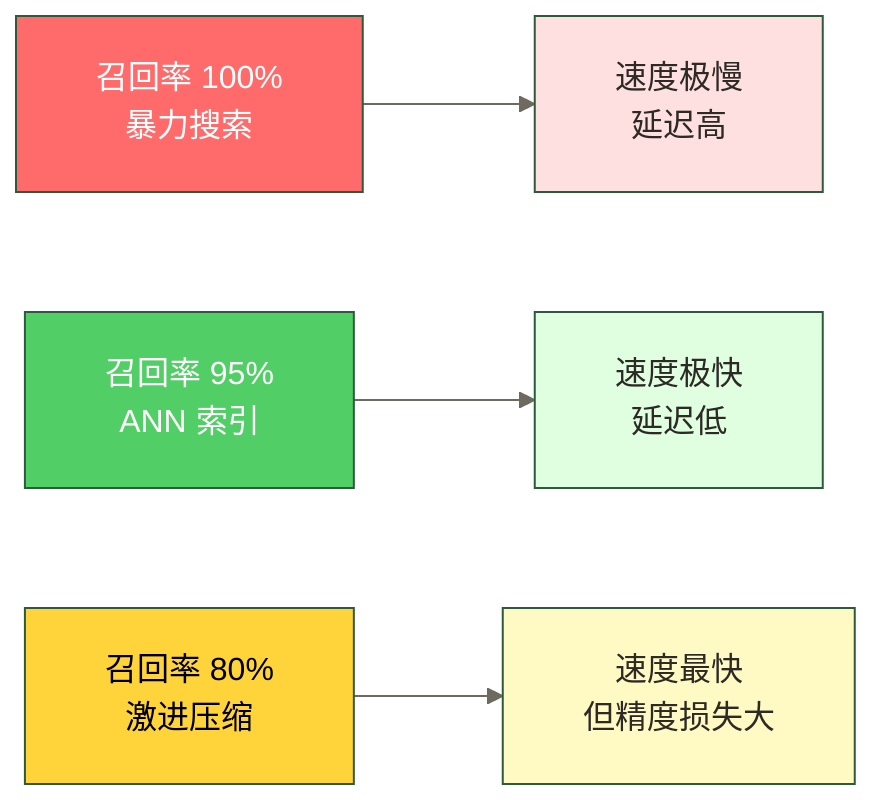
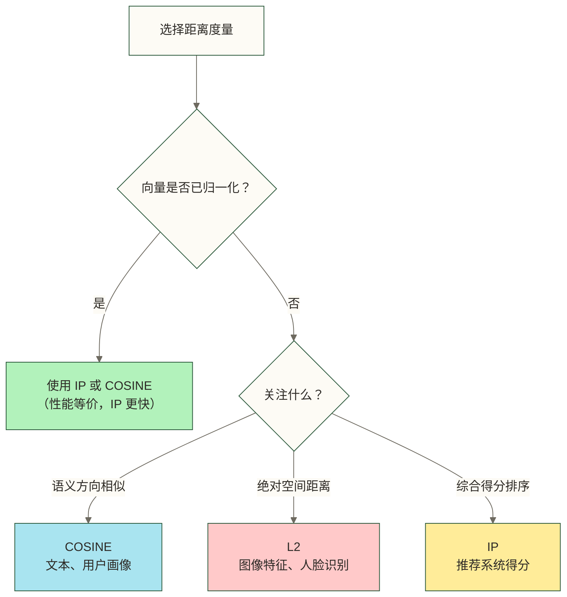
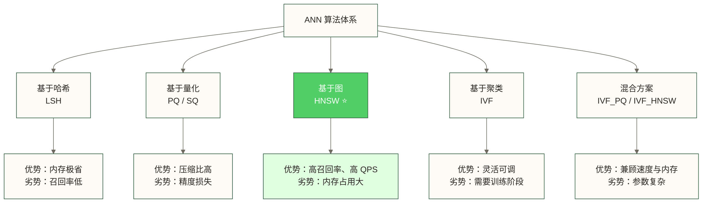
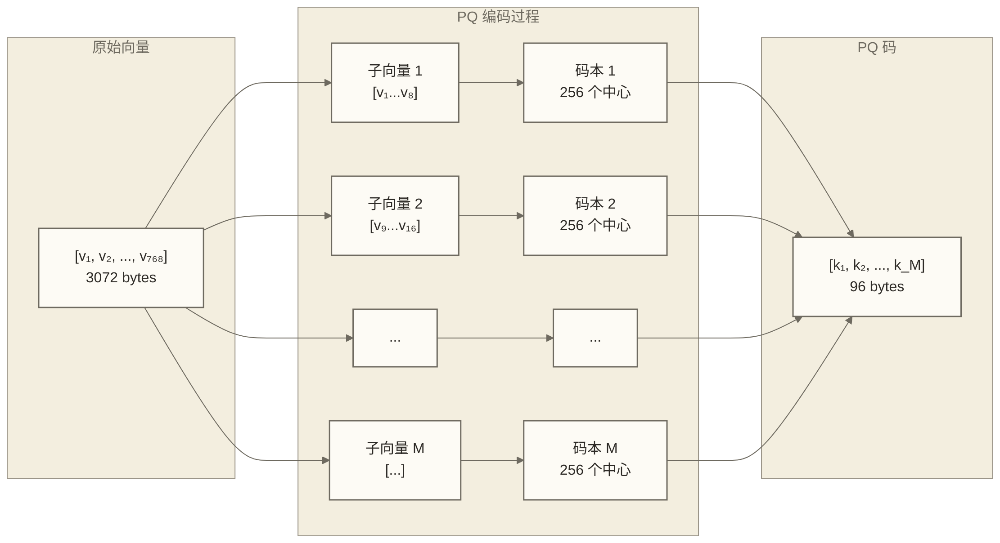
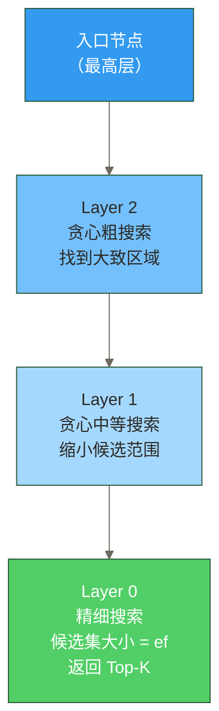
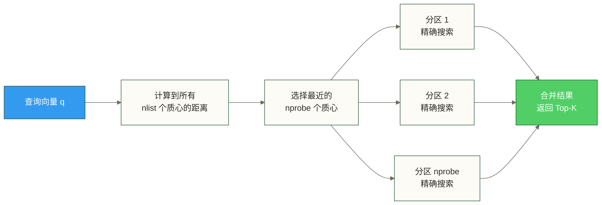
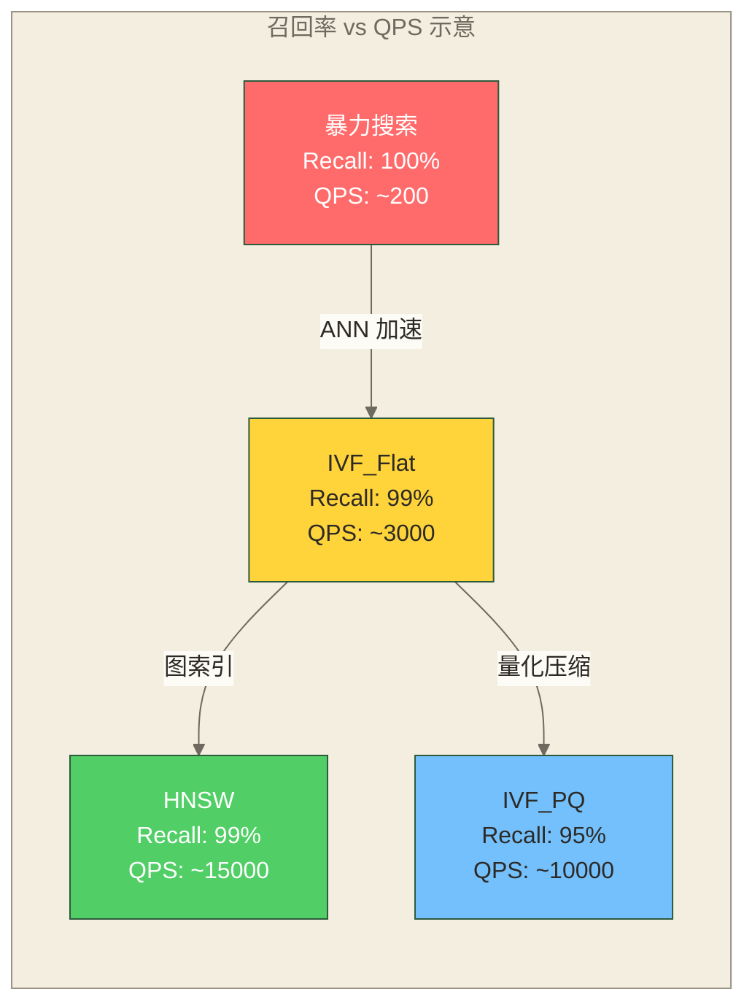
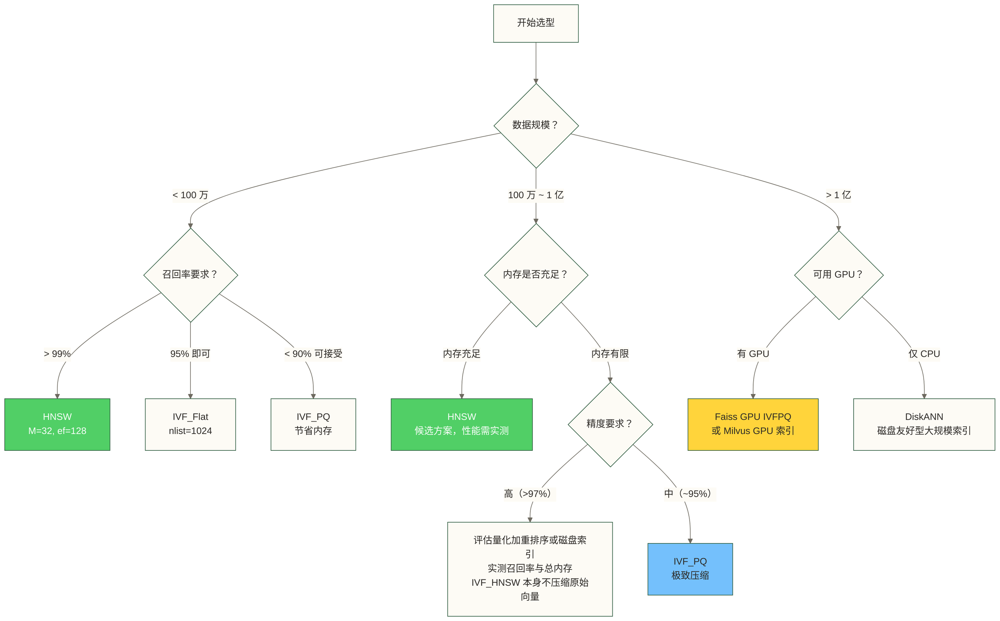
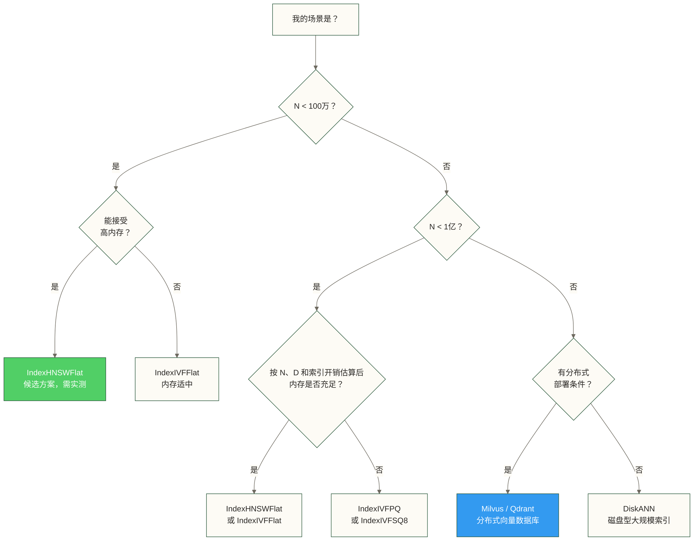

# 向量搜索原理与 ANN 算法

> [!note] 文档定位
> 本文是向量数据库技术体系的基础理论篇。理解本文内容，是正确选择索引类型、合理配置参数、评估系统性能的前提。建议配合 Milvus 索引选型指南 阅读，形成"理论 → 实践"的完整认知。

---

## 目录

1. [为什么精确最近邻搜索不可行](#1-为什么精确最近邻搜索不可行)
2. [向量距离度量方式](#2-向量距离度量方式)
3. [ANN 算法分类与核心原理](#3-ann-算法分类与核心原理)
   - 3.1 基于哈希：LSH 局部敏感哈希
   - 3.2 基于量化：PQ 乘积量化 + SQ 标量量化
   - 3.3 基于图：HNSW（重点）
   - 3.4 基于聚类：IVF 倒排文件索引
   - 3.5 混合方案：IVF_PQ、IVF_HNSW
4. [算法性能对比与选型决策树](#4-算法性能对比与选型决策树)
5. [工程实践指南](#5-工程实践指南)
6. [延伸阅读](#6-延伸阅读)

---

## 1. 为什么精确最近邻搜索不可行

### 1.1 最近邻搜索的本质问题

给定一个查询向量 $\mathbf{q} \in \mathbb{R}^D$ 和一个数据集 $\mathcal{X} = \{\mathbf{x}_1, \mathbf{x}_2, \ldots, \mathbf{x}_N\}$，精确最近邻（Exact Nearest Neighbor, ENN）搜索需要找到：

$$\mathbf{x}^* = \arg\min_{\mathbf{x}_i \in \mathcal{X}} d(\mathbf{q}, \mathbf{x}_i)$$

这在低维空间里不是问题。但在向量数据库的实际场景中，维度 $D$ 通常为 128（图像特征）、768（BERT 嵌入）乃至 3072（text-embedding-3-large）。这时候，两个根本性的问题出现了。

---

### 1.2 维度灾难（Curse of Dimensionality）

**维度灾难**是由 Richard Bellman 于 1957 年提出的概念，描述了高维空间中数据分布的反直觉特性。

#### 核心现象 1：所有点到查询点的距离趋于相等

在满足特定分布、采样和查询条件的高维随机模型中，距离可能出现集中，最大距离与最小距离之比趋向于 1；这不是任意高维数据都满足的规律。下式表达这类模型中的相对距离差异趋零：

$$\lim_{D \to \infty} \frac{d_{\max} - d_{\min}}{d_{\min}} \to 0$$

在上述距离集中条件下，最近邻与最远邻的相对距离差异可能很小，距离的区分能力可能减弱；实际嵌入数据是否如此需结合其分布和查询任务判断。

> [!tip] 直觉理解
> 想象在二维平面上，你站在中心，周围的点分布在各个方向，有远有近。现在换成 1000 维空间，绝大多数点都"挤"在一个薄薄的球壳上，距离你几乎相等。这就是为什么高维向量需要特殊的索引策略。

#### 核心现象 2：高维超球体的体积向表面集中

$D$ 维单位球的体积为：

$$V_D = \frac{\pi^{D/2}}{\Gamma(D/2 + 1)}$$

对于单位球内的均匀采样，固定 $0<\varepsilon<1$，半径不超过 $1-\varepsilon$ 的内球占单位球体积的比例为 $(1-\varepsilon)^D$，随 $D$ 增大趋向于 0。因此均匀采样点的半径会集中在靠近球面的薄壳中；这并不意味着任意高维数据分布都集中在球面附近。

#### 核心现象 3：维度增加导致覆盖数据所需的样本量指数级增长

若每个维度划分 $k$ 个区间，覆盖整个空间需要 $k^D$ 个区间。树形索引（KD-Tree、Ball Tree）在维度超过约 20 之后性能急剧退化，其时间复杂度从 $O(\log N)$ 退化为接近 $O(N)$。

---

### 1.3 暴力搜索的性能瓶颈

暴力（Brute-Force）搜索通过遍历所有向量计算距离：

| 参数 | 典型值 |
|------|--------|
| 向量维度 $D$ | 768（BERT 嵌入） |
| 数据集规模 $N$ | 1 亿条 |
| 单次查询浮点运算量 | $2 \times 768 \times 10^8 \approx 1.5 \times 10^{11}$ FLOPS |
| A100 GPU 理论吞吐 | $3.1 \times 10^{14}$ FLOPS/s |
| 理论最优查询延迟 | ~0.5 ms（仅计算，不含数据传输） |
| 实际 RAM 带宽瓶颈 | 1 亿 × 768 × 4 bytes = **300 GB** |

**核心瓶颈**不是计算，而是**内存带宽**。300 GB 的数据根本无法驻留在 GPU 显存中，数据搬运时间远超计算时间。

```text
暴力搜索复杂度分析：

时间复杂度：O(N × D)
空间复杂度：O(N × D)（需将全部向量加载到内存）

当 N = 1亿, D = 768 时：
  - 存储占用：1亿 × 768 × 4 bytes ≈ 300 GB（float32）
  - 单次查询：需扫描 300 GB 数据
  - 10 QPS 的吞吐需要：3 TB/s 内存带宽（不可行）
```

---

### 1.4 ANN 的工程权衡：召回率 vs 速度

**近似最近邻（Approximate Nearest Neighbor, ANN）** 的核心思路是：**牺牲少量精度，换取数量级的速度提升**。

这一权衡由两个核心指标刻画：

- **召回率（Recall@K）**：返回的 K 个结果中，真正的 K 个最近邻所占的比例
- **QPS（Queries Per Second）**：每秒能处理的查询请求数量

$$\text{Recall@K} = \frac{|\text{ANN 返回的 K 个结果} \cap \text{真实 K 个最近邻}|}{K}$$

> [!warning] 工程现实
> 可将 Recall@10 = 95% 作为某些场景的候选评估目标，但是否足够好需结合业务指标验证。若以吞吐提升 10-100 倍作为实验假设，也必须在相同硬件、数据和查询条件下与精确搜索基线比较；召回率下降是否影响用户体验不能仅由 Recall@10 判断。



---

## 2. 向量距离度量方式

距离（或相似度）的选择是向量搜索的第一个关键决策，直接影响索引构建和搜索结果的语义。

### 2.1 三种核心度量

#### L2 欧氏距离（Euclidean Distance）

$$d_{L2}(\mathbf{p}, \mathbf{q}) = \sqrt{\sum_{i=1}^{D} (p_i - q_i)^2}$$

- **语义**：向量在空间中的绝对几何距离
- **值域**：$[0, +\infty)$，越小越相似
- **适用场景**：图像特征检索（如 FaceNet）、需要考虑向量模长的场景

#### 内积（Inner Product / Dot Product）

$$\text{IP}(\mathbf{p}, \mathbf{q}) = \sum_{i=1}^{D} p_i \cdot q_i = \mathbf{p}^T \mathbf{q}$$

- **语义**：向量方向与模长的综合度量
- **值域**：$(-\infty, +\infty)$，越大越相似
- **适用场景**：推荐系统的矩阵分解（如 Collaborative Filtering）、OpenAI text-embedding 系列（官方推荐 IP）

#### 余弦相似度（Cosine Similarity）

$$\text{COSINE}(\mathbf{p}, \mathbf{q}) = \frac{\mathbf{p}^T \mathbf{q}}{\|\mathbf{p}\| \cdot \|\mathbf{q}\|}$$

- **语义**：仅考虑方向，忽略模长
- **值域**：$[-1, 1]$，越大越相似
- **适用场景**：文本语义相似度（BERT、Sentence-BERT）、用户兴趣方向匹配

### 2.2 三者关系与选择建议

> [!tip] 关键数学关系
> 对于**归一化向量**（$\|\mathbf{p}\| = \|\mathbf{q}\| = 1$），余弦相似度等价于内积，内积与 L2 距离满足：
> $$d_{L2}^2(\mathbf{p}, \mathbf{q}) = 2(1 - \text{IP}(\mathbf{p}, \mathbf{q}))$$
> 因此，归一化后使用 IP 搜索等价于使用余弦相似度，且计算效率更高。



| 度量方式 | 是否受模长影响 | 推荐 Embedding 类型 |
|---------|--------------|-------------------|
| L2 | 是 | 图像 CNN 特征、FaceNet |
| IP | 是 | OpenAI text-embedding、推荐系统 |
| COSINE | 否 | BERT、Sentence-BERT、BGE 系列 |

---

## 3. ANN 算法分类与核心原理

ANN 算法的本质是用不同的数据结构**索引**向量空间，通过减少搜索范围来加速查询。主流方法分为四大类：



---

### 3.1 基于哈希：LSH（局部敏感哈希）

#### 核心思路

**局部敏感哈希（Locality Sensitive Hashing, LSH）** 的关键洞察是：设计一类特殊的哈希函数族，使得**相似的向量以高概率被映射到同一个哈希桶**。这与传统哈希（刻意避免碰撞）的目标恰好相反。

形式化定义：对于哈希函数族 $\mathcal{H}$，若对任意 $h \in \mathcal{H}$：
- 若 $d(\mathbf{p}, \mathbf{q}) \leq r_1$（相近），则 $\Pr[h(\mathbf{p}) = h(\mathbf{q})] \geq p_1$
- 若 $d(\mathbf{p}, \mathbf{q}) \geq r_2$（相远），则 $\Pr[h(\mathbf{p}) = h(\mathbf{q})] \leq p_2$

其中 $r_1 < r_2$，$p_1 > p_2$，则称该哈希函数族是 $(r_1, r_2, p_1, p_2)$-LSH。

#### 随机超平面哈希（适用于余弦相似度）

最常见的 LSH 实现通过**随机超平面**将空间切割：

1. 随机生成法向量 $\mathbf{r}$（定义一个超平面）
2. 对向量 $\mathbf{v}$，计算哈希值：$h(\mathbf{v}) = \text{sign}(\mathbf{r}^T \mathbf{v})$
3. 方向相近的向量（余弦相似度高）落在超平面同侧，概率更高

使用 $L$ 个独立哈希表（每个含 $K$ 个哈希函数）来减少假阴性：

```text
LSH 搜索流程：

建索引阶段：
  对每个向量 v，计算 L 个哈希值 h₁(v), h₂(v), ..., hₗ(v)
  将 v 放入对应的 L 个哈希桶

查询阶段：
  计算查询向量 q 的 L 个哈希值
  收集所有匹配桶中的候选向量（可能有重复）
  对候选向量精确计算距离，返回 Top-K
```

#### LSH 的局限性

| 优势 | 劣势 |
|------|------|
| 理论保证（概率近似） | 召回率通常 < 90%，远不如 HNSW |
| 内存效率高 | 参数调优困难（L、K 需要实验） |
| 查询速度快 | 对维度变化敏感 |
| 实现简单 | 现代向量数据库很少作为默认索引 |

> [!note] 现状
> LSH 作为 ANN 的早期主流方案，在学术界有重要地位。但在工程实践中，HNSW 和 IVF 系列已基本取代了 LSH，主要原因是 LSH 在相同内存下的召回率显著低于 HNSW。FAISS 库中已移除了 LSH 的 GPU 实现。

---

### 3.2 基于量化：PQ 乘积量化 + SQ 标量量化

#### 3.2.1 标量量化（Scalar Quantization, SQ）

最简单的量化方式：将每个维度的 float32（4 字节）压缩为 int8（1 字节）或 int4（0.5 字节）。

$$\tilde{x}_i = \text{round}\left(\frac{x_i - x_{\min}}{x_{\max} - x_{\min}} \times 255\right)$$

- **压缩比**：float32 → int8，节省 75% 内存
- **精度损失**：通常 < 1% 的召回率下降
- **适用场景**：对内存敏感、对精度损失容忍度较高的场景

Faiss 中对应 `IndexScalarQuantizer`，Milvus 中为 `SQ8` 索引。

#### 3.2.2 乘积量化（Product Quantization, PQ）

PQ 是向量压缩领域最重要的技术，由 Jégou et al. 2011 年提出。其核心思路是**分而治之**。

**Step 1：将高维向量切分为子向量**

将 $D$ 维向量切分为 $M$ 个 $D/M$ 维的子向量：

$$\mathbf{x} = [\underbrace{x_1, \ldots, x_{D/M}}_{\mathbf{x}^{(1)}}, \underbrace{x_{D/M+1}, \ldots, x_{2D/M}}_{\mathbf{x}^{(2)}}, \ldots, \underbrace{\ldots}_{\mathbf{x}^{(M)}}]$$

**Step 2：对每个子空间独立做 k-means 聚类，建立码本**

对第 $m$ 个子空间，使用 k-means 聚类生成 $K^*$（通常为 256）个聚类中心（码字）：

$$\mathcal{C}^{(m)} = \{c_1^{(m)}, c_2^{(m)}, \ldots, c_{K^*}^{(m)}\}$$

**Step 3：用码字 ID 替换原始子向量**

每个原始向量 $\mathbf{x}$ 被压缩为 $M$ 个整数（码字索引）：

$$\text{PQ}(\mathbf{x}) = [k_1, k_2, \ldots, k_M], \quad k_m \in \{0, 1, \ldots, K^*-1\}$$

**压缩率计算示例**：

```text
原始向量：D = 768 维，float32
存储空间：768 × 4 bytes = 3072 bytes

PQ 压缩 (M=96, K*=256)：
  每个码字 ID 占 1 byte（log₂256 = 8 bit）
  压缩后：96 × 1 byte = 96 bytes

压缩比：3072 / 96 = 32倍！
```

**快速距离计算（ADC，非对称距离计算）**：

查询时无需解压，直接通过查表计算近似距离：

```python
# 预计算：查询子向量 q(m) 到第 m 个码本所有码字的距离
distance_table = {}
for m in range(M):
    for k in range(K_star):
        distance_table[(m, k)] = np.sum((q_subvec[m] - codebook[m][k]) ** 2)  # 平方 L2；需 import numpy as np

# 对每个数据库向量 x（已压缩为 PQ 码）
def approx_distance(pq_code):
    return sum(distance_table[(m, pq_code[m])] for m in range(M))
```

> [!tip] PQ 的工程价值
> 一个包含 1 亿条 768 维向量的数据集：
> - 原始存储：1亿 × 3072 bytes ≈ **300 GB**
> - PQ 压缩后：1亿 × 96 bytes ≈ **9.6 GB**
> 整个索引可以放进一台普通服务器的内存，这是 PQ 的核心工程价值。



---

### 3.3 基于图：HNSW（重点）

HNSW（Hierarchical Navigable Small World）是一种常用于高召回率、低延迟检索的 ANN 算法；是否为最佳选择取决于数据分布、内存预算、更新需求与测试条件，由 Malkov & Yashunin 于 2016 年提出，2018 年发表于 IEEE TPAMI。几乎所有主流向量数据库（Milvus、Qdrant、Weaviate、pgvector）都将其作为默认或推荐索引。

#### 3.3.1 算法灵感来源：小世界网络

HNSW 的理论基础来自网络科学中的**小世界网络（Small World Network）** 理论：

- 社交网络中，任意两个人之间平均只需 6 步（六度分隔理论）
- 小世界网络同时具备**高聚类系数**（局部连接紧密）和**短路径长度**（全局路径短）
- NSW 算法利用这一特性构建近似图，HNSW 在此基础上增加了层次结构

#### 3.3.2 HNSW 的数据结构：多层图

HNSW 构建的是一个**多层有向图**：

| 层级 | 特征 | 说明 |
|------|------|------|
| Layer 2（顶层） | 最稀疏，长距离连接 | 节点最少，快速跨越大范围定位候选区域 |
| Layer 1（中间层） | 中等密度，中距离连接 | 在大区域内逐步缩小搜索范围 |
| Layer 0（底层） | 最密集，短距离连接 | 包含所有向量，进行最终近似近邻搜索 |

- **Layer 0**：包含所有 $N$ 个向量，每个节点连接最多 $2M$ 个邻居
- **Layer $l > 0$**：只包含部分向量，每个节点连接最多 $M$ 个邻居
- **某向量被插入第 $l$ 层的概率**：$P(l) = e^{-l \cdot m_L}$，呈指数衰减

这种层次结构实现了**coarse-to-fine 搜索**：上层快速定位大致区域，下层精细搜索。

#### 3.3.3 插入（索引构建）过程

```text
INSERT(新向量 q, 最大层数 L, 参数 M, efConstruction)：

1. 随机决定 q 的最高层 l（依指数分布）
2. 从入口节点（entry point）开始，在层 L 到层 l+1：
   - 贪心搜索，找到最近的 1 个节点作为下一层入口
3. 在层 l 到层 0，每层：
   - 用启发式搜索（候选集大小 = efConstruction）找最近的 ef 个候选
   - 从候选集中选 M 个邻居与 q 建立双向连接
   - 对邻居节点：若其连接数超过 M，修剪连接
4. 若 l > 当前最高层，更新入口节点为 q
```

> [!note] 为什么需要"多样性启发式"选邻居？
> 简单贪心选最近的 M 个邻居会导致节点只连接本地簇内的向量，无法提供"远程跳跃"的能力。HNSW 的启发式策略会保留能连通不同方向的邻居，即使它们不是绝对最近的。这是 HNSW 高召回率的关键。

#### 3.3.4 搜索过程

```text
SEARCH(查询向量 q, 参数 ef, Top-K)：

1. 从最高层的入口节点开始
2. 在每一层（从高层到第 1 层）：
   - 从当前节点出发，贪心扩展：
     - 将当前节点的所有邻居加入候选集
     - 选择候选集中距 q 最近的节点作为下一个"当前节点"
   - 直到找不到更近的节点（局部最优），移动到下一层
3. 在第 0 层：
   - 维护大小为 ef 的候选集（动态更新）
   - 返回候选集中距离最近的 K 个向量
```



#### 3.3.5 三个核心参数的直觉理解

| 参数 | 默认值 | 作用阶段 | 直觉理解 |
|------|--------|---------|---------|
| `M` | 16 | 构建索引 | 每个节点保持的邻居连接数。M 越大，图越稠密，召回率越高，但内存占用和构建时间增加。类比：你的通讯录有多少人。 |
| `efConstruction` | 200 | 构建索引 | 构建时每层搜索的候选集大小。越大图质量越好，但构建越慢。类比：建通讯录时你考察了多少候选联系人。 |
| `ef`（`efSearch`） | 64 | 搜索时 | 搜索时的动态候选集大小。越大召回率越高但越慢。**可在查询时动态调整，无需重建索引。** |

```text
参数经验法则（实际调优起点）：

高召回率场景（RAG、精确推荐）：
  M = 32, efConstruction = 400, ef = 128
  候选实验目标：Recall@10 > 99%；是否达到目标及对应 QPS 均需实测

高吞吐场景（实时推荐、低延迟）：
  M = 16, efConstruction = 200, ef = 32
  候选实验目标：Recall@10 ≈ 95%；需与其他配置比较 QPS，不能预先认定最优

内存受限场景：
  M = 8, efConstruction = 100, ef = 16
  候选实验目标：Recall@10 ≈ 90%；较小 M 可减少连接表开销，实际召回率与总内存需测量
```

> [!warning] HNSW 的内存代价
> HNSW 的主要缺点是**内存占用大**。每个向量需要存储原始浮点数据 + 邻居连接列表：
> $$\text{内存} \approx N \times (D \times 4 + M \times 2 \times 4) \text{ bytes}$$
> 对于 1 亿个 768 维向量（M=16）：
> - 向量数据：300 GB
> - 连接表：1亿 × 16 × 2 × 4 = 12.8 GB
> - **合计约 313 GB**
>
> 这是 HNSW 在超大规模场景下的主要限制。可评估采用量化存储的 HNSW 变体或下文 IVF_PQ 来降低向量存储开销；本文定义的 IVF_HNSW 仅用图加速质心搜索，不会自动压缩原始向量。

---

### 3.4 基于聚类：IVF（倒排文件索引）

#### 3.4.1 核心思路

IVF（Inverted File Index）借鉴文本搜索的倒排索引思路：**先用 k-means 聚类将向量空间分区，查询时只搜索最相关的几个分区**。

#### 3.4.2 两阶段构建流程

**训练阶段**（仅一次）：

```text
1. 用 k-means 算法将所有向量聚类为 nlist 个簇
   nlist 通常取 sqrt(N) 到 4*sqrt(N)

2. 存储 nlist 个聚类中心（质心）
   每个质心对应一个"分区"（inverted list）

3. 将每个向量分配到最近的质心所属的分区
```

**搜索阶段**：

```text
1. 计算查询向量 q 到所有 nlist 个质心的距离
   选出最近的 nprobe 个质心（分区）

2. 只在这 nprobe 个分区内进行精确搜索

3. 返回全局最近的 K 个向量
```

#### 3.4.3 nprobe 参数的权衡

```text
nprobe 与 nlist 的关系：

nprobe = 1  → 只搜 1 个分区 → 速度最快，召回率最低
nprobe = nlist → 搜所有分区 → 等同于暴力搜索，100% 召回

实际搜索范围 ≈ N × (nprobe / nlist)

例：N=1亿，nlist=10000，nprobe=50
  → 若分区大小近似均衡，搜索约 50万个向量（0.5% 的数据集）
  → 候选扫描量约为全量扫描的 1/200，但实际加速还受质心搜索及其他开销影响
  → Recall@10 需在实际数据集上测量，不能由 nprobe/nlist 直接推导
```



#### 3.4.4 IVF 的 nlist 选择经验

| 数据规模 N | 推荐 nlist | 备注 |
|-----------|-----------|------|
| < 10 万 | 1024 | 小数据集，分区不宜过多 |
| 10 万 ~ 100 万 | 4096 | 经典配置 |
| 100 万 ~ 1000 万 | 16384 | 大规模场景 |
| > 1000 万 | sqrt(N) | 动态调整 |
| Faiss 推荐 | 30 × nprobe ≤ nlist | 确保分区搜索有意义 |

> [!note] IVF vs HNSW 的本质区别
> - **IVF**：基于聚类的空间划分，需要训练阶段，支持动态调整 nprobe，内存效率高
> - **HNSW**：基于图的邻域导航，无需聚类训练，搜索时可调整 efSearch，原始向量与图结构通常占用较多内存，召回率需结合数据和参数测量
> 详细对比见 Milvus 索引选型指南

---

### 3.5 混合方案：IVF_PQ、IVF_HNSW

#### 3.5.1 IVF_PQ：内存与性能的平衡

IVF_PQ 是生产环境中**最常用的大规模索引方案**，将 IVF 的空间分区与 PQ 的向量压缩结合：

```text
IVF_PQ 工作原理：

构建：
  1. IVF 聚类：将向量分为 nlist 个分区（粗量化）
  2. PQ 压缩：在每个分区内，对"残差向量"（原始向量 - 质心向量）进行 PQ 编码

搜索：
  1. 选 nprobe 个候选分区（同 IVF）
  2. 在候选分区内，用 ADC 近似距离快速筛选（同 PQ）
  3. 可选：对 Top-K 候选做重排序（精确距离计算）
```

**内存估算**（IVF_PQ，N=1亿，D=768，M=96，nlist=65536）：

```text
质心存储：65536 × 768 × 4 = 201 MB
PQ 码存储：1亿 × 96 bytes = 9.6 GB
PQ 码本：96 × 256 × 8 × 4 bytes = 786432 bytes ≈ 0.79 MB

上述三项合计约：9.8 GB；不含 ID、倒排列表管理结构、预计算表和临时分配
对比原始向量数据：约 300 GB

仅按上述存储项估算，约减少 96.7%；这不是进程总内存的节省比例。
```

#### 3.5.2 IVF_HNSW：用图加速粗搜索

传统 IVF 在粗搜索阶段需要计算到所有 nlist 个质心的距离，当 nlist 很大时（如 65536）这也不可忽视。IVF_HNSW 用 HNSW 图索引来加速质心搜索：

```ini
IVF_HNSW = HNSW(质心图) + 倒排列表(精确向量)

粗搜索：用 HNSW 在 nlist 个质心中找最近的 nprobe 个（O(log nlist)）
细搜索：在 nprobe 个分区内精确搜索（同 IVF）
```

**三种索引对比**：

| 索引类型 | 内存占用 | 搜索速度 | 召回率 | 适用场景 |
|---------|---------|---------|-------|---------|
| HNSW | 大（原始 + 连接表） | 极快 | 极高（>99%） | 中小规模，对召回率要求高 |
| IVF_Flat | 中（原始向量） | 中等 | 高（可达 99%） | 精确但大规模 |
| IVF_PQ | 极小（压缩） | 快 | 中（~95%） | 超大规模，内存受限 |
| IVF_HNSW（本文定义的精确向量倒排列表） | 原始向量 + 质心图及倒排结构，不自动压缩向量 | 质心搜索可加速，整体速度需实测 | 取决于质心搜索和 nprobe，需实测 | 质心数量较多、粗搜索开销明显的场景 |

---

## 4. 算法性能对比与选型决策树

### 4.1 基准测试参考（ANN-Benchmarks 数据集）

以下以 SIFT-1M（100 万条 128 维向量）为场景，用假设性数值示意召回率与 QPS 的权衡；这些数值没有对应到可定位的 ANN-Benchmarks 测试运行，不代表该网站的实测结果：



> [!note] 测试环境说明
> 上述数值仅作为性能权衡的示意，本文未提供可定位的 ANN-Benchmarks 运行记录，不能将其视为已复现的测试结果。实际性能受硬件（CPU/GPU/内存带宽）、数据分布、维度、批量大小等多重因素影响，建议在自己的数据集上跑 benchmark 后决策。

**主流算法综合对比**：

| 算法 | 构建时间 | 内存 | QPS | Recall@10 | 参数调优难度 |
|------|---------|------|-----|----------|------------|
| 暴力搜索（Flat） | O(1) | 高 | 低 | 100% | 无需调优 |
| LSH | 低 | 低 | 高 | 70-85% | 高 |
| IVF_Flat | 中（需 k-means）| 高 | 中 | 95-99% | 中（nlist, nprobe）|
| IVF_PQ | 中 | 极低 | 高 | 90-97% | 高（M, nlist, nprobe）|
| HNSW | 高 | 高 | 极高 | 97-99.9% | 低（M, ef）|
| ScaNN（Google） | 高 | 中 | 极高 | 98%+ | 中 |
| DiskANN | 高 | 低（磁盘） | 中 | 95%+ | 中 |

### 4.2 选型决策树



---

## 5. 工程实践指南

### 5.1 内存使用估算公式

```text
各索引内存估算（float32，N 个向量，D 维）：

Flat（暴力搜索）:
  内存 = N × D × 4 bytes

HNSW (参数 M):
  内存 = N × (D × 4 + M × 2 × 4) bytes
       ≈ N × (4D + 8M) bytes

IVF_Flat (nlist 个质心):
  内存 = N × D × 4 + nlist × D × 4 bytes
       ≈ (N + nlist) × D × 4 bytes

IVF_PQ (M 个子空间, K*=256 个码字):
  内存 = N × M × 1 + nlist × D × 4 + M × K* × (D/M) × 4 bytes
       ≈ N × M bytes  （压缩后几乎只剩这项）
```

**快速估算表**（N=1千万，D=768）：

| 索引类型 | 近似内存 |
|---------|---------|
| Flat | 30 GB |
| HNSW (M=16) | 31.3 GB |
| IVF_Flat | 30 GB + 质心（可忽略） |
| IVF_PQ (M=96) | 0.96 GB |
| IVF_SQ8 | 7.5 GB |

### 5.2 Faiss 代码示例（Python）

Faiss 是向量搜索领域最重要的底层库，Meta FAIR 开发维护，支持 CPU 和 GPU。

#### 安装

```bash
# CPU 版本
pip install faiss-cpu

# GPU 版本（需要 CUDA）
pip install faiss-gpu
```

#### Flat 暴力搜索（基准）

```python
import faiss
import numpy as np

# 数据准备
D = 128          # 向量维度
N = 100_000      # 数据集大小
K = 10           # 返回 Top-K

# 随机生成数据（实际替换为你的 embedding）
data = np.random.random((N, D)).astype('float32')
query = np.random.random((1, D)).astype('float32')

# 建索引（L2 距离）
index = faiss.IndexFlatL2(D)
index.add(data)

# 搜索
distances, indices = index.search(query, K)
print(f"最近邻索引: {indices[0]}")
print(f"对应距离: {distances[0]}")
```

#### HNSW 索引

```python
import faiss
import numpy as np

D = 768
N = 1_000_000
M = 32                    # 每个节点的邻居数
ef_construction = 400     # 构建时的候选集大小
K = 10
query = np.random.random((1, D)).astype('float32')  # 查询维度须与索引一致

# 创建 HNSW 索引
index = faiss.IndexHNSWFlat(D, M)
index.hnsw.efConstruction = ef_construction

# 添加向量（批量添加效率更高）
batch_size = 10000
data = np.random.random((N, D)).astype('float32')
for i in range(0, N, batch_size):
    index.add(data[i:i+batch_size])

# 搜索时调整 ef（不需要重建索引！）
index.hnsw.efSearch = 128  # 高召回率模式
distances, indices = index.search(query, K)

# 保存和加载
faiss.write_index(index, "hnsw.index")
index = faiss.read_index("hnsw.index")
```

#### IVF_PQ 索引（大规模推荐）

```python
import faiss
import numpy as np

D = 768
N = 100_000_000    # 1 亿条向量
nlist = 65536      # 示例聚类中心数；N=1亿时 sqrt(N)*4=40000，需结合数据与训练成本调优
M_pq = 96          # PQ 子空间数（D 的因子）
nbits = 8          # 每个 PQ 码的 bit 数（256 个码字）
K = 10
query = np.random.random((1, D)).astype('float32')  # 本示例独立定义查询

# 创建 IVF_PQ 索引
quantizer = faiss.IndexFlatL2(D)   # 粗量化器
index = faiss.IndexIVFPQ(
    quantizer,     # 粗量化器
    D,             # 维度
    nlist,         # 聚类数
    M_pq,          # PQ 子空间数
    nbits          # 每个子空间的 bits
)

# 训练阶段（需要足够样本，通常 50*nlist 条向量）
train_data = np.random.random((nlist * 50, D)).astype('float32')
print("开始训练 IVF_PQ 索引...")
index.train(train_data)
print("训练完成")

# 添加向量
# 实际中建议分批加载
data = np.random.random((N, D)).astype('float32')
index.add(data)

# 搜索（运行时调整 nprobe）
index.nprobe = 64    # 搜索的分区数，可动态调整
distances, indices = index.search(query, K)

# 保存
faiss.write_index(index, "ivfpq.index")
```

#### 使用 GPU 加速

```python
import faiss

# 将 CPU 索引迁移到 GPU
res = faiss.StandardGpuResources()   # GPU 资源

# 方法 1：将现有 CPU 索引迁移到 GPU
cpu_index = faiss.read_index("ivfpq.index")
gpu_index = faiss.index_cpu_to_gpu(res, 0, cpu_index)  # 0 = GPU device ID

# 方法 2：多 GPU
gpu_index = faiss.index_cpu_to_all_gpus(cpu_index)

# 搜索（接口与 CPU 版本相同）
distances, indices = gpu_index.search(query, K)
```

#### 使用余弦相似度

```python
import faiss
import numpy as np

D = 768
N = 10_000       # 本示例独立定义数据规模，避免继承前文亿级 N
K = 10

# 方法：对向量归一化，然后用 IP（内积）代替余弦
index = faiss.IndexFlatIP(D)  # Inner Product

# 在添加前归一化
data = np.random.random((N, D)).astype('float32')
faiss.normalize_L2(data)      # in-place 归一化

index.add(data)

# 查询时同样归一化
query = np.random.random((1, D)).astype('float32')
faiss.normalize_L2(query)

# 搜索结果就是余弦相似度（范围 [-1, 1]）
similarities, indices = index.search(query, K)
```

### 5.3 索引选择速查指南



### 5.4 性能调优检查清单

> [!tip] 调优顺序建议
> 先确定索引类型 → 用默认参数建基线 → 测量召回率和延迟 → 根据瓶颈调整参数 → 迭代

**HNSW 调优**：

- [ ] `M` 从 16 开始，若内存允许逐步增大到 32/48
- [ ] `efConstruction` 设为 `M × 10` 作为起点
- [ ] 搜索时通过调整 `efSearch` 在 QPS 和召回率之间动态权衡
- [ ] 若内存不足，考虑切换为 `IndexHNSWSQ`（SQ8 量化存储）

**IVF 系列调优**：

- [ ] `nlist` ≈ `sqrt(N)` 到 `4 × sqrt(N)`
- [ ] 训练数据量 ≥ `39 × nlist`（Faiss 推荐最低 39 个样本/簇）
- [ ] `nprobe` 从 `nlist/100` 开始，逐步增大直到达到召回率目标
- [ ] 对于 IVF_PQ，`M` 必须是 `D` 的因子（如 D=768，可用 M=96, 48, 32）

**批量搜索优化**：

```python
# 批量搜索比逐条查询效率高得多
batch_queries = np.random.random((100, D)).astype('float32')
distances, indices = index.search(batch_queries, K)
# 返回 shape: (100, K)
```

---

## 6. 延伸阅读

### 6.1 知识体系关联

本文是向量搜索底层原理的介绍，与以下文档形成完整的技术链路：

- Milvus 索引选型指南 — 在 Milvus 中具体配置各类索引
- 混合搜索工程实践 — 向量搜索 + 标量过滤的工程实现
- 向量数据库选型指南 — 从系统层面选择向量数据库

### 6.2 参考资料

**核心论文**：

- Malkov, Y. A., & Yashunin, D. A. (2018). *Efficient and Robust Approximate Nearest Neighbor Search Using Hierarchical Navigable Small World Graphs*. IEEE TPAMI, 42(4), 824-836. [arXiv:1603.09320](https://arxiv.org/abs/1603.09320)
- Jégou, H., Douze, M., & Schmid, C. (2011). *Product Quantization for Nearest Neighbor Search*. IEEE TPAMI.
- Douze, M., et al. (2024). *The Faiss Library*. [arXiv:2401.08281](https://arxiv.org/pdf/2401.08281)

**工具文档**：

- [Faiss 官方文档](https://faiss.ai/index.html)
- [Faiss GitHub](https://github.com/facebookresearch/faiss)
- [hnswlib GitHub](https://github.com/nmslib/hnswlib)
- [ANN-Benchmarks](https://ann-benchmarks.com/)

**延伸学习**：

- [Pinecone：Product Quantization 详解](https://www.pinecone.io/learn/series/faiss/product-quantization/)
- [Pinecone：LSH 图解指南](https://www.pinecone.io/learn/series/faiss/locality-sensitive-hashing/)
- [Milvus Blog：IVF vs HNSW 深度对比](https://milvus.io/blog/understanding-ivf-vector-index-how-It-works-and-when-to-choose-it-over-hnsw.md)

---

> [!note] 版本信息
> 本文基于 Faiss 1.8.x（2025 年）和 HNSW 原始论文（2018 年）编写。ANN 领域发展迅速，建议关注 ANN-Benchmarks 获取最新算法比较数据。
