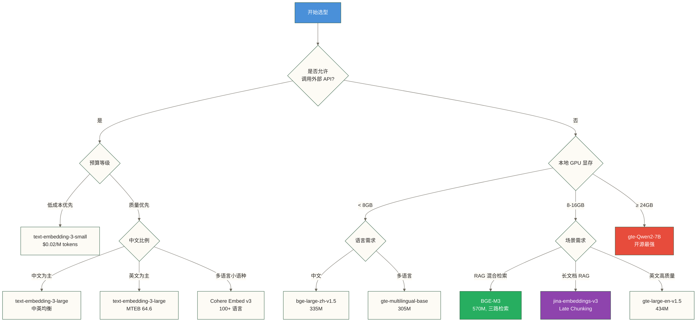

# Embedding 模型选型指南

> [!note] 文档定位
> 本文面向需要在实际工程中选择 Embedding 模型的数据工程师、算法工程师和架构师。覆盖从理论原理到工程落地的完整链路，重点聚焦 2024-2025 年主流模型的横向对比与选型决策框架。
>
> 相关文档：ANN 算法原理 | 混合搜索工程实践 | Milvus RAG 集成实战

---

## 一、Embedding 的本质

### 1.1 从词向量到句子向量的演进

Embedding 的核心思想是**将离散的符号（词、句、文档）映射到连续的稠密向量空间**，使得语义相似的内容在向量空间中距离相近。这一思想的演进经历了四个关键阶段：

**第一阶段：One-Hot 与稀疏表示（1990s）**

最早期的文本表示使用 One-Hot 编码——词表大小为 V，每个词用一个长度为 V 的向量表示，其中只有一个位置为 1，其余全为 0。这种方式的致命缺陷在于：
- 向量维度随词表线性增长，通常达到数万维
- 向量之间两两正交，无法表达语义相似性（"猫"和"猫咪"的余弦相似度为 0）
- 完全无法处理词表外（OOV）词汇

**第二阶段：静态词向量（2013-2018）**

Word2Vec（2013）、GloVe（2014）和 FastText（2016）开创了**分布式词向量**时代。核心假设来自分布假说（Distributional Hypothesis）：**出现在相似上下文中的词具有相似的含义**。

Word2Vec 通过两种训练目标学习词向量：
- **CBOW**（Continuous Bag of Words）：用上下文词预测中心词
- **Skip-gram**：用中心词预测上下文词

训练结果令人惊喜：`king - man + woman ≈ queen`，词向量空间呈现出可操纵的代数结构。

然而静态词向量的局限性在于**一词一义**——"苹果"无论在水果语境还是科技语境，向量是完全相同的。

**第三阶段：上下文化词向量（2018-2019）**

ELMo（2018）首次引入**上下文相关**的词表示，通过双向 LSTM 为同一个词在不同语境中生成不同向量。随后，BERT（2018）彻底改变了 NLP 格局：

- 基于 Transformer 的双向编码器
- Masked Language Model（MLM）预训练任务
- 在 11 项 NLP 任务上刷新 SOTA

但 BERT 的输出是**词级别**的向量，直接用 [CLS] token 做句子表示效果并不理想。

**第四阶段：句子 Embedding 与对比学习（2019-至今）**

Sentence-BERT（SBERT，2019）通过孪生网络（Siamese Network）结构，使用对比学习微调 BERT，使其输出真正高质量的**句子级别向量**。此后，大量针对检索、相似度、多语言等场景专门优化的 Embedding 模型涌现，形成了今天百花齐放的格局。

```text
词向量演进时间线：

One-Hot (1990s)
    ↓ 稀疏→稠密，捕获语义
Word2Vec / GloVe (2013-2014)
    ↓ 静态→动态，上下文感知
ELMo (2018)
    ↓ RNN→Transformer，并行计算
BERT (2018)
    ↓ 词级→句级，检索优化
SBERT / E5 / BGE / GTE (2019-2025)
```

### 1.2 Encoder-only vs Decoder-only 的差异

当前的语言模型架构分为两大主流：

| 特性 | Encoder-only（双向） | Decoder-only（单向） |
|------|---------------------|---------------------|
| 代表模型 | BERT、RoBERTa、BGE | GPT 系列、LLaMA |
| 注意力机制 | 双向全局注意力 | 单向因果注意力 |
| 每个 token 能看到 | 全部 token | 只有左侧 token |
| 参数量 | 通常 100M-570M | 通常 1B-70B+ |
| Embedding 质量 | 高（天然双向语义理解） | 需要特殊处理 |
| 推理速度 | 取决于模型规模、输入长度和硬件 | Embedding编码不等同于逐token生成，速度取决于模型规模、输入长度、池化方式和硬件 |
| 适合任务 | 句子理解、检索、分类 | 文本生成、补全 |

**为什么 Encoder-only 更适合 Embedding 任务？**

Encoder-only 模型在编码时，每个 token 的表示都融合了**整个输入序列**的信息（双向注意力）。这意味着句子中每个词的向量都充分理解了上下文，对句子的整体语义把握更准确。

Decoder-only 模型做 Embedding 时，只能用最后一个 token 的表示（或平均池化），由于因果掩码，前面的 token 无法"看到"后面的内容，语义表达能力受限。

> [!tip] 2024 年新趋势
> 随着 gte-Qwen2-7B-instruct（Decoder-only，7B 参数）在 MTEB 上登顶，学界开始探索大型 Decoder-only 模型做 Embedding 的可行性。通过特殊的 prompt 模板和 EOS token 池化策略，大模型的 Embedding 能力得到充分释放。但其推理成本是 Encoder-only 的数十倍，实际工程中需权衡。

### 1.3 对比学习（Contrastive Learning）训练原理

现代高质量 Embedding 模型几乎都依赖**对比学习**（Contrastive Learning）进行训练。核心思想极为简洁：**让相似的样本对在向量空间中靠近，不相似的样本对远离**。

**训练数据结构**

对比学习需要构建（anchor, positive, negative）三元组：
- **Anchor**：查询句子
- **Positive**：语义相关的正样本
- **Negative**：语义无关的负样本

**损失函数：InfoNCE Loss**

$$\mathcal{L} = -\log \frac{\exp(\text{sim}(q, k^+) / \tau)}{\exp(\text{sim}(q, k^+) / \tau) + \sum_{i=1}^{N} \exp(\text{sim}(q, k_i^-) / \tau)}$$

其中 $\tau$ 是温度系数，控制分布的尖锐程度；$\text{sim}$ 通常使用余弦相似度。

**In-batch Negatives（批内负样本）**

高效训练的关键技巧：在一个 batch 中，其他样本对的 positive 自动作为当前样本的 negative。batch size 越大，负样本越丰富，模型训练越充分——这也是为什么 Embedding 模型训练通常需要极大的 batch size（通常 4096-65536）。

**Hard Negative Mining（困难负样本挖掘）**

普通负样本（随机样本）往往太"容易"——模型轻松区分。**困难负样本**是那些与 anchor 语义接近但并非真正相关的样本，能更有效地提升模型判别边界。

BGE 系列、E5 系列均采用困难负样本挖掘策略，这也是其性能优于早期模型的关键原因之一。

**Self-Knowledge Distillation（BGE-M3 的创新）**

BGE-M3 提出了**自知识蒸馏**策略，将密集检索、词法检索（稀疏）和多向量检索的结果相互蒸馏，让三种检索模式互相增强，无需额外标注数据即可提升整体性能。

---

## 二、MTEB 基准评测

### 2.1 MTEB 评测维度详解

MTEB（Massive Text Embedding Benchmark）是目前**最权威**的 Embedding 模型综合评测框架，由 Hugging Face 维护。它覆盖 8 大任务类型、1000+ 语言，是业界事实上的选型标准。

**8 大任务类型详解：**

| 任务类型 | 英文名 | 评测内容 | 典型指标 | 示例数据集 |
|---------|--------|---------|---------|-----------|
| **检索** | Retrieval | 给定 query，从大规模语料库中检索相关文档 | NDCG@10 | MS MARCO, BEIR |
| **语义相似度** | Semantic Textual Similarity (STS) | 评估模型对句子对相似度的判断 | Spearman 相关系数 | STS-B, SICK-R |
| **分类** | Classification | 用 Embedding 作为特征训练分类器 | Accuracy | SST-2, AmazonReviews |
| **聚类** | Clustering | 对 Embedding 进行聚类，评估聚类质量 | V-measure | ArXivClustering |
| **重排序** | Reranking | 对候选文档列表重排序 | MAP | MindSmall |
| **双语挖掘** | Bitext Mining | 在平行语料库中挖掘翻译对 | F1 | BUCC, Tatoeba |
| **摘要** | Summarization | 评估摘要与原文的语义匹配 | Spearman 相关系数 | SummEval |
| **句对分类** | PairClassification | 判断句子对的关系类型 | AP | TwitterSemEval |

> [!warning] MTEB 评测的局限性
> MTEB 综合得分是加权平均，高分不代表在所有场景都是最优选择：
> - **检索任务**才是 RAG 场景最关键的指标，而非总分
> - 部分数据集可能被模型训练数据覆盖（数据泄露风险）
> - 中文能力需参考 C-MTEB（中文子集）的专项评分
> - 长文档场景要单独考察长文本检索任务的得分

### 2.2 2024-2025 年主流模型排行榜

#### 英文 MTEB 排行榜（2025 年主流模型）

| 排名 | 模型 | MTEB 均分 | 维度 | 参数量 | 开源 |
|------|------|-----------|------|--------|------|
| 1 | NV-Embed-v2（NVIDIA） | 69.32 | 4096 | ~7B | 是 |
| 2 | Cohere Embed v4 | 65.2 | 1024 | 闭源 | 否 |
| 3 | text-embedding-3-large（OpenAI） | 64.6 | 3072 | 闭源 | 否 |
| 4 | gte-Qwen2-7B-instruct（Alibaba） | 64.1 | 3584 | 7B | 是 |
| 5 | jina-embeddings-v3（Jina AI） | 63.3 | 1024 | 570M | 是 |
| 6 | BGE-M3（BAAI） | 63.0 | 1024 | 570M | 是 |
| 7 | e5-mistral-7b-instruct（Microsoft） | 62.0 | 4096 | 7B | 是 |
| 8 | text-embedding-3-small（OpenAI） | 62.3 | 1536 | 闭源 | 否 |
| 9 | bge-large-en-v1.5（BAAI） | 63.5 | 1024 | 335M | 是 |
| 10 | gte-large-en-v1.5（Alibaba） | 63.1 | 1024 | 434M | 是 |

#### 中文 C-MTEB 排行榜（2024-2025 年主流模型）

| 排名 | 模型 | C-MTEB 均分 | 中文检索 | 特点 |
|------|------|-------------|---------|------|
| 1 | gte-Qwen2-7B-instruct | ~72+ | 极强 | 大模型，资源消耗高 |
| 2 | BGE-M3 | ~64 | 强 | 中文最优轻量级选择 |
| 3 | bge-large-zh-v1.5 | ~63 | 强 | 纯中文专项优化 |
| 4 | text-embedding-3-large | ~60 | 良好 | 付费 API |
| 5 | gte-multilingual-base | ~60 | 良好 | 75 语言，高效 |

### 2.3 如何读懂 MTEB 排行榜

拿到 MTEB 排行榜，不要只看总分，要掌握以下读法：

**Step 1：明确你的核心场景**

| 你的场景 | 重点关注指标 |
|---------|------------|
| RAG 知识库检索 | Retrieval 列（NDCG@10） |
| 语义去重 / 相似度 | STS 列（Spearman） |
| 文本分类 | Classification 列（Accuracy） |
| 多语言场景 | 切换到 Multilingual 标签页 |

**Step 2：筛选语言范围**

- 纯英文场景：英文 MTEB 排行榜即可
- 中文或中英混合：必须参考 **C-MTEB**（中文子集）
- 多语言：参考 MIRACL 榜单

**Step 3：结合实际约束筛选**

- 是否允许调用外部 API？（否 → 过滤闭源模型）
- GPU 显存限制是多少？（<8GB → 过滤 7B 以上模型）
- 延迟要求？（<100ms → 优先 100M-335M 小模型）

**Step 4：关注任务权重分布**

MTEB 总分的计算中，各任务类型权重并不完全相等。检索任务（Retrieval）通常占比最大，对 RAG 项目来说，这个指标最有参考价值。

> [!tip] 实用建议
> 在最终选型前，建议用自己的业务数据构建一个小型评测集（至少 200 条查询-文档对），直接跑候选模型，比 MTEB 排行榜更有参考价值。评测方法见第七章。

---

## 三、主流模型深度对比

### 3.1 模型核心参数速查表

| 模型 | 维度 | 最大 Token | 参数量 | 多语言 | MRL | 开源 | 收费方式 |
|------|------|-----------|--------|--------|-----|------|---------|
| BGE-M3 | 1024 | 8192 | 570M | 100+ 语言 | 否 | 是 | 免费 |
| bge-large-zh-v1.5 | 1024 | 512 | 335M | 中文专项 | 否 | 是 | 免费 |
| text-embedding-3-small | 1536 | 8192 | 闭源 | 多语言 | 是 | 否 | $0.02/M tokens |
| text-embedding-3-large | 3072 | 8192 | 闭源 | 多语言 | 是 | 否 | $0.13/M tokens |
| jina-embeddings-v3 | 1024 | 8192 | 570M | 89 语言 | 是 | 是 | 免费/API |
| Cohere Embed v3 | 1024 | 512 | 闭源 | 100+ 语言 | 否 | 否 | 按量付费 |
| E5-mistral-7b | 4096 | 32768 | 7B | 多语言 | 否 | 是 | 免费 |
| gte-multilingual-base | 768 | 8192 | 305M | 75 语言 | 是 | 是 | 免费 |
| gte-Qwen2-7B-instruct | 3584 | 32768 | 7B | 多语言 | 否 | 是 | 免费 |

---

### 3.2 BGE 系列（BAAI）

**机构背景**：北京智源人工智能研究院（BAAI），国内最顶级的 AI 研究机构之一。BGE 系列（BAAI General Embedding）是 FlagEmbedding 项目的核心成果，也是中文 Embedding 领域的事实标准。

**BGE-M3（核心旗舰模型）**

BGE-M3 是 BGE 系列目前最重要的模型，发布于 2024 年 1 月，名称中的"M3"代表三个核心特性：

**Multi-Functionality（多功能性）**

BGE-M3 是目前极少数能同时支持三种检索模式的模型：

1. **稠密检索（Dense Retrieval）**：传统的语义向量检索，将查询和文档编码为固定维度向量（1024 维），通过向量相似度检索
2. **稀疏检索（Sparse/Lexical Retrieval）**：类似 BM25 的词法检索，输出稀疏向量（词袋表示），保留精确词项匹配能力
3. **多向量检索（Multi-Vector Retrieval）**：类似 ColBERT 的 late interaction 机制，为每个 token 生成独立向量，通过 MaxSim 计算相关性，捕获更细粒度的词级语义

三种模式可以独立使用，也可以加权融合，用于混合检索场景（详见 混合搜索工程实践）。

**Multi-Linguality（多语言性）**

BGE-M3 在 100+ 种语言的数据上训练，覆盖超过 170 种语言。在中文场景中表现尤为突出，C-MTEB 检索任务得分优于大多数同体量竞品。其多语言能力特别适合中英文混合检索、跨语言文档检索等场景。

**Multi-Granularity（多粒度）**

最大支持 8192 tokens 的输入长度，这对于长文档检索场景极为关键。相比早期 BGE 模型的 512 tokens 限制，长文本处理能力有质的飞跃。

**训练创新：自知识蒸馏**

BGE-M3 提出了独特的自知识蒸馏（Self-Knowledge Distillation）训练策略：
- 在一个 batch 内，让三种检索模式的输出相互作为监督信号
- 无需额外标注数据，三种模式互相增强
- 通过大 batch size（实测需要 4096+）和梯度缓存技术高效训练

**性能表现**：在 MTEB 多语言榜单中，BGE-M3 平均分约 63.0，在开源 570M 量级模型中表现最优。在 MIRACL 多语言检索基准上，BGE-M3 比 mE5 高出 5.5 个点。

**BGE-Large-ZH-v1.5（中文专项）**

- 参数量：335M，基于 RoBERTa-large 架构
- 向量维度：1024，最大 512 tokens
- 专为中文场景优化，在 C-MTEB 中文子集上表现优秀
- 适合中文单语场景、计算资源受限的部署环境

**BGE 系列使用建议**：
- 中文场景优先选 `BAAI/bge-m3`（兼顾长文本和多语言）
- 纯中文、低延迟场景可选 `BAAI/bge-large-zh-v1.5`
- 需要混合检索时，BGE-M3 的多功能特性是最优选择

---

### 3.3 OpenAI text-embedding-3 系列

**背景**：OpenAI 于 2024 年 1 月发布 text-embedding-3 系列，取代此前广泛使用的 text-embedding-ada-002。这是 OpenAI 在 Embedding 领域的重大更新，引入了 Matryoshka Representation Learning（MRL）技术，允许用户灵活调整向量维度。

**text-embedding-3-small**

- 向量维度：默认 1536，可通过参数压缩至最小 512
- 最大 Token：8192
- MTEB 均分：约 62.3
- 定价：$0.02 / 百万 tokens
- 性能：在 MTEB 上显著优于 ada-002（61.0 → 62.3），同时成本降低约 5 倍
- 适合场景：高并发、成本敏感的 API 调用场景，如实时搜索、大规模文档索引

**text-embedding-3-large**

- 向量维度：默认 3072，可压缩至最小 256
- 最大 Token：8192
- MTEB 均分：约 64.6，与 Cohere Embed v4 接近
- 定价：$0.13 / 百万 tokens
- 性能亮点：
  - MIRACL 多语言检索：所列分数从 ada-002 的 31.4% 提升至 54.9%（增加23.5个百分点；评测口径仍未提供）
  - MTEB 英文总分：从 61.0 提升至 64.6（+3.6）
  - 将向量压缩至 256 维后，仍优于未压缩的 ada-002（1536 维）
- 适合场景：对质量要求高的企业级 RAG、语义搜索产品

**Matryoshka Representation Learning（MRL）的实际意义**

OpenAI embedding-3 系列最重要的工程价值在于 MRL 支持。用户可以通过 `dimensions` 参数调整输出维度：

```python
from openai import OpenAI
client = OpenAI()

# 标准维度
embedding_full = client.embeddings.create(
    input="数据湖架构设计最佳实践",
    model="text-embedding-3-large"
).data[0].embedding  # 3072 维

# 压缩维度（降低存储和检索成本）
embedding_small = client.embeddings.create(
    input="数据湖架构设计最佳实践",
    model="text-embedding-3-large",
    dimensions=256  # 压缩至 256 维
).data[0].embedding  # 256 维，性能损失极小
```

实测数据：text-embedding-3-large 压缩至 256 维后，MTEB 得分仍高于 ada-002 的 1536 维原始向量。若所述评测结果成立，且采用相同数值精度，3-large的256维向量在该评测中优于ada-002的1536维向量，其原始向量存储量为后者的六分之一；这不是同等存储成本比较，也不包含索引及元数据开销。

**OpenAI 系列使用建议**：
- 快速上线、不想维护自托管服务 → text-embedding-3-small（性价比高）
- 追求最佳质量、对中英文均有需求 → text-embedding-3-large
- 存储成本敏感 → 使用 MRL 将 3-large 压缩至 512-1024 维

---

### 3.4 Jina Embeddings v3

**背景**：Jina AI 是专注于多模态 AI 和向量检索的德国公司。jina-embeddings-v3 于 2024 年 9 月发布，570M 参数，是当时参数量小于 1B 的模型中，MTEB 英文榜排名最高的开源模型（排名第 2）。

**核心规格**：
- 参数量：570M
- 向量维度：1024（支持 MRL，可压缩）
- 最大 Token：8192
- 支持语言：89 种（包含中文，但中文专项优化弱于 BGE-M3）
- MTEB 均分：约 63.3

**Task-Specific LoRA Adapters（任务专用适配器）**

jina-embeddings-v3 的独特架构是**为不同任务训练了专用的 LoRA 适配器**，共 5 种：

| 任务类型 | LoRA 参数 | 适用场景 |
|---------|----------|---------|
| `retrieval.query` | Query 编码优化 | 检索场景的查询端 |
| `retrieval.passage` | Passage 编码优化 | 检索场景的文档端 |
| `separation` | 差异化优化 | 文本聚类、重排序 |
| `classification` | 分类优化 | 下游分类任务 |
| `text-matching` | 相似度优化 | STS、语义相似度 |

使用时通过 `task` 参数指定，模型自动加载对应 LoRA 权重：

```python
from sentence_transformers import SentenceTransformer

model = SentenceTransformer("jinaai/jina-embeddings-v3", trust_remote_code=True)

# 检索场景：query 和 passage 分别使用不同 LoRA
query_embedding = model.encode(
    "数据湖和数据仓库的区别",
    task="retrieval.query"
)
doc_embedding = model.encode(
    "数据湖是一个集中式存储库，允许以原始格式存储所有结构化和非结构化数据...",
    task="retrieval.passage"
)
```

**Late Chunking（核心技术创新）**

Jina AI 提出的 Late Chunking 是 2024 年长文档 Embedding 领域最重要的技术创新之一。

**传统 Naive Chunking 的问题**：

```text
文档："张三是一名数据工程师，他在阿里巴巴工作了 5 年。他精通 Flink 和 Spark。"

Naive Chunking（先切块再编码）：
  Chunk 1: "张三是一名数据工程师，他在阿里巴巴工作了 5 年。"
  Chunk 2: "他精通 Flink 和 Spark。"

  问题：Chunk 2 中的"他"失去了上下文，不知道指谁。
  检索"张三的技能"时，Chunk 2 可能无法被有效检索到。
```

**Late Chunking（后期分块）的解决方案**：

```text
Late Chunking（先编码再切块）：
  Step 1: 将整个文档输入长上下文模型，获取 token-level 表示
          每个 token 的表示都包含了全文上下文信息
  Step 2: 按切块边界对 token 表示做 mean pooling

  结果：Chunk 2 的"他"的向量中包含了 Chunk 1 的上下文信息
  "他精通 Flink 和 Spark" → 向量中包含"张三"的语义
```

启用方式：

```python
# API 调用启用 late chunking
import requests

response = requests.post(
    "https://api.jina.ai/v1/embeddings",
    headers={"Authorization": "Bearer YOUR_API_KEY"},
    json={
        "input": ["长文档内容..."],
        "model": "jina-embeddings-v3",
        "late_chunking": True
    }
)
```

> [!warning] Late Chunking 的限制
> 启用 `late_chunking=True` 时，单次请求所有输入的总 token 数不超过 8192。这意味着对于超长文档，仍需要先做初步分段，再在每个分段内使用 Late Chunking。

**Jina v3 使用建议**：
- 长文档 RAG 场景（文档超过 1000 字）→ 首选，Late Chunking 效果显著
- 需要任务自适应（同一套系统既做检索又做分类）→ LoRA 适配器机制很有价值
- 中文专项场景 → 不如 BGE-M3，慎重选择

---

### 3.5 Cohere Embed v3

**背景**：Cohere 是专注于企业级 NLP API 的加拿大 AI 公司，embed-multilingual-v3.0 是其旗舰 Embedding 产品，在多语言企业场景中应用广泛。最新的 Cohere Embed v4 进一步支持多模态（文本+图像）。

**核心规格**：
- 向量维度：1024
- 最大 Token：512（英文版），多语言版同为 512
- 支持语言：100+ 种
- 训练数据：近 10 亿英文训练对 + 5 亿非英文训练对
- 定价：按量付费（通过 AWS、Azure 等云平台）

**技术特点**：

1. **多语言 SOTA**：在 MIRACL 多语言检索基准上达到最优性能，特别是对低资源语言（小语种）的支持质量高于大多数开源模型
2. **输入类型区分**：提供 `input_type` 参数，区分查询端和文档端编码，优化非对称检索性能
3. **企业级集成**：原生支持 AWS SageMaker、Azure AI Foundry、Oracle Cloud 等主流云平台，无需自维护推理服务
4. **多模态扩展（Embed v4）**：最新版本支持文本和图像的统一向量空间，适合多模态 RAG 场景

**使用示例**：

```python
import cohere

co = cohere.Client("YOUR_API_KEY")

# 区分 query 和 document 编码
query_embeddings = co.embed(
    texts=["数据仓库的分层架构"],
    model="embed-multilingual-v3.0",
    input_type="search_query"
).embeddings

doc_embeddings = co.embed(
    texts=["ODS层是数据仓库的第一层，存储原始业务数据..."],
    model="embed-multilingual-v3.0",
    input_type="search_document"
).embeddings
```

**Cohere Embed v3 使用建议**：
- 已在 AWS/Azure 生态内，不想自建推理服务 → 首选，云平台集成最简洁
- 多语言混合场景（含小语种）→ 多语言能力极强
- 需要文本+图像统一检索 → 升级至 Cohere Embed v4
- 对 512 token 的限制敏感 → 需要额外的长文档切块策略

---

### 3.6 E5 系列（Microsoft）

**背景**：E5（Embeddings from bidirectional Encoder representations）是 Microsoft Research 发布的 Embedding 系列，以"Text Embeddings by Weakly-Supervised Contrastive Pre-training"（E5）和"Improving Text Embeddings with Large Language Models"（E5-Mistral）两篇论文为基础。

**主要模型**：

**e5-large-v2**（经典版本）
- 参数量：335M，向量维度：1024，最大 512 tokens
- 在英文检索任务上性能优秀，C-MTEB 中文表现一般
- 特点：使用 (query:, passage:) 前缀区分查询和文档

**e5-mistral-7b-instruct**（大模型版本）
- 参数量：7B（基于 Mistral-7B），向量维度：4096，最大 32768 tokens
- MTEB 均分约 62.0，超长上下文（32K）是显著优势
- 使用 instruction-following 方式提升 Embedding 质量：

```python
from sentence_transformers import SentenceTransformer

model = SentenceTransformer("intfloat/e5-mistral-7b-instruct")

# E5-Mistral 使用 instruction prefix 格式
query = "Instruct: Given a web search query, retrieve relevant passages\nQuery: 数据湖与数据仓库的区别"
doc = "数据湖是一个集中式存储库，允许以原生格式存储所有规模的结构化和非结构化数据..."

query_embedding = model.encode(query, normalize_embeddings=True)
doc_embedding = model.encode(doc, normalize_embeddings=True)
```

**E5 系列使用建议**：
- 英文场景、需要 32K 超长上下文 → e5-mistral-7b-instruct
- 资源受限的英文场景 → e5-large-v2（经典选择）
- 中文场景 → 不推荐，中文能力弱于 BGE 和 GTE

---

### 3.7 GTE 系列（阿里 Tongyi）

**背景**：GTE（General Text Embeddings）是阿里巴巴 Tongyi Lab 发布的 Embedding 系列，持续迭代，目前已从最初的 GTE 演进到 gte-Qwen2 系列，2024 年 6 月，gte-Qwen2-7B-instruct 同时登顶 MTEB 英文和中文排行榜，是目前已知最强的开源 Embedding 模型。

**gte-multilingual-base**（轻量高效）
- 参数量：305M，向量维度：768，最大 8192 tokens
- 支持 75 种语言，覆盖中英文场景
- 支持 MRL（弹性向量维度），显著降低存储成本
- MTEB 多语言表现：在同体量模型中名列前茅
- 推理速度：比 7B 级别的 Decoder-only 模型快 10 倍以上

**gte-large-en-v1.5**（英文专项）
- 参数量：434M，向量维度：1024，最大 8192 tokens
- MTEB 英文总分约 63.1，在英文场景中表现出色
- 支持 MRL

**gte-Qwen2-7B-instruct**（性能天花板）
- 参数量：7B，基于 Qwen2-7B
- 向量维度：3584，最大 32768 tokens
- MTEB 英文和中文同时排名第一（截至 2024 年 6 月）
- 使用 Decoder-only 架构 + 特殊 EOS token 池化策略
- 资源需求：推理需要至少 16GB 显存

```python
from sentence_transformers import SentenceTransformer

# GTE-Qwen2 使用特殊格式
model = SentenceTransformer("Alibaba-NLP/gte-Qwen2-7B-instruct", trust_remote_code=True)

# 查询需要添加 instruction prefix
query_instruction = "Given a web search query, retrieve relevant passages that answer the query"
query = f"Instruct: {query_instruction}\nQuery: 如何设计数据仓库的分层架构"

query_emb = model.encode(query, normalize_embeddings=True)
doc_emb = model.encode("数据仓库通常采用四层架构：ODS、DWD、DWS、ADS...", normalize_embeddings=True)
```

**GTE 系列使用建议**：
- 追求极致质量、有充足 GPU 资源 → gte-Qwen2-7B-instruct（目前开源最强）
- 平衡性能和成本、多语言场景 → gte-multilingual-base（305M，轻量高效）
- 英文专项、需要 8K 上下文 → gte-large-en-v1.5

---

## 四、关键技术特性深度解析

### 4.1 Matryoshka Representation Learning（MRL）

**名称来源**：俄罗斯套娃（Matryoshka Doll）——大娃娃里套着小娃娃，每个小娃娃都是完整的。MRL 让 Embedding 向量呈现相同的结构：前 N 维是完整的低精度表示，截取不同长度都能有效工作。

**训练原理**：

传统训练方式：只在完整维度（如 1024 维）上计算损失。

MRL 训练方式：同时在多个维度上计算损失：

$$\mathcal{L}_{MRL} = \sum_{m \in \mathcal{M}} c_m \cdot \mathcal{L}(f(\mathbf{x})_{[1:m]}, y)$$

其中 $\mathcal{M} = \{8, 16, 32, 64, 128, 256, 512, 1024, 2048, 4096\}$ 是支持的维度集合，$c_m$ 是各维度的权重系数。

通过在多维度上同步优化，模型学会了**将最重要的信息压缩到最前面的维度**，确保截取任意前 N 维都保持较高的语义质量。

**工程价值：存储与速度的线性收益**

| 维度 | 存储（vs 3072 维） | 检索速度（vs 3072 维） | 质量损失 |
|------|-------------------|----------------------|---------|
| 3072（全量） | 100% | 1x | 0% |
| 1024 | 33% | 3x | ~2% |
| 512 | 17% | 6x | ~4% |
| 256 | 8% | 12x | ~6% |

以 OpenAI text-embedding-3-large 为例，将 1 亿条文档向量从 3072 维压缩至 512 维：
- 存储节省：从 ~1.2TB 降至 ~200GB
- 检索速度提升：约 6 倍
- MTEB 得分：仅下降约 2 个点

> [!tip] MRL 的实际使用策略
> 推荐采用**两阶段检索**：
> 1. 第一阶段：用低维向量（256-512 维）快速粗检索，召回 Top-100
> 2. 第二阶段：用全维度向量对 Top-100 精排
> 这种策略可降低粗检索成本，但全维精排无法找回未进入Top-100的相关文档；最终质量是否保持，需要在业务评测集上验证。

---

### 4.2 Late Chunking（Jina 的长文档技术）

Late Chunking 解决的是**长文档 RAG 中上下文丢失**的问题，详细原理已在 3.4 节介绍。这里补充工程实现细节。

**与 Naive Chunking 的对比实验**（Jina AI 官方数据）：

| 评测指标 | Naive Chunking | Late Chunking | 提升 |
|---------|---------------|--------------|------|
| BEIR-SciFact (NDCG@10) | 74.2 | 78.1 | +3.9 |
| NFCorpus (NDCG@10) | 36.4 | 38.2 | +1.8 |
| TREC-COVID (NDCG@10) | 62.1 | 65.3 | +3.2 |

**Late Chunking 适用场景**：

**适合使用 Late Chunking 的场景**：

| 场景类型 | 具体示例 |
|---------|---------|
| 大量代词指代 | 文档中频繁出现"他、它、该公司、该系统"等指代 |
| 段落间强依赖 | 前文定义概念，后文多处引用 |
| 技术文档 | 定义在一处，应用散布多处 |
| 法律合同 | 主体在开头定义，条款反复引用 |

**不适合的场景**：

| 场景类型 | 原因 |
|---------|------|
| 段落结构独立 | 各段落无跨段依赖，无需全文上下文 |
| 短文档（< 500 tokens） | 上下文窗口足够，无需特殊处理 |
| 对延迟极敏感 | Late Chunking 需先全文编码，增加延迟 |

---

### 4.3 稀疏 + 稠密双路 Embedding（BGE-M3）

BGE-M3 实现了在单一模型中同时输出稠密向量和稀疏向量，这是构建**混合检索系统**的基础。

**稠密向量（Dense Vector）**：
- 输出：固定维度的实数向量（1024 维）
- 特点：捕获语义相似性，能处理同义词、近义词
- 弱点：精确词项匹配能力弱（"v1.5" vs "v2.0" 可能语义很近）

**稀疏向量（Sparse Vector / Lexical Weights）**：
- 输出：稀疏向量（词表大小维度，大部分为 0）
- 特点：保留词法精确匹配，类似 BM25
- 弱点：无法捕获语义相似（"汽车"和"轿车"得分为 0）

**多向量检索（ColBERT-style）**：
- 输出：每个 token 的独立向量集合
- 特点：细粒度词级匹配，捕获"部分相关性"
- 弱点：存储和计算开销大（每文档存储 N 个向量）

**混合检索融合策略**：

```python
# BGE-M3 混合检索示例
from FlagEmbedding import BGEM3FlagModel

model = BGEM3FlagModel('BAAI/bge-m3', use_fp16=True)

output = model.encode(
    ["数据湖与数据仓库的区别"],
    return_dense=True,
    return_sparse=True,
    return_colbert_vecs=True
)

# 融合三路得分（可调权重）
dense_score = 0.4
sparse_score = 0.3
colbert_score = 0.3

final_score = (
    dense_score * dense_retrieval_score +
    sparse_score * sparse_retrieval_score +
    colbert_score * colbert_retrieval_score
)
```

> [!note] 详细的混合检索工程实践
> 参见 混合搜索工程实践，包含 Milvus + BGE-M3 的完整代码示例。

---

## 五、选型决策框架

### 5.1 按维度的系统化选型

#### 按语言需求

| 语言需求 | 推荐模型 | 备注 |
|---------|---------|------|
| 纯中文 | BGE-M3 或 bge-large-zh-v1.5 | BGE 系列在中文 MTEB 表现最优 |
| 纯英文 | gte-large-en-v1.5 或 text-embedding-3-large | 质量优先选 gte-Qwen2-7B |
| 中英混合 | BGE-M3 | 中英双语均衡优秀 |
| 多语言（含小语种） | Cohere Embed v3 或 BGE-M3 | Cohere 对低资源语言支持更好 |
| 100+ 语言企业场景 | Cohere Embed v3 | 最广泛的语言覆盖 |

#### 按应用场景

| 应用场景 | 推荐模型 | 关键理由 |
|---------|---------|---------|
| RAG 知识库检索（中文） | BGE-M3 | 支持混合检索，中文强，8K token |
| RAG 知识库检索（英文） | text-embedding-3-large 或 gte-large-en-v1.5 | 英文检索 NDCG@10 高 |
| 长文档 RAG（>2000 字/块） | jina-embeddings-v3 | Late Chunking 保留跨块上下文 |
| 实时语义搜索（低延迟） | text-embedding-3-small 或 bge-base-zh-v1.5 | 小模型，API 响应快 |
| 文本语义相似度 | jina-embeddings-v3（text-matching LoRA） | STS 专项优化 |
| 多语言文档分类 | Cohere Embed v3 | 多语言分类能力强 |
| 混合检索（稀疏+稠密） | BGE-M3 | 唯一同时支持三种模式的主流模型 |
| 多模态（文本+图像） | Cohere Embed v4 | 文本图像统一向量空间 |

#### 按成本与资源约束

| 约束条件 | 推荐方案 |
|---------|---------|
| 无 GPU，希望 API 调用 | OpenAI text-embedding-3-small（成本最低） |
| 有 API 预算，追求质量 | OpenAI text-embedding-3-large 或 Cohere Embed v3 |
| 有 GPU（<8GB 显存） | gte-multilingual-base（305M）或 bge-large-zh-v1.5 |
| 有 GPU（8-16GB 显存） | BGE-M3（570M）或 jina-embeddings-v3（570M） |
| 有 GPU（≥24GB 显存） | gte-Qwen2-7B-instruct（7B，性能最强） |
| 边缘设备部署 | bge-small-zh-v1.5（24M，极轻量） |

### 5.2 选型决策树



### 5.3 综合推荐矩阵

| 场景 | 首选 | 次选 | 不推荐 |
|------|------|------|--------|
| 中文 RAG（快速上线） | BGE-M3 | bge-large-zh-v1.5 | E5 系列 |
| 英文 RAG（高质量） | gte-Qwen2-7B | text-embedding-3-large | text-embedding-ada-002 |
| 长文档处理 | jina-embeddings-v3 | BGE-M3 | bge-large-zh-v1.5 |
| 多语言 SaaS | Cohere Embed v3 | BGE-M3 | 纯中文模型 |
| 低成本大规模 | text-embedding-3-small | gte-multilingual-base | gte-Qwen2-7B |
| 混合检索系统 | BGE-M3 | - | 所有单路模型 |
| 极致质量（不限资源） | gte-Qwen2-7B | NV-Embed-v2 | 百 M 级小模型 |

---

## 六、工程实践

### 6.1 用 sentence-transformers 加载本地模型

`sentence-transformers` 是 Embedding 工程的标准库，支持主流开源模型，提供统一接口。

**安装**：

```bash
pip install sentence-transformers torch
# GPU 推理额外安装
pip install sentence-transformers torch --extra-index-url https://download.pytorch.org/whl/cu118
```

**基础使用**：

```python
from sentence_transformers import SentenceTransformer
import numpy as np

# 加载模型（首次运行自动从 HuggingFace 下载）
model = SentenceTransformer("BAAI/bge-m3")

# 编码单条文本
sentences = [
    "数据湖是一个集中存储海量原始数据的系统",
    "数据仓库是面向主题的、集成的、时变的数据集合",
    "机器学习模型训练需要大量标注数据"
]

# 批量编码
embeddings = model.encode(
    sentences,
    batch_size=32,          # 批大小，根据显存调整
    normalize_embeddings=True,  # 归一化，用于余弦相似度计算
    show_progress_bar=True
)

print(f"Embedding shape: {embeddings.shape}")  # (3, 1024)

# 计算相似度
from sentence_transformers import util
similarity_matrix = util.cos_sim(embeddings, embeddings)
print(similarity_matrix)
```

**国内网络加速（ModelScope 镜像）**：

```python
# 方法一：使用 ModelScope 下载
from modelscope import snapshot_download
model_dir = snapshot_download('AI-ModelScope/bge-m3')
model = SentenceTransformer(model_dir)

# 方法二：设置 HF 镜像
import os
os.environ["HF_ENDPOINT"] = "https://hf-mirror.com"
model = SentenceTransformer("BAAI/bge-m3")
```

**BGE 系列的特殊处理**：

BGE 查询前缀应按具体模型和任务区分：BGE-M3不需要查询指令；以下bge-large-zh-v1.5示例用于非对称检索，显式为查询添加检索指令，文档不添加。

```python
from sentence_transformers import SentenceTransformer

model = SentenceTransformer("BAAI/bge-large-zh-v1.5")

# bge-large-zh-v1.5非对称检索示例：查询显式加检索指令，文档不加
queries = ["为什么数据湖比数据仓库更灵活？"]
documents = ["数据湖采用 Schema-on-Read 模式，数据写入时不需要预定义 Schema..."]

# 查询显式加前缀
query_embeddings = model.encode(
    ["为这个句子生成表示以用于检索相关文章：" + query for query in queries],
    normalize_embeddings=True
)

# 文档不添加查询检索指令
doc_embeddings = model.encode(documents, normalize_embeddings=True)
```

### 6.2 Embedding 服务化（FastAPI 封装）

将 Embedding 模型封装为 HTTP 服务，与上层 RAG 应用解耦，便于横向扩展。

```python
# embedding_service.py
from fastapi import FastAPI, HTTPException
from pydantic import BaseModel
from sentence_transformers import SentenceTransformer
from typing import List, Optional
import uvicorn
import numpy as np
import time

app = FastAPI(title="Embedding Service", version="1.0.0")

# 全局模型实例（避免重复加载）
MODEL_NAME = "BAAI/bge-m3"
model = None

@app.on_event("startup")
async def load_model():
    global model
    print(f"Loading model: {MODEL_NAME}")
    model = SentenceTransformer(MODEL_NAME, device="cuda")
    print("Model loaded successfully")

class EmbeddingRequest(BaseModel):
    input: List[str]
    model: Optional[str] = "bge-m3"
    normalize: Optional[bool] = True

class EmbeddingResponse(BaseModel):
    data: List[dict]
    model: str
    usage: dict

@app.post("/v1/embeddings", response_model=EmbeddingResponse)
async def create_embeddings(request: EmbeddingRequest):
    if not model:
        raise HTTPException(status_code=503, detail="Model not loaded")

    start_time = time.time()

    # 批量推理
    embeddings = model.encode(
        request.input,
        batch_size=64,
        normalize_embeddings=request.normalize,
        show_progress_bar=False
    )

    inference_time = time.time() - start_time

    # 格式化响应（OpenAI 兼容格式）
    data = [
        {
            "object": "embedding",
            "embedding": emb.tolist(),
            "index": i
        }
        for i, emb in enumerate(embeddings)
    ]

    # 计算 token 数（近似）
    total_tokens = sum(len(text.split()) * 1.3 for text in request.input)

    return EmbeddingResponse(
        data=data,
        model=request.model,
        usage={
            "prompt_tokens": int(total_tokens),
            "total_tokens": int(total_tokens),
            "inference_time_ms": round(inference_time * 1000, 2)
        }
    )

@app.get("/health")
async def health_check():
    return {"status": "healthy", "model": MODEL_NAME}

if __name__ == "__main__":
    uvicorn.run(app, host="0.0.0.0", port=8000, workers=1)
```

**Docker 化部署**：

```dockerfile
# Dockerfile
FROM nvidia/cuda:11.8.0-cudnn8-runtime-ubuntu22.04

WORKDIR /app

RUN apt-get update && apt-get install -y python3 python3-pip

COPY requirements.txt .
RUN pip3 install -r requirements.txt

COPY embedding_service.py .

# 预下载模型（构建时缓存）
RUN python3 -c "from sentence_transformers import SentenceTransformer; SentenceTransformer('BAAI/bge-m3')"

EXPOSE 8000
CMD ["python3", "embedding_service.py"]
```

```yaml
# docker-compose.yml
version: '3.8'
services:
  embedding-service:
    build: .
    ports:
      - "8000:8000"
    deploy:
      resources:
        reservations:
          devices:
            - driver: nvidia
              count: 1
              capabilities: [gpu]
    environment:
      - CUDA_VISIBLE_DEVICES=0
    restart: unless-stopped
```

**调用方式（OpenAI 兼容）**：

```python
import openai

# 直接用 OpenAI SDK 调用自建服务
client = openai.OpenAI(
    api_key="dummy",  # 自建服务不验证
    base_url="http://localhost:8000/v1"
)

response = client.embeddings.create(
    input=["数据仓库分层架构"],
    model="bge-m3"
)

embedding = response.data[0].embedding
```

### 6.3 批量推理优化

大规模文档索引时，推理效率至关重要。以下是关键优化策略：

**策略一：动态 Batch Size**

```python
import torch
from sentence_transformers import SentenceTransformer

model = SentenceTransformer("BAAI/bge-m3")

def optimal_batch_size(model, sample_text: str, target_memory_gb: float = 0.8) -> int:
    """动态计算最优 batch size"""
    if not torch.cuda.is_available():
        return 32

    total_memory = torch.cuda.get_device_properties(0).total_memory
    target_memory = total_memory * target_memory_gb

    # 测试单条推理内存占用
    torch.cuda.empty_cache()
    before = torch.cuda.memory_allocated()
    _ = model.encode([sample_text])
    after = torch.cuda.memory_allocated()
    per_sample_memory = after - before

    optimal = max(1, int(target_memory / (per_sample_memory * 10)))
    return min(optimal, 512)  # 上限 512

# 大规模批量编码
def batch_encode_documents(
    model: SentenceTransformer,
    documents: list,
    batch_size: int = 64,
    show_progress: bool = True
) -> np.ndarray:
    """高效批量编码"""
    all_embeddings = []

    for i in range(0, len(documents), batch_size):
        batch = documents[i:i + batch_size]
        embeddings = model.encode(
            batch,
            batch_size=batch_size,
            normalize_embeddings=True,
            convert_to_numpy=True,
            show_progress_bar=False
        )
        all_embeddings.append(embeddings)

        if show_progress and i % (batch_size * 10) == 0:
            print(f"Processed {i}/{len(documents)} documents")

    return np.vstack(all_embeddings)
```

**策略二：FP16 / BF16 半精度推理**

```python
# FP16 推理（速度提升约 2x，精度损失极小）
model = SentenceTransformer("BAAI/bge-m3")
model.half()  # 转换为 FP16

# 或在加载时指定
from FlagEmbedding import BGEM3FlagModel
model = BGEM3FlagModel('BAAI/bge-m3', use_fp16=True)
```

**策略三：多进程 CPU 推理（无 GPU 场景）**

```python
from sentence_transformers import SentenceTransformer
import multiprocessing as mp
import numpy as np

def encode_chunk(args):
    model_name, texts, normalize = args
    model = SentenceTransformer(model_name)
    return model.encode(texts, normalize_embeddings=normalize)

def parallel_encode(model_name: str, documents: list, n_workers: int = 4):
    """多进程 CPU 并行推理"""
    chunk_size = len(documents) // n_workers
    chunks = [
        (model_name, documents[i:i+chunk_size], True)
        for i in range(0, len(documents), chunk_size)
    ]

    with mp.Pool(n_workers) as pool:
        results = pool.map(encode_chunk, chunks)

    return np.vstack(results)
```

**策略四：向量持久化（避免重复计算）**

```python
import numpy as np
import pickle
from pathlib import Path
import hashlib

def get_cache_key(texts: list, model_name: str) -> str:
    content = f"{model_name}:{':'.join(texts)}"
    return hashlib.md5(content.encode()).hexdigest()

def encode_with_cache(
    model: SentenceTransformer,
    texts: list,
    model_name: str,
    cache_dir: str = ".embedding_cache"
):
    Path(cache_dir).mkdir(exist_ok=True)
    cache_key = get_cache_key(texts, model_name)
    cache_path = Path(cache_dir) / f"{cache_key}.npy"

    if cache_path.exists():
        return np.load(cache_path)

    embeddings = model.encode(texts, normalize_embeddings=True)
    np.save(cache_path, embeddings)
    return embeddings
```

### 6.4 向量归一化与维度的工程影响

**向量归一化**

绝大多数 Embedding 应用应使用**归一化向量**（L2 归一化，使向量模长为 1）：

```python
import numpy as np

def normalize(embeddings: np.ndarray) -> np.ndarray:
    """L2 归一化"""
    norms = np.linalg.norm(embeddings, axis=1, keepdims=True)
    return embeddings / (norms + 1e-10)

# sentence-transformers 自动归一化
embeddings = model.encode(texts, normalize_embeddings=True)
```

归一化后的核心好处：**余弦相似度计算退化为点积计算**。

$$\cos(\mathbf{u}, \mathbf{v}) = \mathbf{u}^T\mathbf{v} \quad \text{（当 } \|\mathbf{u}\| = \|\mathbf{v}\| = 1 \text{）}$$

点积计算可充分利用 BLAS/FAISS 的高度优化实现，在亿级向量库检索中速度比余弦相似度快 2-3 倍。

**维度选择的工程影响**

| 向量维度 | 内存（100万条） | 检索延迟（FAISS） | 适用场景 |
|---------|---------------|-----------------|---------|
| 256 | ~1 GB | 极快 | 实时搜索、边缘计算 |
| 512 | ~2 GB | 快 | 通用 RAG |
| 768 | ~3 GB | 快 | 标准部署 |
| 1024 | ~4 GB | 中等 | 高质量场景 |
| 1536 | ~6 GB | 中等 | OpenAI 默认 |
| 3072 | ~12 GB | 慢 | 大规模离线分析 |

> [!tip] 维度选择原则
> - **在线检索系统**（延迟 < 50ms）：优先 512-768 维，使用 MRL 压缩
> - **离线语义分析**：可使用全维度（1024-3072）
> - **存储敏感场景**：使用 MRL + 乘积量化（PQ）进一步压缩

---

## 七、Embedding 质量评估

### 7.1 为什么需要自己评估

公开 MTEB 榜单的局限：
1. 测试数据是公开的英文/通用数据集，与你的业务数据分布不同
2. 模型可能在训练时接触过评测数据（数据污染）
3. 你的业务可能有特殊词汇（行业术语、产品名称）不在评测集中

**结论**：在 MTEB 上表现好的模型，在你的具体业务上不一定最优，**必须用自己的数据评估**。

### 7.2 召回测试集构建方法

**方法一：人工标注（金标准）**

```text
1. 从知识库中随机采样 200-500 条文档
2. 针对每条文档，编写 2-5 条"合理的用户查询"
3. 标注每个 (query, doc) 对的相关性（0: 不相关，1: 相关，2: 强相关）
4. 构建评测格式：qrels = {query_id: {doc_id: relevance_score}}
```

**方法二：LLM 自动生成（快速低成本）**

```python
from openai import OpenAI

client = OpenAI()

def generate_queries_for_doc(doc_text: str, n_queries: int = 3) -> list:
    """用 LLM 为文档生成模拟用户查询"""
    prompt = f"""给定以下文档内容，生成 {n_queries} 个用户可能会搜索这篇文档的问题。
问题应该多样化，覆盖文档的不同方面。只输出问题，每行一个。

文档内容：
{doc_text[:1000]}

生成的问题："""

    response = client.chat.completions.create(
        model="gpt-4o-mini",
        messages=[{"role": "user", "content": prompt}]
    )

    queries = response.choices[0].message.content.strip().split('\n')
    return [q.strip() for q in queries if q.strip()]

# 批量生成评测集
test_dataset = []
for doc_id, doc in documents.items():
    queries = generate_queries_for_doc(doc['content'])
    for query in queries:
        test_dataset.append({
            "query": query,
            "relevant_doc_id": doc_id,
            "relevance": 1
        })
```

**方法三：历史搜索日志（最真实）**

如果系统已上线，从用户搜索日志中提取真实查询：
- 提取用户点击的 (query, document) 对
- 用点击次数作为相关性代理指标
- 覆盖面最广，但初始冷启动时无此数据

### 7.3 MRR、NDCG@10 指标解读

**MRR（Mean Reciprocal Rank，平均倒数排名）**

$$\text{MRR} = \frac{1}{|Q|} \sum_{i=1}^{|Q|} \frac{1}{\text{rank}_i}$$

- `rank_i`：第 i 个查询中，第一个相关文档的排名位置
- MRR = 1.0：所有查询的第一个检索结果都是相关文档（完美）
- MRR = 0.5：各查询首个相关文档排名的倒数均值为0.5，不能据此推出平均排名为第2位。

**NDCG@K（Normalized Discounted Cumulative Gain）**

NDCG@K 考虑排名位置和相关性等级，比 MRR 更全面：

$$\text{NDCG@K} = \frac{\text{DCG@K}}{\text{IDCG@K}}$$

$$\text{DCG@K} = \sum_{i=1}^{K} \frac{2^{rel_i} - 1}{\log_2(i+1)}$$

- `rel_i`：第 i 个检索结果的相关性分数（0/1/2）
- IDCG：理想情况下的 DCG（相关文档全部排在最前面）
- NDCG@10 = 0.8：检索质量达到理想状态的 80%

**实际评测代码**：

```python
import numpy as np
from sentence_transformers import SentenceTransformer, util
from typing import List, Dict, Tuple

def evaluate_retrieval(
    model: SentenceTransformer,
    queries: List[str],
    documents: List[str],
    relevance_labels: List[int],  # 每个 query 对应的相关文档索引
    top_k: int = 10
) -> Dict[str, float]:
    """
    评估 Embedding 模型的检索质量

    Args:
        queries: 查询列表
        documents: 文档库
        relevance_labels: relevance_labels[i] = j 表示 queries[i] 的相关文档是 documents[j]
        top_k: 评估 Top-K 的指标
    """
    # 编码所有文档和查询
    doc_embeddings = model.encode(documents, normalize_embeddings=True, batch_size=64)
    query_embeddings = model.encode(queries, normalize_embeddings=True, batch_size=64)

    mrr_scores = []
    ndcg_scores = []
    recall_at_k = []

    for q_idx, (q_emb, relevant_doc_idx) in enumerate(zip(query_embeddings, relevance_labels)):
        # 计算与所有文档的相似度
        scores = util.cos_sim(q_emb, doc_embeddings)[0].numpy()

        # 获取 Top-K 排名
        top_k_indices = np.argsort(scores)[::-1][:top_k]

        # 计算 MRR
        rank = None
        for pos, doc_idx in enumerate(top_k_indices):
            if doc_idx == relevant_doc_idx:
                rank = pos + 1
                break

        mrr_scores.append(1.0 / rank if rank else 0.0)

        # 计算 NDCG@K
        dcg = 0.0
        for pos, doc_idx in enumerate(top_k_indices):
            relevance = 1 if doc_idx == relevant_doc_idx else 0
            dcg += (2**relevance - 1) / np.log2(pos + 2)

        ideal_dcg = (2**1 - 1) / np.log2(2)  # 理想情况：相关文档排第一
        ndcg_scores.append(dcg / ideal_dcg if ideal_dcg > 0 else 0.0)

        # 计算 Recall@K
        recall_at_k.append(1.0 if relevant_doc_idx in top_k_indices else 0.0)

    return {
        f"MRR@{top_k}": np.mean(mrr_scores),
        f"NDCG@{top_k}": np.mean(ndcg_scores),
        f"Recall@{top_k}": np.mean(recall_at_k),
        "num_queries": len(queries)
    }

# 使用示例
model = SentenceTransformer("BAAI/bge-m3")

results = evaluate_retrieval(
    model=model,
    queries=test_queries,
    documents=knowledge_base_docs,
    relevance_labels=relevant_doc_indices,
    top_k=10
)

print(f"MRR@10:    {results['MRR@10']:.4f}")
print(f"NDCG@10:   {results['NDCG@10']:.4f}")
print(f"Recall@10: {results['Recall@10']:.4f}")
```

**评测结果解读参考**：

| 指标 | < 0.3 | 0.3-0.5 | 0.5-0.7 | > 0.7 |
|------|-------|---------|---------|-------|
| MRR | 差 | 一般 | 良好 | 优秀 |
| NDCG@10 | 差 | 一般 | 良好 | 优秀 |
| Recall@10 | 差 | 一般 | 良好 | 优秀 |

> [!note] 评测建议
> - 同时对 2-3 个候选模型跑完整评测，选差距最明显的指标作为最终判据
> - 评测集至少 200 条查询，才有统计意义
> - 关注**长尾查询**的表现，平均分高不代表所有用户都满意

---

## 八、常见问题与避坑指南

> [!warning] 常见踩坑点

**Q1：为什么我用 BGE 模型，中文检索效果很差？**

可能原因：
1. 没有对查询添加正确的 instruction 前缀（BGE-M3 不需要，但旧版 BGE 需要）
2. 没有归一化向量（`normalize_embeddings=False`）
3. 文档切块过短（< 50 字），信息密度太低
4. 编码归一化方式与索引距离度量不匹配；对于单位向量，平方L2距离等于2减去2倍余弦相似度，两者的精确检索排序等价。

**Q2：MTEB 排名第一的模型为什么在我的场景里不是最优？**

MTEB 是通用评测，你的业务可能有：
- 大量行业专有词汇（金融、医疗、法律）
- 特殊的查询-文档长度比例
- 特定的语言混合比例

解决方案：按第七章方法构建业务评测集，在自己数据上选型。

**Q3：text-embedding-3-large 和 BGE-M3 如何选？**

- **中文为主** → BGE-M3（C-MTEB 更强，免费本地部署）
- **英文为主** → text-embedding-3-large（MTEB 更高，无需维护服务）
- **预算充足、追求方便** → text-embedding-3-large
- **预算受限、可维护 GPU** → BGE-M3

**Q4：如何处理超长文档（> 8192 tokens）？**

分层处理策略：
1. 按语义切块（段落/章节边界），每块 < 500 tokens
2. 对每块独立编码
3. 查询时检索 Top-K 块，聚合后送入 LLM
4. 可选：对每块同时存储"文档摘要 Embedding"用于粗召回

**Q5：多语言场景选 BGE-M3 还是 Cohere Embed v3？**

- **中文 + 英文** → BGE-M3（中文更强，免费）
- **含小语种（东南亚、中东）** → Cohere Embed v3（100+ 语言覆盖更广）
- **需要企业级 SLA 和云平台集成** → Cohere Embed v3

---

## 附录：快速参考

### 模型下载地址

| 模型 | Hugging Face | ModelScope（国内） |
|------|-------------|------------------|
| BGE-M3 | `BAAI/bge-m3` | `AI-ModelScope/bge-m3` |
| bge-large-zh-v1.5 | `BAAI/bge-large-zh-v1.5` | `AI-ModelScope/bge-large-zh-v1.5` |
| jina-embeddings-v3 | `jinaai/jina-embeddings-v3` | - |
| gte-multilingual-base | `Alibaba-NLP/gte-multilingual-base` | - |
| gte-Qwen2-7B-instruct | `Alibaba-NLP/gte-Qwen2-7B-instruct` | 未提供对应Embedding模型的ModelScope地址；`qwen/Qwen2-7B`是基础模型，不能直接替代 |

### 一行代码快速对比

```python
from sentence_transformers import SentenceTransformer, util

def quick_compare(query: str, docs: list, model_names: list):
    """快速对比多个模型的检索排序"""
    for model_name in model_names:
        model = SentenceTransformer(model_name)
        q_emb = model.encode(query, normalize_embeddings=True)
        d_embs = model.encode(docs, normalize_embeddings=True)
        scores = util.cos_sim(q_emb, d_embs)[0]
        ranked = sorted(zip(scores, docs), reverse=True)

        print(f"\n=== {model_name} ===")
        for score, doc in ranked:
            print(f"  {score:.4f}: {doc[:50]}...")

quick_compare(
    query="数据仓库的分层架构",
    docs=["ODS 层存储原始数据...", "数据分析师需要掌握...", "DWD 层是数据仓库的明细层..."],
    model_names=["BAAI/bge-m3", "jinaai/jina-embeddings-v3"]
)
```

---

> [!note] 延伸阅读
> - ANN 算法原理：理解向量检索的底层算法（HNSW、IVF、PQ）
> - 混合搜索工程实践：将本文的 BGE-M3 双路 Embedding 应用到生产混合检索系统
> - Milvus RAG 集成实战：端到端 RAG 系统构建，包含 Embedding 服务集成
