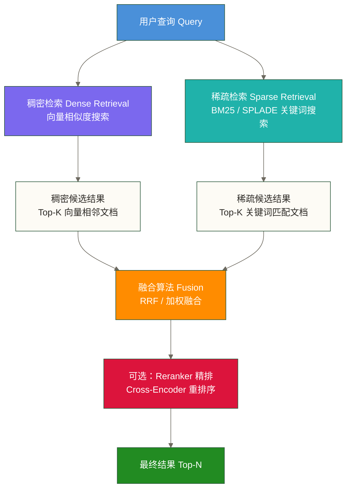
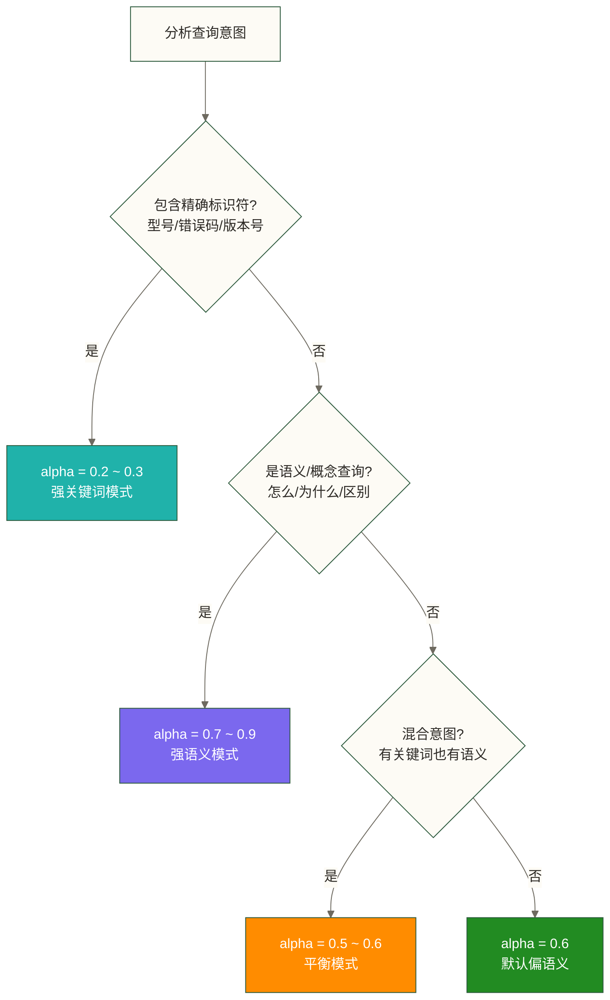

# 混合搜索 Hybrid Search 工程实践

> 单靠向量搜索的 RAG，就像只用嗅觉找东西——能找到气味相近的，但找不到贴了标签的那一个。混合搜索把鼻子和眼睛都用上了。

---

## 目录

- [[#1. 为什么单路检索不够用]]
- [[#2. 稀疏检索深度解析]]
- [[#3. 融合算法：RRF vs 加权融合]]
- [[#4. 各数据库混合搜索实战]]
- [[#5. 参数调优策略]]
- [[#6. Reranker 加持：检索的最后一公里]]
- [[#7. 评估：怎么知道效果真的好了]]
- [[#8. 生产部署最佳实践]]
- [[#9. 完整 RAG 系统集成]]
- [[#10. 常见坑与应对]]

---

## 1. 为什么单路检索不够用

### 1.1 向量搜索的软肋

向量搜索（稠密检索）的核心承诺是：把文本变成高维空间里的点，语义相近的点距离近。这个承诺在大多数情况下兑现得不错——但有几种场景它会系统性地失败。

**场景一：精确名词**

用户搜索 `"GPT-4o 的 context window 是多少"`。

向量搜索会把这个查询嵌入为一个语义向量，然后找距离最近的文档。问题在于，`GPT-4o` 这个字符串对模型来说只是词表里的一个 token 序列，它的语义表示和 `GPT-4`、`Claude 3 Opus`、`Gemini Ultra` 的语义向量距离都很近——因为它们在语义上都是"大语言模型"。

结果：你想找 GPT-4o 的具体参数，却召回了一堆写 Claude 和 Gemini 的文档。

**场景二：产品型号、代码、专有名词**

- 搜索 `"iPhone 15 Pro Max"` → 召回所有苹果手机文档
- 搜索 `"ORA-00942"` → 可能召回数据库错误相关的所有内容
- 搜索 `"sklearn.preprocessing.StandardScaler"` → 召回所有数据预处理内容

**场景三：用户就是在找那个词**

当用户的搜索意图本身就是关键词匹配时，语义搜索反而是累赘。搜索"法律第 205 条第 3 款"，你要的不是语义相近的法条，你要的就是这一条，字面意思，一字不差。

### 1.2 BM25 的软肋

BM25 是信息检索领域几十年打磨出来的关键词匹配算法，工业界使用极其广泛（Elasticsearch 的默认相关性算法就是 BM25）。但它有一个根本性缺陷：**它只认识字面，不理解意思**。

**词汇鸿沟（Vocabulary Mismatch）**

- 用户搜 `"苹果手机"` → 文档里只有 `"iPhone"`，BM25 匹配失败
- 用户搜 `"怎么解决"` → 文档标题是 `"问题处理方案"`，BM25 匹配分很低
- 用户搜 `"汽车"` → 知识库里全是 `"车辆"`、`"轿车"`、`"机动车"`，召回率极差

**无法理解语境**

同一个词在不同语境下意思截然不同——"苹果"可以是水果也可以是 Apple Inc.。BM25 不管语境，见词就匹配，见词就打分。

### 1.3 混合搜索：两条腿走路

混合搜索的核心逻辑是互补：

- BM25 保住**精确匹配**的边界，不让精确词汇从指缝里溜走
- 向量搜索打通**语义理解**的通道，跨越词汇鸿沟

两路分别召回，然后融合排序。可以将以下目标作为待验证的实验假设：融合后的结果在多数查询类型上不差于两路中的任何一路，并在"精确 + 语义"兼顾的查询上优于单路。实际是否成立，需要在业务标注集上分别比较纯稠密、纯稀疏与融合检索，不能保证融合始终更好。



> [!note] 三种检索方式对比
>
> | 维度 | 纯向量搜索 | 纯 BM25 | 混合搜索 |
> |------|-----------|---------|---------|
> | 精确关键词匹配 | 弱 | 强 | 强 |
> | 语义相似匹配 | 强 | 无 | 强 |
> | 同义词/近义词 | 强 | 无 | 强 |
> | 罕见词/专有名词 | 弱 | 强 | 强 |
> | 长文本理解 | 强 | 弱 | 强 |
> | 计算复杂度 | 中 | 低 | 高 |
> | 工程复杂度 | 低 | 低 | 中高 |

---

## 2. 稀疏检索深度解析

### 2.1 BM25：信息检索的老工匠

BM25 的全称是 Best Match 25，是 TF-IDF 的改进版。理解它需要先搞清楚两个直觉：

**TF（Term Frequency，词频）的直觉**

一篇文档里某个词出现越多次，这篇文档和这个词越相关——这个直觉是对的，但不能线性地对。如果 "向量" 在文档 A 里出现了 10 次，在文档 B 里出现了 100 次，我们不能说 B 的相关性是 A 的 10 倍。词频有**边际效用递减**的规律。

**IDF（Inverse Document Frequency，逆文档频率）的直觉**

"的"、"是"、"在"这些词在所有文档里都出现，它们对区分文档没有任何贡献。一个词越稀少，它的区分度越高，权重越大。IDF 就是衡量这种稀少程度的：

$$IDF(t) = \ln\left(\frac{N - n(t) + 0.5}{n(t) + 0.5} + 1\right)$$

其中 $N$ 是总文档数，$n(t)$ 是包含词 $t$ 的文档数。

**BM25 完整公式**

$$BM25(d, q) = \sum_{t \in q} IDF(t) \cdot \frac{f(t, d) \cdot (k_1 + 1)}{f(t, d) + k_1 \cdot \left(1 - b + b \cdot \frac{|d|}{avgdl}\right)}$$

参数说明：
- $f(t, d)$：词 $t$ 在文档 $d$ 中的频率
- $|d|$：文档长度（词数）
- $avgdl$：语料库平均文档长度
- $k_1$：TF 饱和参数，通常取 1.2-2.0，控制词频的影响程度
- $b$：文档长度归一化参数，通常取 0.75，控制长度惩罚程度

> [!tip] 用人话解释 BM25 的两个关键改进
>
> **改进一：TF 饱和（$k_1$ 参数）**
> BM25 的分子是 $f(t,d) \cdot (k_1+1)$，分母包含 $f(t,d)$。当 $f(t,d)$ 很大时，整个分式趋近于 $k_1+1$——即词频无论多高，得分都有上限。这就是饱和。词出现 10 次和 100 次，在 BM25 看来差不了太多。
>
> **改进二：文档长度归一化（$b$ 参数）**
> 一本 1000 页的书比一篇 1 页的文章更容易包含任何词——这不代表这本书更相关。BM25 通过 $b$ 参数对长文档做惩罚，给短文档奖励。$b=0$ 完全不做长度归一化，$b=1$ 做完全归一化。

**用代码实现 BM25**

```python
import math
from collections import Counter
from typing import List

class BM25:
    """简洁的 BM25 实现，用于理解原理"""

    def __init__(self, k1: float = 1.5, b: float = 0.75):
        self.k1 = k1
        self.b = b
        self.corpus: List[List[str]] = []
        self.doc_freq: dict = {}   # 每个词出现在多少文档中
        self.idf: dict = {}
        self.avg_doc_len: float = 0
        self.n_docs: int = 0

    def fit(self, corpus: List[List[str]]):
        """
        corpus: 分词后的文档列表
        例如: [["向量", "数据库", "检索"], ["BM25", "关键词", "搜索"]]
        """
        self.corpus = corpus
        self.n_docs = len(corpus)
        self.avg_doc_len = sum(len(doc) for doc in corpus) / self.n_docs

        # 计算 DF（文档频率）
        for doc in corpus:
            for word in set(doc):  # set 去重，每个词在每篇文档只算一次
                self.doc_freq[word] = self.doc_freq.get(word, 0) + 1

        # 计算 IDF
        for word, df in self.doc_freq.items():
            self.idf[word] = math.log(
                (self.n_docs - df + 0.5) / (df + 0.5) + 1
            )

    def score(self, doc: List[str], query: List[str]) -> float:
        """计算单篇文档对查询的 BM25 分数"""
        score = 0.0
        doc_len = len(doc)
        term_freq = Counter(doc)

        for term in query:
            if term not in self.idf:
                continue  # 查询词不在语料库中

            tf = term_freq.get(term, 0)
            idf = self.idf[term]

            # BM25 核心公式
            numerator = tf * (self.k1 + 1)
            denominator = tf + self.k1 * (
                1 - self.b + self.b * doc_len / self.avg_doc_len
            )
            score += idf * (numerator / denominator)

        return score

    def search(self, query: List[str], top_k: int = 10) -> List[tuple]:
        """返回 (文档索引, 分数) 的列表，按分数降序"""
        scores = [
            (i, self.score(doc, query))
            for i, doc in enumerate(self.corpus)
        ]
        scores.sort(key=lambda x: x[1], reverse=True)
        return scores[:top_k]


# 使用示例
corpus = [
    ["向量", "数据库", "Qdrant", "高性能", "检索"],
    ["BM25", "关键词", "搜索", "信息检索", "经典算法"],
    ["混合搜索", "向量", "BM25", "融合", "RAG", "检索"],
    ["GPT-4o", "大语言模型", "上下文", "窗口"],
    ["语义搜索", "嵌入向量", "余弦相似度"],
]

bm25 = BM25(k1=1.5, b=0.75)
bm25.fit(corpus)

query = ["混合", "搜索", "向量"]
results = bm25.search(query, top_k=3)
for idx, score in results:
    print(f"文档 {idx}: 分数 {score:.4f} -> {corpus[idx]}")
```

### 2.2 SPLADE：神经网络重新诠释稀疏向量

BM25 的瓶颈很清晰：它只能匹配字面上出现的词，无法扩展到同义词。SPLADE（Sparse Lexical and Expansion Model）用神经网络来解决这个问题。

**SPLADE 的核心思想**

SPLADE 把一段文本映射到**整个词表维度的稀疏向量**。词表有多大（比如 30,000 个词），向量就有多少维。但大多数维度是 0，只有少数重要词对应的维度有非零权重。

关键突破：SPLADE 会**词汇扩展**（Lexical Expansion）——它知道"苹果手机"应该在"iPhone"这个维度上也有权重，因为这两者经常在相同语境中出现。这样就用稀疏向量的形式，实现了部分语义理解能力。

$$\mathbf{w}_{SPLADE}(t) = \sum_{i \in \text{tokens}} \log(1 + \text{ReLU}(MLM_t(i)))$$

其中 $MLM_t(i)$ 是 BERT-like 模型对 token $i$ 预测词 $t$ 的 logit 值。上式展示sum聚合变体，下面代码使用max聚合变体，二者不是同一个聚合公式。中文词汇扩展仅用于说明机制，不能视为所列模型在中文语料上的效果保证。

```mermaid
%%{init: {"theme":"base","themeVariables":{"fontFamily":"PingFang SC, -apple-system, Source Han Serif SC, serif","fontSize":"16px","background":"#FDFBF5","primaryColor":"#FDFBF5","primaryTextColor":"#2D2A26","primaryBorderColor":"#6E6A60","secondaryColor":"#E8EFE8","secondaryBorderColor":"#8FA890","secondaryTextColor":"#2D2A26","tertiaryColor":"#FDFBF5","tertiaryBorderColor":"#9A9488","tertiaryTextColor":"#6E6A60","lineColor":"#6E6A60","textColor":"#2D2A26","mainBkg":"#FDFBF5","nodeBorder":"#2D5A3D","clusterBkg":"#F3EEDF","clusterBorder":"#9A9488","edgeLabelBackground":"#FDFBF5"},"flowchart":{"htmlLabels":true,"curve":"basis","padding":20,"nodeSpacing":60,"rankSpacing":70,"useMaxWidth":false},"themeCSS":".node rect, .node polygon, .node circle { stroke-width: 1.5px; } .edgePath .path { stroke-width: 1.5px; } .cluster-label .nodeLabel, .cluster-label foreignObject { color: #2D2A26 !important; } .edgeLabel, .edgeLabel foreignObject { color: #2D2A26 !important; background-color: #FDFBF5; } .edgeLabel rect { fill: #FDFBF5; }"}}%%
graph LR
    A[输入文本<br/>'苹果手机怎么样'] --> B[BERT Encoder<br/>12层 Transformer]
    B --> C[MLM Head<br/>词表预测层]
    C --> D[ReLU + Log<br/>非负稀疏化]
    D --> E[稀疏权重向量<br/>30000维<br/>大部分为0]

    E --> F["苹果: 2.3<br/>手机: 1.8<br/>iPhone: 1.2<br/>设备: 0.9<br/>电子: 0.7<br/>... 其余为0"]

    style A fill:#4A90D9,color:#fff
    style B fill:#7B68EE,color:#fff
    style E fill:#20B2AA,color:#fff
    style F fill:#228B22,color:#fff
```



> [!note] BM25 vs SPLADE 实际对比
>
> | 场景 | BM25 能否召回 | SPLADE 能否召回 |
> |------|-------------|--------------|
> | 搜"苹果手机"，文档有"iPhone" | 不能 | 能（词汇扩展） |
> | 搜"GPT-4o"，文档有"GPT-4o" | 能 | 能 |
> | 搜"情绪低落"，文档有"抑郁" | 不能 | 大概率能 |
> | 搜"ORA-00942"，文档有"ORA-00942" | 能 | 能 |
> | 计算开销 | 极低（倒排索引） | 中等（需要向量化） |

**在 Python 中使用 SPLADE**

```python
from transformers import AutoModelForMaskedLM, AutoTokenizer
import torch
import numpy as np

class SPLADEEncoder:
    """使用 SPLADE 模型生成稀疏向量"""

    def __init__(self, model_name: str = "naver/splade-cocondenser-ensembledistil"):
        self.tokenizer = AutoTokenizer.from_pretrained(model_name)
        self.model = AutoModelForMaskedLM.from_pretrained(model_name)
        self.model.eval()

    @torch.no_grad()
    def encode(self, text: str) -> dict:
        """
        返回稀疏向量，格式为 {词: 权重} 字典
        只包含权重 > 0 的词
        """
        inputs = self.tokenizer(
            text,
            return_tensors="pt",
            padding=True,
            truncation=True,
            max_length=512
        )

        outputs = self.model(**inputs)
        logits = outputs.logits  # shape: (1, seq_len, vocab_size)

        # SPLADE 聚合：对序列维度取 max，然后 log(1 + ReLU)
        # 结果是 (vocab_size,) 的稀疏向量
        aggregated = torch.max(
            torch.log(1 + torch.relu(logits)),
            dim=1
        ).values.squeeze()

        # 转为稀疏字典格式
        nonzero_indices = aggregated.nonzero().squeeze().tolist()
        if isinstance(nonzero_indices, int):
            nonzero_indices = [nonzero_indices]

        sparse_vector = {}
        for idx in nonzero_indices:
            token = self.tokenizer.convert_ids_to_tokens(idx)
            weight = aggregated[idx].item()
            if weight > 0:
                sparse_vector[token] = weight

        return sparse_vector

    def compute_similarity(self, sparse1: dict, sparse2: dict) -> float:
        """计算两个稀疏向量的点积相似度"""
        score = 0.0
        for term, weight in sparse1.items():
            if term in sparse2:
                score += weight * sparse2[term]
        return score


# 使用示例
encoder = SPLADEEncoder()

query_sparse = encoder.encode("苹果手机推荐")
doc_sparse = encoder.encode("iPhone 15 Pro Max 详细评测")

# 查看扩展后的稀疏向量（只展示权重最高的10个词）
sorted_query = sorted(query_sparse.items(), key=lambda x: x[1], reverse=True)[:10]
print("查询稀疏向量 (Top-10):")
for token, weight in sorted_query:
    print(f"  {token}: {weight:.4f}")

similarity = encoder.compute_similarity(query_sparse, doc_sparse)
print(f"\n查询与文档的 SPLADE 相似度: {similarity:.4f}")
```

---

## 3. 融合算法：RRF vs 加权融合

### 3.1 融合的核心挑战

两路检索各返回一个带分数的排列表。问题是：**两路的分数不可比**。

- 向量搜索返回余弦相似度，范围通常是 [0, 1]，高分文档是 0.95，低分是 0.6
- BM25 返回的分数范围可能是 [0, 50]，取决于词频和文档数量

直接相加是灾难：0.95 的向量分 + 0.1 的 BM25 分 ≠ 0.6 的向量分 + 8.0 的 BM25 分。你无法判断哪个更相关。

### 3.2 RRF（Reciprocal Rank Fusion）

RRF 是目前实践中最广泛使用的融合算法，它的优雅之处在于**完全不看分数，只看排名**。

**核心思路**：一篇文档在某一路检索中排名越靠前，它的贡献值越大，但贡献值按照排名的倒数计算，而不是线性的。

**公式**

$$RRF(d) = \sum_{i=1}^{n} \frac{1}{k + rank_i(d)}$$

其中：
- $d$：文档
- $n$：融合的检索路数（通常是 2）
- $rank_i(d)$：文档 $d$ 在第 $i$ 路检索结果中的排名（从 1 开始）
- $k$：平滑参数，通常取 60（这是 RRF 论文的原始设定，实践中一般不需要修改）

**直觉理解**：第 1 名贡献 1/(60+1) ≈ 0.016，第 2 名贡献 1/(60+2) ≈ 0.016，第 10 名贡献 1/(60+10) ≈ 0.014。排名的差异对最终分数影响不大，真正重要的是"是否进入了两路的结果列表"。

**为什么 k=60**：$k$ 越大，不同排名之间的分数差异越小（更平滑）。$k=60$ 是经验上效果较好的取值，论文作者实验验证过。

```python
from typing import List, Dict, Tuple

def rrf_fusion(
    results_list: List[List[Tuple[str, float]]],
    k: int = 60
) -> List[Tuple[str, float]]:
    """
    RRF 融合多路检索结果

    Args:
        results_list: 多路检索结果，每路是 (doc_id, score) 的有序列表
        k: RRF 平滑参数，默认 60

    Returns:
        融合后按 RRF 分数降序排列的 (doc_id, rrf_score) 列表

    Example:
        dense_results = [("doc1", 0.95), ("doc3", 0.88), ("doc2", 0.72)]
        sparse_results = [("doc2", 15.3), ("doc1", 12.1), ("doc5", 9.8)]
        merged = rrf_fusion([dense_results, sparse_results])
    """
    rrf_scores: Dict[str, float] = {}

    for results in results_list:
        for rank, (doc_id, _score) in enumerate(results, start=1):
            if doc_id not in rrf_scores:
                rrf_scores[doc_id] = 0.0
            rrf_scores[doc_id] += 1.0 / (k + rank)

    # 按 RRF 分数降序排列
    sorted_results = sorted(
        rrf_scores.items(),
        key=lambda x: x[1],
        reverse=True
    )
    return sorted_results


# 使用示例：演示 RRF 的融合逻辑
dense_results = [
    ("doc_A", 0.95),  # 语义最相关
    ("doc_C", 0.88),
    ("doc_B", 0.72),
    ("doc_E", 0.65),
]

sparse_results = [
    ("doc_B", 15.3),  # 关键词完全匹配
    ("doc_A", 12.1),
    ("doc_D", 9.8),
    ("doc_C", 7.2),
]

merged = rrf_fusion([dense_results, sparse_results], k=60)
print("RRF 融合结果:")
for doc_id, rrf_score in merged:
    print(f"  {doc_id}: {rrf_score:.6f}")

# 输出说明：
# doc_A 在两路都排名靠前，综合得分最高
# doc_B 在向量搜索排第3，但在BM25排第1，融合后排名上升
# doc_D 只在BM25里出现，但排名靠前，也会进入融合结果
```

**RRF 的优点**

- 对异常分数鲁棒（某路结果分数极端高/低不影响融合）
- 不需要归一化，省去了大量调参工作
- 实现简单，计算开销极低
- 允许不同路检索返回数量不同的结果

### 3.3 加权线性融合

加权融合的想法更直觉：在两路分数上分别乘以权重然后相加。

$$score_{hybrid}(d) = \alpha \cdot score_{dense}(d) + (1-\alpha) \cdot score_{sparse}(d)$$

**问题：量纲不同**

向量分数在 [0, 1]，BM25 分数可能在 [0, 100]。直接加权会导致 BM25 的权重被放大——即使你设置 `alpha=0.7` 偏向向量，实际上 BM25 仍然主导结果，因为它的分数值本身就大得多。

**解决方案：相对分数归一化（Relative Score Fusion）**

Weaviate 采用了一种叫 Relative Score Fusion 的方法：对每路结果单独做 min-max 归一化，然后再加权融合。

```python
def relative_score_fusion(
    dense_results: List[Tuple[str, float]],
    sparse_results: List[Tuple[str, float]],
    alpha: float = 0.7
) -> List[Tuple[str, float]]:
    """
    相对分数融合：先归一化，再加权融合

    Args:
        dense_results: 向量搜索结果 (doc_id, score)
        sparse_results: 关键词搜索结果 (doc_id, score)
        alpha: 向量搜索权重，范围 [0, 1]
               alpha=1.0 纯向量，alpha=0.0 纯关键词

    Returns:
        融合后的排序结果
    """
    def min_max_normalize(results: List[Tuple[str, float]]) -> Dict[str, float]:
        """Min-Max 归一化到 [0, 1]"""
        if not results:
            return {}
        scores = [s for _, s in results]
        min_score = min(scores)
        max_score = max(scores)
        score_range = max_score - min_score

        if score_range == 0:  # 所有分数相同
            return {doc_id: 1.0 for doc_id, _ in results}

        return {
            doc_id: (score - min_score) / score_range
            for doc_id, score in results
        }

    dense_normalized = min_max_normalize(dense_results)
    sparse_normalized = min_max_normalize(sparse_results)

    # 收集所有出现过的文档
    all_doc_ids = set(dense_normalized.keys()) | set(sparse_normalized.keys())

    fused_scores: Dict[str, float] = {}
    for doc_id in all_doc_ids:
        d_score = dense_normalized.get(doc_id, 0.0)
        s_score = sparse_normalized.get(doc_id, 0.0)
        fused_scores[doc_id] = alpha * d_score + (1 - alpha) * s_score

    return sorted(fused_scores.items(), key=lambda x: x[1], reverse=True)


# 对比两种融合方法
dense_results = [
    ("doc_A", 0.95), ("doc_B", 0.88), ("doc_C", 0.72), ("doc_D", 0.65)
]
sparse_results = [
    ("doc_C", 45.3), ("doc_A", 38.7), ("doc_E", 25.1), ("doc_B", 18.4)
]

rrf_results = rrf_fusion([dense_results, sparse_results])
rsf_results = relative_score_fusion(dense_results, sparse_results, alpha=0.6)

print("RRF 结果:")
for doc, score in rrf_results:
    print(f"  {doc}: {score:.6f}")

print("\n相对分数融合结果 (alpha=0.6):")
for doc, score in rsf_results:
    print(f"  {doc}: {score:.4f}")
```

> [!warning] 选择融合方法的准则
>
> **用 RRF 的场景**：
> - 两路分数量纲差异很大，懒得做归一化
> - 追求鲁棒性，不想被极端分数搞乱
> - 绝大多数生产场景的默认选择
>
> **用加权融合的场景**：
> - 你有充足的数据来调参 alpha，并且做了严格的评估
> - 你需要根据查询类型动态调整权重
> - 两路分数量纲相近（比如两路都是归一化的余弦相似度）
>
> 实践建议：从 RRF 开始，有了评估数据后再考虑加权融合。

---

## 4. 各数据库混合搜索实战

### 4.1 Qdrant 混合搜索（原生支持最完善）

Qdrant 从 1.7 版本开始原生支持稠密向量和稀疏向量同时存储，并提供了完整的混合搜索接口。详见 [[【技术与工具】/向量数据库/Qdrant/00-Qdrant学习路线图|Qdrant向量数据库实战]]。

**环境准备**

```bash
# 安装依赖
pip install qdrant-client fastembed sentence-transformers

# 启动 Qdrant（Docker）
docker run -p 6333:6333 -p 6334:6334 \
    -v $(pwd)/qdrant_storage:/qdrant/storage \
    qdrant/qdrant
```

**完整实战代码**

```python
from qdrant_client import QdrantClient
from qdrant_client.models import (
    VectorParams, SparseVectorParams, Distance,
    PointStruct, SparseVector, NamedVector, NamedSparseVector,
    SearchRequest, FusionQuery, Prefetch, Fusion
)
from fastembed import TextEmbedding, SparseTextEmbedding
from typing import List
import numpy as np

# 初始化客户端
client = QdrantClient(url="http://localhost:6333")

# 初始化嵌入模型
# Dense：通用语义嵌入（所选BGE-small-zh-v1.5为512维）
dense_model = TextEmbedding("BAAI/bge-small-zh-v1.5")
# Sparse：SPLADE 稀疏嵌入
sparse_model = SparseTextEmbedding("prithivida/Splade_PP_en_v1")

COLLECTION_NAME = "hybrid_search_demo"

def create_hybrid_collection():
    """创建支持混合搜索的集合"""
    client.recreate_collection(
        collection_name=COLLECTION_NAME,
        vectors_config={
            # 稠密向量配置
            "dense": VectorParams(
                size=512,           # BGE-small-zh-v1.5 输出维度
                distance=Distance.COSINE
            )
        },
        sparse_vectors_config={
            # 稀疏向量配置（SPLADE）
            "sparse": SparseVectorParams()
        }
    )
    print(f"集合 {COLLECTION_NAME} 创建成功")

def encode_dense(texts: List[str]) -> List[List[float]]:
    """生成稠密向量"""
    embeddings = list(dense_model.embed(texts))
    return [emb.tolist() for emb in embeddings]

def encode_sparse(texts: List[str]) -> List[SparseVector]:
    """生成稀疏向量（SPLADE 格式）"""
    sparse_embeddings = list(sparse_model.embed(texts))
    result = []
    for emb in sparse_embeddings:
        # FastEmbed SPLADE 返回的格式：indices 和 values
        result.append(SparseVector(
            indices=emb.indices.tolist(),
            values=emb.values.tolist()
        ))
    return result

def index_documents(documents: List[dict]):
    """
    批量索引文档

    documents 格式：
    [{"id": "doc1", "text": "文档内容", "metadata": {...}}]
    """
    texts = [doc["text"] for doc in documents]

    # 并行生成两种向量
    dense_vectors = encode_dense(texts)
    sparse_vectors = encode_sparse(texts)

    points = []
    for i, doc in enumerate(documents):
        point = PointStruct(
            id=i,
            vector={
                "dense": dense_vectors[i],
                "sparse": sparse_vectors[i],
            },
            payload={
                "doc_id": doc["id"],
                "text": doc["text"],
                **doc.get("metadata", {})
            }
        )
        points.append(point)

    # 批量上传
    client.upsert(
        collection_name=COLLECTION_NAME,
        points=points,
        wait=True
    )
    print(f"成功索引 {len(points)} 篇文档")

def hybrid_search(
    query: str,
    top_k: int = 5,
    dense_limit: int = 20,
    sparse_limit: int = 20
) -> List[dict]:
    """
    执行混合搜索（Qdrant 原生 RRF 融合）

    Args:
        query: 用户查询
        top_k: 最终返回数量
        dense_limit: 稠密检索候选数量
        sparse_limit: 稀疏检索候选数量

    Returns:
        融合排序后的文档列表
    """
    # 生成查询向量
    query_dense = encode_dense([query])[0]
    query_sparse = encode_sparse([query])[0]

    # Qdrant Query API：同时执行两路检索并 RRF 融合
    results = client.query_points(
        collection_name=COLLECTION_NAME,
        prefetch=[
            # 稠密检索（向量相似度）
            Prefetch(
                query=query_dense,
                using="dense",
                limit=dense_limit
            ),
            # 稀疏检索（BM25/SPLADE）
            Prefetch(
                query=query_sparse,
                using="sparse",
                limit=sparse_limit
            ),
        ],
        # 使用 RRF 融合
        query=FusionQuery(fusion=Fusion.RRF),
        limit=top_k,
        with_payload=True
    )

    return [
        {
            "score": point.score,
            "doc_id": point.payload.get("doc_id"),
            "text": point.payload.get("text"),
        }
        for point in results.points
    ]


# 完整使用演示
if __name__ == "__main__":
    # 1. 创建集合
    create_hybrid_collection()

    # 2. 准备示例文档
    documents = [
        {
            "id": "doc_001",
            "text": "Qdrant 是一个用 Rust 编写的高性能向量数据库，支持 HNSW 索引和 Payload 过滤。",
            "metadata": {"category": "vector_db", "date": "2024-01-01"}
        },
        {
            "id": "doc_002",
            "text": "GPT-4o 是 OpenAI 发布的多模态大语言模型，context window 为 128K tokens。",
            "metadata": {"category": "llm", "date": "2024-05-13"}
        },
        {
            "id": "doc_003",
            "text": "混合搜索将稠密检索和稀疏检索融合，结合 BM25 和向量搜索的优势。",
            "metadata": {"category": "search", "date": "2024-06-01"}
        },
        {
            "id": "doc_004",
            "text": "iPhone 15 Pro Max 搭载 A17 Pro 芯片，配备钛合金机身和 USB-C 接口。",
            "metadata": {"category": "product", "date": "2023-09-12"}
        },
        {
            "id": "doc_005",
            "text": "RAG（检索增强生成）通过从知识库检索相关文档来增强大语言模型的回答准确性。",
            "metadata": {"category": "rag", "date": "2024-02-01"}
        },
    ]

    # 3. 索引文档
    index_documents(documents)

    # 4. 测试混合搜索
    test_queries = [
        "GPT-4o 的上下文长度",   # 精确名词 + 语义查询
        "苹果手机新款",           # 同义词（苹果手机 vs iPhone）
        "向量数据库对比",         # 语义查询
    ]

    for query in test_queries:
        print(f"\n查询: '{query}'")
        results = hybrid_search(query, top_k=3)
        for i, r in enumerate(results, 1):
            print(f"  {i}. [{r['score']:.4f}] {r['text'][:60]}...")
```

### 4.2 Weaviate 混合搜索

Weaviate 对混合搜索有非常简洁的接口设计，`alpha` 参数直接控制两路权重。详见 [[【技术与工具】/向量数据库/Weaviate/00-Weaviate学习路线图|Weaviate向量数据库实战]]。

```python
import weaviate
import weaviate.classes as wvc
from weaviate.classes.query import HybridFusion

# 连接 Weaviate（本地或云端）
client = weaviate.connect_to_local(host="localhost", port=8080)

# 创建 Collection（Schema）
def create_weaviate_collection():
    articles = client.collections.create(
        name="KnowledgeBase",
        vectorizer_config=wvc.config.Configure.Vectorizer.text2vec_openai(
            model="text-embedding-3-small"
        ),
        properties=[
            wvc.config.Property(name="content", data_type=wvc.config.DataType.TEXT),
            wvc.config.Property(name="doc_id", data_type=wvc.config.DataType.TEXT),
            wvc.config.Property(name="category", data_type=wvc.config.DataType.TEXT),
        ]
    )
    return articles

# 执行混合搜索
def weaviate_hybrid_search(
    query: str,
    alpha: float = 0.6,    # 0=纯BM25, 1=纯向量
    top_k: int = 5,
    fusion_type: str = "relative_score"  # 或 "ranked"（RRF）
) -> List[dict]:
    """
    Weaviate 混合搜索

    alpha 参数说明：
    - alpha=0.0: 完全依赖 BM25（适合精确关键词搜索）
    - alpha=0.5: 两路平等权重
    - alpha=1.0: 完全依赖向量搜索（适合语义搜索）
    """
    collection = client.collections.get("KnowledgeBase")

    # 选择融合方式
    if fusion_type == "ranked":
        fusion = HybridFusion.RANKED        # RRF
    else:
        fusion = HybridFusion.RELATIVE_SCORE  # 相对分数融合

    response = collection.query.hybrid(
        query=query,
        alpha=alpha,
        fusion_type=fusion,
        limit=top_k,
        return_metadata=wvc.query.MetadataQuery(score=True, explain_score=True)
    )

    results = []
    for obj in response.objects:
        results.append({
            "doc_id": obj.properties.get("doc_id"),
            "content": obj.properties.get("content"),
            "score": obj.metadata.score,
            "explain": obj.metadata.explain_score  # 解释分数来源
        })

    return results

# Alpha 动态调整示例：根据查询特征选择 alpha
def auto_alpha(query: str) -> float:
    """
    简单的 alpha 自动选择策略
    实际生产中应使用更复杂的查询分类器
    """
    import re

    # 包含精确型模式（产品型号、错误码、版本号）→ 偏关键词
    exact_patterns = [
        r'\b[A-Z]{2,}-\d+\b',      # 错误码格式：ORA-00942
        r'v?\d+\.\d+(\.\d+)?',      # 版本号：v1.2.3
        r'[A-Z][a-z]+-\d[a-z]?',   # 产品型号：iPhone-15
        r'GPT-\d',                   # LLM 型号
    ]

    for pattern in exact_patterns:
        if re.search(pattern, query):
            return 0.3  # 偏向关键词

    # 问句、语义查询 → 偏向量
    if any(q in query for q in ['怎么', '为什么', '如何', '什么是', '区别', '对比']):
        return 0.8  # 偏向语义

    # 默认平衡
    return 0.6

# 测试
test_query = "GPT-4o 多模态能力"
auto_a = auto_alpha(test_query)
print(f"查询 '{test_query}' 自动 alpha: {auto_a}")
results = weaviate_hybrid_search(test_query, alpha=auto_a)
```

### 4.3 Elasticsearch 混合搜索（企业常用）

Elasticsearch 的混合搜索通过 `knn` 子查询和 `bool` 查询组合实现，是企业存量系统最常用的方案。

```python
from elasticsearch import Elasticsearch
from sentence_transformers import SentenceTransformer
from typing import List, Dict

es = Elasticsearch(["http://localhost:9200"])
embed_model = SentenceTransformer("BAAI/bge-small-zh-v1.5")

INDEX_NAME = "hybrid_knowledge_base"

# 创建索引（支持 kNN 向量搜索）
def create_es_index():
    mapping = {
        "mappings": {
            "properties": {
                "doc_id": {"type": "keyword"},
                "content": {
                    "type": "text",
                    "analyzer": "ik_max_word",     # 中文分词（需安装 IK 插件）
                    "search_analyzer": "ik_smart"
                },
                "dense_vector": {
                    "type": "dense_vector",
                    "dims": 512,
                    "index": True,
                    "similarity": "cosine"          # 余弦相似度
                },
                "category": {"type": "keyword"},
            }
        },
        "settings": {
            "number_of_shards": 1,
            "number_of_replicas": 0,
        }
    }

    if es.indices.exists(index=INDEX_NAME):
        es.indices.delete(index=INDEX_NAME)
    es.indices.create(index=INDEX_NAME, body=mapping)
    print(f"ES 索引 {INDEX_NAME} 创建成功")

# 索引文档
def es_index_documents(documents: List[dict]):
    for i, doc in enumerate(documents):
        vector = embed_model.encode(doc["content"]).tolist()
        es.index(
            index=INDEX_NAME,
            id=i,
            document={
                "doc_id": doc["doc_id"],
                "content": doc["content"],
                "dense_vector": vector,
                "category": doc.get("category", "")
            }
        )
    es.indices.refresh(index=INDEX_NAME)

def es_hybrid_search(
    query: str,
    top_k: int = 5,
    knn_boost: float = 0.7,
    bm25_boost: float = 0.3,
    knn_candidates: int = 50
) -> List[dict]:
    """
    Elasticsearch 混合搜索

    使用 bool query 将 kNN 向量搜索和 BM25 全文搜索融合

    Args:
        knn_boost: kNN 分数权重（相对于 BM25 的比例）
        bm25_boost: BM25 分数权重
        knn_candidates: kNN 候选数量（越大越准确，越慢）
    """
    query_vector = embed_model.encode(query).tolist()

    search_body = {
        "size": top_k,
        "query": {
            "bool": {
                "should": [
                    # BM25 全文检索（关键词匹配）
                    {
                        "match": {
                            "content": {
                                "query": query,
                                "boost": bm25_boost
                            }
                        }
                    }
                ]
            }
        },
        # kNN 向量搜索（语义匹配）
        "knn": {
            "field": "dense_vector",
            "query_vector": query_vector,
            "k": top_k,
            "num_candidates": knn_candidates,
            "boost": knn_boost
        },
        "_source": ["doc_id", "content", "category"],
        "explain": False
    }

    response = es.search(index=INDEX_NAME, body=search_body)

    results = []
    for hit in response["hits"]["hits"]:
        results.append({
            "doc_id": hit["_source"]["doc_id"],
            "content": hit["_source"]["content"],
            "score": hit["_score"],
            "category": hit["_source"].get("category")
        })

    return results

# Elasticsearch原生RRF示例：具体retriever.rrf语法需匹配服务版本
def es_rrf_search(query: str, top_k: int = 5) -> List[dict]:
    """
    Elasticsearch原生RRF检索示例
    需要支持下述retriever.rrf请求语法的服务版本；不能仅依据RRF功能的起始版本判断兼容性
    """
    query_vector = embed_model.encode(query).tolist()

    search_body = {
        "retriever": {
            "rrf": {
                "retrievers": [
                    # 向量检索器
                    {
                        "knn": {
                            "field": "dense_vector",
                            "query_vector": query_vector,
                            "k": 20,
                            "num_candidates": 50
                        }
                    },
                    # 全文检索器
                    {
                        "standard": {
                            "query": {
                                "match": {
                                    "content": {"query": query}
                                }
                            }
                        }
                    }
                ],
                "rank_constant": 60,    # RRF 的 k 参数
                "rank_window_size": 100  # 每路候选数量
            }
        },
        "size": top_k
    }

    response = es.search(index=INDEX_NAME, body=search_body)

    return [
        {
            "doc_id": hit["_source"]["doc_id"],
            "content": hit["_source"]["content"],
            "score": hit["_score"]
        }
        for hit in response["hits"]["hits"]
    ]
```

### 4.4 pgvector + PostgreSQL 全文检索融合

pgvector 是 PostgreSQL 的向量扩展，配合 PostgreSQL 内置的全文检索（tsvector），可以构建一个不依赖额外服务的混合搜索系统。详见 [[【技术与工具】/向量数据库/pgvector/00-pgvector学习路线图|pgvector实战指南]]。

```python
import psycopg2
from psycopg2.extras import execute_values
from sentence_transformers import SentenceTransformer
import numpy as np

embed_model = SentenceTransformer("BAAI/bge-small-zh-v1.5")

conn = psycopg2.connect(
    host="localhost",
    port=5432,
    database="vectordb",
    user="postgres",
    password="password"
)

def setup_pg_hybrid_search():
    """设置 PostgreSQL 混合搜索环境"""
    with conn.cursor() as cur:
        # 启用 pgvector 扩展
        cur.execute("CREATE EXTENSION IF NOT EXISTS vector;")

        # 创建混合搜索表
        cur.execute("""
            CREATE TABLE IF NOT EXISTS knowledge_base (
                id SERIAL PRIMARY KEY,
                doc_id TEXT UNIQUE NOT NULL,
                content TEXT NOT NULL,
                category TEXT,
                -- 向量列（BGE-small-zh-v1.5为512维，余弦搜索）
                embedding vector(512),
                -- 全文检索列（自动从content生成）
                search_vector tsvector GENERATED ALWAYS AS (
                    to_tsvector('chinese', content)  -- 需要中文分词扩展
                ) STORED
            );
        """)

        # 为向量列创建 HNSW 索引
        cur.execute("""
            CREATE INDEX IF NOT EXISTS knowledge_base_embedding_idx
            ON knowledge_base USING hnsw (embedding vector_cosine_ops)
            WITH (m = 16, ef_construction = 64);
        """)

        # 为全文检索列创建 GIN 索引
        cur.execute("""
            CREATE INDEX IF NOT EXISTS knowledge_base_search_vector_idx
            ON knowledge_base USING gin (search_vector);
        """)

        conn.commit()
    print("PostgreSQL 混合搜索环境设置完成")

def pg_hybrid_search(
    query: str,
    top_k: int = 5,
    dense_weight: float = 0.7,
    sparse_weight: float = 0.3,
    candidate_pool: int = 50
) -> List[dict]:
    """
    PostgreSQL 混合搜索：向量相似度 + 全文检索 RRF 融合
    使用 CTE（公共表表达式）实现 RRF
    """
    query_embedding = embed_model.encode(query).tolist()
    query_tsquery = ' | '.join(query.split())  # 简单分词处理

    rrf_sql = """
    WITH
    -- 稠密检索（向量相似度）
    dense_results AS (
        SELECT
            id,
            doc_id,
            content,
            1 - (embedding <=> %s::vector) AS dense_score,
            ROW_NUMBER() OVER (ORDER BY embedding <=> %s::vector) AS dense_rank
        FROM knowledge_base
        ORDER BY embedding <=> %s::vector
        LIMIT %s
    ),
    -- 稀疏检索（PostgreSQL全文搜索，使用ts_rank_cd排序，并非BM25）
    sparse_results AS (
        SELECT
            id,
            doc_id,
            content,
            ts_rank_cd(search_vector, plainto_tsquery('chinese', %s)) AS sparse_score,
            ROW_NUMBER() OVER (
                ORDER BY ts_rank_cd(search_vector, plainto_tsquery('chinese', %s)) DESC
            ) AS sparse_rank
        FROM knowledge_base
        WHERE search_vector @@ plainto_tsquery('chinese', %s)
        ORDER BY sparse_score DESC, id
        LIMIT %s
    ),
    -- RRF 融合（k=60）
    rrf_fusion AS (
        SELECT
            COALESCE(d.id, s.id) AS id,
            COALESCE(d.doc_id, s.doc_id) AS doc_id,
            COALESCE(d.content, s.content) AS content,
            COALESCE(1.0 / (60 + d.dense_rank), 0) +
            COALESCE(1.0 / (60 + s.sparse_rank), 0) AS rrf_score
        FROM dense_results d
        FULL OUTER JOIN sparse_results s ON d.id = s.id
    )
    SELECT id, doc_id, content, rrf_score
    FROM rrf_fusion
    ORDER BY rrf_score DESC
    LIMIT %s;
    """

    with conn.cursor() as cur:
        cur.execute(rrf_sql, (
            query_embedding, query_embedding, query_embedding, candidate_pool,  # dense
            query, query, query, candidate_pool,    # sparse
            top_k                                    # final limit
        ))
        rows = cur.fetchall()

    return [
        {"id": row[0], "doc_id": row[1], "content": row[2], "rrf_score": float(row[3])}
        for row in rows
    ]
```

> [!tip] 各数据库混合搜索能力对比
>
> | 数据库 | 原生混合搜索 | RRF 支持 | 稀疏向量存储 | 推荐场景 |
> |--------|------------|---------|------------|---------|
> | Qdrant | 原生 | 原生 | 原生 | 新项目首选 |
> | Weaviate | 原生 | 原生（alpha参数） | 通过BM25 | AI原生应用 |
> | Elasticsearch 8.8+ | 原生 | 原生 | 原生 | 企业存量系统 |
> | pgvector + PG | 手动实现 | 手动CTE | 不支持 | 已有PG的团队 |
> | Milvus | 原生 | 原生 | 原生 | 超大规模场景 |

---

## 5. 参数调优策略

### 5.1 Alpha 参数调优

对于支持 alpha 参数的系统（Weaviate 等），alpha 是影响效果最大的单一参数。

**查询类型与 alpha 的关系**



**用标注集离线评估选择 alpha 候选，再通过线上 A/B 测试验证**

```python
import random
from dataclasses import dataclass
from typing import Callable, List
from collections import defaultdict

@dataclass
class SearchResult:
    doc_id: str
    rank: int
    score: float

@dataclass
class EvalSample:
    query: str
    relevant_doc_ids: List[str]  # 标注的相关文档

def evaluate_alpha(
    search_fn: Callable,    # 搜索函数，接受 (query, alpha) 返回结果列表
    eval_samples: List[EvalSample],
    alpha_candidates: List[float],
    k: int = 5
) -> dict:
    """
    对不同 alpha 值评估 Recall@K 和 MRR

    Returns:
        {alpha: {"recall@k": float, "mrr": float}}
    """
    results = defaultdict(lambda: {"recall_at_k": [], "mrr": []})

    for sample in eval_samples:
        for alpha in alpha_candidates:
            search_results = search_fn(sample.query, alpha)
            retrieved_ids = [r["doc_id"] for r in search_results[:k]]

            # 计算 Recall@K
            relevant_retrieved = set(retrieved_ids) & set(sample.relevant_doc_ids)
            recall = len(relevant_retrieved) / max(len(sample.relevant_doc_ids), 1)
            results[alpha]["recall_at_k"].append(recall)

            # 计算 MRR（Mean Reciprocal Rank）
            mrr = 0.0
            for rank, doc_id in enumerate(retrieved_ids, start=1):
                if doc_id in sample.relevant_doc_ids:
                    mrr = 1.0 / rank
                    break
            results[alpha]["mrr"].append(mrr)

    # 汇总平均值
    summary = {}
    for alpha, metrics in results.items():
        summary[alpha] = {
            "recall@k": sum(metrics["recall_at_k"]) / len(metrics["recall_at_k"]),
            "mrr": sum(metrics["mrr"]) / len(metrics["mrr"])
        }

    return summary


# 使用示例
eval_data = [
    EvalSample(
        query="GPT-4o 上下文窗口大小",
        relevant_doc_ids=["doc_002"]
    ),
    EvalSample(
        query="向量数据库选型",
        relevant_doc_ids=["doc_001", "doc_003"]
    ),
    EvalSample(
        query="苹果手机新款推荐",
        relevant_doc_ids=["doc_004"]
    ),
]

alpha_values = [0.1, 0.3, 0.5, 0.7, 0.9]

# 假设 hybrid_search_fn 是你实现的搜索函数
# summary = evaluate_alpha(hybrid_search_fn, eval_data, alpha_values)
#
# print("Alpha 调优结果:")
# for alpha, metrics in sorted(summary.items()):
#     print(f"  alpha={alpha}: Recall@5={metrics['recall@k']:.3f}, MRR={metrics['mrr']:.3f}")
```

### 5.2 K 值（召回数量）选择

每路检索召回多少候选文档，是效果和性能的权衡点。

**理论分析**

- 两路各召回 20 候选，融合后去重，最多得到 40 个文档
- 最终返回 Top-5，40 个候选池通常足够
- 每路召回越多，准确率越高，但延迟和计算成本也越高

**经验建议**

| 场景 | 每路候选数 | 最终返回数 |
|------|---------|---------|
| 实时聊天（低延迟优先） | 10-20 | 3-5 |
| RAG 文档检索（质量优先） | 30-50 | 5-10 |
| 离线批量处理 | 100+ | 20+ |

```python
import time

def benchmark_hybrid_search(search_fn: Callable, query: str, k_values: List[int]):
    """测试不同 k 值下的延迟"""
    for k in k_values:
        start = time.time()
        results = search_fn(query, dense_limit=k, sparse_limit=k)
        elapsed = (time.time() - start) * 1000  # 毫秒
        print(f"  每路候选 k={k}: 延迟={elapsed:.1f}ms, 返回={len(results)}条")
```

---

## 6. Reranker 加持：检索的最后一公里

混合搜索大幅提升了召回率，但排序精度仍然有限——向量相似度和 BM25 分数只是一阶近似。Reranker（精排模型）是检索系统的最后一公里。

### 6.1 为什么需要 Reranker

召回（Retrieval）阶段的目标是**不漏**：用双塔模型把候选从百万中筛到几十。精排（Reranking）阶段的目标是**排准**：对几十个候选做精细的相关性判断。

召回模型（Bi-Encoder）把 query 和 document 分别编码为独立向量，两者在最后一步才做点积——效率高，但损失了 query 和 document 之间的细粒度交互信息。

Reranker（Cross-Encoder）把 query 和 document **拼在一起**输入模型，让 Transformer 的 attention 机制充分捕捉两者之间的每一个词的交互关系。计算量大，但精度显著更高。

```mermaid
%%{init: {"theme":"base","themeVariables":{"fontFamily":"PingFang SC, -apple-system, Source Han Serif SC, serif","fontSize":"16px","background":"#FDFBF5","primaryColor":"#FDFBF5","primaryTextColor":"#2D2A26","primaryBorderColor":"#6E6A60","secondaryColor":"#E8EFE8","secondaryBorderColor":"#8FA890","secondaryTextColor":"#2D2A26","tertiaryColor":"#FDFBF5","tertiaryBorderColor":"#9A9488","tertiaryTextColor":"#6E6A60","lineColor":"#6E6A60","textColor":"#2D2A26","mainBkg":"#FDFBF5","nodeBorder":"#2D5A3D","clusterBkg":"#F3EEDF","clusterBorder":"#9A9488","edgeLabelBackground":"#FDFBF5"},"flowchart":{"htmlLabels":true,"curve":"basis","padding":20,"nodeSpacing":60,"rankSpacing":70,"useMaxWidth":false},"themeCSS":".node rect, .node polygon, .node circle { stroke-width: 1.5px; } .edgePath .path { stroke-width: 1.5px; } .cluster-label .nodeLabel, .cluster-label foreignObject { color: #2D2A26 !important; } .edgeLabel, .edgeLabel foreignObject { color: #2D2A26 !important; background-color: #FDFBF5; } .edgeLabel rect { fill: #FDFBF5; }"}}%%
graph LR
    subgraph "召回阶段（毫秒级）"
        Q1[Query] --> QE[Query Encoder]
        D1[Document] --> DE[Doc Encoder]
        QE --> V1[Query Vector]
        DE --> V2[Doc Vector]
        V1 --> DOT[点积 / 余弦相似度]
        V2 --> DOT
    end

    subgraph "精排阶段（tens of ms）"
        Q2[Query] --> CAT[Concat<br/>query + doc]
        D2[Top-50 候选] --> CAT
        CAT --> CE[Cross-Encoder<br/>完整Transformer]
        CE --> SCORE[精排分数]
    end

    DOT --> TOPK[Top-50 候选]
    TOPK --> Q2
    TOPK --> D2
    SCORE --> FINAL[最终Top-5]

    style DOT fill:#20B2AA,color:#fff
    style CE fill:#DC143C,color:#fff
    style FINAL fill:#228B22,color:#fff
```



### 6.2 BGE-Reranker 代码实现

```python
from sentence_transformers import CrossEncoder
from typing import List, Tuple

class BGEReranker:
    """
    使用 BGE-Reranker 对混合搜索结果精排
    模型：BAAI/bge-reranker-v2-m3（支持中英文）
    """

    def __init__(self, model_name: str = "BAAI/bge-reranker-v2-m3"):
        # CrossEncoder 会把 (query, doc) 对拼接后输入模型
        self.model = CrossEncoder(model_name, max_length=512)
        print(f"Reranker 加载完成: {model_name}")

    def rerank(
        self,
        query: str,
        candidates: List[dict],
        text_key: str = "content",
        top_k: int = 5
    ) -> List[dict]:
        """
        对候选文档精排

        Args:
            query: 用户查询
            candidates: 候选文档列表，每个元素包含 text_key 对应的文本
            text_key: 文档文本字段名
            top_k: 精排后返回数量

        Returns:
            按精排分数降序的文档列表（含 rerank_score 字段）
        """
        if not candidates:
            return []

        # 构建 (query, doc) 对
        pairs = [(query, doc[text_key]) for doc in candidates]

        # 批量计算相关性分数
        scores = self.model.predict(pairs, batch_size=32, show_progress_bar=False)

        # 附加分数到文档
        for doc, score in zip(candidates, scores):
            doc["rerank_score"] = float(score)

        # 按精排分数降序
        reranked = sorted(candidates, key=lambda x: x["rerank_score"], reverse=True)

        return reranked[:top_k]


# 完整的混合搜索 + Reranker 流水线
class HybridSearchPipeline:
    """
    生产级混合搜索流水线
    召回（混合搜索）→ 融合（RRF）→ 精排（Reranker）
    """

    def __init__(self):
        self.reranker = BGEReranker("BAAI/bge-reranker-v2-m3")

    def search(
        self,
        query: str,
        recall_k: int = 30,  # 召回候选数
        final_k: int = 5,    # 最终返回数
        use_reranker: bool = True
    ) -> List[dict]:
        """
        完整检索流水线

        Step 1: 混合搜索召回 Top-30
        Step 2: RRF 融合排序
        Step 3: Reranker 精排 Top-5
        """
        # Step 1 & 2: 混合搜索（调用前面实现的函数）
        candidates = hybrid_search(
            query,
            top_k=recall_k,
            dense_limit=recall_k,
            sparse_limit=recall_k
        )

        # Step 3: Reranker 精排
        if use_reranker and candidates:
            final_results = self.reranker.rerank(
                query=query,
                candidates=candidates,
                text_key="text",
                top_k=final_k
            )
        else:
            final_results = candidates[:final_k]

        return final_results


# 使用示例
pipeline = HybridSearchPipeline()
results = pipeline.search("GPT-4o 多模态理解能力", final_k=5)

for i, r in enumerate(results, 1):
    rerank_score = r.get("rerank_score", "N/A")
    print(f"{i}. [精排分: {rerank_score:.4f}] {r.get('text', '')[:80]}")
```

### 6.3 Cohere Reranker（云端方案）

```python
import cohere

co = cohere.Client("YOUR_COHERE_API_KEY")

def cohere_rerank(query: str, candidates: List[dict], top_k: int = 5) -> List[dict]:
    """
    使用 Cohere Reranker API 精排

    适合：不想部署本地模型、追求最高质量、对成本不敏感的场景
    """
    documents = [doc["content"] for doc in candidates]

    response = co.rerank(
        model="rerank-multilingual-v3.0",  # 支持中文
        query=query,
        documents=documents,
        top_n=top_k
    )

    reranked = []
    for result in response.results:
        doc = candidates[result.index].copy()
        doc["rerank_score"] = result.relevance_score
        reranked.append(doc)

    return reranked
```

> [!tip] Reranker 选型建议
>
> | 方案 | 质量 | 延迟 | 成本 | 适用场景 |
> |------|------|------|------|---------|
> | BGE-Reranker-v2-m3 | 高 | 中（~50ms） | 低（本地） | 中文场景首选 |
> | Cohere Reranker v3 | 极高 | 低（API） | 中（按调用计费） | 多语言、追求最高质量 |
> | BGE-Reranker-Large | 极高 | 高（~200ms） | 低（本地） | 离线批处理 |
> | 不用 Reranker | 中 | 极低 | 零 | 对延迟要求极严苛 |

---

## 7. 评估：怎么知道效果真的好了

### 7.1 核心检索指标

**Recall@K（召回率@K）**

在返回的 Top-K 结果中，有多少标注相关文档被召回了。

$$Recall@K = \frac{|\text{relevant} \cap \text{retrieved@K}|}{|\text{relevant}|}$$

**MRR（Mean Reciprocal Rank，平均倒数排名）**

关注第一个相关文档出现在什么位置。如果用户期望第一条结果就是相关的，MRR 比 Recall 更重要。

$$MRR = \frac{1}{|Q|} \sum_{i=1}^{|Q|} \frac{1}{rank_i}$$

**NDCG@K（归一化折损累积增益）**

考虑了相关文档在排名中的位置，并允许相关性有梯度（"高度相关"、"相关"、"不相关"）。

$$NDCG@K = \frac{DCG@K}{IDCG@K}, \quad DCG@K = \sum_{i=1}^{K} \frac{rel_i}{\log_2(i+1)}$$

```python
import math
from typing import List

def recall_at_k(retrieved: List[str], relevant: List[str], k: int) -> float:
    """计算 Recall@K"""
    retrieved_k = set(retrieved[:k])
    relevant_set = set(relevant)
    if not relevant_set:
        return 0.0
    return len(retrieved_k & relevant_set) / len(relevant_set)

def mean_reciprocal_rank(retrieved: List[str], relevant: List[str]) -> float:
    """计算 MRR（只看第一个相关文档的排名）"""
    relevant_set = set(relevant)
    for rank, doc_id in enumerate(retrieved, start=1):
        if doc_id in relevant_set:
            return 1.0 / rank
    return 0.0

def ndcg_at_k(retrieved: List[str], relevance_scores: dict, k: int) -> float:
    """
    计算 NDCG@K

    relevance_scores: {doc_id: relevance}
    relevance 可以是 0（不相关）、1（相关）、2（高度相关）
    """
    def dcg(ranked_list: List[str], scores: dict, k: int) -> float:
        dcg_val = 0.0
        for i, doc_id in enumerate(ranked_list[:k], start=1):
            rel = scores.get(doc_id, 0)
            dcg_val += rel / math.log2(i + 1)
        return dcg_val

    # 实际 DCG
    actual_dcg = dcg(retrieved, relevance_scores, k)

    # 理想 DCG（将所有文档按相关度排序）
    ideal_order = sorted(
        relevance_scores.keys(),
        key=lambda x: relevance_scores[x],
        reverse=True
    )
    ideal_dcg = dcg(ideal_order, relevance_scores, k)

    if ideal_dcg == 0:
        return 0.0
    return actual_dcg / ideal_dcg


# 对比评估：纯向量 vs 纯BM25 vs 混合搜索
def compare_retrieval_methods(
    eval_data: List[dict],
    dense_search_fn: Callable,
    sparse_search_fn: Callable,
    hybrid_search_fn: Callable,
    k: int = 5
):
    """对比三种检索方法"""
    methods = {
        "Dense Only": dense_search_fn,
        "Sparse Only": sparse_search_fn,
        "Hybrid (RRF)": hybrid_search_fn,
    }

    print(f"{'方法':<15} {'Recall@'+str(k):<15} {'MRR':<10}")
    print("-" * 40)

    for method_name, search_fn in methods.items():
        recalls, mrrs = [], []

        for sample in eval_data:
            results = search_fn(sample["query"])
            retrieved = [r["doc_id"] for r in results]

            recalls.append(recall_at_k(retrieved, sample["relevant_ids"], k))
            mrrs.append(mean_reciprocal_rank(retrieved, sample["relevant_ids"]))

        avg_recall = sum(recalls) / len(recalls)
        avg_mrr = sum(mrrs) / len(mrrs)

        print(f"{method_name:<15} {avg_recall:.3f}{'':>8} {avg_mrr:.3f}")
```

### 7.2 RAGAS 框架评估 RAG 系统

RAGAS 专为 RAG 系统设计，从检索质量和生成质量两个维度评估。

```python
# pip install ragas
from ragas import evaluate
from ragas.metrics import (
    context_precision,
    context_recall,
    faithfulness,
    answer_relevancy
)
from datasets import Dataset

# 准备评估数据集
eval_samples = [
    {
        "question": "GPT-4o 的上下文窗口是多少？",
        "answer": "GPT-4o 的上下文窗口为 128K tokens。",
        "contexts": [
            "GPT-4o 是 OpenAI 发布的多模态大语言模型，context window 为 128K tokens，支持文本、图像、音频的输入处理。"
        ],
        "ground_truth": "GPT-4o 的上下文窗口为 128K tokens。"
    },
    {
        "question": "什么是混合搜索？",
        "answer": "混合搜索结合了稠密检索（向量搜索）和稀疏检索（BM25）的优势。",
        "contexts": [
            "混合搜索将稠密检索和稀疏检索融合，结合 BM25 和向量搜索的优势，在精确匹配和语义理解上均有良好表现。"
        ],
        "ground_truth": "混合搜索是稠密检索和稀疏检索的融合方法，能同时处理精确关键词匹配和语义相似匹配。"
    }
]

dataset = Dataset.from_list(eval_samples)

# 评估
result = evaluate(
    dataset=dataset,
    metrics=[
        context_precision,  # 检索结果中相关文档的比例
        context_recall,     # 相关文档被检索到的比例
        faithfulness,       # 回答是否忠实于检索内容
        answer_relevancy    # 回答是否与问题相关
    ]
)

print("RAGAS 评估结果:")
print(result)
```

> [!note] 核心评估指标含义
>
> | 指标 | 含义 | 优化方向 |
> |------|------|---------|
> | context_precision | 召回的文档中，真正相关的占多少 | 提高精确率，减少噪声文档 |
> | context_recall | 相关文档被召回了多少 | 提高召回率，不漏掉关键文档 |
> | faithfulness | 生成的答案是否忠实于召回内容 | 优化 LLM prompt，减少幻觉 |
> | answer_relevancy | 答案是否真正回答了问题 | 整体 RAG 流程优化 |

---

## 8. 生产部署最佳实践

### 8.1 并行双路检索：延迟控制

混合搜索的天然延迟是两路延迟的串行叠加，应当改为并行。

```python
import asyncio
from concurrent.futures import ThreadPoolExecutor
import time

executor = ThreadPoolExecutor(max_workers=4)

async def async_hybrid_search(
    query: str,
    top_k: int = 5
) -> List[dict]:
    """
    异步并行混合搜索
    两路检索同时发起，而不是串行等待
    """
    loop = asyncio.get_event_loop()

    # 并行发起两路检索
    dense_future = loop.run_in_executor(
        executor,
        dense_search,    # 向量搜索函数
        query, 50
    )
    sparse_future = loop.run_in_executor(
        executor,
        sparse_search,   # 关键词搜索函数
        query, 50
    )

    # 等待两路完成
    dense_results, sparse_results = await asyncio.gather(
        dense_future, sparse_future
    )

    # RRF 融合（计算量极小，可同步完成）
    merged = rrf_fusion([dense_results, sparse_results])

    return merged[:top_k]


# 同步版本（使用 threading）
from threading import Thread

def parallel_hybrid_search(query: str, top_k: int = 5) -> List[dict]:
    """使用线程并行的同步版本"""
    dense_results = []
    sparse_results = []
    errors = []

    def run_dense():
        try:
            dense_results.extend(dense_search(query, limit=50))
        except Exception as e:
            errors.append(f"Dense search error: {e}")

    def run_sparse():
        try:
            sparse_results.extend(sparse_search(query, limit=50))
        except Exception as e:
            errors.append(f"Sparse search error: {e}")

    # 并行执行
    t1 = Thread(target=run_dense)
    t2 = Thread(target=run_sparse)
    t1.start()
    t2.start()
    t1.join(timeout=2.0)  # 最多等2秒
    t2.join(timeout=2.0)

    if errors:
        print(f"检索错误: {errors}")

    # 如果有一路失败，使用另一路的结果
    if not dense_results and not sparse_results:
        return []
    elif not dense_results:
        return sparse_results[:top_k]
    elif not sparse_results:
        return dense_results[:top_k]

    merged = rrf_fusion([dense_results, sparse_results])
    return merged[:top_k]
```

### 8.2 冷启动问题

新系统没有历史点击数据，alpha 如何设置？

```python
class AdaptiveAlphaSelector:
    """
    自适应 alpha 选择器
    冷启动阶段使用规则，积累数据后用统计模型
    """

    def __init__(self, default_alpha: float = 0.6):
        self.default_alpha = default_alpha
        self.query_history = []  # 积累查询历史用于统计

    def get_alpha(self, query: str) -> float:
        """
        根据查询特征返回合适的 alpha
        """
        import re

        query_lower = query.lower().strip()

        # 规则 1：包含精确标识符 → 强关键词
        exact_patterns = [
            r'\b[a-z]{2,3}-\d+\b',          # 错误码；query_lower已转为小写
            r'\bv\d+\.\d+',                  # 版本号
            r'\b(gpt|claude|gemini)-\d',     # LLM 型号
            r'\biphone\s*\d+',               # 产品型号
            r'"[^"]{3,}"',                   # 引号精确匹配
        ]
        for pattern in exact_patterns:
            if re.search(pattern, query_lower):
                return 0.25

        # 规则 2：法规条款、代码片段 → 强关键词
        if re.search(r'第\d+条|article\s*\d+|def\s+\w+\(', query_lower):
            return 0.2

        # 规则 3：问句类 → 偏语义
        semantic_keywords = ['怎么', '为什么', '如何', '什么是', '区别', '对比',
                            '推荐', '最好', '原理', '机制', 'how', 'why', 'what']
        if any(kw in query_lower for kw in semantic_keywords):
            return 0.75

        # 规则 4：短查询（< 5 字）→ 偏关键词（可能是精确词搜索）
        if len(query.replace(' ', '')) < 5:
            return 0.35

        # 默认
        return self.default_alpha

    def record_feedback(self, query: str, alpha: float, clicked_rank: int):
        """
        记录用户点击行为，用于后续统计优化
        clicked_rank: 用户点击的结果排名（从1开始）
        """
        self.query_history.append({
            "query": query,
            "alpha": alpha,
            "clicked_rank": clicked_rank
        })
```

### 8.3 监控指标体系

```python
import time
from dataclasses import dataclass, field
from collections import deque
from threading import Lock

@dataclass
class SearchMetrics:
    """混合搜索监控指标"""

    # 延迟指标
    dense_latency_ms: float = 0.0
    sparse_latency_ms: float = 0.0
    fusion_latency_ms: float = 0.0
    rerank_latency_ms: float = 0.0
    total_latency_ms: float = 0.0

    # 质量指标
    dense_result_count: int = 0
    sparse_result_count: int = 0
    fusion_result_count: int = 0

    # 系统指标
    timestamp: float = field(default_factory=time.time)
    alpha_used: float = 0.6
    query_length: int = 0


class HybridSearchMonitor:
    """混合搜索监控器（滑动窗口统计）"""

    def __init__(self, window_size: int = 1000):
        self.window_size = window_size
        self.metrics_window = deque(maxlen=window_size)
        self.lock = Lock()

    def record(self, metrics: SearchMetrics):
        with self.lock:
            self.metrics_window.append(metrics)

    def get_stats(self) -> dict:
        """获取当前窗口的统计信息"""
        with self.lock:
            if not self.metrics_window:
                return {}

            metrics = list(self.metrics_window)

        total_latencies = [m.total_latency_ms for m in metrics]

        return {
            "sample_count": len(metrics),
            "avg_total_latency_ms": sum(total_latencies) / len(total_latencies),
            "p95_latency_ms": sorted(total_latencies)[int(len(total_latencies) * 0.95)],
            "p99_latency_ms": sorted(total_latencies)[int(len(total_latencies) * 0.99)],
            "avg_alpha": sum(m.alpha_used for m in metrics) / len(metrics),
            "avg_dense_candidates": sum(m.dense_result_count for m in metrics) / len(metrics),
            "avg_sparse_candidates": sum(m.sparse_result_count for m in metrics) / len(metrics),
        }

    def alert_if_slow(self, p95_threshold_ms: float = 500.0):
        """超过延迟阈值时告警"""
        stats = self.get_stats()
        if stats.get("p95_latency_ms", 0) > p95_threshold_ms:
            print(f"[ALERT] P95 延迟 {stats['p95_latency_ms']:.1f}ms 超过阈值 {p95_threshold_ms}ms")
```

---

## 9. 完整 RAG 系统集成

### 9.1 端到端 RAG Pipeline

```python
from openai import OpenAI
from typing import Optional

openai_client = OpenAI()

class HybridRAGSystem:
    """
    基于混合搜索的完整 RAG 系统

    架构：
    用户查询 → 混合检索（Dense + Sparse + RRF）→ Reranker 精排 → LLM 生成
    """

    def __init__(
        self,
        search_pipeline: HybridSearchPipeline,
        monitor: Optional[HybridSearchMonitor] = None
    ):
        self.search = search_pipeline
        self.monitor = monitor
        self.alpha_selector = AdaptiveAlphaSelector()

    def retrieve_context(
        self,
        query: str,
        recall_k: int = 20,
        final_k: int = 5
    ) -> List[dict]:
        """检索相关文档"""
        start = time.time()
        results = self.search.search(query, recall_k=recall_k, final_k=final_k)
        elapsed = (time.time() - start) * 1000

        if self.monitor:
            self.monitor.record(SearchMetrics(
                total_latency_ms=elapsed,
                alpha_used=self.alpha_selector.get_alpha(query),
                query_length=len(query)
            ))

        return results

    def generate_answer(
        self,
        query: str,
        context_docs: List[dict],
        model: str = "gpt-4o-mini"
    ) -> str:
        """基于检索到的文档生成答案"""

        # 构建上下文
        context_text = "\n\n".join([
            f"[文档{i+1}] {doc.get('text', doc.get('content', ''))}"
            for i, doc in enumerate(context_docs)
        ])

        prompt = f"""你是一个专业的知识问答助手。根据以下检索到的文档内容回答用户问题。

如果检索内容中没有答案，请明确说明。不要凭空捏造信息。

检索到的相关文档：
{context_text}

用户问题：{query}

请给出准确、简洁的回答："""

        response = openai_client.chat.completions.create(
            model=model,
            messages=[{"role": "user", "content": prompt}],
            temperature=0.1  # 低温度，更确定性的输出
        )

        return response.choices[0].message.content

    def answer(self, query: str) -> dict:
        """
        完整的问答流程

        Returns:
            {
                "answer": str,
                "sources": List[dict],  # 引用的文档
                "query": str
            }
        """
        # Step 1: 混合检索
        context_docs = self.retrieve_context(query)

        if not context_docs:
            return {
                "answer": "抱歉，知识库中没有找到相关信息。",
                "sources": [],
                "query": query
            }

        # Step 2: 生成答案
        answer = self.generate_answer(query, context_docs)

        return {
            "answer": answer,
            "sources": [
                {
                    "doc_id": doc.get("doc_id"),
                    "text_snippet": doc.get("text", "")[:200],
                    "rerank_score": doc.get("rerank_score", 0)
                }
                for doc in context_docs
            ],
            "query": query
        }


# 使用示例
rag = HybridRAGSystem(
    search_pipeline=HybridSearchPipeline(),
    monitor=HybridSearchMonitor()
)

result = rag.answer("混合搜索和纯向量搜索有什么区别？")
print("回答:", result["answer"])
print("\n引用来源:")
for source in result["sources"]:
    print(f"  [{source['rerank_score']:.3f}] {source['text_snippet'][:60]}...")
```

### 9.2 LangChain 集成

```python
from langchain.retrievers import EnsembleRetriever
from langchain_community.retrievers import BM25Retriever
from langchain_community.vectorstores import Qdrant
from langchain_openai import OpenAIEmbeddings
from langchain_core.documents import Document

# 构建 LangChain 混合检索器
def build_langchain_hybrid_retriever(documents: List[str], k: int = 5):
    """
    使用 LangChain EnsembleRetriever 实现混合搜索
    底层使用 RRF 融合
    """
    # 将字符串转为 Document 对象
    docs = [Document(page_content=text) for text in documents]

    # 稀疏检索器（BM25）
    bm25_retriever = BM25Retriever.from_documents(docs)
    bm25_retriever.k = k * 2  # 每路多召回一些

    # 稠密检索器（向量搜索）
    embeddings = OpenAIEmbeddings(model="text-embedding-3-small")
    vectorstore = Qdrant.from_documents(
        docs,
        embeddings,
        location=":memory:",
        collection_name="langchain_hybrid"
    )
    dense_retriever = vectorstore.as_retriever(
        search_kwargs={"k": k * 2}
    )

    # EnsembleRetriever：自动执行 RRF 融合
    # weights 对应每路的权重（仅用于加权 RRF，不是分数权重）
    ensemble_retriever = EnsembleRetriever(
        retrievers=[bm25_retriever, dense_retriever],
        weights=[0.4, 0.6]  # 稀疏:稠密 = 4:6
    )

    return ensemble_retriever


# 测试 LangChain 混合检索器
sample_docs = [
    "Qdrant 是用 Rust 编写的高性能向量数据库，支持稠密和稀疏向量存储。",
    "BM25 是经典的关键词匹配算法，被 Elasticsearch 用作默认相关性算法。",
    "混合搜索融合了语义向量搜索和关键词 BM25 搜索，效果优于单路检索。",
    "RAG（检索增强生成）是目前最主流的 LLM 落地方案。",
    "GPT-4o 支持 128K tokens 的上下文窗口，是 OpenAI 的旗舰多模态模型。"
]

retriever = build_langchain_hybrid_retriever(sample_docs)
results = retriever.invoke("向量数据库语义搜索")
for doc in results:
    print(f"- {doc.page_content}")
```

---

## 10. 常见坑与应对

### 10.1 重复文档问题

两路检索可能返回同一篇文档的不同分块（chunk）。融合时需要做去重。

```python
def deduplicate_by_doc(
    results: List[dict],
    doc_id_key: str = "doc_id",
    keep: str = "best_score"
) -> List[dict]:
    """
    对同一个文档的多个 chunk，只保留最高分的那个

    Args:
        keep: "best_score" 保留最高分，"first" 保留第一个出现的
    """
    seen_docs = {}

    for item in results:
        doc_id = item.get(doc_id_key)
        if doc_id is None:
            continue

        if doc_id not in seen_docs:
            seen_docs[doc_id] = item
        elif keep == "best_score":
            current_score = item.get("score", 0) or item.get("rrf_score", 0)
            existing_score = seen_docs[doc_id].get("score", 0) or seen_docs[doc_id].get("rrf_score", 0)
            if current_score > existing_score:
                seen_docs[doc_id] = item

    return list(seen_docs.values())
```

### 10.2 长查询 vs 短查询的不同策略

```python
def smart_hybrid_search(query: str, top_k: int = 5) -> List[dict]:
    """
    根据查询长度智能选择策略
    """
    query_len = len(query.strip())

    if query_len <= 5:
        # 极短查询：可能是精确词搜索，偏向 BM25
        return weaviate_hybrid_search(query, top_k=top_k, alpha=0.2)
    elif query_len <= 20:
        # 中等查询：平衡
        return weaviate_hybrid_search(query, top_k=top_k, alpha=0.5)
    else:
        # 长查询：语义为主
        return weaviate_hybrid_search(query, top_k=top_k, alpha=0.8)
```

> [!warning] 常见误区
>
> 1. **误区：两路召回数量越多越好**
>    真相：候选数量超过 50-100 后，效果提升边际递减，但延迟线性增加。建议每路召回 20-50。
>
> 2. **误区：Reranker 一定能提升效果**
>    真相：如果 Reranker 的训练数据和你的领域差距很大（比如用通用 Reranker 处理法律文本），效果可能反而下降。建议先评估后部署。
>
> 3. **误区：alpha=0.5 是最佳平衡点**
>    真相：最优 alpha 依赖查询分布。如果你的用户多用精确型查询（产品序号、错误码），alpha 可能 0.3 更好。没有评估就没有发言权。
>
> 4. **误区：混合搜索一定比单路好**
>    真相：如果你的语料库里没有同义词问题（比如内部专有名词数据库），纯 BM25 可能就足够了。不要为了混合而混合。

> [!tip] 上线前检查清单
>
> - [ ] 两路检索是否并行执行（而非串行）
> - [ ] 融合算法是否经过离线评估验证
> - [ ] Reranker 是否在领域数据上验证过效果
> - [ ] 延迟 P95 是否满足 SLA（建议 < 500ms）
> - [ ] 是否有降级策略（某一路失败时的 fallback）
> - [ ] 是否有监控和告警

---

## 小结

混合搜索不是什么高深莫测的黑魔法，本质是一个朴素的工程决策：**没有一把刀可以切所有菜，所以带两把**。

BM25 的刀刃精准，擅长找到那个你明确叫出名字的东西。向量搜索的刀身厚重，擅长在意思的海洋里摸鱼。两把刀同时上，RRF 做调度，Reranker 做最后的裁判。

工程上的建议很简单：

1. 用 Qdrant 做新项目，用 Elasticsearch 对接老系统，用 pgvector 凑合小团队
2. 融合算法从 RRF 开始，稳如老狗，再考虑加权融合
3. alpha/k 参数靠评估数据说话，不靠直觉
4. Reranker 是锦上添花，不是雪中送炭——先把前两步做好
5. 监控要建，延迟要盯

最后一句话：**检索效果的天花板，是你数据质量的天花板。** 以假设性的评分作比喻：混合搜索可能把某个系统从 70 分提高到 85 分，但数据质量仍可能限制进一步提升；这些数字不是实验结果，也不是固定的效果上限。文档分块策略、清洗质量、更新频率，这些比算法选型更重要。

---

## 相关资源

### 关联文档

- [[【AI 与大数据】/04-AI工程化/07-向量数据库与语义搜索]] — 向量搜索基础，本文前置知识
- [[【AI 与大数据】/04-AI工程化/08-向量数据库与RAG工程实践]] — RAG 系统完整实践
- [[【技术与工具】/向量数据库/Milvus/00-Milvus学习路线图|Milvus向量数据库实战]] — Milvus 混合搜索实战
- [[【技术与工具】/向量数据库/Qdrant/00-Qdrant学习路线图|Qdrant向量数据库实战]] — Qdrant 深度解析，本文推荐首选
- [[【技术与工具】/向量数据库/Weaviate/00-Weaviate学习路线图|Weaviate向量数据库实战]] — Weaviate alpha 参数详解
- [[【AI 与大数据】/02-大模型核心/04-RAG检索增强生成实战]] — RAG 系统端到端实践

### 扩展阅读

- SPLADE 论文：*SPLADE v2: Sparse Lexical and Expansion Model for Information Retrieval*
- RRF 原始论文：*Reciprocal Rank Fusion outperforms Condorcet and individual Rank Learning Methods*
- BEIR Benchmark：评估各检索方法的通用基准测试

#混合搜索 #Hybrid-Search #RAG #BM25 #稀疏检索 #稠密检索 #RRF #SPLADE #向量数据库 #信息检索 #Reranker
