# RAG 系统架构设计模式：从 Naive 到 Agentic 的完整演进

> [!abstract] 文章导读
> 本文是**通用的 RAG 架构设计指南**，不绑定任何特定向量数据库，系统梳理从 Naive RAG 到 Advanced RAG、再到 Modular RAG / Agentic RAG 的完整演进路径。读完本文，你将掌握：
> - RAG 三代范式的核心差异与适用场景
> - 10+ 种 Advanced RAG 改进模式的原理与代码实现
> - 生产级 RAG 的工程化设计（评估、多租户、缓存、可观测性）
> - 框架选型与架构决策的量化判断标准

**阅读时间**：约 45 分钟 | **适合人群**：LLM 应用开发者、数据架构师、AI 平台工程师

---

## 目录

1. [RAG 的本质与核心问题](#1-rag-的本质与核心问题)
2. [Naive RAG：最简架构与缺陷分析](#2-naive-rag最简架构与缺陷分析)
3. [Advanced RAG 改进模式](#3-advanced-rag-改进模式)
   - 3.1 Pre-Retrieval：查询优化
   - 3.2 Retrieval：检索增强
   - 3.3 Post-Retrieval：结果精炼
4. [Modular RAG：最新架构范式](#4-modular-rag最新架构范式)
5. [文档处理工程](#5-文档处理工程)
6. [RAG 评估体系](#6-rag-评估体系)
7. [生产级 RAG 设计原则](#7-生产级-rag-设计原则)
8. [架构选型决策](#8-架构选型决策)

---

## 1. RAG 的本质与核心问题

### 1.1 为什么 LLM 需要 RAG

大语言模型本质上是一个**压缩后的世界知识库**，它在训练完成的那一刻就被"冻结"了。这带来三个根本性缺陷：

| 缺陷 | 说明 | 示例 |
|------|------|------|
| ① 知识截止（Knowledge Cutoff） | 训练数据有时间边界，无法感知最新信息 | "2025年最新的xx政策是什么？" LLM 不知道 |
| ② 私有数据盲区（Private Data Blindspot） | 企业内部文档、数据库从未出现在训练集中 | "我们公司Q3销售报告的核心结论？" LLM 无从回答 |
| ③ 幻觉（Hallucination） | LLM 倾向于"生成听起来合理"的内容而非"真实"内容 | 在缺乏依据时，模型会自信地编造事实 |

**RAG 的本质**：在生成前，动态地为 LLM 注入与问题相关的外部知识，将"闭卷考试"变成"开卷考试"。

```text
没有 RAG：用户问题 → LLM（记忆） → 答案
有了 RAG：用户问题 → 检索器（外部知识库） → 相关文档 + 用户问题 → LLM → 有依据的答案
```

### 1.2 RAG 的正式定义

**RAG = Retrieval（检索）+ Augmented（增强）+ Generation（生成）**

$$\text{Answer} = \text{LLM}(\text{Query} + \text{Retrieve}(\text{Query}, \text{KnowledgeBase}))$$

三个组件各自的职责：

| 组件 | 职责 | 核心技术 |
|------|------|---------|
| **Retrieval（检索）** | 从知识库中找到与问题最相关的内容 | 向量搜索、BM25、混合搜索 |
| **Augmented（增强）** | 将检索结果与原始问题融合成 Prompt | Prompt 工程、上下文管理 |
| **Generation（生成）** | 基于融合后的上下文生成最终答案 | LLM（GPT-4、Claude、Qwen 等） |

### 1.3 RAG 的核心评估指标

理解 RAG 的质量，必须区分**检索质量**和**生成质量**两个维度：

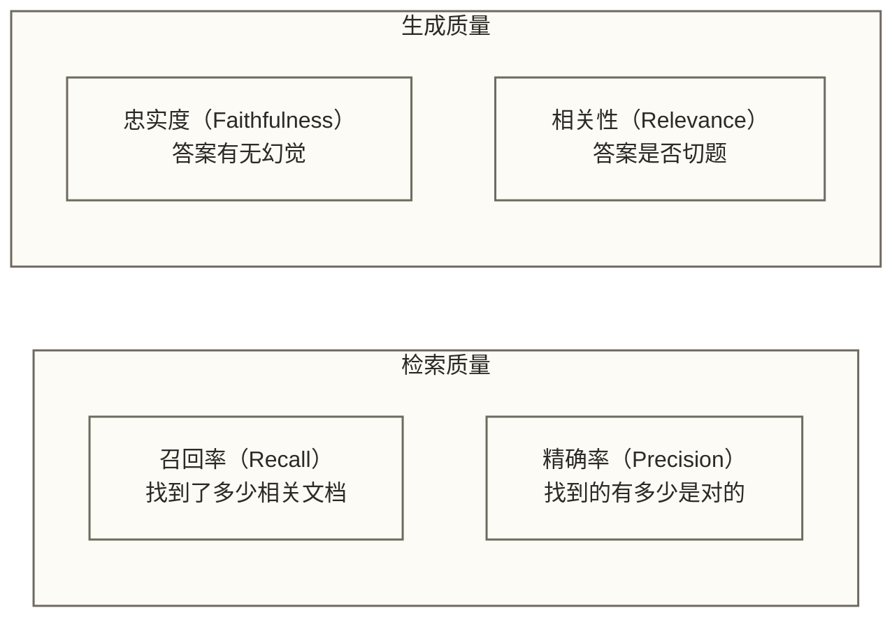

**召回率 vs 精确率的经典权衡**：

- 召回率高 → 找到更多相关内容，但噪声增加，LLM 上下文窗口被稀释
- 精确率高 → 找到的都是精准内容，但可能遗漏关键信息

这个权衡贯穿 RAG 架构设计的每一个决策。

> [!note] 关联阅读
> 向量搜索的底层原理请参考 ANN 算法原理，Embedding 模型的选择请参考 Embedding 选型。

---

## 2. Naive RAG：最简架构与缺陷分析

### 2.1 Naive RAG 的完整流程

Naive RAG 是 RAG 的"原始形态"，也是理解所有改进的起点。

```mermaid
%%{init: {"theme":"base","themeVariables":{"fontFamily":"PingFang SC, -apple-system, Source Han Serif SC, serif","fontSize":"16px","background":"#FDFBF5","primaryColor":"#FDFBF5","primaryTextColor":"#2D2A26","primaryBorderColor":"#6E6A60","secondaryColor":"#E8EFE8","secondaryBorderColor":"#8FA890","secondaryTextColor":"#2D2A26","tertiaryColor":"#FDFBF5","tertiaryBorderColor":"#9A9488","tertiaryTextColor":"#6E6A60","lineColor":"#6E6A60","textColor":"#2D2A26","mainBkg":"#FDFBF5","nodeBorder":"#2D5A3D","clusterBkg":"#F3EEDF","clusterBorder":"#9A9488","edgeLabelBackground":"#FDFBF5"},"flowchart":{"htmlLabels":true,"curve":"basis","padding":20,"nodeSpacing":60,"rankSpacing":70,"useMaxWidth":false},"themeCSS":".node rect, .node polygon, .node circle { stroke-width: 1.5px; } .edgePath .path { stroke-width: 1.5px; } .cluster-label .nodeLabel, .cluster-label foreignObject { color: #2D2A26 !important; } .edgeLabel, .edgeLabel foreignObject { color: #2D2A26 !important; background-color: #FDFBF5; } .edgeLabel rect { fill: #FDFBF5; }"}}%%
flowchart LR
    classDef default fill:#FDFBF5,stroke:#6E6A60,color:#2D2A26,stroke-width:1.5px
    classDef startend fill:#2D2A26,stroke:#2D2A26,color:#FDFBF5,font-weight:bold
    classDef decision fill:#F6EAD8,stroke:#C08A1A,color:#2D2A26,font-weight:bold
    classDef hub fill:#3B5A80,stroke:#3B5A80,color:#FDFBF5,font-weight:bold
    classDef io fill:#E5EAF0,stroke:#3B5A80,color:#2D2A26
    classDef accent fill:#A6432C,stroke:#A6432C,color:#FDFBF5,font-weight:bold
    classDef storage fill:#F3EEDF,stroke:#9A9488,color:#2D2A26
    subgraph 离线阶段["离线阶段（Indexing）"]
        A[原始文档<br/>PDF/Word/网页] --> B[文档切割<br/>Chunking]
        B --> C[Embedding<br/>向量化]
        C --> D[(向量数据库<br/>存储)]
    end

    subgraph 在线阶段["在线阶段（Querying）"]
        E[用户问题] --> F[Query Embedding<br/>问题向量化]
        F --> G[向量检索<br/>Top-K 相似块]
        D --> G
        G --> H[Prompt 拼接<br/>问题 + 上下文]
        H --> I[LLM 生成]
        I --> J[最终答案]
    end
    class D storage
    class A,B,C,E,F,G,H,I,J default
```

**核心步骤详解**：

**Step 1：文档切割（Chunking）**

```python
from langchain.text_splitter import RecursiveCharacterTextSplitter

splitter = RecursiveCharacterTextSplitter(
    chunk_size=512,       # 默认按字符长度计量，目标块大小为 512 个字符
    chunk_overlap=50,     # 目标重叠长度为 50 个字符；不是 token 数
    separators=["\n\n", "\n", "。", ".", " "]
)

chunks = splitter.split_documents(documents)
```

**Step 2：Embedding 与存储**

```python
from langchain_openai import OpenAIEmbeddings
from langchain_community.vectorstores import Milvus

embeddings = OpenAIEmbeddings(model="text-embedding-3-small")

vectorstore = Milvus.from_documents(
    documents=chunks,
    embedding=embeddings,
    connection_args={"host": "localhost", "port": "19530"},
    collection_name="knowledge_base"
)
```

**Step 3：检索与生成**

```python
from langchain.chains import RetrievalQA
from langchain_openai import ChatOpenAI

llm = ChatOpenAI(model="gpt-4o", temperature=0)
retriever = vectorstore.as_retriever(search_kwargs={"k": 5})

qa_chain = RetrievalQA.from_chain_type(
    llm=llm,
    retriever=retriever,
    return_source_documents=True
)

result = qa_chain.invoke({"query": "什么是数据湖？"})
print(result["result"])
```

### 2.2 Naive RAG 的四大痛点

> [!warning] Naive RAG 的局限性
> Naive RAG 在原型验证阶段够用，但在生产环境中会暴露严重问题。了解这些痛点，是选择正确改进方案的前提。

#### 痛点一：语义漂移（Semantic Drift）

固定大小的切块会**破坏文本的自然语义单元**，导致检索到的片段缺失关键上下文。

```text
原文：
"张三是公司CEO，他负责整体战略方向。
 李四是CTO，负责技术架构。
 两人在2024年共同决定转型AI方向。"

切块后（chunk_size=30）：
Chunk A: "张三是公司CEO，他负责整体战略方向。"
Chunk B: "李四是CTO，负责技术架构。两人在"
Chunk C: "2024年共同决定转型AI方向。"

问题："谁决定了AI转型？"
检索到 Chunk C，但缺失了主语信息！
```

#### 痛点二：召回噪声（Retrieval Noise）

向量相似度无法完美捕捉语义相关性，特别是在**词汇差距（Vocabulary Mismatch）**场景下。

```text
用户问题："公司业绩下滑原因"
文档中：  "营业收入环比减少 23%，主要受宏观经济影响"

用户用"业绩下滑"，文档用"营业收入减少"
纯语义搜索可能找不到，但 BM25 关键词搜索同样可能错过
```

#### 痛点三：丢失整体信息（Lost in the Middle）

研究表明，LLM 对**放在上下文中间**的信息注意力显著低于开头和结尾。当检索到多个 chunk 时，关键信息可能因为排列位置而被忽略。

此外，单个 chunk 只能提供局部视角，无法回答需要**跨文档综合**的问题。

#### 痛点四：幻觉放大（Hallucination Amplification）

Naive RAG 将检索结果无条件塞入 Prompt，当检索到**错误或不相关**的片段时，LLM 会以这些错误内容为"依据"生成更有说服力的错误答案。

```text
检索到的噪声片段："2023年，该公司营收为50亿"（实际是5亿，文档有误）
LLM 生成："根据资料，该公司2023年营收高达50亿元，增长强劲..."

→ LLM 用错误数据生成了一个"有据可查"的幻觉
```

### 2.3 Naive RAG 适用场景

并非所有场景都需要 Advanced RAG。Naive RAG 在以下条件下仍然有效：

- 知识库文档**语义清晰、结构规整**（如技术文档、API 手册）
- 问题**简单直接**，不需要多跳推理
- 对准确率要求**不是极端严苛**的内部工具
- **快速原型验证**，验证 RAG 路线可行性

---

## 3. Advanced RAG 改进模式

Advanced RAG 在 Naive RAG 的基础上，在**检索前（Pre-Retrieval）**、**检索中（Retrieval）**、**检索后（Post-Retrieval）** 三个阶段引入优化。

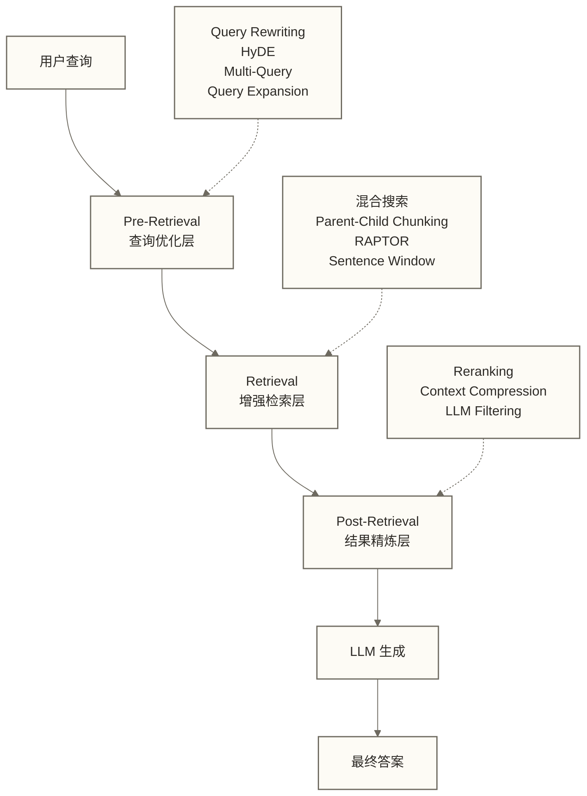

### 3.1 Pre-Retrieval：查询优化

在用户的原始问题到达检索层之前，先对问题本身进行优化处理。

---

#### 3.1.1 Query Rewriting（查询改写）

**核心思路**：用户的原始问题往往是口语化、不完整或有歧义的。通过 LLM 将其改写为**更适合检索**的形式。

**典型场景**：
- 口语化问题 → 专业术语表达
- 代词消解 → 明确指代
- 简短问题 → 补充隐含假设

```python
from langchain_openai import ChatOpenAI
from langchain_core.prompts import ChatPromptTemplate

rewrite_prompt = ChatPromptTemplate.from_messages([
    ("system", """你是一个查询改写专家。
将用户的问题改写为更适合文档检索的形式：
1. 使用专业术语替换口语表达
2. 消解代词，使问题自包含
3. 仅使用输入中明确提供的上下文，不得补造技术名称、实体或时间范围
4. 缺少明确指代或必要范围时，输出澄清问题，不要强行改写

只输出改写后的问题或必要的澄清问题，不要解释。"""),
    ("human", "原始问题：{query}")
])

llm = ChatOpenAI(model="gpt-4o-mini", temperature=0)
rewriter = rewrite_prompt | llm

def rewrite_query(query: str) -> str:
    result = rewriter.invoke({"query": query})
    return result.content

# 示例
original = "这个技术最近怎么样了？"
rewritten = rewrite_query(original)
# 缺少技术名称和时间范围，不能据此确定改写结果。
# 可先请求澄清：“您指的是哪项技术，希望了解哪个时间范围的发展？”
```

---

#### 3.1.2 Query Expansion（查询扩展）

**核心思路**：生成与原始问题**语义相关**的同义表达或相关概念，扩大检索覆盖面。

这直接解决了"词汇差距"问题——用户用A说法，文档用B说法，查询扩展能同时覆盖。

```python
from langchain_core.output_parsers import CommaSeparatedListOutputParser

expansion_prompt = ChatPromptTemplate.from_messages([
    ("system", """为以下问题生成5个相关的同义或扩展搜索词/短语。
这些词语应该覆盖：同义词、相关概念、不同表达方式。
用逗号分隔输出。"""),
    ("human", "{query}")
])

parser = CommaSeparatedListOutputParser()
expander = expansion_prompt | llm | parser

def expand_query(query: str) -> list[str]:
    expansions = expander.invoke({"query": query})
    return [query] + expansions  # 原始查询 + 扩展查询

# 示例
query = "数据仓库架构"
expanded = expand_query(query)
# → ["数据仓库架构", "DWH设计", "数据湖仓一体", "OLAP系统架构",
#    "企业级数据平台", "ETL数据管道"]
```

---

#### 3.1.3 HyDE（Hypothetical Document Embeddings，假设文档嵌入）

**这是 Advanced RAG 中最具创意的技术之一。**

**核心洞察**：用户问题（Query）和文档（Document）在向量空间中天然存在分布差异——问题是短句，文档是长文。直接用问题向量去检索文档向量，存在**分布不匹配**问题。

**HyDE 的解决方案**：让 LLM 先根据问题"虚构"一份假设性的答案文档，然后用这份假设文档的向量去检索真实文档。

```mermaid
%%{init: {"theme":"base","themeVariables":{"fontFamily":"PingFang SC, -apple-system, Source Han Serif SC, serif","fontSize":"16px","background":"#FDFBF5","primaryColor":"#FDFBF5","primaryTextColor":"#2D2A26","primaryBorderColor":"#6E6A60","secondaryColor":"#E8EFE8","secondaryBorderColor":"#8FA890","secondaryTextColor":"#2D2A26","tertiaryColor":"#FDFBF5","tertiaryBorderColor":"#9A9488","tertiaryTextColor":"#6E6A60","lineColor":"#6E6A60","textColor":"#2D2A26","mainBkg":"#FDFBF5","nodeBorder":"#2D5A3D","clusterBkg":"#F3EEDF","clusterBorder":"#9A9488","edgeLabelBackground":"#FDFBF5"},"flowchart":{"htmlLabels":true,"curve":"basis","padding":20,"nodeSpacing":60,"rankSpacing":70,"useMaxWidth":false},"themeCSS":".node rect, .node polygon, .node circle { stroke-width: 1.5px; } .edgePath .path { stroke-width: 1.5px; } .cluster-label .nodeLabel, .cluster-label foreignObject { color: #2D2A26 !important; } .edgeLabel, .edgeLabel foreignObject { color: #2D2A26 !important; background-color: #FDFBF5; } .edgeLabel rect { fill: #FDFBF5; }"}}%%
flowchart LR
    A["用户问题<br/>（短句）"] --> B["LLM<br/>生成假设答案"]
    B --> C["假设文档<br/>（长文，可能含幻觉）"]
    C --> D["Embedding<br/>向量化"]
    D --> E["向量检索<br/>找真实文档"]
    E --> F["真实相关文档<br/>（高质量）"]
    F --> G["LLM 基于<br/>真实文档生成答案"]

    style C fill:#fff3cd
    style F fill:#d4edda
```

> [!tip] HyDE 的妙处
> 假设文档本身**不需要准确**！它的作用是"探路"——在向量空间中找到一个比原始问题更接近真实文档分布的向量锚点。即使假设文档包含不准确内容，其向量也可能帮助检索相关真实文档；但幻觉也可能使检索偏离目标，效果需要通过领域评估集验证。

```python
from langchain_core.prompts import PromptTemplate

hyde_prompt = PromptTemplate.from_template("""
请根据以下问题，写一段假设性的回答文档（100-200字）。
注意：你只需要生成可能包含答案的文档内容，不需要确保准确性。
文档应该使用专业语言，好像你真的找到了这样一篇文档。

问题：{query}

假设文档：
""")

def hyde_retrieve(query: str, vectorstore, k: int = 5):
    # Step 1: 生成假设文档
    hyde_chain = hyde_prompt | llm
    hypothetical_doc = hyde_chain.invoke({"query": query}).content

    # Step 2: 用假设文档向量检索（而非原始问题向量）
    results = vectorstore.similarity_search(
        hypothetical_doc,  # 使用假设文档，不是原始问题
        k=k
    )
    return results

# 使用示例
query = "Flink 处理背压的机制是什么？"
docs = hyde_retrieve(query, vectorstore)
```

**HyDE 的适用场景**：
- 专业领域问题（医疗、法律、金融）
- 短问题、长文档的场景
- 零样本检索（没有微调的 Embedding 模型）

**HyDE 的局限**：
- 增加一次 LLM 调用，延迟上升
- 对生成模型质量有依赖

---

#### 3.1.4 Multi-Query（多路查询）

**核心思路**：一个问题可以从多个角度理解。生成**多个语义相关但表达不同**的问题变体，分别检索后合并结果，通过集成效应提升召回率。

```python
from langchain.retrievers.multi_query import MultiQueryRetriever
from langchain_openai import ChatOpenAI

llm = ChatOpenAI(model="gpt-4o-mini", temperature=0.3)

multi_query_retriever = MultiQueryRetriever.from_llm(
    retriever=vectorstore.as_retriever(search_kwargs={"k": 5}),
    llm=llm
)

# LangChain 内置实现，自动：
# 1. 生成 3 个查询变体
# 2. 分别检索
# 3. 去重合并结果

docs = multi_query_retriever.invoke("RAG 系统如何处理长文档？")

# 等价于手动做：
multi_query_prompt = ChatPromptTemplate.from_messages([
    ("system", """为以下问题生成3个不同角度的搜索查询。
每个查询应该从不同侧面探索问题。
每行输出一个查询。"""),
    ("human", "{question}")
])
```

**Multi-Query 与 Query Expansion 的区别**：

| 维度 | Query Expansion | Multi-Query |
|------|----------------|-------------|
| 操作对象 | 扩展关键词/同义词 | 生成完整的问题变体 |
| 检索方式 | 通常合并成一个检索请求 | 每个变体独立检索 |
| 适合场景 | 词汇差距问题 | 多角度理解同一问题 |

---

### 3.2 Retrieval：检索增强

对检索层本身进行架构升级，而非只优化查询。

---

#### 3.2.1 混合搜索（Hybrid Search）

**核心思路**：融合密集向量检索（Dense）和稀疏关键词检索（Sparse），取长补短。

关于混合搜索的完整工程实践，请参考 混合搜索工程实践。

这里给出 RAG 场景下的核心配置：

```python
from langchain_community.retrievers import BM25Retriever
from langchain.retrievers import EnsembleRetriever

# 稀疏检索（关键词精确匹配）
bm25_retriever = BM25Retriever.from_documents(
    documents=all_docs,
    k=10
)

# 密集检索（语义相似度）
dense_retriever = vectorstore.as_retriever(
    search_type="similarity",
    search_kwargs={"k": 10}
)

# 混合检索（RRF 融合）
ensemble_retriever = EnsembleRetriever(
    retrievers=[bm25_retriever, dense_retriever],
    weights=[0.4, 0.6]  # 稀疏 40%，密集 60%
)

docs = ensemble_retriever.invoke("数据湖架构最佳实践")
```

**不同场景的权重建议**：

| 查询类型 | 稀疏权重 | 密集权重 | 说明 |
|---------|---------|---------|------|
| 专有名词、产品名 | 0.6 | 0.4 | 精确匹配优先 |
| 概念性问题 | 0.3 | 0.7 | 语义理解优先 |
| 代码搜索 | 0.5 | 0.5 | 均衡 |
| 通用问答 | 0.4 | 0.6 | 轻微偏向语义 |

---

#### 3.2.2 Parent-Child Chunking（父子块策略）

**核心洞察**：用**小块（Child）做精确检索**，用**大块（Parent）提供完整上下文**。

这解决了 Naive RAG 的经典矛盾：
- 小 chunk → 检索精确，但上下文不完整
- 大 chunk → 上下文完整，但检索噪声大、Token 消耗高

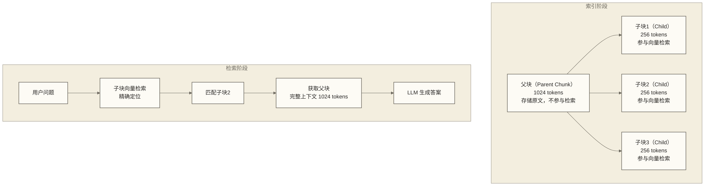

```python
from langchain.retrievers import ParentDocumentRetriever
from langchain.storage import InMemoryStore
from langchain.text_splitter import RecursiveCharacterTextSplitter

# 子块切割器（用于检索）
child_splitter = RecursiveCharacterTextSplitter(chunk_size=256)

# 父块切割器（用于提供上下文）
parent_splitter = RecursiveCharacterTextSplitter(chunk_size=1024)

# 存储层：向量库存子块向量，文档库存父块原文
docstore = InMemoryStore()

retriever = ParentDocumentRetriever(
    vectorstore=vectorstore,
    docstore=docstore,
    child_splitter=child_splitter,
    parent_splitter=parent_splitter,
)

# 添加文档时自动处理父子关系
retriever.add_documents(documents)

# 检索时：匹配子块 → 返回父块
results = retriever.invoke("Flink 的检查点机制")
# → 返回完整的父块内容，而非小子块
```

**参数选择建议**：

| 文档类型 | 父块大小 | 子块大小 | 比例 |
|---------|---------|---------|------|
| 技术文档 | 1024 tokens | 256 tokens | 4:1 |
| 新闻 / 博客 | 512 tokens | 128 tokens | 4:1 |
| 法律文书 | 2048 tokens | 512 tokens | 4:1 |
| 对话记录 | 整个对话 | 单轮对话 | 按轮次 |

---

#### 3.2.3 Sentence-Window Retrieval（句子窗口检索）

**核心思路**：以**单句**为单位检索（极高精确度），但返回该句子**前后 N 句**的窗口作为上下文。

与 Parent-Child 的区别：
- Parent-Child 是**层级化**的预处理
- Sentence Window 是**动态扩展**的检索时策略

```python
from llama_index.core.node_parser import SentenceWindowNodeParser
from llama_index.core.postprocessor import MetadataReplacementPostProcessor

# 解析时：以句子为单位，每个节点存储窗口信息
node_parser = SentenceWindowNodeParser.from_defaults(
    window_size=3,           # 上下各 3 句
    window_metadata_key="window",
    original_text_metadata_key="original_text",
)

# 检索后处理：用窗口文本替换单句文本
postproc = MetadataReplacementPostProcessor(
    target_metadata_key="window"
)

# 配合查询引擎使用
from llama_index.core import VectorStoreIndex

nodes = node_parser.get_nodes_from_documents(documents)
index = VectorStoreIndex(nodes=nodes)
query_engine = index.as_query_engine(
    node_postprocessors=[postproc],
    similarity_top_k=5
)
```

---

#### 3.2.4 RAPTOR（递归树状摘要）

**RAPTOR**（Recursive Abstractive Processing for Tree-Organized Retrieval）是 2024 年 ICLR 的重要成果，专门解决 RAG 对**长文档、多跳推理**问题的处理能力不足。

**核心思路**：自底向上递归构建一棵摘要树，检索时可在不同抽象层次上获取信息。

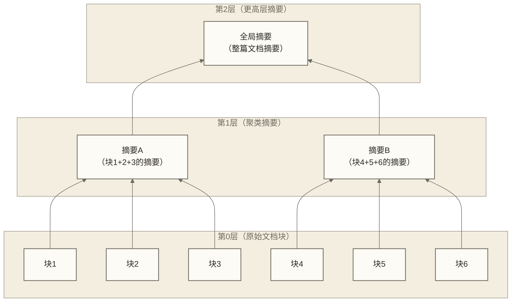

**检索策略**：根据问题类型，在不同层次检索：
- **细节问题** → 在第0层检索原始块
- **综合性问题** → 在第1-2层检索摘要
- **全局性问题** → 在顶层摘要中检索

```python
# RAPTOR 在 LlamaIndex 中的实现思路
from llama_index.core import Document, VectorStoreIndex
from llama_index.core.node_parser import SentenceSplitter
import numpy as np
from sklearn.cluster import KMeans

def build_raptor_tree(documents, llm, embeddings, num_levels=3):
    """层级聚类摘要示例；未保存父子关系或实现分层检索，不是完整 RAPTOR 树实现。"""
    all_nodes = {}  # 存储所有层的节点

    # 第0层：原始文档块
    splitter = SentenceSplitter(chunk_size=512)
    leaf_nodes = splitter.get_nodes_from_documents(documents)
    all_nodes[0] = leaf_nodes

    current_nodes = leaf_nodes
    for level in range(1, num_levels + 1):
        # 1. 对当前层节点进行 Embedding
        texts = [node.get_content() for node in current_nodes]
        node_embeddings = embeddings.embed_documents(texts)

        # 2. 聚类（找语义相关的节点）
        n_clusters = max(1, len(current_nodes) // 5)
        kmeans = KMeans(n_clusters=n_clusters, random_state=42)
        cluster_labels = kmeans.fit_predict(node_embeddings)

        # 3. 对每个聚类生成摘要
        summary_nodes = []
        for cluster_id in range(n_clusters):
            cluster_texts = [
                texts[i] for i, label in enumerate(cluster_labels)
                if label == cluster_id
            ]
            combined_text = "\n\n".join(cluster_texts)

            summary_prompt = f"""请对以下内容生成一段精炼的摘要（100-200字）：

{combined_text}

摘要："""
            summary = llm.predict(summary_prompt)
            summary_nodes.append(Document(text=summary))

        all_nodes[level] = summary_nodes
        current_nodes = summary_nodes

    return all_nodes

# 构建多层索引
tree = build_raptor_tree(documents, llm, embeddings)
```

> [!tip] RAPTOR 的价值
> 在需要**跨文档综合**的场景下，RAPTOR 比标准 RAG 提升显著。文中提及的 RAPTOR + GPT-4 在 QuALITY benchmark 上绝对精度提升 **20%**，仅作为待核对论文实验条件的结果描述；当前未交代对照基线和指标口径，不能外推为其他知识库的预期收益。代价是索引构建时间更长（需要多次 LLM 调用生成摘要）。

---

### 3.3 Post-Retrieval：结果精炼

检索完成后，在将结果送入 LLM 之前，进行质量筛选和压缩。

---

#### 3.3.1 Reranking（精排）

**核心思路**：向量检索快但粗糙（Bi-Encoder 独立编码），精排慢但准确（Cross-Encoder 联合编码）。

两阶段检索策略：**粗排（Top-N）→ 精排（Top-K，K<<N）**

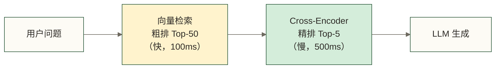

**两种 Reranker 对比**：

| 类型 | 原理 | 速度 | 质量 | 代表模型 |
|------|------|------|------|---------|
| **Bi-Encoder** | 问题和文档独立编码，计算向量相似度 | 极快 | 一般 | text-embedding-3 |
| **Cross-Encoder** | 问题+文档拼接后联合编码，输出相关性分数 | 慢 | 极高 | bge-reranker, Cohere Rerank |
| **ColBERT** | 多向量延迟交互（折中方案） | 中等 | 高 | ColBERT-v2 |

```python
# 方案一：使用 Cohere Rerank API
from langchain_cohere import CohereRerank
from langchain.retrievers import ContextualCompressionRetriever

reranker = CohereRerank(
    model="rerank-multilingual-v3.0",
    top_n=5  # 最终保留 5 个
)

compression_retriever = ContextualCompressionRetriever(
    base_compressor=reranker,
    base_retriever=vectorstore.as_retriever(search_kwargs={"k": 50})
)

docs = compression_retriever.invoke("什么是 Flink 背压机制？")

# 方案二：使用开源 BGE Reranker（本地部署）
from FlagEmbedding import FlagReranker

reranker = FlagReranker(
    'BAAI/bge-reranker-v2-m3',
    use_fp16=True
)

def rerank_documents(query: str, docs: list, top_k: int = 5) -> list:
    """使用 BGE Reranker 对文档重排序"""
    # 构建 (query, doc) 对
    pairs = [[query, doc.page_content] for doc in docs]

    # 计算相关性分数
    scores = reranker.compute_score(pairs, normalize=True)

    # 按分数排序
    ranked = sorted(
        zip(docs, scores),
        key=lambda x: x[1],
        reverse=True
    )

    return [doc for doc, score in ranked[:top_k]]
```

---

#### 3.3.2 Context Compression（上下文压缩）

**核心思路**：检索到的文档块中，**并非所有内容都与问题相关**。压缩掉无关内容，只保留关键句子/段落，节省 Token、减少噪声。

```python
from langchain.retrievers.document_compressors import LLMChainExtractor
from langchain.retrievers import ContextualCompressionRetriever

# LLM 驱动的上下文提取压缩
compressor = LLMChainExtractor.from_llm(llm)

compression_retriever = ContextualCompressionRetriever(
    base_compressor=compressor,
    base_retriever=vectorstore.as_retriever(search_kwargs={"k": 10})
)

# 压缩效果示例：
# 原始文档块（500 tokens）：
#   "第一部分介绍了公司背景...（无关）
#    在2024年Q3，营收同比增长23%...（相关！）
#    第三部分讨论了供应链问题...（无关）"
#
# 压缩后（50 tokens）：
#   "2024年Q3，营收同比增长23%"

docs = compression_retriever.invoke("2024年Q3营收表现如何？")

# 也可以使用无 LLM 的轻量级方案：Embeddings Filter
from langchain.retrievers.document_compressors import EmbeddingsFilter

embeddings_filter = EmbeddingsFilter(
    embeddings=embeddings,
    similarity_threshold=0.76  # 相关性低于阈值的段落被过滤
)
```

---

#### 3.3.3 LLM-based Filtering（LLM 过滤）

**核心思路**：用一个小 LLM 作为"质检员"，在最终生成前对检索结果进行相关性判断。

```python
from langchain_core.prompts import PromptTemplate
from langchain_core.output_parsers import StrOutputParser

filter_prompt = PromptTemplate.from_template("""
判断以下文档是否与问题相关。
只回答 "是" 或 "否"，不要解释。

问题：{question}

文档内容：
{document}

是否相关（是/否）：
""")

filter_chain = filter_prompt | ChatOpenAI(model="gpt-4o-mini", temperature=0) | StrOutputParser()

def filter_relevant_docs(question: str, docs: list) -> list:
    """过滤不相关文档"""
    relevant_docs = []
    for doc in docs:
        relevance = filter_chain.invoke({
            "question": question,
            "document": doc.page_content
        })
        if "是" in relevance:
            relevant_docs.append(doc)

    return relevant_docs if relevant_docs else docs[:3]  # 至少保留3个
```

> [!warning] 性能权衡
> LLM Filtering 为每个检索文档增加一次 LLM 调用。若检索 Top-20，则额外增加 20 次调用。生产环境中建议用轻量级模型（如 gpt-4o-mini 或本地小模型）完成过滤，或改用 Embeddings Filter 替代。

---

## 4. Modular RAG：最新架构范式

本文将 Modular RAG 作为继 Naive、Advanced RAG 之后的模块化设计范式介绍；这一组织方式不代表对 2024-2025 年行业普及程度的统计结论。

### 4.1 Modular RAG 的设计哲学

```text
Naive RAG：    固定管道，线性流程，不可配置
Advanced RAG： 在固定管道上打补丁，局部优化
Modular RAG：  解耦成独立模块，动态编排，无限组合
```

Modular RAG 将 RAG 分解为若干**可独立替换**的功能模块：

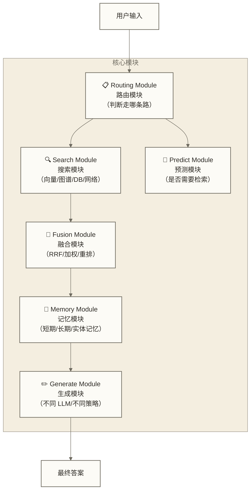

### 4.2 Adaptive RAG（自适应检索）

不是所有问题都需要检索。**自适应 RAG 让系统自己判断是否检索、检索什么、检索多少次。**

```python
from langchain_core.prompts import ChatPromptTemplate
from enum import Enum

class RetrievalDecision(str, Enum):
    RETRIEVE = "retrieve"      # 需要检索
    NO_RETRIEVE = "no_retrieve"  # 直接生成
    CLARIFY = "clarify"        # 需要澄清问题

routing_prompt = ChatPromptTemplate.from_messages([
    ("system", """判断是否需要从文档库检索信息来回答用户问题。

输出以下之一：
- "retrieve"：问题需要外部知识（专业文档、最新数据、私有信息）
- "no_retrieve"：通用知识问题，LLM 直接回答即可
- "clarify"：问题不清晰，需要澄清

只输出决策词，不要解释。"""),
    ("human", "{question}")
])

def adaptive_rag(question: str, vectorstore, llm) -> str:
    # Step 1: 决策是否需要检索
    router = routing_prompt | llm | StrOutputParser()
    decision = router.invoke({"question": question})

    if decision == "no_retrieve":
        # 直接生成
        return llm.invoke(question).content

    elif decision == "retrieve":
        # 走完整 RAG 流程
        docs = vectorstore.similarity_search(question, k=5)
        context = "\n\n".join([d.page_content for d in docs])
        prompt = f"基于以下上下文回答问题：\n\n{context}\n\n问题：{question}"
        return llm.invoke(prompt).content

    else:  # clarify
        return "请问您能更具体说明您的问题吗？"
```

### 4.3 Agent-based RAG（工具调用 + 多步推理）

本文介绍 Agentic RAG 的工具调用与多步推理设计，不据此断言其在 2024-2025 年的行业领先程度。LLM 作为**智能体（Agent）**，自主决定：
- 何时检索
- 检索哪个数据源
- 是否需要多轮检索
- 如何综合多次检索结果

```python
from langchain.agents import create_react_agent, AgentExecutor
from langchain.tools.retriever import create_retriever_tool
from langchain_community.tools import TavilySearchResults

# 工具1：内部知识库检索
internal_tool = create_retriever_tool(
    retriever=vectorstore.as_retriever(search_kwargs={"k": 5}),
    name="internal_knowledge_base",
    description="从公司内部知识库检索信息。用于查询内部文档、产品手册、流程规范等。"
)

# 工具2：网络搜索（最新信息）
web_search_tool = TavilySearchResults(
    max_results=3,
    description="搜索互联网获取最新信息。用于查询近期新闻、最新技术动态等。"
)

# 工具3：结构化数据库查询（示意）
from langchain_community.tools.sql_database.tool import QuerySQLDataBaseTool
# db_tool = QuerySQLDataBaseTool(db=db)

tools = [internal_tool, web_search_tool]

# ReAct Agent：Reasoning + Acting 交替进行
from langchain import hub
react_prompt = hub.pull("hwchase17/react")

agent = create_react_agent(
    llm=ChatOpenAI(model="gpt-4o", temperature=0),
    tools=tools,
    prompt=react_prompt
)

agent_executor = AgentExecutor(
    agent=agent,
    tools=tools,
    verbose=True,  # 展示推理过程
    max_iterations=5,
    handle_parsing_errors=True
)

# 执行多跳推理
result = agent_executor.invoke({
    "input": "对比我们公司内部的数据仓库规范和行业最新最佳实践，有哪些差距？"
})
# Agent 会自动：
# 1. 检索内部知识库获取公司规范
# 2. 搜索互联网获取行业最佳实践
# 3. 综合两次检索结果进行对比分析
```

### 4.4 Self-RAG（自我批判检索）

Self-RAG 引入**反思令牌（Reflection Tokens）**，让模型在生成过程中自我评估：

| 反思令牌 | 作用 |
|---------|------|
| `[Retrieve]` | 判断是否需要检索（是/否） |
| `[IsRel]` | 判断检索结果是否相关 |
| `[IsSup]` | 判断生成内容是否有文档支撑 |
| `[IsUse]` | 判断最终答案对用户是否有用 |

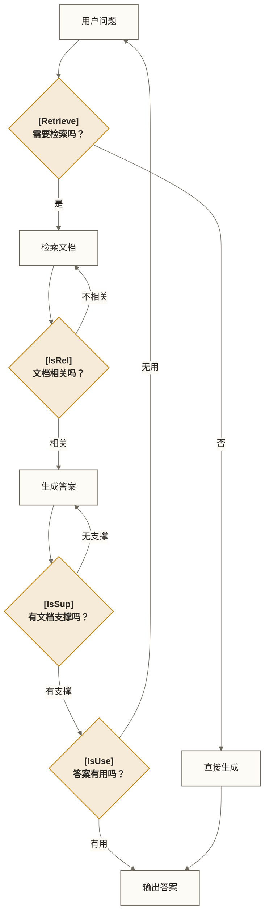

---

## 5. 文档处理工程

文档处理质量直接决定 RAG 的天花板。"垃圾进，垃圾出"在 RAG 中尤为贴切。

### 5.1 切块策略对比

| 策略 | 原理 | 优势 | 劣势 | 适用场景 |
|------|------|------|------|---------|
| **Fixed-Size** | 固定字符/Token 数量切割 | 简单、可预测 | 破坏语义边界 | 快速原型 |
| **Recursive** | 按分隔符层级递归切割 | 尽量保留语义 | 仍可能切断段落 | 通用推荐 |
| **Semantic** | 基于语义相似度切割 | 语义边界最准确 | 慢、成本高 | 高质量要求场景 |
| **Sentence** | 以句子为最小单位 | 保留完整句意 | 块大小不均匀 | 配合 Window 使用 |
| **Document** | 按文档结构（章节/标题）切割 | 保留文档结构 | 块大小差异极大 | 结构化文档（书籍、报告） |
| **Agentic** | LLM 决定切割位置 | 最智能 | 成本极高 | 高价值少量文档 |

```python
# 1. Fixed-Size（最简单）
from langchain.text_splitter import CharacterTextSplitter

fixed_splitter = CharacterTextSplitter(
    chunk_size=512,
    chunk_overlap=50
)

# 2. Recursive（通用推荐）
from langchain.text_splitter import RecursiveCharacterTextSplitter

recursive_splitter = RecursiveCharacterTextSplitter(
    chunk_size=512,
    chunk_overlap=50,
    separators=["\n\n", "\n", "。", ".", "！", "？", " ", ""]
)

# 3. Semantic（语义切割，基于 Embedding 相似度）
from langchain_experimental.text_splitter import SemanticChunker

semantic_splitter = SemanticChunker(
    embeddings=embeddings,
    breakpoint_threshold_type="percentile",  # 按百分位数确定断点
    breakpoint_threshold_amount=95           # 95th percentile
)

# 4. 按 Markdown 结构切割（适合知识库文档）
from langchain.text_splitter import MarkdownHeaderTextSplitter

headers_to_split_on = [
    ("#", "h1"),
    ("##", "h2"),
    ("###", "h3"),
]
md_splitter = MarkdownHeaderTextSplitter(
    headers_to_split_on=headers_to_split_on,
    strip_headers=False
)
```

### 5.2 Chunk 参数选择指南

> [!tip] 黄金参数规则
> 没有万能参数，但有经验法则。根据查询类型和文档性质调整。

**按问题类型选择**：

| 问题类型 | 建议 Chunk Size |
|---------|----------------|
| 事实查询（"XX 是什么"） | 256-512 tokens |
| 分析性问题（"为什么XX"） | 512-1024 tokens |
| 综合性问题（"对比XX和YY"） | 1024+ tokens 或 RAPTOR |

**按文档类型选择**：

| 文档类型 | 建议 Chunk Size |
|---------|----------------|
| API 文档 / 代码注释 | 256 tokens（短小精悍） |
| 技术博客 / 新闻 | 512 tokens |
| 研究报告 / 白皮书 | 1024 tokens |
| 法律合同 / 学术论文 | 1024-2048 tokens |

**Embedding 模型限制**：建议 `chunk_size ≤ 模型最大输入的 1/4`（text-embedding-3-small 最大 8191 tokens，BGE-M3 最大 8192 tokens）。

**Chunk Overlap 设置**：

```python
# Overlap 的作用：保留跨块的上下文连续性
# 推荐：chunk_size 的 10-20%

chunk_size = 512
chunk_overlap = int(chunk_size * 0.1)  # 约 51 tokens
```

### 5.3 元数据设计

元数据是 RAG 系统**可观测性和可过滤性**的基础。

```python
from langchain_core.documents import Document
from datetime import datetime

def create_document_with_metadata(
    content: str,
    source_path: str,
    doc_type: str,
    section: str = None,
    page: int = None
) -> Document:
    """创建带完整元数据的文档对象"""
    return Document(
        page_content=content,
        metadata={
            # 来源追踪
            "source": source_path,           # 文件路径/URL
            "doc_type": doc_type,            # pdf/word/markdown/html

            # 位置信息
            "section": section,              # 章节名称
            "page": page,                    # 页码

            # 时间信息
            "created_at": datetime.now().isoformat(),
            "doc_date": "2024-01-01",        # 文档日期（用于时效性过滤）

            # 分类信息
            "category": "技术文档",
            "tags": ["RAG", "向量数据库"],

            # 质量信息
            "language": "zh-CN",
            "word_count": len(content),

            # 权限信息（多租户）
            "tenant_id": "tenant_001",
            "access_level": "internal",      # public/internal/confidential
        }
    )

# 元数据过滤检索示例（Milvus）
filtered_docs = vectorstore.similarity_search(
    query="数据架构最佳实践",
    k=10,
    expr='tenant_id == "tenant_001" and access_level in ["public", "internal"]'
)
```

### 5.4 多模态文档处理

生产环境中的文档往往不是纯文本，需要处理 PDF、表格、图片等多种格式。

```python
# PDF 处理（保留布局信息）
from langchain_community.document_loaders import PyMuPDFLoader

loader = PyMuPDFLoader("report.pdf")
docs = loader.load()
# 元数据包含：page, source, file_path

# 高质量 PDF 解析（LlamaParse，付费 API）
from llama_parse import LlamaParse

parser = LlamaParse(
    result_type="markdown",   # 转换为 Markdown，保留结构
    language="zh",
    verbose=True
)
llama_docs = await parser.aload_data("complex_report.pdf")

# 表格处理（保留表格结构）
from langchain_community.document_loaders import UnstructuredExcelLoader

excel_loader = UnstructuredExcelLoader(
    "data.xlsx",
    mode="elements"  # 每个表格元素单独处理
)
table_docs = excel_loader.load()

# 图片中的文字提取（OCR）
from langchain_community.document_loaders import UnstructuredImageLoader

image_loader = UnstructuredImageLoader("screenshot.png")
image_docs = image_loader.load()

# 多模态 RAG：图片 + 文字联合嵌入（GPT-4o Vision）
from langchain_openai import ChatOpenAI
import base64

def embed_image_as_text(image_path: str, llm) -> str:
    """将图片转换为文本描述，用于向量化"""
    with open(image_path, "rb") as f:
        image_data = base64.b64encode(f.read()).decode("utf-8")

    from langchain_core.messages import HumanMessage
    import mimetypes

    mime_type = mimetypes.guess_type(image_path)[0]
    if mime_type not in {"image/jpeg", "image/png", "image/webp", "image/gif"}:
        raise ValueError("请使用模型支持的图片格式，并提供正确的文件扩展名")

    response = llm.invoke([HumanMessage(content=[{
        "type": "image_url",
        "image_url": {"url": f"data:{mime_type};base64,{image_data}"}
    }, {
        "type": "text",
        "text": "请详细描述这张图片的内容，包括所有文字、图表数据和视觉元素。"
    }])])
    return response.content
```

---

## 6. RAG 评估体系

> [!warning] 没有评估，就没有改进
> 很多团队停留在"感觉还不错"的阶段。建立系统化评估体系，是 RAG 从 Demo 走向生产的必经之路。

### 6.1 RAGAS 四大核心指标

**RAGAS** 是可用于 RAG 自动化评估的框架；本文以其指标和调用方式说明评估流程，不据此断言其行业使用排名。

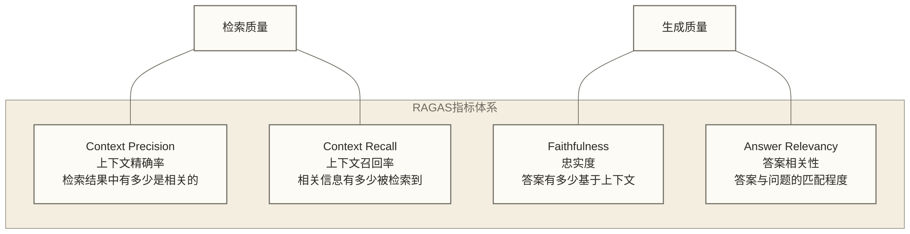

**各指标详解**：

| 指标 | 计算方式 | 取值范围 | 高值含义 |
|------|---------|---------|---------|
| **Context Precision** | 相关 chunk 在 Top-K 中的排名加权平均 | 0~1 | 检索结果质量高，精准 |
| **Context Recall** | 标准答案中的信息有多少被检索覆盖 | 0~1 | 检索全面，没遗漏 |
| **Faithfulness** | 答案中的声明有多少能在上下文中找到支撑 | 0~1 | 答案无幻觉 |
| **Answer Relevancy** | 从答案反推问题，与原问题的相似度 | 0~1 | 答案切题，不偏题 |

### 6.2 构建黄金评估数据集

```python
# 黄金数据集结构
golden_dataset = [
    {
        "question": "Flink 的检查点（Checkpoint）机制是如何工作的？",
        "ground_truth": "Flink 的检查点机制通过在所有 source 中注入 barrier，"
                       "barrier 随数据流传播，当所有 sink 算子接收到 barrier 后，"
                       "快照完成。这实现了 exactly-once 语义...",
        "ground_truth_contexts": [
            "Checkpoint barrier 从 source 开始注入...",
            "当 barrier 对齐完成后，算子对其状态做快照..."
        ]
    },
    # 更多样本...
]

# 如何快速生成评估数据集（使用 LLM 辅助）
generation_prompt = """
基于以下文档，生成5个高质量的问答对。
要求：
- 问题要有实际意义，覆盖不同难度
- 答案必须完全基于文档内容
- 包含需要多段落综合的问题

文档内容：
{document}

输出格式（JSON）：
[
  {{"question": "...", "answer": "...", "source_sentences": ["..."]}}
]
"""
```

### 6.3 自动化评估流水线

```python
from ragas import evaluate
from ragas.metrics import (
    context_precision,
    context_recall,
    faithfulness,
    answer_relevancy,
)
from datasets import Dataset
import pandas as pd

def run_rag_evaluation(
    qa_pairs: list,
    rag_pipeline,
    metrics=None
) -> pd.DataFrame:
    """运行 RAGAS 评估流水线"""

    if metrics is None:
        metrics = [
            context_precision,
            context_recall,
            faithfulness,
            answer_relevancy,
        ]

    # Step 1: 运行 RAG 管道获取答案和上下文
    evaluation_data = {
        "question": [],
        "answer": [],
        "contexts": [],
        "ground_truth": []
    }

    for item in qa_pairs:
        question = item["question"]

        # 运行 RAG
        result = rag_pipeline.invoke({"query": question})

        evaluation_data["question"].append(question)
        evaluation_data["answer"].append(result["result"])
        evaluation_data["contexts"].append(
            [doc.page_content for doc in result["source_documents"]]
        )
        evaluation_data["ground_truth"].append(item["ground_truth"])

    # Step 2: 转换为 Dataset 格式
    dataset = Dataset.from_dict(evaluation_data)

    # Step 3: 运行 RAGAS 评估
    results = evaluate(
        dataset=dataset,
        metrics=metrics,
        llm=ChatOpenAI(model="gpt-4o"),
        embeddings=embeddings,
        raise_exceptions=False
    )

    # Step 4: 生成报告
    df = results.to_pandas()
    print("\n=== RAG 评估报告 ===")
    print(f"Context Precision:  {df['context_precision'].mean():.3f}")
    print(f"Context Recall:     {df['context_recall'].mean():.3f}")
    print(f"Faithfulness:       {df['faithfulness'].mean():.3f}")
    print(f"Answer Relevancy:   {df['answer_relevancy'].mean():.3f}")

    return df

# 定期运行评估（CI/CD 集成）
# 建议：每次更新知识库后、每次修改 RAG 参数后运行评估
```

### 6.4 诊断问题定位矩阵

| Context Precision | Context Recall | Faithfulness | Answer Relevancy | 问题诊断 | 改进方向 |
|:-:|:-:|:-:|:-:|---------|---------|
| 低 | 低 | 任意 | 任意 | 检索完全失效 | 检查 Embedding 模型、查询改写 |
| 高 | 低 | 任意 | 任意 | 遗漏相关文档 | 增加 Top-K、改用混合搜索 |
| 低 | 高 | 任意 | 任意 | 检索噪声多 | 增加 Reranking、过滤阈值 |
| 高 | 高 | 低 | 任意 | LLM 幻觉 | 改进 Prompt、更换更强 LLM |
| 高 | 高 | 高 | 低 | 答案偏题 | 优化 Prompt 中的问题约束 |
| 高 | 高 | 高 | 高 | 系统健康 | 关注延迟和成本优化 |

---

## 7. 生产级 RAG 设计原则

### 7.1 数据导入策略

**冷启动（Cold Start）**：首次批量导入大量文档

```python
import asyncio
from tqdm import tqdm

async def batch_ingest(documents: list, batch_size: int = 100):
    """批量异步导入文档"""
    for i in tqdm(range(0, len(documents), batch_size)):
        batch = documents[i:i + batch_size]

        # 并行处理一批文档
        tasks = [process_document(doc) for doc in batch]
        processed = await asyncio.gather(*tasks, return_exceptions=True)

        # 过滤失败的文档
        valid_docs = [
            chunk_doc
            for result in processed
            if not isinstance(result, Exception)
            for chunk_doc in result
        ]

        # 批量写入向量库
        await vectorstore.aadd_documents(valid_docs)

async def process_document(doc):
    """单文档处理流程"""
    # 1. 清洗文本
    cleaned = clean_text(doc.page_content)
    # 2. 切块
    chunks = splitter.split_text(cleaned)
    # 3. 添加元数据
    return [Document(page_content=chunk, metadata=doc.metadata)
            for chunk in chunks]
```

**增量更新（Incremental Update）**：文档更新时的处理策略

```python
import hashlib
from datetime import datetime

class IncrementalIndexer:
    def __init__(self, vectorstore, doc_registry: dict):
        self.vectorstore = vectorstore
        self.doc_registry = doc_registry  # {doc_id: content_hash}

    def compute_hash(self, content: str) -> str:
        return hashlib.md5(content.encode()).hexdigest()

    def update_document(self, doc_id: str, new_content: str):
        new_hash = self.compute_hash(new_content)
        old_hash = self.doc_registry.get(doc_id)

        if old_hash == new_hash:
            return  # 内容未变，跳过

        # 1. 删除旧版本（通过元数据过滤）
        self.vectorstore.delete(expr=f'doc_id == "{doc_id}"')

        # 2. 索引新版本
        chunks = splitter.split_text(new_content)
        docs = [
            Document(
                page_content=chunk,
                metadata={
                    "doc_id": doc_id,
                    "updated_at": datetime.now().isoformat(),
                    "content_hash": new_hash
                }
            )
            for chunk in chunks
        ]
        self.vectorstore.add_documents(docs)

        # 3. 更新注册表
        self.doc_registry[doc_id] = new_hash
```

### 7.2 多租户隔离方案

企业级 RAG 需要严格的数据隔离，避免不同用户/团队的数据互相泄露。

```python
# 方案一：Collection 级隔离（强隔离，高成本）
# 每个租户独立一个 Collection
class MultiTenantRAG_Collection:
    def get_collection_name(self, tenant_id: str) -> str:
        return f"kb_{tenant_id}"

    def get_retriever(self, tenant_id: str):
        collection_name = self.get_collection_name(tenant_id)
        return Milvus(
            embedding_function=embeddings,
            collection_name=collection_name,
            connection_args={"host": "localhost", "port": "19530"}
        ).as_retriever()

# 方案二：Partition 级隔离（推荐，平衡性价比）
# 同一 Collection，不同 Partition
class MultiTenantRAG_Partition:
    def get_retriever(self, tenant_id: str):
        return vectorstore.as_retriever(
            search_kwargs={
                "k": 10,
                "partition_names": [f"tenant_{tenant_id}"]
            }
        )

# 方案三：元数据过滤隔离（弱隔离，成本最低）
class MultiTenantRAG_Metadata:
    def get_retriever(self, tenant_id: str, user_role: str):
        # 根据用户角色确定可访问的 access_level
        accessible_levels = self._get_accessible_levels(user_role)

        return vectorstore.as_retriever(
            search_kwargs={
                "k": 10,
                "expr": f'tenant_id == "{tenant_id}" and '
                        f'access_level in {accessible_levels}'
            }
        )

    def _get_accessible_levels(self, role: str) -> list:
        role_access = {
            "admin": ["public", "internal", "confidential"],
            "employee": ["public", "internal"],
            "guest": ["public"]
        }
        return role_access.get(role, ["public"])
```

### 7.3 缓存层设计

RAG 的性能瓶颈通常在检索和 LLM 生成两个阶段。缓存可以显著降低延迟和成本。

```python
import hashlib
import json
from functools import wraps
import redis

redis_client = redis.Redis(host='localhost', port=6379, decode_responses=True)

class RAGCache:
    def __init__(self, ttl: int = 3600):
        self.ttl = ttl

    def _make_key(self, query: str, config: dict = None) -> str:
        """生成缓存 Key（问题 + 配置的哈希）"""
        content = json.dumps({"query": query, "config": config or {}}, sort_keys=True)
        return f"rag:answer:{hashlib.sha256(content.encode()).hexdigest()}"

    def get(self, query: str, config: dict = None) -> str | None:
        key = self._make_key(query, config)
        return redis_client.get(key)

    def set(self, query: str, answer: str, config: dict = None):
        key = self._make_key(query, config)
        redis_client.setex(key, self.ttl, answer)

    def invalidate_by_source(self, source: str):
        """文档更新时，使相关缓存失效"""
        # 使用 Redis Scan 找到相关缓存（简化示例）
        pattern = f"rag:*:{source}*"
        for key in redis_client.scan_iter(pattern):
            redis_client.delete(key)

cache = RAGCache(ttl=3600)

def cached_rag(rag_pipeline):
    """RAG 缓存装饰器"""
    @wraps(rag_pipeline)
    def wrapper(query: str, **kwargs):
        # 检查缓存
        cached_answer = cache.get(query)
        if cached_answer:
            return {"result": cached_answer, "cached": True}

        # 执行 RAG
        result = rag_pipeline({"query": query, **kwargs})

        # 存储缓存
        cache.set(query, result["result"])

        return result
    return wrapper

# 语义缓存（相似问题复用答案）
from langchain.cache import InMemoryCache
from langchain_core.globals import set_llm_cache
from langchain_community.cache import RedisSemanticCache

# 语义缓存：满足后端定义的距离或分数阈值时复用结果；上线前需验证分数方向和误命中率
semantic_cache = RedisSemanticCache(
    redis_url="redis://localhost:6379",
    embedding=embeddings,
    score_threshold=0.95  # 示例参数；其距离或分数语义依赖实际后端，不能直接解释为相似度超过 0.95
)
set_llm_cache(semantic_cache)
```

### 7.4 可观测性设计

```python
import time
import logging
from contextlib import contextmanager
from opentelemetry import trace
from opentelemetry.sdk.trace import TracerProvider
from opentelemetry.sdk.trace.export import BatchSpanProcessor
from opentelemetry.exporter.otlp.proto.grpc.trace_exporter import OTLPSpanExporter

# 初始化 OpenTelemetry
provider = TracerProvider()
provider.add_span_processor(
    BatchSpanProcessor(OTLPSpanExporter(endpoint="http://localhost:4317"))
)
trace.set_tracer_provider(provider)
tracer = trace.get_tracer("rag-system")

# 结构化日志
logging.basicConfig(
    format='{"timestamp": "%(asctime)s", "level": "%(levelname)s", '
           '"module": "%(name)s", "message": "%(message)s"}',
    level=logging.INFO
)
logger = logging.getLogger("rag")

class ObservableRAG:
    def __init__(self, pipeline):
        self.pipeline = pipeline
        self.metrics = {
            "total_requests": 0,
            "cache_hits": 0,
            "retrieval_times": [],
            "generation_times": [],
            "total_times": []
        }

    def query(self, question: str, tenant_id: str = "default") -> dict:
        start_time = time.time()

        with tracer.start_as_current_span("rag_query") as span:
            span.set_attribute("question", question[:100])
            span.set_attribute("tenant_id", tenant_id)

            # 检索阶段
            retrieval_start = time.time()
            with tracer.start_as_current_span("retrieval"):
                docs = self.pipeline.retriever.invoke(question)
            retrieval_time = time.time() - retrieval_start

            # 生成阶段
            generation_start = time.time()
            with tracer.start_as_current_span("generation"):
                context = "\n\n".join(doc.page_content for doc in docs)
                answer = self.pipeline.llm.invoke(
                    f"请仅根据以下检索上下文回答问题；依据不足时明确说明。\n\n"
                    f"上下文：\n{context}\n\n问题：{question}"
                )
            generation_time = time.time() - generation_start

            total_time = time.time() - start_time

            # 记录 span 属性
            span.set_attribute("docs_retrieved", len(docs))
            span.set_attribute("retrieval_ms", retrieval_time * 1000)
            span.set_attribute("generation_ms", generation_time * 1000)
            span.set_attribute("total_ms", total_time * 1000)

            # 结构化日志
            logger.info(json.dumps({
                "event": "rag_query",
                "tenant_id": tenant_id,
                "question_len": len(question),
                "docs_retrieved": len(docs),
                "retrieval_ms": round(retrieval_time * 1000, 2),
                "generation_ms": round(generation_time * 1000, 2),
                "total_ms": round(total_time * 1000, 2)
            }))

            self.metrics["total_requests"] += 1
            self.metrics["retrieval_times"].append(retrieval_time)
            self.metrics["generation_times"].append(generation_time)

            return {
                "answer": answer,
                "sources": docs,
                "metrics": {
                    "retrieval_ms": retrieval_time * 1000,
                    "generation_ms": generation_time * 1000
                }
            }

    def get_p99_latency(self) -> dict:
        """获取 P99 延迟"""
        import numpy as np
        return {
            "retrieval_p99_ms": np.percentile(self.metrics["retrieval_times"], 99) * 1000,
            "generation_p99_ms": np.percentile(self.metrics["generation_times"], 99) * 1000,
        }
```

**关键监控指标**：

| 指标类别 | 具体指标 |
|---------|---------|
| 延迟指标 | P50/P95/P99 端到端延迟；检索延迟（向量搜索耗时）；生成延迟（LLM 响应时间） |
| 质量指标 | 在线 Faithfulness 抽样评估；用户反馈（👍/👎 比率）；空答案率（检索失败） |
| 成本指标 | Token 消耗（输入/输出）；缓存命中率；单次查询成本 |
| 系统指标 | 向量数据库 QPS / 存储量；错误率 / 超时率；队列积压（异步场景） |

---

## 8. 架构选型决策

### 8.1 简单 RAG vs 高级 RAG 的成本收益

> [!tip] 从最简单的开始
> 先用 Naive RAG 验证业务价值，再逐步引入 Advanced RAG 组件。每次只改变一个变量，用评估数据驱动决策。

| 功能模块 | 实现成本 | 质量提升 | 延迟影响 | 推荐优先级 |
|---------|---------|---------|---------|-----------|
| 混合搜索 | 低 | 高 | 低 | ★★★★★ |
| Reranking | 中 | 高 | 中 | ★★★★★ |
| Query Rewriting | 低 | 中 | 低 | ★★★★ |
| Parent-Child | 中 | 高 | 低 | ★★★★ |
| HyDE | 低 | 中高 | 中 | ★★★ |
| Sentence Window | 中 | 中 | 低 | ★★★ |
| Context Compress | 中 | 中 | 中 | ★★★ |
| Multi-Query | 中 | 中 | 高 | ★★ |
| RAPTOR | 高 | 高 | 低（离线预处理） | ★★★ |
| Agentic RAG | 高 | 极高 | 极高 | ★★（高价值场景） |

**推荐演进路径**：

```text
Stage 1（原型，1周）：
Naive RAG → 验证可行性

Stage 2（基础提升，2-4周）：
+ 混合搜索
+ Reranking
→ 示例目标：若项目将解决 70% 的已标注质量问题作为阶段目标，应通过同一评估集验证；此处不代表通用实测效果

Stage 3（进阶优化，1-2个月）：
+ Query Rewriting
+ Parent-Child Chunking
+ Context Compression
+ RAGAS 评估体系

Stage 4（生产加固，持续）：
+ 多租户隔离
+ 缓存层
+ 可观测性
+ 自动化评估 CI/CD

Stage 5（高级场景，按需）：
+ Agentic RAG（复杂推理）
+ RAPTOR（超长文档）
+ Self-RAG（高精度场景）
```

### 8.2 框架选型：LangChain vs LlamaIndex vs 自建

| 维度 | LangChain | LlamaIndex | 自建 |
|------|-----------|-----------|------|
| **定位** | 通用 LLM 应用框架 | RAG 专业框架 | 完全定制 |
| **RAG 专项能力** | 中 | 极强 | 视实现而定 |
| **Agent 支持** | 极强 | 较强 | 需自建 |
| **学习曲线** | 中等 | 中等 | 低（无框架学习成本） |
| **生态集成** | 极丰富 | 丰富 | 需手动集成 |
| **调试便利性** | 一般 | 较好 | 最好 |
| **适合场景** | 通用 LLM 应用、Agent | RAG 专项、知识库问答 | 高性能、高定制需求 |

**示例组合**（用于说明检索与编排层的职责分工，不代表已统计的2025年主流方案）：

```python
# LlamaIndex 做 RAG 核心（文档解析、索引、检索）
# LangChain 做编排层（Agent、工具调用、流程控制）
# Langfuse / Phoenix 做可观测性

from llama_index.core import VectorStoreIndex
from langchain.agents import create_react_agent

# 1. 用 LlamaIndex 构建高质量检索器
index = VectorStoreIndex.from_documents(
    documents,
    transformations=[
        SentenceWindowNodeParser(window_size=3),
    ]
)
query_engine = index.as_query_engine(
    node_postprocessors=[
        MetadataReplacementPostProcessor(target_metadata_key="window"),
        SentenceTransformerRerank(model="BAAI/bge-reranker-v2-m3", top_n=5)
    ],
    similarity_top_k=20,
)

# 2. 将 LlamaIndex 查询引擎包装为 LangChain Tool
from llama_index.core.langchain_helpers.agents import IndexToolConfig, LlamaIndexTool

tool_config = IndexToolConfig(
    query_engine=query_engine,
    name="knowledge_base",
    description="查询内部知识库。适合回答技术文档、规范、最佳实践等问题。"
)
rag_tool = LlamaIndexTool.from_tool_config(tool_config)

# 3. 用 LangChain 构建 Agent
from langchain import hub
from langchain.agents import AgentExecutor

react_prompt = hub.pull("hwchase17/react")
agent_tools = [rag_tool, web_search_tool]
agent = create_react_agent(llm, agent_tools, react_prompt)
agent_executor = AgentExecutor(
    agent=agent,
    tools=agent_tools,
    max_iterations=5,
    handle_parsing_errors=True
)
```

### 8.3 向量数据库选型对 RAG 的影响

向量数据库的选择深刻影响 RAG 的性能上限和运维复杂度。完整对比请参考 向量数据库选型指南，这里给出 RAG 视角的关键关注点：

| 关键维度 | Milvus | Weaviate | Qdrant | pgvector / Chroma |
|---------|--------|---------|--------|-----------------|
| 混合搜索（Dense + Sparse） | ✅ | ✅ | ✅ | ⚠️ pgvector 需扩展 |
| 元数据过滤（复杂 WHERE） | ✅ | ✅ | ✅ | ⚠️ Chroma 有限 |
| 多租户隔离 | ✅ 原生支持 | ✅ | ⚠️ 命名空间 | — |
| 实时更新 | ✅ | ✅ | ✅ | ✅；性能差异需在相同条件下测试 |
| 规模假设（非产品上限） | 十亿级测试目标 | — | 亿级测试目标 | pgvector 千万级测试目标；均需验证资源和负载条件 |

关于 Milvus 与 RAG 的深度集成实践，请参考 Milvus RAG 集成实战。

---

## 总结：RAG 演进全景图

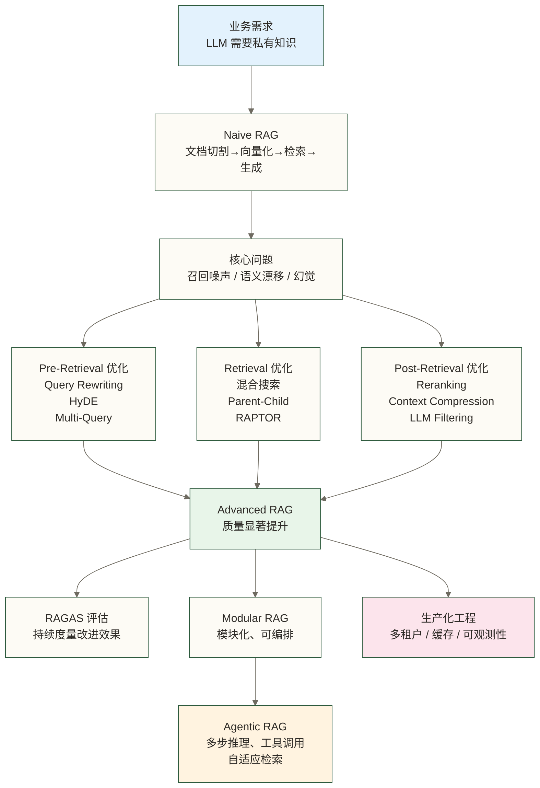

> [!note] 核心方法论
> 1. **从 Naive 开始**，用真实数据验证业务价值
> 2. **建立评估基线**（RAGAS），用数据驱动决策
> 3. **优先级排序**：混合搜索 + Reranking 性价比最高
> 4. **渐进式演进**，每次只改一个变量
> 5. **生产化优先**：可观测性和缓存是稳定性保障

---

## 延伸阅读

**内部关联文档**：
- ANN 算法原理 - 理解检索的数学基础
- Embedding 选型 - 选对 Embedding 是 RAG 的基础
- 混合搜索工程实践 - Dense + Sparse 融合的完整实现
- Milvus RAG 集成实战 - 基于 Milvus 的生产级 RAG 实现
- 向量数据库选型指南 - 选择适合 RAG 场景的向量库

**关键论文**：
- RAPTOR (2024, ICLR)：[arxiv.org/abs/2401.18059](https://arxiv.org/abs/2401.18059)
- Self-RAG (2023, NeurIPS)：自我反思的检索增强生成
- RAGAS (2023)：[arxiv.org/abs/2309.15217](https://arxiv.org/abs/2309.15217)
- Agentic RAG Survey (2025)：[arxiv.org/abs/2501.09136](https://arxiv.org/abs/2501.09136)

---

#RAG #向量数据库 #AI架构 #LLM #检索增强生成 #LangChain #LlamaIndex #Advanced-RAG #Agentic-RAG
