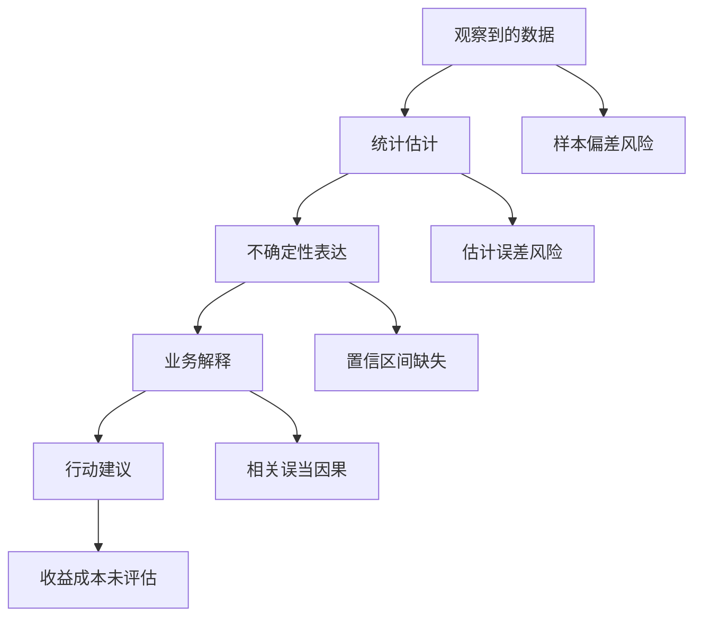

# AI时代统计推断与反幻觉

> [!abstract] 核心观点
> AI 生成分析结论的速度，远远快于人类验证结论的速度。统计推断的价值，就是把“流畅的解释”重新拉回到“证据够不够”。

AI 很会写这样的句子：

> “本月用户活跃度显著提升，说明新功能有效增强了用户粘性。”

这句话可能对，也可能错。真正的数据人不会先改文案，而会问：

- 活跃度是什么指标？
- 提升了多少？
- 样本量多大？
- 是否有置信区间？
- 是否排除了节假日、渠道变化、产品改版等混杂因素？
- 这个提升是否足以支持“新功能有效”这个因果判断？

这就是统计推断在 AI 时代的职责：**不让一句漂亮话越过证据边界**。

---

## 1. 反幻觉不是反 AI，而是反过度推断

AI 分析幻觉通常不是凭空造数，而是把一个有限证据说成无限结论。



反幻觉的关键不是让 AI 闭嘴，而是给 AI 的结论加上边界：哪里是数据支持的，哪里只是猜测，哪里需要实验。

---

## 2. 一个通用审查框架：SURE

我建议用 SURE 框架审查 AI 生成的分析结论：

| 字母 | 含义 | 要问的问题 |
|---|---|---|
| S | Sample 样本 | 样本是否代表目标总体？ |
| U | Uncertainty 不确定性 | 有没有置信区间、误差范围、波动基线？ |
| R | Relationship 关系 | 是相关、预测，还是因果？ |
| E | Effect 效应 | 效果大小是否值得行动？ |

### S：样本是否代表总体

样本存在选择偏差时，将结果推广到目标总体可能产生系统性误差；仍需区分对当前样本的描述与对总体的推断。

常见偏差包括：

- 只看活跃用户，忽略沉默用户
- 只看付费用户，忽略未转化用户
- 只看存活企业客户，忽略流失客户
- 只看某渠道样本，却推广到全站

相关概念：[[【技术与工具】/统计学/抽样方法|抽样方法]]、[[【技术与工具】/统计学/抽样误差与偏差|抽样误差与偏差]]。

### U：有没有表达不确定性

只给一个数字，很容易制造确定性幻觉。

例如“转化率从 10.0% 提升到 10.8%”，听起来提升 0.8 个点。但如果样本只有 300 人，这个差异可能只是波动。

下面的 Python 示例以每组 1000 人为演示数据，分别计算两组比例的正态近似置信区间，并未计算两组比例之差的置信区间，也不能直接据此判断差异是否显著。该近似要求观测独立且成功、失败计数足够大；输入还需满足 total > 0 且 0 <= success <= total。

```python
import math

def proportion_ci(success, total, z=1.96):
    p = success / total
    se = math.sqrt(p * (1 - p) / total)
    return p, p - z * se, p + z * se

control = proportion_ci(100, 1000)
treatment = proportion_ci(108, 1000)

print("control:", control)
print("treatment:", treatment)
```

相关概念：[[【技术与工具】/统计学/置信区间|置信区间]]、[[【技术与工具】/统计学/中心极限定理|中心极限定理]]。

### R：关系类型是否说清楚

数据里常见三种关系：

1. **描述关系**：A 和 B 同时变化。
2. **预测关系**：A 能帮助预测 B。
3. **因果关系**：改变 A 会导致 B 改变。

AI 最容易把第 1 种写成第 3 种。

例如广告投放与留存率正相关，不等于广告提高留存。可能是投放期间同时上线了新手权益，也可能是渠道结构变了。

相关概念：[[【技术与工具】/统计学/相关分析|相关分析]]、[[【技术与工具】/统计学/线性回归|线性回归]]、[[【数据分析与数据运营】/02-数据分析专业能力/02-统计分析/05-实验设计与业务落地|实验设计与A/B测试]]。

### E：效果大小是否值得行动

显著不等于重要。

一个实验可能因为样本量很大，检测出 0.05% 的提升，但这个提升不足以覆盖研发、运营、风控成本。反过来，一个小样本实验可能不显著，但效果方向稳定、业务价值高，值得继续扩大样本。

数据人的职责，是把统计判断翻译成业务判断。

---

## 3. 三个典型场景

### 场景一：均值提升了，业务真的变好吗

AI 说：“客单价从 120 元提升到 135 元，说明用户消费能力增强。”

审查步骤：

1. 看中位数是否也提升。
2. 看 P90/P99 是否由极端大单拉动。
3. 分渠道、分品类、分新老用户拆解。
4. 检查是否有价格调整或大促活动。

如果只是少数大客户拉高均值，结论应该改成：

> “本月客单价均值提升，但中位数变化不大，提升主要来自高客单价用户占比增加。暂不能说明整体用户消费能力增强。”

相关：[[【技术与工具】/统计学/均值|均值]]、[[【技术与工具】/统计学/中位数|中位数]]、[[【技术与工具】/统计学/分位数|分位数]]。

### 场景二：A/B 测试显著了，能不能上线

AI 说：“实验组转化率显著高于对照组，建议全量上线。”

审查步骤：

1. 是否提前偷看数据并停止实验？
2. 是否同时观察了多个指标却只汇报显著的那个？
3. 主指标是否提升，护栏指标是否受损？
4. 效果大小是否覆盖上线成本？
5. 是否分人群存在反向效果？

相关：[[【技术与工具】/统计学/假设检验|假设检验]]、[[【技术与工具】/统计学/多重比较|多重比较]]。

### 场景三：模型准确率提高了，真的更好吗

AI 说：“模型 A 准确率 92%，模型 B 准确率 90%，所以 A 更好。”

审查步骤：

1. 类别是否不平衡？
2. 召回率、精确率、AUC 是否同步改善？
3. 错误样本的业务成本是否一致？
4. 新模型是否存在数据漂移风险？
5. 是否在独立验证集上评估？

相关：[[【数据分析与数据运营】/02-数据分析专业能力/03-建模与预测/06-模型评估指标体系|模型评估指标体系]]、[[【技术与工具】/Python/27-模型评估与交叉验证|模型评估与交叉验证]]。

---

## 4. 给 AI 的统计审查提示词

你可以把下面这段当成日常工作提示词：

```text
请不要直接给业务结论。先按以下结构审查：
1. 当前样本是否能代表目标总体？可能有哪些选择偏差？
2. 指标是否存在口径歧义？分子、分母、时间窗口是什么？
3. 是否需要置信区间或显著性检验？如果需要，请说明方法和前提。
4. 当前结果最多支持相关、预测还是因果判断？
5. 还需要哪些分层拆解或护栏指标？
6. 在证据不足的地方，请明确标注“不能得出该结论”。
```

注意：提示词不能替代统计判断。它只是让 AI 暴露推理过程，最终审查仍然要由人完成。

---

## 5. 反幻觉检查清单

- [ ] 有没有样本量说明？
- [ ] 有没有样本偏差风险？
- [ ] 有没有分布检查？
- [ ] 有没有置信区间或波动基线？
- [ ] 有没有把相关误写成因果？
- [ ] 有没有忽略混杂因素？
- [ ] 有没有只汇报显著结果？
- [ ] 有没有效果大小与业务成本判断？
- [ ] 有没有护栏指标？
- [ ] 有没有明确“不能得出”的边界？

---

## 6. 相关学习入口

- [[【学习路线】/AI时代数据人/13-AI时代统计学能力地图|AI时代统计学能力地图]]
- [[【技术与工具】/统计学/统计学基础|统计学基础]]
- [[【技术与工具】/统计学/常见统计陷阱与误区|常见统计陷阱与误区]]
- [[【技术与工具】/统计学/假设检验流程|假设检验流程]]
- [[【数据分析与数据运营】/02-数据分析专业能力/02-统计分析/05-实验设计与业务落地|实验设计与A/B测试]]
- [[【数据分析与数据运营】/02-数据分析专业能力/05-Agentic-Analytics/03-AI-BI评估体系与误差治理|AI-BI评估体系与误差治理]]
- [[【技术与工具】/Python/17-数据统计与描述|Python数据统计与描述]]
