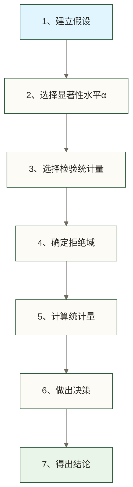

# 假设检验（Hypothesis Testing）

> [!abstract] 📋 本节概览
> - 🎯 **学习目标**：掌握假设检验的基本原理、实施步骤和实际应用
> - 📚 **前置知识**：[[【技术与工具】/统计学/描述性统计|描述性统计]] | [[【技术与工具】/统计学/概率的基本概念|概率的基本概念]] | [[【技术与工具】/统计学/正态分布|正态分布]] | [[【技术与工具】/统计学/中心极限定理|中心极限定理]]
> - ⏱️ **预计用时**：25分钟
> - 🎯 **难度等级**：中级

## 什么是假设检验？

> [!note] 📖 核心定义
> 假设检验是利用样本信息来判断关于总体参数假设是否成立的统计推断方法。本质上是一种**科学的"反证法"**思维方式。

### 生活化理解

想象你是一名侦探，需要判断嫌疑人是否有罪：

1. **设定假设**：假设嫌疑人无罪（原假设H₀）
2. **收集证据**：通过调查获取证据（样本数据）
3. **评估证据**：如果证据强烈指向有罪，且足以推翻"无罪推定"
4. **做出判决**：证据充分就判定有罪（拒绝原假设），否则维持无罪（不拒绝原假设）

这就是假设检验的核心逻辑——**通过反证来推断真相**。

### 实际应用场景

| 领域 | 问题示例 | 原假设H₀ | 备择假设H₁ |
|------|---------|----------|-----------|
| **医学** | 新药是否更有效？ | 新药效果≤旧药 | 新药效果>旧药 |
| **教育** | 新教学法是否提高成绩？ | 平均成绩≤75分 | 平均成绩>75分 |
| **质量控制** | 产品合格率是否达标？ | 合格率≤90% | 合格率>90% |
| **市场研究** | A/B测试哪个版本更好？ | 转化率A=转化率B | 转化率A≠转化率B |

## 核心概念深入理解

### 假设的类型

#### 1. 原假设（H₀）与备择假设（H₁）

> [!info] 💡 假设设定原则
> - **原假设（H₀）**：通常是现状、无差异或无效果的假设
> - **备择假设（H₁）**：研究者想要证明的假设，通常是有差异或有效果

**示例分析**：

**双尾检验（Two-tailed test）**
- 研究问题：某班级平均成绩是否为75分？
- H₀: μ = 75（平均成绩等于75分）
- H₁: μ ≠ 75（平均成绩不等于75分）
- 适用于：不确定方向的差异检验

**右尾检验（Right-tailed test）**  
- 研究问题：新教学方法是否能提高成绩？
- H₀: μ ≤ 75（新方法不能提高成绩）
- H₁: μ > 75（新方法能提高成绩）
- 适用于：检验是否有改进或增长

**左尾检验（Left-tailed test）**
- 研究问题：新工艺是否能降低不良率？
- H₀: p ≥ 0.05（不良率不低于5%）
- H₁: p < 0.05（不良率低于5%）
- 适用于：检验是否有减少或降低

#### 2. 决策错误类型

假设检验中可能出现两种错误，用生活化的例子来理解：

> [!warning] ⚠️ 两类错误详解
> 
> | 现实情况 | 决策：不拒绝H₀ | 决策：拒绝H₀ |
> |---------|--------------|------------|
> | **H₀为真** | ✅ 正确决策 | ❌ **第一类错误（α错误）** |
> | **H₀为假** | ❌ **第二类错误（β错误）** | ✅ 正确决策 |

**第一类错误（α错误）**：
- **定义**：原假设为真，但错误地拒绝了
- **生活例子**：一个健康的人被误诊为有病
- **法庭例子**：无罪的人被判有罪
- **概率**：P(拒绝H₀ | H₀为真) = α（显著性水平）

**第二类错误（β错误）**：
- **定义**：原假设为假，但未能拒绝
- **生活例子**：生病的人被误诊为健康
- **法庭例子**：有罪的人被判无罪
- **概率**：P(不拒绝H₀ | H₀为假) = β

**关键概念**：
- **显著性水平α**：我们愿意承受第一类错误的最大概率（通常设为0.05）
- **检验力（1-β）**：正确拒绝假原假设的概率，检验力越高越好

## 假设检验实施步骤

### 七步检验流程



#### 详细步骤说明

**步骤1：建立假设**
- 原假设H₀：通常是现状或无差异的假设
- 备择假设H₁：研究者想要证明的假设

**步骤2：选择显著性水平**
- 常用：α = 0.05（最常用）、0.01（更严格）、0.001（极严格）
- α越小，检验越严格，但可能遗漏真实效应

**步骤3：选择检验统计量**
- 连续数据的均值检验：总体标准差未知时通常使用t统计量；总体标准差已知且满足相应分布或近似条件时可使用z统计量，不能仅按样本大小选择
- 分类数据：χ²统计量
- 取决于：数据类型、样本大小、分布假设

**步骤4：确定拒绝域**
- 单尾检验：左尾或右尾的极值区域
- 双尾检验：两端的极值区域

**步骤5：计算统计量**
- 基于样本数据计算相应的检验统计量

**步骤6：做出决策**
- 方法1：统计量是否落在拒绝域内
- 方法2：p值是否小于α

**步骤7：得出结论**
- 用业务语言解释统计结论的实际意义

## 常用假设检验方法

### 检验方法选择指南

| 数据类型 | 样本数 | 检验目的 | 推荐方法 |
|---------|-------|---------|---------|
| **连续数据** | 1个样本 | 检验均值 | 单样本t检验 |
| **连续数据** | 2个样本 | 比较均值 | 双样本t检验 |
| **连续数据** | 3+个样本 | 比较均值 | 方差分析(ANOVA) |
| **分类数据** | 1个样本 | 检验比例 | 比例z检验 |
| **分类数据** | 2个样本 | 比较比例 | 双比例z检验 |
| **分类数据** | 列联表 | 独立性检验 | 卡方检验 |

### t检验详解

#### 1. 单样本t检验

**应用场景**：检验样本均值是否等于某个特定值

**基本代码示例**：
```python
import scipy.stats as stats
import numpy as np

# 示例：检验班级平均成绩是否为80分
scores = [78, 82, 85, 79, 88, 76, 90, 84, 87, 81]
target_mean = 80

# 执行单样本t检验
t_stat, p_value = stats.ttest_1samp(scores, target_mean)

print(f"t统计量: {t_stat:.3f}")
print(f"p值: {p_value:.4f}")

# 决策
if p_value < 0.05:
    print("拒绝原假设：平均成绩显著不等于80分")
else:
    print("不拒绝原假设：平均成绩可能等于80分")
```

#### 2. 双样本t检验

**应用场景**：比较两组数据的均值是否有显著差异

**基本代码示例**：
```python
# 示例：比较两个班级的成绩
class_a = [78, 82, 85, 79, 88, 76, 90, 84, 87, 81]
class_b = [75, 79, 81, 76, 84, 73, 86, 80, 83, 77]

# 执行双样本t检验
# 假设两组观测相互独立；使用不要求两组总体方差相等的Welch t检验
# 小样本下还需考虑总体分布及异常值影响
t_stat, p_value = stats.ttest_ind(class_a, class_b, equal_var=False)

print(f"班级A均值: {np.mean(class_a):.2f}")
print(f"班级B均值: {np.mean(class_b):.2f}")
print(f"t统计量: {t_stat:.3f}")
print(f"p值: {p_value:.4f}")
```

### 卡方检验

#### 1. 卡方拟合优度检验
**应用场景**：检验观察频数是否符合期望分布

```python
# 示例：检验骰子是否公平
observed = [95, 103, 98, 107, 92, 105]  # 实际观察次数
expected = [100, 100, 100, 100, 100, 100]  # 期望次数

chi2_stat, p_value = stats.chisquare(observed, expected)
print(f"χ²统计量: {chi2_stat:.3f}, p值: {p_value:.4f}")
```

#### 2. 卡方独立性检验
**应用场景**：检验两个分类变量是否独立

```python
# 示例：性别与专业选择的关联性
contingency_table = [[30, 20, 10], [15, 35, 25]]  # 示例列联表：两类性别、三类专业

chi2, p_value, dof, expected = stats.chi2_contingency(contingency_table)
print(f"χ²统计量: {chi2:.3f}, p值: {p_value:.4f}")
```

## p值的理解和常见误区

### p值的本质含义

> [!info] 📐 p值的正确定义
> p值 = 在原假设H₀为真的前提下，观察到当前样本结果或更极端结果的概率

**通俗解释**：
- 如果p = 0.03，意思是：假设原假设为真，出现当前或更极端数据的概率只有3%
- 这个概率很小，让我们怀疑"原假设为真"这个前提条件
- 若预先设定α = 0.05，则因p = 0.03 < α而拒绝原假设；若α = 0.01，则不拒绝

### 决策规则

- **p < α（如0.05）**：拒绝原假设，结果统计显著
- **p ≥ α**：不拒绝原假设，结果不显著

### 常见误区与纠正

> [!warning] ⚠️ 误区1：p值是原假设为真的概率
> **错误**：p(H₀为真) = 0.03
> 
> **正确**：在H₀及检验模型假设成立时，检验统计量取到当前观察值或更极端值的概率为0.03

> [!warning] ⚠️ 误区2：p值越小，效应越大
> **错误**：p值反映效应大小
> 
> **正确**：p值反映统计显著性，大样本下微小差异也可能p值很小

> [!warning] ⚠️ 误区3：p > 0.05就证明原假设正确
> **错误**：不显著就是原假设正确
> 
> **正确**：不拒绝≠接受，可能是样本量不足

> [!warning] ⚠️ 误区4：0.05是绝对界限
> **错误**：p=0.051与p=0.049本质不同
> 
> **正确**：0.05是人为标准，应结合置信区间和效应量

## 实际应用案例

### 案例1：A/B测试

**业务场景**：网站测试新设计是否能提高转化率

**数据**：
- A版本（原版）：1000访客，50次转化，转化率5.0%
- B版本（新版）：1000访客，62次转化，转化率6.2%

**分析步骤**：
```python
from statsmodels.stats.proportion import proportions_ztest

# 执行双比例检验
counts = [50, 62]
nobs = [1000, 1000] 
z_stat, p_value = proportions_ztest(counts, nobs)

print(f"Z统计量: {z_stat:.3f}, p值: {p_value:.4f}")
# 默认双侧检验：Z约为-1.167，p约为0.243
# 在α = 0.05下不拒绝两版本转化率相等的原假设
```

**结论**：B版本的样本转化率高于A版本，但默认双侧检验在α = 0.05下不显著，尚不足以认定新版总体转化率更高或仅据此建议采用新设计。若研究目标是检验提升，应事先明确单侧备择假设和样本量计划，不能看过结果后再改变检验方向。

### 案例2：质量控制

**业务场景**：工厂检查产品直径是否符合10.0mm标准

**数据**：抽检30个样本，样本均值10.05mm，标准差0.12mm

**分析步骤**：
```python
import scipy.stats as stats

# 单样本t检验
# 未提供原始测量值，改用正文给定的汇总统计量
# 将0.12mm视为样本标准差；假设观测独立且满足单样本t检验条件
sample_mean, sample_std, sample_n = 10.05, 0.12, 30
t_stat = (sample_mean - 10.0) / (sample_std / sample_n**0.5)
p_value = 2 * stats.t.sf(abs(t_stat), df=sample_n - 1)

print(f"t统计量: {t_stat:.3f}, p值: {p_value:.4f}")
# 预先设定α = 0.05；若p < α，则拒绝总体均值等于10.0mm的原假设
# 这不等同于判定产品不符合公差或生产过程不稳定
```

**结论**：在所述假设成立且预先设定α = 0.05时，t约为2.282，双侧p约为0.030，可拒绝总体均值等于10.0mm的原假设。是否调整生产设备还需结合允许公差、偏差的实际影响和过程稳定性等信息，不能仅凭该p值决定。

## 注意事项与最佳实践

### 样本量的影响

**现象**：样本量越大，越容易检测出差异

**含义**：
- 大样本下，即使微小的差异也可能有显著的p值
- 小样本可能错过真实的重要差异（第二类错误）
- 需要平衡统计显著性与实际重要性

### 多重比较问题

**问题**：进行多次检验会增加整体的假阳性率

**解决方法**：
- **Bonferroni校正**：α' = α/n（n为检验次数）
- **FDR控制**：控制错误发现率
- **计划比较**：事先设定具体的比较计划

### 效应量的重要性

**为什么需要效应量**：
- p值只告诉我们差异是否显著
- 效应量告诉我们差异有多大
- 帮助判断结果的实际意义

**Cohen's d解释标准**：
- 0.2：小效应
- 0.5：中等效应  
- 0.8：大效应

```python
# 效应量计算示例
def cohens_d(group1, group2):
    n1, n2 = len(group1), len(group2)
    pooled_std = np.sqrt(((n1-1)*np.var(group1,ddof=1) + (n2-1)*np.var(group2,ddof=1)) / (n1+n2-2))
    return (np.mean(group2) - np.mean(group1)) / pooled_std
```

### 实用建议

1. **报告完整信息**：同时报告p值、效应量和置信区间
2. **避免p值偏见**：不要过分关注p=0.05这个临界值
3. **考虑实际意义**：统计显著不等于实际重要
4. **预先设定样本量**：基于效应量和检验力分析
5. **检查假设条件**：确保数据满足所选检验方法的前提

## 相关知识链接

- [[【技术与工具】/统计学/t检验|t检验]] - 最常用的假设检验方法
- [[【技术与工具】/统计学/卡方检验|卡方检验]] - 分类数据的假设检验
- [[【技术与工具】/统计学/方差分析（ANOVA）|方差分析（ANOVA）]] - 多组比较的方法
- [[【技术与工具】/统计学/正态分布|正态分布]] - 许多检验方法的理论基础
- [[【技术与工具】/统计学/置信区间|置信区间]] - 与假设检验互补的推断方法
- [[【技术与工具】/统计学/中心极限定理|中心极限定理]] - 大样本检验的理论支撑

---

> [!tip] 💡 学习建议
> 1. **掌握核心逻辑**：理解"反证法"的检验思维
> 2. **选择合适方法**：根据数据类型和研究目的选择检验
> 3. **正确解读p值**：避免常见的p值误区
> 4. **注重实际意义**：结合效应量和置信区间进行判断
> 5. **多做实践**：通过具体案例加深理解

#统计学 #假设检验 #统计推断 #t检验 #卡方检验 #p值
