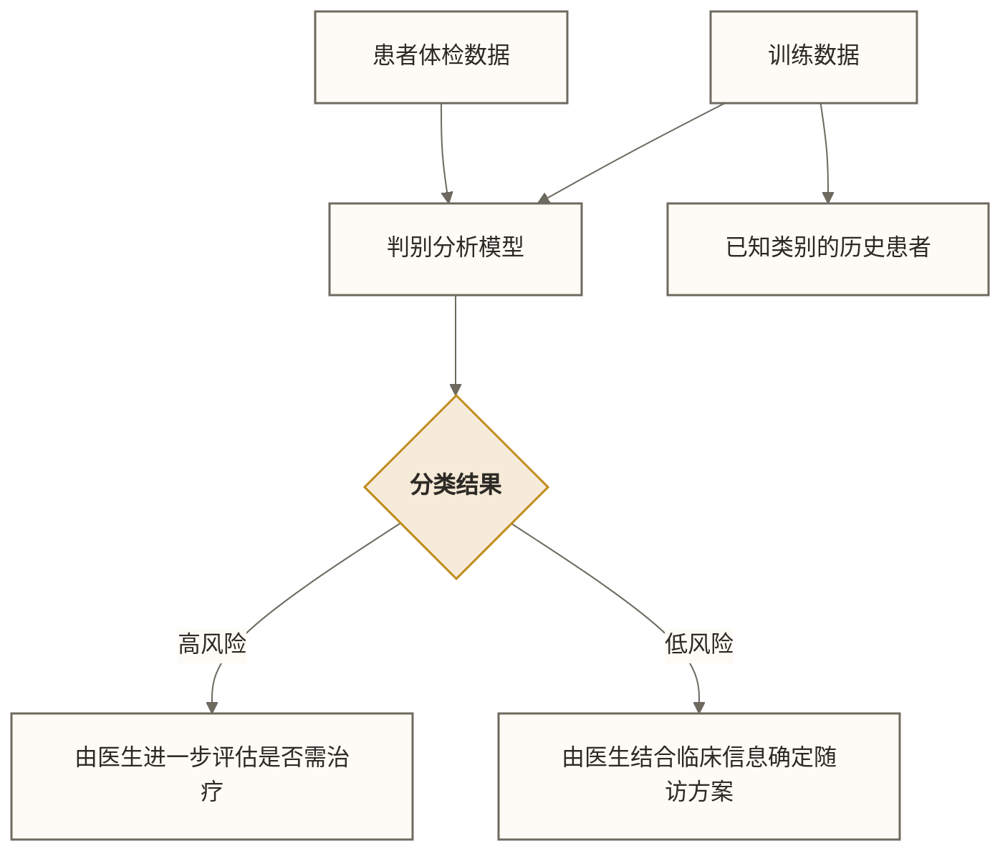

# 🏷️ 判别分析（Discriminant Analysis）

> [!abstract] 📋 本节概览
> - 🎯 **学习目标**：掌握判别分析的理论基础、分类方法和实际应用
> - 📚 **前置知识**：[[【技术与工具】/统计学/线性回归|线性回归]] | [[【技术与工具】/统计学/相关分析|相关]] | [[【技术与工具】/统计学/正态分布|正态分布]] | [[【技术与工具】/统计学/方差分析（ANOVA）|方差分析（ANOVA）]]
> - ⏱️ **预计用时**：25分钟
> - 🔧 **应用场景**：分类预测、降维分析、生物识别

## 🌟 核心概念理解

> [!note] 📖 **什么是判别分析？**
> 判别分析是一种多元统计分析方法，旨在根据多个连续变量的观测值来**预测样本所属的类别**，并寻找能够**最好地区分不同类别**的变量组合。

### 📊 生活化类比

想象你是一位医生，需要根据患者的多项体检指标（血压、血糖、胆固醇、年龄等）来判断患者是否患有心脏病：



**其他应用场景：**
- 银行根据客户资料判断信贷风险等级
- 人力资源根据简历特征筛选合适候选人
- 生物学家根据形态特征识别物种

## 🔍 判别分析的类型

### 1. 线性判别分析（LDA）

> [!info] 线性判别分析假设
> - 各类别的协方差矩阵相等
> - 各类别内的特征条件分布服从多元正态分布
> - 使用线性判别函数进行分类

**判别函数形式：**
```text
L(x) = w₁x₁ + w₂x₂ + ... + wₚxₚ + w₀
```

### 2. 二次判别分析（QDA）

> [!info] 二次判别分析特点
> - 各类别可以有不同的协方差矩阵
> - 判别边界是二次曲线
> - 当类内协方差结构确有差异且各类样本量足以估计协方差时可考虑QDA；需验证集比较，并非类别均值差异大就应选QDA

## 🛠️ Python实现与应用

### 基础判别分析实现

```python title="线性判别分析完整示例"
import numpy as np
import pandas as pd
from sklearn.discriminant_analysis import LinearDiscriminantAnalysis, QuadraticDiscriminantAnalysis
from sklearn.model_selection import train_test_split
from sklearn.metrics import classification_report, confusion_matrix
import matplotlib.pyplot as plt
import seaborn as sns

# 创建模拟数据集 - 客户信用评估
np.random.seed(42)

# 生成两类客户数据
# 类别1：低风险客户
low_risk_income = np.random.normal(8000, 1500, 200)  # 收入
low_risk_age = np.random.normal(35, 8, 200)          # 年龄  
low_risk_credit = np.random.normal(750, 50, 200)     # 信用分

# 类别2：高风险客户  
high_risk_income = np.random.normal(4500, 1200, 150)
high_risk_age = np.random.normal(28, 6, 150)
high_risk_credit = np.random.normal(650, 80, 150)

# 构建数据集
X_low = np.column_stack([low_risk_income, low_risk_age, low_risk_credit])
X_high = np.column_stack([high_risk_income, high_risk_age, high_risk_credit])

X = np.vstack([X_low, X_high])
y = np.hstack([np.zeros(200), np.ones(150)])  # 0: 低风险, 1: 高风险

# 创建DataFrame以便分析
feature_names = ['收入', '年龄', '信用分']
df = pd.DataFrame(X, columns=feature_names)
df['风险类别'] = y

print("数据集基本信息：")
print(df.groupby('风险类别').describe())
```

### 模型训练与评估

```python title="判别分析模型训练"
# 划分训练集和测试集
X_train, X_test, y_train, y_test = train_test_split(
    X, y, test_size=0.3, random_state=42, stratify=y
)

# 1. 线性判别分析
lda = LinearDiscriminantAnalysis()
lda.fit(X_train, y_train)

# 2. 二次判别分析
qda = QuadraticDiscriminantAnalysis()
qda.fit(X_train, y_train)

# 预测
lda_pred = lda.predict(X_test)
qda_pred = qda.predict(X_test)

# 获取预测概率
lda_proba = lda.predict_proba(X_test)
qda_proba = qda.predict_proba(X_test)

print("=== 线性判别分析结果 ===")
print(f"训练集准确率: {lda.score(X_train, y_train):.3f}")
print(f"测试集准确率: {lda.score(X_test, y_test):.3f}")
print("\n分类报告:")
print(classification_report(y_test, lda_pred, 
                          target_names=['低风险', '高风险']))

print("\n=== 二次判别分析结果 ===")
print(f"训练集准确率: {qda.score(X_train, y_train):.3f}")
print(f"测试集准确率: {qda.score(X_test, y_test):.3f}")
```

### 判别函数系数分析

```python title="分析判别函数"
# 线性判别函数系数
print("=== 线性判别函数分析 ===")
print("原始判别系数（受特征量纲影响，绝对值不能直接用于跨特征重要性排序）:")
for i, feature in enumerate(feature_names):
    coef = lda.coef_[0][i]
    print(f"{feature}: {coef:.4f}")

# 各类别均值
print(f"\n各类别在判别空间的均值:")
class_means = lda.transform(X_train.reshape(-1, 1, 3).mean(axis=0))
print(f"低风险类别均值: {lda.transform(X_train[y_train==0].mean(axis=0).reshape(1, -1))[0]}")
print(f"高风险类别均值: {lda.transform(X_train[y_train==1].mean(axis=0).reshape(1, -1))[0]}")
```

### 可视化分析

```python title="判别分析可视化"
# 绘制判别空间
fig, axes = plt.subplots(1, 2, figsize=(15, 6))

# LDA降维可视化
X_train_lda = lda.transform(X_train)
X_test_lda = lda.transform(X_test)

axes[0].scatter(X_train_lda[y_train==0], np.zeros(sum(y_train==0)), 
                c='blue', alpha=0.6, label='低风险 (训练)')
axes[0].scatter(X_train_lda[y_train==1], np.zeros(sum(y_train==1)), 
                c='red', alpha=0.6, label='高风险 (训练)')
axes[0].scatter(X_test_lda[y_test==0], np.ones(sum(y_test==0))*0.1, 
                c='lightblue', marker='s', alpha=0.8, label='低风险 (测试)')
axes[0].scatter(X_test_lda[y_test==1], np.ones(sum(y_test==1))*0.1, 
                c='lightcoral', marker='s', alpha=0.8, label='高风险 (测试)')
axes[0].axhline(y=0.05, color='black', linestyle='--', alpha=0.5)
axes[0].set_xlabel('LDA判别得分')
axes[0].set_title('线性判别分析投影')
axes[0].legend()
axes[0].grid(True, alpha=0.3)

# 原始判别系数可视化（不同量纲下不作为跨特征重要性排名）
feature_importance = np.abs(lda.coef_[0])
axes[1].barh(feature_names, feature_importance, color='skyblue', edgecolor='navy')
axes[1].set_xlabel('系数绝对值')
axes[1].set_title('原始判别系数绝对值（受量纲影响）')
axes[1].grid(True, alpha=0.3)

plt.tight_layout()
plt.show()
```

## 🎯 实际应用案例

### 案例：鸢尾花分类经典应用

```python title="多类别判别分析"
from sklearn.datasets import load_iris

# 加载鸢尾花数据集
iris = load_iris()
X_iris = iris.data
y_iris = iris.target

# 划分训练测试集
X_train_iris, X_test_iris, y_train_iris, y_test_iris = train_test_split(
    X_iris, y_iris, test_size=0.3, random_state=42, stratify=y_iris
)

# 训练LDA模型
lda_iris = LinearDiscriminantAnalysis(n_components=2)  # 降至2维便于可视化
lda_iris.fit(X_train_iris, y_train_iris)

# 预测
y_pred_iris = lda_iris.predict(X_test_iris)
accuracy = (y_pred_iris == y_test_iris).mean()

print(f"鸢尾花分类准确率: {accuracy:.3f}")
print(f"各类别预测情况:")
print(classification_report(y_test_iris, y_pred_iris, 
                          target_names=iris.target_names))

# LDA降维可视化
X_lda_2d = lda_iris.transform(X_iris)

plt.figure(figsize=(10, 8))
colors = ['red', 'green', 'blue']
for i, color in enumerate(colors):
    plt.scatter(X_lda_2d[y_iris == i, 0], 
                X_lda_2d[y_iris == i, 1], 
                c=color, alpha=0.7, 
                label=iris.target_names[i])

plt.xlabel('LD1')
plt.ylabel('LD2')
plt.title('鸢尾花数据集的线性判别分析')
plt.legend()
plt.grid(True, alpha=0.3)
plt.show()
```

## ⚠️ 使用注意事项

> [!warning] 应用前提与限制
> 1. **数据分布假设**：LDA假设各类别内的特征条件分布服从多元正态分布
> 2. **等协方差假设**：LDA假设各类别有相同的协方差矩阵
> 3. **样本量要求**：每类样本量应大于特征数量
> 4. **多重共线性**：避免特征间高度相关

### 模型诊断

```python title="判别分析诊断"
# 检验正态性假设
from scipy import stats

def check_normality(X, y, feature_names):
    """检验各类别各特征的正态性"""
    print("=== 正态性检验 (Shapiro-Wilk) ===")
    for class_label in np.unique(y):
        print(f"\n类别 {class_label}:")
        class_data = X[y == class_label]
        for i, feature in enumerate(feature_names):
            statistic, p_value = stats.shapiro(class_data[:, i])
            result = "未拒绝单变量正态性假设（不代表已证明正态，也不能确认联合多元正态性）" if p_value > 0.05 else "拒绝单变量正态性假设"
            print(f"  {feature}: p-value = {p_value:.4f} ({result})")

# 查看各类别方差（仅比较协方差矩阵对角元素，不构成等协方差检验）
def check_homoscedasticity(X, y):
    """简单的协方差矩阵比较"""
    print("=== 协方差矩阵比较 ===")
    for class_label in np.unique(y):
        cov_matrix = np.cov(X[y == class_label].T)
        print(f"类别 {class_label} 协方差矩阵对角元素:")
        print(np.diag(cov_matrix))

# 执行诊断
check_normality(X_train, y_train, feature_names)
check_homoscedasticity(X_train, y_train)
```

## 🔄 与其他方法的比较

| 方法 | 优点 | 缺点 | 适用场景 |
|------|------|------|----------|
| **线性判别分析** | 可解释性强，计算效率高 | 假设条件严格 | 数据满足正态分布假设 |
| **二次判别分析** | 允许不同协方差矩阵 | 参数更多，易过拟合 | 类内协方差结构不同且样本量足够，结合验证集比较 |
| **逻辑回归** | 不要求特征服从正态分布 | 标准模型的决策边界为线性，处理非线性关系可能需要特征工程 | 二分类；非线性边界需配合相应特征变换 |
| **SVM** | 处理非线性问题强 | 参数调优复杂 | 高维数据，复杂边界 |

## 🔗 扩展学习

### 相关知识链接
- [[【技术与工具】/统计学/主成分分析（PCA）|主成分分析（PCA）]] - 另一种降维方法
- [[【技术与工具】/统计学/线性回归|线性回归]] - 线性模型基础
- [[【技术与工具】/统计学/方差分析（ANOVA）|方差分析（ANOVA）]] - 理解组间差异
- [[【技术与工具】/Python/21-分类算法|分类算法]] - 更多分类方法比较
- [[【技术与工具】/Python/18-机器学习基础|机器学习]] - 监督学习理论

### 进阶主题
- 正则化判别分析（Regularized Discriminant Analysis）
- 稀疏判别分析（Sparse Discriminant Analysis）
- 核判别分析（Kernel Discriminant Analysis）

> [!tip] 💡 学习建议
> 1. **理论基础**：先理解多元正态分布和协方差矩阵
> 2. **实践应用**：从简单的二分类问题开始练习
> 3. **模型比较**：对比LDA与逻辑回归在同一数据集上的表现
> 4. **诊断技能**：学会检验模型假设是否满足

#统计学 #判别分析 #多元分析 #分类预测
