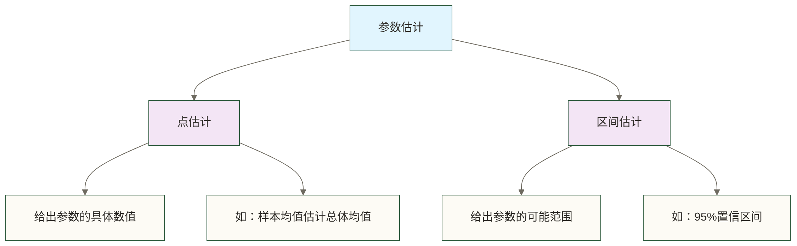

# 🧮 参数估计（Parameter Estimation）

> [!abstract] 📋 本节概览
> - 🎯 **学习目标**：掌握参数估计的基本原理、估计方法和置信区间构造
> - 📚 **前置知识**：[[【技术与工具】/统计学/抽样分布|抽样分布]] | [[【技术与工具】/统计学/中心极限定理|中心极限定理]] | [[【技术与工具】/统计学/正态分布|正态分布]] | [[【技术与工具】/统计学/t分布|t分布]]
> - ⏱️ **预计用时**：30分钟
> - 🎯 **核心技能**：点估计、区间估计、估计量评价

## 🌟 核心概念理解

> [!note] 📖 **什么是参数估计？**
> 参数估计是**推断统计学**的核心内容，指利用样本数据来推断总体参数（如均值、方差、比例等）的数值。它是从"局部观察"推断"整体特征"的科学方法。

### 🎯 参数估计的两种类型



### 📊 生活化类比

想象你是一位质检员，需要检测一批产品的质量：

**场景设置：**
- **总体**：工厂生产的10万个零件
- **参数**：零件平均重量（未知）
- **样本**：随机抽取100个零件
- **目标**：推断所有零件的平均重量

这就像通过"品尝一勺汤"来判断"整锅汤"的味道！

## 🔍 估计方法详解

### 1. 点估计（Point Estimation）

> [!info] 点估计的核心思想
> 用样本统计量的值直接作为总体参数的估计值

#### 常用的点估计量

| 总体参数 | 点估计量 | 符号表示 | Python实现 |
|---------|---------|---------|------------|
| 总体均值 μ | 样本均值 | x̄ = Σxᵢ/n | `np.mean(sample)` |
| 总体方差 σ² | 样本方差 | s² = Σ(xᵢ-x̄)²/(n-1) | `np.var(sample, ddof=1)` |
| 总体比例 p | 样本比例 | p̂ = x/n | `np.sum(success)/len(sample)` |

```python title="点估计基础实现"
import numpy as np
import pandas as pd
from scipy import stats
import matplotlib.pyplot as plt

# 创建示例数据 - 产品重量检测
np.random.seed(42)
# 假设真实总体均值为500g，标准差为15g
true_population = np.random.normal(500, 15, 10000)
sample = np.random.choice(true_population, 100, replace=False)

# 点估计
sample_mean = np.mean(sample)  # 估计总体均值
sample_std = np.std(sample, ddof=1)  # 估计总体标准差
sample_var = np.var(sample, ddof=1)  # 估计总体方差

print("=== 点估计结果 ===")
print(f"真实总体均值: {np.mean(true_population):.2f}g")
print(f"样本均值估计: {sample_mean:.2f}g")
print(f"估计误差: {abs(sample_mean - np.mean(true_population)):.2f}g")
print(f"样本标准差: {sample_std:.2f}g")
print(f"样本方差: {sample_var:.2f}g²")
```

### 2. 区间估计（Interval Estimation）

> [!important] 置信区间的含义
> 置信区间不是说"参数有95%的概率落在区间内"，而是说"用相同方法构造的100个区间中，约有95个区间包含真实参数"。

#### 均值的置信区间构造

**当总体方差已知时（使用Z分布）：**
```ini
CI = x̄ ± z_{α/2} × (σ/√n)
```

**当总体方差未知时（使用t分布）：**
```ini
CI = x̄ ± t_{α/2,n-1} × (s/√n)
```

```python title="置信区间完整实现"
from scipy.stats import t, norm

def confidence_interval_mean(sample, confidence_level=0.95, sigma=None):
    """
    计算均值的置信区间
    
    参数:
    - sample: 样本数据
    - confidence_level: 置信水平
    - sigma: 总体标准差（如果已知）
    """
    n = len(sample)
    sample_mean = np.mean(sample)
    alpha = 1 - confidence_level
    
    if sigma is not None:
        # 总体方差已知，使用Z分布
        z_critical = norm.ppf(1 - alpha/2)
        margin_error = z_critical * sigma / np.sqrt(n)
        method = "Z分布（总体方差已知）"
    else:
        # 总体方差未知，使用t分布
        sample_std = np.std(sample, ddof=1)
        t_critical = t.ppf(1 - alpha/2, df=n-1)
        margin_error = t_critical * sample_std / np.sqrt(n)
        method = "t分布（总体方差未知）"
    
    ci_lower = sample_mean - margin_error
    ci_upper = sample_mean + margin_error
    
    return {
        'sample_mean': sample_mean,
        'confidence_level': confidence_level,
        'ci_lower': ci_lower,
        'ci_upper': ci_upper,
        'margin_error': margin_error,
        'method': method
    }

# 计算不同置信水平的置信区间
confidence_levels = [0.90, 0.95, 0.99]

print("=== 均值置信区间分析 ===")
for conf_level in confidence_levels:
    result = confidence_interval_mean(sample, conf_level)
    print(f"\n{conf_level*100}% 置信区间:")
    print(f"  样本均值: {result['sample_mean']:.2f}g")
    print(f"  置信区间: [{result['ci_lower']:.2f}, {result['ci_upper']:.2f}]g")
    print(f"  误差边际: ±{result['margin_error']:.2f}g")
    print(f"  方法: {result['method']}")
```

### 3. 比例的参数估计

```python title="比例参数估计"
def confidence_interval_proportion(successes, n, confidence_level=0.95):
    """
    计算比例的置信区间
    
    参数:
    - successes: 成功次数
    - n: 总样本量
    - confidence_level: 置信水平
    """
    p_hat = successes / n  # 样本比例
    alpha = 1 - confidence_level
    z_critical = norm.ppf(1 - alpha/2)
    
    # 标准误差
    se = np.sqrt(p_hat * (1 - p_hat) / n)
    margin_error = z_critical * se
    
    ci_lower = max(0, p_hat - margin_error)  # 确保不小于0
    ci_upper = min(1, p_hat + margin_error)  # 确保不大于1
    
    return {
        'sample_proportion': p_hat,
        'confidence_level': confidence_level,
        'ci_lower': ci_lower,
        'ci_upper': ci_upper,
        'margin_error': margin_error
    }

# 示例：调查1000人中有420人支持某政策
successes = 420
total_n = 1000

prop_result = confidence_interval_proportion(successes, total_n, 0.95)
print("=== 比例置信区间 ===")
print(f"样本比例: {prop_result['sample_proportion']:.3f}")
print(f"95% 置信区间: [{prop_result['ci_lower']:.3f}, {prop_result['ci_upper']:.3f}]")
print(f"支持率在 {prop_result['ci_lower']*100:.1f}% - {prop_result['ci_upper']*100:.1f}% 之间")
```

## 📊 估计量的评价标准

### 1. 无偏性（Unbiasedness）

> [!info] 无偏估计量
> E(θ̂) = θ，即估计量的期望等于真实参数值

```python title="验证估计量的无偏性"
def verify_unbiasedness(true_param, n_samples, sample_size, estimator_func):
    """验证估计量的无偏性"""
    estimates = []
    
    for _ in range(n_samples):
        # 从真实分布中抽样
        sample = np.random.normal(true_param, 15, sample_size)
        estimate = estimator_func(sample)
        estimates.append(estimate)
    
    estimates = np.array(estimates)
    bias = np.mean(estimates) - true_param
    
    return {
        'true_parameter': true_param,
        'mean_estimate': np.mean(estimates),
        'bias': bias,
        'std_estimates': np.std(estimates),
        'estimates': estimates
    }

# 验证样本均值的无偏性
result = verify_unbiasedness(
    true_param=500,
    n_samples=1000, 
    sample_size=30,
    estimator_func=np.mean
)

print("=== 无偏性验证 ===")
print(f"真实参数: {result['true_parameter']}")
print(f"估计量均值: {result['mean_estimate']:.4f}")
print(f"偏差: {result['bias']:.4f}")
print(f"偏差是否接近0: {'是' if abs(result['bias']) < 0.5 else '否'}")
```

### 2. 一致性（Consistency）

> [!info] 一致估计量
> 当样本量n→∞时，估计量依概率收敛到真实参数值

```python title="验证估计量的一致性"
def verify_consistency(true_param, sample_sizes):
    """验证估计量的一致性"""
    results = {}
    
    for n in sample_sizes:
        estimates = []
        for _ in range(500):  # 每个样本量重复500次
            sample = np.random.normal(true_param, 15, n)
            estimate = np.mean(sample)
            estimates.append(estimate)
        
        results[n] = {
            'mean_estimate': np.mean(estimates),
            'std_estimate': np.std(estimates),
            'mse': np.mean((np.array(estimates) - true_param)**2)
        }
    
    return results

# 验证一致性
sample_sizes = [10, 30, 50, 100, 200, 500]
consistency_results = verify_consistency(500, sample_sizes)

print("=== 一致性验证 ===")
for n, result in consistency_results.items():
    print(f"样本量 {n:3d}: 均值={result['mean_estimate']:.2f}, "
          f"标准差={result['std_estimate']:.3f}, MSE={result['mse']:.3f}")
```

## 🎯 实际应用案例

### 案例1：质量控制中的参数估计

```python title="质量控制应用案例"
# 案例背景：工厂生产螺丝，需要控制直径在10.0±0.1mm范围内

# 模拟生产数据
np.random.seed(123)
production_data = np.random.normal(10.05, 0.08, 200)  # 真实均值稍有偏移

# 质检抽样（每批抽检20个）
sample_batch = np.random.choice(production_data, 20, replace=False)

# 参数估计
mean_estimate = np.mean(sample_batch)
std_estimate = np.std(sample_batch, ddof=1)

# 95%置信区间
ci_result = confidence_interval_mean(sample_batch, 0.95)

print("=== 质量控制参数估计 ===")
print(f"样本直径均值: {mean_estimate:.4f} mm")
print(f"样本标准差: {std_estimate:.4f} mm")
print(f"95%置信区间: [{ci_result['ci_lower']:.4f}, {ci_result['ci_upper']:.4f}] mm")

# 质量判断
target = 10.0
tolerance = 0.1
if ci_result['ci_lower'] >= target - tolerance and ci_result['ci_upper'] <= target + tolerance:
    quality_status = "均值置信区间位于目标范围内（不代表单件或整批产品合格）"
else:
    quality_status = "均值置信区间未完全位于目标范围内（需进一步评估，不能据此直接判定产品不合格）"

print(f"质量状态: {quality_status}")
print(f"目标范围: [{target-tolerance}, {target+tolerance}] mm")
```

### 案例2：市场调研中的比例估计

```python title="市场调研比例估计"
# 案例：调查消费者对新产品的接受度

# 调研数据
survey_responses = np.random.choice([0, 1], size=500, p=[0.35, 0.65])  # 65%接受
acceptance_count = np.sum(survey_responses)
total_respondents = len(survey_responses)

# 比例估计
prop_ci = confidence_interval_proportion(acceptance_count, total_respondents, 0.95)

print("=== 市场调研比例估计 ===")
print(f"调研样本量: {total_respondents}")
print(f"接受新产品人数: {acceptance_count}")
print(f"样本接受比例: {prop_ci['sample_proportion']:.3f} ({prop_ci['sample_proportion']*100:.1f}%)")
print(f"95%置信区间: [{prop_ci['ci_lower']:.3f}, {prop_ci['ci_upper']:.3f}]")
print(f"即接受率在 {prop_ci['ci_lower']*100:.1f}% - {prop_ci['ci_upper']*100:.1f}% 之间")

# 商业决策建议
if prop_ci['ci_lower'] > 0.5:
    decision = "推荐上市"
elif prop_ci['ci_upper'] < 0.5:
    decision = "不推荐上市"
else:
    decision = "需要更多调研"

print(f"商业决策建议: {decision}")
```

## 📈 可视化分析

```python title="参数估计可视化"
# 创建综合可视化
fig, axes = plt.subplots(2, 2, figsize=(15, 12))

# 1. 样本分布与总体分布对比
axes[0,0].hist(true_population, bins=50, alpha=0.5, label='总体分布', density=True, color='lightblue')
axes[0,0].hist(sample, bins=15, alpha=0.7, label='样本分布', density=True, color='orange')
axes[0,0].axvline(np.mean(true_population), color='blue', linestyle='--', label=f'总体均值: {np.mean(true_population):.2f}')
axes[0,0].axvline(np.mean(sample), color='red', linestyle='-', label=f'样本均值: {np.mean(sample):.2f}')
axes[0,0].set_title('总体与样本分布对比')
axes[0,0].legend()
axes[0,0].grid(True, alpha=0.3)

# 2. 不同置信水平的置信区间
conf_levels = [0.90, 0.95, 0.99]
ci_results = [confidence_interval_mean(sample, level) for level in conf_levels]

y_pos = np.arange(len(conf_levels))
for i, (level, result) in enumerate(zip(conf_levels, ci_results)):
    axes[0,1].barh(i, result['ci_upper'] - result['ci_lower'], 
                   left=result['ci_lower'], alpha=0.7, 
                   label=f'{level*100}% CI')
    axes[0,1].plot(result['sample_mean'], i, 'ro', markersize=8)

axes[0,1].axvline(np.mean(true_population), color='blue', linestyle='--', label='真实均值')
axes[0,1].set_yticks(y_pos)
axes[0,1].set_yticklabels([f'{level*100}%' for level in conf_levels])
axes[0,1].set_title('不同置信水平的置信区间')
axes[0,1].legend()
axes[0,1].grid(True, alpha=0.3)

# 3. 样本量对估计精度的影响
sample_sizes = [10, 20, 50, 100, 200]
precisions = []

for size in sample_sizes:
    temp_sample = np.random.choice(true_population, size, replace=False)
    ci_temp = confidence_interval_mean(temp_sample, 0.95)
    precision = ci_temp['ci_upper'] - ci_temp['ci_lower']
    precisions.append(precision)

axes[1,0].plot(sample_sizes, precisions, 'bo-', linewidth=2, markersize=8)
axes[1,0].set_xlabel('样本量')
axes[1,0].set_ylabel('置信区间宽度')
axes[1,0].set_title('样本量vs估计精度')
axes[1,0].grid(True, alpha=0.3)

# 4. 估计量的抽样分布
n_simulations = 1000
sample_means = []
for _ in range(n_simulations):
    sim_sample = np.random.choice(true_population, 30, replace=False)
    sample_means.append(np.mean(sim_sample))

axes[1,1].hist(sample_means, bins=40, density=True, alpha=0.7, color='lightgreen')
axes[1,1].axvline(np.mean(true_population), color='blue', linestyle='--', label=f'真实均值: {np.mean(true_population):.2f}')
axes[1,1].axvline(np.mean(sample_means), color='red', linestyle='-', label=f'估计量均值: {np.mean(sample_means):.2f}')
axes[1,1].set_title('样本均值的抽样分布')
axes[1,1].legend()
axes[1,1].grid(True, alpha=0.3)

plt.tight_layout()
plt.show()
```

## ⚠️ 实践要点

> [!warning] 参数估计常见误区
> 1. **置信区间理解错误**：置信区间是关于估计方法的，不是关于单个参数的
> 2. **样本代表性**：确保样本是从目标总体中随机抽取的
> 3. **分布假设**：验证数据是否满足所用方法的分布假设
> 4. **样本量不足**：样本量太小会导致估计不可靠

### 最佳实践建议

```python title="参数估计检查清单"
def parameter_estimation_checklist(sample, parameter_type='mean'):
    """参数估计质量检查"""
    checks = {}
    
    # 1. 样本量检查
    n = len(sample)
    checks['sample_size'] = {
        'value': n,
        'adequate': n >= 30,
        'note': '样本量≥30，但是否足够仍取决于分布、抽样设计和精度要求' if n >= 30 else '样本量较小；正态总体下仍可使用t区间，需结合抽样条件和精度要求判断'
    }
    
    # 2. 正态性检查
    from scipy.stats import shapiro
    stat, p_value = shapiro(sample[:min(5000, len(sample))])  # shapiro限制样本量
    checks['normality'] = {
        'p_value': p_value,
        'normal': p_value > 0.05,
        'note': '在5%显著性水平下未拒绝正态性假设，不代表已证明正态' if p_value > 0.05 else '在5%显著性水平下拒绝正态性假设'
    }
    
    # 3. 异常值检查
    Q1 = np.percentile(sample, 25)
    Q3 = np.percentile(sample, 75)
    IQR = Q3 - Q1
    outliers = sample[(sample < Q1 - 1.5*IQR) | (sample > Q3 + 1.5*IQR)]
    checks['outliers'] = {
        'count': len(outliers),
        'percentage': len(outliers)/len(sample)*100,
        'note': f'发现{len(outliers)}个异常值 ({len(outliers)/len(sample)*100:.1f}%)'
    }
    
    return checks

# 运行检查
quality_check = parameter_estimation_checklist(sample)
print("=== 参数估计质量检查 ===")
for check_name, result in quality_check.items():
    print(f"{check_name}: {result['note']}")
```

## 🔗 扩展学习

### 相关知识链接
- [[【技术与工具】/统计学/抽样分布|抽样分布]] - 理解估计量的分布特性
- [[【技术与工具】/统计学/假设检验|假设检验]] - 参数估计的推断扩展
- [[【技术与工具】/统计学/中心极限定理|中心极限定理]] - 大样本估计的理论基础
- [[【技术与工具】/统计学/t分布|t分布]] - 小样本估计的理论工具
- 贝叶斯估计 - 参数估计的另一种范式

### 进阶主题
- 最大似然估计（MLE）
- 矩估计法（Method of Moments）
- 贝叶斯参数估计
- 自助法（Bootstrap）置信区间
- 稳健估计（Robust Estimation）

> [!tip] 💡 学习建议
> 1. **理论理解**：掌握抽样分布的概念是参数估计的基础
> 2. **方法选择**：根据数据特点选择合适的估计方法
> 3. **结果解释**：正确理解置信区间的含义
> 4. **模拟观察**：通过有限模拟观察估计方法在设定分布下的表现；无偏性和一致性的证明需依靠理论推导

#统计学 #参数估计 #推断统计 #置信区间
