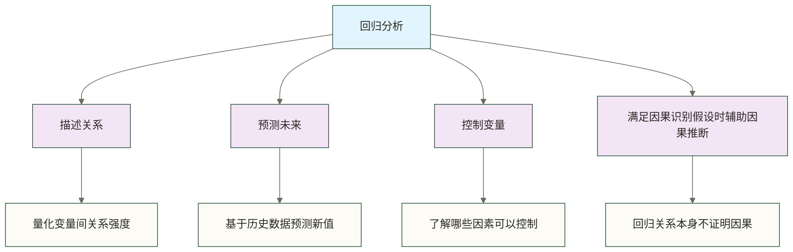

# 📉 回归分析（Regression Analysis）

> [!abstract] 📋 本节概览
> - 🎯 **学习目标**：掌握回归分析的理论基础、建模方法和实际应用
> - 📚 **前置知识**：[[【技术与工具】/统计学/相关分析|相关]] | [[【技术与工具】/统计学/正态分布|正态分布]] | [[【技术与工具】/统计学/假设检验|假设检验]] | 最小二乘法
> - ⏱️ **预计用时**：35分钟
> - 🔧 **核心技能**：建立预测模型、解释变量关系、模型诊断

## 🌟 核心概念理解

> [!note] 📖 **什么是回归分析？**
> 回归分析是一种统计分析方法，用于**建立变量间的数学关系**，研究一个或多个自变量（预测变量）对因变量（响应变量）的**影响程度和方向**，并能够进行**预测和推断**。

### 🎯 回归分析的核心目的



### 📊 生活化类比

想象你是一位房地产分析师，需要预测房价：

**场景设置：**
- **因变量（Y）**：房价（我们想预测的目标）
- **自变量（X）**：面积、位置、房龄、装修等（影响房价的因素）
- **目标**：建立一个数学模型来预测房价

这就像找到一个"配方"，告诉你各种"原料"如何共同"烹饪"出最终的"价格"！

## 🔍 回归分析类型

### 1. 简单线性回归

> [!info] 简单线性回归
> 只有一个自变量的线性回归：Y = β₀ + β₁X + ε

```python title="简单线性回归完整实现"
import numpy as np
import pandas as pd
import matplotlib.pyplot as plt
from scipy.stats import linregress, pearsonr
from sklearn.linear_model import LinearRegression
from sklearn.metrics import r2_score, mean_squared_error
import seaborn as sns

# 创建示例数据 - 学习时间与考试成绩
np.random.seed(42)
study_hours = np.random.uniform(1, 10, 100)
exam_scores = 60 + 3.5 * study_hours + np.random.normal(0, 5, 100)  # 添加噪声

# 数据准备
X = study_hours.reshape(-1, 1)
y = exam_scores

# 方法1：使用scipy.stats.linregress
slope, intercept, r_value, p_value, std_err = linregress(study_hours, exam_scores)

print("=== 简单线性回归结果 (scipy.stats) ===")
print(f"回归方程: y = {slope:.3f}x + {intercept:.3f}")
print(f"相关系数 r: {r_value:.3f}")
print(f"决定系数 R²: {r_value**2:.3f}")
print(f"p值: {p_value:.3e}")
print(f"标准误差: {std_err:.3f}")

# 方法2：使用sklearn (更适合复杂分析)
model = LinearRegression()
model.fit(X, y)
y_pred = model.predict(X)

print("\n=== 简单线性回归结果 (sklearn) ===")
print(f"截距 (β₀): {model.intercept_:.3f}")
print(f"斜率 (β₁): {model.coef_[0]:.3f}")
print(f"R² 得分: {r2_score(y, y_pred):.3f}")
print(f"均方误差 (MSE): {mean_squared_error(y, y_pred):.3f}")
print(f"均方根误差 (RMSE): {np.sqrt(mean_squared_error(y, y_pred)):.3f}")
```

### 2. 多元线性回归

> [!info] 多元线性回归
> 有多个自变量的线性回归：Y = β₀ + β₁X₁ + β₂X₂ + ... + βₚXₚ + ε

```python title="多元线性回归实现"
from sklearn.model_selection import train_test_split
from sklearn.preprocessing import StandardScaler

# 创建多元回归示例数据 - 房价预测
np.random.seed(123)
n_samples = 500

# 生成特征变量
area = np.random.normal(100, 30, n_samples)  # 面积
age = np.random.uniform(0, 50, n_samples)    # 房龄
distance = np.random.exponential(5, n_samples)  # 距离市中心距离
rooms = np.random.poisson(3, n_samples) + 1     # 房间数

# 生成目标变量（房价）
price = (2 * area + 
         -0.5 * age + 
         -0.3 * distance + 
         5 * rooms + 
         np.random.normal(0, 20, n_samples) + 100)

# 创建DataFrame
df = pd.DataFrame({
    'area': area,
    'age': age, 
    'distance': distance,
    'rooms': rooms,
    'price': price
})

print("=== 数据集基本信息 ===")
print(df.describe())
print(f"\n相关系数矩阵:")
print(df.corr().round(3))

# 特征和目标变量
X_multi = df[['area', 'age', 'distance', 'rooms']]
y_multi = df['price']

# 划分训练测试集
X_train, X_test, y_train, y_test = train_test_split(
    X_multi, y_multi, test_size=0.2, random_state=42
)

# 标准化特征（可选，便于系数比较）
scaler = StandardScaler()
X_train_scaled = scaler.fit_transform(X_train)
X_test_scaled = scaler.transform(X_test)

# 训练模型
model_multi = LinearRegression()
model_multi.fit(X_train, y_train)

# 预测
y_train_pred = model_multi.predict(X_train)
y_test_pred = model_multi.predict(X_test)

print("\n=== 多元线性回归结果 ===")
print(f"截距: {model_multi.intercept_:.3f}")
print("回归系数:")
for feature, coef in zip(X_multi.columns, model_multi.coef_):
    print(f"  {feature}: {coef:.3f}")

print(f"\n模型性能:")
print(f"训练集 R²: {r2_score(y_train, y_train_pred):.3f}")
print(f"测试集 R²: {r2_score(y_test, y_test_pred):.3f}")
print(f"训练集 RMSE: {np.sqrt(mean_squared_error(y_train, y_train_pred)):.3f}")
print(f"测试集 RMSE: {np.sqrt(mean_squared_error(y_test, y_test_pred)):.3f}")
```

### 3. 多项式回归

```python title="多项式回归实现"
from sklearn.preprocessing import PolynomialFeatures
from sklearn.pipeline import Pipeline

# 创建非线性数据
x_poly = np.linspace(0, 4, 100)
y_poly = 2 * x_poly**2 - 3 * x_poly + 1 + np.random.normal(0, 2, 100)

# 不同次数的多项式回归
degrees = [1, 2, 3, 5]
plt.figure(figsize=(15, 10))

for i, degree in enumerate(degrees):
    plt.subplot(2, 2, i+1)
    
    # 创建多项式特征
    poly_reg = Pipeline([
        ('poly', PolynomialFeatures(degree=degree)),
        ('linear', LinearRegression())
    ])
    
    # 拟合模型
    poly_reg.fit(x_poly.reshape(-1, 1), y_poly)
    
    # 预测
    X_plot = np.linspace(0, 4, 300).reshape(-1, 1)
    y_plot = poly_reg.predict(X_plot)
    
    # 绘图
    plt.scatter(x_poly, y_poly, alpha=0.6, color='blue')
    plt.plot(X_plot, y_plot, color='red', linewidth=2)
    plt.title(f'多项式回归 (度数={degree})')
    plt.xlabel('X')
    plt.ylabel('Y')
    
    # 计算R²
    y_pred = poly_reg.predict(x_poly.reshape(-1, 1))
    r2 = r2_score(y_poly, y_pred)
    plt.text(0.1, max(y_poly)*0.9, f'R² = {r2:.3f}', fontsize=12)

plt.tight_layout()
plt.show()
```

## 📊 回归诊断与验证

### 1. 残差分析

```python title="回归诊断 - 残差分析"
# 计算残差
residuals = y_test - y_test_pred
fitted_values = y_test_pred

# 创建诊断图
fig, axes = plt.subplots(2, 2, figsize=(15, 12))

# 1. 残差vs拟合值图
axes[0,0].scatter(fitted_values, residuals, alpha=0.6)
axes[0,0].axhline(y=0, color='red', linestyle='--')
axes[0,0].set_xlabel('拟合值')
axes[0,0].set_ylabel('残差')
axes[0,0].set_title('残差 vs 拟合值')
axes[0,0].grid(True, alpha=0.3)

# 2. 残差的正态Q-Q图
from scipy import stats
stats.probplot(residuals, dist="norm", plot=axes[0,1])
axes[0,1].set_title('残差的正态Q-Q图')
axes[0,1].grid(True, alpha=0.3)

# 3. 残差直方图
axes[1,0].hist(residuals, bins=20, density=True, alpha=0.7, color='lightblue')
x_norm = np.linspace(residuals.min(), residuals.max(), 100)
y_norm = stats.norm.pdf(x_norm, residuals.mean(), residuals.std())
axes[1,0].plot(x_norm, y_norm, 'r-', linewidth=2, label='正态分布')
axes[1,0].set_xlabel('残差')
axes[1,0].set_ylabel('密度')
axes[1,0].set_title('残差分布')
axes[1,0].legend()
axes[1,0].grid(True, alpha=0.3)

# 4. 残差序列图
axes[1,1].plot(range(len(residuals)), residuals, 'o-', alpha=0.6)
axes[1,1].axhline(y=0, color='red', linestyle='--')
axes[1,1].set_xlabel('观测序号')
axes[1,1].set_ylabel('残差')
axes[1,1].set_title('残差序列图')
axes[1,1].grid(True, alpha=0.3)

plt.tight_layout()
plt.show()

# 残差统计检验
print("=== 残差诊断 ===")

# 1. Shapiro-Wilk正态性检验
shapiro_stat, shapiro_p = stats.shapiro(residuals)
print(f"Shapiro-Wilk正态性检验: 统计量={shapiro_stat:.4f}, p值={shapiro_p:.4f}")
print(f"Shapiro-Wilk检验（显著性水平0.05）: {'未拒绝正态性假设，不代表证明正态性' if shapiro_p > 0.05 else '拒绝正态性假设'}")

# 2. Durbin-Watson自相关检验
def durbin_watson(residuals):
    """计算Durbin-Watson统计量"""
    diff_residuals = np.diff(residuals)
    return np.sum(diff_residuals**2) / np.sum(residuals**2)

dw_stat = durbin_watson(residuals)
print(f"Durbin-Watson统计量: {dw_stat:.4f}")
print("此处残差按随机测试集顺序排列，Durbin-Watson数值仅作计算展示，不能据此判断原观测序列的时间自相关。")
```

### 2. 多重共线性检验

```python title="多重共线性诊断"
from statsmodels.stats.outliers_influence import variance_inflation_factor

def calculate_vif(X):
    """计算方差膨胀因子(VIF)"""
    vif_data = pd.DataFrame()
    vif_data["特征"] = X.columns
    vif_data["VIF"] = [variance_inflation_factor(X.values, i) 
                       for i in range(X.shape[1])]
    return vif_data

# 计算VIF
vif_results = calculate_vif(X_train)
print("=== 多重共线性检验 (VIF) ===")
print(vif_results)
print("\nVIF解释:")
print("VIF < 5: 按常见经验阈值，通常未提示较强的系数方差膨胀")
print("5 ≤ VIF < 10: 可作为进一步检查共线性的经验提示")
print("VIF ≥ 10: 可作为较强系数方差膨胀的经验提示")
print("上述阈值不是普遍判定标准；本函数尚未加入截距，当前结果不匹配正文的含截距模型。")

# 相关系数热力图
plt.figure(figsize=(10, 8))
correlation_matrix = X_train.corr()
sns.heatmap(correlation_matrix, annot=True, cmap='coolwarm', center=0,
            square=True, linewidths=0.5)
plt.title('特征相关性热力图')
plt.show()
```

## 🎯 实际应用案例

### 案例1：销售预测模型

```python title="销售预测回归模型"
# 模拟销售数据
np.random.seed(456)
n_months = 100

# 特征变量
advertising_spend = np.random.uniform(1000, 10000, n_months)
season = np.random.choice([1, 2, 3, 4], n_months)  # 季节
competition = np.random.uniform(0.5, 2.0, n_months)  # 竞争强度
economic_index = np.random.normal(100, 10, n_months)  # 经济指数

# 目标变量（销售额）
sales = (0.8 * advertising_spend + 
         season * 2000 +
         -1500 * competition +
         50 * economic_index +
         np.random.normal(0, 1000, n_months))

# 创建数据集
sales_df = pd.DataFrame({
    'advertising_spend': advertising_spend,
    'season': season,
    'competition': competition, 
    'economic_index': economic_index,
    'sales': sales
})

# 划分数据集
X_sales = sales_df[['advertising_spend', 'season', 'competition', 'economic_index']]
y_sales = sales_df['sales']

X_train_s, X_test_s, y_train_s, y_test_s = train_test_split(
    X_sales, y_sales, test_size=0.2, random_state=42
)

# 训练模型
sales_model = LinearRegression()
sales_model.fit(X_train_s, y_train_s)

# 预测和评估
y_pred_s = sales_model.predict(X_test_s)

print("=== 销售预测模型结果 ===")
print(f"模型R²: {r2_score(y_test_s, y_pred_s):.3f}")
print(f"RMSE: {np.sqrt(mean_squared_error(y_test_s, y_pred_s)):.2f}")

print("\n回归系数（受特征量纲影响，不可直接跨变量比较重要性）:")
for feature, coef in zip(X_sales.columns, sales_model.coef_):
    print(f"{feature}: {coef:.3f}")

# 预测示例
new_data = pd.DataFrame({
    'advertising_spend': [5000],
    'season': [4],  # 第四季度
    'competition': [1.2],
    'economic_index': [105]
})

predicted_sales = sales_model.predict(new_data)
print(f"\n新数据预测销售额: {predicted_sales[0]:.2f}")

# 绘制预测 vs 实际
plt.figure(figsize=(10, 6))
plt.scatter(y_test_s, y_pred_s, alpha=0.6)
plt.plot([y_test_s.min(), y_test_s.max()], [y_test_s.min(), y_test_s.max()], 'r--', lw=2)
plt.xlabel('实际销售额')
plt.ylabel('预测销售额')
plt.title('销售预测模型：预测 vs 实际')
plt.grid(True, alpha=0.3)
plt.show()
```

### 案例2：学术成绩影响因素分析

```python title="学术成绩回归分析"
# 模拟学生数据
np.random.seed(789)
n_students = 300

# 学生特征
study_time = np.random.gamma(2, 2, n_students)  # 学习时间
sleep_hours = np.random.normal(7.5, 1.2, n_students)  # 睡眠时间
family_income = np.random.lognormal(10.5, 0.5, n_students)  # 家庭收入
extracurricular = np.random.poisson(2, n_students)  # 课外活动数量

# 成绩（添加现实的非线性关系）
grades = (5 * study_time + 
          2 * sleep_hours +
          0.00001 * family_income +
          -0.5 * extracurricular +
          0.5 * study_time * sleep_hours +  # 交互效应
          np.random.normal(0, 3, n_students) + 
          60)

# 限制成绩范围
grades = np.clip(grades, 0, 100)

# 创建数据集
student_df = pd.DataFrame({
    'study_time': study_time,
    'sleep_hours': sleep_hours,
    'family_income': family_income,
    'extracurricular': extracurricular,
    'grades': grades
})

print("=== 学生成绩数据描述统计 ===")
print(student_df.describe())

# 添加交互项
student_df['study_sleep_interaction'] = student_df['study_time'] * student_df['sleep_hours']

# 建立模型
X_student = student_df[['study_time', 'sleep_hours', 'family_income', 
                       'extracurricular', 'study_sleep_interaction']]
y_student = student_df['grades']

X_train_st, X_test_st, y_train_st, y_test_st = train_test_split(
    X_student, y_student, test_size=0.25, random_state=42
)

student_model = LinearRegression()
student_model.fit(X_train_st, y_train_st)
y_pred_st = student_model.predict(X_test_st)

print("\n=== 学生成绩模型结果 ===")
print(f"模型R²: {r2_score(y_test_st, y_pred_st):.3f}")
print(f"RMSE: {np.sqrt(mean_squared_error(y_test_st, y_pred_st)):.2f}")

print("\n影响因素分析:")
feature_importance = pd.DataFrame({
    '特征': X_student.columns,
    '系数': student_model.coef_,
    '系数绝对值（非重要性）': np.abs(student_model.coef_)
}).sort_values('系数绝对值（非重要性）', ascending=False)

print(feature_importance)
```

## ⚠️ 回归分析注意事项

> [!warning] OLS估计、统计推断与预测的条件需区分
> 1. **模型形式**：线性回归指模型对参数线性，可包含多项式与交互项；若用于解释条件均值，应检查模型形式是否合理。
> 2. **OLS估计**：计算最小二乘拟合不要求误差正态或同方差；含截距设计矩阵满列秩时，系数解唯一。将系数解释为总体关系还需要相应外生性等假设，因果解释另需研究设计与识别条件。
> 3. **独立性与同方差性**：经典标准误和检验依赖相应误差结构假设；存在异方差、聚类或序列相关时，应采用适合数据结构的推断方法。
> 4. **正态性**：正态误差假设支持特定经典有限样本推断，并非所有回归预测的必要条件；残差检验不显著不等于证明误差正态。
> 5. **共线性**：完全共线性影响系数唯一识别，强相关可能使系数估计不稳定；VIF阈值只是经验提示，不是普遍判定标准。
> 6. **预测评估**：应采用与实际使用场景一致的数据划分和样本外评估；有时间顺序的数据不能仅凭随机测试残差的排列判断自相关。

### 常见问题及解决方案

```python title="回归问题诊断与解决"
def regression_diagnostics(X, y, model):
    """回归模型全面诊断"""
    y_pred = model.predict(X)
    residuals = y - y_pred
    
    diagnostics = {}
    
    # 1. 线性关系检验
    # 通过残差vs拟合值图检验
    
    # 2. 正态性检验
    shapiro_stat, shapiro_p = stats.shapiro(residuals)
    diagnostics['normality'] = {
        'test': 'Shapiro-Wilk',
        'statistic': shapiro_stat,
        'p_value': shapiro_p,
        'normality_not_rejected_at_0_05': shapiro_p > 0.05
    }
    
    # 3. 探索残差平方与拟合值的相关性（不是Breusch-Pagan检验，不能据此确认同方差性）
    # 计算残差平方与拟合值的相关性
    residuals_squared = residuals ** 2
    bp_correlation, bp_p = pearsonr(y_pred, residuals_squared)
    diagnostics['homoscedasticity'] = {
        'correlation': bp_correlation,
        'p_value': bp_p,
        'zero_pearson_correlation_not_rejected_at_0_05': bp_p > 0.05
    }
    
    # 4. 异常值检测
    # Cook's distance (简化版)
    leverage = np.diag(X @ np.linalg.pinv(X.T @ X) @ X.T)
    mse = np.mean(residuals ** 2)
    cooks_d = (residuals ** 2 / (X.shape[1] * mse)) * (leverage / (1 - leverage) ** 2)
    outliers = np.where(cooks_d > 4 / len(X))[0]
    
    diagnostics['outliers'] = {
        'count': len(outliers),
        'indices': outliers,
        'cooks_distance': cooks_d
    }
    
    return diagnostics

# 运行诊断
diagnostics_result = regression_diagnostics(X_test, y_test, model_multi)

print("=== 回归模型诊断结果 ===")
print(f"Shapiro-Wilk检验（显著性水平0.05）: {'未拒绝正态性假设，不代表证明正态性' if diagnostics_result['normality']['p_value'] > 0.05 else '拒绝正态性假设'} "
      f"(p={diagnostics_result['normality']['p_value']:.4f})")
print(f"残差平方与预测值的Pearson相关探索: "
      f"r={diagnostics_result['homoscedasticity']['correlation']:.4f}, "
      f"p={diagnostics_result['homoscedasticity']['p_value']:.4f}；"
      "该检查不是Breusch-Pagan检验，不显著不能确认同方差性。")
print(f"异常值数量: {diagnostics_result['outliers']['count']}")
```

## 🔗 扩展学习

### 相关知识链接
- [[【技术与工具】/统计学/线性回归|线性回归]] - 经典回归方法详解
- [[【技术与工具】/统计学/相关分析|相关]] - 变量关系的初步探索
- [[【技术与工具】/统计学/假设检验|假设检验]] - 模型显著性检验
- [[【技术与工具】/统计学/方差分析（ANOVA）|方差分析（ANOVA）]] - 模型整体显著性
- [[【技术与工具】/Python/21-分类算法|分类算法]] - 从回归到分类

### 进阶回归方法
- 岭回归（Ridge Regression）
- Lasso回归
- 弹性网络回归（Elastic Net）
- 逻辑回归（Logistic Regression）
- 泊松回归（Poisson Regression）

> [!tip] 💡 学习建议
> 1. **理论基础**：掌握最小二乘法原理
> 2. **假设检验**：学会验证模型假设条件
> 3. **实践应用**：多做不同领域的回归案例
> 4. **模型选择**：了解何时使用何种回归方法

#统计学 #回归分析 #预测建模 #数据分析
