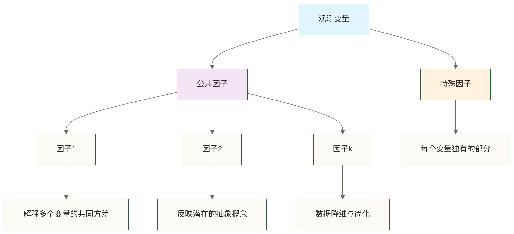

# 🧱 因子分析（Factor Analysis）

> [!abstract] 📋 本节概览
> - 🎯 **学习目标**：掌握因子分析的原理、方法及其在数据科学中的应用
> - 📚 **前置知识**：[[【技术与工具】/统计学/主成分分析（PCA）|主成分分析（PCA）]] | [[【技术与工具】/统计学/相关分析|相关]] | [[【技术与工具】/统计学/方差|方差]] | 特征值分解
> - ⏱️ **预计用时**：30分钟
> - 🔧 **核心技能**：潜在变量识别、降维分析、模型解释

## 🌟 核心概念理解

> [!note] 📖 **什么是因子分析？**
> 因子分析是一种**多元统计技术**，旨在发现大量观测变量背后的**少数几个潜在因子**（不可直接观测的变量），用这些潜在因子来**解释观测变量间的相关性**。它假设观测变量是由少数**公共因子**和各自的**特殊因子**共同决定的。

### 🎯 因子分析的核心思想



### 📊 与主成分分析的区别

| 比较维度 | 因子分析 | 主成分分析 |
|---------|---------|-----------|
| **目的** | 发现潜在结构和因子 | 数据降维和信息保留 |
| **模型假设** | 存在潜在因子模型 | 线性组合最大化方差 |
| **解释性** | 强调因子的实际意义 | 主要关注数据压缩 |
| **方差分解** | 公共方差 vs 特殊方差 | 总方差的重新分配 |
| **旋转** | 通常需要因子旋转 | 一般不进行旋转 |

### 🔬 生活化类比

想象你是一位心理学家，想要理解影响学生学习成绩的潜在因素：

**观察到的变量：**
- 数学成绩、语文成绩、英语成绩、物理成绩、化学成绩

**潜在的因子：**
- **认知能力因子**：影响所有科目的基础智力
- **语言能力因子**：主要影响语文和英语
- **逻辑思维因子**：主要影响数学和物理

因子分析帮你从5个具体成绩中提取出2-3个抽象但更根本的"能力因子"！

## 🔍 因子分析模型

### 数学模型

对于p个观测变量X₁, X₂, ..., Xₚ，因子分析模型可以表示为：

```text
Xᵢ = λᵢ₁F₁ + λᵢ₂F₂ + ... + λᵢₖFₖ + εᵢ
```

其中：
- **Xᵢ**：第i个观测变量（标准化）
- **Fⱼ**：第j个公共因子
- **λᵢⱼ**：因子载荷，表示第i个变量在第j个因子上的负载
- **εᵢ**：第i个变量的特殊因子
- **k**：公共因子的个数（k < p）

## 🛠️ Python实现详解

### 1. 基础因子分析

```python title="因子分析基础实现"
import numpy as np
import pandas as pd
import matplotlib.pyplot as plt
import seaborn as sns
from sklearn.decomposition import FactorAnalysis
from sklearn.preprocessing import StandardScaler
from scipy.stats import bartlett
from factor_analyzer import FactorAnalyzer
from factor_analyzer.factor_analyzer import calculate_bartlett_sphericity, calculate_kmo

# 创建示例数据 - 学生能力评估
np.random.seed(42)
n_students = 300

# 潜在因子（不可观测）
cognitive_ability = np.random.normal(0, 1, n_students)    # 认知能力
language_ability = np.random.normal(0, 1, n_students)     # 语言能力  
logical_thinking = np.random.normal(0, 1, n_students)     # 逻辑思维

# 观测变量（可观测的成绩）
math_score = 0.8 * cognitive_ability + 0.6 * logical_thinking + np.random.normal(0, 0.5, n_students)
physics_score = 0.7 * cognitive_ability + 0.8 * logical_thinking + np.random.normal(0, 0.5, n_students)
chinese_score = 0.6 * cognitive_ability + 0.9 * language_ability + np.random.normal(0, 0.5, n_students)
english_score = 0.5 * cognitive_ability + 0.8 * language_ability + np.random.normal(0, 0.5, n_students)
chemistry_score = 0.7 * cognitive_ability + 0.4 * logical_thinking + np.random.normal(0, 0.5, n_students)

# 创建数据集
data = pd.DataFrame({
    'math': math_score,
    'physics': physics_score, 
    'chinese': chinese_score,
    'english': english_score,
    'chemistry': chemistry_score
})

# 标准化数据
scaler = StandardScaler()
data_scaled = pd.DataFrame(scaler.fit_transform(data), columns=data.columns)

print("=== 原始数据相关系数矩阵 ===")
print(data_scaled.corr().round(3))

# 绘制相关系数热力图
plt.figure(figsize=(10, 8))
sns.heatmap(data_scaled.corr(), annot=True, cmap='coolwarm', center=0,
            square=True, linewidths=0.5, cbar_kws={"shrink": 0.8})
plt.title('科目成绩相关系数矩阵')
plt.show()
```

### 2. 因子分析适用性检验

```python title="KMO和Bartlett检验"
# KMO检验 - 测量抽样充分性
kmo_all, kmo_model = calculate_kmo(data_scaled)

# Bartlett球形检验 - 检验变量间是否存在相关性
chi_square_value, p_value = calculate_bartlett_sphericity(data_scaled)

print("=== 因子分析适用性检验 ===")
print(f"KMO测试值: {kmo_model:.3f}")
print("KMO解释:")
print("  > 0.9: 非常适合")
print("  0.8-0.9: 适合") 
print("  0.7-0.8: 一般")
print("  0.6-0.7: 不太适合")
print("  < 0.6: 不适合")

print(f"\nBartlett球形检验:")
print(f"  卡方统计量: {chi_square_value:.3f}")
print(f"  p值: {p_value:.3e}")
print(f"  结果: {'拒绝相关矩阵为单位阵的原假设；仍需结合KMO与模型检查判断适用性' if p_value < 0.05 else '未拒绝相关矩阵为单位阵的原假设；当前相关性证据不足'}")
```

### 3. 确定因子数量

```python title="因子数量确定方法"
# 方法1：特征值准则（Kaiser准则）
correlation_matrix = data_scaled.corr()
eigenvalues, eigenvectors = np.linalg.eig(correlation_matrix)
eigenvalues = np.real(eigenvalues)  # 取实数部分
eigenvalues_sorted = np.sort(eigenvalues)[::-1]  # 降序排列

print("=== 因子数量确定 ===")
print("特征值:")
for i, val in enumerate(eigenvalues_sorted):
    print(f"  因子 {i+1}: {val:.3f} {'(保留)' if val > 1 else ''}")

# 方法2：碎石图
plt.figure(figsize=(12, 5))

plt.subplot(1, 2, 1)
plt.plot(range(1, len(eigenvalues_sorted)+1), eigenvalues_sorted, 'bo-')
plt.axhline(y=1, color='red', linestyle='--', label='特征值=1')
plt.xlabel('因子序号')
plt.ylabel('特征值')
plt.title('碎石图')
plt.legend()
plt.grid(True, alpha=0.3)

# 方法3：相关矩阵特征值的累积比例（对应PCA总方差口径，不等同于提取后公共因子的方差贡献率；仅作辅助参考）
cumulative_variance = np.cumsum(eigenvalues_sorted) / np.sum(eigenvalues_sorted)
plt.subplot(1, 2, 2)
plt.plot(range(1, len(cumulative_variance)+1), cumulative_variance, 'ro-')
plt.axhline(y=0.8, color='green', linestyle='--', label='80%方差')
plt.xlabel('因子序号')
plt.ylabel('累积方差贡献率')
plt.title('累积方差贡献率')
plt.legend()
plt.grid(True, alpha=0.3)

plt.tight_layout()
plt.show()

# 根据特征值>1的准则确定因子数
n_factors = np.sum(eigenvalues_sorted > 1)
print(f"\n建议因子数量: {n_factors}")
```

### 4. 因子提取与旋转

```python title="因子提取和旋转"
# 因子提取
fa = FactorAnalyzer(n_factors=n_factors, rotation='varimax', method='minres')
fa.fit(data_scaled)

# 获取因子载荷矩阵
loadings = fa.loadings_
loadings_df = pd.DataFrame(loadings, 
                          index=data_scaled.columns,
                          columns=[f'因子{i+1}' for i in range(n_factors)])

print("=== 旋转后的因子载荷矩阵 ===")
print(loadings_df.round(3))

# 计算共同度（communalities）
communalities = fa.get_communalities()
communalities_df = pd.DataFrame({'变量': data_scaled.columns, '共同度': communalities})
print(f"\n=== 共同度 ===")
print(communalities_df.round(3))

# 方差解释
variance_explained = fa.get_factor_variance()
print(f"\n=== 方差解释 ===")
print(f"各因子载荷平方和: {variance_explained[0]}")
print(f"方差比例: {variance_explained[1]}")
print(f"累积方差比例: {variance_explained[2]}")

# 可视化因子载荷
plt.figure(figsize=(12, 8))
sns.heatmap(loadings_df.T, annot=True, cmap='RdBu_r', center=0,
            square=True, linewidths=0.5, cbar_kws={"shrink": 0.8})
plt.title('因子载荷矩阵热力图')
plt.show()
```

### 5. 因子解释与命名

```python title="因子解释与得分计算"
# 因子解释
def interpret_factors(loadings_df, threshold=0.5):
    """解释因子含义"""
    interpretations = {}
    
    for factor in loadings_df.columns:
        high_loadings = loadings_df[loadings_df[factor].abs() > threshold][factor]
        high_loadings_sorted = high_loadings.reindex(high_loadings.abs().sort_values(ascending=False).index)
        
        interpretations[factor] = {
            'variables': high_loadings_sorted,
            'interpretation': []
        }
        
        # 基于高载荷变量给出解释
        high_vars = high_loadings_sorted.index.tolist()
        if 'math' in high_vars and 'physics' in high_vars:
            interpretations[factor]['interpretation'].append('数理逻辑能力')
        if 'chinese' in high_vars and 'english' in high_vars:
            interpretations[factor]['interpretation'].append('语言文字能力')
        if len(high_vars) >= 3:
            interpretations[factor]['interpretation'].append('综合认知能力')
    
    return interpretations

factor_interpretations = interpret_factors(loadings_df, 0.5)

print("=== 因子解释与命名 ===")
for factor, info in factor_interpretations.items():
    print(f"\n{factor}:")
    print(f"  主要载荷变量: {list(info['variables'].index)}")
    print(f"  载荷值: {info['variables'].values.round(3)}")
    print(f"  可能含义: {', '.join(info['interpretation'])}")

# 计算因子得分
factor_scores = fa.transform(data_scaled)
factor_scores_df = pd.DataFrame(factor_scores, 
                               columns=[f'因子{i+1}得分' for i in range(n_factors)])

print(f"\n=== 因子得分统计 ===")
print(factor_scores_df.describe().round(3))

# 因子得分散点图
if n_factors >= 2:
    plt.figure(figsize=(10, 8))
    plt.scatter(factor_scores[:, 0], factor_scores[:, 1], alpha=0.6)
    plt.xlabel('因子1得分')
    plt.ylabel('因子2得分')
    plt.title('学生在两个主因子上的得分分布')
    plt.grid(True, alpha=0.3)
    plt.axhline(y=0, color='red', linestyle='--', alpha=0.5)
    plt.axvline(x=0, color='red', linestyle='--', alpha=0.5)
    plt.show()
```

## 🎯 实际应用案例

### 案例1：消费者行为分析

```python title="消费者行为因子分析"
# 模拟消费者调研数据
np.random.seed(456)
n_consumers = 500

# 潜在因子
price_sensitivity = np.random.normal(0, 1, n_consumers)     # 价格敏感度
brand_loyalty = np.random.normal(0, 1, n_consumers)        # 品牌忠诚度
quality_pursuit = np.random.normal(0, 1, n_consumers)      # 质量追求

# 观测变量（模拟连续评分，后续裁剪至1-5；并非离散的李克特5级响应）
consumer_data = pd.DataFrame({
    'price_important': 3 + 0.8 * price_sensitivity + np.random.normal(0, 0.5, n_consumers),
    'compare_prices': 3 + 0.7 * price_sensitivity + np.random.normal(0, 0.5, n_consumers),
    'discount_influence': 3 + 0.6 * price_sensitivity + np.random.normal(0, 0.5, n_consumers),
    'brand_preference': 3 + 0.8 * brand_loyalty + np.random.normal(0, 0.5, n_consumers),
    'brand_switching': 3 - 0.7 * brand_loyalty + np.random.normal(0, 0.5, n_consumers),
    'quality_first': 3 + 0.8 * quality_pursuit + np.random.normal(0, 0.5, n_consumers),
    'durability_important': 3 + 0.7 * quality_pursuit + np.random.normal(0, 0.5, n_consumers),
    'material_concern': 3 + 0.6 * quality_pursuit + np.random.normal(0, 0.5, n_consumers)
})

# 限制在1-5分范围内
consumer_data = consumer_data.clip(1, 5)

# 标准化
consumer_scaled = pd.DataFrame(
    StandardScaler().fit_transform(consumer_data), 
    columns=consumer_data.columns
)

# 因子分析
consumer_fa = FactorAnalyzer(n_factors=3, rotation='varimax')
consumer_fa.fit(consumer_scaled)

consumer_loadings = pd.DataFrame(
    consumer_fa.loadings_,
    index=consumer_scaled.columns,
    columns=['因子1', '因子2', '因子3']
)

print("=== 消费者行为因子分析结果 ===")
print(consumer_loadings.round(3))

# 因子命名
factor_names = {
    '因子1': '价格敏感型',
    '因子2': '品牌忠诚型', 
    '因子3': '质量追求型'
}

# 重命名因子
consumer_loadings.columns = [factor_names[col] for col in consumer_loadings.columns]
print(f"\n=== 消费者类型因子载荷 ===")
print(consumer_loadings.round(3))

# 计算消费者得分
consumer_scores = consumer_fa.transform(consumer_scaled)
consumer_scores_df = pd.DataFrame(
    consumer_scores, 
    columns=list(factor_names.values())
)

# 消费者分类
def classify_consumer(scores):
    """基于因子得分对消费者分类"""
    max_factor = scores.abs().idxmax()
    return max_factor

consumer_types = consumer_scores_df.apply(classify_consumer, axis=1)
print(f"\n=== 消费者类型分布 ===")
print(consumer_types.value_counts())

# 可视化消费者分布
fig = plt.figure(figsize=(15, 5))

for i, (factor1, factor2) in enumerate([('价格敏感型', '品牌忠诚型'), 
                                       ('价格敏感型', '质量追求型'), 
                                       ('品牌忠诚型', '质量追求型')]):
    ax = fig.add_subplot(1, 3, i+1)
    scatter = ax.scatter(consumer_scores_df[factor1], 
                        consumer_scores_df[factor2], 
                        c=consumer_types.astype('category').cat.codes,
                        alpha=0.6, cmap='viridis')
    ax.set_xlabel(factor1)
    ax.set_ylabel(factor2)
    ax.set_title(f'{factor1} vs {factor2}')
    ax.grid(True, alpha=0.3)
    ax.axhline(y=0, color='red', linestyle='--', alpha=0.5)
    ax.axvline(x=0, color='red', linestyle='--', alpha=0.5)

plt.tight_layout()
plt.show()
```

### 案例2：员工满意度分析

```python title="员工满意度因子分析"
# 模拟员工满意度调研
np.random.seed(789)
n_employees = 400

# 潜在满意度因子
work_satisfaction = np.random.normal(0, 1, n_employees)      # 工作内容满意度
management_satisfaction = np.random.normal(0, 1, n_employees)  # 管理满意度
welfare_satisfaction = np.random.normal(0, 1, n_employees)    # 福利满意度

# 观测变量（满意度打分1-10分）
employee_data = pd.DataFrame({
    'job_content': 5 + 1.2 * work_satisfaction + np.random.normal(0, 0.8, n_employees),
    'work_challenge': 5 + 1.0 * work_satisfaction + np.random.normal(0, 0.8, n_employees),
    'skill_development': 5 + 0.9 * work_satisfaction + np.random.normal(0, 0.8, n_employees),
    'supervisor_support': 5 + 1.1 * management_satisfaction + np.random.normal(0, 0.8, n_employees),
    'team_cooperation': 5 + 1.0 * management_satisfaction + np.random.normal(0, 0.8, n_employees),
    'communication': 5 + 0.8 * management_satisfaction + np.random.normal(0, 0.8, n_employees),
    'salary_level': 5 + 1.2 * welfare_satisfaction + np.random.normal(0, 0.8, n_employees),
    'benefits_package': 5 + 1.1 * welfare_satisfaction + np.random.normal(0, 0.8, n_employees),
    'work_life_balance': 5 + 0.9 * welfare_satisfaction + np.random.normal(0, 0.8, n_employees)
})

# 限制在1-10分范围
employee_data = employee_data.clip(1, 10)

print("=== 员工满意度数据基本统计 ===")
print(employee_data.describe().round(2))

# 标准化并进行因子分析
employee_scaled = StandardScaler().fit_transform(employee_data)
employee_fa = FactorAnalyzer(n_factors=3, rotation='varimax')
employee_fa.fit(employee_scaled)

# 因子载荷
employee_loadings = pd.DataFrame(
    employee_fa.loadings_,
    index=employee_data.columns,
    columns=['工作内容因子', '管理因子', '福利因子']
)

print("\n=== 员工满意度因子载荷矩阵 ===")
print(employee_loadings.round(3))

# 计算各因子所选项目的标准化Cronbach's α（内部一致性指标，不等同于因子得分可靠性；反向项目需先统一计分方向）
def calculate_factor_reliability(data, loadings, factor_col, threshold=0.5):
    """计算因子的内部一致性"""
    high_loading_vars = loadings[loadings[factor_col].abs() > threshold].index
    if len(high_loading_vars) < 2:
        return np.nan
    
    factor_data = data[high_loading_vars]
    correlation_matrix = factor_data.corr()
    
    # 简化的内部一致性计算
    n_items = len(high_loading_vars)
    avg_correlation = correlation_matrix.values[np.triu_indices_from(correlation_matrix.values, k=1)].mean()
    
    # 基于项目平均相关的标准化Cronbach's α公式
    reliability = (n_items * avg_correlation) / (1 + (n_items - 1) * avg_correlation)
    return reliability

print(f"\n=== 因子可靠性分析 ===")
for factor in employee_loadings.columns:
    reliability = calculate_factor_reliability(employee_data, employee_loadings, factor)
    print(f"{factor}: {reliability:.3f} {'(良好)' if reliability > 0.7 else '(一般)' if reliability > 0.6 else '(较差)'}")

# 员工满意度整体分析
employee_scores = employee_fa.transform(employee_scaled)
overall_satisfaction = np.mean(employee_scores, axis=1)

plt.figure(figsize=(15, 5))

# 各因子得分分布
plt.subplot(1, 3, 1)
for i, factor in enumerate(employee_loadings.columns):
    plt.hist(employee_scores[:, i], alpha=0.7, bins=20, label=factor)
plt.xlabel('因子得分')
plt.ylabel('频数')
plt.title('各满意度因子分布')
plt.legend()

# 整体满意度分布
plt.subplot(1, 3, 2)
plt.hist(overall_satisfaction, bins=25, color='green', alpha=0.7)
plt.xlabel('整体满意度得分')
plt.ylabel('频数')
plt.title('员工整体满意度分布')

# 因子间相关性
plt.subplot(1, 3, 3)
factor_corr = pd.DataFrame(employee_scores, columns=employee_loadings.columns).corr()
sns.heatmap(factor_corr, annot=True, cmap='coolwarm', center=0, square=True)
plt.title('满意度因子间相关性')

plt.tight_layout()
plt.show()

# 满意度分级
satisfaction_levels = pd.cut(overall_satisfaction, 
                           bins=[-np.inf, -0.5, 0.5, np.inf],
                           labels=['不满意', '一般', '满意'])

print(f"\n=== 员工满意度水平分布 ===")
print(satisfaction_levels.value_counts())
print(f"满意度比例: {satisfaction_levels.value_counts()['满意'] / len(satisfaction_levels) * 100:.1f}%")
```

## 🔄 因子分析与其他方法的比较

### 因子分析 vs 主成分分析

```python title="FA与PCA的直观比较"
from sklearn.decomposition import PCA

# 使用相同的数据比较FA和PCA
pca = PCA(n_components=n_factors)
pca_scores = pca.fit_transform(data_scaled)

fa_scores = fa.transform(data_scaled)

# 比较结果
comparison_df = pd.DataFrame({
    'PCA方差解释率': pca.explained_variance_ratio_,
    'FA方差解释率': fa.get_factor_variance()[1]
})

print("=== FA vs PCA 比较 ===")
print(comparison_df.round(3))

# 可视化比较
fig, axes = plt.subplots(1, 2, figsize=(15, 6))

# PCA结果
axes[0].scatter(pca_scores[:, 0], pca_scores[:, 1], alpha=0.6, color='blue')
axes[0].set_xlabel(f'PC1 (解释方差: {pca.explained_variance_ratio_[0]:.3f})')
axes[0].set_ylabel(f'PC2 (解释方差: {pca.explained_variance_ratio_[1]:.3f})')
axes[0].set_title('主成分分析结果')
axes[0].grid(True, alpha=0.3)

# FA结果
axes[1].scatter(fa_scores[:, 0], fa_scores[:, 1], alpha=0.6, color='red')
axes[1].set_xlabel(f'Factor1 (解释方差: {fa.get_factor_variance()[1][0]:.3f})')
axes[1].set_ylabel(f'Factor2 (解释方差: {fa.get_factor_variance()[1][1]:.3f})')
axes[1].set_title('因子分析结果')
axes[1].grid(True, alpha=0.3)

plt.tight_layout()
plt.show()
```

## ⚠️ 因子分析注意事项

> [!warning] 因子分析的前提假设与限制
> 1. **样本量要求**：通常需要变量数的5-10倍样本量
> 2. **线性关系**：假设变量间存在线性关系
> 3. **分布与估计方法**：多元正态性通常是最大似然因子分析及相关推断的重要假设，并非所有提取方法的统一前提；本文使用minres，仍需检查异常值、变量类型与相关结构。
> 4. **变量间相关**：变量间应存在足够的相关性
> 5. **因子解释**：需要专业知识来解释因子含义

### 模型质量评估

```python title="因子分析质量评估"
def evaluate_factor_analysis(fa_model, data, loadings_df):
    """综合评估因子分析质量"""
    evaluation = {}
    
    # 1. 提取因子的累计方差解释比例（不是总体模型拟合度）
    evaluation['total_variance_explained'] = fa_model.get_factor_variance()[2][-1]
    
    # 2. 各变量的共同度
    communalities = fa_model.get_communalities()
    evaluation['avg_communality'] = np.mean(communalities)
    evaluation['low_communality_vars'] = [
        var for var, comm in zip(data.columns, communalities) if comm < 0.5
    ]
    
    # 3. 因子载荷质量
    high_loadings = (loadings_df.abs() > 0.5).sum()
    evaluation['variables_with_high_loadings'] = high_loadings.to_dict()
    
    # 4. 因子间相关性
    factor_scores = fa_model.transform(StandardScaler().fit_transform(data))
    factor_correlations = pd.DataFrame(factor_scores).corr()
    upper_correlations = factor_correlations.abs().values[
        np.triu_indices_from(factor_correlations, k=1)
    ]
    evaluation['max_factor_correlation'] = (
        upper_correlations.max() if upper_correlations.size else np.nan
    )
    
    return evaluation

# 评估我们的模型
model_evaluation = evaluate_factor_analysis(fa, data_scaled, loadings_df)

print("=== 因子分析模型质量评估 ===")
print(f"总方差解释率: {model_evaluation['total_variance_explained']:.3f}")
print(f"平均共同度: {model_evaluation['avg_communality']:.3f}")
print(f"低共同度变量: {model_evaluation['low_communality_vars']}")
print(f"高载荷变量数量: {model_evaluation['variables_with_high_loadings']}")
print(f"因子间最大相关系数: {model_evaluation['max_factor_correlation']:.3f}")

# 质量评估建议
def provide_recommendations(evaluation):
    """基于评估结果提供建议"""
    recommendations = []
    
    if evaluation['total_variance_explained'] < 0.6:
        recommendations.append("总方差解释率较低，考虑增加因子数量或检查数据质量")
    
    if evaluation['avg_communality'] < 0.5:
        recommendations.append("平均共同度较低，某些变量可能不适合当前因子结构")
    
    if evaluation['low_communality_vars']:
        recommendations.append(f"变量 {evaluation['low_communality_vars']} 的共同度较低，考虑移除")
    
    if evaluation['max_factor_correlation'] > 0.3:
        recommendations.append("因子间相关性较高，可能需要斜交旋转")
    
    return recommendations

recommendations = provide_recommendations(model_evaluation)
print(f"\n=== 改进建议 ===")
for i, rec in enumerate(recommendations, 1):
    print(f"{i}. {rec}")
```

## 🔗 扩展学习

### 相关知识链接
- [[【技术与工具】/统计学/主成分分析（PCA）|主成分分析（PCA）]] - 对比学习降维方法
- [[【技术与工具】/统计学/相关分析|相关]] - 理解变量间关系
- [[【技术与工具】/统计学/聚类分析|聚类]] - 另一种模式发现方法
- [[【技术与工具】/Python/18-机器学习基础|机器学习]] - 无监督学习方法
- [[【技术与工具】/统计学/方差分析（ANOVA）|方差分析（ANOVA）]] - 方差分解的思想

### 进阶因子分析方法
- 验证性因子分析（CFA）
- 结构方程模型（SEM）
- 探索性结构方程模型（ESEM）
- 贝叶斯因子分析
- 非线性因子分析

> [!tip] 💡 学习建议
> 1. **理论理解**：深入理解潜在变量和观测变量的关系
> 2. **实践应用**：从心理学和社会科学的经典案例开始
> 3. **结果解释**：重点培养因子命名和解释的能力
> 4. **模型评估**：学会评估因子分析的质量和适用性
> 5. **领域知识**：结合具体领域的专业知识进行因子解释

#统计学 #因子分析 #多元分析 #降维分析
