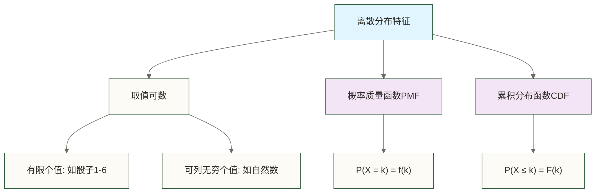

# 🎲 常见离散分布（Discrete Distributions）

> [!abstract] 📋 本节概览
> - 🎯 **学习目标**：掌握主要离散型概率分布的特征、应用和Python实现
> - 📚 **前置知识**：[[【技术与工具】/统计学/概率的基本概念|概率的基本概念]] | 随机变量 | 期望值 | [[【技术与工具】/统计学/方差|方差]]
> - ⏱️ **预计用时**：25分钟
> - 🎯 **核心分布**：二项分布、泊松分布、几何分布、超几何分布

## 🌟 离散分布基础概念

> [!note] 📖 **什么是离散分布？**
> 离散分布描述的是**离散型随机变量**的概率分布，其取值只能是**可数的有限个或可列无限个数值**。每个可能取值都有对应的概率，且所有概率之和等于1。

### 📊 离散分布的特征



### 🎯 生活化类比

想象不同的"计数"场景：
- **掷骰子**：结果只能是1, 2, 3, 4, 5, 6（有限离散）
- **等公交车**：等待的车辆数量 0, 1, 2, 3...（无限离散）
- **抽奖活动**：中奖人数只能是整数（离散性质）

## 🔍 主要离散分布详解

### 1. 二项分布（Binomial Distribution）

> [!info] 二项分布定义
> 在n次独立重复试验中，每次试验成功概率为p，成功次数X服从二项分布B(n, p)

**数学表达式：**
```text
P(X = k) = C(n,k) × p^k × (1-p)^(n-k)
期望值：E(X) = np
方差：Var(X) = np(1-p)
```

```python title="二项分布完整分析"
import numpy as np
import matplotlib.pyplot as plt
from scipy.stats import binom, poisson, geom, hypergeom
import seaborn as sns

# 二项分布示例
def analyze_binomial_distribution():
    """二项分布深入分析"""
    # 参数设置
    n_trials = [10, 20, 50]  # 试验次数
    p_success = [0.1, 0.3, 0.5, 0.7]  # 成功概率
    
    fig, axes = plt.subplots(2, 2, figsize=(15, 12))
    fig.suptitle('二项分布特性分析', fontsize=16)
    
    # 1. 不同试验次数的影响
    ax1 = axes[0, 0]
    for n in n_trials:
        x = np.arange(0, n+1)
        pmf = binom.pmf(x, n, 0.3)
        ax1.plot(x, pmf, 'o-', alpha=0.7, label=f'n={n}, p=0.3')
    ax1.set_xlabel('成功次数 k')
    ax1.set_ylabel('概率 P(X=k)')
    ax1.set_title('试验次数对分布的影响')
    ax1.legend()
    ax1.grid(True, alpha=0.3)
    
    # 2. 不同成功概率的影响
    ax2 = axes[0, 1]
    n = 20
    for p in p_success:
        x = np.arange(0, n+1)
        pmf = binom.pmf(x, n, p)
        ax2.plot(x, pmf, 'o-', alpha=0.7, label=f'n={n}, p={p}')
    ax2.set_xlabel('成功次数 k')
    ax2.set_ylabel('概率 P(X=k)')
    ax2.set_title('成功概率对分布的影响')
    ax2.legend()
    ax2.grid(True, alpha=0.3)
    
    # 3. 累积分布函数
    ax3 = axes[1, 0]
    n, p = 20, 0.3
    x = np.arange(0, n+1)
    cdf = binom.cdf(x, n, p)
    ax3.step(x, cdf, where='post', alpha=0.8, linewidth=2)
    ax3.fill_between(x, cdf, alpha=0.3)
    ax3.set_xlabel('成功次数 k')
    ax3.set_ylabel('累积概率 P(X≤k)')
    ax3.set_title(f'累积分布函数 (n={n}, p={p})')
    ax3.grid(True, alpha=0.3)
    
    # 4. 理论值vs模拟值
    ax4 = axes[1, 1]
    n, p = 20, 0.3
    
    # 理论分布
    x_theory = np.arange(0, n+1)
    pmf_theory = binom.pmf(x_theory, n, p)
    
    # 模拟数据
    simulated_data = binom.rvs(n, p, size=10000)
    
    ax4.bar(x_theory, pmf_theory, alpha=0.6, label='理论分布', width=0.4)
    ax4.hist(simulated_data, bins=range(0, n+2), density=True, alpha=0.6, 
             label='模拟数据', width=0.4)
    ax4.set_xlabel('成功次数 k')
    ax4.set_ylabel('概率密度')
    ax4.set_title('理论分布 vs 模拟数据')
    ax4.legend()
    ax4.grid(True, alpha=0.3)
    
    plt.tight_layout()
    plt.show()
    
    # 统计特性
    print("=== 二项分布统计特性 ===")
    for n in [10, 20, 50]:
        for p in [0.1, 0.5, 0.9]:
            mean = n * p
            var = n * p * (1 - p)
            print(f"B({n}, {p}): 均值={mean:.2f}, 方差={var:.2f}, 标准差={np.sqrt(var):.2f}")

analyze_binomial_distribution()
```

**实际应用场景：**
- 质量控制：检验n个产品中的不合格品数量
- 医学试验：n个患者中治愈的人数
- 市场调研：n个调研对象中支持某观点的人数

### 2. 泊松分布（Poisson Distribution）

> [!info] 泊松分布定义
> 描述固定时间间隔或空间区域内的事件计数；在齐次泊松过程模型下，事件具有独立增量且发生率恒定，参数λ为该观察窗口内的期望事件数。若单位时间发生率为r、窗口长度为t，则λ=rt

**数学表达式：**
```text
P(X = k) = (λ^k × e^(-λ)) / k!
期望值：E(X) = λ
方差：Var(X) = λ
```

```python title="泊松分布深入分析"
def analyze_poisson_distribution():
    """泊松分布深入分析"""
    lambdas = [0.5, 1, 2, 4, 6]  # 不同的λ参数
    
    fig, axes = plt.subplots(2, 2, figsize=(15, 12))
    fig.suptitle('泊松分布特性分析', fontsize=16)
    
    # 1. 不同λ参数的分布形状
    ax1 = axes[0, 0]
    max_k = 15
    for lam in lambdas:
        x = np.arange(0, max_k)
        pmf = poisson.pmf(x, lam)
        ax1.plot(x, pmf, 'o-', alpha=0.7, label=f'λ={lam}')
    ax1.set_xlabel('事件发生次数 k')
    ax1.set_ylabel('概率 P(X=k)')
    ax1.set_title('不同λ参数的泊松分布')
    ax1.legend()
    ax1.grid(True, alpha=0.3)
    
    # 2. 泊松分布的近似正态性
    ax2 = axes[0, 1]
    large_lambdas = [5, 10, 20]
    for lam in large_lambdas:
        x = np.arange(max(0, lam-15), lam+15)
        pmf = poisson.pmf(x, lam)
        ax2.plot(x, pmf, 'o-', alpha=0.7, label=f'λ={lam}')
        
        # 正态近似
        from scipy.stats import norm
        x_norm = np.linspace(max(0, lam-15), lam+15, 100)
        normal_approx = norm.pdf(x_norm, lam, np.sqrt(lam))
        ax2.plot(x_norm, normal_approx, '--', alpha=0.8, label=f'正态近似 λ={lam}')
    
    ax2.set_xlabel('事件发生次数 k')
    ax2.set_ylabel('概率密度')
    ax2.set_title('大λ值时的正态近似')
    ax2.legend()
    ax2.grid(True, alpha=0.3)
    
    # 3. 泊松过程的时间间隔
    ax3 = axes[1, 0]
    lam = 3  # 平均每分钟3次事件
    time_intervals = np.random.exponential(1/lam, 1000)  # 指数分布的时间间隔
    
    ax3.hist(time_intervals, bins=30, density=True, alpha=0.7, color='skyblue')
    # 理论指数分布
    x_exp = np.linspace(0, 3, 100)
    exp_pdf = lam * np.exp(-lam * x_exp)
    ax3.plot(x_exp, exp_pdf, 'r-', linewidth=2, label='理论指数分布')
    ax3.set_xlabel('时间间隔（分钟）')
    ax3.set_ylabel('密度')
    ax3.set_title('泊松过程中事件间时间间隔分布')
    ax3.legend()
    ax3.grid(True, alpha=0.3)
    
    # 4. 实际数据拟合示例
    ax4 = axes[1, 1]
    # 模拟50天内每天接收的客服电话数量
    np.random.seed(42)
    daily_calls = poisson.rvs(15, size=50)  # 50天的数据
    
    # 统计频率
    unique_counts, frequencies = np.unique(daily_calls, return_counts=True)
    observed_prob = frequencies / len(daily_calls)
    
    # 理论概率
    lam_fitted = np.mean(daily_calls)  # 用样本均值估计λ
    theoretical_prob = poisson.pmf(unique_counts, lam_fitted)
    
    x_pos = np.arange(len(unique_counts))
    ax4.bar(x_pos - 0.2, observed_prob, 0.4, alpha=0.7, label='观测频率')
    ax4.bar(x_pos + 0.2, theoretical_prob, 0.4, alpha=0.7, label='理论概率')
    ax4.set_xticks(x_pos)
    ax4.set_xticklabels(unique_counts)
    ax4.set_xlabel('每日电话数量')
    ax4.set_ylabel('概率/频率')
    ax4.set_title(f'客服电话数据拟合 (估计λ={lam_fitted:.2f})')
    ax4.legend()
    ax4.grid(True, alpha=0.3)
    
    plt.tight_layout()
    plt.show()
    
    print("=== 泊松分布统计特性 ===")
    for lam in [0.5, 2, 5, 10]:
        mean_var = lam  # 泊松分布的均值和方差都等于λ
        print(f"Poisson({lam}): 均值={mean_var}, 方差={mean_var}, 标准差={np.sqrt(mean_var):.3f}")

analyze_poisson_distribution()
```

**实际应用场景：**
- 呼叫中心：单位时间内接到的电话数量
- 网站流量：每小时的访问次数
- 生物学：显微镜下细菌的计数
- 交通流量：单位时间内通过路口的车辆数

### 3. 几何分布（Geometric Distribution）

> [!info] 几何分布定义
> 描述在独立重复伯努利试验中，首次成功所需的试验次数，成功概率为p

```python title="几何分布分析"
def analyze_geometric_distribution():
    """几何分布深入分析"""
    p_values = [0.1, 0.2, 0.5, 0.8]  # 不同成功概率
    
    fig, axes = plt.subplots(2, 2, figsize=(15, 12))
    fig.suptitle('几何分布特性分析', fontsize=16)
    
    # 1. 不同成功概率的分布
    ax1 = axes[0, 0]
    max_x = 20
    for p in p_values:
        x = np.arange(1, max_x+1)
        pmf = geom.pmf(x, p)
        ax1.plot(x, pmf, 'o-', alpha=0.7, label=f'p={p}')
    ax1.set_xlabel('首次成功的试验次数')
    ax1.set_ylabel('概率 P(X=k)')
    ax1.set_title('不同成功概率的几何分布')
    ax1.legend()
    ax1.grid(True, alpha=0.3)
    
    # 2. 几何分布的"无记忆性"
    ax2 = axes[0, 1]
    p = 0.2
    x = np.arange(1, 21)
    pmf_original = geom.pmf(x, p)
    
    # 条件概率：已知前5次都失败，后续分布
    # P(X = k | X > 5) = P(X = k-5) for k > 5
    x_conditional = np.arange(6, 21)
    pmf_conditional = geom.pmf(x_conditional - 5, p)
    
    ax2.plot(x, pmf_original, 'o-', alpha=0.7, label='原始分布 P(X=k)')
    ax2.plot(x_conditional, pmf_conditional, 's-', alpha=0.7, 
             label='条件分布 P(X=k|X>5)')
    ax2.set_xlabel('试验次数 k')
    ax2.set_ylabel('概率')
    ax2.set_title('几何分布的无记忆性 (p=0.2)')
    ax2.legend()
    ax2.grid(True, alpha=0.3)
    
    # 3. 期望值和方差的可视化验证
    ax3 = axes[1, 0]
    p_range = np.linspace(0.05, 0.95, 50)
    expected_values = 1 / p_range  # 理论期望值
    variances = (1 - p_range) / (p_range ** 2)  # 理论方差
    
    # 蒙特卡洛验证
    simulated_means = []
    simulated_vars = []
    for p in p_range[::10]:  # 每10个点验证一次
        samples = geom.rvs(p, size=5000)
        simulated_means.append(np.mean(samples))
        simulated_vars.append(np.var(samples))
    
    ax3.plot(p_range, expected_values, 'b-', linewidth=2, label='理论期望值')
    ax3.plot(p_range[::10], simulated_means, 'bo', alpha=0.7, label='模拟期望值')
    ax3_twin = ax3.twinx()
    ax3_twin.plot(p_range, variances, 'r-', linewidth=2, label='理论方差')
    ax3_twin.plot(p_range[::10], simulated_vars, 'ro', alpha=0.7, label='模拟方差')
    
    ax3.set_xlabel('成功概率 p')
    ax3.set_ylabel('期望值', color='blue')
    ax3_twin.set_ylabel('方差', color='red')
    ax3.set_title('几何分布的期望值和方差')
    ax3.legend(loc='upper right')
    ax3_twin.legend(loc='upper left')
    ax3.grid(True, alpha=0.3)
    
    # 4. 实际应用：客户转化分析
    ax4 = axes[1, 1]
    # 模拟：网站访客转化，转化率10%
    p_conversion = 0.1
    n_customers = 1000
    
    # 每个客户首次转化所需的访问次数
    visits_to_conversion = geom.rvs(p_conversion, size=n_customers)
    
    # 统计分析
    ax4.hist(visits_to_conversion, bins=range(1, max(visits_to_conversion)+2), 
             density=True, alpha=0.7, edgecolor='black')
    
    # 理论分布
    x_theory = np.arange(1, 50)
    pmf_theory = geom.pmf(x_theory, p_conversion)
    ax4.plot(x_theory, pmf_theory, 'r-', linewidth=2, label='理论分布')
    
    ax4.set_xlabel('首次转化的访问次数')
    ax4.set_ylabel('概率密度')
    ax4.set_title('客户转化次数分布 (转化率10%)')
    ax4.legend()
    ax4.grid(True, alpha=0.3)
    
    plt.tight_layout()
    plt.show()
    
    # 统计信息
    print("=== 几何分布统计特性 ===")
    print(f"理论期望访问次数: {1/p_conversion:.1f}")
    print(f"实际平均访问次数: {np.mean(visits_to_conversion):.1f}")
    print(f"理论方差: {(1-p_conversion)/(p_conversion**2):.1f}")
    print(f"实际方差: {np.var(visits_to_conversion):.1f}")

analyze_geometric_distribution()
```

### 4. 超几何分布（Hypergeometric Distribution）

> [!info] 超几何分布定义
> 从有限总体中无放回抽样时，抽到特定类别个体数量的概率分布

```python title="超几何分布分析"
def analyze_hypergeometric_distribution():
    """超几何分布分析"""
    # 典型例子：产品质量检验
    N = 100  # 总产品数
    K = 20   # 不合格品数
    n = 10   # 抽样数量
    
    fig, axes = plt.subplots(2, 2, figsize=(15, 12))
    fig.suptitle('超几何分布与二项分布比较', fontsize=16)
    
    # 1. 超几何分布 vs 二项分布
    ax1 = axes[0, 0]
    x = np.arange(0, min(n, K) + 1)
    
    # 超几何分布
    hyper_pmf = hypergeom.pmf(x, N, K, n)
    ax1.bar(x - 0.2, hyper_pmf, width=0.4, alpha=0.7, label='超几何分布')
    
    # 二项分布近似
    p = K / N  # 不合格率
    binom_pmf = binom.pmf(x, n, p)
    ax1.bar(x + 0.2, binom_pmf, width=0.4, alpha=0.7, label='二项分布近似')
    
    ax1.set_xlabel('抽到的不合格品数')
    ax1.set_ylabel('概率')
    ax1.set_title(f'N={N}, K={K}, n={n}')
    ax1.legend()
    ax1.grid(True, alpha=0.3)
    
    # 2. 样本量对近似效果的影响
    ax2 = axes[0, 1]
    sample_sizes = [5, 10, 20]
    colors = ['blue', 'red', 'green']
    
    for i, n_sample in enumerate(sample_sizes):
        x = np.arange(0, min(n_sample, K) + 1)
        hyper_pmf = hypergeom.pmf(x, N, K, n_sample)
        binom_pmf = binom.pmf(x, n_sample, p)
        
        # 计算差异
        diff = np.abs(hyper_pmf - binom_pmf)
        ax2.plot(x, diff, 'o-', color=colors[i], label=f'n={n_sample}')
    
    ax2.set_xlabel('不合格品数 k')
    ax2.set_ylabel('|P_hyper - P_binom|')
    ax2.set_title('超几何与二项分布的差异')
    ax2.legend()
    ax2.grid(True, alpha=0.3)
    
    # 3. 实际应用：民意调查
    ax3 = axes[1, 0]
    # 假设：总人口1000人，支持率60%，调查50人
    N_pop = 1000
    K_support = 600
    n_survey = 50
    
    x_survey = np.arange(0, n_survey + 1)
    survey_pmf = hypergeom.pmf(x_survey, N_pop, K_support, n_survey)
    
    # 找到已知总体参数下抽样支持人数的等尾覆盖区间（覆盖率至少95%）
    cdf = hypergeom.cdf(x_survey, N_pop, K_support, n_survey)
    lower_bound = np.argmax(cdf >= 0.025)
    upper_bound = np.argmax(cdf >= 0.975)
    
    ax3.bar(x_survey, survey_pmf, alpha=0.7, color='lightblue')
    ax3.axvline(lower_bound, color='red', linestyle='--', label=f'至少95%计数覆盖区间: [{lower_bound}, {upper_bound}]')
    ax3.axvline(upper_bound, color='red', linestyle='--')
    ax3.axvline(K_support * n_survey / N_pop, color='green', linestyle='-', 
                linewidth=2, label=f'期望值: {K_support * n_survey / N_pop}')
    
    ax3.set_xlabel('调查中支持的人数')
    ax3.set_ylabel('概率')
    ax3.set_title(f'民意调查结果分布 (真实支持率60%)')
    ax3.legend()
    ax3.grid(True, alpha=0.3)
    
    # 4. 有放回vs无放回的对比
    ax4 = axes[1, 1]
    N_values = [50, 100, 500, 1000]  # 不同的总体大小
    K_ratio = 0.2  # 特殊个体比例
    n_fixed = 10   # 固定样本量
    
    differences = []
    for N_val in N_values:
        K_val = int(N_val * K_ratio)
        x = np.arange(0, min(n_fixed, K_val) + 1)
        
        hyper_pmf = hypergeom.pmf(x, N_val, K_val, n_fixed)
        binom_pmf = binom.pmf(x, n_fixed, K_ratio)
        
        # 计算总变差距离
        total_variation = 0.5 * np.sum(np.abs(hyper_pmf - binom_pmf))
        differences.append(total_variation)
    
    ax4.plot(N_values, differences, 'bo-', linewidth=2, markersize=8)
    ax4.set_xlabel('总体大小 N')
    ax4.set_ylabel('总变差距离')
    ax4.set_title('总体大小对近似质量的影响')
    ax4.grid(True, alpha=0.3)
    ax4.set_xscale('log')
    
    plt.tight_layout()
    plt.show()
    
    # 统计比较
    print("=== 超几何分布 vs 二项分布比较 ===")
    print(f"总体大小 N = {N}")
    print(f"特殊个体数 K = {K} (比例 = {K/N:.2%})")
    print(f"样本大小 n = {n}")
    
    # 期望值和方差比较
    hyper_mean = n * K / N
    hyper_var = n * (K/N) * (1 - K/N) * (N - n) / (N - 1)
    
    binom_mean = n * (K/N)
    binom_var = n * (K/N) * (1 - K/N)
    
    print(f"\n期望值: 超几何={hyper_mean:.3f}, 二项={binom_mean:.3f}")
    print(f"方差: 超几何={hyper_var:.3f}, 二项={binom_var:.3f}")
    print(f"方差比值: {hyper_var/binom_var:.3f} (有限总体修正因子: {(N-n)/(N-1):.3f})")

analyze_hypergeometric_distribution()
```

## 🎯 实际应用案例

### 案例：电商网站数据分析

```python title="电商数据的离散分布应用"
def ecommerce_discrete_analysis():
    """电商数据中的离散分布应用"""
    np.random.seed(42)
    
    # 1. 客户订单数量分析（泊松分布）
    print("=== 客户月订单数量分析 ===")
    lambda_orders = 2.5  # 平均每月2.5个订单
    customer_orders = poisson.rvs(lambda_orders, size=5000)
    
    # 统计分析
    print(f"平均订单数: {np.mean(customer_orders):.2f}")
    print(f"理论期望: {lambda_orders}")
    print(f"订单数方差: {np.var(customer_orders):.2f}")
    print(f"理论方差: {lambda_orders}")
    
    # 业务洞察
    no_order_customers = np.sum(customer_orders == 0) / len(customer_orders)
    high_value_customers = np.sum(customer_orders >= 5) / len(customer_orders)
    
    print(f"零订单客户比例: {no_order_customers:.1%}")
    print(f"高价值客户(≥5单)比例: {high_value_customers:.1%}")
    
    # 2. 转化漏斗分析（几何分布）
    print(f"\n=== 转化漏斗分析 ===")
    conversion_rates = {
        '浏览到加购': 0.05,
        '加购到下单': 0.3,
        '下单到支付': 0.85
    }
    
    for stage, rate in conversion_rates.items():
        avg_attempts = 1 / rate
        print(f"{stage}: 假设每次尝试独立且成功概率恒为{rate:.1%}，首次成功平均需要{avg_attempts:.1f}次尝试；普通漏斗转化率不能直接作此解释")
    
    # 3. 库存需求预测（多种分布比较）
    print(f"\n=== 日销量分布拟合 ===")
    
    # 模拟不同商品的销量数据
    products = {
        '热销商品': poisson.rvs(15, size=90),  # 高频率
        '普通商品': poisson.rvs(5, size=90),   # 中频率  
        '冷门商品': poisson.rvs(1, size=90)    # 低频率
    }
    
    fig, axes = plt.subplots(1, 3, figsize=(18, 6))
    
    for i, (product, sales_data) in enumerate(products.items()):
        ax = axes[i]
        
        # 绘制直方图
        unique_sales, counts = np.unique(sales_data, return_counts=True)
        probabilities = counts / len(sales_data)
        
        ax.bar(unique_sales, probabilities, alpha=0.7, label='实际数据')
        
        # 拟合泊松分布
        lambda_fit = np.mean(sales_data)
        theoretical_prob = poisson.pmf(unique_sales, lambda_fit)
        ax.plot(unique_sales, theoretical_prob, 'ro-', label=f'泊松拟合(λ={lambda_fit:.1f})')
        
        ax.set_xlabel('日销量')
        ax.set_ylabel('概率')
        ax.set_title(f'{product}销量分布')
        ax.legend()
        ax.grid(True, alpha=0.3)
        
        # 计算拟合泊松模型下单日需求的95%分位数（不是安全库存）
        demand_quantile = poisson.ppf(0.95, lambda_fit)
        print(f"{product}: 平均日销{lambda_fit:.1f}件, 模型下单日需求95%分位数为{demand_quantile:.0f}件")
    
    plt.tight_layout()
    plt.show()
    
    # 4. A/B测试的统计检验
    print(f"\n=== A/B测试统计检验 ===")
    
    # 两个版本的转化数据
    n_visitors_A = 1000
    n_visitors_B = 1000
    conversions_A = 45  # A版本转化45人
    conversions_B = 52  # B版本转化52人
    
    rate_A = conversions_A / n_visitors_A
    rate_B = conversions_B / n_visitors_B
    
    print(f"版本A转化率: {rate_A:.1%}")
    print(f"版本B转化率: {rate_B:.1%}")
    print(f"提升幅度: {(rate_B - rate_A) / rate_A:.1%}")
    
    # 使用二项分布进行显著性检验
    from scipy import stats
    
    # 合并数据进行卡方检验
    obs = np.array([[conversions_A, n_visitors_A - conversions_A],
                   [conversions_B, n_visitors_B - conversions_B]])
    
    chi2, p_value, dof, expected = stats.chi2_contingency(obs)
    
    print(f"卡方统计量: {chi2:.3f}")
    print(f"p值: {p_value:.3f}")
    print(f"结果: {'显著差异' if p_value < 0.05 else '无显著差异'}")

ecommerce_discrete_analysis()
```

## 📊 分布选择指南

### 如何选择合适的离散分布？

```python title="离散分布选择决策树"
def distribution_selection_guide():
    """离散分布选择指南"""
    
    scenarios = [
        {
            'scenario': '质量检验：n个产品中的不合格品数',
            'characteristics': '固定试验次数，每次独立，成功概率固定',
            'distribution': '二项分布',
            'parameters': 'n(试验次数), p(不合格率)',
            'example': 'B(100, 0.05)'
        },
        {
            'scenario': '客服电话：单位时间内接到的电话数',
            'characteristics': '固定时间/空间内的事件计数，事件独立发生',
            'distribution': '泊松分布',
            'parameters': 'λ(固定观察窗口内的期望事件数)',
            'example': 'Poisson(λ=8)'
        },
        {
            'scenario': '营销活动：首次成功转化需要的尝试次数',
            'characteristics': '重复独立试验，直到首次成功',
            'distribution': '几何分布',
            'parameters': 'p(成功概率)',
            'example': 'Geometric(p=0.15)'
        },
        {
            'scenario': '市场调研：无放回抽样中特定群体的数量',
            'characteristics': '有限总体，无放回抽样',
            'distribution': '超几何分布',
            'parameters': 'N(总体), K(特定群体数), n(样本量)',
            'example': 'Hypergeometric(N=1000, K=200, n=50)'
        }
    ]
    
    print("=== 离散分布选择指南 ===\n")
    for i, info in enumerate(scenarios, 1):
        print(f"{i}. 应用场景: {info['scenario']}")
        print(f"   特征: {info['characteristics']}")
        print(f"   推荐分布: {info['distribution']}")
        print(f"   参数: {info['parameters']}")
        print(f"   示例: {info['example']}\n")
    
    # 分布关系图
    print("=== 分布间的关系 ===")
    relationships = [
        "二项分布 → 泊松分布: 当n很大，p很小，np适中时",
        "二项分布 → 正态分布: 当n很大，p不接近0或1时",
        "几何分布 → 指数分布: 连续化类比，都具有无记忆性",
        "超几何分布 → 二项分布: 当N >> n时(有放回近似无放回)"
    ]
    
    for relationship in relationships:
        print(f"• {relationship}")

distribution_selection_guide()
```

## ⚠️ 常见误区与注意事项

> [!warning] 离散分布使用注意事项
> 1. **参数范围**：确保参数在有效范围内（如概率在[0,1]）
> 2. **独立性假设**：验证试验或事件的独立性
> 3. **分布选择**：根据数据生成机制选择合适分布
> 4. **近似条件**：使用近似时要检查适用条件
> 5. **样本量要求**：统计推断需要足够的样本量

## 🔗 扩展学习

### 相关知识链接
- [[【技术与工具】/统计学/概率的基本概念|概率的基本概念]] - 概率论基础
- [[【技术与工具】/统计学/常见连续分布|常见连续分布]] - 连续型分布对比
- [[【技术与工具】/统计学/中心极限定理|中心极限定理]] - 分布收敛性质
- [[【技术与工具】/统计学/假设检验|假设检验]] - 分布在推断中的应用
- 贝叶斯估计 - 先验分布的选择

### 进阶主题
- 复合分布（Compound Distributions）
- 零膨胀分布（Zero-Inflated Distributions）
- 多项分布（Multinomial Distribution）
- 负二项分布（Negative Binomial Distribution）

> [!tip] 💡 学习建议
> 1. **理解场景**：重点理解每个分布适用的实际场景
> 2. **参数含义**：深刻理解分布参数的实际意义
> 3. **关系把握**：掌握不同分布间的近似关系
> 4. **实践应用**：多用真实数据进行分布拟合练习
> 5. **可视化**：通过图形直观理解分布特性

#统计学 #离散分布 #概率分布 #随机变量
