# 正态分布（Normal Distribution）

> [!abstract] 📋 本节概览  
> - 🎯 **学习目标**：深入掌握正态分布的性质、特征和实际应用
> - 📚 **前置知识**：[[【技术与工具】/统计学/概率的基本概念|概率的基本概念]] | [[【技术与工具】/统计学/描述性统计|描述性统计]] | [[【技术与工具】/统计学/中心极限定理|中心极限定理]]
> - ⏱️ **预计用时**：20分钟
> - 🎯 **难度等级**：中级

## 什么是正态分布？

> [!note] 📖 核心定义
> 正态分布是统计学中最重要的连续概率分布，呈对称的钟形曲线，由均值μ和标准差σ完全确定。它是自然科学和社会科学中常用的概率模型之一，但具体数据是否适合正态模型，需要结合数据生成机制和分布特征判断。

### 数学表达式

$$f(x) = \frac{1}{\sigma\sqrt{2\pi}} \exp\left(-\frac{(x-\mu)^2}{2\sigma^2}\right)$$

**符号表示**：$X \sim N(\mu, \sigma^2)$

### 生活化理解

想象你在统计全班同学的身高：
- 大部分同学的身高集中在平均身高附近
- 特别高或特别矮的同学相对较少
- 以平均身高为中心，左右对称分布

这就形成了一个典型的"钟形曲线"，这就是正态分布的直观表现。

### 正态模型的教学示例

下表中的数值仅作为假设性参数，不代表特定考试、人群或市场的实测统计。考试成绩、身高和产品指标是否近似正态需结合具体数据判断；股票收益率的正态模型尤其不能充分描述厚尾及极端风险。

| 领域 | 现象 | 均值μ | 标准差σ |
|------|------|-------|---------|
| **教育** | 标准化考试成绩 | 500 | 100 |
| **生物** | 成年男性身高 | 175cm | 7cm |
| **制造** | 产品质量指标 | 目标值 | 工艺精度 |
| **金融** | 股票日收益率 | 0% | 波动率 |
| **心理** | IQ测试分数 | 100 | 15 |

## 核心性质

### 五大基本特征

1. **对称性**：关于均值μ完全对称，左右两侧形状一致
2. **钟形曲线**：中间高、两端低的经典钟形
3. **单峰性**：在均值μ处达到唯一的最高点
4. **渐近性**：尾部无限接近x轴但永不相交
5. **由参数唯一确定**：μ决定位置，σ决定形状

### 68-95-99.7法则（经验法则）

这是正态分布最重要的性质之一：

> [!important] 📊 68-95-99.7法则
> - **68%的数据**落在 [μ-σ, μ+σ] 范围内（1个标准差）
> - **95%的数据**落在 [μ-2σ, μ+2σ] 范围内（2个标准差）  
> - **99.7%的数据**落在 [μ-3σ, μ+3σ] 范围内（3个标准差）

```mermaid
%%{init: {"theme":"base","themeVariables":{"fontFamily":"PingFang SC, -apple-system, Source Han Serif SC, serif","fontSize":"16px","background":"#FDFBF5","primaryColor":"#FDFBF5","primaryTextColor":"#2D2A26","primaryBorderColor":"#6E6A60","secondaryColor":"#E8EFE8","secondaryBorderColor":"#8FA890","secondaryTextColor":"#2D2A26","tertiaryColor":"#FDFBF5","tertiaryBorderColor":"#9A9488","tertiaryTextColor":"#6E6A60","lineColor":"#6E6A60","textColor":"#2D2A26","mainBkg":"#FDFBF5","nodeBorder":"#2D5A3D","clusterBkg":"#F3EEDF","clusterBorder":"#9A9488","edgeLabelBackground":"#FDFBF5"},"flowchart":{"htmlLabels":true,"curve":"basis","padding":20,"nodeSpacing":60,"rankSpacing":70,"useMaxWidth":false},"themeCSS":".node rect, .node polygon, .node circle { stroke-width: 1.5px; } .edgePath .path { stroke-width: 1.5px; } .cluster-label .nodeLabel, .cluster-label foreignObject { color: #2D2A26 !important; } .edgeLabel, .edgeLabel foreignObject { color: #2D2A26 !important; background-color: #FDFBF5; } .edgeLabel rect { fill: #FDFBF5; }"}}%%
graph LR
    A[μ-3σ] --> B[μ-2σ]
    B --> C[μ-σ]
    C --> D[μ]
    D --> E[μ+σ]
    E --> F[μ+2σ]
    F --> G[μ+3σ]
    
    style D fill:#ff9999
    style C fill:#ffcc99
    style E fill:#ffcc99
    style B fill:#ccffcc
    style F fill:#ccffcc
    style A fill:#ccccff
    style G fill:#ccccff
```



### 参数的影响

#### 均值μ的作用
- **位置参数**：决定分布的中心位置
- μ增大，整个分布向右平移
- μ减小，整个分布向左平移
- 不改变分布的形状

#### 标准差σ的作用  
- **形状参数**：决定分布的离散程度
- σ大，分布较宽较平，数据更分散
- σ小，分布较窄较高，数据更集中
- σ→0时，分布趋向于μ点的脉冲函数

## 标准化变换（Z分数）

### 标准化的意义

任何正态分布都可以通过标准化转换为标准正态分布N(0,1)：

$$Z = \frac{X - \mu}{\sigma}$$

### 标准化的好处

1. **统一量纲**：不同单位的数据可以比较
2. **简化计算**：只需查标准正态分布表
3. **便于解释**：Z分数直接表示偏离均值的标准差数

### Z分数的解释

| Z分数 | 含义 | 超过数据百分比 |
|-------|------|---------------|
| Z = 0 | 等于均值 | 50% |
| Z = 1 | 高于均值1个标准差 | 84.1% |
| Z = -1 | 低于均值1个标准差 | 15.9% |
| Z = 2 | 高于均值2个标准差 | 97.7% |
| Z = -2 | 低于均值2个标准差 | 2.3% |

### 实用示例

**考试成绩分析**：
- 某次考试平均分75分，标准差10分
- 小明得了85分：Z = (85-75)/10 = 1.0
- 若该次考试成绩近似服从N(75, 10²)，模型估计85分约对应第84.1百分位；实际超过的学生比例应由成绩数据计算

## Python基础应用

### 核心函数速查

```python
from scipy import stats

# 创建正态分布N(μ=50, σ=10)
mu, sigma = 50, 10

# 概率密度函数值
pdf_value = stats.norm.pdf(60, mu, sigma)  # f(60)

# 累积分布函数值  
cdf_value = stats.norm.cdf(60, mu, sigma)  # P(X ≤ 60)

# 分位数（反函数）
quantile = stats.norm.ppf(0.95, mu, sigma)  # 95%分位数

# 区间概率
prob = stats.norm.cdf(60, mu, sigma) - stats.norm.cdf(40, mu, sigma)

# 标准化
z_score = (60 - mu) / sigma
```

### 常用计算模式

```python
# 计算P(a ≤ X ≤ b)
def interval_prob(a, b, mu, sigma):
    return stats.norm.cdf(b, mu, sigma) - stats.norm.cdf(a, mu, sigma)

# 寻找临界值
def find_cutoff(prob, mu, sigma, upper_tail=True):
    if upper_tail:
        return stats.norm.ppf(1-prob, mu, sigma)  # P(X > x) = prob
    else:
        return stats.norm.ppf(prob, mu, sigma)    # P(X < x) = prob
```

## 实际应用场景

### 1. 质量控制

**应用场景**：生产线产品质量监控

**假设性案例**：螺栓直径质量控制

以下假设过程稳定、直径近似正态且均值等于目标直径，所给标准差用于演示计算；实际应用需明确标准差估计口径。
- 目标直径：10.0mm
- 生产标准差：0.2mm  
- 规格要求：9.4mm - 10.6mm

**关键指标计算**：
```python
from scipy import stats

mu, sigma = 10.0, 0.2
spec_lower, spec_upper = 9.4, 10.6

# 合格率
conform_rate = stats.norm.cdf(spec_upper, mu, sigma) - stats.norm.cdf(spec_lower, mu, sigma)

# 过程能力指数Cpk
cpk = min((spec_upper - mu)/(3*sigma), (mu - spec_lower)/(3*sigma))

print(f"合格率: {conform_rate:.2%}")
print(f"Cpk: {cpk:.2f}")
```

**教学性阈值参考**：
- Cpk ≥ 1.33或Cpk ≥ 1.0可作为能力评价的示例阈值，并非通用的“优秀”或“良好”判定
- Cpk < 1.0表示按该指数口径至少一侧规格边界距均值不足3个标准差
- 实际判断需结合过程稳定性、标准差估计方法、产品风险和适用的验收要求

### 2. 教育评估  

**应用场景**：考试成绩分析与等级划分

**假设性案例**：统考成绩分析
- 假设成绩近似服从正态分布，均值为75分、标准差为12分
- 这些参数用于演示计算，不代表真实全国统考统计

**实用分析**：
```python
# 等级划分
mu, sigma = 75, 12

grades = {
    'A': (90, 100),    # 优秀
    'B': (80, 90),     # 良好  
    'C': (70, 80),     # 中等
    'D': (60, 70),     # 及格
    'F': (0, 60)       # 不及格
}

for grade, (lower, upper) in grades.items():
    # 按声明的上下界计算未截断正态模型下的区间概率
    prob = stats.norm.cdf(upper, mu, sigma) - stats.norm.cdf(lower, mu, sigma)
    # 模型仍在0至100分之外分配概率；若需所有等级合计为100%，
    # 应明确采用截断正态模型或其他适合有界成绩的模型
    print(f"等级{grade}: {prob:.1%}")
```

**个人成绩解读**：
- 在上述假设正态模型下，85分对应Z = (85-75)/12 ≈ 0.83，模型百分位约为79.8%；实际考生排名需由成绩数据计算
- 可作为分层教学等场景的辅助分析示例，奖学金评定还需结合真实成绩分布和明确的评定规则

### 3. 金融风险管理

**应用场景**：投资组合风险评估

**核心指标**：
- **VaR（风险价值）**：在指定持有期限和置信水平下，损失分布的相应分位数；它不是最大可能损失，也不描述超过该阈值后的损失大小
- **夏普比率**：单位风险的超额收益

**计算示例**：
```python
import numpy as np

# 假设性投资组合：年收益率参数8%，年波动率参数15%
# 以下按252个交易日近似换算；波动率缩放假设日收益独立同分布且方差稳定
annual_return = 0.08
volatility = 0.15

# 95%置信度的VaR（日）
daily_return = annual_return / 252
daily_vol = volatility / np.sqrt(252)
return_quantile_05 = stats.norm.ppf(0.05, daily_return, daily_vol)
var_95 = -return_quantile_05  # 以损失率为口径的95%日VaR

# 夏普比率（无风险利率3%）
risk_free = 0.03
sharpe = (annual_return - risk_free) / volatility

print(f"日VaR(95%): {var_95:.2%}")
print(f"夏普比率: {sharpe:.2f}")
```

## 常见误区与注意事项

### 误区纠正

> [!warning] ⚠️ 误区1：所有数据都应该服从正态分布
> **错误认知**：认为正态分布是万能的
> 
> **正确理解**：许多实际数据（如收入、房价）呈偏态分布

> [!warning] ⚠️ 误区2：样本量大就保证数据正态分布
> **错误认知**：大样本自动变正态
> 
> **正确理解**：中心极限定理说的是**样本均值**趋向正态，不是原始数据

> [!warning] ⚠️ 误区3：正态分布可以取负值，不适用于非负数据
> **错误认知**：身高、体重等不能用正态分布
> 
> **正确理解**：当μ >> σ时，负值概率可以忽略（如身高N(170,7²)，负值概率<10⁻¹⁶）

> [!warning] ⚠️ 误区4：中心极限定理对任何样本量都适用
> **错误认知**：n=5就能应用CLT
> 
> **正确理解**：常见中心极限定理要求样本独立同分布且具有有限方差等条件；近似精度取决于原始分布的偏态和尾部特征，n≥30不是通用保证。若总体本身正态，样本均值在任意正整数样本量下都服从正态分布

### 实用技巧

#### 1. 正态性检验方法

```python
from scipy import stats

# 常用正态性检验
def check_normality(data):
    # 对传入样本进行Shapiro-Wilk检验，不静默截断数据
    stat, p_value = stats.shapiro(data)
    note = "；样本量超过5000时，p值精度需谨慎解释" if len(data) > 5000 else ""
    if p_value > 0.05:
        return "在5%显著性水平下未拒绝正态性假设，不等于证明正态" + note
    else:
        return "在5%显著性水平下拒绝正态性假设，应结合Q-Q图及分析目的判断" + note

# Q-Q图直观判断
import matplotlib.pyplot as plt
stats.probplot(data, dist="norm", plot=plt)
plt.show()
```

#### 2. 非正态数据的变换

| 数据特征 | 推荐变换 | Python实现 |
|---------|---------|------------|
| **右偏且全部为正值** | 可尝试对数变换，变换后重新评估分布 | `np.log(data)` |
| **左偏** | 不宜一律平方，应结合取值范围选择变换并重新评估 | `data**2`仅为候选示例 |
| **偏态且全部为正值** | 可尝试Box-Cox变换，不保证变换后正态 | `stats.boxcox(data)` |
| **双峰** | 分组分析 | 按组分别建模 |

#### 3. 实际应用建议

1. **验证假设**：使用前检验数据的正态性
2. **选择合适方法**：非正态数据考虑变换或非参数方法
3. **关注实际意义**：统计显著性≠实际重要性
4. **样本量考虑**：小样本时更需谨慎

## 与其他分布的关系

- **t分布**：对来自正态总体的独立同分布样本，统计量(样本均值−总体均值)/(s/√n)服从自由度为n−1的t分布，其中s为样本标准差，n≥2
- **卡方分布**：k个相互独立的标准正态变量的平方和服从自由度为k的卡方分布
- **F分布**：若U、V是独立卡方变量，自由度分别为d₁、d₂，则(U/d₁)/(V/d₂)服从自由度为(d₁, d₂)的F分布
- **对数正态分布**：ln(X)服从正态分布

## 相关知识链接

- [[【技术与工具】/统计学/中心极限定理|中心极限定理]] - 正态分布的理论基础
- [[【技术与工具】/统计学/假设检验|假设检验]] - 基于正态分布的统计推断
- [[【技术与工具】/统计学/置信区间|置信区间]] - 正态分布的区间估计
- [[【技术与工具】/统计学/t分布|t分布]] - 小样本情况的修正分布
- [[【技术与工具】/统计学/标准差|标准差]] - 正态分布的重要参数
- [[【技术与工具】/统计学/概率的基本概念|概率的基本概念]] - 理解分布的基础

---

> [!tip] 💡 学习建议
> 1. **掌握68-95-99.7法则**：这是正态分布最实用的经验法则
> 2. **学会标准化**：Z分数是连接不同正态分布的桥梁
> 3. **验证假设**：使用前要检验数据的正态性
> 4. **结合实际**：理解正态分布在各领域的具体应用
> 5. **避免误用**：不是所有数据都服从正态分布

#统计学 #正态分布 #概率分布 #中心极限定理 #连续分布
