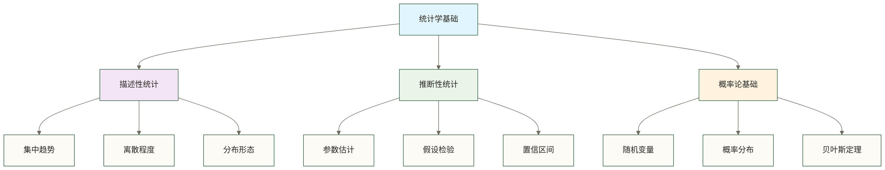

# 📊 统计学基础（Statistics Fundamentals）

> [!abstract] 📋 本节概览
> - 🎯 **学习目标**：掌握数据分析必备的统计学理论与实用技能
> - 📚 **前置知识**：[[【技术与工具】/统计学/统计学是什么|统计学是什么]] | [[【技术与工具】/统计学/概率的基本概念|概率的基本概念]]
> - ⏱️ **预计用时**：30分钟
> - 🔧 **实践技能**：掌握Python统计分析的基础操作

## 🌟 统计学基础的核心概念

> [!note] 📖 **什么是统计学基础？**
> 统计学基础是数据科学的根基，教会我们如何从数据中发现规律、做出推断，并量化不确定性。就像学习语言需要掌握语法一样，数据分析也需要掌握统计学的"语法"。

### 🎯 核心知识架构



## 📊 描述性统计：数据的基本画像

### 🎯 集中趋势指标

描述性统计就像给数据拍一张"证件照"，告诉我们数据长什么样。

```python title="集中趋势分析实例"
import numpy as np
import pandas as pd
import matplotlib.pyplot as plt
import seaborn as sns
from scipy import stats

# 模拟员工薪资数据
np.random.seed(42)
salaries = np.random.lognormal(mean=10.5, sigma=0.3, size=1000)  # 对数正态分布

# 计算集中趋势指标
mean_salary = np.mean(salaries)
median_salary = np.median(salaries)
mode_result = stats.mode(np.round(salaries, -3), keepdims=True)  # 四舍五入到千位
mode_salary = mode_result.mode[0] if len(mode_result.mode) > 0 else np.nan

print("=== 员工薪资集中趋势分析 ===")
print(f"平均工资（均值）: ¥{mean_salary:,.0f}")
print(f"中位数工资: ¥{median_salary:,.0f}")
print(f"最常见工资（众数）: ¥{mode_salary:,.0f}")
print(f"\n💡 解读:")
print(f"   - 均值 > 中位数，说明存在高薪人员拉高平均值")
print(f"   - 中位数更能代表'典型'员工的薪资水平")

# 可视化分布
plt.figure(figsize=(12, 8))

# 主图：薪资分布直方图
plt.subplot(2, 2, 1)
plt.hist(salaries, bins=50, density=True, alpha=0.7, color='skyblue', edgecolor='black')
plt.axvline(mean_salary, color='red', linestyle='--', linewidth=2, label=f'均值: ¥{mean_salary:,.0f}')
plt.axvline(median_salary, color='green', linestyle='--', linewidth=2, label=f'中位数: ¥{median_salary:,.0f}')
plt.xlabel('薪资 (¥)')
plt.ylabel('密度')
plt.title('员工薪资分布')
plt.legend()
plt.grid(True, alpha=0.3)

# 箱线图
plt.subplot(2, 2, 2)
plt.boxplot(salaries, vert=False)
plt.xlabel('薪资 (¥)')
plt.title('薪资箱线图')
plt.grid(True, alpha=0.3)

# 累积分布
plt.subplot(2, 2, 3)
sorted_salaries = np.sort(salaries)
cumulative_prob = np.arange(1, len(sorted_salaries) + 1) / len(sorted_salaries)
plt.plot(sorted_salaries, cumulative_prob, linewidth=2, color='purple')
plt.axhline(0.5, color='green', linestyle='--', alpha=0.7, label='50分位数（中位数）')
plt.axvline(median_salary, color='green', linestyle='--', alpha=0.7)
plt.xlabel('薪资 (¥)')
plt.ylabel('累积概率')
plt.title('薪资累积分布函数')
plt.legend()
plt.grid(True, alpha=0.3)

# QQ图检验正态性
plt.subplot(2, 2, 4)
stats.probplot(np.log(salaries), dist="norm", plot=plt)  # 对数变换后检验
plt.title('对数薪资的QQ图（检验正态性）')
plt.grid(True, alpha=0.3)

plt.tight_layout()
plt.show()
```

### 📏 离散程度指标

```python title="离散程度分析"
# 计算离散程度指标
variance = np.var(salaries, ddof=1)  # 样本方差
std_dev = np.std(salaries, ddof=1)   # 样本标准差
range_val = np.max(salaries) - np.min(salaries)
iq_range = np.percentile(salaries, 75) - np.percentile(salaries, 25)  # 四分位距
cv = std_dev / mean_salary  # 变异系数

print("\n=== 薪资离散程度分析 ===")
print(f"方差: {variance:,.0f}")
print(f"标准差: ¥{std_dev:,.0f}")
print(f"极差: ¥{range_val:,.0f}")
print(f"四分位距(IQR): ¥{iq_range:,.0f}")
print(f"变异系数: {cv:.2%}")

# 标准差的68-95-99.7规则验证
within_1std = np.sum((salaries >= mean_salary - std_dev) & (salaries <= mean_salary + std_dev)) / len(salaries)
within_2std = np.sum((salaries >= mean_salary - 2*std_dev) & (salaries <= mean_salary + 2*std_dev)) / len(salaries)
within_3std = np.sum((salaries >= mean_salary - 3*std_dev) & (salaries <= mean_salary + 3*std_dev)) / len(salaries)

print(f"\n📏 标准差区间分析:")
print(f"   1个标准差内: {within_1std:.1%} (理论值68%)")
print(f"   2个标准差内: {within_2std:.1%} (理论值95%)")
print(f"   3个标准差内: {within_3std:.1%} (理论值99.7%)")
print(f"\n💡 由于数据为对数正态分布，不完全符合正态分布的68-95-99.7规则")
```

### 📈 分布形态分析

```python title="分布形态指标"
from scipy.stats import skew, kurtosis

# 计算偏度和峰度
skewness = skew(salaries)
kurt = kurtosis(salaries, fisher=True)  # Fisher=True表示超额峰度

print("\n=== 薪资分布形态分析 ===")
print(f"偏度(Skewness): {skewness:.3f}")
if skewness > 0.5:
    skew_interpretation = "显著右偏（高薪人员较少但影响均值）"
elif skewness < -0.5:
    skew_interpretation = "显著左偏"
else:
    skew_interpretation = "近似对称"

print(f"偏度解释: {skew_interpretation}")

print(f"\n峰度(Kurtosis): {kurt:.3f}")
if kurt > 0:
    kurt_interpretation = "正超额峰度（标准化四阶矩高于正态分布，不能仅据此判断峰顶形状）"
elif kurt < 0:
    kurt_interpretation = "负超额峰度（标准化四阶矩低于正态分布，不能仅据此判断峰顶形状）"
else:
    kurt_interpretation = "超额峰度为零（不意味着分布为正态）"

print(f"峰度解释: {kurt_interpretation}")

# 计算分位数
percentiles = [5, 10, 25, 50, 75, 90, 95]
percentile_values = np.percentile(salaries, percentiles)

print(f"\n📊 薪资分位数分析:")
for p, v in zip(percentiles, percentile_values):
    print(f"   P{p:2d}: ¥{v:7,.0f} ({'有' + str(100-p) + '%的人薪资高于此值' if p < 50 else '有' + str(p) + '%的人薪资低于此值'})")
```

## 🔬 推断性统计：从样本到总体

### 🎯 参数估计基础

```python title="点估计与区间估计"
from scipy.stats import t

# 从总体中抽取小样本
np.random.seed(123)
sample_size = 50
sample_data = np.random.choice(salaries, sample_size, replace=False)

# 点估计
sample_mean = np.mean(sample_data)
sample_std = np.std(sample_data, ddof=1)
sample_se = sample_std / np.sqrt(sample_size)  # 标准误

print("=== 参数估计分析 ===")
print(f"样本量: {sample_size}")
print(f"样本均值: ¥{sample_mean:,.0f}")
print(f"样本标准差: ¥{sample_std:,.0f}")
print(f"标准误: ¥{sample_se:,.0f}")

# 置信区间估计
confidence_level = 0.95
alpha = 1 - confidence_level
degrees_freedom = sample_size - 1
t_critical = t.ppf(1 - alpha/2, degrees_freedom)

margin_error = t_critical * sample_se
ci_lower = sample_mean - margin_error
ci_upper = sample_mean + margin_error

print(f"\n📊 95%置信区间估计:")
print(f"   误差范围: ±¥{margin_error:,.0f}")
print(f"   置信区间: [¥{ci_lower:,.0f}, ¥{ci_upper:,.0f}]")
print(f"   真实总体均值: ¥{mean_salary:,.0f}")
print(f"   区间是否包含真值: {'✅ 是' if ci_lower <= mean_salary <= ci_upper else '❌ 否'}")

# 不同置信水平的比较
confidence_levels = [0.90, 0.95, 0.99]
print(f"\n🔍 不同置信水平的置信区间:")
for cl in confidence_levels:
    alpha_temp = 1 - cl
    t_temp = t.ppf(1 - alpha_temp/2, degrees_freedom)
    me_temp = t_temp * sample_se
    ci_l = sample_mean - me_temp
    ci_u = sample_mean + me_temp
    print(f"   {cl*100:2.0f}%置信区间: [¥{ci_l:6,.0f}, ¥{ci_u:6,.0f}] 区间宽度: ¥{ci_u-ci_l:,.0f}")
```

### 🧪 假设检验基础

```python title="单样本t检验实例"
# 假设检验：公司声称平均薪资为60000元，实际情况如何？
hypothesized_mean = 60000

# 计算t统计量
t_statistic = (sample_mean - hypothesized_mean) / sample_se

# 计算p值（双尾检验）
p_value = 2 * (1 - t.cdf(abs(t_statistic), degrees_freedom))

print("\n=== 假设检验分析 ===")
print(f"H₀: μ = ¥{hypothesized_mean:,} (公司声称的平均薪资)")
print(f"H₁: μ ≠ ¥{hypothesized_mean:,} (实际平均薪资不等于声称值)")
print(f"\n检验统计量:")
print(f"   t统计量: {t_statistic:.3f}")
print(f"   自由度: {degrees_freedom}")
print(f"   p值: {p_value:.4f}")

# 判断结果
alpha = 0.05
if p_value < alpha:
    conclusion = f"拒绝H₀，有充分证据表明实际平均薪资不等于¥{hypothesized_mean:,}"
else:
    conclusion = f"无法拒绝H₀，没有充分证据表明实际平均薪资不等于¥{hypothesized_mean:,}"

print(f"\n📋 检验结论 (α=0.05):")
print(f"   {conclusion}")
print(f"   样本平均薪资: ¥{sample_mean:,.0f}")
print(f"   95%置信区间: [¥{ci_lower:,.0f}, ¥{ci_upper:,.0f}]")
```

## 📊 概率分布基础

### 🎯 常见分布的应用

```python title="概率分布实战应用"
from scipy.stats import binom, poisson, norm, expon

# 1. 二项分布：网站转化率分析
print("=== 1. 二项分布应用：网站转化率分析 ===")
n_visitors = 100  # 访客数
conversion_rate = 0.15  # 转化率15%

# 计算转化人数的概率分布
conversions = np.arange(0, 31)
prob_conversions = binom.pmf(conversions, n_visitors, conversion_rate)

# 期望转化人数和标准差
expected_conversions = n_visitors * conversion_rate
std_conversions = np.sqrt(n_visitors * conversion_rate * (1 - conversion_rate))

print(f"100个访客的转化分析:")
print(f"   期望转化人数: {expected_conversions:.1f}人")
print(f"   标准差: {std_conversions:.1f}人")
print(f"   转化10-20人的概率: {binom.cdf(20, n_visitors, conversion_rate) - binom.cdf(9, n_visitors, conversion_rate):.3f}")

# 2. 泊松分布：客服呼入分析
print(f"\n=== 2. 泊松分布应用：客服呼入分析 ===")
avg_calls_per_hour = 8  # 平均每小时8个电话

# 计算1小时内接到不同电话数的概率
calls = np.arange(0, 21)
prob_calls = poisson.pmf(calls, avg_calls_per_hour)

print(f"客服每小时呼入分析:")
print(f"   平均呼入: {avg_calls_per_hour}个/小时")
print(f"   接到5个电话的概率: {poisson.pmf(5, avg_calls_per_hour):.3f}")
print(f"   接到10个以上电话的概率: {1 - poisson.cdf(10, avg_calls_per_hour):.3f}")

# 3. 正态分布：产品质量控制
print(f"\n=== 3. 正态分布应用：产品质量控制 ===")
target_weight = 500  # 目标重量500g
std_weight = 5       # 标准差5g

print(f"产品重量质量控制:")
print(f"   目标重量: {target_weight}g ± {std_weight}g")
print(f"   合格范围[490-510g]的概率: {norm.cdf(510, target_weight, std_weight) - norm.cdf(490, target_weight, std_weight):.3f}")
print(f"   超重(>510g)的概率: {1 - norm.cdf(510, target_weight, std_weight):.3f}")

# 4. 指数分布：设备故障间隔
print(f"\n=== 4. 指数分布应用：设备故障分析 ===")
mean_time_between_failures = 30  # 平均30天故障一次
lambda_rate = 1 / mean_time_between_failures

print(f"设备故障间隔分析:")
print(f"   平均故障间隔: {mean_time_between_failures}天")
print(f"   10天内故障的概率: {expon.cdf(10, scale=mean_time_between_failures):.3f}")
print(f"   至少运行60天的概率: {expon.sf(60, scale=mean_time_between_failures):.3f}")
```

## 🔧 实战综合案例

```python title="电商A/B测试完整分析"
# A/B测试场景：比较两个页面的转化率
np.random.seed(42)

# 生成测试数据
n_control = 1000  # 控制组样本量
n_treatment = 1000  # 处理组样本量

control_conversion_rate = 0.12    # 控制组真实转化率
treatment_conversion_rate = 0.15  # 处理组真实转化率

control_conversions = np.random.binomial(1, control_conversion_rate, n_control)
treatment_conversions = np.random.binomial(1, treatment_conversion_rate, n_treatment)

# 计算观察到的转化率
obs_control_rate = np.mean(control_conversions)
obs_treatment_rate = np.mean(treatment_conversions)

print("=== A/B测试完整分析 ===")
print(f"控制组 (原页面):")
print(f"   样本量: {n_control:,}")
print(f"   转化数: {sum(control_conversions)}")
print(f"   转化率: {obs_control_rate:.3%}")

print(f"\n处理组 (新页面):")
print(f"   样本量: {n_treatment:,}")
print(f"   转化数: {sum(treatment_conversions)}")
print(f"   转化率: {obs_treatment_rate:.3%}")

# 效果评估
print(f"\n💰 业务影响评估:")
absolute_lift = obs_treatment_rate - obs_control_rate
relative_lift = absolute_lift / obs_control_rate
print(f"   绝对提升: {absolute_lift:.3%}")
print(f"   相对提升: {relative_lift:.2%}")

# 统计显著性检验
from statsmodels.stats.proportion import proportions_ztest

counts = np.array([sum(treatment_conversions), sum(control_conversions)])
nobs = np.array([n_treatment, n_control])

z_stat, p_value = proportions_ztest(counts, nobs)

print(f"\n🧪 统计显著性检验:")
print(f"   Z统计量: {z_stat:.3f}")
print(f"   P值: {p_value:.4f}")
print(f"   显著性(α=0.05): {'✅ 显著' if p_value < 0.05 else '❌ 不显著'}")

# 置信区间
from statsmodels.stats.proportion import proportion_confint

treatment_ci = proportion_confint(sum(treatment_conversions), n_treatment, alpha=0.05)
control_ci = proportion_confint(sum(control_conversions), n_control, alpha=0.05)

print(f"\n📊 95%置信区间:")
print(f"   控制组: [{control_ci[0]:.3%}, {control_ci[1]:.3%}]")
print(f"   处理组: [{treatment_ci[0]:.3%}, {treatment_ci[1]:.3%}]")

# 效应量(Cohen's h)
def cohens_h(p1, p2):
    return 2 * (np.arcsin(np.sqrt(p1)) - np.arcsin(np.sqrt(p2)))

effect_size = cohens_h(obs_treatment_rate, obs_control_rate)
if abs(effect_size) < 0.2:
    effect_interpretation = "低于常用小效应阈值"
elif abs(effect_size) < 0.5:
    effect_interpretation = "小效应"
elif abs(effect_size) < 0.8:
    effect_interpretation = "中等效应"
else:
    effect_interpretation = "大效应"

print(f"\n📈 效应量分析:")
print(f"   Cohen's h: {effect_size:.3f}")
print(f"   效应大小: {effect_interpretation}")

# 功效分析
from statsmodels.stats.power import NormalIndPower
power = NormalIndPower().power(abs(effect_size), nobs1=n_treatment, alpha=0.05, ratio=n_control / n_treatment, alternative='two-sided')
print(f"   基于本次观察效应量的事后功效演示: {power:.3f} ({power*100:.1f}%)；不能作为独立有效性证据，事前规划应使用预设的最小可检测效应")

# 业务建议
print(f"\n💡 分析结论与建议:")
if p_value < 0.05 and relative_lift > 0:
    print(f"   ✅ 本次模拟中新页面转化率相对提升{relative_lift:.1%}且差异显著；真实上线还须检查实验有效性、护栏指标及业务成本，不能仅凭显著性决定")
    print(f"   📊 预期收益：假设月访问量10万，月新增转化{100000 * absolute_lift:.0f}人")
elif p_value >= 0.05:
    print(f"   ⚠️  差异不显著，不代表无效；应按预设样本量和停止规则结束或继续实验，不可因当前不显著而任意延长，必要时重新设计独立实验")
else:
    print(f"   ❌ 新页面效果不佳，不建议上线")
```

## 📚 学习路径与进阶方向

### 🎯 基础阶段学习路径


### 🚀 进阶方向选择

**1. 业务分析方向**
- [[【数据分析与数据运营】/02-数据分析专业能力/02-统计分析/05-实验设计与业务落地|实验设计与A_B测试]] - 产品优化的科学方法
- [[【技术与工具】/统计学/回归分析|回归]] - 变量关系建模（因果解释需额外识别假设）
- [[【数据分析与数据运营】/02-数据分析专业能力/03-建模与预测/03-时间序列分析|时间序列]] - 预测与趋势分析

**2. 机器学习方向**
- 贝叶斯统计 - 机器学习的概率基础
- 多元统计分析 - 高维数据处理
- [[【技术与工具】/统计学/主成分分析（PCA）|主成分分析（PCA）]] - 降维技术

**3. 深度应用方向**
- 因果推断 - 现代因果分析
- [[【数据分析与数据运营】/02-数据分析专业能力/02-统计分析/05-实验设计与业务落地|实验设计与A_B测试]] - 科学实验方法
- 非参数统计 - 无分布假设的方法

> [!tip] 💡 **学习建议**
> 统计学基础是数据分析的根基，建议：
> 1. **多动手实践**：每个概念都用Python代码验证
> 2. **理解业务场景**：将统计方法与实际问题结合
> 3. **注意假设条件**：每种方法都有适用条件
> 4. **培养统计直觉**：通过大量案例建立统计思维

## 🔗 相关知识链接

### 📊 核心概念
- [[【技术与工具】/统计学/描述性统计|描述性统计]] - 数据的基本描述方法
- [[【技术与工具】/统计学/概率的基本概念|概率的基本概念]] - 不确定性的数学描述
- [[【技术与工具】/统计学/假设检验流程|假设检验流程]] - 统计推断的标准流程

### 🛠️ 工具技能
- [[【技术与工具】/Python/07-NumPy数值计算|Python/NumPy数值计算]] - Python数值计算基础
- [[【技术与工具】/Python/09-Pandas数据结构|Python/Pandas数据结构]] - 数据处理核心工具
- [[【技术与工具】/Python/13-Matplotlib基础|Python/Matplotlib]] - 数据可视化

### 📈 实际应用
- [[【技术与工具】/统计学/统计分析实战案例|统计分析实战案例]] - 真实业务场景
- [[【技术与工具】/统计学/常见统计陷阱与误区|常见统计陷阱与误区]] - 避免分析错误

#统计学 #基础 #数据分析 #Python #描述性统计 #推断性统计 #概率分布 #假设检验