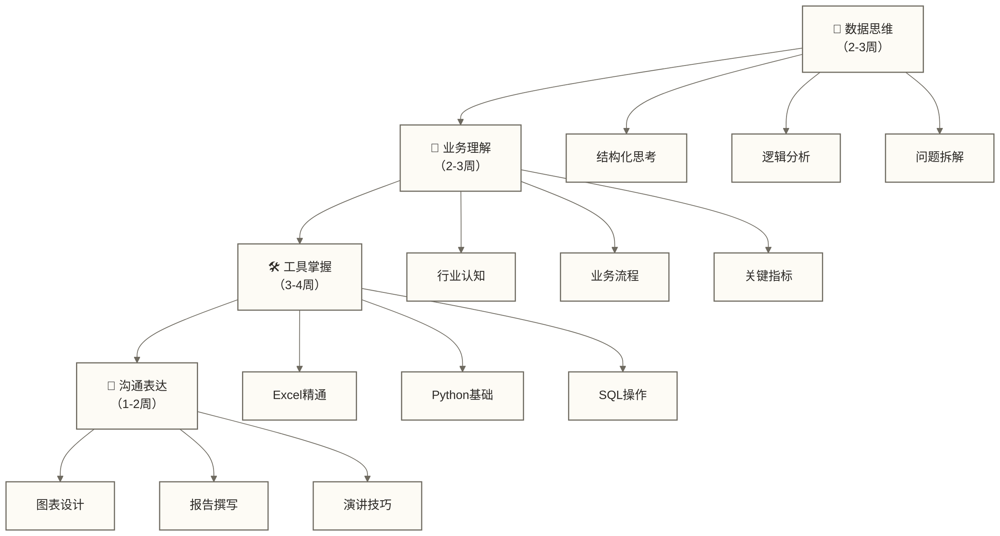

# 共同能力基础 - 数据从业者的基石能力体系

> [!abstract] 🎯 模块概览
> - 🎯 **学习目标**：掌握数据从业者必备的四大基础能力
> - 📚 **前置知识**：无需特定技术背景，适合零基础学习者
> - ⏱️ **完整周期**：8-12周（每周3-4小时）
> - 🎭 **能力范围**：数据思维、业务理解、工具掌握、沟通表达

## 🤔 从数据小白到数据专家的困惑

**"老板让我分析用户流失，我该从哪儿下手？"**
**"学了Python和SQL，但面对业务问题还是不知道怎么分析？"**
**"做出的图表总是被说'看不出重点'，怎么办？"**

如果你也有这些困惑，说明你已经意识到：**技术技能只是数据工作的一部分，真正的差距在于综合能力**。

很多人学数据分析的路径是这样的：
- 📚 先学工具：Python、SQL、Excel
- 📊 再学技术：统计学、机器学习
- 🤔 最后发现：**技术会了，但不知道怎么解决实际问题**

但真正的数据专家是反过来的：
- 🧠 **先有思维**：知道如何分解问题、设计分析
- 🏢 **再懂业务**：明确分析目的和价值创造点  
- 🛠️ **后学工具**：针对性地掌握解决问题的技术
- 💬 **能表达**：让分析结果产生真正的业务影响

这就是为什么我们设计了"共同能力基础"模块——**它是所有数据从业者的基石，不管你将来做分析师还是数据科学家，这四项能力都必不可少**。
## 💡 四大核心能力体系

> [!note] 🧠 **数据思维** - 用数据的方式看世界
> 不是简单的"看图说话"，而是培养结构化、逻辑性的数据洞察能力。就像培养一双"数据眼睛"，能从数字背后看到业务真相。

> [!note] 🏢 **业务理解** - 让数据为业务服务
> 数据分析的最终目的是解决业务问题。这个能力让你从"技术工人"变成"业务伙伴"，真正参与到公司的决策过程中。

> [!note] 🛠️ **工具掌握** - 效率提升的技术基础
> 掌握Excel、[[【数据分析与数据运营】/98-专业术语词典/08-技能方法类/Python|专业术语词典/Python]]、SQL等核心工具，让你的想法能够快速变成现实。工具是思维的延伸，熟练度直接影响工作效率。

> [!note] 💬 **沟通表达** - 让洞察产生价值
> 再好的分析结果，如果无法清晰传达给业务方，就毫无价值。这个能力决定你的影响力范围。

## 🗺️ 学习路径设计

### 📅 建议学习顺序

### 🎯 各模块重点内容

| 模块 | 核心技能 | 实战产出 | 学习重点 |
|---|---|---|---|
| **数据思维** | 结构化分析、假设验证 | 分析框架模板 | 培养敏感度 |
| **业务理解** | 行业知识、流程梳理 | 业务分析报告 | 场景应用 |
| **工具掌握** | [[【数据分析与数据运营】/01-共同能力基础/03-工具掌握/02-Excel数据处理\|Excel数据处理]]、[[【数据分析与数据运营】/98-专业术语词典/08-技能方法类/Python\|Python]] 和 SQL | 自动化工具 | 实操练习 |
| **沟通表达** | 可视化、演讲 | 汇报PPT | 影响力建设 |

## 🎯 能力检验标准

### 🧠 数据思维达标标准
- [ ] 能够将复杂问题拆解成可量化的子问题
- [ ] 具备假设-验证的分析思路
- [ ] 能够识别数据中的异常和机会点

### 🏢 业务理解达标标准
- [ ] 了解所在行业的核心商业模式
- [ ] 能够设计关键业务指标体系
- [ ] 具备从业务角度解读数据的能力

### 🛠️ 工具掌握达标标准
- [ ] [[【数据分析与数据运营】/01-共同能力基础/03-工具掌握/02-Excel数据处理|Excel数据处理]]：能够处理万级数据并制作动态图表
- [ ] [[【数据分析与数据运营】/98-专业术语词典/08-技能方法类/Python|专业术语词典/Python]]：能够完成数据清洗和基础分析
- [ ] SQL：能够编写复杂查询和数据提取

### 💬 沟通表达达标标准
- [ ] 能够制作专业的数据可视化图表
- [ ] 具备向非技术人员解释技术概念的能力
- [ ] 能够独立完成分析报告的撰写和汇报

## 🚀 学习成果预期

完成本模块学习后，你将具备：

> [!success] 🎓 **综合能力**
> - 独立承担中等复杂度的数据分析项目
> - 与业务团队进行有效的需求沟通
> - 使用多种工具快速响应数据需求
> - 将分析结果转化为业务洞察和建议

## 🔗 学习连接

**模块入口**：从 [[【数据分析与数据运营】/01-共同能力基础/01-数据思维/04-数据分析与情报学|数据分析与情报学]] 开始你的数据从业者之旅

**平行学习**：
- 如果你偏向分析：可同时关注 [[【数据分析与数据运营】/00-数据分析与数据运营导览|数据分析与数据运营导览/数据分析与数据运营导览]]
- 如果你偏向运营：可同时关注 [[【数据分析与数据运营】/00-数据分析与数据运营导览|数据分析与数据运营导览/数据分析与数据运营导览]]

**后续进阶**：[[【数据分析与数据运营】/00-数据分析与数据运营导览|数据分析与数据运营导览/数据分析与数据运营导览]] 将为你规划具体的发展方向

---

> [!tip] 💡 **学习建议**
> 
> 这四个能力是相互强化的关系：
> - 数据思维提供分析框架
> - 业务理解指明分析方向
> - 工具掌握提升执行效率  
> - 沟通表达放大分析价值
> 
> 建议循序渐进，每个模块都要通过实际项目来巩固。

**🎯 准备好了吗？让我们从培养数据思维开始！** 