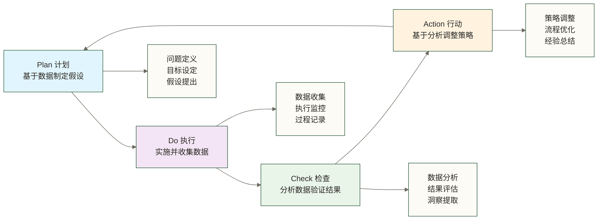
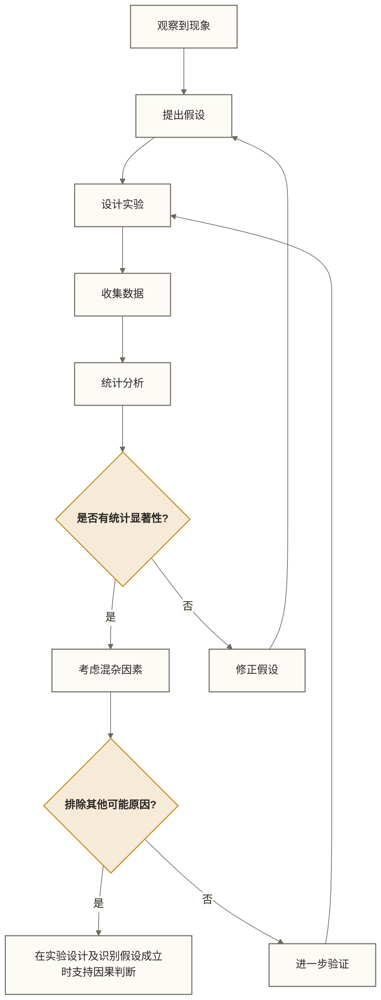

# 🧠 数据思维基础 - 用数据看世界的智慧

> [!tip] 💝 给数据思维新手的温暖指导
> 
> 🤗 **培养数据思维就像学会用科学的眼光看世界！**
> 
> 如果你现在面对问题时想：
> - "这个结论是不是靠谱？需要什么证据？"
> - "如何用数据来支撑我的观点和决策？"
> - "怎样避免被表面现象迷惑，看到事物的本质？"
> 
> **别担心！** 每个优秀的分析师都是从第一次质疑"感觉"开始的 ✨
> 
> 🔬 **想象数据思维就像成为一位细心的侦探**
> 
> 就像福尔摩斯通过观察细节、收集证据、逻辑推理来破案一样，数据思维让我们学会通过收集数据、分析证据、理性判断来解决问题和做出决策。

## 🎯 数据思维的本质理解

### 📊 什么是数据思维

数据思维是一种基于事实和证据的思维方式，强调用客观、量化的方法来观察、分析和解决问题，而不是依赖直觉、经验或主观判断。

**核心特征**：
- **🔍 证据导向**：相信数据胜过相信感觉
- **📈 量化分析**：用数字说话，用指标衡量
- **🎯 假设验证**：先假设，再用数据验证
- **🔄 持续迭代**：基于数据反馈不断优化

### 🧭 数据思维vs传统思维

| 思维方式 | 传统思维 | 数据思维 |
|----------|----------|----------|
| **决策依据** | 经验、直觉、感觉 | 数据、事实、证据 |
| **问题分析** | 定性描述 | 定量分析 |
| **结论得出** | 主观判断 | 客观验证 |
| **改进方式** | 试错法 | 假设检验法 |
| **风险控制** | 依赖运气 | 概率评估 |

## 🏗️ 数据思维的核心框架

### 1. 📋 PDCA数据思维循环



### 2. 🎯 数据思维的五个层次

**第一层：数据敏感性**
- 能够识别哪些问题需要用数据来解决
- 知道什么样的数据是有价值的
- 养成收集和记录数据的习惯

**第二层：数据分析能力**
- 掌握基本的统计分析方法
- 能够从数据中发现模式和趋势
- 学会用图表清晰表达数据洞察

**第三层：业务洞察能力**
- 将数据分析结果与业务问题结合
- 从数据中提取可执行的业务建议
- 理解数据背后的业务逻辑

**第四层：决策支持能力**
- 用数据支撑重要决策的制定
- 建立基于数据的决策流程
- 评估决策效果并持续优化

**第五层：数据驱动文化**
- 在组织中推广数据思维
- 建立数据驱动的工作机制
- 培养团队的数据素养

## 🔍 数据思维的核心原则

### 1. 📊 客观性原则

**避免认知偏差**：
- **确认偏差**：只关注支持自己观点的数据
- **可得性偏差**：过分依赖容易获得的信息
- **锚定效应**：被第一印象过度影响
- **幸存者偏差**：只看到成功案例，忽略失败

**保持客观的方法**：
```python
# 客观分析的Python示例框架
def objective_analysis(data, hypothesis):
    """
    客观分析框架
    """
    # 1. 多角度探索数据
    descriptive_stats = data.describe()
    correlation_analysis = data.corr()
    distribution_analysis = analyze_distributions(data)
    
    # 2. 寻找反例和异常
    outliers = detect_outliers(data)
    contrary_evidence = find_contrary_evidence(data, hypothesis)
    
    # 3. 交叉验证结果
    cross_validation_results = cross_validate(data, hypothesis)
    
    # 4. 综合判断
    conclusion = synthesize_findings(
        descriptive_stats, 
        correlation_analysis,
        contrary_evidence,
        cross_validation_results
    )
    
    return conclusion
```

### 2. 🎯 精准性原则

**明确定义指标**：
- 避免模糊的概念，用具体可测量的指标
- 建立清晰的计算标准和统计口径
- 确保数据的准确性和完整性

**指标定义示例**：
```text
❌ 错误：用户满意度"很高"
✅ 正确：用户满意度评分8.5分（10分制，样本1000人）

❌ 错误：销售业绩"不错"  
✅ 正确：月销售额增长15%（同比去年同期）

❌ 错误：产品"很受欢迎"
✅ 正确：产品净推荐值(NPS)为45分，月活跃用户增长30%
```

### 3. 🔗 因果性原则

**区分相关性和因果性**：
- 相关性不等于因果性
- 建立因果关系需要更严格的验证
- 考虑混杂变量和第三因素的影响

**因果分析框架**：


## 🛠️ 培养数据思维的实践方法

### 1. 📝 从问题开始的思维训练

**问题驱动的思维模式**：

**第一步：问题澄清**
- 这个问题真正要解决的是什么？
- 问题的边界和范围是什么？
- 成功的标准是什么？

**第二步：数据需求分析**
- 需要什么样的数据来回答这个问题？
- 这些数据从哪里获得？
- 数据的质量如何保证？

**第三步：分析方法选择**
- 用什么分析方法最合适？
- 需要做哪些假设？
- 如何验证分析结果的可靠性？

**第四步：结论与行动**
- 数据支持什么样的结论？
- 基于分析结果应该采取什么行动？
- 如何监控行动效果？

### 2. 📊 日常数据化习惯

**个人数据化实践**：
```text
💡 生活数据化举例：

🏃‍♂️ 健身目标：不说"多运动"，而是"每周跑步3次，每次30分钟"
📚 学习计划：不说"好好学习"，而是"每天学习2小时，每周完成5个练习"
💰 理财目标：不说"节约开支"，而是"每月固定储蓄3000元，年化收益率>6%"
🍎 健康管理：不说"健康饮食"，而是"每天蔬菜300g，水2000ml，糖分<25g"
```

**工作数据化实践**：
- 用数据描述工作目标和成果
- 建立关键指标的监控机制
- 定期回顾和分析工作数据
- 基于数据调整工作策略

### 3. 🧪 A/B测试思维

**实验思维的培养**：

**假设-实验-验证循环**：
```python
# A/B测试思维框架
class ABTestThinking:
    def __init__(self, hypothesis):
        self.hypothesis = hypothesis
        self.experiment_design = None
        self.results = None
    
    def design_experiment(self, control_group, test_group, metrics):
        """设计实验"""
        self.experiment_design = {
            'control': control_group,
            'test': test_group,
            'metrics': metrics,
            'duration': self.calculate_duration(),
            'sample_size': self.calculate_sample_size()
        }
    
    def run_experiment(self):
        """执行实验"""
        # 随机分组
        # 并行运行
        # 收集数据
        pass
    
    def analyze_results(self):
        """分析结果"""
        # 统计显著性检验
        # 实际业务意义评估
        # 置信区间计算
        pass
    
    def make_decision(self):
        """基于结果做决策"""
        if self.results['significant'] and self.results['practical']:
            return "采用新方案"
        else:
            return "保持现状或继续实验"
```

## 📈 数据思维在不同场景的应用

### 1. 🏢 业务决策场景

**市场营销决策**：
- 用数据分析目标客户群体
- 基于转化率数据优化营销渠道
- 通过A/B测试优化营销文案和策略

**产品决策**：
- 用用户行为数据指导产品功能优化
- 通过数据分析识别用户需求
- 基于使用数据评估功能价值

**运营决策**：
- 用数据监控运营活动效果
- 基于数据优化用户体验
- 通过数据分析提升运营效率

### 2. 🎯 个人成长场景

**学习效果评估**：
```text
📊 学习数据化示例：

学习时长统计：每日学习2.5小时，月累计75小时
知识掌握度：完成练习准确率85%，知识点覆盖度90%
学习效果验证：月考成绩提升15分，实际应用成功率70%
学习习惯分析：最佳学习时段19:00-21:30，效率最高的学习方式是实践练习
```

**职业发展规划**：
- 用数据分析行业发展趋势
- 基于数据评估职业技能需求
- 通过数据制定职业发展目标

### 3. 🔍 问题解决场景

**问题诊断流程**：

```mermaid
%%{init: {"theme":"base","themeVariables":{"fontFamily":"PingFang SC, -apple-system, Source Han Serif SC, serif","fontSize":"16px","background":"#FDFBF5","primaryColor":"#FDFBF5","primaryTextColor":"#2D2A26","primaryBorderColor":"#6E6A60","secondaryColor":"#E8EFE8","secondaryBorderColor":"#8FA890","secondaryTextColor":"#2D2A26","tertiaryColor":"#FDFBF5","tertiaryBorderColor":"#9A9488","tertiaryTextColor":"#6E6A60","lineColor":"#6E6A60","textColor":"#2D2A26","mainBkg":"#FDFBF5","nodeBorder":"#2D5A3D","clusterBkg":"#F3EEDF","clusterBorder":"#9A9488","edgeLabelBackground":"#FDFBF5"},"flowchart":{"htmlLabels":true,"curve":"basis","padding":20,"nodeSpacing":60,"rankSpacing":70,"useMaxWidth":false},"themeCSS":".node rect, .node polygon, .node circle { stroke-width: 1.5px; } .edgePath .path { stroke-width: 1.5px; } .cluster-label .nodeLabel, .cluster-label foreignObject { color: #2D2A26 !important; } .edgeLabel, .edgeLabel foreignObject { color: #2D2A26 !important; background-color: #FDFBF5; } .edgeLabel rect { fill: #FDFBF5; }"}}%%
flowchart TD
    classDef default fill:#FDFBF5,stroke:#6E6A60,color:#2D2A26,stroke-width:1.5px
    classDef startend fill:#2D2A26,stroke:#2D2A26,color:#FDFBF5,font-weight:bold
    classDef decision fill:#F6EAD8,stroke:#C08A1A,color:#2D2A26,font-weight:bold
    classDef hub fill:#3B5A80,stroke:#3B5A80,color:#FDFBF5,font-weight:bold
    classDef io fill:#E5EAF0,stroke:#3B5A80,color:#2D2A26
    classDef accent fill:#A6432C,stroke:#A6432C,color:#FDFBF5,font-weight:bold
    classDef storage fill:#F3EEDF,stroke:#9A9488,color:#2D2A26
    A[发现问题] --> B[数据收集]
    B --> C[现状分析]
    C --> D[原因假设]
    D --> E[假设验证]
    E --> F[根因识别]
    F --> G[解决方案]
    G --> H[效果监控]
    H --> I{问题解决?}
    I -->|否| D
    I -->|是| J[经验总结]
    class I decision
    class A,B,C,D,E,F,G,H,J default
```


## 🚀 数据思维的进阶发展

### 1. 🎨 数据叙事能力

**用数据讲故事**：
- 为数据找到业务背景和意义
- 用可视化增强数据表达力
- 将数据洞察转化为行动建议

**数据叙事结构**：
```text
🎬 数据故事的经典结构：

📖 背景设定：为什么这个问题很重要？
📊 数据发现：数据告诉我们什么？
💡 洞察提取：这意味着什么？
🎯 行动建议：我们应该怎么做？
📈 预期效果：预计会带来什么改善？
```

### 2. 🔮 预测性思维

**从描述到预测**：
- 不仅分析过去发生了什么
- 更要预测未来可能发生什么
- 基于预测制定前瞻性策略

**预测分析框架**：
- 趋势分析：识别长期发展趋势
- 周期分析：发现周期性模式
- 情景分析：考虑不同可能性
- 敏感性分析：评估关键因素影响

### 3. 🌐 系统性思维

**全局数据视角**：
- 不孤立地看单个数据点
- 理解数据之间的关联关系
- 考虑系统性的影响因素

**数据生态系统**：
- 建立数据指标体系
- 理解业务数据流
- 识别关键影响因子
- 监控系统性风险

## ⚠️ 数据思维的常见误区

### 🕳️ 误区一：数据万能论

**错误认知**：认为数据能解决所有问题
**正确理解**：数据是工具，需要结合业务理解和人的判断

### 🕳️ 误区二：追求完美数据

**错误认知**：等到有完美数据再做决策
**正确理解**：在不完美数据基础上做出合理决策

### 🕳️ 误区三：忽视数据背景

**错误认知**：只关注数据本身，忽视数据产生的背景
**正确理解**：理解数据的业务背景和限制条件

### 🕳️ 误区四：过度解读数据

**错误认知**：从有限数据中得出过度结论
**正确理解**：根据数据质量和样本量得出合理结论

## 🌱 培养数据思维的行动建议

### 初级阶段（0-6个月）
- [ ] 建立数据收集和记录的习惯
- [ ] 学会使用基础的数据分析工具
- [ ] 培养质疑和验证的习惯
- [ ] 开始用数据支持日常决策

### 中级阶段（6-18个月）
- [ ] 掌握常用的统计分析方法
- [ ] 能够设计简单的数据分析方案
- [ ] 学会用数据驱动工作优化
- [ ] 建立基于数据的工作流程

### 高级阶段（18个月+）
- [ ] 具备复杂数据分析和建模能力
- [ ] 能够指导他人培养数据思维
- [ ] 建立组织级的数据驱动文化
- [ ] 用数据思维解决战略性问题

## 💡 数据思维的价值体现

**个人价值**：
- 提高决策质量，减少主观错误
- 增强说服力，用事实说话
- 培养理性思维，避免情绪化决策
- 提升职业竞争力，适应数字化时代

**组织价值**：
- 提高经营效率，优化资源配置
- 降低决策风险，提高成功率
- 建立学习型组织，持续改进
- 增强市场竞争力，适应变化

**社会价值**：
- 促进理性讨论，减少盲从
- 提高决策透明度，增强信任
- 推动科学发展，促进进步
- 培养批判思维，提升国民素质

---

**相关阅读推荐**：
- [[【数据分析与数据运营】/01-共同能力基础/01-数据思维/01-批判性思维|批判性思维]] - 理性思考的基础技能
- [[【数据分析与数据运营】/02-数据分析专业能力/02-统计分析/01-统计分析基础|数据分析专业能力/统计]] - 数据分析的数学基础
- [[【数据分析与数据运营】/01-共同能力基础/04-沟通表达/05-数据可视化设计原则|数据可视化设计原则]] - 数据表达与沟通的艺术
- [[【数据分析与数据运营】/02-数据分析专业能力/04-业务分析框架/04-同期群分析|数据分析专业能力/同期群]] - 将数据思维应用到业务中

**创建时间**：2024-12-11  
**适用对象**：所有职场人士、学生、创业者  
**预计学习时长**：阅读与练习用时未核定，请按自身基础与练习范围安排  
**难度等级**：⭐⭐ (基础)  

#数据思维 #理性决策 #数据驱动 #科学思维 #批判性思维