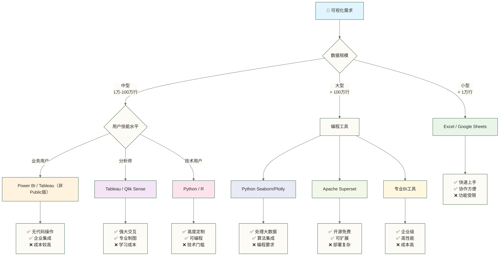
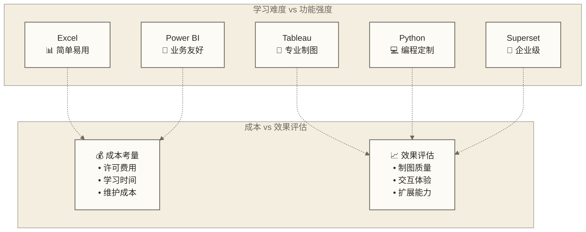

# 可视化工具：数据洞察的视觉呈现

> [!abstract] 📋 本节概览
> - 🎯 **学习目标**：了解数据分析工作中常用的可视化工具及其应用场景
> - 📚 **前置知识**：基础数据处理能力
> - ⏱️ **预计用时**：25分钟
> - 💡 **核心收获**：掌握不同可视化工具的特点与适用场景

## 😤 "这图表一看就是业余的"

汇报会上，小张展示了精心准备的数据分析报告。数据很详实，结论很精准，但是...

**老板皱眉**："这个饼图颜色也太花哨了吧？"  
**同事窃窃私语**："Excel默认样式，一看就知道..."  
**客户摇头**："能不能做得专业一点？"

小张很委屈：**明明分析得这么仔细，为什么大家只关注图表的样式？**

但事实残酷：**在商务环境中，可视化质量直接影响你的专业形象和分析结果的可信度**。

同样的数据，不同的可视化呈现，会产生截然不同的效果：
- 🤡 **业余级**：Excel默认颜色、密密麻麻的标签、不协调的布局
- 💼 **专业级**：品牌色彩、清晰的层次、精心的细节处理  
- 🚀 **专家级**：交互式仪表板、动态更新、多维度探索

掌握专业的可视化工具，不只是技能升级，更是**从"数据工人"向"业务顾问"转变的重要一步**。
## 💡 数据分析师的可视化工具图谱

数据分析师需要掌握多种可视化工具，以应对不同的分析场景和受众需求。以下是主要的可视化工具类别：

### 1. 办公软件内置可视化（基础必备）

#### Excel图表功能

**适用场景**：日常报告、快速分析、小型数据集

**核心功能**：
- 基础图表：柱形图、折线图、饼图、散点图
- 组合图表：双轴图表、瀑布图
- 交互功能：切片器、时间轴
- 条件格式：数据条、色阶、图标集

**优势与局限**：
- ✅ 上手容易，广泛普及
- ✅ 与数据处理功能无缝集成
- ❌ 高级可视化能力有限
- ❌ 大数据集性能较差

**使用示例**：
```markdown
# Excel创建动态图表步骤

1. 准备数据并创建数据透视表
2. 基于透视表创建图表（插入 > 推荐的图表）
3. 添加切片器（分析 > 插入切片器）
4. 设置图表格式和交互控件
```

### 2. 专业BI工具（进阶必备）

#### Power BI

**适用场景**：企业报表、交互式仪表板、[[【数据分析与数据运营】/98-专业术语词典/07-基础概念类/数据分析方法|数据分析]]

**核心功能**：
- 数据连接：多种数据源集成
- 数据建模：关系创建、计算字段
- 可视化库：丰富的图表类型
- 交互功能：钻取、筛选、切片器
- 共享协作：在线发布与共享

**优势与局限**：
- ✅ 强大的数据处理和可视化能力
- ✅ 良好的交互性和用户体验
- ✅ 微软生态系统集成
- ❌ 高级功能需要付费订阅
- ❌ 学习曲线较陡峭

#### 阿里云Quick BI

**适用场景**：企业级报表、云数据分析、国内企业应用

**核心功能**：
- 云原生架构
- 多种数据源连接
- 自助式仪表板创建
- 内置数据准备功能
- 权限管理和共享

**优势与局限**：
- ✅ 与阿里云生态深度集成
- ✅ 针对中国企业优化
- ✅ 性价比较高
- ❌ 全球化程度不如国际产品
- ❌ 高级功能可能需要定制开发

#### Redash

**适用场景**：数据团队内部分析、SQL驱动的可视化

**核心功能**：
- SQL查询编辑器
- 查询结果可视化
- 仪表板创建与共享
- 参数化查询
- 开源可自托管

**优势与局限**：
- ✅ 开源免费
- ✅ 对SQL用户友好
- ✅ 灵活的部署选项
- ❌ 可视化选项相对有限
- ❌ 需要技术团队维护

### 3. 编程语言可视化库（高级技能）

#### Python

**适用场景**：自动化报告、科学可视化、定制化图表

**核心功能**：
- 底层绘图功能
- 高度定制化
- 静态图表生成
- 与数据处理库集成
- 导出多种格式

**优势与局限**：
- ✅ 完全可编程和自动化
- ✅ 精确控制可视化细节
- ✅ 广泛的社区支持
- ❌ 学习曲线陡峭
- ❌ 创建交互式可视化较复杂

**代码示例**：
```python
import matplotlib.pyplot as plt
import numpy as np

# 创建数据
x = np.linspace(0, 10, 100)
y1 = np.sin(x)
y2 = np.cos(x)

# 创建图表
fig, ax = plt.subplots(figsize=(10, 6))
ax.plot(x, y1, 'b-', label='Sin(x)')
ax.plot(x, y2, 'r--', label='Cos(x)')

# 添加标签和图例
ax.set_title('正弦和余弦函数')
ax.set_xlabel('X轴')
ax.set_ylabel('Y轴')
ax.legend()
ax.grid(True)

# 保存图表
plt.savefig('trig_functions.png', dpi=300)
plt.show()
```

#### Python Seaborn统计可视化库

**适用场景**：[[【数据分析与数据运营】/02-数据分析专业能力/02-统计分析/01-统计分析基础|数据分析专业能力/统计]] 和 [[【数据分析与数据运营】/98-专业术语词典/07-基础概念类/数据分析方法|数据分析]]、科学研究

**核心功能**：
- 统计图表库
- 美观的默认样式
- 集成统计功能
- 多变量关系可视化
- 基于Matplotlib构建

**优势与局限**：
- ✅ 专为统计可视化优化
- ✅ 默认美观的样式
- ✅ 简化复杂统计图表创建
- ❌ 高度定制化需要额外代码
- ❌ 交互性有限

**代码示例**：
```python
import seaborn as sns
import matplotlib.pyplot as plt
import pandas as pd

# 加载示例数据集
tips = sns.load_dataset("tips")

# 创建多面板图表
g = sns.FacetGrid(tips, col="time", row="sex", height=4)
g.map_dataframe(sns.scatterplot, x="total_bill", y="tip")
g.add_legend()
g.set_axis_labels("消费金额", "小费")
g.set_titles(col_template="{col_name}时段", row_template="{row_name}性别")

plt.tight_layout()
plt.show()
```

#### Python Plotly交互式图表库

**适用场景**：交互式数据探索、Web应用、仪表板

**核心功能**：
- 交互式图表
- 丰富的图表类型
- 动画和过渡效果
- 地理空间可视化
- 导出为HTML或集成到Web应用

**优势与局限**：
- ✅ 强大的交互功能
- ✅ 现代化的视觉效果
- ✅ 易于集成到Web应用
- ❌ 文件大小较大
- ❌ 某些高级功能需要付费

**代码示例**：
```python
import plotly.express as px
import pandas as pd

# 创建示例数据
df = px.data.gapminder().query("continent=='Asia'")

# 创建动画散点图
fig = px.scatter(
    df, x="gdpPercap", y="lifeExp", size="pop", color="country",
    log_x=True, size_max=60, range_y=[30, 90],
    animation_frame="year", animation_group="country",
    title="亚洲国家GDP与预期寿命关系(1952-2007)"
)

# 更新布局
fig.update_layout(
    xaxis_title="人均GDP(对数刻度)",
    yaxis_title="预期寿命(年)",
    legend_title="国家",
    height=600
)

# 显示图表
fig.show()
```

### 4. 专业数据新闻可视化工具（特定场景）

#### Flourish

**适用场景**：数据故事、演示文稿、数据新闻

**核心功能**：
- 模板库
- 动画过渡
- 交互式图表
- 故事模式
- 易用的界面

**优势与局限**：
- ✅ 无需编程经验
- ✅ 精美的设计模板
- ✅ 适合数据故事讲述
- ❌ 高级功能需付费
- ❌ 数据处理能力有限

#### Datawrapper

**适用场景**：新闻媒体、简洁图表、快速发布

**核心功能**：
- 简洁的界面
- 响应式设计
- 地图创建工具
- 嵌入式图表
- 导出多种格式

**优势与局限**：
- ✅ 快速创建专业图表
- ✅ 适合媒体发布
- ✅ 易于学习和使用
- ❌ 自定义选项较少
- ❌ 免费版功能受限

## 🛠️ 可视化工具选择指南

### 📊 工具选择决策树



### 🔍 工具特性对比矩阵



**选择建议精要**：
- 🟢 **新手首选**：Excel → Power BI → Tableau 渐进学习路径
- 🟡 **技术路线**：Python/R + Jupyter → 专业数据科学工具栈  
- 🔵 **企业选型**：平衡成本、功能、维护三大要素
- 🟠 **专业分析师**：Tableau + Python 组合实现最佳效果

### 按场景选择合适的工具

| 场景 | 推荐工具 | 理由 |
|---|---|---|
| 日常报告 | [[【数据分析与数据运营】/01-共同能力基础/03-工具掌握/02-Excel数据处理\|Excel数据处理]], Power BI | 快速上手，易于分享 |
| 探索性分析 | Tableau, [[【数据分析与数据运营】/98-专业术语词典/08-技能方法类/Python\|Python]] | 强大的交互性和灵活性 |
| 自动化报告 | [[【数据分析与数据运营】/98-专业术语词典/08-技能方法类/Python\|Python]], R | 可编程，可重复执行 |
| 实时仪表板 | Power BI, Superset | 支持数据刷新和交互 |
| 数据故事 | Flourish, Tableau | 强调叙事和过渡效果 |
| 地理空间分析 | Tableau, QGIS | 专业的地图功能 |
| 内部数据产品 | Redash, Superset | 开源，可定制化 |

### 按数据规模选择

| 数据规模 | 推荐工具 | 注意事项 |
|---|---|---|
| 小型数据(<10MB) | [[【数据分析与数据运营】/01-共同能力基础/03-工具掌握/02-Excel数据处理\|Excel数据处理]], Datawrapper | 注意Excel行数限制 |
| 中型数据(10MB-1GB) | Power BI, Tableau | 考虑数据导入和处理时间 |
| 大型数据(>1GB) | Superset, [[【数据分析与数据运营】/98-专业术语词典/08-技能方法类/Python\|Python]] | 需要优化查询和渲染 |

### 按用户技能选择

| 用户类型 | 推荐工具 | 学习曲线 |
|---|---|---|
| 业务分析师 | [[【数据分析与数据运营】/01-共同能力基础/03-工具掌握/02-Excel数据处理\|Excel数据处理]], Power BI | 低到中等 |
| 数据分析师 | Tableau, Power BI, Redash | 中等 |
| 数据科学家 | [[【数据分析与数据运营】/98-专业术语词典/08-技能方法类/Python\|Python]], R | 较高 |
| 开发人员 | D3.js, Plotly | 高 |

## 🌟 数据可视化最佳实践

### 选择正确的图表类型

| 目的 | 推荐图表 | 示例场景 |
|---|---|---|
| 比较数值 | 条形图、柱状图 | 不同产品的销售额对比 |
| 显示趋势 | 折线图、面积图 | 月度销售额变化趋势 |
| 展示构成 | 饼图、堆叠柱形图 | 销售额的产品类别构成 |
| 分析分布 | 直方图、箱线图 | 客户年龄分布分析 |
| 研究关系 | 散点图、气泡图 | 价格与销量的关系 |
| 地理分布 | 地图、[[【数据分析与数据运营】/98-专业术语词典/05-用户行为类/热力图\|热力图]] | 各地区客户分布情况 |

### 设计原则

1. **简洁明了**：去除无关元素，突出核心信息
2. **选择合适的颜色**：使用对比色突出重点，考虑色盲友好
3. **适当的标签和注释**：帮助受众理解数据含义
4. **保持一致性**：在多图表分析中保持风格一致
5. **考虑受众**：根据受众的专业水平调整复杂度

## ✅ 小结与实践

数据可视化是数据分析的重要环节，选择合适的可视化工具能够大幅提升分析效率和沟通效果。数据分析师应根据具体场景、数据规模和技能水平选择适合的工具，并遵循可视化设计原则创建有效的可视化成果。

### 实践建议

1. 从一种工具开始，逐步扩展技能范围
2. 收集优秀的可视化案例，分析其设计思路
3. 针对同一数据集，尝试使用不同工具创建可视化
4. 获取反馈并持续改进可视化设计

## 🔗 学习连接
**相关技能**: [[【数据分析与数据运营】/01-共同能力基础/03-工具掌握/01-SQL基本概念|SQL基本概念]], [[【数据分析与数据运营】/01-共同能力基础/03-工具掌握/02-Excel数据处理|Excel数据处理]]
**进阶学习**: [[【数据分析与数据运营】/01-共同能力基础/03-工具掌握/01-SQL基本概念|SQL基本概念]], [[【技术与工具】/Python/14-Seaborn统计图|Seaborn统计图]], [[【数据分析与数据运营】/98-专业术语词典/04-数据工程类/数据可视化|数据可视化]], [[【数据分析与数据运营】/98-专业术语词典/08-技能方法类/Python|Python]]
**应用场景**: [[【数据分析与数据运营】/01-共同能力基础/04-沟通表达/01-数据故事讲述|数据故事讲述]], [[【数据分析与数据运营】/02-数据分析专业能力/01-分析方法论/01-指标体系构建|指标体系]]
