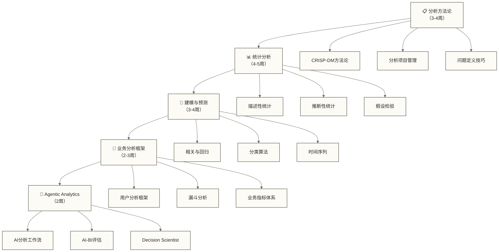

# 数据分析专业能力 - 从数据到洞察的专业技能体系

> [!abstract] 🎯 模块概览
> - 🎯 **学习目标**：掌握专业数据分析师的核心技能和方法体系
> - 📚 **前置知识**：具备基础能力，参见文末“前置模块”
> - ⏱️ **完整周期**：14-18周（每周5-6小时）
> - 🎭 **专业深度**：从初级分析师到高级分析专家的技能进阶

## 🤔 什么是专业的数据分析能力？

想象一下侦探破案的过程：
- **分析方法论**（相当于办案程序）：确保分析过程科学、严谨
- **[[【数据分析与数据运营】/02-数据分析专业能力/02-统计分析/01-统计分析基础|统计分析]]**（相当于物证分析）：用数学方法揭示数据中的规律
- **建模预测**（相当于推理预测）：基于现有信息预测未来趋势
- **业务分析框架**（相当于案件分类）：针对不同业务场景采用合适的分析策略
- **Agentic Analytics**（相当于智能助手的办案规则）：让 AI 参与执行，但由人负责口径、验证和决策

专业的数据分析师就像数据世界的"福尔摩斯"，能够从杂乱的数据中发现有价值的商业洞察。

## 💡 五大专业技能模块

> [!note] 📋 **分析方法论** - 科学分析的思维框架
> 掌握CRISP-DM、PDCA等经典分析方法论，建立标准化的分析流程。就像医生诊断疾病有固定流程一样，数据分析也需要科学的方法论指导。

> [!note] 📊 **[[【数据分析与数据运营】/02-数据分析专业能力/02-统计分析/01-统计分析基础|统计分析]]** - 数据背后规律的数学解读
> 掌握描述性统计、推断性统计、假设检验等核心统计方法。这是数据分析的"数学基础"，让你的结论更加可信和严谨。

> [!note] 🤖 **建模与预测** - 从历史数据预测未来趋势
> 学习回归分析、[[【技术与工具】/Python/21-分类算法|Python - 分类算法]]、时间序列等建模方法。这是数据分析的"高级技能"，让你从"看过去"升级到"预测未来"。

> [!note] 🏢 **业务分析框架** - 针对性解决业务问题
> 掌握用户分析、[[【数据分析与数据运营】/98-专业术语词典/02-分析方法类/漏斗分析|漏斗]]、队列分析等业务分析框架。这是理论与实践的桥梁，让你的分析真正为业务服务。

> [!note] 🤖 **[[【数据分析与数据运营】/02-数据分析专业能力/05-Agentic-Analytics/00-Agentic-Analytics专题导览|Agentic Analytics]]** - AI 时代的分析工作流
> 学习 Text-to-SQL、语义层、AI-BI Eval、分析 Agent 需求设计和 Decision Scientist 升级路径。它不是替代前四个模块，而是把前四个模块放进 AI 协作场景中重新组织。

## 🗺️ 学习路径设计

### 📅 建议学习顺序

### 🎯 各模块能力进阶

| 模块 | 初级目标 | 中级目标 | 高级目标 |
|---|---|---|---|
| **分析方法论** | 了解标准流程 | 灵活应用方法论 | 设计创新分析框架 |
| **[[【数据分析与数据运营】/02-数据分析专业能力/02-统计分析/01-统计分析基础\|统计分析基础]]** | 基础统计概念 | 熟练假设检验 | 高级统计建模 |
| **建模预测** | 简单回归模型 | 多种算法对比 | 模型优化调参 |
| **业务框架** | 套用经典框架 | 结合业务创新 | 构建行业标准 |
| **[[【数据分析与数据运营】/02-数据分析专业能力/05-Agentic-Analytics/00-Agentic-Analytics专题导览\|Agentic Analytics]]** | 会用 AI 辅助分析 | 设计 AI 协作流程 | 构建 AI-BI Eval 与决策闭环 |

## 🛠️ 技术工具栈

### 必备工具技能
- **[[【数据分析与数据运营】/98-专业术语词典/08-技能方法类/Python|Python]]**：pandas、numpy、scipy、scikit-learn
- **R语言**：ggplot2、dplyr、统计建模包
- **SQL**：高级查询、窗口函数、存储过程
- **可视化**：Tableau、Power BI、Python绘图库

### 🔧 各阶段工具重点

| 学习阶段 | 主要工具 | 技能要求 | 应用场景 |
|---|---|---|---|
| **方法论阶段** | [[【数据分析与数据运营】/01-共同能力基础/03-工具掌握/02-Excel数据处理\|Excel数据处理]] + 思维导图 | 流程梳理 | 项目规划 |
| **[[【数据分析与数据运营】/02-数据分析专业能力/02-统计分析/01-统计分析基础\|统计分析]]** | [[【数据分析与数据运营】/98-专业术语词典/08-技能方法类/Python\|Python]]/R + SQL | 统计计算 | [[【数据分析与数据运营】/98-专业术语词典/08-技能方法类/数据挖掘技术\|数据挖掘]] |
| **建模预测** | Python机器学习库 | 算法实现 | 预测建模 |
| **业务框架** | BI工具 + [[【数据分析与数据运营】/98-专业术语词典/08-技能方法类/Python\|Python]] | 可视化呈现 | 业务汇报 |
| **Agentic Analytics** | LLM + BI + 语义层 | AI协作、Eval、审查 | 智能分析与决策支持 |

## 🎯 能力检验标准

### 📋 分析方法论达标标准
- [ ] 能够独立设计完整的分析项目流程
- [ ] 具备问题拆解和假设构建的能力
- [ ] 掌握至少2种主流分析方法论的应用

### 📊 统计分析达标标准
- [ ] 熟练掌握描述性统计的计算和解读
- [ ] 能够正确进行假设检验和区间估计
- [ ] 具备统计结果的业务化解读能力

### 🤖 建模预测达标标准
- [ ] 能够构建并评估多种预测模型
- [ ] 掌握特征工程和模型调优技巧
- [ ] 具备模型结果的可解释性分析能力

### 🏢 业务分析框架达标标准
- [ ] 熟练应用5种以上经典业务分析框架
- [ ] 能够针对具体业务场景定制分析方案
- [ ] 具备将分析结果转化为业务建议的能力

### 🤖 Agentic Analytics达标标准
- [ ] 能够把业务问题拆成 AI 可执行、人工可审查的分析流程
- [ ] 能够设计 Text-to-SQL 测试问题、正确口径和错误分级
- [ ] 能够区分 AI 输出中的事实、假设、建议和风险
- [ ] 能够将一次分析沉淀为模板、Eval 集或作品集案例

## 🚀 职业发展路径

以下为本模块的能力进阶目标，实际达成水平需通过项目实践与能力检验确认：

> [!success] 🎓 **专业技能水平**
> - **初级数据分析师**：能够独立完成常规分析项目
> - **中级数据分析师**：具备复杂业务问题的分析能力
> - **高级数据分析师**：能够设计分析体系并指导他人

### 🎯 典型职业发展方向

1. **业务数据分析师**：深入特定业务领域，成为该领域的数据专家
2. **产品数据分析师**：专注产品数据分析，支持产品决策优化
3. **增长数据分析师**：专注用户增长和商业模式优化
4. **数据科学家**：向更高级的机器学习和AI方向发展

## 🔗 学习连接

**前置模块**：[[【数据分析与数据运营】/00-数据分析与数据运营导览|数据分析与数据运营导览]] - 确保具备基础能力

**平行学习**：
- 运营方向：[[【数据分析与数据运营】/00-数据分析与数据运营导览|数据分析与数据运营导览]]
- 职业规划：[[【数据分析与数据运营】/00-数据分析与数据运营导览|数据分析与数据运营导览]]

**实战应用**：[[【数据分析与数据运营】/00-数据分析与数据运营导览|数据分析与数据运营导览]] - 在真实场景中应用所学技能

**模块入口**：从 [[【数据分析与数据运营】/98-专业术语词典/07-基础概念类/分析方法论|分析]] 开始构建专业分析思维

---

> [!tip] 💡 **学习策略建议**
> 
> 专业能力的培养需要：
> - **理论与实践结合**：每个概念都要通过项目来巩固
> - **循序渐进**：不要跳过基础直接学习高级内容
> - **多元化练习**：用不同的数据集练习相同的方法
> - **持续迭代**：定期回顾和更新自己的方法论体系
> 
> 记住：专业技能的核心不是记住公式，而是培养数据敏感性和业务洞察力。

**🎯 准备好成为专业的数据分析师了吗？让我们从科学的分析方法论开始！** 