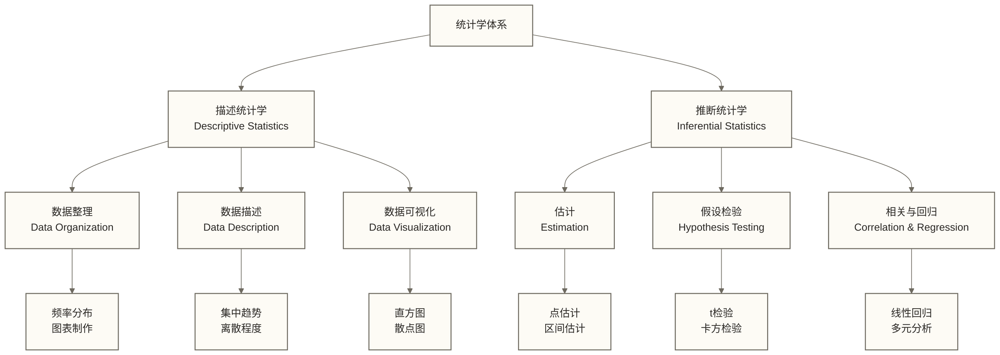
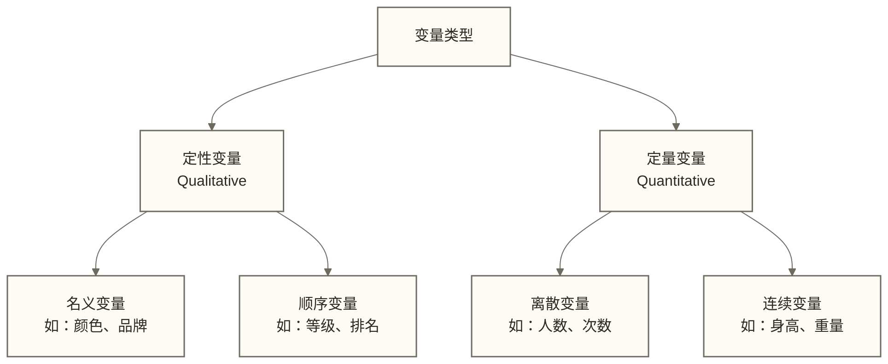

# 📊 统计分析基本概念 - 数据分析的数学基础

> [!tip] 💝 给统计新手的温暖指导
> 
> 🤗 **学习统计概念就像掌握理解世界的新语言！**
> 
> 如果你现在面对统计学时想：
> - "这些概念到底在说什么？"
> - "为什么需要这么多数学公式？"
> - "怎么把这些理论应用到实际工作中？"
> 
> **别担心！** 每个数据专家都是从理解第一个平均数开始的 ✨
> 
> 🎯 **想象统计概念就像医生的诊断工具**
> 
> 就像医生用体温、血压、心率等指标来了解病人的健康状况一样，统计概念帮助我们用平均数、标准差、相关系数等"诊断"数据，发现其中的模式和规律。

## 🎯 统计学基础认知

### 📊 统计学是什么

统计学是收集、分析、解释和展示数据的科学，它帮助我们从不确定性中找到规律，从部分信息推断整体情况。

**统计学的核心作用**：
- **📈 描述现象**：用数字概括复杂的现实情况
- **🔍 发现规律**：从表面的混乱中找到内在的模式
- **🎯 支持决策**：基于数据证据做出理性判断
- **🔮 预测未来**：根据历史数据推测未来趋势

### 🏗️ 统计学的层次结构



## 📊 基础统计概念

### 1. 🎯 总体与样本

**总体（Population）**：
- 研究对象的全集
- 通常很大，难以全部观测
- 用参数（Parameters）描述特征

**样本（Sample）**：
- 从总体中抽取的部分个体
- 用来推断总体特征
- 用统计量（Statistics）描述特征

**形象理解**：
```text
🍲 总体 = 一大锅汤
🥄 样本 = 用勺子舀的一小口
🤔 推断 = 通过这一小口判断整锅汤的味道
```

### 2. 📏 测量尺度

**名义尺度（Nominal）**：
- 仅用于分类标记
- 例：性别、血型、品牌名称
- 运算：计数、众数

**顺序尺度（Ordinal）**：
- 有等级顺序，但不能保证或解释为等距
- 例：满意度等级、教育程度、比赛名次
- 运算：排序、中位数

**间距尺度（Interval）**：
- 等距但无绝对零点
- 例：温度（摄氏度）、智商分数
- 运算：加减、平均数

**比率尺度（Ratio）**：
- 等距且有绝对零点
- 例：身高、体重、收入、时间
- 运算：四则运算、几何平均数

### 3. 📊 变量类型

**按性质分类**：


## 📈 描述性统计核心概念

### 1. 🎯 集中趋势

**平均数（Mean）**：
```python
# 算术平均数
def arithmetic_mean(data):
    return sum(data) / len(data)

# 示例
scores = [85, 92, 78, 96, 88]
mean_score = arithmetic_mean(scores)
print(f"平均成绩: {mean_score}")
```

**特点**：
- ✅ 充分利用所有数据信息
- ✅ 便于数学运算
- ❌ 容易受极值影响

**中位数（Median）**：
```python
def median(data):
    sorted_data = sorted(data)
    n = len(sorted_data)
    if n % 2 == 0:
        return (sorted_data[n//2 - 1] + sorted_data[n//2]) / 2
    else:
        return sorted_data[n//2]

# 示例
median_score = median(scores)
print(f"中位成绩: {median_score}")
```

**特点**：
- ✅ 不受极值影响
- ✅ 适用于偏态分布
- ❌ 不具备平均数那样的线性代数性质

**众数（Mode）**：
```python
from collections import Counter

def mode(data):
    counts = Counter(data)
    max_count = max(counts.values())
    modes = [k for k, v in counts.items() if v == max_count]
    return modes

# 示例
mode_score = mode(scores)
print(f"众数: {mode_score}")
```

### 2. 📏 离散程度

**方差（Variance）**：
```python
def variance(data, is_population=False):
    """
    计算方差
    is_population: True表示总体方差，False表示样本方差
    """
    mean = sum(data) / len(data)
    squared_deviations = [(x - mean) ** 2 for x in data]
    
    if is_population:
        return sum(squared_deviations) / len(data)
    else:
        return sum(squared_deviations) / (len(data) - 1)  # 样本方差使用n-1

# 示例
var_score = variance(scores, is_population=False)
print(f"样本方差: {var_score:.2f}")
```

**标准差（Standard Deviation）**：
```python
import math

def standard_deviation(data, is_population=False):
    """标准差 = 方差的平方根"""
    var = variance(data, is_population)
    return math.sqrt(var)

# 示例
std_score = standard_deviation(scores, is_population=False)
print(f"标准差: {std_score:.2f}")
```

**变异系数（Coefficient of Variation）**：
```python
def coefficient_of_variation(data):
    """变异系数 = 标准差 / 平均数 × 100%"""
    mean = arithmetic_mean(data)
    std = standard_deviation(data)
    return (std / mean) * 100

# 示例
cv_score = coefficient_of_variation(scores)
print(f"变异系数: {cv_score:.2f}%")
```

### 3. 📊 分布形状

**偏度（Skewness）**：
```python
def skewness(data):
    """
    偏度计算：衡量分布的对称性
    = 0: 三阶标准化中心矩为零（不必然对称）
    > 0: 右偏（正偏）
    < 0: 左偏（负偏）
    """
    n = len(data)
    mean = arithmetic_mean(data)
    std = standard_deviation(data, is_population=True)
    
    skew_sum = sum(((x - mean) / std) ** 3 for x in data)
    return skew_sum / n

# 示例
skew_score = skewness(scores)
print(f"偏度: {skew_score:.2f}")
```

**峰度（Kurtosis）**：
```python
def kurtosis(data):
    """
    峰度计算：四阶标准化中心矩，主要刻画尾部特征
    正态总体的理论峰度为3；样本估计值等于3不意味着正态
    > 3: 四阶标准化中心矩高于正态总体
    < 3: 四阶标准化中心矩低于正态总体
    """
    n = len(data)
    mean = arithmetic_mean(data)
    std = standard_deviation(data, is_population=True)
    
    kurt_sum = sum(((x - mean) / std) ** 4 for x in data)
    return kurt_sum / n

# 示例
kurt_score = kurtosis(scores)
print(f"峰度: {kurt_score:.2f}")
```

## 🎲 概率基础概念

### 1. 🎯 概率的定义

**古典概率**：
```python
def classical_probability(favorable_outcomes, total_outcomes):
    """古典概率 = 有利结果数 / 总结果数"""
    return favorable_outcomes / total_outcomes

# 示例：投掷公平硬币，正面向上的概率
prob_heads = classical_probability(1, 2)
print(f"硬币正面概率: {prob_heads}")
```

**频率概率**：
```python
def frequency_probability(event_count, total_trials):
    """频率概率 = 事件发生次数 / 试验总次数"""
    return event_count / total_trials

# 示例：投掷硬币1000次，正面出现520次
prob_heads_freq = frequency_probability(520, 1000)
print(f"频率概率: {prob_heads_freq}")
```

### 2. 📊 概率分布

**正态分布（Normal Distribution）**：
```python
import math

def normal_pdf(x, mean, std):
    """正态分布概率密度函数"""
    coefficient = 1 / (std * math.sqrt(2 * math.pi))
    exponent = -0.5 * ((x - mean) / std) ** 2
    return coefficient * math.exp(exponent)

# 示例：标准正态分布在x=0处的密度
density = normal_pdf(0, 0, 1)
print(f"标准正态分布在0点的密度: {density:.4f}")
```

**二项分布（Binomial Distribution）**：
```python
import math

def binomial_probability(n, k, p):
    """
    二项分布概率计算
    n: 试验次数
    k: 成功次数
    p: 单次成功概率
    """
    # 组合数 C(n,k)
    combination = math.factorial(n) / (math.factorial(k) * math.factorial(n - k))
    
    # 二项概率
    probability = combination * (p ** k) * ((1 - p) ** (n - k))
    return probability

# 示例：投掷硬币10次，恰好得到6次正面的概率
prob = binomial_probability(10, 6, 0.5)
print(f"10次投掷得到6次正面的概率: {prob:.4f}")
```

## 🔍 推断统计基础

### 1. 🎯 抽样分布

**中心极限定理**：
- 对独立同分布且具有有限均值和有限非零方差的观测，随着样本量增大
- 标准化的样本平均数分布趋近于标准正态分布
- 所需样本量取决于总体分布，n≥30并非通用保证

**标准误差（Standard Error）**：
```python
def standard_error(population_std, sample_size):
    """样本均值的标准误差"""
    return population_std / math.sqrt(sample_size)

# 示例
se = standard_error(15, 100)  # 总体标准差15，样本量100
print(f"标准误差: {se}")
```

### 2. 📊 置信区间

**概念理解**：
- 用样本统计量估计总体参数的范围
- 置信水平：在模型假设成立的重复抽样中，按同一方法构造的区间覆盖真实参数的长期比例
- 常用置信水平：90%、95%、99%

**均值的置信区间**：
```python
def confidence_interval_mean(sample_data, confidence_level=0.95):
    """计算总体均值的置信区间"""
    from scipy import stats
    
    n = len(sample_data)
    mean = arithmetic_mean(sample_data)
    std = standard_deviation(sample_data, is_population=False)
    se = std / math.sqrt(n)
    
    # t分布的临界值
    alpha = 1 - confidence_level
    t_critical = stats.t.ppf(1 - alpha/2, df=n-1)
    
    # 置信区间
    margin_of_error = t_critical * se
    lower_bound = mean - margin_of_error
    upper_bound = mean + margin_of_error
    
    return (lower_bound, upper_bound)

# 示例
ci = confidence_interval_mean(scores, 0.95)
print(f"95%置信区间: ({ci[0]:.2f}, {ci[1]:.2f})")
```

### 3. 🔍 假设检验基础

**基本步骤**：
```text
1️⃣ 建立假设：H0（原假设）和H1（备择假设）
2️⃣ 选择检验方法和显著性水平α
3️⃣ 计算检验统计量
4️⃣ 确定p值或临界值
5️⃣ 做出统计决策
```

**t检验示例**：
```python
def one_sample_t_test(sample_data, hypothesized_mean, alpha=0.05):
    """单样本t检验"""
    from scipy import stats
    
    n = len(sample_data)
    sample_mean = arithmetic_mean(sample_data)
    sample_std = standard_deviation(sample_data, is_population=False)
    
    # t统计量
    t_stat = (sample_mean - hypothesized_mean) / (sample_std / math.sqrt(n))
    
    # 自由度
    df = n - 1
    
    # p值（双侧检验）
    p_value = 2 * (1 - stats.t.cdf(abs(t_stat), df))
    
    # 判断结果
    is_significant = p_value < alpha
    
    return {
        't_statistic': t_stat,
        'p_value': p_value,
        'degrees_of_freedom': df,
        'is_significant': is_significant,
        'conclusion': '拒绝原假设' if is_significant else '不拒绝原假设'
    }

# 示例：检验样本均值是否等于80
result = one_sample_t_test(scores, 80)
print(f"t检验结果: {result}")
```

## 📊 相关与回归基础

### 1. 🔗 相关分析

**皮尔逊相关系数**：
```python
def pearson_correlation(x, y):
    """计算皮尔逊相关系数"""
    n = len(x)
    
    # 计算均值
    mean_x = arithmetic_mean(x)
    mean_y = arithmetic_mean(y)
    
    # 计算相关系数
    numerator = sum((x[i] - mean_x) * (y[i] - mean_y) for i in range(n))
    sum_sq_x = sum((x[i] - mean_x) ** 2 for i in range(n))
    sum_sq_y = sum((y[i] - mean_y) ** 2 for i in range(n))
    
    denominator = math.sqrt(sum_sq_x * sum_sq_y)
    
    if denominator == 0:
        raise ValueError("变量为常量时，皮尔逊相关系数未定义")
    
    return numerator / denominator

# 示例数据
study_hours = [2, 3, 4, 5, 6, 7, 8]
test_scores = [60, 65, 70, 75, 80, 85, 90]

corr = pearson_correlation(study_hours, test_scores)
print(f"学习时间与成绩的相关系数: {corr:.3f}")
```

**相关强度判断**：
```python
def interpret_correlation(r):
    """解释相关系数的强度"""
    abs_r = abs(r)
    if abs_r >= 0.8:
        strength = "强相关"
    elif abs_r >= 0.5:
        strength = "中等相关"
    elif abs_r >= 0.3:
        strength = "弱相关"
    else:
        strength = "很弱或无相关"
    
    direction = "正相关" if r > 0 else "负相关" if r < 0 else "无相关"
    
    return f"{strength}的{direction}"

print(f"相关性解释: {interpret_correlation(corr)}")
```

### 2. 📈 简单线性回归

**回归方程计算**：
```python
def simple_linear_regression(x, y):
    """简单线性回归：y = a + bx"""
    n = len(x)
    mean_x = arithmetic_mean(x)
    mean_y = arithmetic_mean(y)
    
    # 计算斜率b
    numerator = sum((x[i] - mean_x) * (y[i] - mean_y) for i in range(n))
    denominator = sum((x[i] - mean_x) ** 2 for i in range(n))
    
    b = numerator / denominator
    
    # 计算截距a
    a = mean_y - b * mean_x
    
    # 计算决定系数R²
    y_pred = [a + b * xi for xi in x]
    ss_res = sum((y[i] - y_pred[i]) ** 2 for i in range(n))
    ss_tot = sum((y[i] - mean_y) ** 2 for i in range(n))
    r_squared = 1 - (ss_res / ss_tot)
    
    return {
        'intercept': a,
        'slope': b,
        'r_squared': r_squared,
        'equation': f'y = {a:.2f} + {b:.2f}x'
    }

# 示例
regression_result = simple_linear_regression(study_hours, test_scores)
print(f"回归结果: {regression_result}")
```

## ⚠️ 常见误区与注意事项

### 1. 🕳️ 概念理解误区

**误区一：混淆总体和样本**
```text
❌ 错误：用样本数据的特征直接代表总体
✅ 正确：用样本统计量推断总体参数，考虑不确定性
```

**误区二：相关性等于因果性**
```text
❌ 错误：有相关关系就说明存在因果关系
✅ 正确：相关性只是共变关系，因果需要更多证据
```

### 2. 📊 应用实践误区

**误区三：忽视数据类型**
```text
❌ 错误：对名义变量计算平均数
✅ 正确：根据数据类型选择合适的统计方法
```

**误区四：不考虑分布假设**
```text
❌ 错误：无视正态性假设直接使用t检验
✅ 正确：检验假设条件，选择合适的统计方法
```

## 💡 实际应用指导

### 1. 🎯 业务问题映射

**描述性问题** → **描述统计**
- "销售额的平均水平如何？" → 计算均值和中位数
- "数据的波动程度大吗？" → 计算标准差和变异系数

**比较性问题** → **假设检验**
- "两个营销策略效果有差异吗？" → 双样本t检验
- "不同地区的销售表现是否相同？" → 方差分析

**关系性问题** → **相关回归分析**
- "广告投入与销售额有关系吗？" → 相关分析
- "能否预测明年的销售额？" → 回归分析

### 2. 🛠️ 工具选择建议

**Excel**：基础描述统计、简单假设检验
**Python/R**：复杂统计分析、机器学习
**SPSS/SAS**：专业统计软件、完整分析流程

## 📚 学习路径建议

### 基础阶段
- [ ] 理解统计学的基本概念和术语
- [ ] 掌握描述统计的计算和解释
- [ ] 学会基本的概率计算
- [ ] 了解常见的概率分布

### 进阶阶段
- [ ] 掌握置信区间和假设检验
- [ ] 理解统计推断的逻辑和方法
- [ ] 学会相关分析和回归分析
- [ ] 具备统计软件使用能力

### 应用阶段
- [ ] 能够将统计方法应用到实际业务
- [ ] 具备统计结果的解释和沟通能力
- [ ] 建立统计思维和分析框架
- [ ] 持续学习新的统计方法

---

**相关阅读推荐**：
- [[【数据分析与数据运营】/02-数据分析专业能力/02-统计分析/01-统计分析基础|统计分析]] - 深入学习统计分析方法
- [[【数据分析与数据运营】/02-数据分析专业能力/02-统计分析/01-统计分析基础|统计分析]] - 理解概率的数学基础
- [[【数据分析与数据运营】/98-专业术语词典/02-分析方法类/假设检验|假设检验]] - 掌握统计推断的核心
- [[【数据分析与数据运营】/01-共同能力基础/01-数据思维/04-数据分析与情报学|数据分析与情报学]] - 培养统计思维方式

**创建时间**：2024-12-11  
**适用对象**：数据分析初学者、业务分析师、产品经理  
**预计学习时长**：阅读与练习用时未核定，请按自身基础与练习范围安排  
**难度等级**：⭐⭐ (基础)  

#统计学基础 #描述统计 #推断统计 #概率论 #数据分析基础