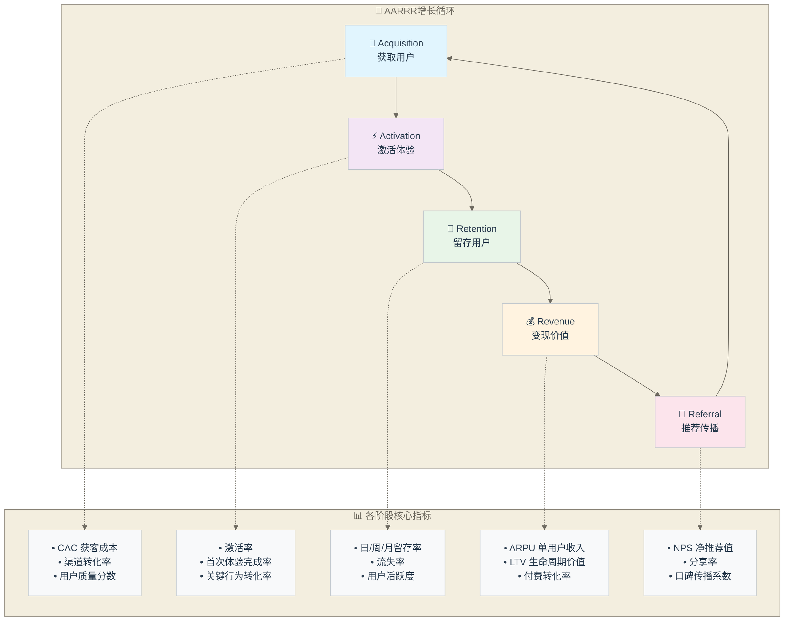

# 数据分析师的增长智慧 - 用AARRR模型读懂商业成长

> [!abstract] 📋 本节概览
> - 🎯 **学习目标**：培养系统性的增长分析思维
> - 📚 **前置知识**：[[【数据分析与数据运营】/02-数据分析专业能力/02-统计分析/01-统计分析基础|统计分析]] 和 [[【数据分析与数据运营】/98-专业术语词典/05-用户行为类/用户行为分析|用户留存]]
> - ⏱️ **预计用时**：25分钟
> - 💡 **核心价值**：掌握从数据中发现增长机会的智慧

## 🤔 "数据齐全，但增长策略一团糟"

**月度增长复盘会上的混乱场景：**

**CEO看着各种增长数据，越看越糊涂**："我们到底增长得怎么样？每个部门都在说自己的数据很好..."

**市场总监兴奋汇报**："我们的获客成本比上月降低了30%！新用户注册量达到历史新高！"

**产品经理紧接着说**："用户激活率提升了15%，产品体验明显改善！"

**运营总监也很兴奋**："7日留存率创新高，用户粘性大幅提升！"

**财务总监泼冷水**："但是收入目标只完成了65%，付费用户数反而在下降..."

**CEO更困惑了**："等等，每个指标都在变好，为什么收入反而下降？到底哪里出了问题？"

**数据分析师小王尴尬地站起来**："我们有所有的数据报表，但我也说不清具体问题在哪..."

**这种"数据很全，增长很乱"的企业困境：**

很多企业在增长分析中都遇到类似问题：
- 📊 **指标孤岛化**：各部门关注自己的指标，缺乏全局视角
- 🔄 **因果关系不清**：不知道各环节如何相互影响
- 🎯 **优化目标分散**：同时优化多个指标，资源分散效率低
- 📉 **增长逻辑混乱**：看得见数据，看不懂增长

**AARRR模型**就是要让你从"数据收集员"变成"增长架构师"，用系统思维驾驭复杂的增长数据。

## 🎯 重新理解"增长"的智慧

> [!tip] 💫 AARRR模型的本质
> AARRR不是简单的数据框架，而是一种理解用户生命周期和商业增长的系统思维

### 🧠 增长思维的三重境界

**第一重：指标监控思维**
- 关注每个环节的基础数据
- 发现"数字"层面的问题
- **价值**：建立增长的数据基础

**第二重：系统洞察思维**
- 理解各环节之间的相互关系
- 发现"结构"层面的问题
- **价值**：找到增长的关键驱动力

**第三重：价值创造思维**
- 从用户价值角度理解增长
- 发现"本质"层面的机会
- **价值**：建立可持续的增长引擎

### 🎨 AARRR中的人性洞察

**增长背后的用户故事**
- 获取：用户为什么选择尝试我们？
- 激活：用户在什么时候感受到价值？
- [[【数据分析与数据运营】/03-数据运营专业能力/01-用户增长/03-留存策略|留存]]：用户为什么愿意持续使用？
- 变现：用户为什么愿意付费？
- 推荐：用户为什么愿意推荐给朋友？

**每个环节的情感连接**
- 获取阶段：好奇心与期待
- 激活阶段：惊喜与满足
- 留存阶段：习惯与依赖
- 变现阶段：认同与投资
- 推荐阶段：自豪与分享

## 🔍 AARRR增长分析的智慧框架

### 📊 AARRR模型概览图

**模型核心价值**：
- 🔄 **循环增长**：每个阶段相互促进，形成可持续增长飞轮
- 📈 **全链路优化**：从获取到推荐的完整用户旅程优化
- 🎯 **精准定位**：快速识别增长瓶颈和优化机会点
- 📊 **量化管理**：用数据驱动每个增长决策

### 📅 **A1 - Acquisition（获取）：发现用户的第一道门**

**获取的本质思考**
- 不只是吸引流量，而是吸引"对的人"
- 关注用户质量，不只是用户数量
- **智慧要点**：最好的获客是最匹配的获客

**深度获取分析维度**
- **渠道质量分析**：哪些渠道带来的用户价值最高？
- **用户意图分析**：用户通过什么关键词找到我们？
- **转化时机分析**：用户在什么情况下更容易转化？
- **成本效率分析**：长期价值与获客成本的平衡点？

**获取阶段的常见误区**
- 只关注成本最低的渠道，忽视用户质量
- 盲目追求流量规模，缺乏质量控制
- 缺乏对用户需求的深度理解

### 📅 **A2 - Activation（激活）：用户的"啊哈时刻"**

**激活的本质思考**
- 不是完成注册，而是体验到核心价值
- 不是使用功能，而是解决实际问题
- **智慧要点**：激活是用户从"试试看"到"有价值"的转变

**深度激活分析维度**
- **价值体验分析**：用户在什么时候感受到"啊哈时刻"？
- **行为路径分析**：最容易激活的用户行为路径是什么？
- **时间窗口分析**：用户激活的黄金时间是多久？
- **障碍识别分析**：什么因素阻碍了用户激活？

**激活阶段的设计智慧**
- 降低初次体验的门槛
- 快速引导用户完成核心价值体验
- 提供个性化的引导路径

### 📅 **R1 - Retention（留存）：从新鲜感到习惯的转变**

**留存的本质思考**
- 不是让用户回来，而是让用户离不开
- 不是功能粘性，而是价值依赖
- **智慧要点**：真正的留存是用户生活方式的改变

**深度留存分析维度**
- **留存模式分析**：用户的留存曲线呈现什么模式？
- **价值衰减分析**：用户为什么会逐渐流失？
- **习惯形成分析**：什么行为能够培养用户习惯？
- **生命周期分析**：不同类型用户的留存特征？

**留存阶段的策略智慧**
- 持续提供新的价值发现
- 培养用户使用习惯
- 建立用户的社交连接
- 个性化的内容和体验

### 📅 **R2 - Revenue（变现）：价值认同的商业转化**

**变现的本质思考**
- 不是销售产品，而是交换价值
- 不是一次性交易，而是长期关系
- **智慧要点**：最好的变现是用户主动的价值投资

**深度变现分析维度**
- **付费动机分析**：用户为什么愿意付费？
- **价格敏感性分析**：不同用户群的价格接受度？
- **价值感知分析**：用户如何评估产品价值？
- **付费时机分析**：什么时候用户最愿意付费？

**变现阶段的设计智慧**
- 建立清晰的价值层次
- 提供灵活的付费选择
- 创造付费的"仪式感"
- 持续验证和强化价值

### 📅 **R3 - Referral（推荐）：从用户到传播者的升华**

**推荐的本质思考**
- 不是营销活动，而是口碑传播
- 不是功能分享，而是价值传递
- **智慧要点**：最好的推荐是用户的自发传播

**深度推荐分析维度**
- **推荐动机分析**：用户为什么愿意推荐？
- **推荐场景分析**：用户在什么情况下会推荐？
- **推荐效果分析**：被推荐用户的质量如何？
- **病毒传播分析**：推荐的传播效率和范围？

**推荐阶段的激发智慧**
- 创造值得分享的体验
- 提供分享的便利工具
- 设计分享的激励机制
- 培养用户的归属感

## 🌟 AARRR各环节的协同智慧

### 📖 从孤立指标到系统思维

**环节间的相互影响**
- 获取质量影响激活效果
- 激活体验影响留存率
- 留存用户是变现的基础
- 变现用户更容易推荐

**增长杠杆的识别**
- 哪个环节的改进对整体增长影响最大？
- 如何通过一个环节的优化带动其他环节？
- **分析智慧**：找到增长的关键杠杆点

**增长瓶颈的诊断**
- 增长停滞的根本原因在哪个环节？
- 如何通过数据快速定位问题？
- **分析智慧**：先诊断，再治疗

### 🎪 不同阶段产品的AARRR重点

**早期产品（产品-市场匹配阶段）**
- 重点关注：激活和留存
- 核心问题：用户是否真的需要这个产品？
- **分析重点**：验证产品价值假设

**成长期产品（规模化阶段）**
- 重点关注：获取和变现
- 核心问题：如何高效地扩大用户规模？
- **分析重点**：优化增长引擎效率

**成熟期产品（优化阶段）**
- 重点关注：留存和推荐
- 核心问题：如何提升用户生命周期价值？
- **分析重点**：深化用户价值创造

## 🔮 AARRR分析的实战智慧

### 📈 建立增长数据仪表盘

**核心指标的选择原则**
- 每个环节选择1-2个最关键的指标
- 指标必须可行动、可改进
- **设计智慧**：少而精，聚焦核心

**数据更新的频率设计**
- 快速试错的指标：日更新
- 趋势观察的指标：周更新
- 战略评估的指标：月更新

**预警机制的建立**
- 识别每个环节的健康水位线
- 设置数据异常的自动预警
- **运营智慧**：数据驱动的快速反应

### 🎯 增长实验的设计框架

**假设驱动的实验设计**
- 基于AARRR框架提出增长假设
- 设计可验证的小型实验
- **实验智慧**：小步快跑，快速验证

**多变量的协同测试**
- 避免孤立地优化单一环节
- 关注整体增长效果
- **系统智慧**：局部优化服务于整体目标

**长期影响的跟踪**
- 关注短期指标改善对长期的影响
- 平衡各环节的健康发展
- **可持续智慧**：避免透支式增长

## 💡 从AARRR到增长思维的升华

### 🔧 培养增长型分析师的能力

**商业敏感度的培养**
- 理解业务模式和盈利逻辑
- 从财务视角理解增长价值
- **成长路径**：从数据专家到商业伙伴

**用户同理心的建立**
- 真正理解用户的需求和痛点
- 从用户价值角度思考增长
- **成长路径**：从数据分析师到用户代言人

**产品思维的结合**
- 理解产品功能与用户价值的关系
- 参与产品改进决策
- **成长路径**：从支持角色到决策伙伴

### 🚀 建立数据驱动的增长文化

**让数据成为共同语言**
- 用AARRR框架统一团队对增长的认知
- 建立基于数据的决策习惯
- **组织智慧**：数据文化的建设

**促进跨部门协作**
- 用增长数据连接产品、运营、市场团队
- 建立共同的增长目标
- **协作智慧**：打破部门墙，聚焦用户价值

**培养实验精神**
- 鼓励基于假设的快速试错
- 建立学习型组织
- **创新智慧**：在不确定中寻找确定性

## 🌺 写在最后：增长的本质是创造价值

在数据分析中，AARRR模型教会我们的最重要的一课是：**真正的增长不是数字游戏，而是价值创造的过程**。每一个用户的获取、激活、[[【数据分析与数据运营】/03-数据运营专业能力/01-用户增长/03-留存策略|留存]]、付费、推荐，背后都是我们为用户创造价值的体现。

当我们学会用AARRR的眼光去看待增长，我们就不再是冰冷的数据分析师，而是温暖的价值创造者。**最好的增长，是用户和企业的共同成长**。

记住，每一个增长数字的背后，都是一个个真实的用户选择；每一次增长的突破，都是我们更好地理解和服务用户的结果。

愿你在数据分析的路上，不仅成为增长的分析师，更成为价值的创造者。

## 🔗 延展学习

**基础方法**：[[【数据分析与数据运营】/98-专业术语词典/05-用户行为类/用户行为分析|用户留存]] 和 [[【数据分析与数据运营】/98-专业术语词典/02-分析方法类/漏斗分析|漏斗]] 和 [[【数据分析与数据运营】/98-专业术语词典/02-分析方法类/同期群分析|同期群]]
**商业思维**：[[【数据分析与数据运营】/01-共同能力基础/02-业务理解/06-商业模式深度解析|商业模式深度解析]] 和 [[【数据分析与数据运营】/98-专业术语词典/01-业务指标类/LTV|LTV]]
**增长实践**：[[【数据分析与数据运营】/98-专业术语词典/02-分析方法类/A-B测试|A-B测试]] 和 [[【数据分析与数据运营】/98-专业术语词典/07-基础概念类/数据驱动决策|数据驱动决策]]
