# 📊 用户行为分析 - 深度解读用户背后的数据故事

> [!tip] 💝 给行为分析新手的温暖指导
> 
> 🤗 **学习用户行为分析就像当一位出色的心理学家！**
> 
> 如果你现在面对用户数据时想：
> - "用户在我们的产品里到底在做什么？"
> - "如何从海量行为数据中找到用户的真实需求？"
> - "怎么通过行为分析来优化产品和运营策略？"
> 
> **别担心！** 每个优秀的数据分析师都是从理解第一个用户行为开始的 ✨
> 
> 🔍 **想象用户行为分析就像观察顾客在商店里的购物行为**
> 
> 就像一位经验丰富的店主，通过观察顾客在店里的走动路线、停留时间、查看商品的频率，来理解顾客的需求和购买意愿，从而优化店铺布局和商品陈列。

## 🎯 用户行为分析核心概念

### 📊 什么是用户行为分析

用户行为分析是通过收集、分析用户在产品或服务中的各种行为数据，来理解用户需求、优化用户体验、提升业务指标的数据分析方法。

**核心要素包括**：
- **👤 用户标识**：Who - 谁在使用产品
- **📍 行为场景**：Where - 在哪里发生行为  
- **⏰ 时间维度**：When - 什么时候发生
- **🎯 行为内容**：What - 具体做了什么
- **🤔 行为动机**：Why - 为什么这样做

### 🏗️ 用户行为分析框架

```mermaid
%%{init: {"theme":"base","themeVariables":{"fontFamily":"PingFang SC, -apple-system, Source Han Serif SC, serif","fontSize":"16px","background":"#FDFBF5","primaryColor":"#FDFBF5","primaryTextColor":"#2D2A26","primaryBorderColor":"#6E6A60","secondaryColor":"#E8EFE8","secondaryBorderColor":"#8FA890","secondaryTextColor":"#2D2A26","tertiaryColor":"#FDFBF5","tertiaryBorderColor":"#9A9488","tertiaryTextColor":"#6E6A60","lineColor":"#6E6A60","textColor":"#2D2A26","mainBkg":"#FDFBF5","nodeBorder":"#2D5A3D","clusterBkg":"#F3EEDF","clusterBorder":"#9A9488","edgeLabelBackground":"#FDFBF5"},"flowchart":{"htmlLabels":true,"curve":"basis","padding":20,"nodeSpacing":60,"rankSpacing":70,"useMaxWidth":false},"themeCSS":".node rect, .node polygon, .node circle { stroke-width: 1.5px; } .edgePath .path { stroke-width: 1.5px; } .cluster-label .nodeLabel, .cluster-label foreignObject { color: #2D2A26 !important; } .edgeLabel, .edgeLabel foreignObject { color: #2D2A26 !important; background-color: #FDFBF5; } .edgeLabel rect { fill: #FDFBF5; }"}}%%
flowchart TD
    classDef default fill:#FDFBF5,stroke:#6E6A60,color:#2D2A26,stroke-width:1.5px
    classDef startend fill:#2D2A26,stroke:#2D2A26,color:#FDFBF5,font-weight:bold
    classDef decision fill:#F6EAD8,stroke:#C08A1A,color:#2D2A26,font-weight:bold
    classDef hub fill:#3B5A80,stroke:#3B5A80,color:#FDFBF5,font-weight:bold
    classDef io fill:#E5EAF0,stroke:#3B5A80,color:#2D2A26
    classDef accent fill:#A6432C,stroke:#A6432C,color:#FDFBF5,font-weight:bold
    classDef storage fill:#F3EEDF,stroke:#9A9488,color:#2D2A26
    A[用户行为分析框架] --> B[数据收集层]
    A --> C[数据处理层]
    A --> D[分析建模层]
    A --> E[洞察应用层]
    
    B --> B1[埋点数据]
    B --> B2[业务数据] 
    B --> B3[第三方数据]
    
    C --> C1[数据清洗]
    C --> C2[行为序列构建]
    C --> C3[用户标签生成]
    
    D --> D1[行为路径分析]
    D --> D2[漏斗转化分析]
    D --> D3[留存分析]
    D --> D4[用户分群分析]
    
    E --> E1[产品优化建议]
    E --> E2[运营策略制定]
    E --> E3[个性化推荐]
    class A,B,C,D,E,B1,B2,B3,C1,C2,C3,D1,D2,D3,D4,E1,E2,E3 default
```



## 📈 核心分析方法

### 1. 🛣️ 用户路径分析

**分析用户在产品中的行为路径和流转轨迹**

**关键指标**：
- **路径长度**：用户完成目标需要的步骤数
- **转化率**：各路径节点的转化情况
- **路径热度**：不同路径的用户流量分布
- **异常路径**：偏离预期的用户行为路径

**应用场景**：
- 优化产品交互流程
- 发现用户体验痛点
- 设计更符合用户习惯的功能布局

### 2. 📊 漏斗分析

**分析用户在关键业务流程中的转化表现**

**核心步骤**：
1. **定义漏斗节点**：确定关键转化步骤
2. **计算转化率**：各节点间的转化比例
3. **识别流失点**：转化率明显下降的节点
4. **分析流失原因**：结合用户反馈和产品体验

**常见漏斗模型**：
- **获客漏斗**：广告展示 → 点击 → 注册 → 激活
- **购买漏斗**：浏览商品 → 加购物车 → 下单 → 支付
- **内容漏斗**：内容曝光 → 点击 → 阅读完成 → 互动

### 3. 🔄 留存分析

**分析用户在不同时间维度上的回访和使用情况**

**留存类型**：
- **次日留存**：用户第二天是否继续使用
- **周留存**：一周内的回访情况
- **月留存**：长期用户价值评估

**影响因素**：
- 产品核心价值体验
- 新用户引导质量
- 产品功能粘性
- 运营活动效果

### 4. 👥 用户分群分析

**基于行为特征对用户进行分类和画像构建**

**分群维度**：
- **行为频次**：高频、中频、低频用户
- **使用深度**：核心功能使用情况
- **价值贡献**：付费用户、活跃用户、流失用户
- **生命周期**：新用户、成长期用户、成熟用户、流失用户

## 🛠️ 实施步骤与方法

### 第一步：明确分析目标
- 确定要解决的业务问题
- 设定可量化的分析目标
- 识别关键成功指标

### 第二步：数据收集与整理
```sql
-- 示例：用户行为数据收集SQL
SELECT 
    user_id,
    event_name,
    event_time,
    page_path,
    device_type,
    user_properties
FROM user_events 
WHERE event_date >= '2024-01-01'
ORDER BY user_id, event_time;
```

### 第三步：构建分析模型
- 建立用户行为序列
- 定义关键行为指标
- 创建分析仪表板

### 第四步：洞察挖掘与应用
- 识别行为模式和趋势
- 发现优化机会点
- 制定改进行动计划

## 📊 常用分析工具

### 专业工具
- **Google Analytics**：网站用户行为分析
- **Mixpanel**：事件追踪和用户分析
- **Amplitude**：产品用户行为分析
- **神策数据**：国内用户行为分析平台

### 技术方案
- **埋点方案**：前端、后端、可视化埋点
- **数据仓库**：用户行为数据存储和管理
- **分析平台**：自建或第三方分析工具

## 🎯 业务应用场景

### 产品优化
- **功能使用分析**：识别高价值功能和冗余功能
- **用户体验优化**：发现卡点并优化交互流程
- **新功能效果评估**：A/B测试和用户反馈分析

### 运营决策
- **内容策略优化**：基于用户兴趣偏好调整内容方向
- **活动效果分析**：评估运营活动对用户行为的影响
- **用户生命周期管理**：针对不同阶段用户制定运营策略

### 商业增长
- **转化率优化**：提升关键业务流程的转化效果
- **用户价值提升**：通过行为引导增加用户贡献
- **精准营销**：基于行为特征进行个性化推荐

## 💡 最佳实践建议

### 数据质量保障
1. **完善埋点设计**：确保关键行为数据的准确收集
2. **数据验证机制**：建立数据质量监控和异常检测
3. **隐私合规**：遵循数据保护法规，保护用户隐私

### 分析思维培养
1. **业务导向**：始终围绕业务问题进行分析
2. **全局视角**：综合考虑各种影响因素
3. **迭代优化**：持续监控和改进分析方法

### 跨部门协作
1. **与产品团队**：共同定义用户行为指标和改进目标
2. **与运营团队**：结合运营策略解读用户行为变化
3. **与技术团队**：确保数据收集和分析技术的有效实施

## 🎓 学习成长建议

### 基础技能
- **统计学基础**：掌握基本的统计分析方法
- **数据处理**：熟练使用SQL、Python/R进行数据分析
- **可视化能力**：能够创建清晰直观的分析报表

### 进阶能力
- **机器学习**：应用算法模型进行用户行为预测
- **大数据技术**：处理海量用户行为数据的技术能力
- **业务理解**：深入理解业务模式和用户需求

### 实践项目
- **完成端到端分析项目**：从数据收集到业务应用的完整流程
- **参与产品优化**：通过行为分析驱动产品改进
- **建立分析体系**：为团队或企业建立用户行为分析框架

---

**相关阅读推荐**：
- [[【数据分析与数据运营】/98-专业术语词典/01-业务指标类/AARRR模型|AARRR]] - 用户增长的经典分析框架
- [[【数据分析与数据运营】/98-专业术语词典/02-分析方法类/漏斗分析|漏斗]] - 深入理解转化分析方法  
- [[【数据分析与数据运营】/98-专业术语词典/02-分析方法类/同期群分析|同期群]] - 用户留存的时间维度分析
- [[【数据分析与数据运营】/05-场景实战案例/03-金融行业/02-用户画像应用|用户画像]] - 构建全面的用户认知体系

**创建时间**：2024-12-11  
**适用对象**：数据分析师、产品经理、运营人员  
**预计学习时长**：阅读与练习用时未核定，请按自身基础与练习范围安排  
**难度等级**：⭐⭐⭐ (中级)  

#用户行为分析 #数据分析 #业务分析框架 #用户体验优化 #数据驱动决策