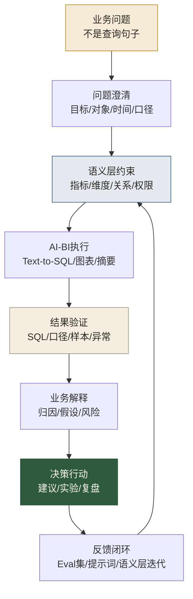

# Agentic Analytics专题导览

> [!abstract] 本专题定位
> 这个专题不是教你把一句中文丢给 AI，然后等它吐出 SQL。那只是表层。真正的 Agentic Analytics，是把**分析问题定义、语义约束、自动执行、结果验证、业务解释、行动追踪**连成一条可复用的工作流。
>
> 换句话说，它不是“分析师偷懒工具”，而是“分析师工作方式的一次换骨”。骨头换了，皮相还是报表、SQL、结论；骨头没换，用再好的 AI，也只是把旧毛病跑得更快。

## 为什么要单独做这个专题

我们已经有 [[【AI 与大数据】/06-行业应用/03-Text-to-SQL自然语言查询实战|Text-to-SQL自然语言查询实战]]，也有 [[【数据开发与数据架构】/07-数据服务架构/09-语义层工程实践|语义层工程实践]]，还有 [[【学习路线】/AI时代数据人/05-AI时代数据分析师升级路线|AI时代数据分析师升级路线]]。

但这些内容各自回答的是不同问题：

| 板块 | 回答的问题 | 读者得到什么 |
|---|---|---|
| [[【AI 与大数据】/00-AI与大数据导航\|AI与大数据]] | AI 技术怎么工作 | 理解 LLM、RAG、Agent、Text-to-SQL 的技术原理 |
| [[【数据开发与数据架构】/07-数据服务架构/09-语义层工程实践\|语义层工程实践]] | 数据平台怎么支撑 AI-BI | 理解指标、模型、权限、血缘如何工程化 |
| [[【学习路线】/AI时代数据人/05-AI时代数据分析师升级路线\|分析师升级路线]] | 数据分析师该怎么转型 | 明确岗位变化和个人升级方向 |
| **本专题** | 分析工作流具体怎么变 | 把 AI-BI 落到日常分析、评估、提示词和决策协作中 |

所以它不和已有板块冲突。它站在“数据分析师的工作现场”里，把技术翻译成新的职业动作。

## 一句话理解 Agentic Analytics

> [!quote] 核心定义
> Agentic Analytics 是一种由 AI Agent 参与的分析方式：它不只回答一次查询，而是在明确目标、调用数据、生成分析、验证结果、追问异常、形成建议的过程中，半自主或自主地推进数据到洞察的链路。

传统 BI 更像“仪表盘”：你看什么，它展示什么。  
Text-to-SQL 更像“翻译器”：你问一句，它写一段 SQL。  
Agentic Analytics 更像“分析助理”：它会拆问题、查数据、做对比、给假设、提醒风险，但最终还需要分析师来设边界、定口径、审结论、推行动。

## Agentic Analytics 的工作流骨架

这张图里最重要的是：AI 不是替你“做完分析”，而是进入分析链路的若干节点。真正的专业性，反而从“我会不会写 SQL”转向“我能不能把这条链路设计得可靠”。

## 本专题的阅读顺序

| 顺序 | 文档 | 解决的问题 | 推荐读者 |
|---|---|---|---|
| 1 | [[【数据分析与数据运营】/02-数据分析专业能力/05-Agentic-Analytics/01-AI时代分析工作流重构\|AI时代分析工作流重构]] | 传统分析流程如何变成 AI 协作流程 | 所有分析师 |
| 2 | [[【数据分析与数据运营】/02-数据分析专业能力/05-Agentic-Analytics/02-Text-to-SQL与语义层协同\|Text-to-SQL与语义层协同]] | 为什么自然语言查询离不开语义层 | 分析师、Analytics Engineer |
| 3 | [[【数据分析与数据运营】/02-数据分析专业能力/05-Agentic-Analytics/03-AI-BI评估体系与误差治理\|AI-BI评估体系与误差治理]] | 如何判断 AI 给出的答案是否可信 | 高级分析师、治理负责人 |
| 4 | [[【数据分析与数据运营】/02-数据分析专业能力/05-Agentic-Analytics/04-分析Agent需求设计与提示词规范\|分析Agent需求设计与提示词规范]] | 怎样把业务问题交给 Agent，而不是随便提问 | 分析师、数据产品经理 |
| 5 | [[【数据分析与数据运营】/02-数据分析专业能力/05-Agentic-Analytics/05-Decision-Scientist升级清单\|Decision Scientist升级清单]] | 分析师如何升级为决策科学型角色 | 准备转型的数据分析师 |

如果你时间有限，先读 01 和 03。一个帮你改工作方式，一个帮你防止“AI 一本正经地胡说”。

## 这个专题服务的三类人

### 1. 还在做取数与报表的分析师

你最需要建立一个判断：哪些工作会被 AI 明显提效，哪些工作必须由你升级承担。建议先读 [[【数据分析与数据运营】/02-数据分析专业能力/Agentic-Analytics分析师角色的终局推演|Agentic Analytics：分析师角色的终局推演]]，再进入本专题。

### 2. 已经负责指标体系、看板、专题分析的高级分析师

你的关键任务不再是“多做几个分析”，而是把分析能力产品化：指标定义、诊断路径、常见问题集、异常归因模板、业务解释规则，都要沉淀成可被 Agent 调用的资产。

这里会和 [[【数据分析与数据运营】/02-数据分析专业能力/01-分析方法论/01-指标体系构建|指标体系构建]]、[[【数据分析与数据运营】/02-数据分析专业能力/01-分析方法论/04-归因分析方法|归因分析方法]] 形成很强的连接。

### 3. 在做 AI-BI、数据产品、语义层建设的人

你需要的不只是技术能力，而是知道业务用户怎么提问、分析师怎么判断、错误在哪里发生。Agentic Analytics 的成败，往往不是模型不够聪明，而是业务语境没有被结构化。

这部分请配合 [[【数据治理与数据管理】/02-深度研究/05-AI数据治理/10-AI-ready Data/00-AI-ready Data专题导览|AI-ready Data专题导览]] 阅读。

## 本专题的产出标准

学完这个专题，不要求你立刻变成 AI 工程师，但至少要能拿出四类作品：

1. **一个 AI 辅助分析工作流**：从业务问题到结论输出，每一步都有输入、输出和审查点。
2. **一个语义层协同样例**：至少包含指标定义、维度说明、同义词、样例问题和正确 SQL。
3. **一个 AI-BI Eval 集**：包含常见问题、边界问题、陷阱问题、期望答案和错误分级。
4. **一个 Decision Scientist 作品集案例**：说明你如何用 AI 提效，但最终靠人类判断推动业务行动。

这四个作品，比“我会用某某 AI 工具”更有含金量。工具会变，作品背后的能力不会过时。

## 和知识库其他内容的关系

- 方法论基础：[[【数据分析与数据运营】/02-数据分析专业能力/01-分析方法论/02-数据分析流程|数据分析流程]]、[[【数据分析与数据运营】/02-数据分析专业能力/01-分析方法论/09-分析结果验证方法|分析结果验证方法]]
- 统计与实验基础：[[【数据分析与数据运营】/02-数据分析专业能力/02-统计分析/05-实验设计与业务落地|实验设计与A/B测试]]、[[【数据分析与数据运营】/02-数据分析专业能力/02-统计分析/02-假设检验|假设检验]]
- AI 工程基础：[[【AI 与大数据】/04-AI工程化/05-LLM评估体系|LLM评估体系]]、[[【AI 与大数据】/03-AI-Agent/06-Agent可观测性三件套|Agent可观测性三件套]]
- 数据底座：[[【数据开发与数据架构】/07-数据服务架构/09-语义层工程实践|语义层工程实践]]、[[【数据治理与数据管理】/02-深度研究/05-AI数据治理/10-AI-ready Data/01-AI-ready Data标准框架|AI-ready Data标准框架]]
- 职业升级：[[【学习路线】/AI时代数据人/00-AI时代数据人成长路线|AI时代数据人成长路线]]、[[【学习路线】/AI时代数据人/04-AI时代数据人作品集路线|AI时代数据人作品集路线]]

## 趋势参考

本专题具有时效性，建议每季度复查一次。当前判断参考了以下公开资料：

- [Gartner - Top Data and Analytics Predictions for 2026](https://www.gartner.com/en/newsroom/press-releases/2026-03-11-gartner-announces-top-predictions-for-data-and-analytics-in-2026)
- [Snowflake Documentation - Cortex Analyst](https://docs.snowflake.com/en/user-guide/snowflake-cortex/cortex-analyst)
- [Databricks Documentation - AI/BI concepts](https://docs.databricks.com/aws/en/ai-bi/concepts)
- [Databricks Documentation - Genie Spaces](https://docs.databricks.com/aws/en/genie)
- [dbt Developer Hub - dbt Semantic Layer](https://docs.getdbt.com/)
