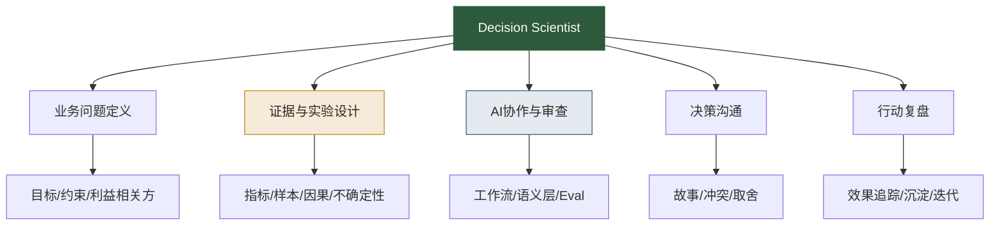

# Decision Scientist升级清单

> [!abstract] 本文定位
> Decision Scientist 不是一个更洋气的岗位名，而是数据分析师在 AI 时代的一种升级方向：从“回答数据问题的人”，升级为“提升决策质量的人”。
>
> 如果说传统分析师的交付物是报表和结论，那么 Decision Scientist 的交付物是**更好的决策过程**。

## 为什么会出现这个方向

当 AI 能快速完成取数、图表、摘要和初步分析，分析师的时间会被释放出来。问题是：释放出来以后做什么？

低价值路径是继续接更多需求，变成“AI 加速版取数员”。高价值路径是靠近决策：定义问题、设计实验、判断证据、组织讨论、推动行动、验证结果。

这就是 Decision Scientist 的位置。

它不要求你变成算法科学家，也不要求你天天训练模型。它要求你把数据、业务、实验和沟通连接起来，让组织少拍脑袋、少争口径、少做无效动作。

## Decision Scientist 与传统分析师的区别

| 维度 | 传统数据分析师 | Decision Scientist |
|---|---|---|
| 工作入口 | 业务提需求 | 业务有决策难题 |
| 核心动作 | 取数、分析、汇报 | 定义问题、评估证据、推动选择 |
| AI 关系 | 用 AI 提效执行 | 设计 AI 协作流程并审查输出 |
| 价值判断 | 报告是否完整 | 决策是否更好 |
| 主要风险 | 做慢、做错 | 误导决策、证据不足、行动失效 |
| 核心资产 | SQL、看板、报告 | 指标体系、实验框架、决策复盘、Eval 集 |

如果你已经读过 [[【数据分析与数据运营】/02-数据分析专业能力/Agentic-Analytics分析师角色的终局推演|Agentic Analytics：分析师角色的终局推演]]，会发现 Decision Scientist 对应的是那篇文章里“向业务决策现场移动”的路径。

## 能力模型



这五项能力里，AI 协作只是其中一项。真正拉开差距的，是你能否把 AI 产生的信息放进一个严肃的决策框架里。

## 能力一：业务问题定义

很多分析做不好，不是因为 SQL 不行，而是从一开始问题就错了。

业务说“帮我看看留存为什么下降”，Decision Scientist 不会直接开查，而是先问：

- 留存下降影响了什么业务目标？
- 是哪个用户群、哪个渠道、哪个版本、哪个生命周期阶段？
- 下降是否超过正常波动？
- 这个问题需要解释原因，还是需要选择行动？
- 如果找到了原因，业务团队有什么动作可以做？

这对应 [[【数据分析与数据运营】/01-共同能力基础/02-业务理解/02-业务问题转化|业务问题转化]] 和 [[【数据分析与数据运营】/01-共同能力基础/01-数据思维/02-结构化思维|结构化思维]]。

## 能力二：证据与实验设计

Decision Scientist 不满足于“数据看起来像这样”。他会继续问：这个证据强不强？能不能支持行动？有没有替代解释？

核心能力包括：

- 区分相关性与因果关系。
- 判断样本量与显著性。
- 设计 A/B 测试或准实验。
- 识别选择偏差、幸存者偏差、混杂变量。
- 用不确定性语言表达结论。

相关基础：[[【数据分析与数据运营】/02-数据分析专业能力/02-统计分析/05-实验设计与业务落地|实验设计与A/B测试]]、[[【数据分析与数据运营】/02-数据分析专业能力/01-分析方法论/03-假设验证法|假设验证法]]、[[【数据分析与数据运营】/02-数据分析专业能力/01-分析方法论/04-归因分析方法|归因分析方法]]。

## 能力三：AI协作与审查

AI 时代的 Decision Scientist，不需要每次手写所有 SQL，但必须能审查 AI 的输出。

你至少要做到：

- 能判断 AI 是否用错指标口径。
- 能看懂 SQL 是否存在明显逻辑风险。
- 能把高频分析需求整理成 Agent 工作流。
- 能维护 AI-BI Eval 集。
- 能把错误反馈给语义层、Prompt 和数据治理流程。

对应学习：[[【数据分析与数据运营】/02-数据分析专业能力/05-Agentic-Analytics/01-AI时代分析工作流重构|AI时代分析工作流重构]]、[[【数据分析与数据运营】/02-数据分析专业能力/05-Agentic-Analytics/03-AI-BI评估体系与误差治理|AI-BI评估体系与误差治理]]。

## 能力四：决策沟通

数据分析不是把真理扔到会议桌上。组织不是这样运转的。组织里有目标冲突、资源约束、部门立场、时间压力，还有人类固有的面子问题。

Decision Scientist 要能把复杂证据讲成可讨论、可选择、可执行的方案。

一个成熟的表达方式通常是：

```text
基于当前数据，我们有较强证据支持 A 假设，但还不能完全排除 B 假设。
如果目标是短期止损，建议先做动作 1；如果目标是长期提升，建议做实验 2。
这两个方案的成本、收益和风险分别是……
我建议先用两周验证指标 X 和 Y，如果没有改善，再切换方案。
```

这里用到 [[【数据分析与数据运营】/01-共同能力基础/04-沟通表达/01-数据故事讲述|数据故事讲述]]、[[【数据分析与数据运营】/01-共同能力基础/04-沟通表达/02-跨部门协作|跨部门协作]] 和 [[【数据分析与数据运营】/01-共同能力基础/04-沟通表达/03-向上管理|向上管理]]。

## 能力五：行动复盘

分析最大的浪费，是提出建议以后没人追踪。Decision Scientist 要把建议变成可验证的行动。

复盘至少包含：

- 当初的决策问题是什么？
- 当时使用了哪些证据？
- 做了什么动作？谁负责？
- 预期改善什么指标？
- 实际结果如何？
- 如果结果不符合预期，是假设错、执行错，还是环境变了？
- 下次应如何调整指标、分析框架或 Agent 规则？

这一步会把个人经验变成团队资产。

## 90天升级路径

### 第1阶段：从执行者到审查者（第1-30天）

- [ ] 整理自己最近 5 个分析需求。
- [ ] 标记其中哪些环节可以由 AI 提效。
- [ ] 对每个需求补写业务问题卡和口径卡。
- [ ] 用 AI 生成一次 SQL 或报告初稿，并记录错误。
- [ ] 学习 [[【数据分析与数据运营】/02-数据分析专业能力/05-Agentic-Analytics/02-Text-to-SQL与语义层协同|Text-to-SQL与语义层协同]]。

### 第2阶段：从审查者到流程设计者（第31-60天）

- [ ] 选择一个高频分析场景，设计标准流程。
- [ ] 整理 20 个典型问题与正确答案。
- [ ] 建立一个轻量 AI-BI Eval 表。
- [ ] 写出 Agent 追问规则和输出规范。
- [ ] 形成一个可复用分析模板。

### 第3阶段：从流程设计者到决策伙伴（第61-90天）

- [ ] 主动参与一次业务决策讨论。
- [ ] 不只交付结论，还给出方案比较和验证计划。
- [ ] 跟踪建议执行后的指标变化。
- [ ] 完成一份完整复盘。
- [ ] 将项目整理进 [[【学习路线】/AI时代数据人/04-AI时代数据人作品集路线|AI时代数据人作品集路线]]。

## 作品集项目建议

### 项目一：AI辅助留存下降诊断

包含业务问题定义、指标口径、AI 初步诊断、人工审查、归因假设、行动建议、后续验证。

### 项目二：活动效果 AI-BI Eval 集

包含 20-50 个活动效果问题、标准 SQL、评分维度、错误分级和修复闭环。

### 项目三：语义层指标治理样例

选择一个业务域，如增长、会员、订单、内容，整理指标卡、同义词、典型问题和权限说明。

### 项目四：决策复盘报告

选择一次真实业务动作，复盘当初的数据证据、决策逻辑、结果和下一步调整。

## 自检：你是否已经接近 Decision Scientist

- [ ] 业务方找你不是只要数，而是要你参与判断。
- [ ] 你能主动指出需求里的伪问题。
- [ ] 你能解释一个指标为什么这样定义，而不只是怎么计算。
- [ ] 你能判断 AI 输出的分析哪里可能错。
- [ ] 你能设计实验或验证方案。
- [ ] 你的报告里有不确定性和风险提示。
- [ ] 你的建议有负责人、动作、指标和复盘周期。
- [ ] 你能把一次分析沉淀成模板、Eval 或知识资产。

如果你能勾 6 项以上，说明你已经不只是“会分析数据”，而是在帮助组织做更好的决策。

## 继续阅读

- [[【学习路线】/AI时代数据人/05-AI时代数据分析师升级路线|AI时代数据分析师升级路线]]
- [[【学习路线】/AI时代数据人/08-AI-Data-Analyst岗位全解析|AI Data Analyst岗位全解析]]
- [[【数据分析与数据运营】/04-职业成长路径/01-数据分析师路径/04-数据分析师职业规划|数据分析师职业规划]]
- [[【数据分析与数据运营】/02-数据分析专业能力/05-Agentic-Analytics/00-Agentic-Analytics专题导览|Agentic Analytics专题导览]]
