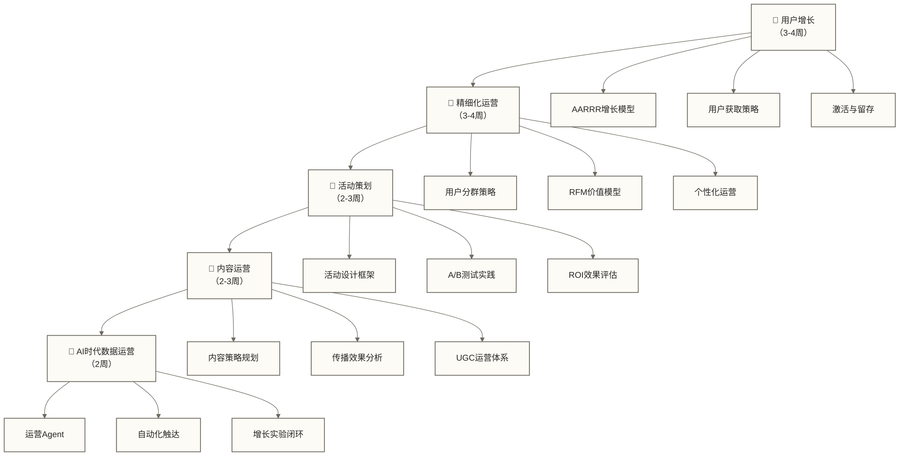

# 数据运营专业能力 - 数据驱动的运营增长体系

> [!abstract] 🎯 模块概览
> - 🎯 **学习目标**：掌握数据驱动运营的核心技能和增长方法论
> - 📚 **前置知识**：先学习数据分析与数据运营导览，确保具备基础数据能力
> - ⏱️ **完整周期**：12-16周（每周5-6小时）
> - 🎭 **专业深度**：从运营专员到增长专家的技能进阶

## 🤔 什么是数据驱动的运营？

想象一下经营一家餐厅的过程：
- **[[【数据分析与数据运营】/98-专业术语词典/07-基础概念类/用户增长策略|用户增长]]**（相当于拉新客人）：如何找到目标客群并吸引他们来店
- **精细化运营**（相当于提升服务）：如何针对不同客人提供个性化服务
- **活动策划**（相当于促销活动）：如何设计活动提升营业额和客户满意度
- **内容运营**（相当于菜品研发）：如何打造吸引人的产品和内容
- **AI时代数据运营**（相当于智能后厨和服务调度）：让 AI 参与策略生成、触达执行、实验评估和复盘沉淀

数据运营就是用数据的方式来经营"数字化餐厅"，让每个决策都有数据支撑，每个运营动作都能被量化和优化。

## 💡 五大运营技能模块

> [!note] 🚀 **[[【数据分析与数据运营】/98-专业术语词典/07-基础概念类/用户增长策略|用户增长]]** - 可持续的用户获取与激活
> 掌握AARRR增长模型、用户获取漏斗、激活策略等。这是运营的"引擎"，决定了业务的增长天花板。不只是简单的拉新，更要关注用户质量和长期价值。

> [!note] 🎯 **精细化运营** - 千人千面的个性化运营
> 学习用户分群、RFM模型、个性化推荐等精细化运营方法。这是运营的"精髓"，让有限的运营资源发挥最大价值。

> [!note] 🎪 **活动策划** - 数据驱动的活动设计与优化
> 掌握活动设计框架、A/B测试、效果评估等活动运营技能。这是运营的"催化剂"，能在短期内显著提升关键指标。

> [!note] 📝 **内容运营** - 内容策略与传播优化
> 学习内容策略制定、传播分析、内容效果评估等。这是运营的"灵魂"，决定了用户的参与度和品牌认知。

> [!note] 🤖 **[[【数据分析与数据运营】/03-数据运营专业能力/05-AI时代数据运营/00-AI时代数据运营专题导览|AI时代数据运营]]** - AI 协同的增长运营系统
> 学习增长运营 Agent、自动化触达、智能用户分层、AI 辅助活动策划和效果复盘。这不是替代前四个模块，而是把前四个模块放进 AI 协作与自动化闭环中。

## 🗺️ 学习路径设计

### 📅 建议学习顺序

### 🎯 各模块能力进阶

| 模块 | 运营专员级 | 高级运营级 | 运营专家级 |
|---|---|---|---|
| **[[【数据分析与数据运营】/98-专业术语词典/07-基础概念类/用户增长策略\|用户增长策略]]** | 执行增长策略 | 设计增长实验 | 构建增长体系 |
| **精细化运营** | 基础用户分群 | 多维度精细运营 | 智能化运营体系 |
| **活动策划** | 执行活动方案 | 独立策划活动 | 构建活动运营体系 |
| **内容运营** | 内容发布执行 | 内容策略制定 | 内容生态建设 |
| **[[【数据分析与数据运营】/03-数据运营专业能力/05-AI时代数据运营/00-AI时代数据运营专题导览\|AI时代数据运营]]** | 用 AI 辅助执行 | 设计运营 Agent 流程 | 构建 AI 协同增长系统 |

## 🛠️ 运营工具栈

### 数据分析工具
- **用户行为分析**：Google Analytics、神策数据、GrowingIO
- **A/B测试平台**：Optimizely、VWO、自建测试系统
- **用户画像平台**：CDP客户数据平台、DMP数据管理平台

### 运营执行工具
- **营销自动化**：HubSpot、Marketo、MarketingCloud
- **内容管理**：WordPress、Drupal、自建CMS
- **社群运营**：微信群助手、Discord、Slack

### 🔧 各阶段工具重点

| 学习阶段 | 核心工具 | 技能要求 | 应用场景 |
|---|---|---|---|
| **[[【数据分析与数据运营】/98-专业术语词典/07-基础概念类/用户增长策略\|用户增长]]** | GA + [[【数据分析与数据运营】/01-共同能力基础/03-工具掌握/02-Excel数据处理\|Excel数据处理]] | 漏斗分析 | 增长实验设计 |
| **精细化运营** | [[【数据分析与数据运营】/98-专业术语词典/08-技能方法类/Python\|Python]] + SQL | 用户分群 | 个性化策略 |
| **活动策划** | A/B测试平台 | 实验设计 | 活动效果优化 |
| **内容运营** | 内容分析工具 | 传播分析 | 内容策略调整 |
| **AI时代数据运营** | LLM + 自动化触达 + CDP | Agent协作与审查 | 用户旅程与增长闭环 |

## 🎯 能力检验标准

### 🚀 用户增长达标标准
- [ ] 能够设计完整的用户增长漏斗并进行优化
- [ ] 掌握至少3种用户获取渠道的运营方法
- [ ] 具备用户生命周期管理和价值提升的能力

### 🎯 精细化运营达标标准
- [ ] 能够建立多维度的用户分群体系
- [ ] 掌握RFM等用户价值评估模型的应用
- [ ] 具备个性化运营策略的设计和执行能力

### 🎪 活动策划达标标准
- [ ] 能够独立策划并执行数据驱动的运营活动
- [ ] 掌握A/B测试的设计、执行和结果分析
- [ ] 具备活动ROI评估和持续优化的能力

### 📝 内容运营达标标准
- [ ] 能够制定数据驱动的内容策略
- [ ] 掌握内容传播效果的分析和优化方法
- [ ] 具备UGC（用户生成内容）运营体系的构建能力

### 🤖 AI时代数据运营达标标准
- [ ] 能够把运营动作改写为目标卡、用户诊断卡和策略编排卡
- [ ] 能够设计增长运营 Agent 的任务边界、触达规则和人工审查点
- [ ] 能够同时观察转化指标、护栏指标和用户负反馈
- [ ] 能够将一次活动或触达复盘沉淀为策略库、内容库或 Eval 集

## 🚀 职业发展路径

本模块的能力进阶目标如下，是否达成需通过实际项目与能力检验确认：

> [!success] 🎓 **专业运营技能**
> - **运营专员**：能够执行数据驱动的运营策略
> - **高级运营**：具备独立设计和优化运营体系的能力
> - **运营专家**：能够构建全链路的数据运营体系

### 🎯 典型职业发展方向

1. **用户增长专家**：专注用户增长策略和增长体系建设
2. **产品运营经理**：深入产品运营，推动产品数据指标提升
3. **内容运营负责人**：构建内容生态和传播体系
4. **数据运营总监**：统筹整体运营数据体系和策略
5. **AI运营策略负责人**：建设运营 Agent、自动化触达和增长实验闭环

## 🔗 学习连接

**前置模块**：[[【数据分析与数据运营】/00-数据分析与数据运营导览|数据分析与数据运营导览]] - 确保具备基础数据能力

**平行学习**：
- 分析方向：[[【数据分析与数据运营】/00-数据分析与数据运营导览|数据分析与数据运营导览]]
- 职业规划：[[【数据分析与数据运营】/00-数据分析与数据运营导览|数据分析与数据运营导览]]

**实战应用**：[[【数据分析与数据运营】/00-数据分析与数据运营导览|数据分析与数据运营导览]] - 在真实运营场景中应用技能

**模块入口**：从 目录导览 开始构建增长思维

---

> [!tip] 💡 **学习策略建议**
> 
> 数据运营能力的培养重点：
> - **实战导向**：运营技能必须在实际项目中学习和验证
> - **快速迭代**：运营策略需要根据数据反馈快速调整
> - **全链路思维**：要从获客、激活、留存、变现的全流程思考
> - **用户视角**：始终从用户需求和体验出发设计运营策略
> 
> 记住：优秀的数据运营不是单纯追求数据增长，而是要平衡用户价值与商业价值。

**🎯 准备好成为数据驱动的运营专家了吗？让我们从用户增长的核心逻辑开始！** 