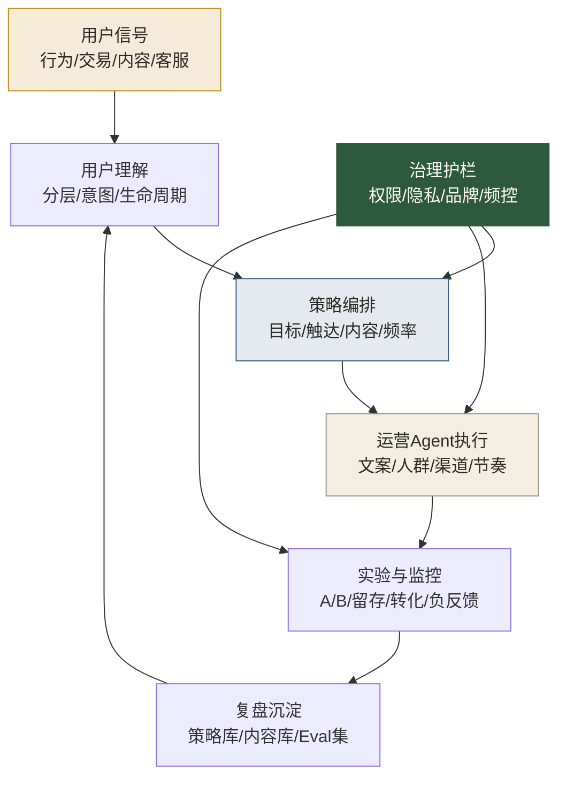

# AI时代数据运营专题导览

> [!abstract] 本专题定位
> 这个专题不是教你“用 AI 写文案”“用 AI 做海报”“用 AI 批量生成活动方案”。那些当然有用，但只是表面。
>
> 真正的 AI 时代数据运营，是把用户信号、用户分层、触达策略、内容生成、实验评估和复盘沉淀连成一套可持续迭代的运营系统。运营不再只是“做活动的人”，而是**设计用户旅程、指挥运营 Agent、管理触达质量、对增长结果负责的人**。

## 为什么要补这个专题

我们前面已经补了 [[【数据分析与数据运营】/02-数据分析专业能力/05-Agentic-Analytics/00-Agentic-Analytics专题导览|Agentic Analytics专题]]。那一层重点解决“AI 如何参与分析”。

但数据运营的核心不是“知道发生了什么”，而是“接下来做什么”。分析给出判断，运营负责行动。AI 时代真正改变运营岗位的地方，也恰恰在行动侧：

- 用户不再只接受单向群发，而是期待及时、个性化、有上下文的互动。
- 内容生产成本下降，运营的难点从“写不出来”变成“怎么不打扰、怎么有用、怎么可控”。
- 触达渠道越来越碎，运营动作需要跨短信、邮件、App Push、私域、客服、内容平台协同。
- AI Agent 开始进入企业应用，运营流程会从“人操作工具”变成“人设计规则，Agent 执行动作”。

所以这个专题补的是数据运营的下一层：**从数据驱动运营，升级为 AI 协同运营**。

## 本专题和已有内容的关系

| 模块 | 已有内容解决什么 | 本专题补什么 |
|---|---|---|
| 用户增长 | 获客、激活、留存、增长模型 | 用 Agent 管理增长实验、触达节奏和异常响应 |
| 精细化运营 | 用户分层、RFM、生命周期 | 用 AI 建立动态分层、下一步最佳动作和个性化策略 |
| 活动策划 | 活动设计、A/B 测试、效果评估 | 用 AI 提升活动生成、实验编排和复盘沉淀 |
| 内容运营 | 内容策略、分发、效果分析 | 用 AI 做内容变体、分发适配和品牌一致性审查 |
| Agentic Analytics | AI 辅助分析与评估 | 把分析结果接到运营动作和用户旅程中 |

> [!tip] 一个简单区分
> Agentic Analytics 关心“答案是否可信”；AI 时代数据运营关心“动作是否有效、是否克制、是否可持续”。

## 一张图看懂 AI 时代数据运营

这张图里最重要的是“闭环”。AI 不是一次性帮你生成一个活动，而是进入用户理解、策略执行、效果监控和复盘沉淀的循环。

## 推荐阅读顺序

| 顺序 | 文档 | 解决的问题 | 推荐读者 |
|---|---|---|---|
| 1 | [[【数据分析与数据运营】/03-数据运营专业能力/05-AI时代数据运营/01-AI时代数据运营工作流重构\|AI时代数据运营工作流重构]] | 传统运营流程如何升级为 AI 协同流程 | 所有数据运营 |
| 2 | [[【数据分析与数据运营】/03-数据运营专业能力/05-AI时代数据运营/02-增长运营Agent与自动化触达\|增长运营Agent与自动化触达]] | 如何用 Agent 做拉新、激活、留存和召回 | 增长运营、用户运营 |
| 3 | [[【数据分析与数据运营】/03-数据运营专业能力/05-AI时代数据运营/03-用户分层与个性化运营智能化\|用户分层与个性化运营智能化]] | 如何从静态分层走向动态个性化 | 精细化运营、会员运营 |
| 4 | [[【数据分析与数据运营】/03-数据运营专业能力/05-AI时代数据运营/04-AI驱动活动策划与效果复盘\|AI驱动活动策划与效果复盘]] | 如何让活动从一次性执行变成可复用资产 | 活动运营、产品运营 |
| 5 | [[【数据分析与数据运营】/03-数据运营专业能力/05-AI时代数据运营/05-AI时代数据运营岗位升级清单\|AI时代数据运营岗位升级清单]] | 数据运营如何完成岗位升级 | 准备转型的数据运营 |

## 这个专题服务的三类人

### 1. 还在做执行型运营的人

如果你的工作大量是写文案、配人群、发 Push、做活动页、拉日报，那么 AI 会很快压缩这些执行动作的价值。你要尽快把能力从“执行动作”升级到“设计策略、管理节奏、审查质量”。

### 2. 已经做增长、会员、活动、内容策略的人

你最应该补的是 AI 协作流程。不要把 AI 当成文案工具，而要把它变成运营系统的一部分：它生成策略草案，你判断适用场景；它生成内容变体，你审查品牌和合规；它建议触达节奏，你看用户负反馈和长期价值。

### 3. 数据分析师或数据产品想理解运营落地的人

分析结论如果不能进入运营动作，就只是聪明的报告。这个专题能帮助你理解数据如何被转化为触达、内容、实验和复盘。

## 本专题的作品集产出

学完这个专题，至少可以沉淀四类作品：

1. **AI 辅助增长实验项目**：从用户问题、分层、触达、实验到复盘的完整链路。
2. **用户生命周期 Agent 工作流**：针对新用户、活跃用户、沉默用户、流失风险用户分别设计动作。
3. **个性化运营策略库**：包括用户分层、内容策略、触达频率、负反馈处理。
4. **活动复盘 Eval 集**：整理活动目标、实验设计、效果评估和 AI 生成内容的审查规则。

这些作品比“我会用 AI 写运营方案”更有区分度。运营的竞争力从来不是话术，而是能不能把动作做成体系。

## 和知识库其他内容的连接

- 增长底盘：[[【数据分析与数据运营】/03-数据运营专业能力/01-用户增长/04-增长模型构建|增长模型构建]]、[[【数据分析与数据运营】/02-数据分析专业能力/04-业务分析框架/01-AARRR模型|AARRR模型]]
- 精细化运营：[[【数据分析与数据运营】/03-数据运营专业能力/02-精细化运营/01-用户分层策略|用户分层策略]]、[[【数据分析与数据运营】/03-数据运营专业能力/02-精细化运营/03-用户生命周期管理|用户生命周期管理]]
- 实验评估：[[【数据分析与数据运营】/03-数据运营专业能力/03-活动策划/03-A_B测试应用|活动A/B测试应用]]、[[【数据分析与数据运营】/02-数据分析专业能力/02-统计分析/05-实验设计与业务落地|实验设计与A/B测试]]
- AI 协作：[[【数据分析与数据运营】/02-数据分析专业能力/05-Agentic-Analytics/00-Agentic-Analytics专题导览|Agentic Analytics专题导览]]、[[【AI 与大数据】/03-AI-Agent/01-AI-Agent智能体概述|AI Agent智能体概述]]
- 数据底座：[[【数据治理与数据管理】/02-深度研究/05-AI数据治理/10-AI-ready Data/00-AI-ready Data专题导览|AI-ready Data专题导览]]

## 趋势参考

本专题具有时效性，建议每季度复查一次。当前判断参考了以下公开资料：

- [Gartner - 40% of Enterprise Apps Will Feature Task-Specific AI Agents by 2026](https://www.gartner.com/en/newsroom/press-releases/2025-08-26-gartner-predicts-40-percent-of-enterprise-apps-will-feature-task-specific-ai-agents-by-2026-up-from-less-than-5-percent-in-2025)
- [Salesforce - State of Marketing 2026](https://www.salesforce.com/news/stories/state-of-marketing-2026/)
- [McKinsey - The State of AI: Global Survey 2025](https://www.mckinsey.com/capabilities/quantumblack/our-insights/the-state-of-ai)
- [Adobe - CX Enterprise in the Agentic AI Era](https://news.adobe.com/en/gb/news/2026/04/adobe-redefines-customer-experience)
- [Gartner - 2026 Hype Cycle for Agentic AI](https://www.gartner.com/en/articles/hype-cycle-for-agentic-ai)
