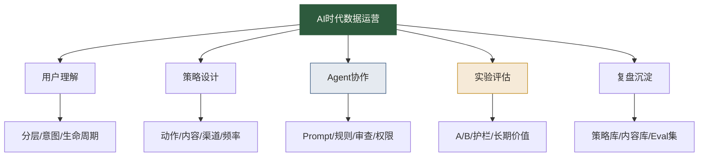

# AI时代数据运营岗位升级清单

> [!abstract] 本文定位
> 这篇文章给数据运营一个清晰升级方向：从“活动、文案、触达、日报”的执行者，升级为“用户旅程设计者、运营 Agent 管理者、增长实验负责人”。
>
> AI 不会让运营消失，但会让低质量、重复性、无复盘的运营动作越来越不值钱。

## 哪些运营工作会被明显压缩

直白说，下面这些工作会被 AI 快速提效，单独依赖它们很危险：

1. **基础文案生成**：标题、Push、短信、邮件、活动说明。
2. **活动方案初稿**：节日活动、拉新活动、召回活动、会员活动。
3. **日报周报整理**：指标变化、图表说明、基础归因假设。
4. **素材改写适配**：同一内容改成不同渠道版本。
5. **常规客服和 FAQ**：活动规则解释、流程说明、常见问题回答。

这些工作不是没价值，而是不能再作为你的核心价值。它们会变成运营人的“基础生产力”，就像 Excel 和 SQL 一样。

## AI 时代更值钱的五类运营能力

### 1. 用户理解能力

你要能判断不同用户真正处在什么状态，而不是只看粗标签。用户为什么没激活、为什么沉默、为什么复购、为什么退订，这些问题比文案本身更重要。

相关学习：[[【数据分析与数据运营】/03-数据运营专业能力/02-精细化运营/01-用户分层策略|用户分层策略]]、[[【数据分析与数据运营】/03-数据运营专业能力/02-精细化运营/03-用户生命周期管理|用户生命周期管理]]。

### 2. 策略设计能力

AI 能给你十个活动方案，但你要能判断哪个方案适合当前业务目标，哪个方案只是热闹，哪个方案短期有效但长期伤害用户。

策略设计能力包括：目标设定、人群选择、触发条件、内容框架、渠道选择、频控、实验设计和风险控制。

### 3. Agent 协作能力

运营人不一定要开发 Agent，但要会管理 Agent：

- 给它清晰任务。
- 给它数据边界。
- 给它输出格式。
- 给它拒答和追问规则。
- 审查它生成的策略和内容。
- 把错误反馈回规则库和 Eval 集。

这和 [[【AI 与大数据】/03-AI-Agent/01-AI-Agent智能体概述|AI Agent智能体概述]]、[[【数据分析与数据运营】/03-数据运营专业能力/05-AI时代数据运营/02-增长运营Agent与自动化触达|增长运营Agent与自动化触达]] 直接相关。

### 4. 实验评估能力

运营结果必须被验证。AI 生成方案越快，越要用实验筛选。

你要能设计对照组，看主指标和护栏指标，识别短期转化和长期留存之间的冲突，避免把自然波动当成活动效果。

相关学习：[[【数据分析与数据运营】/02-数据分析专业能力/02-统计分析/05-实验设计与业务落地|实验设计与A/B测试]]。

### 5. 复盘沉淀能力

未来运营团队的壁垒，不是某个人临时想了一个好点子，而是团队是否有持续积累的策略库、内容库、用户规则库和失败案例库。

AI 很适合检索和复用这些资产，但前提是你把它们沉淀出来。

## 90天升级路线

### 第1阶段：从执行者到策略卡设计者（第1-30天）

- [ ] 整理自己最近做过的 3 个运营动作。
- [ ] 把每个动作改写成目标卡、用户诊断卡、策略编排卡。
- [ ] 找出哪些环节可以由 AI 辅助完成初稿。
- [ ] 记录这些初稿的错误与不可用原因。
- [ ] 学习 [[【数据分析与数据运营】/03-数据运营专业能力/05-AI时代数据运营/01-AI时代数据运营工作流重构|AI时代数据运营工作流重构]]。

### 第2阶段：从策略卡到增长实验（第31-60天）

- [ ] 选择一个高频场景，例如新用户激活或沉默用户召回。
- [ ] 设计用户分层、触发条件、内容策略和频控规则。
- [ ] 用 AI 生成内容变体和策略备选。
- [ ] 设计实验组、对照组、主指标和护栏指标。
- [ ] 形成一个轻量增长实验方案。

### 第3阶段：从增长实验到作品集（第61-90天）

- [ ] 执行一次真实实验或用历史数据模拟复盘。
- [ ] 总结有效策略、无效策略和风险案例。
- [ ] 建立一份运营 Agent Prompt 与审查清单。
- [ ] 输出一份完整作品集：背景、问题、分层、策略、AI 协作、实验、复盘。
- [ ] 对照 [[【学习路线】/AI时代数据人/04-AI时代数据人作品集路线|AI时代数据人作品集路线]] 完成包装。

## 作品集项目建议

### 项目一：AI 辅助新用户激活实验

说明新用户为什么没有完成关键行为，如何分层，如何用 AI 生成不同触达策略，如何设计实验验证。

### 项目二：沉默用户召回 Agent 工作流

设计沉默用户识别规则、召回触发条件、内容变体、频控、负反馈指标和复盘规则。

### 项目三：会员复购个性化运营方案

围绕高价值用户、价格敏感用户、内容偏好用户设计不同复购策略，体现个性化与 LTV 思维。

### 项目四：活动方案 Eval 集

整理 20 个 AI 生成活动方案，设计审查维度，标注哪些可用、哪些危险、为什么危险。

## 简历表达示例

可以这样写：

- 构建 AI 辅助用户激活运营流程，沉淀目标卡、用户诊断卡、触达策略卡和内容审查清单，支持新用户关键行为提升实验。
- 设计沉默用户召回策略，结合用户生命周期分层、AI 文案生成和 A/B 测试，建立触达频控与负反馈监控机制。
- 搭建活动方案 Eval 表，对 AI 生成活动从目标清晰度、用户匹配度、成本、体验、合规和实验可测性六个维度进行评估。

> [!tip] 求职提醒
> 不要只写“熟练使用 AI 做运营”。要写清楚：你如何定义用户问题，如何让 AI 参与流程，如何审查输出，如何验证效果，如何沉淀方法。

## 自检清单

- [ ] 我能把运营动作说清楚目标指标，而不是只说活动形式。
- [ ] 我能根据用户状态设计不同触达策略。
- [ ] 我知道 AI 生成的文案哪里可能有风险。
- [ ] 我能设置频控和负反馈指标。
- [ ] 我能设计基础 A/B 测试。
- [ ] 我能把活动复盘沉淀成策略库。
- [ ] 我能写出运营 Agent 的任务边界和审查规则。
- [ ] 我能用一个作品集案例证明自己不是执行型运营。

如果你能勾选 6 项以上，就已经开始从传统运营执行者，走向 AI 时代的数据运营负责人。

## 继续阅读

- [[【学习路线】/AI时代数据人/10-AI时代数据运营升级路线|AI时代数据运营升级路线]]
- [[【数据分析与数据运营】/03-数据运营专业能力/05-AI时代数据运营/00-AI时代数据运营专题导览|AI时代数据运营专题导览]]
- [[【数据分析与数据运营】/04-职业成长路径/02-数据运营路径/04-数据运营职业规划|数据运营职业规划]]
- [[【求职就业专题】/00-岗位导向求职指南|数据从业者岗位导向求职指南]]
