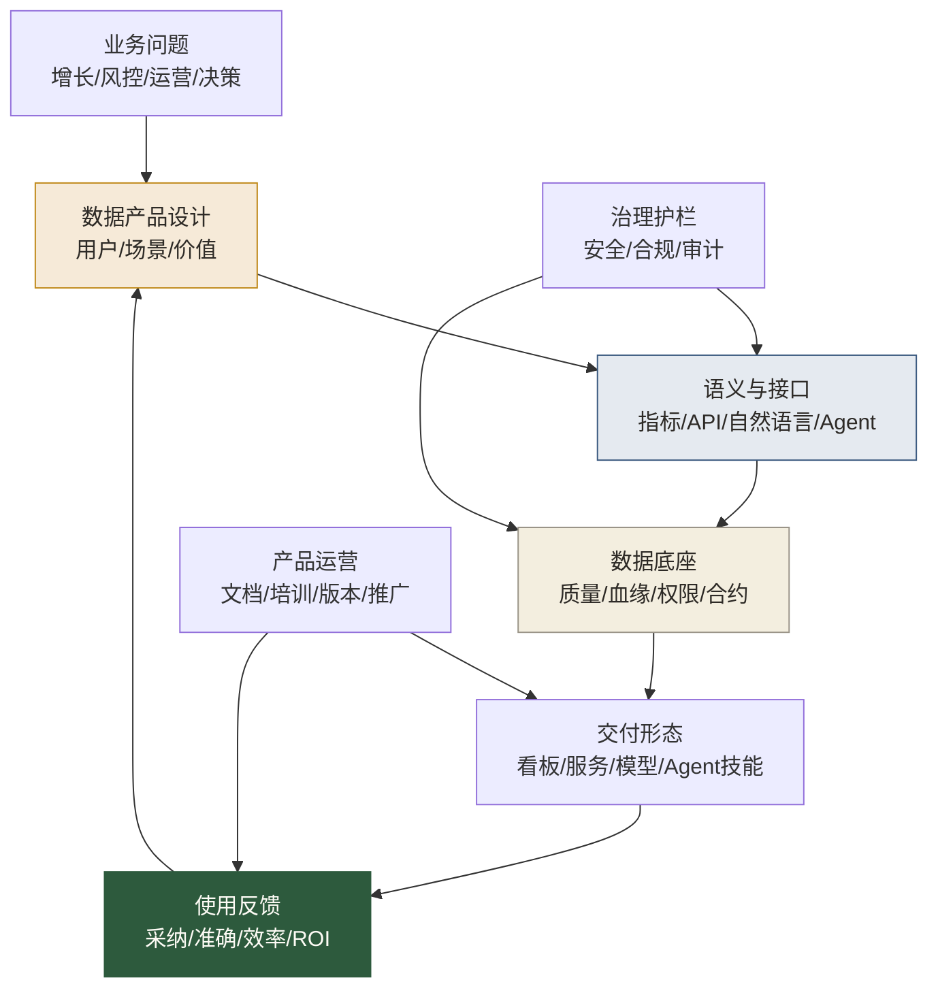

# AI时代数据产品经理专题导览

> [!abstract] 本专题定位
> 这个专题解决一个越来越关键的问题：当数据不再只是给人看，而是要被 AI Agent、自然语言查询、RAG 系统、自动化运营和智能决策系统调用时，数据产品经理到底要做什么。
>
> 过去的数据产品经理常常在“做看板、做报表、做数据平台、做指标管理”之间来回摆动。AI 时代，他要进一步升级为**数据能力产品化的负责人**：定义数据产品的用户、价值、接口、语义、权限、质量、可观测和 ROI。

## 为什么要补这个专题

前面我们已经补了三条线：

- [[【数据分析与数据运营】/02-数据分析专业能力/05-Agentic-Analytics/00-Agentic-Analytics专题导览.md|Agentic Analytics]]：解决“AI 如何参与分析”。
- [[【数据分析与数据运营】/03-数据运营专业能力/05-AI时代数据运营/00-AI时代数据运营专题导览.md|AI时代数据运营]]：解决“AI 如何参与运营动作”。
- [[【数据治理与数据管理】/02-深度研究/05-AI数据治理/10-AI-ready Data/00-AI-ready Data专题导览.md|AI-ready Data]]：解决“数据如何准备好给 AI 使用”。

但中间还缺一个角色：**谁把这些能力设计成产品？**

没有数据产品经理，AI-ready Data 可能停留在治理规范里；Agentic Analytics 可能只是一个 Demo；数据运营 Agent 可能只是一个自动群发工具。数据产品经理要做的是把它们变成可被持续使用、可被衡量、可被治理、可被迭代的产品。

## 一句话理解 AI 时代数据产品

> [!quote] 核心定义
> AI 时代的数据产品，是面向人类用户和 AI Agent 的、可发现、可理解、可调用、可治理、可衡量的数据能力封装。

它不只是一个数据集，也不只是一个看板。一个成熟的数据产品通常包含：

- 明确用户和业务场景。
- 可理解的业务语义。
- 稳定的数据接口或交互入口。
- 质量、权限、血缘和 SLA。
- 使用说明、样例问题和成功案例。
- 产品指标与价值评估。

## AI 时代数据产品全景

这张图里最重要的是反馈闭环。数据产品不是上线即结束，而是像真正的产品一样，需要看用户是否使用、是否信任、是否产生价值。

## 推荐阅读顺序

| 顺序 | 文档 | 解决的问题 | 推荐读者 |
|---|---|---|---|
| 1 | [[【数据分析与数据运营】/04-职业成长路径/03-复合型人才/05-AI时代数据产品经理/01-AI时代数据产品工作流重构.md\|AI时代数据产品工作流重构]] | 数据产品从需求到迭代的流程如何变化 | 数据产品经理、BI负责人 |
| 2 | [[【数据分析与数据运营】/04-职业成长路径/03-复合型人才/05-AI时代数据产品经理/02-数据产品PRD与需求设计.md\|数据产品PRD与需求设计]] | 如何把模糊数据需求写成可交付产品需求 | 产品、分析、数据PM |
| 3 | [[【数据分析与数据运营】/04-职业成长路径/03-复合型人才/05-AI时代数据产品经理/03-面向Agent的数据产品设计.md\|面向Agent的数据产品设计]] | 数据产品如何同时服务人和 AI Agent | 数据平台、AI-BI、治理团队 |
| 4 | [[【数据分析与数据运营】/04-职业成长路径/03-复合型人才/05-AI时代数据产品经理/04-数据产品指标体系与ROI评估.md\|数据产品指标体系与ROI评估]] | 如何证明数据产品真的有价值 | 数据产品负责人、管理者 |
| 5 | [[【数据分析与数据运营】/04-职业成长路径/03-复合型人才/05-AI时代数据产品经理/05-AI时代数据产品经理岗位升级清单.md\|AI时代数据产品经理岗位升级清单]] | 个人如何从分析/运营/开发转向数据产品 | 准备转型的数据人 |

## 本专题服务的三类人

### 1. 数据分析师和数据运营

你们最懂业务问题和使用场景，但需要补产品化思维。过去你交付报告，未来你要能把高频问题沉淀成数据产品、指标产品、分析模板或 Agent 技能。

### 2. 数据开发和数据架构

你们最懂底层实现，但需要补用户价值和产品运营。过去你交付表和服务，未来你要和产品经理一起定义接口体验、数据契约、SLA 和使用指标。

### 3. 数据治理和数据管理

你们最懂标准、质量和权限，但需要让治理成为产品能力，而不是后台制度。AI 时代，治理会体现在数据产品的可发现性、可解释性、可审计性和可调用性里。

## 和知识库其他内容的连接

- 数据产品基础：[[【数据分析与数据运营】/04-职业成长路径/03-复合型人才/02-数据产品经理之路.md|数据产品经理之路]]、[[【数据开发与数据架构】/17-技术趋势/04-数据产品架构.md|数据产品架构]]
- 服务化底座：[[【数据开发与数据架构】/07-数据服务架构/04-数据API设计.md|数据API设计]]、[[【数据开发与数据架构】/07-数据服务架构/09-语义层工程实践.md|语义层工程实践]]
- AI-ready 底座：[[【数据治理与数据管理】/02-深度研究/05-AI数据治理/10-AI-ready Data/01-AI-ready Data标准框架.md|AI-ready Data标准框架]]、[[【数据治理与数据管理】/02-深度研究/05-AI数据治理/10-AI-ready Data/03-数据合约与AI数据接口.md|数据合约与AI数据接口]]
- AI 应用入口：[[【AI 与大数据】/06-行业应用/03-Text-to-SQL自然语言查询实战.md|Text-to-SQL自然语言查询实战]]、[[【数据分析与数据运营】/02-数据分析专业能力/05-Agentic-Analytics/02-Text-to-SQL与语义层协同.md|Text-to-SQL与语义层协同]]

## 趋势参考

本专题具有时效性，建议每季度复查一次。当前判断参考了以下公开资料：

- [Gartner - Top Trends in Data and Analytics for 2025](https://www.gartner.com/en/newsroom/press-releases/2025-03-05-gartner-identifies-top-trends-in-data-and-analytics-for-2025)
- [Gartner - Lack of AI-ready Data Puts AI Projects at Risk](https://www.gartner.com/en/newsroom/press-releases/2025-02-26-lack-of-ai-ready-data-puts-ai-projects-at-risk)
- [McKinsey - Scaling data products to generate more value](https://www.mckinsey.com/capabilities/tech-and-ai/our-insights/the-missing-data-link-five-practical-lessons-to-scale-your-data-products)
- [Thoughtworks Technology Radar - Data product thinking](https://www.thoughtworks.com/en-us/radar/techniques/data-product-thinking-for-fair-data)
- [Open Data Product Specification](https://opendataproducts.org/v4.0/)
