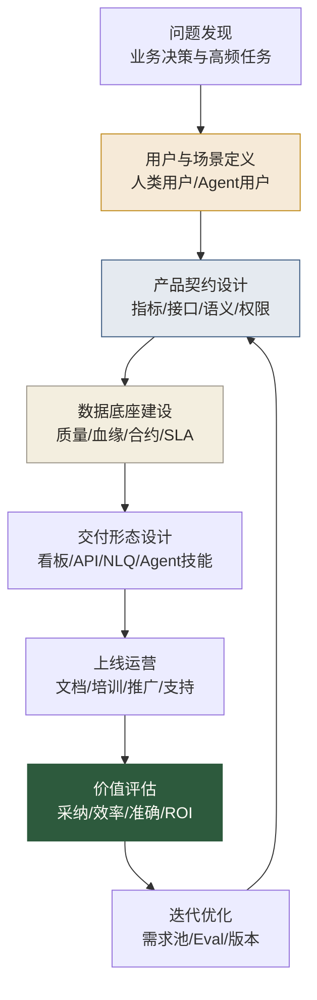

# AI时代数据产品工作流重构

> [!abstract] 本文定位
> 这篇文章回答一个具体问题：AI 时代，数据产品从需求发现、产品设计、开发交付到运营迭代，工作流应该怎么变。
>
> 传统数据产品常常止步于“做出一个看板”或“上线一个数据服务”。AI 时代的数据产品要进一步回答：这个产品能不能被业务理解、被 Agent 调用、被治理审计、被持续评估价值。

## 旧工作流的问题

传统数据产品工作流大致是：业务提需求 → 产品写 PRD → 数据开发建表 → 前端或 BI 做界面 → 上线 → 等下一批需求。

这个流程在很多公司会出现几个问题：

- 需求来源碎片化，业务说要数据，但不清楚要解决什么决策问题。
- 产品交付偏界面，忽略指标口径、权限、血缘、SLA 和数据质量。
- 上线后缺少运营，用户不用、用错、看不懂，也没人系统追踪。
- 数据产品只服务人类用户，没有考虑 AI Agent、自然语言查数和自动化流程。
- 产品价值不可衡量，只能靠“业务说有用”来证明。

AI 时代，这些问题会放大。因为数据产品不再只是被人点击，还会被 AI 读取、调用、解释和自动执行。

## 新工作流：从功能交付到数据能力产品化

这条链路里，最关键的变化是两个：第一，用户不只有人，还包括 AI Agent；第二，交付不只有页面，还包括语义、接口、契约和评估。

## 第一步：问题发现

数据产品不要从“业务想看什么字段”开始，而要从“业务要做什么决策”开始。

一个合格的问题发现至少要回答：

- 这个产品服务哪个业务目标？
- 用户现在用什么方式解决这个问题？
- 这个问题出现频率有多高？
- 如果解决了，能带来什么效率、收入、风险或体验价值？
- 这个问题是否适合产品化，而不是一次性分析？

可以用一句话判断：如果一个数据需求只出现一次，可能是分析项目；如果高频出现、多人使用、口径稳定、可以标准化，就有机会变成数据产品。

## 第二步：用户与场景定义

AI 时代，数据产品用户至少分三类：

1. **业务用户**：希望快速看懂指标、发现问题、做决策。
2. **专业用户**：分析师、运营、数据科学家，需要灵活探索和二次加工。
3. **机器用户**：AI Agent、自动化流程、自然语言查询系统，需要稳定接口和语义上下文。

过去很多数据产品只设计给前两类人。未来第三类用户会越来越重要。机器用户不会抱怨界面难用，但它会因为语义不清、权限不明、接口不稳而生成错误答案。

## 第三步：产品契约设计

数据产品必须有契约。契约不是法律文件，而是产品对用户的承诺。

契约至少包括：

- 产品解决什么问题。
- 提供哪些指标、维度和接口。
- 数据从哪里来，更新频率是多少。
- 质量标准是什么。
- 谁可以访问，哪些字段敏感。
- 出错时如何告警和追责。
- 版本变化如何通知用户。

这和 [[【数据治理与数据管理】/02-深度研究/05-AI数据治理/10-AI-ready Data/03-数据合约与AI数据接口|数据合约与AI数据接口]] 直接相连。

## 第四步：交付形态设计

同一个数据产品可以有多种交付形态：

- 给管理层：经营看板。
- 给分析师：标准宽表、指标模型、语义层。
- 给开发者：数据 API、事件流、SDK。
- 给 AI Agent：可读语义、样例问题、权限策略、工具调用接口。

数据产品经理要判断哪个形态最适合场景，而不是默认做一个看板。

## 第五步：上线运营

数据产品上线后需要运营。很多数据产品失败，不是因为做不出来，而是因为没人会用、没人信、没人持续维护。

上线运营包括：

- 产品文档和示例场景。
- 指标口径培训。
- 用户答疑和使用支持。
- 使用数据监控。
- 用户反馈收集。
- 版本变更公告。
- 典型成功案例传播。

这部分听起来不像“高级技术”，但决定了数据产品能不能被采用。

## 第六步：价值评估

AI 时代的数据产品必须能证明价值。仅仅“上线了”不够。

可以评估：

- 有多少用户使用。
- 高频场景是否被覆盖。
- 是否减少重复取数和重复分析。
- 是否提升决策速度。
- 是否降低口径争议。
- 是否支撑 AI-BI 或 Agent 的准确回答。
- 是否带来收入、留存、转化、风控或成本价值。

详细方法见 [[【数据分析与数据运营】/04-职业成长路径/03-复合型人才/05-AI时代数据产品经理/04-数据产品指标体系与ROI评估|数据产品指标体系与ROI评估]]。

## 30天落地练习

### 第1周：选一个高频数据需求

例如销售经营看板、活动效果查询、用户生命周期分析、渠道转化监控。判断它是否适合产品化。

### 第2周：定义用户和场景

把用户分成业务用户、专业用户和机器用户，分别写出他们的需求、使用方式和成功标准。

### 第3周：设计产品契约

补齐指标、接口、语义、权限、质量、SLA 和版本机制。

### 第4周：写出 MVP 方案

不要追求大而全。先设计一个最小可用数据产品：一个核心场景、三到五个指标、一组样例问题、一个交付入口、一个价值指标。

## 继续阅读

- [[【数据分析与数据运营】/04-职业成长路径/03-复合型人才/05-AI时代数据产品经理/02-数据产品PRD与需求设计|数据产品PRD与需求设计]]
- [[【数据分析与数据运营】/04-职业成长路径/03-复合型人才/05-AI时代数据产品经理/03-面向Agent的数据产品设计|面向Agent的数据产品设计]]
- [[【数据开发与数据架构】/17-技术趋势/04-数据产品架构|数据产品架构]]
