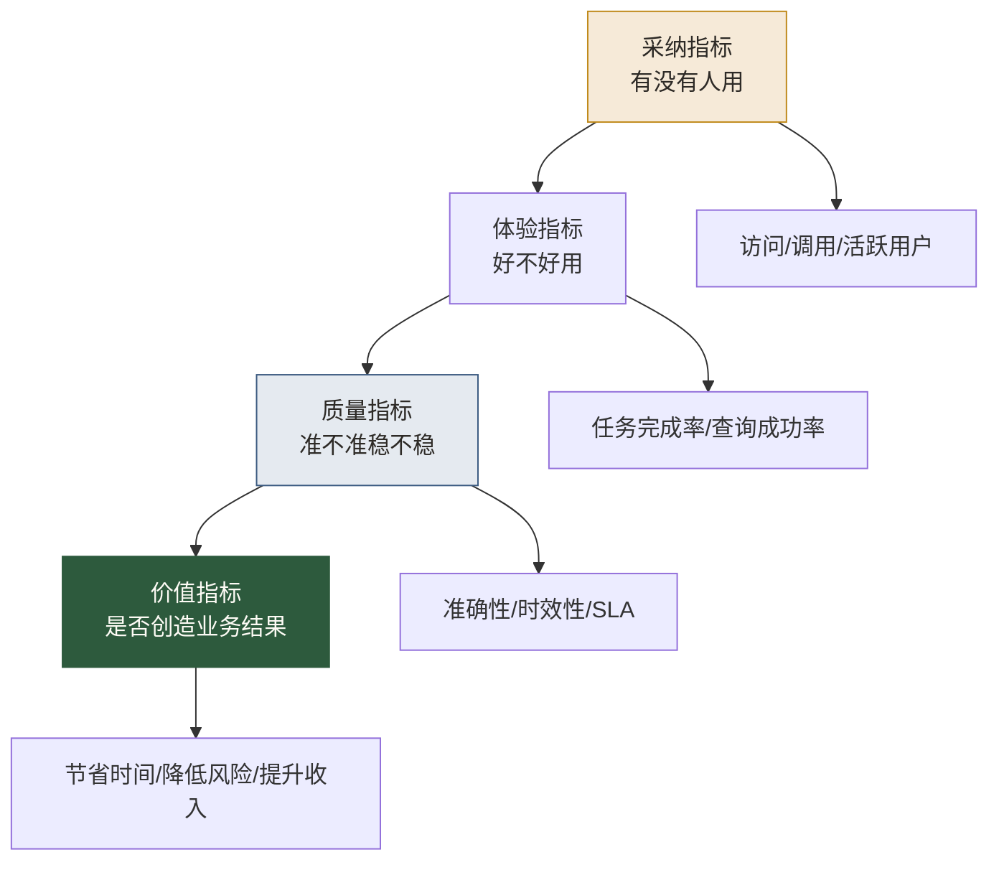

# 数据产品指标体系与ROI评估

> [!abstract] 本文定位
> 数据产品最尴尬的地方，是投入很大，却很难说清楚价值。上线了多少看板、建设了多少指标、开发了多少接口，都不等于产生了业务价值。
>
> 这篇文章讲的是：数据产品经理如何建立一套能证明价值、指导迭代、约束资源投入的指标体系。

## 数据产品为什么难评估

普通产品可以看活跃、留存、转化、收入。数据产品也能看这些，但不够。

因为数据产品的价值往往是间接的：

- 它减少了重复取数时间。
- 它降低了口径争议。
- 它提升了决策速度。
- 它减少了错误决策。
- 它让 AI-BI 回答更准确。
- 它让业务系统可以自动调用数据能力。

这些价值不一定直接体现为收入，但会体现在效率、质量、风险和增长上。

## 数据产品指标的四层体系



这四层要一起看。只有采纳没有质量，会制造错误；只有质量没有采纳，是没人用的精品；只有体验没有价值，是漂亮的玩具。

## 第一层：采纳指标

采纳指标回答“有没有人用”。

常见指标：

- 月活用户数。
- 关键用户覆盖率。
- 查询次数或 API 调用量。
- 高频场景覆盖率。
- 数据产品目录访问量。
- 新用户激活率。
- 复用率。

但采纳指标要防止虚高。一个看板被打开很多次，不代表它真的支持了决策。

## 第二层：体验指标

体验指标回答“用户是否顺利完成任务”。

常见指标：

- 任务完成率。
- 平均查数时间。
- 自助解决率。
- 查询失败率。
- 文档搜索成功率。
- 用户满意度。
- 支持工单数量。

AI 时代还要补充：

- 自然语言查询成功率。
- Agent 工具调用成功率。
- 需要人工兜底的比例。
- 澄清问题比例。

## 第三层：质量指标

质量指标回答“数据是否可信”。

常见指标：

- 数据准确性。
- 完整性。
- 一致性。
- 及时性。
- SLA 达成率。
- 数据延迟。
- 口径变更次数。
- 高风险错误数量。

质量指标要和 [[【数据治理与数据管理】/02-深度研究/05-AI数据治理/10-AI-ready Data/01-AI-ready Data标准框架|AI-ready Data标准框架]] 连接起来，否则产品指标和治理指标会脱节。

## 第四层：价值指标

价值指标回答“是否创造结果”。

可以从四类价值看：

### 1. 效率价值

例如减少取数人天、缩短决策周期、降低分析等待时间、减少重复报表维护。

### 2. 质量价值

例如降低指标口径争议、减少错误报表、提升 AI-BI 回答准确率、减少数据事故。

### 3. 风险价值

例如降低越权访问风险、提升审计可追踪性、减少合规问题、减少敏感数据暴露。

### 4. 业务价值

例如提升转化率、减少流失、提高销售效率、降低运营成本、提升风控拦截率。

## ROI 估算方法

数据产品 ROI 可以用一个朴素公式：

```text
数据产品ROI = (可量化收益 - 产品总成本) / 产品总成本 × 100%

可量化收益 = 效率节省 + 收入提升 + 成本降低 + 风险损失减少
产品总成本 = 开发成本 + 运维成本 + 治理成本 + 培训运营成本
```

不要被公式吓住。很多时候不需要算到小数点后两位，只要能用合理假设说明价值区间，就比“感觉有用”强。

## AI-BI 数据产品的特殊指标

如果数据产品服务 AI-BI 或 Agent，需要额外关注：

- 高频问题通过率。
- 指标口径误用次数。
- Agent 越权请求阻断次数。
- 自然语言问题澄清率。
- AI 生成 SQL 正确率。
- AI 解释错误分级。
- Eval 回归通过率。

这些指标对应 [[【数据分析与数据运营】/02-数据分析专业能力/05-Agentic-Analytics/03-AI-BI评估体系与误差治理|AI-BI评估体系与误差治理]]。

## 数据产品价值看板

一个成熟的数据产品应该有自己的产品看板，而不是只给别人做看板。

看板至少包含：

- 用户采纳。
- 高频场景。
- 查询成功率。
- 数据质量。
- SLA。
- 问题工单。
- 版本变更。
- 价值案例。
- AI 评估结果。

> [!tip] 一个判断标准
> 如果一个数据产品没有自己的指标体系，它就还不是一个真正的产品，只是一个交付物。

## 继续阅读

- [[【数据分析与数据运营】/02-数据分析专业能力/01-分析方法论/01-指标体系构建|指标体系构建]]
- [[【数据开发与数据架构】/07-数据服务架构/07-数据服务监控|数据服务监控]]
- [[【数据分析与数据运营】/04-职业成长路径/03-复合型人才/05-AI时代数据产品经理/05-AI时代数据产品经理岗位升级清单|AI时代数据产品经理岗位升级清单]]
