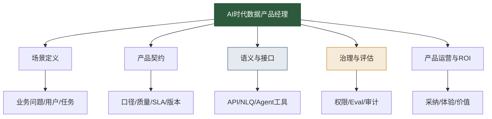

# AI时代数据产品经理岗位升级清单

> [!abstract] 本文定位
> AI 时代的数据产品经理，不再只是“做数据看板的产品经理”，而是数据能力产品化的负责人。他要把数据、语义、接口、权限、AI Agent、业务场景和价值评估放在同一张图里设计。

## 哪些数据产品工作会被压缩

下面这些工作会被 AI 明显提效：

1. **PRD 初稿生成**：页面说明、流程描述、用户故事。
2. **竞品和资料整理**：数据产品案例、功能清单、方案对比。
3. **指标文档初稿**：指标说明、字段解释、FAQ。
4. **用户反馈摘要**：工单归类、访谈纪要整理。
5. **看板原型草图**：布局建议、图表选择、交互流程。

这些事情仍然要做，但不再构成核心壁垒。核心壁垒会转移到：场景判断、产品契约、语义设计、AI 评估、价值证明和跨团队推动。

## AI时代数据产品经理的五项能力

### 1. 场景定义能力

你要能判断一个数据需求是否值得产品化。不是所有需求都要做成产品。高频、稳定、多人使用、有明确价值、能标准化的需求，才适合产品化。

### 2. 产品契约能力

你要能把数据产品的承诺写清楚：服务什么场景、提供什么指标、刷新多快、质量如何、谁负责、谁能访问、怎么变更。

### 3. 语义与接口能力

你不一定亲自写 API，但必须懂接口和语义。AI 时代，数据产品要能被人看，也要能被 Agent 调用。

相关学习：[[【数据开发与数据架构】/07-数据服务架构/09-语义层工程实践|语义层工程实践]]、[[【数据开发与数据架构】/07-数据服务架构/04-数据API设计|数据API设计]]。

### 4. 治理与评估能力

数据产品经理要懂数据质量、权限、血缘、审计和 Eval。否则产品体验越顺滑，风险扩散越快。

### 5. 产品运营与 ROI 能力

数据产品上线后，要看使用、看反馈、看价值、看成本。没有运营的数据产品，很容易变成无人维护的“漂亮遗产”。

## 三类转型路径

### 从数据分析师转型

优势是懂业务问题和指标。需要补产品设计、需求管理、技术协调和数据服务化。

建议作品集：把一个高频分析需求改造成数据产品 PRD，包含指标口径、用户场景、交付形态和价值评估。

### 从数据运营转型

优势是懂用户旅程和业务动作。需要补数据底座、产品化思维和接口意识。

建议作品集：把一个运营场景沉淀为“用户生命周期数据产品”，支持分层、触达、实验和复盘。

### 从数据开发转型

优势是懂技术实现和数据链路。需要补用户研究、产品运营和商业价值表达。

建议作品集：把一套数据服务包装为可发现、可调用、可评估的数据产品。

## 90天升级路径

### 第1阶段：从需求执行到产品判断（第1-30天）

- [ ] 整理最近 5 个数据需求。
- [ ] 判断哪些是一次性分析，哪些适合产品化。
- [ ] 选择一个高频需求，写出用户、场景和价值。
- [ ] 学习 [[【数据分析与数据运营】/04-职业成长路径/03-复合型人才/05-AI时代数据产品经理/01-AI时代数据产品工作流重构|AI时代数据产品工作流重构]]。

### 第2阶段：从产品判断到契约设计（第31-60天）

- [ ] 写出一份数据产品 PRD。
- [ ] 补齐指标口径、数据来源、权限、SLA 和验收标准。
- [ ] 为 AI Agent 增加样例问题、拒答规则和 Eval 维度。
- [ ] 与分析、开发、治理角色分别做一次需求评审模拟。

### 第3阶段：从契约设计到作品集（第61-90天）

- [ ] 设计一个 MVP 交付形态：看板、API、语义层或 Agent 技能。
- [ ] 建立数据产品价值指标体系。
- [ ] 输出一份完整案例：背景、用户、PRD、契约、AI 支持、ROI 评估。
- [ ] 按照 [[【学习路线】/AI时代数据人/04-AI时代数据人作品集路线|AI时代数据人作品集路线]] 做作品集包装。

## 作品集项目建议

### 项目一：销售经营数据产品

围绕销售负责人、销售运营和 AI 助手，设计一个支持渠道质量、转化漏斗和收入预测的数据产品。

### 项目二：用户生命周期数据产品

服务增长运营和运营 Agent，提供用户分层、触达建议、实验效果和复盘数据。

### 项目三：指标语义层产品

选择一个业务域，设计指标目录、同义词、样例问题、正确 SQL 和权限规则。

### 项目四：面向 Agent 的数据产品说明卡

把一个已有数据集包装成 Agent 可安全调用的数据产品，包含发现层、语义层、接口层、治理层和 Eval 层。

## 简历表达示例

可以这样写：

- 设计面向 AI-BI 的经营数据产品，沉淀指标口径、语义说明、样例问题和权限规则，支持业务用户自然语言查数和分析师自助探索。
- 将高频销售分析需求产品化，定义数据产品 PRD、数据契约、SLA 和 ROI 指标，减少重复取数和口径沟通成本。
- 构建面向 Agent 的数据产品说明卡，覆盖可用场景、拒答规则、敏感字段、Eval 问题和错误分级。

> [!tip] 求职提醒
> 不要只写“做过数据看板”。要写清楚：你服务了什么业务场景，如何定义数据产品契约，如何支持 AI 或自助分析，如何证明产品价值。

## 继续阅读

- [[【学习路线】/AI时代数据人/11-AI时代数据产品经理升级路线|AI时代数据产品经理升级路线]]
- [[【数据分析与数据运营】/04-职业成长路径/03-复合型人才/02-数据产品经理之路|数据产品经理之路]]
- [[【数据开发与数据架构】/17-技术趋势/04-数据产品架构|数据产品架构]]
- [[【求职就业专题】/00-岗位导向求职指南|数据从业者岗位导向求职指南]]
