# 跨部门合作艺术 - 数据从业者的协作智慧

> [!abstract] 📋 本节概览
> - 🎯 **学习目标**：掌握高效跨部门合作的方法和技巧
> - 📚 **前置知识**：[[【数据分析与数据运营】/04-职业成长路径/04-职场发展/01-个人品牌建设|个人品牌建设]] 和 [[【数据分析与数据运营】/04-职业成长路径/03-复合型人才/01-数据分析与运营的融合|数据分析与运营的融合]]
> - ⏱️ **预计用时**：28分钟
> - 💡 **关键收获**：提升在复杂组织环境中的协作能力和影响力

## 😤 "我的分析报告做得很好，但为什么没人配合执行？"

**跨部门协作困局中的无奈挣扎：**

**数据分析师小张的困扰**："我花了一周时间分析出了用户流失的根本原因，但产品部说这不是优先级，运营部说没资源执行..."

**项目推进时的四面碰壁**：
- 技术部门："你这个需求太复杂了，至少要3个月才能做完"
- 市场部门："我们现在忙着做促销活动，没时间看数据报告"  
- 产品部门："这个优化方案用户不一定买账，风险太大"
- 老板问："为什么这个项目进展这么慢？"

**会议室里的尴尬时刻**：
- 开会时大家都说"很好很好"，散会后没人真正行动
- 各部门都有自己的小算盘，总是推诿扯皮
- 明明是共同的目标，却感觉在单打独斗

**沟通中的"鸡同鸭讲"**：
- 跟技术说业务需求，他们说"不可能，系统不支持"
- 跟业务说技术限制，他们说"别的公司都能做，为什么我们不行"
- 跟老板汇报进展，老板说"我不关心过程，我只要结果"

**更深层的职场挫败感**：
- "为什么我做的工作总是得不到其他部门的支持？"
- "明明大家都是为了公司好，为什么合作这么难？"
- "我是不是不适合做这种需要协调的工作？"

**发现问题症结的时刻**：
- 每个部门都有自己的KPI和利益考虑
- 缺乏有效的沟通方式和协作机制
- 没有建立起足够的信任和影响力

**最让人郁闷的现实**："技术能力强，但推不动项目；分析做得好，但改变不了现状..."

**这种"个人能力强，但协作效果差，项目总是卡壳"的职场困境：**

很多数据从业者都遇到过这样的挑战：
- 🎯 **专业能力很强，但影响力不够**：会分析数据但推不动决策，报告写得很好但没人执行
- 🤝 **各说各话，难以达成共识**：技术语言和业务语言之间存在沟通屏障  
- 🚀 **项目推进困难，总是遇到阻力**：没有直接管理权限，难以协调其他部门资源
- ⚖️ **利益冲突复杂，难以平衡**：不同部门有不同诉求，很难找到平衡点

**跨部门合作艺术**就是要让你从"单打独斗的分析师"升级为"协调各方的项目推动者"，掌握在复杂组织环境中有效协作的智慧，让你的专业能力真正转化为组织影响力。
## 🎯 跨部门合作的四个核心维度

```mermaid
%%{init: {"theme":"base","themeVariables":{"fontFamily":"PingFang SC, -apple-system, Source Han Serif SC, serif","fontSize":"16px","background":"#FDFBF5","primaryColor":"#FDFBF5","primaryTextColor":"#2D2A26","primaryBorderColor":"#6E6A60","secondaryColor":"#E8EFE8","secondaryBorderColor":"#8FA890","secondaryTextColor":"#2D2A26","tertiaryColor":"#FDFBF5","tertiaryBorderColor":"#9A9488","tertiaryTextColor":"#6E6A60","lineColor":"#6E6A60","textColor":"#2D2A26","mainBkg":"#FDFBF5","nodeBorder":"#2D5A3D","clusterBkg":"#F3EEDF","clusterBorder":"#9A9488","edgeLabelBackground":"#FDFBF5"},"flowchart":{"htmlLabels":true,"curve":"basis","padding":20,"nodeSpacing":60,"rankSpacing":70,"useMaxWidth":false},"themeCSS":".node rect, .node polygon, .node circle { stroke-width: 1.5px; } .edgePath .path { stroke-width: 1.5px; } .cluster-label .nodeLabel, .cluster-label foreignObject { color: #2D2A26 !important; } .edgeLabel, .edgeLabel foreignObject { color: #2D2A26 !important; background-color: #FDFBF5; } .edgeLabel rect { fill: #FDFBF5; }"}}%%
graph TD
    classDef default fill:#FDFBF5,stroke:#6E6A60,color:#2D2A26,stroke-width:1.5px
    classDef startend fill:#2D2A26,stroke:#2D2A26,color:#FDFBF5,font-weight:bold
    classDef decision fill:#F6EAD8,stroke:#C08A1A,color:#2D2A26,font-weight:bold
    classDef hub fill:#3B5A80,stroke:#3B5A80,color:#FDFBF5,font-weight:bold
    classDef io fill:#E5EAF0,stroke:#3B5A80,color:#2D2A26
    classDef accent fill:#A6432C,stroke:#A6432C,color:#FDFBF5,font-weight:bold
    classDef storage fill:#F3EEDF,stroke:#9A9488,color:#2D2A26
    A[跨部门合作精英能力模型] --> B[沟通翻译能力]
    A --> C[利益协调能力]
    A --> D[项目推进能力]
    A --> E[信任建设能力]
    
    B --> B1[多语言沟通<br/>• 技术语言 → 业务语言<br/>• 数据洞察 → 可行动指导<br/>• 复杂概念 → 直观表达]
    B --> B2[影响力沟通<br/>• 结构化表达方式<br/>• 数据驱动的说服<br/>• 视觉化辅助工具]
    
    C --> C1[利益分析框架<br/>• 各部门核心关切识别<br/>• 冲突点和平衡点<br/>• 共赢解决方案]
    C --> C2[利益协调策略<br/>• 分阶段实施方案<br/>• 风险共担机制<br/>• 价值共创体系]
    
    D --> D1[项目管理框架<br/>• 无权威影响模式<br/>• 跨部门协调机制<br/>• 目标与成果管理]
    D --> D2[项目推进策略<br/>• 仪式感和重要性<br/>• 激励机制设计<br/>• 风险管理体系]
    
    E --> E1[信任建设元素<br/>• 可靠性形象打造<br/>• 价值贡献展示<br/>• 情感连接建立]
    E --> E2[信任维护机制<br/>• 持续价值输出<br/>• 互惠互利合作<br/>• 长期伙伴关系]
    class A,B,C,D,E,B1,B2,C1,C2,D1,D2,E1,E2 default
```



> [!success] 跨部门合作成功核心原则
> 
> 跨部门合作的成功不仅仅取决于专业技能，更关键的是对人性、组织动力和利益结构的深度理解。最优秀的数据从业者都是“技术+人文”的复合型人才，他们不仅能做出优秀的分析，更能让分析产生真正的商业价值。

### 第一维度：沟通翻译能力 🗣️

> [!abstract] 🎯 核心技能
> 能够在不同的"语言体系"之间进行有效翻译，让各部门都能理解数据的价值和意义。

**如何成为优秀的"部门间翻译官"？**

想象一下，你要向一个5岁的孩子解释什么是机器学习。你不能说"这是一种基于统计学习理论的算法"，而要说"这就像教电脑学会认识小猫小狗一样"。跨部门沟通也需要这样的"翻译"能力。

**技术语言向业务语言的翻译：**

**案例对比：**
```text
❌ 技术语言："我们需要优化ETL流程，提升数据质量"
✅ 业务语言："我们要让报表数据更准确、更及时，帮你们做出更好的决策"

❌ 技术语言："这个算法的准确率是85%，召回率是78%"
✅ 业务语言："这个系统的整体分类正确比例是85%，能识别出实际目标客户中的78%；是否能让营销投入更精准，还需结合精确率和实际营销效果评估"
```

**业务需求向技术需求的翻译：**

**翻译框架：**
- **业务目标** → **数据需求** → **技术实现**
- **效果期望** → **评估指标** → **监控方案**
- **时间要求** → **开发计划** → **资源配置**

**沟通技巧实践：**

**结构化表达**
- 先说结论，再说原因
- 用数字说话，用事实支撑
- 分层次展开，逻辑清晰
- 留出提问和讨论的空间

**可视化辅助**
- 用图表展示数据趋势
- 用流程图说明工作步骤
- 用对比图突出改进效果
- 用原型展示最终成果

### 第二维度：利益协调能力 ⚖️

> [!abstract] 🎯 核心技能
> 能够理解各部门的核心利益诉求，在冲突中找到平衡点，实现多方共赢。

**如何理解各部门的核心关切？**

每个部门就像一个独特的"部落"，有自己的文化、价值观和生存法则。要想有效合作，必须深入理解每个"部落"真正在乎什么。

**主要部门的核心关切分析：**

**技术部门：**
- **最关心的**: 系统稳定性、技术先进性、代码质量
- **最害怕的**: 系统崩溃、技术债务、无休止的需求变更
- **合作要点**: 给足技术调研时间，尊重技术判断，明确需求边界

**业务部门：**
- **最关心的**: 业务目标达成、市场响应速度、客户满意度
- **最害怕的**: 错失市场机会、竞争对手超越、客户流失
- **合作要点**: 快速响应业务需求，提供可落地的方案，关注业务价值

**产品部门：**
- **最关心的**: 用户体验、产品功能、版本迭代
- **最害怕的**: 用户流失、功能缺陷、产品方向错误
- **合作要点**: 从用户角度思考问题，提供产品洞察，支持功能优化

**财务部门：**
- **最关心的**: 成本控制、投资回报、合规风险
- **最害怕的**: 超支风险、不合规操作、投资浪费
- **合作要点**: 明确成本预算，量化投资回报，确保合规操作

**利益协调的实用策略：**

**寻找共同目标**
在看似冲突的利益背后，往往有共同的更高层次目标。比如"提升用户满意度"可能是所有部门的共同目标。

**分阶段实施方案**
将大项目分解为小阶段，让各部门都能在不同阶段获得收益，减少一次性投入的压力。

**建立风险共担机制**
让各部门都承担一定的项目风险，同时也分享项目收益，形成利益共同体。

### 第三维度：项目推进能力 🚀

> [!abstract] 🎯 核心技能
> 能够在没有直接管理权限的情况下，推动跨部门项目的顺利进行。

**无权威影响的项目管理艺术**

跨部门合作最大的挑战在于，你往往没有对其他部门成员的直接管理权限，但却需要协调他们的工作。这就像要指挥一个乐团，但你不是指挥家，而是其中一个演奏者。

**项目推进的关键策略：**

**建立项目仪式感**
- 正式的项目启动会议
- 定期的进度同步会议
- 阶段性的成果展示会
- 项目完成的庆祝活动

**制定清晰的游戏规则**
- 明确的角色分工和责任边界
- 统一的沟通渠道和汇报流程
- 标准的交付物和质量标准
- 透明的进度跟踪和问题解决机制

**建立激励机制**
- 突出各部门在项目中的贡献
- 让项目成果为各部门加分
- 提供学习和成长的机会
- 给予充分的认可和感谢

**风险管理和应急预案**
- 提前识别可能的风险点
- 制定应对风险的备选方案
- 建立快速决策和调整机制
- 保持与高层管理者的沟通

### 第四维度：信任建设能力 🤝

> [!abstract] 🎯 核心技能
> 能够在合作中建立深层的信任关系，让其他部门愿意与你长期合作。

**信任建设的关键要素**

信任就像是合作的"粘合剂"，有了信任，很多原本复杂的事情都会变得简单。但信任的建立需要时间，也需要正确的方法。

**建立信任的实用方法：**

**言出必行，建立可靠形象**
- 承诺的事情一定要做到
- 做不到的事情不要轻易承诺
- 遇到困难及时沟通，不隐瞒问题
- 始终保持专业和诚实的态度

**主动帮助，建立价值认知**
- 在力所能及的范围内帮助其他部门
- 分享有用的信息和资源
- 提供专业建议和支持
- 在关键时刻挺身而出

**换位思考，建立情感连接**
- 理解其他部门的难处和压力
- 在冲突中寻找双方都能接受的解决方案
- 给予其他部门充分的尊重和认可
- 保持开放和包容的心态

## 🛠️ 常见跨部门合作场景攻略

### 场景一：与技术部门的合作 💻

**典型挑战：**
- 技术实现复杂度超出预期
- 技术团队优先级安排紧张
- 需求理解存在偏差
- 交付时间压力较大

**合作攻略：**

**需求沟通策略**
- 提前做好技术可行性调研
- 用技术人员能理解的语言描述需求
- 提供详细的需求文档和原型
- 允许技术团队参与方案设计

**时间管理技巧**
- 了解技术团队的迭代周期
- 提前规划和预留开发时间
- 分阶段交付，减少一次性压力
- 建立缓冲时间应对突发问题

**质量保障方法**
- 定义清晰的验收标准
- 建立定期的进度检查机制
- 鼓励早期反馈和快速迭代
- 重视测试和质量保证环节

### 场景二：与业务部门的合作 📊

**典型挑战：**
- 业务需求变化频繁
- 对数据项目的期望过高
- 缺乏技术背景理解
- 急于看到短期效果

**合作攻略：**

**期望管理策略**
- 在项目初期设定合理期望
- 用业务语言解释技术限制
- 提供阶段性的成果展示
- 建立长期价值的认知

**需求管理技巧**
- 建立正式的需求变更流程
- 评估需求变更的影响和成本
- 优先满足核心业务需求
- 引导业务团队理性思考需求

**价值证明方法**
- 用业务指标衡量项目成果
- 提供具体的ROI计算
- 分享成功案例和最佳实践
- 建立数据驱动的决策文化

### 场景三：与管理层的合作 👔

**典型挑战：**
- 汇报层级复杂
- 决策周期较长
- 关注点偏向战略层面
- 对技术细节了解有限

**合作攻略：**

**汇报技巧**
- 突出项目的战略价值和商业意义
- 用简洁清晰的方式展示关键信息
- 提供多个方案供选择
- 主动汇报风险和应对策略

**决策支持**
- 提供充分的数据和分析支撑
- 预测不同决策的可能后果
- 给出明确的建议和理由
- 建立快速反馈和调整机制

## ✅ 跨部门合作能力自评清单

**基础能力评估** ⭐
- [ ] 我能够理解不同部门的核心关切和利益诉求
- [ ] 我能够用对方能理解的语言进行沟通
- [ ] 我能够在冲突中保持冷静和客观
- [ ] 我能够建立基本的工作关系

**核心能力评估** ⭐⭐
- [ ] 我能够主导跨部门项目的规划和执行
- [ ] 我能够在利益冲突中找到平衡点
- [ ] 我能够建立有效的协作机制和流程
- [ ] 我能够获得其他部门的信任和支持

**高级能力评估** ⭐⭐⭐
- [ ] 我能够影响组织的跨部门协作文化
- [ ] 我能够化解复杂的组织政治和利益冲突
- [ ] 我能够建立长期稳定的合作伙伴关系
- [ ] 我能够成为组织内的协作典范

## 🎯 实用工具和方法

**沟通工具箱**
- STAR法则：情况-任务-行动-结果
- 金字塔原理：结论先行，以上统下
- 5W2H方法：Who-What-When-Where-Why-How-How much
- DISC沟通风格分析

**项目管理工具**
- 甘特图：项目进度规划和跟踪
- RACI矩阵：角色职责分工
- 风险管理表：风险识别和应对
- 干系人分析：利益相关者管理

**冲突解决工具**
- 双赢思维：寻找共同利益
- 积极倾听：理解对方观点
- 分离立场和利益：关注根本需求
- 创造性替代方案：跳出零和游戏

> [!quote] 跨部门合作的智慧精髓
> 
> 跨部门合作是数据从业者的必修课，它考验的不仅是专业技能，更是对人性和组织动力的深度洞察。
> 
> **核心智慧**：真正的合作不是争输赢，而是创造共赢。当我们能够帮助其他部门实现目标时，我们的专业价值也会得到最大的体现。
> 
> **行动指南**：
> - 始终以创造价值为核心目标
> - 理解并尊重不同部门的文化差异
> - 用数据和事实说话，用真诚和耐心合作
> - 建立长期伙伴关系，而不仅仅是项目合作
