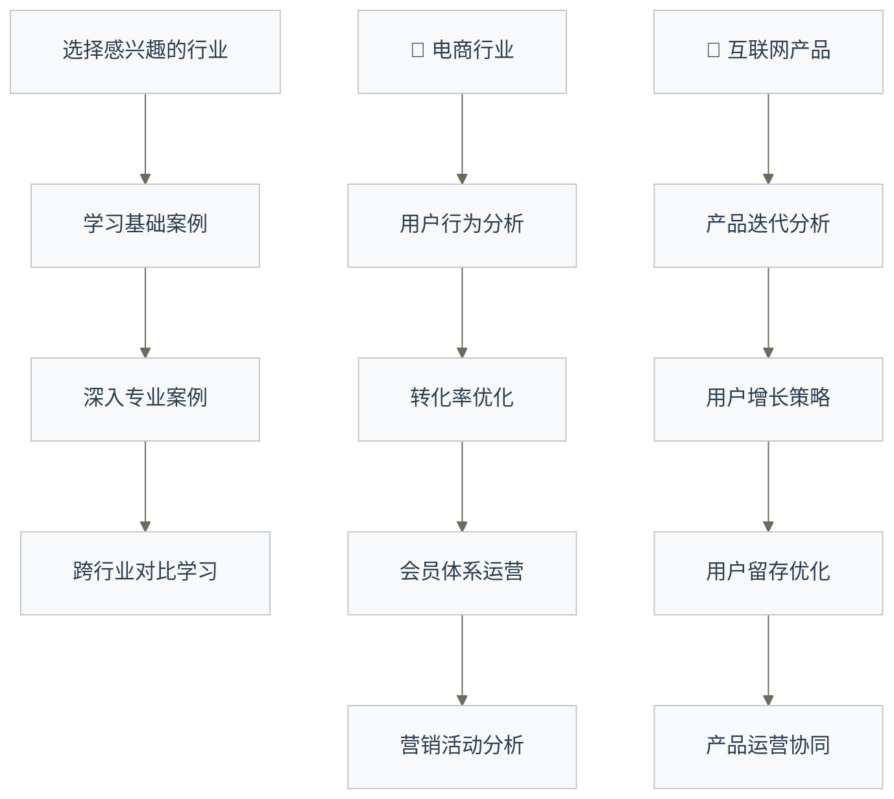

# 场景实战案例 - 业务场景学习导览

> [!note] 案例来源边界
> 本页提供行业场景与学习方向，不证明所列案例均为已核实企业项目。具体页面的来源、数据获取、教学假设和交付范围需逐篇确认；不得将案例学习写成真实工作经历。

> [!abstract] 🎯 模块概览
> - 🎯 **学习目标**：将理论知识应用到真实业务场景中
> - 📚 **前置知识**：建议完成基础能力和专业技能模块
> - ⏱️ **学习方式**：基于真实案例的项目式学习
> - 🎭 **覆盖范围**：四大主流行业的典型数据应用场景

## 🚀 从理论到实战的"最后一公里"

场景实战案例是**将数据分析理论转化为实际业务价值的关键桥梁**，通过真实行业案例的深度剖析，让你具备从数据洞察到业务决策的完整能力。

**实战案例学习的独特价值**：
- 🎯 **能力验证**：在真实业务场景中检验和强化理论知识
- 💼 **经验积累**：通过案例学习快速获得跨行业实战经验  
- 🧠 **思维升级**：培养从数据到决策的商业思维能力
- ⚡ **职场就绪**：掌握企业最需要的实际问题解决能力

从电商巨头到金融科技，从内容平台到互联网产品，每个成功案例背后都有系统的数据分析方法论在发挥作用。
## 💡 四大行业实战场景

> [!note] 🛒 **电商行业** - 交易数据的深度挖掘
> 从用户行为分析到转化优化，从会员体系运营到营销活动分析，掌握电商数据分析的核心方法。

> [!note] 📱 **互联网产品** - 产品数据的精细运营
> 产品迭代分析、用户增长策略、留存优化、产品运营协同，构建完整的产品数据体系。

> [!note] 💰 **金融行业** - 风控与精准营销的数据应用
> 风险控制分析、用户画像应用、产品推荐优化、金融营销策略，掌握金融数据的特殊应用。

> [!note] 📝 **内容平台** - 内容生态的数据驱动
> 内容分发优化、用户互动提升、创作者生态运营、社区活跃度分析，构建内容平台数据体系。

## 🗺️ 学习路径设计

### 📅 建议学习顺序

### 🎯 各行业学习重点

| 行业 | 核心场景 | 关键指标 | 分析方法 |
|---|---|---|---|
| **电商** | 交易转化链 | GMV、转化率、客单价 | [[【数据分析与数据运营】/05-场景实战案例/01-电商行业/02-转化率优化\|转化率优化]]、用户分群 |
| **互联网产品** | 用户生命周期 | DAU、留存率、LTV | 队列分析、增长模型 |
| **金融** | 风险与收益 | 风险评分、转化率、ROI | 评分卡、预测模型 |
| **内容平台** | 内容生态 | 活跃度、互动率、创作量 | 推荐算法、社交网络分析 |

## 🛠️ 实战技能栈

### 分析工具应用
- **数据处理工具**：SQL查询语言 和 Python数据处理 pandas
- **可视化**：Tableau、Python可视化库
- **[[【数据分析与数据运营】/02-数据分析专业能力/02-统计分析/01-统计分析基础|统计分析]]**：假设检验、A/B测试
- **[[【数据分析与数据运营】/02-数据分析专业能力/03-建模与预测/04-机器学习应用|机器学习]]**：[[【数据分析与数据运营】/02-数据分析专业能力/03-建模与预测/02-分类与聚类|分类与聚类]] 和 [[【数据分析与数据运营】/02-数据分析专业能力/02-统计分析/03-相关与回归|相关与回归]] 方法

### 业务理解能力
- **电商业务流程**：从获客到复购的完整链路
- **产品生命周期**：从MVP到成熟产品的数据特征
- **金融风控逻辑**：从风险识别到控制的数据应用
- **内容传播机制**：从创作到消费的数据闭环

## 🎯 学习成果检验

### 📊 分析能力达标标准
- [ ] 能够独立完成端到端的业务分析项目
- [ ] 具备跨行业的数据分析思维迁移能力
- [ ] 掌握至少2个行业的核心业务指标体系

### 🚀 运营能力达标标准
- [ ] 能够设计并执行数据驱动的运营策略
- [ ] 具备A/B测试和增长实验的实操能力
- [ ] 掌握用户生命周期管理的完整方法论

## 🔗 学习连接

**理论基础**：
- 共同能力基础 - 为实战提供基础能力支撑
- 数据分析专业能力 - 分析方法在实战中的应用
- 数据运营专业能力 - 运营策略在实战中的验证

**职业发展**：职业成长路径 - 通过实战案例明确发展方向

**实战入口**：
- 电商方向：电商用户行为分析 
- 产品方向：互联网产品用户分析
- 金融方向：金融风险控制分析
- 内容方向：内容平台分发优化

---

> [!tip] 💡 **实战学习建议**
> 
> - **项目导向**：每个案例都要完整实践，不要只看不做
> - **数据获取**：学会寻找和使用真实的业务数据
> - **结果导向**：关注分析结果能否转化为业务价值
> - **持续迭代**：根据业务反馈不断优化分析方法
> 
> 记住：实战能力的提升需要时间积累，要有耐心和恒心。

**🎯 准备好在真实业务场景中检验你的数据技能了吗？选择一个感兴趣的行业开始吧！** 