# 分析方法论 - 系统化数据分析思维框架

> [!info] 💡 **术语速览**
> **分析方法论** = 指导数据分析工作的系统化思维框架，包含从问题定义到结果应用的完整流程和原则，是确保数据分析工作科学有序进行的导航系统。

## 🗺️ 数据分析的"导航系统"

分析方法论是**确保数据分析工作科学有序进行的思维框架**，就像GPS导航为旅行提供最优路径一样。

**方法论的核心价值**：
- 🎯 **避免盲目**：防止无目标的数据挖掘和过度分析
- ⚡ **提升效率**：标准化流程减少重复工作和试错成本
- 🔍 **保证质量**：系统化检查确保分析结果的可靠性
- 🤝 **促进协作**：统一的框架便于团队协作和成果交接

无论是简单的业务报表还是复杂的机器学习项目，方法论都是连接问题与解决方案的桥梁。
## 💡 核心概念解释

> [!abstract] 🎯 什么是分析方法论？
> 分析方法论是指导数据分析工作的系统化思维框架，包含从问题定义到结果应用的完整流程和原则。

### 经典分析方法论框架

#### 1. CRISP-DM方法论

```mermaid
%%{init: {"theme":"base","themeVariables":{"fontFamily":"PingFang SC, -apple-system, Source Han Serif SC, serif","fontSize":"16px","background":"#FDFBF5","primaryColor":"#FDFBF5","primaryTextColor":"#2D2A26","primaryBorderColor":"#6E6A60","secondaryColor":"#E8EFE8","secondaryBorderColor":"#8FA890","secondaryTextColor":"#2D2A26","tertiaryColor":"#FDFBF5","tertiaryBorderColor":"#9A9488","tertiaryTextColor":"#6E6A60","lineColor":"#6E6A60","textColor":"#2D2A26","mainBkg":"#FDFBF5","nodeBorder":"#2D5A3D","clusterBkg":"#F3EEDF","clusterBorder":"#9A9488","edgeLabelBackground":"#FDFBF5"},"flowchart":{"htmlLabels":true,"curve":"basis","padding":20,"nodeSpacing":60,"rankSpacing":70,"useMaxWidth":false},"themeCSS":".node rect, .node polygon, .node circle { stroke-width: 1.5px; } .edgePath .path { stroke-width: 1.5px; } .cluster-label .nodeLabel, .cluster-label foreignObject { color: #2D2A26 !important; } .edgeLabel, .edgeLabel foreignObject { color: #2D2A26 !important; background-color: #FDFBF5; } .edgeLabel rect { fill: #FDFBF5; }"}}%%
flowchart LR
    classDef default fill:#FDFBF5,stroke:#6E6A60,color:#2D2A26,stroke-width:1.5px
    classDef startend fill:#2D2A26,stroke:#2D2A26,color:#FDFBF5,font-weight:bold
    classDef decision fill:#F6EAD8,stroke:#C08A1A,color:#2D2A26,font-weight:bold
    classDef hub fill:#3B5A80,stroke:#3B5A80,color:#FDFBF5,font-weight:bold
    classDef io fill:#E5EAF0,stroke:#3B5A80,color:#2D2A26
    classDef accent fill:#A6432C,stroke:#A6432C,color:#FDFBF5,font-weight:bold
    classDef storage fill:#F3EEDF,stroke:#9A9488,color:#2D2A26
    A[Business Understanding] --> B[Data Understanding]
    B --> C[Data Preparation]
    C --> D[Modeling]
    D --> E[Evaluation]
    E --> F[Deployment]
    F --> A
    class A,B,C,D,E,F default
```

#### 2. OSEMN方法论  
- **O**btain（获取数据）
- **S**crub（清洗数据）
- **E**xplore（探索数据）
- **M**odel（建模分析）
- i**N**terpret（解释结果）

#### 3. 5W1H分析框架
- **What**：要分析什么问题？
- **Why**：为什么要分析？
- **Who**：分析结果给谁用？
- **When**：什么时候需要结果？
- **Where**：分析应用场景？
- **How**：如何开展分析？

## 🔧 实际应用步骤

### 第一步：问题定义与目标设定
1. 明确业务背景和痛点
2. 将业务问题转化为分析问题
3. 设定可衡量的分析目标

### 第二步：数据理解与准备
1. 评估数据可用性和质量
2. 进行必要的数据清洗
3. 构建分析数据集

### 第三步：分析执行与建模
1. 选择合适的分析方法
2. 构建分析模型或框架
3. 进行假设验证

### 第四步：结果解释与应用
1. 解释分析结果的业务含义
2. 提出可行的行动建议
3. 建立后续跟踪机制

## ✅ 掌握检查

- [ ] 能够识别不同类型的业务问题适用的方法论
- [ ] 理解结构化分析的价值和意义
- [ ] 掌握至少一种经典分析方法论的步骤

## 🔗 学习连接

**前置知识**: 
- [[【数据分析与数据运营】/01-共同能力基础/01-数据思维/04-数据分析与情报学|数据分析与情报学]] - 数据驱动思维
- [[【数据分析与数据运营】/01-共同能力基础/02-业务理解/06-商业模式深度解析|商业模式深度解析]] - 业务问题识别

**相关概念**: 
- [[【数据分析与数据运营】/02-数据分析专业能力/04-业务分析框架/04-同期群分析|同期群]] - 具体的分析框架
- [[【数据分析与数据运营】/98-专业术语词典/07-基础概念类/数据分析方法|数据分析]] - 具体的分析技术

**实际应用**: 
- [[【数据分析与数据运营】/02-数据分析专业能力/01-分析方法论/06-分析项目管理|分析项目]] - 分析项目的管理方法
- 业务场景分析实战
