# 数据开发与架构总体导览

> [!abstract] 📋 知识库概览
> - 🎯 **学习目标**：掌握数据开发与架构的完整知识体系
> - 📚 **知识结构**：18个核心模块，约150个核心文档
> - ⏱️ **学习路径**：从基础到高级的递进式学习
> - 🔗 **协同关系**：与【技术与工具】、【数据治理与数据管理】深度协同

## 🚀 先看项目实战

如果你想先理解数据开发工程师在工作中到底解决什么问题，可以从项目实战库开始。项目库会把链路、表结构、SQL/代码、调度、监控、问题处理和最终交付放在一起，比单独学习工具更容易形成工程体感。

- [[【项目实战库】/00-项目实战库总览|项目实战库总览]]：按岗位、使用目标和学习路径进入项目。
- [[【项目实战库】/02-数据开发项目库/00-数据开发项目库导览|数据开发项目库]]：覆盖实时链路、Spark 优化、离线数仓、数据质量、实时指标、调度治理、OneID 和指标服务。

> [!tip] 学习建议
> 先看一个完整项目，再补对应技术模块。这样 Kafka、Flink、Spark、数仓建模、调度治理这些知识，会变成可落地的工程动作，而不是一堆工具名。

## 🎯 知识库定位与价值

想象你是一个初入数据世界的探索者，面前有两条重要的学习路径：

> 🛠️ **【技术与工具】板块** = "工具箱"
> 告诉你每个具体工具怎么用：Python如何写代码、Spark如何配置、MySQL如何查询
>
> 🏗️ **【数据开发与数据架构】板块** = "建筑师思维"
> 教你如何思考和解决问题：什么时候用什么技术、如何设计整体架构、如何做技术决策

**简单类比**：
- 【技术与工具】= 学会使用锤子、螺丝刀、电钻等具体工具
- 【数据开发与数据架构】= 学会设计房子、规划施工、选择材料的建筑师思维

## 💡 你将获得什么？

通过学习本知识库，你将建立完整的**数据工程师思维体系**：
- 📋 **问题分析能力**：能够准确识别业务中的数据问题
- 🎯 **方案设计能力**：能够设计合理的技术解决方案
- 🔧 **技术选型能力**：能够为不同场景选择最适合的技术栈
- 📈 **架构演进能力**：能够随业务发展持续优化架构

## 📚 知识结构总览

### 🏗️ 核心能力模块

```mermaid
%%{init: {"theme":"base","themeVariables":{"fontFamily":"PingFang SC, -apple-system, Source Han Serif SC, serif","fontSize":"16px","background":"#FDFBF5","primaryColor":"#FDFBF5","primaryTextColor":"#2D2A26","primaryBorderColor":"#6E6A60","secondaryColor":"#E8EFE8","secondaryBorderColor":"#8FA890","secondaryTextColor":"#2D2A26","tertiaryColor":"#FDFBF5","tertiaryBorderColor":"#9A9488","tertiaryTextColor":"#6E6A60","lineColor":"#6E6A60","textColor":"#2D2A26","mainBkg":"#FDFBF5","nodeBorder":"#2D5A3D","clusterBkg":"#F3EEDF","clusterBorder":"#9A9488","edgeLabelBackground":"#FDFBF5"},"flowchart":{"htmlLabels":true,"curve":"basis","padding":20,"nodeSpacing":60,"rankSpacing":70,"useMaxWidth":false},"themeCSS":".node rect, .node polygon, .node circle { stroke-width: 1.5px; } .edgePath .path { stroke-width: 1.5px; } .cluster-label .nodeLabel, .cluster-label foreignObject { color: #2D2A26 !important; } .edgeLabel, .edgeLabel foreignObject { color: #2D2A26 !important; background-color: #FDFBF5; } .edgeLabel rect { fill: #FDFBF5; }"}}%%
flowchart TB
    classDef default fill:#FDFBF5,stroke:#6E6A60,color:#2D2A26,stroke-width:1.5px
    classDef startend fill:#2D2A26,stroke:#2D2A26,color:#FDFBF5,font-weight:bold
    classDef decision fill:#F6EAD8,stroke:#C08A1A,color:#2D2A26,font-weight:bold
    classDef hub fill:#3B5A80,stroke:#3B5A80,color:#FDFBF5,font-weight:bold
    classDef io fill:#E5EAF0,stroke:#3B5A80,color:#2D2A26
    classDef accent fill:#A6432C,stroke:#A6432C,color:#FDFBF5,font-weight:bold
    classDef storage fill:#F3EEDF,stroke:#9A9488,color:#2D2A26
    A[数据开发与架构] --> B[数据开发基础]
    A --> C[数据工程实践]
    A --> D[数据建模]
    A --> E[数据架构设计]
    A --> F[数据存储架构]
    A --> G[数据处理架构]
    A --> H[数据服务架构]
    A --> I[数据中台架构]
    A --> J[实时数据架构]
    A --> K[云原生数据架构]
    A --> L[数据开发运维]
    A --> M[数据开发团队]
    A --> N[技术选型与评估]
    A --> O[跨领域集成方法论]
    A --> P[性能优化]
    A --> Q[实战案例]
    A --> R[技术趋势]
    A --> S[职业发展]
    subgraph "基础能力层"
        B
        C
        D
    end
    subgraph "架构设计层"
        E
        F
        G
        H
    end
    subgraph "高级架构层"
        I
        J
        K
    end
    subgraph "运维管理层"
        L
        M
    end
    subgraph "决策集成层"
        N
        O
    end
    subgraph "优化发展层"
        P
        Q
        R
        S
    end
    class A,B,C,D,E,F,G,H,I,J,K,L,M,N,O,P,Q,R,S default
```

### 📖 模块详细说明

| 模块 | 文档数 | 核心内容 | 学习重点 |
|---|---|---|---|
| **数据开发基础** | 8个 | 开发环境、工具链、规范流程 | 建立开发基础能力 |
| **数据工程实践** | 8个 | ETL、管道、调度、血缘 | 掌握工程化开发 |
| **数据建模** | 8个 | 概念、逻辑、物理、维度建模 | 学会数据建模方法 |
| **数据架构设计** | 8个 | 架构原则、模式、演进策略 | 理解架构设计思维 |
| **数据存储架构** | 8个 | 数据库、仓库、数据湖 | 掌握存储架构设计 |
| **数据处理架构** | 8个 | 批处理和流处理、混合架构 | 理解处理架构模式 |
| **数据服务架构** | 8个 | API设计、服务编排、监控 | 学会服务化架构 |
| **数据中台架构** | 8个 | 中台设计、组件、建设路径 | 掌握中台架构实践 |
| **实时数据架构** | 8个 | 实时采集、处理、服务 | 理解实时架构设计 |
| **云原生数据架构** | 8个 | 容器化、微服务、Serverless | 掌握云原生架构 |
| **数据开发运维** | 8个 | DevOps、CI/CD、自动化 | 学会运维一体化 |
| **数据开发团队** | 8个 | 团队组织、协作、管理 | 理解团队协作模式 |
| **技术选型与评估** | 6个 | 选型框架、评估模型、演进策略 | 掌握技术决策能力 |
| **跨领域集成方法论** | 3个 | 业务融合、AI集成、协同方法 | 学会系统性集成思维 |
| **性能优化** | 6个 | 架构优化、系统调优 | 掌握性能调优技能 |
| **实战案例** | 8个 | 行业案例、开发案例 | 通过案例学习实践 |
| **数据开发项目库** | 持续更新 | 真实项目、故障排查、项目表达 | 从需求到交付学习数据工程项目 |
| **技术趋势** | 6个 | 架构趋势、开发趋势 | 了解前沿技术发展 |
| **职业发展** | 6个 | 成长路径、能力建设 | 规划职业发展方向 |

### 项目实战入口

项目正文已统一迁移到 [[【项目实战库】/00-项目实战库总览|项目实战库]]。这里保留数据开发相关项目入口，方便你从数据开发与数据架构知识体系跳转到实战项目。

- [[【项目实战库】/02-数据开发项目库/00-数据开发项目库导览|数据开发项目库导览]]：真实数据工程项目总入口
- [[【项目实战库】/02-数据开发项目库/01-Kafka消费积压排查与实时链路优化项目|Kafka消费积压排查与实时链路优化项目]]：实时链路延迟与消费积压排查
- [[【项目实战库】/02-数据开发项目库/02-Spark数据倾斜定位与优化项目|Spark数据倾斜定位与优化项目]]：离线任务性能优化与热点 key 处理
- [[【项目实战库】/02-数据开发项目库/03-离线数仓分层建设项目|离线数仓分层建设项目]]：从报表混乱到分层数据资产
- [[【项目实战库】/02-数据开发项目库/04-数据质量监控体系建设项目|数据质量监控体系建设项目]]：质量规则、告警和问题闭环

## 🛤️ 学习路径规划

### 🟢 初级路径（0-6个月）：从零开始的数据工程师

> 🎯 **阶段目标**：从完全不懂到能独立完成简单数据项目

**真实学习场景**：
想象你刚入职一家电商公司，老板要求你帮助分析用户购买行为。你需要：

**第1个月 - 数据开发基础**
- 📚 **你将学会**：搭建自己的数据开发环境，像配置一个完整的"工作台"
- 🎯 **实际收获**：能在自己电脑上处理Excel、CSV等数据文件
- ✅ **检验标准**：成功建立一个可以运行Python/SQL的环境

**第2-3个月 - 数据工程实践**
- 📚 **你将学会**：设计数据处理流水线，像搭建一条"数据生产线"
- 🎯 **实际收获**：能够从数据库提取数据、清洗后保存到新位置
- ✅ **检验标准**：完成一个完整的用户数据ETL项目

**第4-5个月 - 数据建模**
- 📚 **你将学会**：为业务数据设计合理的存储结构
- 🎯 **实际收获**：能设计用户画像、商品分类等业务数据模型
- ✅ **检验标准**：设计出清晰的电商业务数据关系图

**第6个月 - 数据架构设计**
- 📚 **你将学会**：为小团队设计完整的数据处理方案
- 🎯 **实际收获**：能规划从数据收集到报表生成的完整流程
- ✅ **检验标准**：画出一份让业务人员看得懂的架构设计图

### 🟡 中级路径（6-18个月）：专业技能深化

**目标**：成为专业的数据开发工程师或初级架构师

**学习顺序**：
1. **数据存储架构** - 掌握各种存储架构模式
2. **数据处理架构** - 理解批处理和流处理架构
3. **数据服务架构** - 学会数据服务化设计
4. **性能优化** - 掌握性能调优技能
5. **实战案例** - 通过案例学习实践

**能力目标**：
- 能够设计中等规模的数据架构
- 掌握多种数据处理模式
- 具备数据服务化设计能力
- 能够进行性能优化和调优

### 🔴 高级路径（18个月以上）：专家级能力

**目标**：成为数据架构师或技术专家

**学习顺序**：
1. **数据中台架构** - 掌握企业级中台架构
2. **实时数据架构** - 理解实时数据处理架构
3. **云原生数据架构** - 掌握云原生架构设计
4. **数据开发运维** - 学会DevOps实践
5. **数据开发团队** - 理解团队协作和管理
6. **技术趋势** - 了解前沿技术发展

**能力目标**：
- 能够设计企业级数据架构
- 掌握云原生和实时架构
- 具备团队技术领导能力
- 能够指导技术选型和架构决策

## 🔗 与其他知识库的协同

### 🔗 与【技术与工具】的学习协同

> 💡 **双轮驱动学习策略**
>
> **本板块** = 建筑师思维：教你为什么这样做、什么时候这样做
> **【技术与工具】板块** = 施工技能：教你具体怎么做、用什么工具做

**🎯 阶段化学习路径**：

| 学习阶段 | 【数据开发与架构】学习内容 | 【技术与工具】配套实践 | 学习成果 |
|---------|------------------------|-------------------|---------|
| **🥉 初级阶段** | 数据开发概述 + ETL方法论 | Python基础 + SQL基础 | 能做简单ETL项目 |
| **🥈 中级阶段** | 数据架构设计 + 数据建模 | Spark + Kafka + MySQL | 能设计中型数据系统 |
| **🥇 高级阶段** | 实时架构 + 数据中台 | Flink + Hadoop + Redis | 能设计企业级架构 |

**📚 具体学习组合推荐**：
- 学完 [[【数据开发与数据架构】/01-数据开发基础/01-数据开发概述|数据开发]] → 立即学习【技术与工具】的 `Python入门` + `SQL基础`
- 学完 [[【数据开发与数据架构】/02-数据工程实践/01-ETL开发方法论|ETL开发]] → 立即学习【技术与工具】的 `Pandas数据处理` + `数据清洗实践`
- 学完 [[【数据开发与数据架构】/09-实时数据架构/01-实时数据架构概述|实时数据架构]] → 立即学习【技术与工具】的 `Hadoop生态` + `Spark分布式计算`

> **💪 实战建议**：每学一个方法论概念，立即找对应的技术工具去动手实践！

### 🔗 与【数据治理与数据管理】的协同

> 💡 **互补关系**
>
> - **【数据治理与数据管理】**：告诉你"数据应该怎样管理"的规则和标准
> - **【数据开发与数据架构】**：告诉你"如何建设系统来落实这些规则"的方法
>
> **实际应用**：
> 数据治理要求"数据质量可控" → 你需要在架构设计中内置数据质量检测机制
> 数据治理要求"数据血缘可追踪" → 你需要在ETL流程中记录数据处理过程

## 🎯 学习建议

### 📚 学习方法

1. **理论与实践结合**：每学习一个概念，都要动手实践
2. **项目驱动学习**：通过实际项目需求推动学习进度
3. **持续关注发展**：数据技术发展迅速，保持学习新技术
4. **构建知识体系**：注重技术栈的整体性和系统性

### 🛠️ 实践建议

1. **搭建个人环境**：建立自己的数据开发环境
2. **参与开源项目**：通过开源项目积累实战经验
3. **记录学习笔记**：建立个人知识库，记录学习心得
4. **分享交流经验**：通过博客、演讲分享学习经验

## ✅ 学习成果检验

### 🟢 初级水平检查清单
- [ ] 能够搭建数据开发环境
- [ ] 掌握基本的ETL开发流程
- [ ] 理解数据建模的基本方法
- [ ] 具备简单的数据架构设计能力

### 🟡 中级水平检查清单
- [ ] 能够设计中等规模的数据架构
- [ ] 掌握多种数据处理模式
- [ ] 具备数据服务化设计能力
- [ ] 能够进行性能优化和调优

### 🔴 高级水平检查清单
- [ ] 能够设计企业级数据架构
- [ ] 掌握云原生和实时架构
- [ ] 具备团队技术领导能力
- [ ] 能够指导技术选型和架构决策

## 🔗 快速导航

**开始学习**：[[【数据开发与数据架构】/01-数据开发基础/01-数据开发概述|数据开发概述]] - 数据世界的建筑师
**核心技能**：[[【数据开发与数据架构】/02-数据工程实践/00-数据工程实践导览|数据工程实践导览]]
**数据建模**：[[【数据开发与数据架构】/03-数据建模/00-数据建模导览|数据建模导览]]
**架构设计**：[[【数据开发与数据架构】/04-数据架构设计/00-数据架构设计导览|数据架构设计导览]]
**存储架构**：[[【数据开发与数据架构】/05-数据存储架构/00-数据存储架构导览|数据存储架构导览]]
**处理架构**：[[【数据开发与数据架构】/06-数据处理架构/00-数据处理架构导览|数据处理架构导览]]
**服务架构**：[[【数据开发与数据架构】/07-数据服务架构/00-数据服务架构导览|数据服务架构导览]]
**数据中台**：[[【数据开发与数据架构】/08-数据中台架构/00-数据中台架构导览|数据中台架构导览]]
**实时架构**：[[【数据开发与数据架构】/09-实时数据架构/00-实时数据架构导览|实时数据架构导览]]
**云原生架构**：[[【数据开发与数据架构】/10-云原生数据架构/00-云原生数据架构导览|云原生数据架构导览]]
**开发运维**：[[【数据开发与数据架构】/11-数据开发运维/00-数据开发运维导览|数据开发运维导览]]
**团队协作**：[[【数据开发与数据架构】/12-数据开发团队/00-数据开发团队导览|数据开发团队导览]]
**技术选型**：[[【数据开发与数据架构】/13-技术选型与评估/00-技术选型与评估导览|技术选型与评估导览]]
**跨领域集成**：[[【数据开发与数据架构】/14-跨领域集成方法论/00-跨领域集成方法论导览|跨领域集成方法论导览]]
**性能优化**：[[【数据开发与数据架构】/15-性能优化/00-性能优化导览|性能优化导览]]
**实战案例**：[[【数据开发与数据架构】/16-实战案例/00-实战案例导览|实战案例导览]]
**数据开发项目库**：[[【项目实战库】/02-数据开发项目库/00-数据开发项目库导览|数据开发项目库导览]]
**技术趋势**：[[【数据开发与数据架构】/17-技术趋势/00-技术趋势导览|技术趋势导览]]
**职业发展**：[[【数据开发与数据架构】/99-职业发展/00-职业发展导览|职业发展导览]]

---

**创建时间**：2024-12-19
**最后更新**：2024-12-19
**预计完成**：6-18个月系统学习

#数据开发 #数据架构 #学习路径 #知识体系 #职业发展
