# 数据开发基础导览

> [!abstract] 📋 模块概览
> - 🎯 **学习目标**：建立数据开发的基础能力和方法论
> - 📚 **模块内容**：8个核心文档，涵盖开发环境到规范流程
> - ⏱️ **学习时长**：预计2-3周完成基础能力建设
> - 🔗 **前置要求**：基础的编程和数据库知识

## 🎯 学习目标定位

数据开发基础是数据开发与架构知识体系的**第一站**，为后续的工程实践和架构设计奠定坚实基础。

> [!tip] 💡 为什么从基础开始？
> 就像建造高楼需要坚实的地基，数据开发也需要扎实的基础能力。这个模块将帮助你建立正确的开发思维和方法论。

## 📚 学习内容结构

### 📖 文档清单

| 序号 | 文档名称 | 核心内容 | 学习重点 |
|---|---|---|---|
| 01 | [[【数据开发与数据架构】/01-数据开发基础/01-数据开发概述\|数据开发概述\|\|]] | 理解数据开发的核心概念 | 建立基础认知 |
| 02 | [[【数据开发与数据架构】/01-数据开发基础/02-数据开发环境搭建\|数据开发环境搭建\|\|]] | 搭建个人数据开发环境 | 动手实践配置 |
| 03 | [[【数据开发与数据架构】/01-数据开发基础/03-数据开发工具链\|数据开发工具链\|\|]] | 掌握完整的开发工具链 | 熟悉工具使用 |
| 04 | [[【数据开发与数据架构】/01-数据开发基础/04-数据开发规范\|数据开发规范\|\|]] | 建立规范的开发习惯 | 养成良好习惯 |
| 05 | [[【数据开发与数据架构】/01-数据开发基础/05-数据开发流程\|数据开发流程\|\|]] | 掌握标准开发流程 | 理解流程要点 |
| 06 | [[【数据开发与数据架构】/01-数据开发基础/06-数据开发测试\|数据开发测试\|\|]] | 学会数据开发测试方法 | 掌握测试技能 |
| 07 | [[【数据开发与数据架构】/01-数据开发基础/07-数据开发版本管理\|数据开发版本管理\|\|]] | 掌握版本控制最佳实践 | 协作开发必备 |
| 08 | [[【数据开发与数据架构】/01-数据开发基础/08-数据开发文档管理\|数据开发文档管理\|\|]] | 建立完善的文档体系 | 提升协作效率 |

### 🏗️ 学习路径

```mermaid
%%{init: {"theme":"base","themeVariables":{"fontFamily":"PingFang SC, -apple-system, Source Han Serif SC, serif","fontSize":"16px","background":"#FDFBF5","primaryColor":"#FDFBF5","primaryTextColor":"#2D2A26","primaryBorderColor":"#6E6A60","secondaryColor":"#E8EFE8","secondaryBorderColor":"#8FA890","secondaryTextColor":"#2D2A26","tertiaryColor":"#FDFBF5","tertiaryBorderColor":"#9A9488","tertiaryTextColor":"#6E6A60","lineColor":"#6E6A60","textColor":"#2D2A26","mainBkg":"#FDFBF5","nodeBorder":"#2D5A3D","clusterBkg":"#F3EEDF","clusterBorder":"#9A9488","edgeLabelBackground":"#FDFBF5"},"flowchart":{"htmlLabels":true,"curve":"basis","padding":20,"nodeSpacing":60,"rankSpacing":70,"useMaxWidth":false},"themeCSS":".node rect, .node polygon, .node circle { stroke-width: 1.5px; } .edgePath .path { stroke-width: 1.5px; } .cluster-label .nodeLabel, .cluster-label foreignObject { color: #2D2A26 !important; } .edgeLabel, .edgeLabel foreignObject { color: #2D2A26 !important; background-color: #FDFBF5; } .edgeLabel rect { fill: #FDFBF5; }"}}%%
flowchart TD
    classDef default fill:#FDFBF5,stroke:#6E6A60,color:#2D2A26,stroke-width:1.5px
    classDef startend fill:#2D2A26,stroke:#2D2A26,color:#FDFBF5,font-weight:bold
    classDef decision fill:#F6EAD8,stroke:#C08A1A,color:#2D2A26,font-weight:bold
    classDef hub fill:#3B5A80,stroke:#3B5A80,color:#FDFBF5,font-weight:bold
    classDef io fill:#E5EAF0,stroke:#3B5A80,color:#2D2A26
    classDef accent fill:#A6432C,stroke:#A6432C,color:#FDFBF5,font-weight:bold
    classDef storage fill:#F3EEDF,stroke:#9A9488,color:#2D2A26
    A[数据开发概述] --> B[环境搭建]
    B --> C[工具链]
    C --> D[开发规范]
    D --> E[开发流程]
    E --> F[开发测试]
    F --> G[版本管理]
    G --> H[文档管理]
    H --> I[基础能力完成]
    class A,B,C,D,E,F,G,H,I default
```

## 🎯 学习目标

完成本模块学习后，你将掌握：

### 🔧 技术能力
- **开发环境**：能够独立搭建完整的数据开发环境
- **工具使用**：熟练使用各种数据开发工具和平台
- **代码规范**：编写符合规范的高质量数据代码
- **测试方法**：掌握数据开发中的各种测试策略

### 🧠 方法论
- **开发流程**：理解并遵循标准的数据开发流程
- **版本管理**：建立有效的代码版本控制习惯
- **文档管理**：养成良好的技术文档编写习惯
- **团队协作**：具备与团队高效协作的基础能力

## 🛠️ 实践建议

### 💻 动手实践
> [!example] 实践项目建议
> - **个人数据仓库**：构建一个小型个人数据仓库项目
> - **数据处理管道**：实现一个完整的数据ETL管道
> - **文档体系**：为你的项目建立完整的文档系统

### 📈 进阶路径
完成基础学习后，建议按以下路径深入：
1. [[【数据开发与数据架构】/02-数据工程实践/00-数据工程实践导览|数据工程实践导览|]] - 深入工程化实践
2. [[【数据开发与数据架构】/03-数据建模/00-数据建模导览|数据建模导览|]] - 学习数据建模方法
3. [[【数据开发与数据架构】/04-数据架构设计/00-数据架构设计导览|数据架构设计导览|]] - 掌握架构设计能力

---

> [!quote] 💭 开始你的数据开发之旅
> 
> 🚀 **万丈高楼平地起**
> 
> 数据开发看似复杂，但其实是由一个个基础概念和技能组成的。就像学习编程一样，掌握了基础语法和思维方式，复杂的系统设计也会变得清晰明了。
> 
> **学习提示**：
> - 🎯 **边学边做**：每个概念都要通过实际操作来加深理解
> - 📝 **记录心得**：建立自己的学习笔记和最佳实践记录
> - 🤝 **交流讨论**：与同行交流经验，共同进步
> - 🔄 **持续迭代**：基础知识需要在实践中不断加深和完善