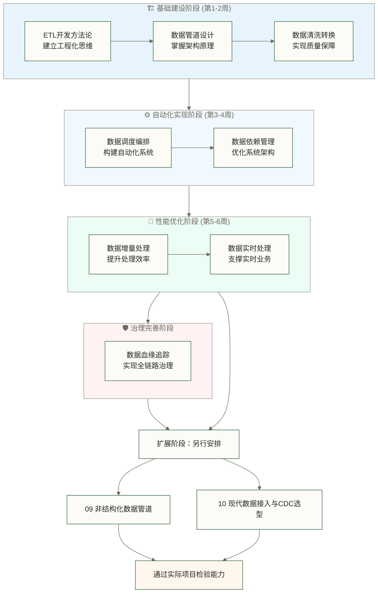

# 数据工程实践导览 - 从理论到实践的完整路径

> [!abstract] 📋 模块概览
> - 🎯 **核心目标**：掌握数据工程的核心实践技能和企业级方法论
> - 📚 **内容体系**：10个核心主题，构建完整的数据工程实践知识图谱
> - ⏱️ **学习周期**：预计4-6周完成从基础到进阶的实践能力建设
> - 🔗 **前置知识**：[[【数据开发与数据架构】/01-数据开发基础/00-数据开发基础导览|数据开发基础导览]]
> - 💪 **技能输出**：具备设计和实现企业级数据处理系统的核心能力

## 🎯 模块价值与定位

**数据工程实践**是数据开发与架构知识体系的**核心实践模块**，是连接理论知识与实际业务价值的重要桥梁。

> [!tip] 💡 数据工程的企业价值体现
> **想象一下汽车制造流水线**：原材料通过标准化的工艺流程，最终组装成精密的汽车产品。
>
> 数据工程就是数据世界的"智能制造系统"：
> - **原材料** = 分散在各业务系统的原始数据
> - **生产流水线** = ETL数据处理管道
> - **质量检验** = 数据清洗与质量保障
> - **智能调度** = 自动化的数据处理编排
> - **成品输出** = 支撑业务决策的高质量数据资产

**掌握数据工程实践的核心价值**：
- 🏭 **系统化思维**：用工业化的方法管理数据处理全流程
- ⚡ **自动化能力**：构建7x24小时无人值守的数据处理系统
- 🛡️ **质量保障**：建立企业级的数据质量管理体系
- 📈 **规模化处理**：支撑从TB到PB级别的数据处理需求

## 📚 学习内容结构

### 📖 文档清单

| 序号 | 文档名称 | 核心内容 | 实践价值 | 技能输出 |
|------|----------|----------|----------|---------|
| 01 | [[【数据开发与数据架构】/02-数据工程实践/01-ETL开发方法论\|ETL开发方法论]] | ETL设计思想与工程化标准 | 建立标准化开发流程 | 方法论指导实际项目 |
| 02 | [[【数据开发与数据架构】/02-数据工程实践/02-数据管道设计\|数据管道设计]] | 管道架构与设计模式 | 构建高可用数据流水线 | 架构设计与技术选型 |
| 03 | [[【数据开发与数据架构】/02-数据工程实践/03-数据清洗转换\|数据清洗转换]] | 数据质量保障技术体系 | 确保数据准确性与一致性 | 数据质量管理能力 |
| 04 | [[【数据开发与数据架构】/02-数据工程实践/04-数据调度编排\|数据调度编排]] | 任务编排与自动化调度 | 实现无人值守数据处理 | 调度系统设计实施 |
| 05 | [[【数据开发与数据架构】/02-数据工程实践/05-数据依赖管理\|数据依赖管理]] | 复杂依赖关系治理 | 降低系统耦合度风险 | 依赖关系分析设计 |
| 06 | [[【数据开发与数据架构】/02-数据工程实践/06-数据增量处理\|数据增量处理]] | 高效增量处理策略 | 提升大数据处理性能 | 增量算法设计优化 |
| 07 | [[【数据开发与数据架构】/02-数据工程实践/07-数据实时处理\|数据实时处理]] | 流式计算与实时架构 | 支撑实时业务决策需求 | 实时系统架构能力 |
| 08 | [[【数据开发与数据架构】/02-数据工程实践/08-数据血缘追踪\|数据血缘追踪]] | 数据血缘关系管理 | 实现数据治理可视化 | 血缘追踪系统建设 |
| 09 | [[【数据开发与数据架构】/02-数据工程实践/09-非结构化数据管道\|非结构化数据管道]] | PDF/音视频到 Embedding 的六阶段管道 | 把非结构化数据纳入数据工程版图 | 生产级 RAG 基础设施建设 |
| 10 | [[【数据开发与数据架构】/02-数据工程实践/10-现代数据接入与CDC选型\|现代数据接入与CDC选型]] | 批量、CDC、日志与事件流选型 | 明确端到端一致性和迁移边界 | 现代数据接入架构能力 |

### 🏗️ 渐进式学习路径

> [!important] 学习策略
> 本模块采用**渐进式能力建设**的学习路径，每个阶段的学习都为下一阶段奠定坚实基础

**学习阶段详解**：

> [!success] 🏗️ **基础建设阶段**（第1-2周）
> **目标**：建立数据工程的核心认知和基础技能
> - 理解ETL开发的工程化思维和标准化流程
> - 掌握数据管道的设计原理和架构模式
> - 学会数据清洗转换的核心技术和质量保障

> [!info] ⚙️ **自动化实现阶段**（第3-4周）
> **目标**：构建自动化的数据处理系统
> - 实现数据调度编排的自动化管理
> - 优化数据依赖关系，降低系统复杂度

> [!warning] 🚀 **性能优化阶段**（第5-6周）
> **目标**：提升系统性能，支撑大规模数据处理
> - 掌握增量处理技术，优化批处理效率
> - 构建实时处理能力，支撑实时业务决策

> [!tip] 🛡️ **治理完善阶段**
> **目标**：实现企业级数据治理能力
> - 建设数据血缘追踪系统，实现全链路数据治理

> [!note] 扩展阶段（另行安排）
> 完成数据管道与实时处理基础后，按业务需求选择09非结构化数据管道与10现代数据接入/CDC；本阶段不计入原4-6周。对应检查项见下方学习检查点。

## 🎯 能力建设目标

### 🟢 **基础能力目标**（基础阶段目标，需实践验证）

> [!success] **工程化思维建立**
> **知识维度**：
> - ✅ 建立系统化的ETL开发方法论认知
> - ✅ 理解数据管道设计的核心原理和最佳实践
> - ✅ 掌握数据清洗转换的技术体系和质量标准
>
> **技能维度**：
> - ✅ 能够独立设计和实现中小型ETL流程
> - ✅ 具备数据质量问题的识别和解决能力
> - ✅ 掌握常见数据处理工具的使用方法
>
> **实践维度**：
> - ✅ 具备数据工程项目的需求分析能力
> - ✅ 能够进行技术选型和架构设计决策
> - ✅ 建立数据处理性能优化的意识

### 🟡 **进阶能力目标**（进阶阶段目标，需实践验证）

> [!info] **自动化系统构建**
> **系统架构能力**：
> - ✅ 设计和实现企业级数据调度编排系统
> - ✅ 构建复杂数据依赖关系的管理机制
> - ✅ 具备大规模数据处理系统的架构设计能力
>
> **技术深度能力**：
> - ✅ 掌握主流数据工程技术栈的核心特性
> - ✅ 能够进行数据处理性能调优和故障排查
> - ✅ 具备数据工程最佳实践的应用和推广能力

### 🔴 **专家能力目标**（长期目标，不保证按周达成）

> [!warning] **企业级解决方案设计**
> **技术领导力**：
> - ✅ 具备复杂业务场景的数据工程解决方案设计能力
> - ✅ 能够指导团队进行数据工程技术选型和架构决策
> - ✅ 建立企业级数据治理体系和质量保障机制
>
> **业务理解力**：
> - ✅ 深度理解数据工程与业务价值的关联关系
> - ✅ 能够从业务需求出发设计数据工程解决方案
> - ✅ 具备跨部门协作和技术方案落地的项目管理能力

### 🚀 **职业发展准备**

> [!tip] **后续模块衔接**
> **为数据建模模块做准备**：
> - 🔗 深度理解数据预处理对建模质量的关键影响
> - 🔗 掌握支撑不同建模场景的数据准备技术
> - 🔗 建立数据工程与数据科学协作的技术基础
>
> **为数据架构设计模块做准备**：
> - 🔗 理解数据处理层在整体架构中的定位和作用
> - 🔗 掌握不同数据处理模式对架构设计的影响
> - 🔗 具备企业级数据平台架构规划的基础能力

## 🔗 与其他模块的关联

### 前置依赖

本模块基于以下模块的基础：

- **数据开发基础**：开发环境、工具链、规范流程
- **编程基础**：SQL、Python等编程语言
- **数据库基础**：关系型数据库、NoSQL数据库

### 后续延伸

完成本模块后，你将能够：

- 进入数据建模模块，掌握数据建模的基本概念
- 开始学习数据架构设计，理解系统架构的基本原理
- 为云原生数据架构和实时数据架构做准备

## 🛠️ 实践学习策略

### 📚 **推荐学习方法**

> [!tip] **项目驱动学习法**
> 1. **选择真实项目**：从公司实际业务场景中选择数据工程项目
> 2. **循序渐进实践**：从简单ETL开始，逐步增加复杂度
> 3. **技术栈演进**：从单机工具到分布式系统的技术演进
> 4. **问题解决导向**：遇到实际问题时深入学习相关技术

### 🎯 **学习重点与难点**

> [!important] **核心重点掌握**
> - 🏗️ **ETL设计思维**：建立系统化的数据处理思维模式
> - ⚙️ **架构设计能力**：数据管道的高可用、高性能架构设计
> - 🛡️ **质量保障体系**：企业级数据质量管理和监控体系
> - 📊 **性能优化策略**：大规模数据处理的性能调优方法

> [!warning] **学习难点突破**
> - 🔄 **复杂依赖管理**：多系统数据依赖关系的设计和治理
> - ⚡ **实时处理架构**：毫秒级延迟要求的流处理系统设计
> - 📈 **规模化挑战**：PB级数据处理的架构设计和性能优化
> - 🎯 **业务理解深度**：将技术方案与业务价值深度结合

## ✅ 学习检查点

### 🟢 基础检查清单

- [ ] 理解ETL开发的核心概念和方法论
- [ ] 能够设计基本的数据管道
- [ ] 掌握数据清洗和转换的基本方法
- [ ] 能够配置数据调度任务
- [ ] 理解数据依赖管理的重要性
- [ ] 掌握增量处理的基本策略
- [ ] 了解实时处理的基本概念
- [ ] 理解数据血缘追踪的价值
- [ ] 了解非结构化数据管道的六个阶段与传统 ETL 的本质差异
- [ ] 能区分批量接入、CDC、日志与事件流的适用条件，并识别端到端一致性与迁移边界

### 扩展阶段：非结构化数据与现代接入
完成基础数据管道和实时处理主题后，根据业务需求学习[[【数据开发与数据架构】/02-数据工程实践/09-非结构化数据管道|非结构化数据管道]]与[[【数据开发与数据架构】/02-数据工程实践/10-现代数据接入与CDC选型|现代数据接入与CDC选型]]。前者关注非结构化数据进入分析与RAG链路，后者关注接入方式选型、一致性与迁移边界；本阶段另行安排学习与实践，不计入原4-6周，也不承诺生产实施能力。

### 🟡 进阶检查清单

- [ ] 能够设计复杂的数据管道架构
- [ ] 掌握高级数据清洗和转换技术
- [ ] 能够优化数据调度性能
- [ ] 能够处理复杂的数据依赖关系
- [ ] 掌握实时数据处理的技术细节
- [ ] 能够进行数据血缘分析和影响评估
- [ ] 具备数据工程问题的排查能力
- [ ] 能够设计数据工程的最佳实践

## 🔗 快速导航

**开始学习**：[[【数据开发与数据架构】/02-数据工程实践/01-ETL开发方法论|ETL开发]]
**管道设计**：[[【数据开发与数据架构】/02-数据工程实践/02-数据管道设计|数据管道]]
**数据清洗**：[[【数据开发与数据架构】/02-数据工程实践/03-数据清洗转换|数据清洗转换]]
**调度编排**：[[【数据开发与数据架构】/02-数据工程实践/04-数据调度编排|数据调度编排]]
**依赖管理**：[[【数据开发与数据架构】/02-数据工程实践/05-数据依赖管理|数据依赖]]
**增量处理**：[[【数据开发与数据架构】/02-数据工程实践/06-数据增量处理|数据增量处理]]
**实时处理**：[[【数据开发与数据架构】/02-数据工程实践/07-数据实时处理|数据实时处理]]
**血缘追踪**：[[【数据开发与数据架构】/02-数据工程实践/08-数据血缘追踪|数据血缘追踪]]
**非结构化管道**：[[【数据开发与数据架构】/02-数据工程实践/09-非结构化数据管道|非结构化数据管道]]
**现代数据接入**：[[【数据开发与数据架构】/02-数据工程实践/10-现代数据接入与CDC选型|现代数据接入与CDC选型]]

**上一步**：[[【数据开发与数据架构】/01-数据开发基础/00-数据开发基础导览|数据开发基础导览]]
**下一步**：[[【数据开发与数据架构】/03-数据建模/00-数据建模导览|数据建模导览]]

---

**创建时间**：2024-12-19
**编辑更新时间**：见元数据 updated；原页尾日期2024-12-19仅保留为历史记录，不作为现行更新时间或事实核验日期。
**预计完成**：4-6周

#数据工程 #ETL #数据管道 #调度编排 #血缘追踪