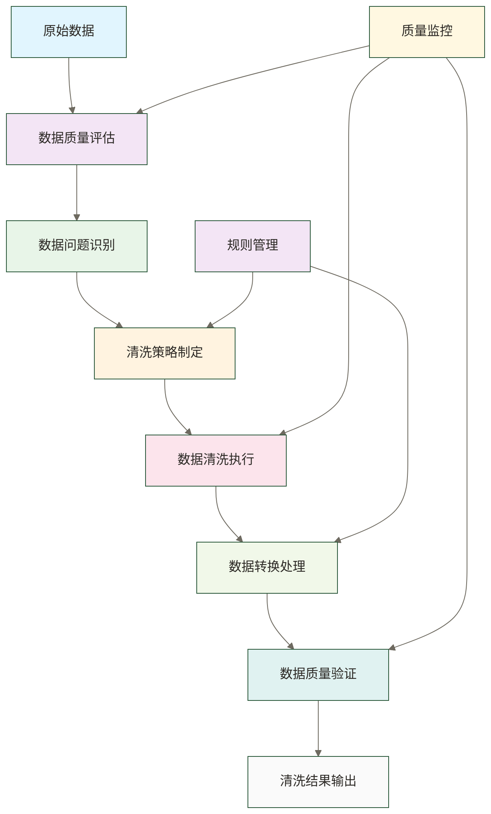

# 数据清洗转换 - 让数据焕发新生

> [!abstract] 📋 本节概览
> - 🎯 **学习目标**：掌握数据清洗和转换的方法和技巧
> - 📚 **前置知识**：[[【数据开发与数据架构】/02-数据工程实践/02-数据管道设计|数据管道]]
> - ⏱️ **预计用时**：25分钟
> - 🔗 **相关概念**：[[【数据开发与数据架构】/02-数据工程实践/04-数据调度编排|数据调度编排]], [[【数据开发与数据架构】/02-数据工程实践/05-数据依赖管理|数据依赖]]

## 🧹 数据清洗转换：数据的"品质工厂"

> [!tip] **从"垃圾场"到"精品店"的数据变身记**
> 
> **想象一下古董修复师的工作**：
> - 🔍 **发现价值**：在一堆破旧物品中识别有价值的古董
> - 🧽 **精心清洗**：去除污渍、锈迹，恢复原有光泽  
> - 🔧 **专业修复**：修补破损，恢复完整功能
> - ✨ **品质认证**：经过专业鉴定，确保品质可靠
> - 🏪 **精美陈列**：以最佳方式展示，供人欣赏使用

**数据清洗转换就是数据世界的"古董修复大师"**：

### 🎯 **现代数据清洗转换的四大价值维度**

> [!success] **🏭 工业化价值 - "数据质量流水线"**
> - **标准化生产**：建立统一的数据处理标准和规范
> - **质量检测**：多层次的数据质量检查和验证机制
> - **自动化处理**：减少人工干预，提升处理效率和一致性
> - **规模化产出**：支撑大规模数据的批量处理需求

> [!info] **💎 商业化价值 - "数据资产增值"**
> - **价值发现**：从看似无用的数据中挖掘商业价值
> - **品质提升**：将低质量数据转化为高价值数据资产
> - **信任建立**：通过质量保障建立数据使用者的信任
> - **竞争优势**：高质量数据成为企业核心竞争力

> [!warning] **🛡️ 风险管控价值 - "数据安全防线"**
> - **错误预防**：在数据使用前识别和修正错误
> - **合规支持**：通过清洗规则与审计记录支持合规评估，具体法规适用及合规结论需另行确认
> - **隐私保护**：自动识别和处理敏感信息
> - **损失避免**：避免因数据质量问题导致的决策失误

> [!tip] **🚀 创新驱动价值 - "数据智能引擎"**
> - **智能识别**：使用AI技术自动识别数据质量问题
> - **自动修复**：智能推荐和执行数据修复策略
> - **持续学习**：从历史处理经验中不断优化清洗规则
> - **预测性维护**：预测可能出现的数据质量问题
### 🎯 数据清洗转换的价值

**对企业而言**：
数据清洗转换能够显著提高数据质量，确保数据的准确性、完整性、一致性和及时性。通过系统化的清洗转换流程，企业可以降低因数据质量问题导致的决策错误，提高数据分析的可靠性，支持更精准的业务决策，实现数据驱动的运营模式。

**对数据工程师而言**：
掌握数据清洗转换技术能够提升数据工程师的核心技能，使其能够处理各种复杂的数据质量问题。这种技能不仅包括技术实现，还包括数据质量评估、清洗策略设计、转换规则制定、质量监控等多个维度的能力。

## 💡 什么是数据清洗转换？

### 🎯 数据清洗转换的核心定义

数据清洗转换是指对原始数据进行系统化的清理、格式化和转换处理，以提高数据质量和可用性的过程。这个过程包括数据质量检查、异常值处理、缺失值处理、格式标准化、数据类型转换、数据验证等多个环节。数据清洗转换是数据工程中的关键环节，直接影响后续数据分析和业务应用的准确性。

> [!note] 📝 简单理解
> 数据清洗转换就是把"脏乱差"的原始数据，通过系统化的处理流程，变成"干净有用"的标准数据的过程。

### 🔍 **数据清洗转换的五大核心特征**

> [!note] **医院急救系统的启发**
> 数据清洗转换就像医院的急救流程：分诊、检查、诊断、治疗、康复，每个环节都有明确的标准和监控。

#### **🎯 1. 质量导向性 - "救死扶伤"**
> [!success] **核心理念**
> 以拯救"病态数据"为使命，让每条数据都能"健康出院"
> 
> **实践表现**：
> - **问题识别**：像医生诊断一样，准确识别数据的"症状"
> - **精准治疗**：针对不同问题采用不同的"治疗方案"  
> - **效果验证**：治疗后检查数据是否"完全康复"
> - **预防保健**：建立预防机制，减少未来的数据质量问题

#### **🔄 2. 流程标准化 - "医疗标准"**
> [!info] **标准化的力量**
> 就像医院的标准化诊疗流程，确保每个患者都能得到一致的高质量治疗
> 
> **标准化体现**：
> ```yaml
> 数据清洗标准流程:
>   1. 数据体检: 全面检查数据健康状况
>   2. 问题诊断: 识别和分类数据质量问题  
>   3. 治疗方案: 制定个性化的清洗策略
>   4. 执行治疗: 按照标准流程执行清洗
>   5. 康复验证: 验证清洗效果和数据质量
>   6. 出院记录: 记录处理过程和结果
> ```

#### **📏 3. 规则系统化 - "诊疗规范"**
> [!warning] **规则就是生命线**
> 医生必须遵循诊疗规范，数据工程师也必须遵循清洗规则
> 
> **规则体系**：
> - **诊断规则**：什么样的数据算是"有问题"？
> - **治疗规则**：针对每种问题应该采用什么处理方法？
> - **验证规则**：如何判断数据已经"治愈"？
> - **预防规则**：如何避免同样的问题再次发生？

#### **📊 4. 全程监控性 - "生命监测"**
> [!tip] **实时生命体征监控**
> 就像ICU的监护设备，实时监控数据处理的每个环节
> 
> **监控维度**：
> - **处理进度监控**：实时跟踪清洗任务的执行进度
> - **质量指标监控**：监控数据质量的各项关键指标
> - **异常状态监控**：及时发现和报警异常情况
> - **性能效率监控**：监控处理性能和资源消耗

#### **🔧 5. 智能自动化 - "智能诊疗"**
> [!danger] **AI辅助诊疗**
> 现代医院使用AI辅助诊断，数据清洗也要拥抱智能化技术
> 
> **智能化应用**：
> - **自动问题识别**：AI自动识别常见的数据质量问题
> - **智能处理推荐**：根据历史经验推荐最佳处理策略
> - **自适应优化**：根据处理结果自动优化清洗规则
> - **预测性维护**：提前预测可能出现的数据质量问题

## 🏗️ 数据清洗转换的基本原则

### 🎯 数据完整性原则

数据清洗转换必须保证数据的完整性，确保在清洗转换过程中不会丢失重要的数据信息。这包括数据的完整性检查、缺失值处理、数据备份、处理日志等多个方面。数据完整性是数据质量的基础，必须在整个清洗转换过程中得到充分的保障。

### 🔄 处理可追溯原则

数据清洗转换过程必须是可追溯的，能够清楚地记录每个数据项的处理历史和变更原因。这包括处理日志、变更记录、版本管理、审计跟踪等多个方面。可追溯性不仅保证了数据处理的透明度，也为数据质量问题的排查和解决提供了支持。

### ⚡ 处理效率原则

数据清洗转换需要处理大量的数据，因此效率是重要的考虑因素。这包括并行处理、批量操作、算法优化、资源管理等多个方面的优化。处理效率不仅影响数据处理的成本，也影响数据更新的及时性。

### 🛡️ 处理安全性原则

数据清洗转换过程必须确保数据的安全性，包括数据隐私保护、访问控制、传输安全、存储安全等多个方面。这包括数据脱敏、加密传输、权限管理、审计日志等多个安全措施，确保数据在整个处理过程中都得到有效的保护。

## 📊 数据清洗转换的流程框架

### 🎯 数据清洗转换流程概览



### 📊 数据质量评估阶段

数据质量评估是数据清洗转换的起点，需要对原始数据进行全面的质量检查。这个阶段包括数据完整性检查、数据准确性检查、数据一致性检查、数据及时性检查等多个方面。通过详细的质量评估，为后续的清洗转换提供明确的目标和方向。

### 🔍 数据问题识别阶段

数据问题识别是数据清洗转换的关键环节，需要准确识别数据中的各种问题。这个阶段包括缺失值识别、异常值识别、重复值识别、格式错误识别、逻辑错误识别等多个方面。通过准确的问题识别，为后续的清洗策略制定提供准确的依据。

### 🎯 清洗策略制定阶段

清洗策略制定是数据清洗转换的规划环节，需要根据识别出的数据问题制定相应的清洗策略。这个阶段包括缺失值处理策略、异常值处理策略、重复值处理策略、格式标准化策略等多个方面。通过合理的策略制定，确保清洗转换的有效性和效率。

### 🧹 数据清洗执行阶段

数据清洗执行是数据清洗转换的具体实施环节，需要根据制定的策略对数据进行实际的清洗处理。这个阶段包括缺失值填充、异常值修正、重复值删除、格式标准化等多个方面。通过规范的清洗执行，确保数据质量的提升。

### 🔄 数据转换处理阶段

数据转换处理是数据清洗转换的转换环节，负责将清洗后的数据转换为目标格式。这个阶段包括数据类型转换、数据格式转换、数据编码转换、数据聚合转换等多个方面。通过系统的转换处理，确保数据符合目标系统的要求。

### ✅ 数据质量验证阶段

数据质量验证是数据清洗转换的验证环节，需要对清洗转换后的数据进行质量验证。这个阶段包括完整性验证、准确性验证、一致性验证、及时性验证等多个方面。通过全面的质量验证，确保清洗转换结果的质量。

## 🔧 数据清洗转换的主流技术栈

### 🎯 数据质量检测技术栈

**数据质量框架**：
- **Great Expectations**：Python数据质量验证框架，支持多种数据源
- **Apache Griffin**：Apache开源的数据质量监控平台
- **Deequ**：AWS开源的数据质量库，基于Apache Spark
- **Monte Carlo**：商业数据质量监控平台，支持实时监控
- **Soda**：开源数据质量平台，支持多种数据源

**数据质量工具**：
- **Talend Data Quality**：商业数据质量工具，提供可视化界面
- **Informatica Data Quality**：企业级数据质量解决方案
- **IBM InfoSphere QualityStage**：IBM数据质量工具
- **Microsoft SQL Server Data Quality Services**：SQL Server数据质量服务

**数据质量库**：
- **Python**：pandas-profiling、missingno、pyjanitor
- **R**：validate、assertr、pointblank
- **Scala/Java**：Apache Griffin、Deequ

### 🔄 数据清洗技术栈

**数据处理框架**：
- **Apache Spark**：分布式数据处理，支持大规模数据清洗
- **Apache Flink**：流处理和批处理，支持实时数据清洗
- **Apache Beam**：统一编程模型，支持多种执行引擎
- **Dask**：Python并行计算框架，适合中等规模数据

**数据清洗库**：
- **Python**：pandas、numpy、pyjanitor、clean-text
- **R**：dplyr、tidyr、janitor、stringr
- **Scala/Java**：Apache Spark 和 SQL 和 Apache Flink Table API

**ETL工具**：
- **Apache NiFi**：可视化数据流处理工具
- **Talend Open Studio**：开源ETL工具
- **Kettle (PDI)**：Pentaho数据集成工具
- **Apache Airflow**：工作流编排，支持数据清洗任务

### ⚙️ 数据转换技术栈

**数据转换引擎**：
- **Apache Spark 和 SQL**：SQL和DataFrame API，支持复杂转换
- **Apache Flink 和 SQL**：流式SQL，支持实时转换
- **Apache Hive**：数据仓库SQL引擎
- **Presto**：分布式SQL查询引擎
- **Apache Drill**：无模式SQL查询引擎

**数据格式转换**：
- **文件格式**：Parquet、Avro、ORC、JSON、XML
- **序列化工具**：Protocol Buffers、Apache Thrift、MessagePack
- **压缩工具**：Snappy、Gzip、LZ4、Zstandard

**数据编码转换**：
- **字符编码**：UTF-8、GBK、ISO-8859-1
- **编码转换工具**：iconv、chardet、python-ftfy

### 📊 数据清洗转换平台技术栈

**云原生平台**：
- **AWS Glue**：无服务器ETL服务，支持数据清洗
- **Azure Data Factory**：云数据集成服务
- **Google Cloud Dataflow**：流处理和批处理服务
- **Databricks**：统一数据分析平台

**开源平台**：
- **Apache Airflow**：工作流编排平台
- **Apache NiFi**：数据流处理平台
- **Apache Kafka Connect**：数据集成框架
- **Apache Superset**：数据可视化和探索平台

**商业平台**：
- **Informatica PowerCenter**：企业级数据集成平台
- **Talend Data Fabric**：统一数据管理平台
- **IBM InfoSphere**：企业数据集成套件
- **Microsoft SSIS**：SQL Server集成服务

## 🔧 数据清洗转换的核心技术

### 🎯 数据质量检查技术

数据质量检查技术是数据清洗转换的基础，包括统计分析方法、规则检查方法、机器学习方法等多种技术。这些技术能够自动识别数据中的各种问题，为后续的清洗转换提供准确的依据。数据质量检查技术需要根据数据的特点和业务需求进行选择和组合。

### 🔄 数据清洗技术

数据清洗技术是数据清洗转换的核心，包括缺失值处理技术、异常值处理技术、重复值处理技术、格式标准化技术等多种技术。这些技术能够有效处理数据中的各种问题，提高数据质量。数据清洗技术需要根据数据问题的类型和严重程度进行选择和调整。

### ⚙️ 数据转换技术

数据转换技术是数据清洗转换的转换环节，包括数据类型转换、数据格式转换、数据编码转换、数据聚合转换等多种技术。这些技术能够将数据转换为目标格式，满足不同系统的需求。数据转换技术需要根据目标系统的要求进行选择和配置。

### 📊 数据验证技术

数据验证技术是数据清洗转换的验证环节，包括规则验证、统计验证、业务验证、交叉验证等多种技术。这些技术能够验证清洗转换结果的质量，确保数据的准确性和可靠性。数据验证技术需要根据数据的特点和业务需求进行选择和组合。

## 📋 数据清洗转换的常见问题

### 🎯 缺失值问题

缺失值是数据清洗转换中最常见的问题之一，可能由于数据采集过程中的技术问题、业务逻辑问题、人为操作问题等多种原因造成。缺失值处理需要根据缺失的原因、缺失的模式、业务的影响等多个因素来选择合适的处理方法，包括删除、填充、插值等多种策略。

### 🔍 异常值问题

异常值是数据清洗转换中的重要问题，可能由于数据录入错误、系统故障、业务异常等多种原因造成。异常值处理需要根据异常值的类型、异常的程度、业务的影响等多个因素来选择合适的处理方法，包括修正、删除、标记等多种策略。

### 🔄 重复值问题

重复值是数据清洗转换中的常见问题，可能由于数据采集过程中的重复采集、系统同步问题、业务逻辑问题等多种原因造成。重复值处理需要根据重复的原因、重复的模式、业务的影响等多个因素来选择合适的处理方法，包括删除、合并、标记等多种策略。

### 📝 格式问题

格式问题是数据清洗转换中的基础问题，可能由于数据源的不同、系统标准的差异、人为操作的不规范等多种原因造成。格式标准化需要根据目标系统的要求、业务的标准、数据的特性等多个因素来制定标准化的规则，包括格式转换、编码转换、单位转换等多种处理。

## 🎯 数据清洗转换的最佳实践

### 📊 数据质量评估最佳实践

数据质量评估应该建立完善的质量指标体系，包括完整性指标、准确性指标、一致性指标、及时性指标等多个维度。这些指标应该能够量化数据质量的水平，为数据清洗转换提供明确的目标和方向。同时，数据质量评估应该建立定期评估机制，持续监控数据质量的变化。

### 🔄 清洗策略设计最佳实践

清洗策略设计应该根据数据问题的类型和严重程度，制定分层次、分阶段的清洗策略。这种策略应该包括问题优先级排序、清洗方法选择、处理顺序安排、质量检查点设置等多个方面。通过合理的策略设计，确保清洗转换的有效性和效率。

### 🛡️ 质量监控最佳实践

质量监控应该建立完善的监控体系，包括实时监控、定期监控、异常监控、趋势监控等多个方面。这个监控体系应该能够及时发现数据质量问题，快速响应和处理异常情况，持续改进数据质量。同时，质量监控应该建立告警机制，确保问题能够及时得到处理。

### 📈 性能优化最佳实践

性能优化应该从多个维度进行考虑，包括算法优化、并行处理、批量操作、资源管理等多个方面。这些优化措施应该能够提高数据清洗转换的效率，降低系统资源的消耗，提高系统的整体性能。同时，性能优化应该考虑系统的可扩展性，确保系统能够适应数据量的增长。

## ✅ 掌握检查

### 🟢 基础检查清单

- [ ] 理解数据清洗转换的核心概念和重要性
- [ ] 掌握数据清洗转换的基本原则
- [ ] 了解数据清洗转换的流程框架
- [ ] 熟悉数据清洗转换的核心技术
- [ ] 理解数据清洗转换的常见问题
- [ ] 能够分析数据清洗转换的需求和挑战

### 🟡 进阶检查清单

- [ ] 能够设计完整的数据清洗转换流程
- [ ] 掌握数据清洗转换中的质量保证技术
- [ ] 能够处理复杂的数据清洗转换场景
- [ ] 理解数据清洗转换中的性能优化技术
- [ ] 能够进行数据清洗转换的问题排查和优化
- [ ] 具备数据清洗转换的项目管理能力

## 🔗 学习连接

**前置知识**：[[【数据开发与数据架构】/02-数据工程实践/02-数据管道设计|数据管道]]  
**相关技术**：[[【数据开发与数据架构】/02-数据工程实践/04-数据调度编排|数据调度编排]], [[【数据开发与数据架构】/02-数据工程实践/05-数据依赖管理|数据依赖]]  
**下一步**：[[【数据开发与数据架构】/02-数据工程实践/04-数据调度编排|数据调度编排]]

**延伸阅读**：
- [[【数据开发与数据架构】/02-数据工程实践/06-数据增量处理|数据增量处理]]
- [[【数据开发与数据架构】/02-数据工程实践/07-数据实时处理|数据实时处理]]
- [[【数据开发与数据架构】/02-数据工程实践/08-数据血缘追踪|数据血缘追踪]]

---

**创建时间**：2024-12-19  
**最后更新**：2024-12-19  
**相关标签**：#数据工程 #数据清洗 #数据转换 #数据质量 #数据处理 