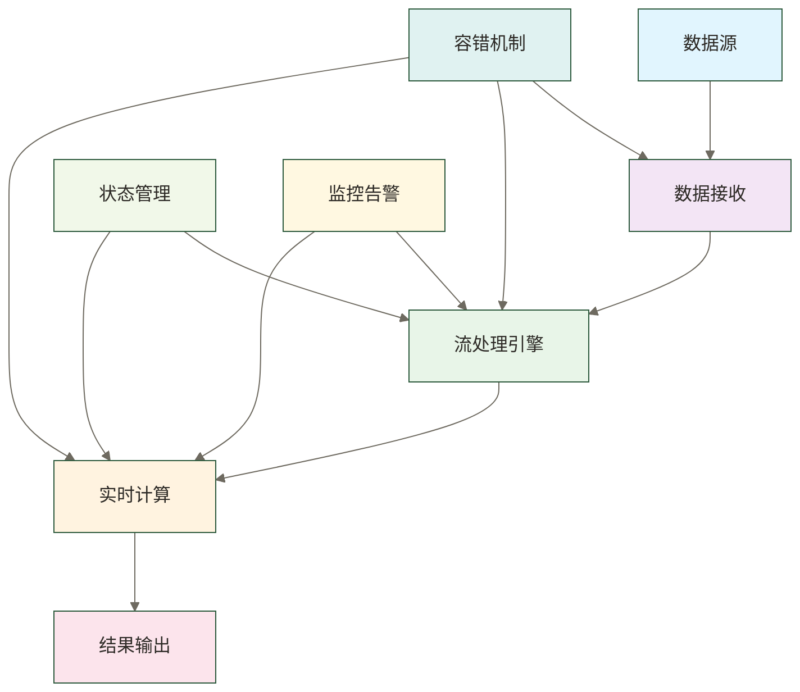

# 数据实时处理 - 数据世界的即时响应

> [!abstract] 📋 本节概览
> - 🎯 **学习目标**：掌握数据实时处理的核心概念和方法
> - 📚 **前置知识**：[[【数据开发与数据架构】/02-数据工程实践/06-数据增量处理|数据增量处理]]
> - ⏱️ **预计用时**：25分钟
> - 🔗 **相关概念**：[[【数据开发与数据架构】/02-数据工程实践/08-数据血缘追踪|数据血缘追踪]]

## ⚡ 实时处理：数据的"光速反应"

数据实时处理是**现代数据工程的速度引擎**，让数据处理从批量等待升级为毫秒级响应。

**技术突破的价值**：
- 🎯 **即时响应**：将数据处理延迟从小时级压缩到毫秒级
- ⚡ **业务敏捷**：支持实时决策和即时业务响应能力
- 🔧 **系统升级**：从传统批处理向流处理架构的技术跃迁
- 📈 **竞争优势**：在快节奏商业环境中建立时间护城河

在数字化时代，实时处理是连接数据产生与价值实现的高速通道。
### 🎯 数据实时处理的价值

**对企业而言**：
数据实时处理能够帮助企业实现真正的实时业务决策，支持快速响应市场变化，提高客户体验，增强竞争优势。通过系统化的实时处理能力，企业可以及时发现业务机会和风险，实现数据驱动的实时运营，在激烈的市场竞争中保持领先地位。

**对数据工程师而言**：
掌握数据实时处理技术能够提升数据工程师的实时系统设计能力，使其能够构建高性能、低延迟的数据处理系统。这种能力不仅包括技术实现，还包括流处理架构、实时计算、性能优化、系统监控等多个维度的考虑。

## 💡 什么是数据实时处理？

### 🎯 数据实时处理的核心定义

数据实时处理是指对数据流进行连续、实时的处理和分析，在数据产生的同时或极短时间内完成处理的技术。这个过程包括数据流的接收、处理、计算、分析和输出等环节，通过流处理技术实现数据的实时响应。数据实时处理是数据工程中的高级技术，能够支持毫秒级到秒级的低延迟数据处理。

> [!note] 📝 简单理解
> 数据实时处理就是"数据一产生就立即处理"，就像流水线上的产品一样，不需要等待批量处理。

### 🔍 数据实时处理的核心特征

#### 低延迟性
数据实时处理以低延迟为核心特征，通常要求处理延迟在毫秒级到秒级之间。这包括数据接收延迟、处理延迟、计算延迟、输出延迟等多个方面的优化。低延迟性确保了实时处理的及时性和有效性。

#### 高吞吐量
数据实时处理需要支持高吞吐量的数据处理，能够同时处理大量的数据流。这包括数据接收能力、处理能力、计算能力、输出能力等多个方面的优化。高吞吐量确保了实时处理系统的处理能力和扩展性。

#### 连续处理
数据实时处理采用连续处理模式，对数据流进行不间断的处理和分析。这包括数据流的持续接收、连续处理、实时计算、持续输出等多个方面。连续处理确保了实时处理系统的持续性和稳定性。

#### 容错性
数据实时处理需要具备良好的容错能力，能够在各种异常情况下保持系统的稳定运行。这包括故障检测、故障恢复、数据重放、状态恢复等多个方面。容错性确保了实时处理系统的可靠性和稳定性。

## 🏗️ 数据实时处理的基本原则

### 🎯 延迟最小原则

数据实时处理必须以最小化处理延迟为核心目标，确保数据能够在最短时间内得到处理。这包括数据接收优化、处理算法优化、计算优化、输出优化等多个方面的优化。延迟最小原则确保了实时处理的及时性和有效性。

### ⚡ 吞吐量最大原则

数据实时处理需要最大化系统的处理吞吐量，确保能够处理大量的数据流。这包括并行处理、批量处理、资源优化、负载均衡等多个方面的优化。吞吐量最大原则确保了实时处理系统的处理能力和扩展性。

### 🔄 连续性保证原则

数据实时处理必须保证处理的连续性，确保数据流能够不间断地得到处理。这包括故障恢复、数据重放、状态管理、资源管理等多个方面。连续性保证原则确保了实时处理系统的稳定性和可靠性。

### 🛡️ 容错性优先原则

数据实时处理必须以容错性为优先考虑，确保在各种异常情况下都能保持系统的稳定运行。这包括故障检测、故障恢复、数据备份、状态恢复等多个方面。容错性优先原则确保了实时处理系统的可靠性和稳定性。

## 📊 数据实时处理的架构模式

### 🎯 数据实时处理架构概览

### 📥 数据接收层

数据接收层是数据实时处理的入口，负责从各种数据源接收数据流。这个层需要支持多种数据源类型，包括消息队列、事件流、传感器数据、日志数据等。数据接收层还需要具备高吞吐量、低延迟、高可靠性等特性，确保能够及时、可靠地接收数据流。

### ⚙️ 流处理引擎

流处理引擎是数据实时处理的核心组件，负责对数据流进行连续的处理和分析。这个引擎需要支持多种处理模式，包括窗口处理、聚合计算、模式匹配、复杂事件处理等。流处理引擎还需要具备高性能、高可靠性、可扩展性等特性，确保能够高效、可靠地处理数据流。

### 🧮 实时计算层

实时计算层负责对数据流进行实时的计算和分析。这个层需要支持多种计算类型，包括统计计算、机器学习、规则引擎、复杂算法等。实时计算层还需要具备高性能、低延迟、高准确性等特性，确保能够快速、准确地完成计算任务。

### 📤 结果输出层

结果输出层负责将实时处理的结果输出到目标系统。这个层需要支持多种输出方式，包括数据库写入、消息发送、API调用、文件写入等。结果输出层还需要具备高可靠性、低延迟、高吞吐量等特性，确保能够及时、可靠地输出处理结果。

## 🔧 数据实时处理的主流技术栈

### 🎯 流处理技术栈

**流处理框架**：
- **Apache Flink**：统一批处理和流处理，支持事件时间处理、状态管理
- **Apache Kafka Streams**：基于Kafka的轻量级流处理，适合微服务架构
- **Apache Storm**：实时流处理，低延迟，适合复杂事件处理
- **Apache Spark Streaming**：基于微批处理的流处理，适合批流一体化
- **Apache Beam**：统一编程模型，支持多种执行引擎

**实时计算与分析工具**：
- **Apache Druid**：实时OLAP数据库，支持实时数据摄入和查询
- **ClickHouse**：列式数据库，高性能实时分析
- **Apache Pinot**：分布式OLAP数据库，实时数据摄入和查询
- **Apache Kylin**：OLAP引擎，预计算多维分析
- **Apache Superset**：数据可视化与分析展示，数据时效性依赖所连接的数据源

**事件处理平台**：
- **Apache Flink CEP**：复杂事件处理，基于Flink
- **Apache Storm Trident**：高级抽象，基于Storm
- **Apache Kafka Streams**：流处理，基于Kafka
- **Custom CEP Engine**：自定义复杂事件处理引擎

### 🔄 实时传输技术栈

**消息队列系统**：
- **Apache Kafka**：分布式流处理平台，高吞吐量、低延迟
- **RabbitMQ**：传统消息队列，支持多种消息模式
- **Apache Pulsar**：云原生消息和流平台，统一队列和流
- **Redis Streams**：基于Redis的轻量级流处理
- **Amazon SQS/SNS**：云原生消息服务

**实时API技术**：
- **gRPC**：Google RPC框架，高性能通信
- **WebSocket**：全双工通信协议，支持实时双向通信
- **Server-Sent Events (SSE)**：服务器推送事件
- **GraphQL Subscriptions**：GraphQL实时订阅
- **REST API**：传统REST API，支持轮询

**流传输协议**：
- **Apache Kafka Protocol**：Kafka原生协议
- **MQTT**：轻量级消息传输协议
- **AMQP**：高级消息队列协议
- **STOMP**：简单文本导向消息协议

### ⚙️ 实时存储技术栈

**内存数据库**：
- **Redis**：内存数据结构存储，支持多种数据类型
- **Memcached**：分布式内存缓存系统
- **Apache Ignite**：分布式内存计算平台
- **Hazelcast**：分布式内存数据网格
- **Aerospike**：NoSQL内存数据库

**时序数据库**：
- **InfluxDB**：时序数据库，专为时间序列数据设计
- **TimescaleDB**：基于PostgreSQL的时序数据库
- **Prometheus**：监控系统和时序数据库
- **OpenTSDB**：基于HBase的时序数据库
- **Graphite**：时序数据库和监控系统

**流存储系统**：
- **Apache Kafka**：分布式流存储平台
- **Apache Pulsar**：云原生消息和流平台
- **Amazon Kinesis**：AWS实时流处理服务
- **Google Cloud Pub/Sub**：Google云消息服务
- **Azure Event Hubs**：Azure事件中心

### 📊 实时分析技术栈

**实时查询引擎**：
- **Apache Druid**：实时OLAP查询引擎
- **ClickHouse**：列式数据库，高性能查询
- **Apache Pinot**：分布式OLAP查询引擎
- **Apache Kylin**：OLAP引擎，预计算查询
- **Presto**：分布式SQL查询引擎

**实时聚合技术**：
- **Apache Flink**：流处理框架，支持实时聚合
- **Apache Kafka Streams**：流处理，支持实时聚合
- **Apache Storm**：实时计算，支持流聚合
- **Custom Aggregation Engine**：自定义聚合引擎

**实时机器学习**：
- **Apache Flink ML**：基于Flink的机器学习
- **Apache Spark Streaming ML**：基于Spark的流式ML
- **TensorFlow Serving**：TensorFlow模型服务
- **MLflow**：机器学习生命周期管理
- **Kubeflow**：Kubernetes机器学习平台

### 📊 实时处理平台技术栈

**企业级平台**：
- **Informatica PowerCenter**：企业级数据集成，支持实时处理
- **Talend Data Fabric**：统一数据管理平台，支持实时ETL
- **IBM InfoSphere Streams**：IBM流处理平台
- **Microsoft Stream Analytics**：Azure流分析服务

**开源平台**：
- **Apache Flink**：开源流处理框架
- **Apache Kafka**：分布式流处理平台
- **Apache Storm**：实时流处理框架
- **Apache NiFi**：数据流处理平台

**云原生平台**：
- **AWS Kinesis**：AWS实时流处理服务
- **Azure Stream Analytics**：Azure流分析服务
- **Google Cloud Dataflow**：Google流处理服务
- **Databricks Structured Streaming**：Databricks流处理

### 🔧 实时处理架构技术栈

**Lambda架构**：
- **批处理层**：Apache Hadoop、Apache Spark、Apache Hive
- **速度层**：Apache Storm、Apache Flink、Apache Kafka
- **服务层**：Apache Druid、ClickHouse、Redis

**Kappa架构**：
- **流处理**：Apache Flink、Apache Kafka Streams
- **存储**：Apache Kafka、Apache Pulsar、Amazon Kinesis
- **查询**：Apache Druid、ClickHouse、Apache Pinot

**微服务架构**：
- **服务框架**：Spring Boot、FastAPI、Express.js
- **消息队列**：Apache Kafka、RabbitMQ、Redis
- **配置管理**：Consul、Etcd、Zookeeper

**事件驱动架构**：
- **事件总线**：Apache Kafka、Apache Pulsar
- **事件存储**：EventStore、Apache Kafka
- **事件处理**：Apache Flink、Apache Storm
- **事件查询**：Apache Druid、ClickHouse

## 🔧 数据实时处理的核心技术

### 🎯 流处理技术

流处理技术是数据实时处理的基础技术，包括流式API、窗口处理、状态管理、容错机制等多种技术。这些技术能够支持对数据流的连续处理，实现低延迟的数据处理。流处理技术需要根据业务需求进行选择和优化。

### ⚡ 实时计算技术

实时计算技术是数据实时处理的核心技术，包括实时统计、实时机器学习、实时规则引擎、实时算法等多种技术。这些技术能够支持对数据流的实时计算和分析，实现快速的数据洞察。实时计算技术需要根据计算需求进行选择和优化。

### 🔄 状态管理技术

状态管理技术是数据实时处理的关键技术，包括状态存储、状态恢复、状态同步、状态一致性等多种技术。这些技术能够支持流处理过程中的状态管理，确保处理的连续性和一致性。状态管理技术需要根据状态需求进行选择和优化。

### 🛡️ 容错技术

容错技术是数据实时处理的保障技术，包括故障检测、故障恢复、数据重放、状态恢复等多种技术。这些技术能够确保实时处理系统在各种异常情况下的稳定运行。容错技术需要根据系统需求进行选择和配置。

## 📋 数据实时处理的应用场景

### 🎯 实时监控场景

实时监控是数据实时处理的典型应用场景，包括系统监控、业务监控、安全监控、性能监控等。这种场景需要对大量的监控数据进行实时处理，及时发现异常情况并采取相应的措施。实时监控场景对延迟和准确性都有较高的要求。

### 🔄 实时分析场景

实时分析是数据实时处理的重要应用场景，包括实时报表、实时仪表板、实时洞察、实时决策等。这种场景需要对数据流进行实时的分析和计算，为业务决策提供实时的数据支持。实时分析场景对计算能力和准确性都有较高的要求。

### ⚡ 实时推荐场景

实时推荐是数据实时处理的高级应用场景，包括个性化推荐、实时广告、智能推荐、动态定价等。这种场景需要对用户行为数据进行实时处理，快速生成个性化的推荐结果。实时推荐场景对延迟和准确性都有极高的要求。

### 🔗 实时交易场景

实时交易是数据实时处理的专业应用场景，包括金融交易、股票交易、期货交易、数字货币交易等。这种场景需要对交易数据进行实时处理，确保交易的及时性和准确性。实时交易场景对延迟、准确性和一致性都有极高的要求。

## 🎯 数据实时处理的最佳实践

### 📊 架构设计最佳实践

架构设计应该采用流处理架构，确保数据能够连续、实时地得到处理。这包括数据流的合理设计、处理节点的优化配置、状态管理的完善机制、容错机制的建立等多个方面。良好的架构设计能够提高实时处理系统的性能和可靠性。

### ⚡ 性能优化最佳实践

性能优化应该从多个维度进行考虑，包括数据接收优化、处理优化、计算优化、输出优化等多个方面。这包括并行处理、批量处理、缓存机制、负载均衡等优化措施。系统的性能优化能够提高实时处理的效率和响应速度。

### 🛡️ 容错设计最佳实践

容错设计应该建立完善的容错机制，确保系统在各种异常情况下的稳定运行。这包括故障检测机制、故障恢复机制、数据重放机制、状态恢复机制等多个方面。完善的容错设计能够提高实时处理系统的可靠性和稳定性。

### 📈 监控告警最佳实践

监控告警应该建立完善的监控体系，实时监控系统的运行状态。这包括性能监控、质量监控、异常监控、资源监控等多个方面。完善的监控告警能够及时发现和处理系统问题，确保实时处理系统的稳定运行。

## ✅ 掌握检查

### 🟢 基础检查清单

- [ ] 理解数据实时处理的核心概念和重要性
- [ ] 掌握数据实时处理的基本原则
- [ ] 了解数据实时处理的架构模式
- [ ] 熟悉数据实时处理的核心技术
- [ ] 理解数据实时处理的应用场景
- [ ] 能够分析数据实时处理的需求和挑战

### 🟡 进阶检查清单

- [ ] 能够设计完整的数据实时处理系统
- [ ] 掌握数据实时处理中的性能优化技术
- [ ] 能够处理复杂的数据实时处理场景
- [ ] 理解数据实时处理中的容错机制
- [ ] 能够进行数据实时处理的问题排查和优化
- [ ] 具备数据实时处理的项目管理能力

## 🔗 学习连接

**前置知识**：[[【数据开发与数据架构】/02-数据工程实践/06-数据增量处理|数据增量处理]]
**相关技术**：[[【数据开发与数据架构】/02-数据工程实践/08-数据血缘追踪|数据血缘追踪]]
**下一步**：[[【数据开发与数据架构】/02-数据工程实践/08-数据血缘追踪|数据血缘追踪]]

---

**创建时间**：2024-12-19  
**最后更新**：2024-12-19  
**相关标签**：#数据工程 #数据实时 #[[【技术与工具】/Flink/01-流处理基本概念|流处理基本概念]] #[[【技术与工具】/Spark/21-实时计算项目|实时计算项目]] #低延迟 