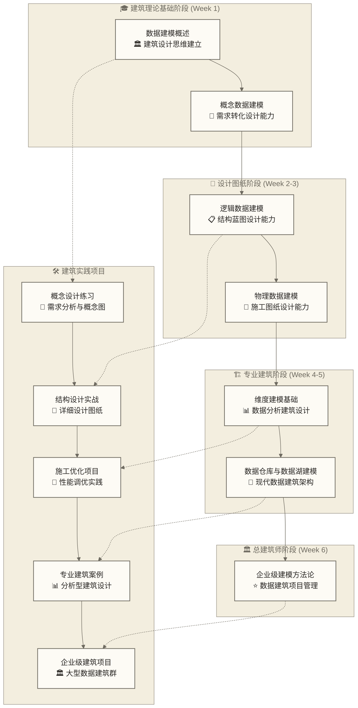

# 数据建模导览 - 构建数据世界的建筑蓝图

> [!abstract] 📋 模块概览
> **数据建模是现代数据架构的核心设计能力**，就如同建筑大师设计摩天大楼时需要从城市规划到施工图纸的全套设计方案，数据建模师需要将复杂的业务需求转化为从概念到物理的完整数据架构，是连接业务世界与技术实现的"**总建筑师**"。
> 
> - 🎯 **核心价值**：掌握业务数字化转型的建筑设计能力，成为数据架构的**首席设计师**
> - 📚 **知识体系**：7个核心文档，构建从理论基础到企业实践的完整建模知识框架
> - ⏱️ **学习规划**：4-6周系统化建模能力建设，**设计思维**与**工程实践**并重
> - 🏗️ **能力进阶**：从建模学徒到企业级数据架构师的完整进阶路径
> - 🔗 **前置基础**：[[【数据开发与数据架构】/01-数据开发基础/00-数据开发基础导览.md|数据开发基础导览]] 和 [[【数据开发与数据架构】/02-数据工程实践/00-数据工程实践导览.md|数据工程实践导览]]

## 🎯 数据建模的核心价值

> [!important] 🏗️ **数据建模：数字化转型的建筑基石**
> 就像建筑大师设计地标建筑时需要深度理解城市文脉、人文需求和工程约束，数据建模师必须深度理解业务逻辑、数据流向和技术边界。数据建模不仅是技术实现，更是**商业智慧与工程艺术的完美结合**，它决定了数据资产的价值实现能力和企业数字化转型的成败关键。

**数据建模的四重价值体系**：

### 📊 **业务价值**：商业逻辑的数字化建筑
> [!tip] 🏛️ **建筑比喻**：如同建筑师将客户需求转化为功能分区和空间设计
数据建模在业务价值创造方面发挥着多重关键作用。在**需求转译**层面，数据建模师扮演着业务世界与技术世界之间的翻译官角色，他们需要深入理解复杂的业务需求和业务逻辑，然后将这些往往是模糊和隐性的业务知识转化为清晰、精确的数据结构和关系模型，使得业务人员熟悉的业务语言能够准确地映射为技术人员理解的数据语言。

在**决策基座**构建方面，优秀的数据建模为企业的数据分析和商业智能系统提供了坚实可靠的数据基础设施。通过合理的建模设计，我们能够构建出支撑企业决策的数据地基，确保决策者能够获得准确、及时、一致的数据支持，从而做出更加科学和精准的商业决策。

**流程重构**是数据建模过程中的一个重要发现，在深入分析和建模业务数据的过程中，建模师往往能够发现现有业务流程中的不合理之处和优化空间，通过数据建模的视角重新审视业务流程，可以帮助企业实现业务流程的数字化改造和优化提升。

最后，在**价值挖掘**方面，通过系统化的数据结构设计和关系建模，我们能够发现数据之间原本隐藏的关联关系和潜在价值，这些发现往往能为企业带来新的业务洞察和商业机会，真正释放数据资产的潜在价值。

### 🔧 **技术价值**：系统架构的承重框架
> [!tip] 🏗️ **建筑比喻**：如同结构工程师设计建筑物的钢筋混凝土骨架
在技术价值实现方面，数据建模承担着数据平台技术架构设计的核心职责。作为**架构基石**，数据建模为整个企业数据平台提供了结构化的设计蓝图和标准化的实现框架，就像建筑物的钢筋混凝土结构一样，为上层的各种数据应用和服务提供稳固的支撑基础，构建起数据大厦的核心承重体系。

在**性能保障**方面，经过精心设计的数据模型能够显著提升数据存储效率和查询性能。通过合理的表结构设计、索引策略和分区方案，数据建模能够确保系统在面对大规模数据处理需求时依然能够保持稳定高效的运行状态，为业务系统提供可靠的技术支撑。

**扩展弹性**是现代数据架构的重要特征，优秀的数据建模设计必须具备前瞻性，能够支持系统的持续演进和业务的快速拓展。通过模块化的设计理念和松耦合的架构模式，数据建模能够建立起面向未来的可伸缩架构，确保数据平台能够适应不断变化的业务需求。

最后，**质量防线**的建立是数据建模的重要职责之一。通过建立完善的数据完整性约束、一致性检查和验证机制，数据建模为整个数据平台构建了多层次的质量保障体系，确保数据在全生命周期内都能够保持高质量状态。

### 🎓 **能力价值**：专业人才的核心竞争力
> [!tip] 🎯 **建筑比喻**：如同总建筑师统筹整个建筑项目的设计与施工
从个人能力发展的角度来看，数据建模为专业人才提供了多层次的核心竞争力提升。在**设计思维**培养方面，数据建模工作需要建模师具备高度的结构化思考能力和抽象设计能力，通过持续的建模实践，专业人才能够逐步建立起系统性的建筑思维，这种思维方式不仅适用于数据建模工作，更能够应用到更广泛的业务分析和解决方案设计中。

作为**沟通桥梁**，数据建模师在企业中扮演着极其重要的跨领域协调角色。他们需要与业务团队深入沟通以理解需求，与技术团队紧密合作以实现方案，与管理层有效对话以争取资源和支持。这种跨领域的沟通协调能力使得数据建模师成为企业中不可或缺的设计协调者。

从**职业进阶**的路径来看，数据建模已经成为现代数据从业者必须掌握的核心技能之一。随着数据在商业决策中地位的不断提升，具备扎实数据建模能力的专业人才在职场中具备了更强的竞争优势和更广阔的发展空间，这是数据专家核心素养的重要体现。

在**创新引领**方面，优秀的数据建模师不仅仅是技术实现者，更是业务创新的重要推动者。通过数据建模的创新思路和方法，他们能够为企业的业务模式创新提供强有力的数据支撑，逐步成长为企业数字化转型进程中的首席设计师。

### 🌐 **生态价值**：企业数据体系的组织架构
> [!tip] 🏢 **建筑比喻**：如同城市规划师设计整个城市的功能布局和发展框架
在企业级数据生态建设方面，数据建模发挥着举足轻重的组织架构作用。在**标准化建设**层面，数据建模为企业建立了统一的数据设计语言和规范体系，就像城市建设需要统一的规划标准一样，企业的数据建设也需要统一的建模标准来确保各个系统之间的数据能够有效整合和互通，从而形成企业级数据治理的制度基础和执行标准。

**协同效应**的实现是数据建模在企业生态中的重要价值体现。通过统一的建模方法和标准，不同业务线的数据系统能够实现有机的整合和协同，打破部门之间的数据孤岛，促进企业内部数据资产的充分流动和价值释放，实现真正意义上的数据生态协同发展。

在**知识资产**积累方面，数据建模过程中积累的业务理解、设计经验和最佳实践构成了企业宝贵的数据智力资产。这些知识资产不仅能够指导未来的建模工作，更能够成为企业数据能力建设的重要基础，为新员工培训、项目快速启动和经验传承提供强有力的支撑。

最终，通过系统性的数据建模能力建设，企业能够形成独特的数据处理和应用优势，这种优势往往难以被竞争对手快速复制，从而成为企业在数字化时代的**核心竞争力**，为企业的长期发展和市场竞争提供坚实的数据基础。

## 📚 学习内容规划

### 📖 文档清单

> [!note] 📖 **学习路径说明**：每个阶段都建议先理解核心概念，再通过实际案例加深理解，最后通过动手练习巩固技能。

| 阶段 | 文档 | 核心价值 | 能力建设 | 应用场景 | 难度 |
|------|------|----------|----------|----------|----------|
| 🎯 **理论基础** | [[【数据开发与数据架构】/03-数据建模/01-数据建模概述.md\|数据建模概述\|]] | 建立完整的建模理论体系 | **抽象思维** + **设计思维** | 项目规划、需求分析 | ⭐️⭐️ |
| 🎨 **概念设计** | [[【数据开发与数据架构】/03-数据建模/02-概念数据建模.md\|概念数据建模\|]] | 掌握业务到概念的转化艺术 | **业务理解** + **概念抽象** | 需求调研、概念设计 | ⭐️⭐️⭐️ |
| 🔧 **逻辑设计** | [[【数据开发与数据架构】/03-数据建模/03-逻辑数据建模.md\|逻辑数据建模\|]] | 构建规范化的数据结构 | **结构化设计** + **规范化思维** | 数据库设计、表结构设计 | ⭐️⭐️⭐️ |
| ⚡ **物理实现** | [[【数据开发与数据架构】/03-数据建模/04-物理数据建模.md\|物理数据建模\|]] | 实现高性能的存储方案 | **性能优化** + **存储设计** | 数据库调优、架构设计 | ⭐️⭐️⭐️⭐️ |
| 📊 **分析建模** | [[【数据开发与数据架构】/03-数据建模/05-维度建模基础.md\|维度建模基础\|]] | 掌握分析型建模核心方法 | **维度思维** + **分析设计** | 数仓建设、BI系统 | ⭐️⭐️⭐️⭐️ |
| 🏗️ **架构建模** | [[【数据开发与数据架构】/03-数据建模/06-数据仓库与数据湖建模.md\|数据仓库与数据湖建模\|]] | 构建现代化数据架构 | **架构思维** + **技术选型** | 企业数据平台、大数据架构 | ⭐️⭐️⭐️⭐️⭐️ |
| 🚀 **企业方法论** | [[【数据开发与数据架构】/03-数据建模/07-企业级建模方法论.md\|企业级建模方法论\|]] | 建立规模化实施体系 | **方法论** + **团队协作** | 企业级项目、团队管理 | ⭐️⭐️⭐️⭐️⭐️ |

### 🏗️ 数据建模师成长路线图

> [!tip] 🏗️ **建筑师成长比喻**
> 数据建模学习如同建筑师的培养过程：从**建筑理论基础**到**设计实践能力**，再到**工程项目管理**，最终成为**总建筑师**。采用"设计思维+工程实践"双轮驱动，每个阶段都包含理论学习、设计练习和项目实战。

## 🎯 能力建设目标体系

### 🟢 **基础能力目标**（建议学习阶段：1-2周）

> [!success] 🎓 **理论基础能力**
> - **建模思维**：建立从业务到数据的抽象思维能力
> - **设计方法**：掌握概念-逻辑-物理三层建模方法论
> - **工具应用**：熟练使用主流数据建模工具和技术

> [!success] 🛠️ **实践操作能力**
> - **需求转化**：能够将复杂业务需求转化为清晰的概念模型
> - **结构设计**：掌握规范化设计和表结构优化方法
> - **性能调优**：理解物理模型对系统性能的影响机制

### 🟡 **专业能力目标**（建议学习阶段：3-4周）

> [!warning] 📊 **分析建模能力**
> - **维度思维**：掌握维度建模的核心原理和设计模式
> - **架构选择**：理解数据仓库与数据湖的建模差异
> - **场景应用**：能够根据业务场景选择合适的建模方法

> [!warning] 🏗️ **架构设计能力**
> - **全局视野**：具备企业级数据架构的整体设计思维
> - **技术选型**：掌握不同存储技术的建模适配策略
> - **演进规划**：能够设计支持业务发展的可扩展模型

### 🔴 **专家能力目标**（建议学习阶段：5-6周）

> [!danger] 🚀 **企业级实施能力**
> - **方法论建立**：能够建立企业级数据建模规范和流程
> - **团队协作**：具备跨部门协作和建模知识传递能力
> - **项目管理**：掌握大型数据建模项目的规划和实施方法

> [!danger] ⭐ **创新应用能力**
> - **前沿探索**：了解云原生、实时计算等新技术的建模挑战
> - **业务创新**：能够通过建模创新支持业务模式创新
> - **标准制定**：具备参与行业标准制定和最佳实践总结的能力

## 🔗 知识网络与学习路径

### 📚 **前置知识依赖**

> [!note] 🎯 **必备基础**
> - [[【数据开发与数据架构】/01-数据开发基础/01-数据开发概述.md|数据开发]]：了解数据开发的整体框架
> - [[【数据分析与数据运营】/01-共同能力基础/03-工具掌握/01-SQL基本概念.md|SQL基本概念]]：掌握数据查询和操作语言
> - [[【数据开发与数据架构】/02-数据工程实践/02-数据管道设计.md|数据管道]]：理解数据处理和ETL流程

> [!note] 📊 **推荐基础**
> - 数据库原理：理解关系型数据库的理论基础
> - 业务分析能力：具备一定的业务理解和需求分析能力
> - 系统思维：具备一定的系统性思考和抽象设计能力

### 🚀 **后续扩展路径**

> [!tip] 📈 **核心发展方向**
> - [[【数据开发与数据架构】/04-数据架构设计/00-数据架构设计导览.md|数据架构设计导览]]：学习企业级数据架构的整体设计
> - [[【数据开发与数据架构】/05-数据存储架构/00-数据存储架构导览.md|数据存储架构导览]]：深入掌握存储层的技术选型和优化
> - [[【数据开发与数据架构】/06-数据处理架构/00-数据处理架构导览.md|数据处理架构导览]]：理解数据处理的架构设计原理

> [!tip] 🏗️ **专业深化方向**
> - [[【数据开发与数据架构】/08-数据中台架构/00-数据中台架构导览.md|数据中台架构导览]]：学习企业级数据中台的建设方法
> - [[【数据开发与数据架构】/09-实时数据架构/00-实时数据架构导览.md|实时数据架构导览]]：掌握实时数据处理的架构设计
> - [[【数据开发与数据架构】/10-云原生数据架构/00-云原生数据架构导览.md|云原生数据架构导览]]：了解云原生环境下的数据建模

### 🎯 **跨领域应用**

> [!important] 🔄 **相关领域连接**
> - **数据治理**：数据建模是数据治理的重要基础
> - **数据分析**：为高效的数据分析提供结构化基础
> - **机器学习**：为ML模型提供优质的数据输入
> - **业务智能**：支撑企业BI系统的数据底层设计

## 🛠️ 学习策略与实践指导

### 📚 **高效学习方法**

> [!tip] 🎯 **理论学习策略**
> - **渐进式学习**：按照知识体系的层次结构，循序渐进地掌握概念
> - **对比学习**：通过对比不同建模方法的优缺点加深理解
> - **案例驱动**：结合实际业务场景理解抽象的建模概念
> - **工具结合**：在学习理论的同时使用建模工具进行实践

> [!warning] 🛠️ **实践练习指导**
> - **项目导向**：选择一个完整的业务场景进行端到端建模练习
> - **迭代优化**：在实践中不断发现问题并优化模型设计
> - **同行交流**：加入数据建模社区，与同行交流经验和最佳实践
> - **反思总结**：定期总结建模过程中的经验教训和设计思路

### 🎯 **重点突破策略**

> [!important] 🏆 **必须掌握的核心技能**
> - **抽象思维**：从复杂业务中提取核心概念和关系的能力
> - **规范化设计**：掌握数据库规范化理论和实际应用技巧
> - **性能优化**：理解建模设计对系统性能的影响机制
> - **维度建模**：掌握分析型数据建模的核心方法和设计模式

> [!caution] ⚠️ **常见学习难点及突破方法**
> - **业务理解难点**：多与业务人员沟通，深入了解业务流程和规则
> - **抽象设计难点**：多做练习，培养从具体到抽象的思维转换能力
> - **性能平衡难点**：通过实际项目积累性能调优的经验
> - **工具使用难点**：选择合适的建模工具，多进行实际操作练习

### 🏅 **进阶提升路径**

> [!success] 🚀 **专业能力提升**
> 1. **参与实际项目**：在真实项目中应用所学建模知识
> 2. **学习先进方法**：关注Data Vault、Anchor Modeling等先进建模方法
> 3. **掌握新技术**：了解云计算、大数据环境下的建模新挑战
> 4. **建立方法论**：总结并建立适合自己团队的建模方法论

## ✅ 分阶段能力评估体系

### 🟢 **基础能力验收清单**（1-2周目标）

> [!success] 📚 **理论知识掌握**
> - [ ] **建模概念**：能够清晰解释数据建模的核心概念和价值
> - [ ] **三层架构**：理解概念-逻辑-物理三层建模的关系和作用
> - [ ] **设计思维**：掌握从业务需求到数据结构的转化思路
> - [ ] **建模方法**：了解不同建模方法的适用场景和优缺点

> [!success] 🛠️ **实践技能验证**
> - [ ] **概念建模**：能够独立完成简单业务场景的概念数据建模
> - [ ] **逻辑设计**：掌握数据库规范化设计和表结构优化
> - [ ] **物理优化**：理解索引、分区等物理优化对性能的影响
> - [ ] **工具使用**：熟练使用至少一种专业数据建模工具

### 🟡 **专业能力验收清单**（3-4周目标）

> [!warning] 📊 **高级建模能力**
> - [ ] **维度建模**：能够设计完整的星型模型和雪花模型
> - [ ] **事实维度设计**：掌握事实表和维度表的设计原则和技巧
> - [ ] **性能调优**：能够针对查询模式进行建模优化设计
> - [ ] **架构选择**：理解数据仓库与数据湖建模的差异和选择标准

> [!warning] 🔍 **问题解决能力**
> - [ ] **复杂场景建模**：能够处理多业务线、复杂关系的建模场景
> - [ ] **性能平衡**：在数据规范化和查询性能之间找到最佳平衡点
> - [ ] **模型演进**：设计支持业务发展和需求变化的可扩展模型
> - [ ] **质量保证**：建立数据模型的质量评估和改进机制

### 🔴 **专家能力验收清单**（5-6周目标）

> [!danger] 🏗️ **企业级实施能力**
> - [ ] **规范建立**：能够建立企业级数据建模规范和标准流程
> - [ ] **团队协作**：具备跨团队协作和建模知识传递的领导能力
> - [ ] **项目管理**：能够规划和管理大型数据建模项目的实施
> - [ ] **技术选型**：能够针对不同技术栈制定相应的建模策略

> [!danger] ⭐ **创新引领能力**
> - [ ] **方法论创新**：能够结合企业特点创新数据建模方法论
> - [ ] **最佳实践**：总结并推广数据建模的最佳实践和经验教训
> - [ ] **前沿探索**：关注并应用数据建模领域的前沿技术和理念
> - [ ] **业务赋能**：通过建模创新支持业务模式创新和数字化转型

### 📊 **能力评估方法**

> [!note] 🎯 **自我评估建议**
> - **理论测试**：通过概念解释、场景分析等方式验证理论掌握程度
> - **实践项目**：通过完整的建模项目验证实际操作能力
> - **同行评审**：邀请有经验的同行对建模成果进行评审
> - **业务反馈**：从业务人员角度评估建模成果的实用性和准确性

## 🧭 学习路径导航

### 📚 **分阶段学习路径**

> [!tip] 🎯 **第一阶段：理论基础建立**（Week 1）
> **开始学习**：[[【数据开发与数据架构】/03-数据建模/01-数据建模概述.md|数据建模]]  
> **概念设计**：[[【数据开发与数据架构】/03-数据建模/02-概念数据建模.md|概念数据建模]]  

> [!warning] ⚡ **第二阶段：设计能力建设**（Week 2-3）
> **逻辑设计**：[[【数据开发与数据架构】/03-数据建模/03-逻辑数据建模.md|逻辑数据建模]]  
> **物理实现**：[[【数据开发与数据架构】/03-数据建模/04-物理数据建模.md|物理数据建模]]  

> [!important] 📊 **第三阶段：专业建模方法**（Week 4-5）
> **分析建模**：[[【数据开发与数据架构】/03-数据建模/05-维度建模基础.md|维度建模]]  
> **架构建模**：[[【数据开发与数据架构】/03-数据建模/06-数据仓库与数据湖建模.md|数据仓库与数据湖建模]]  

> [!danger] 🚀 **第四阶段：企业级实施**（Week 6）
> **方法论建立**：[[【数据开发与数据架构】/03-数据建模/07-企业级建模方法论.md|企业级建模]]  

### 🔗 **知识网络连接**

> [!note] 📈 **前置模块**
> **基础准备**：[[【数据开发与数据架构】/01-数据开发基础/00-数据开发基础导览.md|数据开发基础导览]]  
> **实践基础**：[[【数据开发与数据架构】/02-数据工程实践/00-数据工程实践导览.md|数据工程实践导览]]  

> [!success] 🚀 **后续发展**
> **架构设计**：[[【数据开发与数据架构】/04-数据架构设计/00-数据架构设计导览.md|数据架构设计导览]]  
> **存储架构**：[[【数据开发与数据架构】/05-数据存储架构/00-数据存储架构导览.md|数据存储架构导览]]  
> **处理架构**：[[【数据开发与数据架构】/06-数据处理架构/00-数据处理架构导览.md|数据处理架构导览]]  

### 🎯 **快速定位工具**

| 你的当前需求 | 推荐起点 | 学习重点 |
|-------------|----------|----------|
| 🔰 **建模新手** | [[【数据开发与数据架构】/03-数据建模/01-数据建模概述.md\|数据建模概述\|]] | 建立完整的建模理论基础 |
| 💼 **业务分析师** | [[【数据开发与数据架构】/03-数据建模/02-概念数据建模.md\|概念数据建模\|]] | 掌握业务到概念的转化方法 |
| 👨‍💻 **数据库开发** | [[【数据开发与数据架构】/03-数据建模/03-逻辑数据建模.md\|逻辑数据建模\|]] | 精通规范化设计和结构优化 |
| ⚡ **性能调优师** | [[【数据开发与数据架构】/03-数据建模/04-物理数据建模.md\|物理数据建模\|]] | 深入理解存储和性能优化 |
| 📊 **BI工程师** | [[【数据开发与数据架构】/03-数据建模/05-维度建模基础.md\|维度建模基础\|]] | 专精分析型数据建模方法 |
| 🏗️ **数据架构师** | [[【数据开发与数据架构】/03-数据建模/06-数据仓库与数据湖建模.md\|数据仓库与数据湖建模\|]] | 掌握现代数据架构建模 |
| 👨‍💼 **技术负责人** | [[【数据开发与数据架构】/03-数据建模/07-企业级建模方法论.md\|企业级建模方法论\|]] | 建立企业级建模管理体系 |

---

> [!abstract] 📋 **学习路径总结**
> 数据建模是数字化时代的核心设计能力，通过系统化学习本模块的7个核心文档，你将掌握从概念设计到企业级实施的完整建模方法论，成为具备数据架构设计能力的专业人才。
> 
> **记住：优秀的数据建模师不仅是技术专家，更是业务与技术之间的桥梁建造者！**

---

**📅 创建时间**：2024-12-19  
**🔄 最后更新**：2025-01-19  
**⏱️ 预计完成**：4-6周（包含实践项目）  
**🎯 学习目标**：掌握企业级数据建模的完整方法论和实践技能  
**🏷️ 相关标签**：#数据建模 #概念建模 #逻辑建模 #物理建模 #维度建模 #企业架构 #数据设计