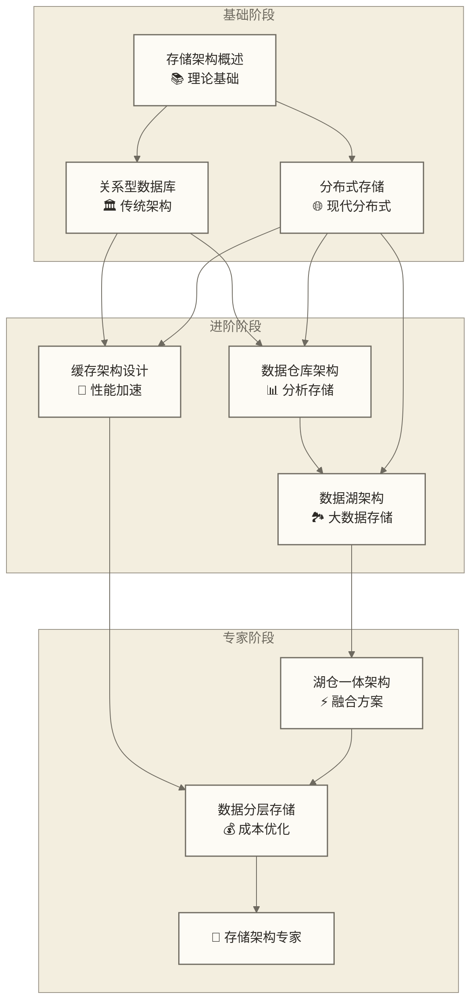

# 数据存储架构导览

> [!abstract] 📋 模块概览
> - 🎯 **学习目标**：掌握从传统到现代的完整数据存储架构设计能力
> - 📚 **模块内容**：8个核心文档，构建完整存储知识体系
> - ⏱️ **学习时长**：完整学习与实践周期未核定，请按已有基础和项目范围安排
> - 🔗 **前置要求**：[[【数据开发与数据架构】/03-数据建模/00-数据建模导览.md|数据建模导览]] 和 [[【数据开发与数据架构】/04-数据架构设计/00-数据架构设计导览.md|数据架构设计导览]]

## 🎯 模块定位：现代数据栈的'基础设施引擎'

数据存储架构是**现代数据栈的核心基础设施**，是连接数据价值与技术实现的关键桥梁。

> [!tip] 💡 存储架构：数据系统的'生命线'
> 就像城市的基础设施决定了城市的发展潜力一样，存储架构是数据系统的"生命线"：
> - 🏗️ **基础设施地位**：决定数据系统的性能上限和扩展能力
> - ⚡ **性能决定因素**：影响查询响应时间、并发处理能力和系统吞吐量
> - 💰 **成本控制核心**：直接影响硬件投入、运维成本和资源利用率
> - 🔧 **技术演进基石**：从单机到分布式、从传统到云原生的技术路径

**在现代数据生态中**：
- 云原生存储重新定义了数据基础设施的边界
- 湖仓一体架构成为企业数据战略的新标准
- 实时存储能力成为数字化转型的核心竞争力

## 📚 模块结构

### 📖 文档清单

| 阶段 | 文档名称 | 核心内容 | 技术重点 | 实践价值 |
|---|---|---|---|---|
| **基础理论** | [[【数据开发与数据架构】/05-数据存储架构/01-数据存储架构概述.md\|数据存储架构概述]] | 存储架构设计原则与方法论 | CAP理论、一致性模型 | 建立存储架构思维 |
| **传统架构** | [[【数据开发与数据架构】/05-数据存储架构/02-关系型数据库架构.md\|关系型数据库架构]] | ACID特性与事务处理 | 索引设计、锁机制 | 企业级OLTP系统 |
| **现代分布式** | [[【数据开发与数据架构】/05-数据存储架构/03-分布式存储架构.md\|分布式存储架构]] | 分布式一致性与容错 | 分片策略、复制机制 | 大规模数据存储 |
| **分析存储** | [[【数据开发与数据架构】/05-数据存储架构/04-数据仓库架构.md\|数据仓库架构]] | 列式存储与MPP架构 | 维度建模、ETL设计 | 企业级数据分析 |
| **大数据存储** | [[【数据开发与数据架构】/05-数据存储架构/05-数据湖架构.md\|数据湖架构]] | 对象存储与元数据管理 | Schema-on-Read | 数据探索与创新 |
| **融合架构** | [[【数据开发与数据架构】/05-数据存储架构/06-数据湖仓一体架构.md\|数据湖仓一体架构]] | 统一存储与计算引擎 | Delta Lake、Iceberg | 现代数据栈核心 |
| **性能加速** | [[【数据开发与数据架构】/05-数据存储架构/07-缓存架构设计.md\|缓存架构设计]] | 多级缓存与一致性 | Redis集群、CDN | 高并发系统优化 |
| **成本优化** | [[【数据开发与数据架构】/05-数据存储架构/08-数据分层存储.md\|数据分层存储]] | 冷热数据分离策略 | 生命周期管理 | 存储成本控制 |

### 🏗️ 存储架构学习路径：从基础到专家

## 🎯 学习目标

### 🟢 核心学习目标

**存储架构设计能力**：
> [!success] 🎯 设计能力目标
> - **方法论掌握**：建立从需求分析到架构落地的完整设计流程
> - **技术选型能力**：基于业务场景和技术约束的存储方案选择
> - **性能优化思维**：从存储层面解决系统性能瓶颈的能力
> - **成本控制意识**：平衡性能需求与成本投入的决策能力

**现代存储技术栈**：
> [!success] 🔧 技术栈目标
> - **传统架构精通**：关系型数据库架构设计与优化
> - **分布式架构理解**：分布式存储的核心原理与实现
> - **云原生架构**：云存储服务与容器化部署
> - **湖仓一体实践**：现代数据栈的统一存储方案

**企业级实践能力**：
> [!success] 🏢 实践目标
> - **架构演进规划**：制定存储架构的迁移与升级策略
> - **团队协作能力**：跨团队的存储架构设计与落地
> - **运维监控体系**：建立存储系统的监控与告警机制
> - **故障处理经验**：处理存储系统故障的标准流程

### 🟡 架构思维进阶

**系统性思维建立**：
> [!warning] 🧠 思维模式转变
> - **从单机到分布式**：理解分布式系统的复杂性与权衡
> - **从性能到成本**：建立性能与成本的平衡决策框架
> - **从静态到动态**：掌握存储系统的弹性伸缩与自适应
> - **从孤立到协同**：理解存储与计算、网络的协同优化

**技术决策能力**：
> [!warning] ⚖️ 决策能力培养
> - **业务驱动设计**：基于业务增长预测的存储容量规划
> - **技术债务管理**：平衡快速交付与长期架构健康
> - **风险评估能力**：识别存储架构变更的潜在风险
> - **投资回报分析**：量化存储架构优化的业务价值

## 🔗 与其他模块的关联

### 前置依赖

本模块基于以下模块的基础：

- **数据建模**：数据模型设计、规范化方法
- **数据架构设计**：架构设计原则、分层方法
- **数据工程实践**：数据处理流程、ETL开发

### 后续延伸

完成本模块后，你将能够：

- 进入**数据处理架构**模块学习
- 开始学习**数据服务架构**设计
- 为**数据中台架构**做准备

## 🛠️ 实践建议

### 📚 学习方法论

**渐进式学习路径**：
> [!tip] 🎯 学习策略
> 1. **概念建立**：先理解存储架构的基本概念和设计原则
> 2. **技术深入**：逐一掌握各种存储技术的特性和适用场景
> 3. **架构设计**：通过实际案例学习架构设计的方法和流程
> 4. **实践验证**：在真实或模拟环境中验证架构设计的可行性

**多维度学习方法**：
- **🔬 技术实验**：搭建不同存储系统进行性能对比测试
- **📊 案例分析**：研究知名企业的存储架构演进路径
- **🤝 社区参与**：参与开源存储项目，了解最新技术趋势
- **📝 文档输出**：通过写作整理和加深对存储技术的理解

**学习资源推荐**：
- **官方文档**：各存储系统的官方技术文档和最佳实践
- **技术博客**：业界专家的存储架构设计经验分享
- **开源项目**：研究开源存储系统的架构设计和实现细节
- **技术会议**：参加存储相关的技术会议和研讨会

### 🎯 重点难点

**重点**：
- 存储架构的设计原则和方法
- 不同存储方案的适用场景
- 存储性能的优化方法

**难点**：
- 分布式存储的一致性设计
- 大规模数据的存储架构设计
- 存储成本与性能的平衡

## ✅ 学习检查点

### 🟢 基础能力检查清单

**理论基础掌握**：
- [ ] **存储架构设计原则**：理解CAP理论、ACID特性等核心概念
- [ ] **一致性模型**：掌握强一致性、最终一致性等不同模型
- [ ] **性能指标体系**：了解IOPS、延迟、吞吐量等关键指标
- [ ] **成本模型分析**：理解存储成本的构成和优化方法

**技术栈应用**：
- [ ] **关系型数据库**：设计高性能的OLTP存储架构
- [ ] **分布式存储**：理解分片、复制等核心机制
- [ ] **数据仓库架构**：掌握列式存储和MPP架构设计
- [ ] **数据湖技术**：了解对象存储和元数据管理
- [ ] **缓存系统**：设计多级缓存架构

**实践能力验证**：
- [ ] **架构设计文档**：能够输出完整的存储架构设计方案
- [ ] **性能测试计划**：制定存储系统的性能测试方案
- [ ] **容量规划能力**：基于业务增长预测存储需求
- [ ] **故障处理流程**：建立存储系统的故障响应机制

### 🟡 专家级能力检查清单

**架构设计领导力**：
- [ ] **复杂架构设计**：设计支持PB级数据的分布式存储架构
- [ ] **多云架构规划**：制定跨云平台的存储策略和迁移方案
- [ ] **湖仓一体落地**：主导企业级湖仓一体架构的实施
- [ ] **技术选型决策**：基于业务需求制定存储技术选型标准

**企业级运营能力**：
- [ ] **成本优化策略**：制定企业级存储成本控制和优化策略
- [ ] **安全合规设计**：设计满足行业规范的存储安全架构
- [ ] **团队能力建设**：建立存储架构设计的团队能力和流程
- [ ] **技术债务管理**：制定存储系统技术债务的清理计划

**创新与前瞻**：
- [ ] **新技术评估**：评估和引入新兴存储技术的潜力
- [ ] **架构演进规划**：制定3-5年的存储架构演进路线图
- [ ] **标准制定能力**：参与或主导企业存储架构标准制定
- [ ] **知识体系建设**：建立和完善存储架构的知识管理体系

## 🔗 快速导航

**开始学习**：[[【数据开发与数据架构】/05-数据存储架构/01-数据存储架构概述.md|数据存储架构]]  
**关系型数据库**：[[【数据开发与数据架构】/05-数据存储架构/02-关系型数据库架构.md|关系型数据库]]  
**分布式存储**：[[【数据开发与数据架构】/05-数据存储架构/03-分布式存储架构.md|分布式存储]]  
**数据仓库**：[[【数据开发与数据架构】/05-数据存储架构/04-数据仓库架构.md|数据仓库]]  
**数据湖**：[[【数据开发与数据架构】/05-数据存储架构/05-数据湖架构.md|数据湖]]  
**湖仓一体**：[[【数据开发与数据架构】/05-数据存储架构/06-数据湖仓一体架构.md|数据湖仓一体]]  
**缓存架构**：[[【数据开发与数据架构】/05-数据存储架构/07-缓存架构设计.md|缓存架构]]  
**分层存储**：[[【数据开发与数据架构】/05-数据存储架构/08-数据分层存储.md|数据分层存储]]  

**上一步**：[[【数据开发与数据架构】/04-数据架构设计/00-数据架构设计导览.md|数据架构设计导览]]  
**下一步**：[[【数据开发与数据架构】/06-数据处理架构/00-数据处理架构导览.md|数据处理架构导览]]

---

**创建时间**：2024-12-19  
**编辑更新时间**：见元数据 updated；原页尾日期2024-12-19  仅保留为历史记录，不作为现行更新时间或事实核验日期。
**预计完成**：完整学习与实践周期未核定

**相关标签**：#数据存储 #数据库架构 #数据仓库 #数据湖 #存储设计