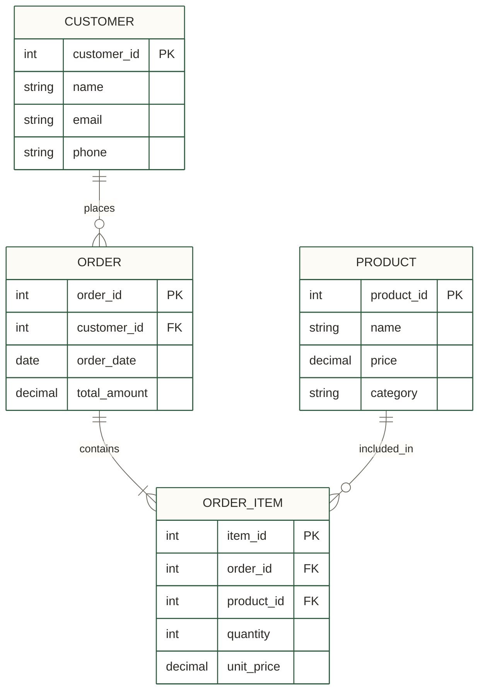
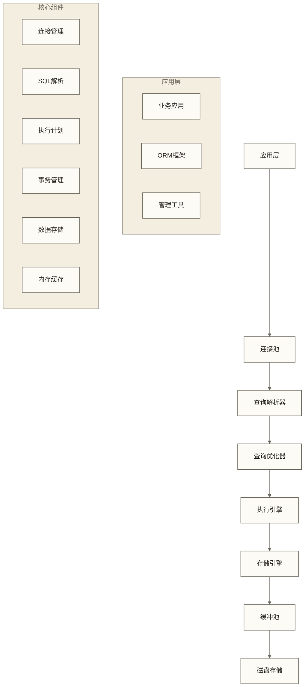
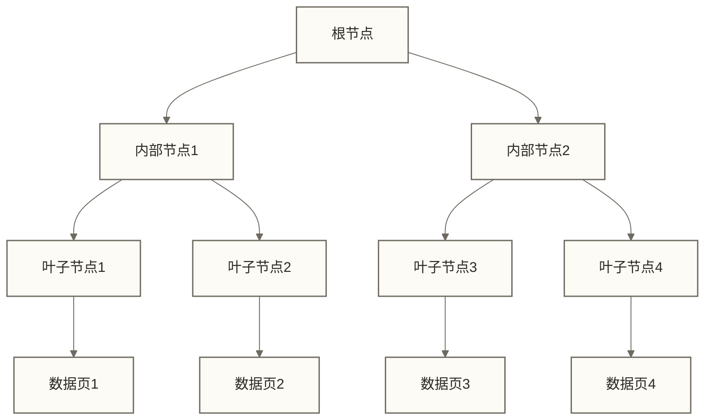
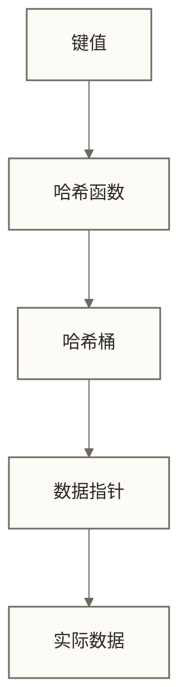
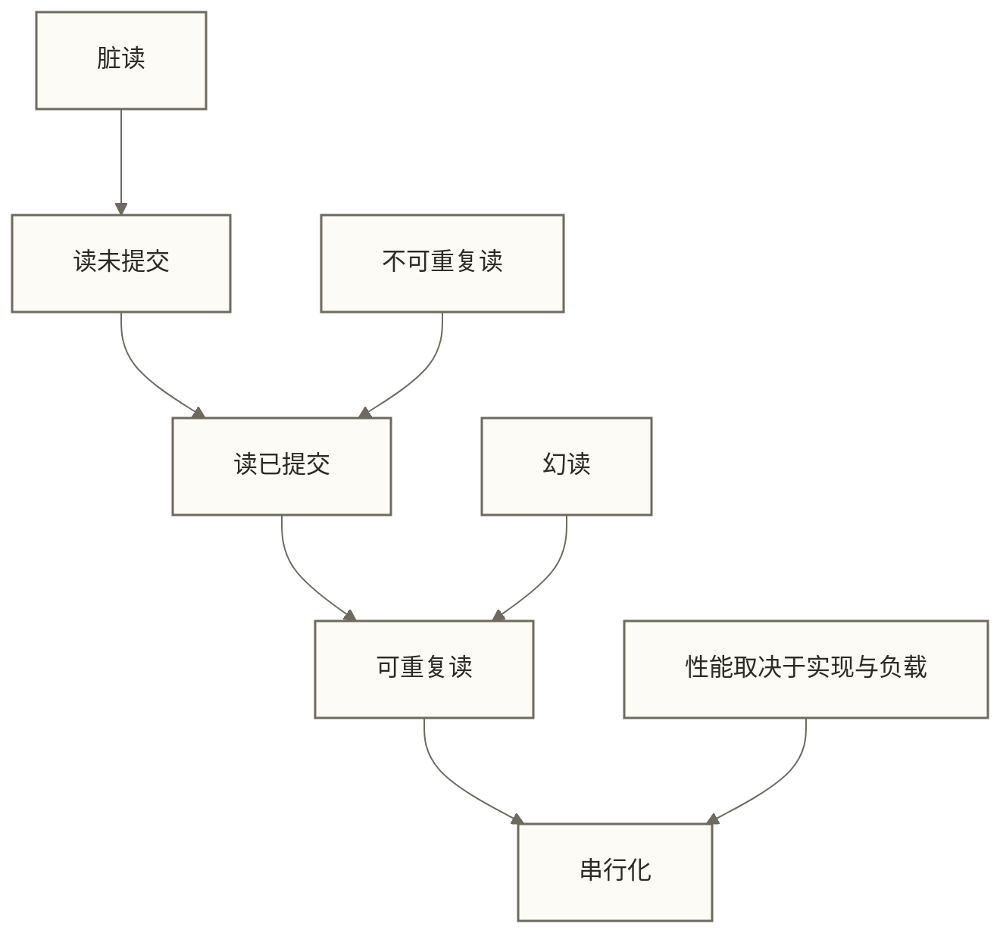
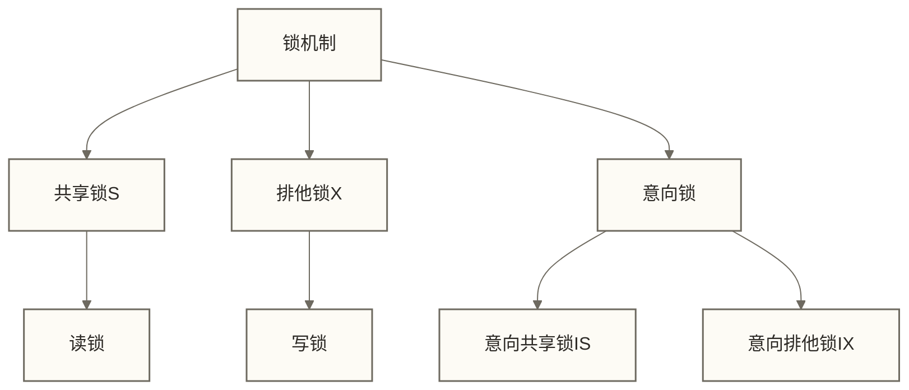
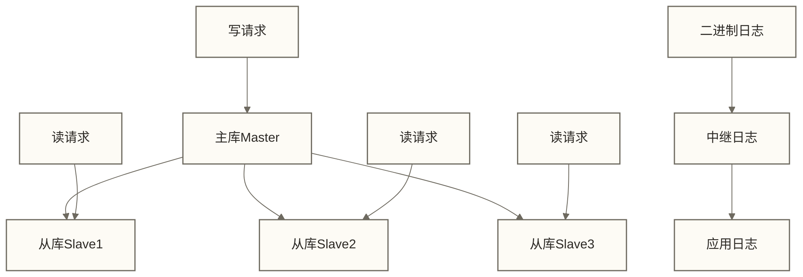
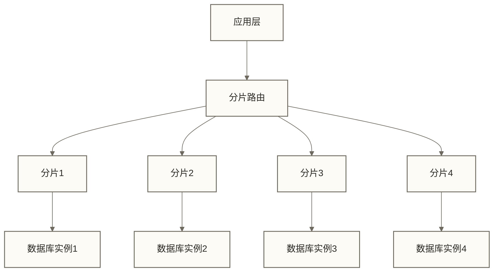
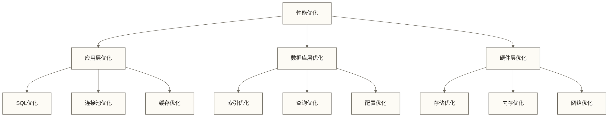

# 关系型数据库架构

> [!abstract] 📋 本节概览
> - 🎯 **学习目标**：掌握关系型数据库的架构设计方法和最佳实践
> - 📚 **前置知识**：[[【数据开发与数据架构】/05-数据存储架构/01-数据存储架构概述|数据存储架构]]、关系数据模型
> - ⏱️ **预计用时**：25分钟

## 🏗️ 关系型数据库架构：数据存储的'可靠基石'

关系型数据库架构是**现代企业数据存储的核心支柱**，让数据管理从简单存储向结构化治理的系统化升级。

**关系型数据库架构的价值**：
- 🎯 **ACID保障**：从数据不一致向原子性、一致性、隔离性和持久性的可靠转化
- ⚡ **性能优化**：建立索引设计、查询优化和存储引擎的高效体系
- 🔧 **事务控制**：掌握并发管理、锁机制和隔离级别的实战技能
- 📈 **架构扩展**：构建主从复制、分库分表和高可用的竞争优势

在数据存储实践中，关系型数据库是连接业务逻辑与数据持久化的重要桥梁。
## 💡 核心概念解释

### 🎯 关系型数据库的核心特性

#### 1. **ACID特性**

> [!note] 📖 ACID是什么？
> ACID是关系型数据库的四个核心特性，确保数据的一致性和可靠性。

**A - Atomicity（原子性）**
- 事务是不可分割的工作单位
- 要么全部成功，要么全部失败
- 例如：转账操作，要么扣款和收款都成功，要么都失败

**C - Consistency（一致性）**
- 事务执行前后，数据库从一个一致状态转换到另一个一致状态
- 例如：转账后，总金额保持不变

**I - Isolation（隔离性）**
- 并发事务之间相互隔离，互不干扰
- 通过锁机制和隔离级别实现

**D - Durability（持久性）**
- 事务一旦提交，数据永久保存
- 通过相应持久化日志、存储刷盘与可靠性机制实现；具体保证取决于配置，备份另用于灾难恢复

#### 2. **关系模型**

### 🏗️ 关系型数据库架构层次

## 🔍 存储引擎架构

### 🎯 存储引擎与数据库产品概览

| 存储引擎或数据库产品 | 事务支持 | 锁粒度 | 并发性能 | 适用场景 | 典型产品 |
|---|---|---|---|---|---|
| **InnoDB** | 完整ACID | 行级锁 | 高 | OLTP、事务处理 | [[【技术与工具】/MySQL/02-MySQL安装配置\|MySQL安装配置]] |
| **MyISAM** | 不支持 | 表级锁 | 低 | 只读、报表 | [[【技术与工具】/MySQL/02-MySQL安装配置\|MySQL安装配置]] |
| **PostgreSQL** | 完整ACID | 行级锁 | 高 | 复杂查询、GIS | PostgreSQL |
| **Oracle** | 完整ACID | 行级锁 | 极高 | 企业级应用 | Oracle Database |
| **SQL Server** | 完整ACID | 行级锁 | 高 | Windows生态 | SQL Server |

### 🏗️ InnoDB存储引擎架构

```mermaid
%%{init: {"theme":"base","themeVariables":{"fontFamily":"PingFang SC, -apple-system, Source Han Serif SC, serif","fontSize":"16px","background":"#FDFBF5","primaryColor":"#FDFBF5","primaryTextColor":"#2D2A26","primaryBorderColor":"#6E6A60","secondaryColor":"#E8EFE8","secondaryBorderColor":"#8FA890","secondaryTextColor":"#2D2A26","tertiaryColor":"#FDFBF5","tertiaryBorderColor":"#9A9488","tertiaryTextColor":"#6E6A60","lineColor":"#6E6A60","textColor":"#2D2A26","mainBkg":"#FDFBF5","nodeBorder":"#2D5A3D","clusterBkg":"#F3EEDF","clusterBorder":"#9A9488","edgeLabelBackground":"#FDFBF5"},"flowchart":{"htmlLabels":true,"curve":"basis","padding":20,"nodeSpacing":60,"rankSpacing":70,"useMaxWidth":false},"themeCSS":".node rect, .node polygon, .node circle { stroke-width: 1.5px; } .edgePath .path { stroke-width: 1.5px; } .cluster-label .nodeLabel, .cluster-label foreignObject { color: #2D2A26 !important; } .edgeLabel, .edgeLabel foreignObject { color: #2D2A26 !important; background-color: #FDFBF5; } .edgeLabel rect { fill: #FDFBF5; }"}}%%
flowchart TB
    classDef default fill:#FDFBF5,stroke:#6E6A60,color:#2D2A26,stroke-width:1.5px
    classDef startend fill:#2D2A26,stroke:#2D2A26,color:#FDFBF5,font-weight:bold
    classDef decision fill:#F6EAD8,stroke:#C08A1A,color:#2D2A26,font-weight:bold
    classDef hub fill:#3B5A80,stroke:#3B5A80,color:#FDFBF5,font-weight:bold
    classDef io fill:#E5EAF0,stroke:#3B5A80,color:#2D2A26
    classDef accent fill:#A6432C,stroke:#A6432C,color:#FDFBF5,font-weight:bold
    classDef storage fill:#F3EEDF,stroke:#9A9488,color:#2D2A26
    A[用户线程] --> B[缓冲池]
    A --> C[重做日志缓冲]
    A --> D[撤销日志]
    B --> E[数据页]
    B --> F[索引页]
    B --> G[插入缓冲]
    B --> H[自适应哈希索引]
    I[后台线程] --> J[主线程]
    I --> K[IO线程]
    I --> L[清理线程]
    I --> M[锁监控线程]
    N[磁盘存储] --> O[系统表空间]
    N --> P[独立表空间]
    N --> Q[重做日志文件]
    N --> R[撤销日志文件]
    class A,B,C,D,E,F,G,H,I,J,K,L,M,N,O,P,Q,R default
```

## 🛠️ 索引架构设计

### 🎯 索引类型和原理

#### 1. **B+树索引**

**特点**：
- 平衡树结构，查询效率稳定
- 叶子节点包含索引键及记录或记录定位信息，具体取决于索引实现
- 支持范围查询
- 适合磁盘存储

#### 2. **哈希索引**

**特点**：
- 等值查询极快
- 不支持范围查询
- 内存占用较大
- 适合内存数据库

### 📊 索引设计原则

| 原则 | 说明 | 示例 |
|---|---|---|
| **最左前缀** | 复合索引按最左列顺序使用 | (a,b,c)索引，按最左前缀进行查找时从a开始 |
| **覆盖索引** | 索引包含查询所需的所有列 | 索引(c,a,b)可覆盖SELECT a,b FROM t WHERE c=1 |
| **选择性** | 选择区分度高的列建立索引 | 性别列不适合单独建索引 |
| **避免冗余** | 避免重复或冗余的索引 | 已有(a,b)索引时，(a)索引可能冗余，需结合约束和查询评估 |

## 🔄 事务和锁机制

### 🎯 事务隔离级别

| 隔离级别 | 脏读 | 不可重复读 | 幻读 | 性能 | 典型应用 |
|---|---|---|---|---|---|
| **读未提交** | 可能 | 可能 | 可能 | 最高 | 可容忍脏读且不用于一致性决策的粗略查询（仍需评估风险） |
| **读已提交** | 不可能 | 可能 | 可能 | 高 | 大多数应用 |
| **可重复读** | 不可能 | 不可能 | 可能 | 中 | 财务系统 |
| **串行化** | 不可能 | 不可能 | 不可能 | 最低 | 银行系统 |

### 🔒 锁机制

#### 1. **锁类型**

#### 2. **锁粒度**

| 锁粒度 | 并发度 | 死锁风险 | 适用场景 |
|---|---|---|---|
| **表级锁** | 低 | 低 | 批量操作 |
| **页级锁** | 中 | 中 | 中等并发 |
| **行级锁** | 高 | 高 | 高并发OLTP |

## 🏗️ 高可用架构模式

### 🎯 主从复制架构

**特点**：
- 读写分离
- 复制副本（不替代独立备份）
- 负载分担
- 故障切换需另行设计检测、提升与客户端重连机制

### 🎯 分片架构

**分片策略**：
- **范围分片**：按ID范围分片
- **哈希分片**：按哈希值分片
- **列表分片**：按特定值分片

## 🎯 性能优化策略

### 📊 性能优化层次

### 🛠️ 常见优化方法

#### 1. **SQL优化**
- 避免SELECT *
- 使用EXPLAIN分析执行计划
- 合理使用索引
- 避免子查询和JOIN过多

#### 2. **索引优化**
- 创建合适的索引
- 定期维护索引统计信息
- 删除无用索引
- 使用覆盖索引

#### 3. **配置优化**
- 调整缓冲池大小
- 优化日志配置
- 调整并发参数
- 配置连接池

## ✅ 掌握检查

### 🟢 基础检查清单

- [ ] 理解ACID特性的含义和作用
- [ ] 掌握关系模型的基本概念
- [ ] 了解存储引擎的架构和特点
- [ ] 理解索引的原理和设计原则
- [ ] 掌握事务隔离级别的概念
- [ ] 了解锁机制的基本原理
- [ ] 理解主从复制的架构模式
- [ ] 掌握基本的性能优化方法

### 🟡 进阶检查清单

- [ ] 能够设计复杂的关系型数据库架构
- [ ] 掌握分布式数据库的设计方法
- [ ] 能够进行深度的性能调优
- [ ] 理解数据库内部实现原理
- [ ] 掌握高可用架构的设计方法
- [ ] 能够进行数据库容量规划
- [ ] 具备数据库安全设计能力
- [ ] 能够指导团队的数据库设计

## 🔗 学习连接

**前置知识**：[[【数据开发与数据架构】/05-数据存储架构/01-数据存储架构概述|数据存储架构]]、关系数据模型  
**下一步**：[[【数据开发与数据架构】/05-数据存储架构/03-分布式存储架构|分布式存储]]  
**相关模块**：[[【数据开发与数据架构】/06-数据处理架构/00-数据处理架构导览|数据处理架构导览]] 和 [[【技术与工具】/SQL/22-SQL优化|SQL优化]]  

**返回**：[[【数据开发与数据架构】/05-数据存储架构/00-数据存储架构导览|数据存储架构导览]]

---

**创建时间**：2024-12-19  
**编辑更新时间**：见元数据 updated；原页尾日期2024-12-19仅保留为历史记录，不作为现行更新时间或事实核验日期。

#关系型数据库 #ACID #事务 #索引 #存储引擎 #架构模式