# 数据仓库架构

> [!abstract] 📋 本节概览
> - 🎯 **学习目标**：掌握数据仓库架构的设计方法和最佳实践
> - 📚 **前置知识**：[[【数据开发与数据架构】/05-数据存储架构/01-数据存储架构概述|数据存储架构]]、[[【数据开发与数据架构】/03-数据建模/01-数据建模概述|数据建模理论]]
> - ⏱️ **预计用时**：30分钟

## 🏛️ 数据仓库：企业智慧的'知识宝库'

数据仓库架构是**现代商业智能的核心基础设施**，让数据存储从零散分布向集中分析的系统化升级。

**数据仓库的价值**：
- 🎯 **数据集成**：从孤立数据源向主题导向、历史积累和一致性保证的整合转化
- ⚡ **分析效能**：建立维度建模、OLAP查询和数据集市的分析体系
- 🔧 **架构能力**：掌握ETL流程、缓慢变化维和分层架构的实战技能
- 📈 **决策支持**：构建商业智能、数据挖掘和决策分析的竞争优势

在数据驱动时代，数据仓库是连接业务数据与管理洞察的重要桥梁。

## 💡 核心概念解释

### 🎯 什么是数据仓库？

**[[【数据分析与数据运营】/98-专业术语词典/04-数据工程类/数据仓库|数据仓库]]**是一个面向主题的、集成的、相对稳定的、反映历史变化的数据集合，用于支持管理决策。

> [!note] 📖 核心特征
> - **面向主题**：围绕业务主题组织数据
> - **集成性**：整合多个数据源的数据
> - **非易失性**：数据一旦写入，一般不修改
> - **时变性**：反映数据随时间的变化
> - **一致性**：保证数据的一致性和准确性

### 🏗️ 数据仓库架构模型

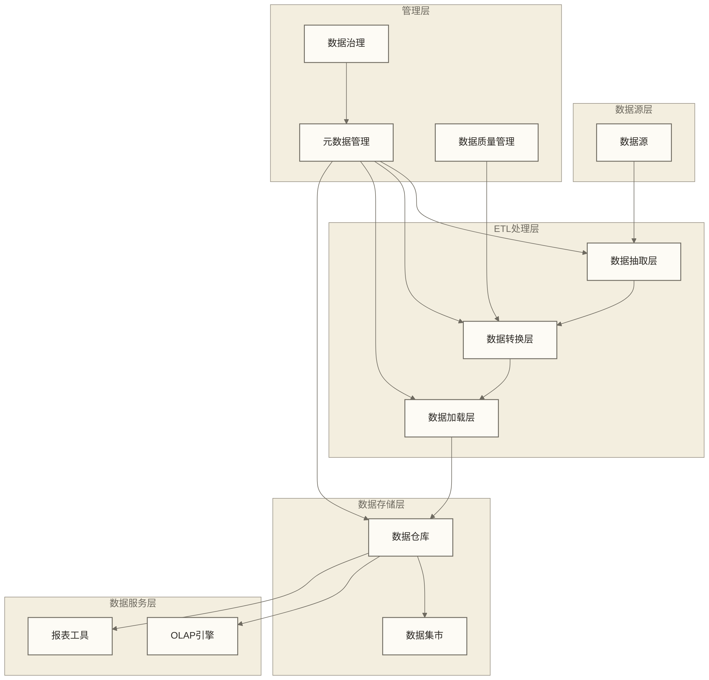

## 🔍 数据仓库设计原则

### 🎯 数据仓库设计原则

#### 1. **主题导向原则**
- 以业务主题为中心组织数据
- 支持跨部门的业务分析需求
- 确保数据的业务价值

#### 2. **数据集成原则**
- 统一数据标准和格式
- 消除数据冗余和不一致
- 建立统一的数据视图

#### 3. **数据质量原则**
- 确保数据的准确性、完整性、一致性
- 建立数据质量监控机制
- 实施数据质量改进流程

#### 4. **性能优化原则**
- 优化查询性能
- 合理设计索引和分区
- 支持并发访问

#### 5. **可扩展性原则**
- 支持数据量增长
- 支持新业务需求
- 支持技术演进

### 🎯 数据仓库架构模式

#### 1. **Kimball架构（维度建模）**
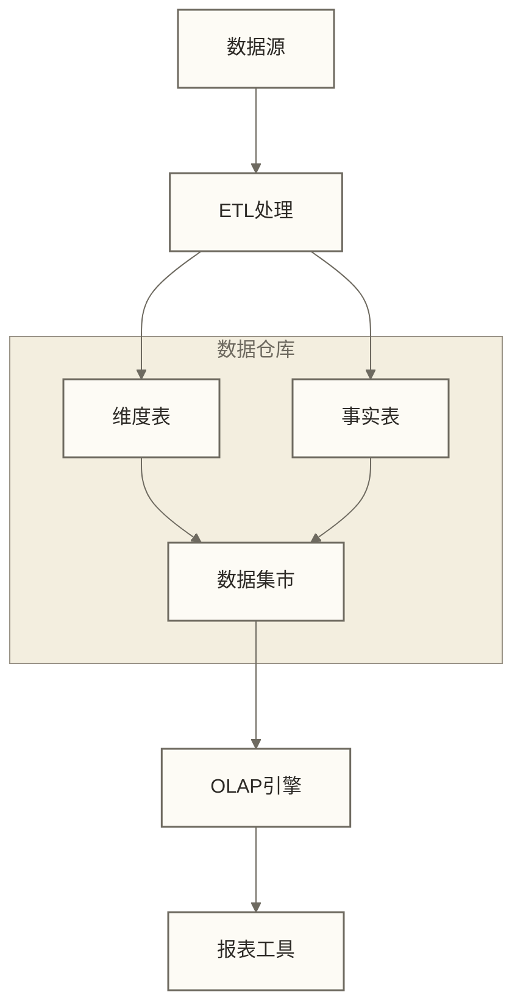

**特点**：
- 以维度建模为核心
- 快速实现，易于理解
- 适合部门级应用

#### 2. **Inmon架构（企业级数据仓库）**
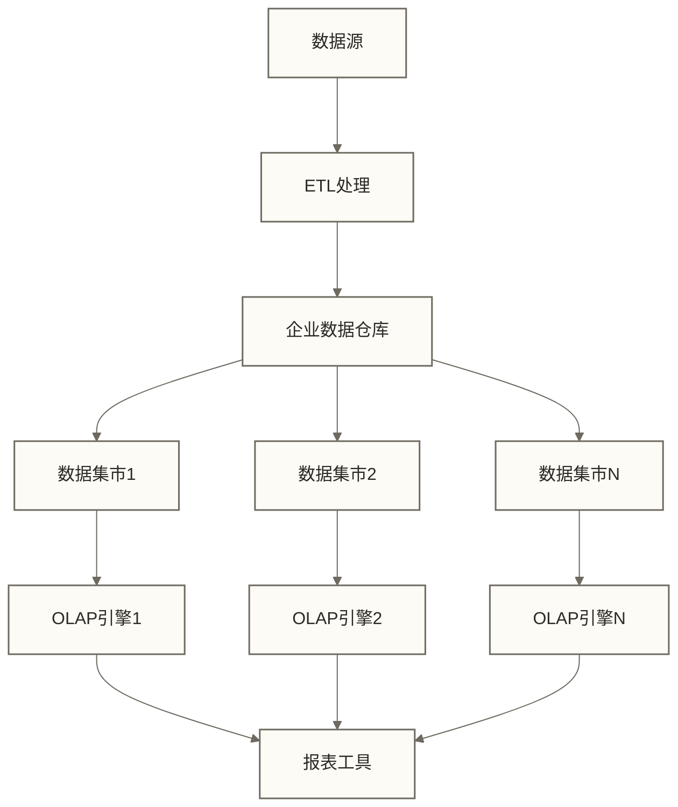

**特点**：
- 以规范化建模为核心
- 数据一致性高
- 适合企业级应用

#### 3. **Data Vault架构**
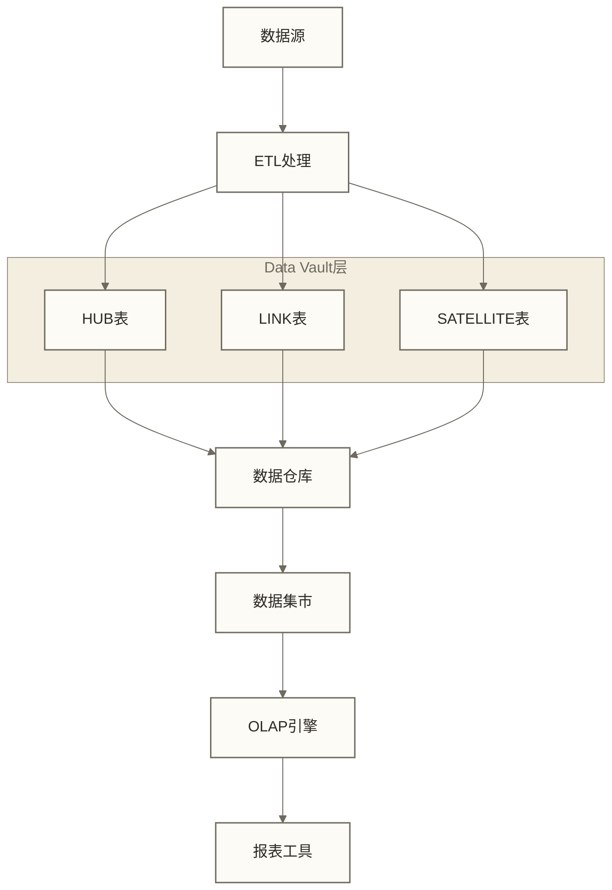

**特点**：
- 高度可扩展
- 支持历史追踪
- 适合大数据环境

## 🛠️ 数据仓库技术实现

### 📊 数据建模技术

#### 1. **星型模型（Star Schema）**
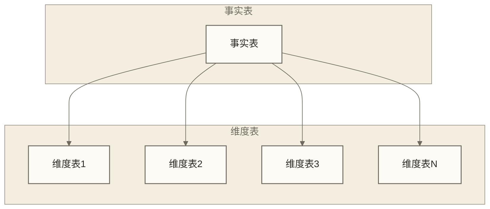

**特点**：
- 结构简单，查询高效
- 适合OLAP分析
- 易于理解和维护

#### 2. **雪花模型（Snowflake Schema）**
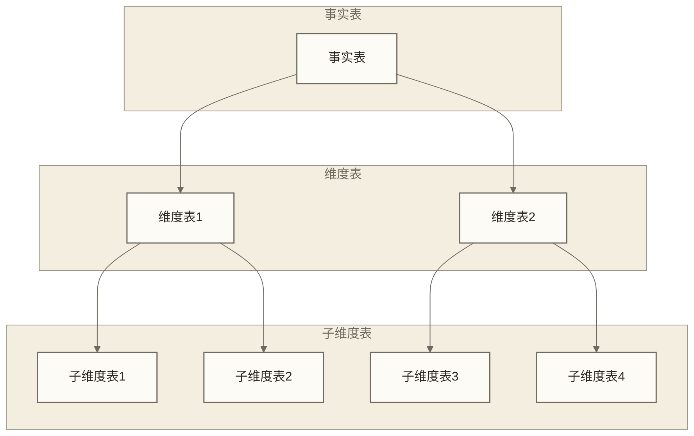

**特点**：
- 减少数据冗余
- 支持复杂维度关系
- 查询性能相对较低

#### 3. **星座模型（Constellation Schema）**
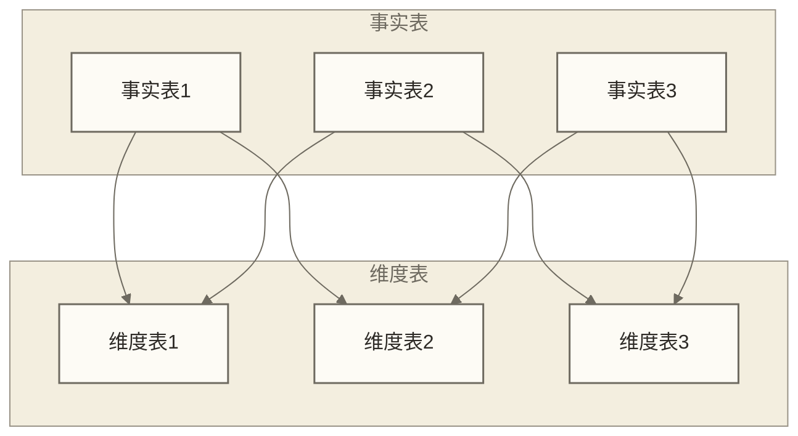

**特点**：
- 支持多个事实表
- 共享维度表
- 适合复杂业务场景

### 🔄 ETL处理技术

#### 1. **数据抽取（Extract）**
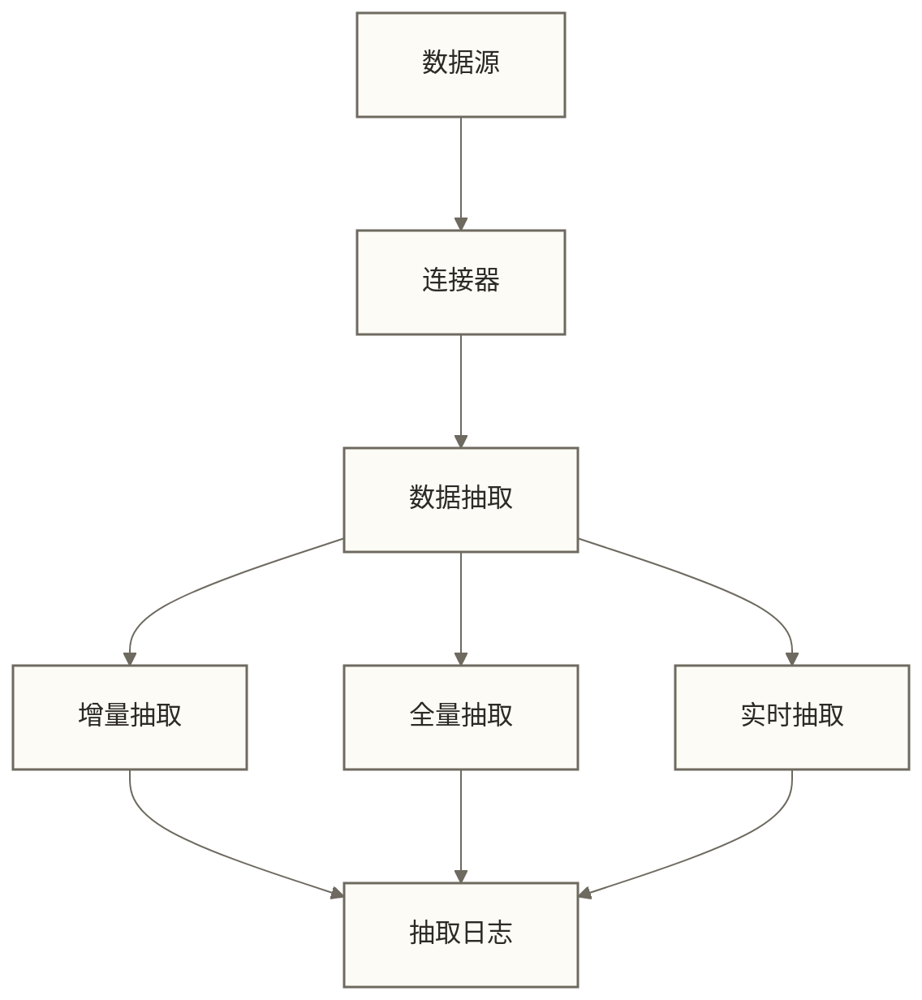

**技术要点**：
- 支持多种数据源
- 增量抽取策略
- 抽取性能优化

#### 2. **数据转换（Transform）**
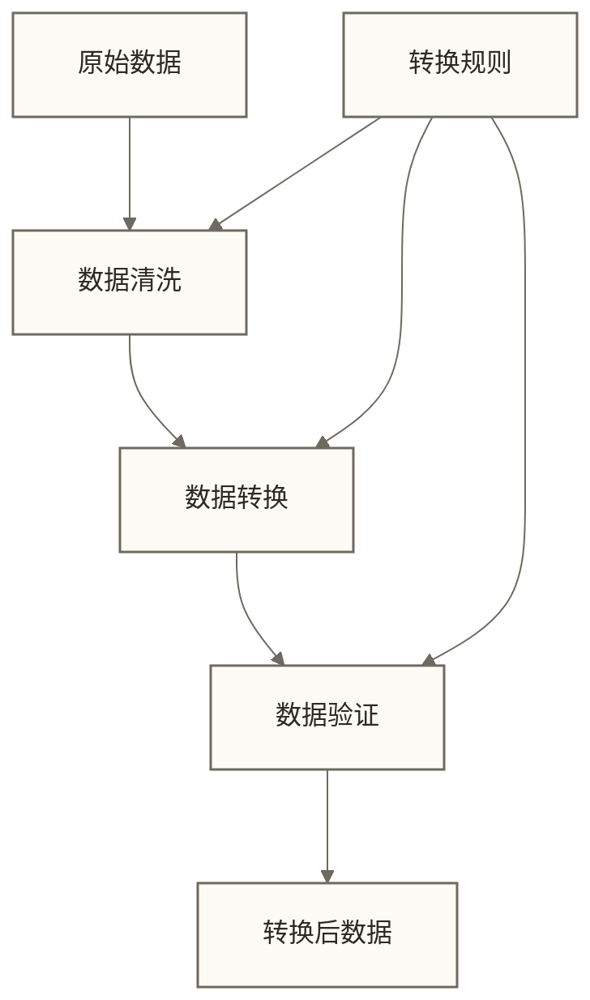

**技术要点**：
- 数据清洗和标准化
- 业务规则转换
- 数据质量检查

#### 3. **数据加载（Load）**
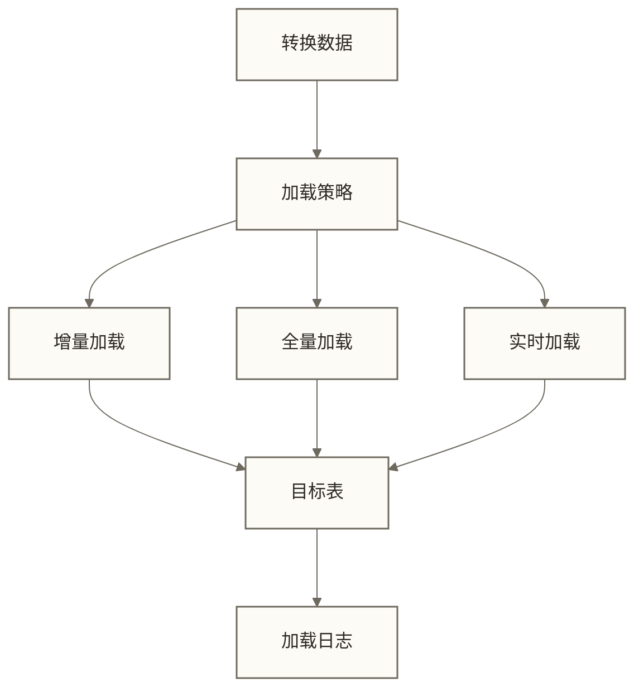

**技术要点**：
- 加载策略选择
- 事务管理
- 性能优化

### 🎯 数据仓库优化技术

#### 1. **索引优化**
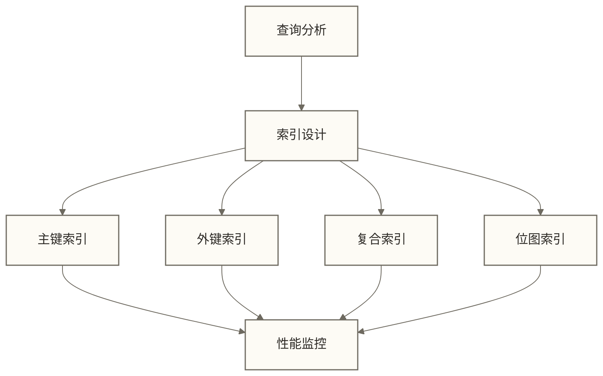

**优化策略**：
- 基于查询模式设计索引
- 定期维护和重建索引
- 监控索引使用情况

#### 2. **分区优化**
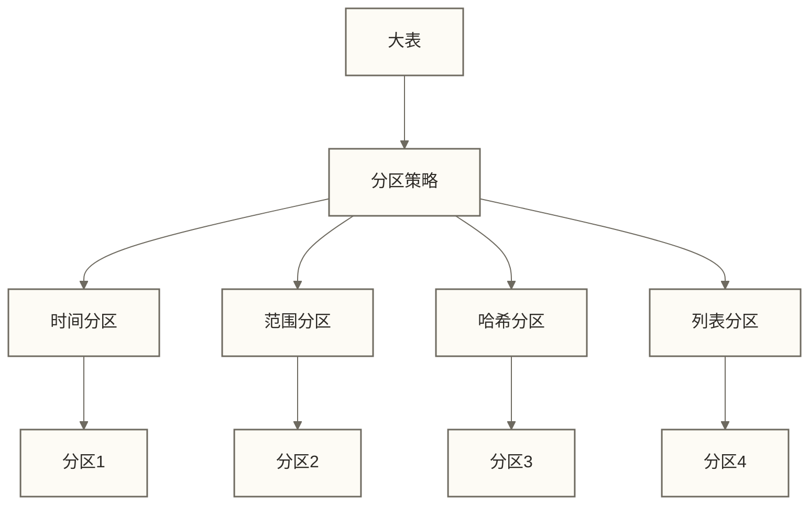

**优化策略**：
- 基于访问模式选择分区策略
- 合理设置分区大小
- 实施分区维护策略

#### 3. **压缩优化**
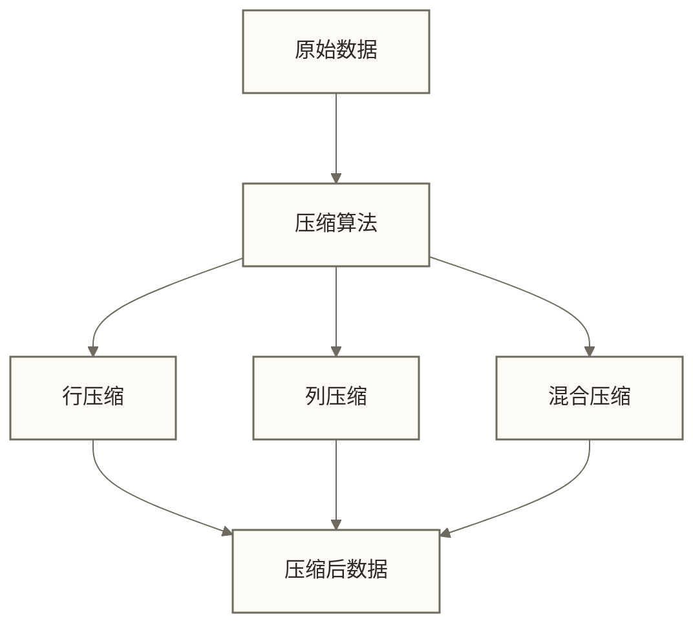

**优化策略**：
- 选择合适的压缩算法
- 平衡压缩率和性能
- 考虑解压缩成本

## ✅ 掌握检查

### 🟢 基础检查清单

- [ ] 理解数据仓库的核心概念和特征
- [ ] 掌握数据仓库的设计原则
- [ ] 了解不同的数据仓库架构模式
- [ ] 理解数据建模的基本方法
- [ ] 掌握ETL处理的基本流程
- [ ] 了解数据仓库优化技术
- [ ] 能够进行基本的数据仓库设计
- [ ] 具备数据仓库的思维方法

### 🟡 进阶检查清单

- [ ] 能够设计复杂的数据仓库架构
- [ ] 掌握高级数据建模技术
- [ ] 能够进行数据仓库性能优化
- [ ] 掌握数据仓库的运维管理
- [ ] 能够设计高可用的数据仓库系统
- [ ] 掌握数据仓库的监控和调优
- [ ] 具备数据仓库技术选型能力
- [ ] 能够指导团队的数据仓库建设

## 🔗 学习连接

**前置知识**：[[【数据开发与数据架构】/05-数据存储架构/01-数据存储架构概述|数据存储架构]]、[[【数据开发与数据架构】/03-数据建模/01-数据建模概述|数据建模理论]]  
**下一步**：[[【数据开发与数据架构】/05-数据存储架构/05-数据湖架构|数据湖]]  
**相关模块**：[[【数据开发与数据架构】/03-数据建模/05-维度建模基础|数据建模原则]]、[[【数据开发与数据架构】/06-数据处理架构/08-数据处理编排|数据处理编排]]  

**返回**：[[【数据开发与数据架构】/05-数据存储架构/00-数据存储架构导览|数据存储架构导览]]

---

**创建时间**：2024-12-19  
**最后更新**：2024-12-19

#数据仓库 #数据建模 #数据集成 #ETL #数据质量 #数据治理