# 数据湖仓一体架构

> [!abstract] 📋 本节概览
> - 🎯 **学习目标**：掌握数据湖仓一体架构的设计方法和最佳实践
> - 📚 **前置知识**：[[【数据开发与数据架构】/05-数据存储架构/04-数据仓库架构|数据仓库]] 和 [[【数据开发与数据架构】/05-数据存储架构/05-数据湖架构|数据湖]]
> - ⏱️ **预计用时**：30分钟

## 🔗 数据湖仓一体：融合架构的'最佳实践'

数据湖仓一体架构是**现代企业数据平台的创新融合**，让数据管理从湖仓分离向统一架构的系统化升级。

**数据湖仓一体架构的价值**：
- 🎯 **架构统一**：从湖仓分离向统一存储、统一处理和统一服务的转化
- ⚡ **性能兼顾**：建立ACID事务、Schema演进和高效查询的平衡体系
- 🔧 **成本优化**：掌握存储分层、计算弹性和资源调度的实战技能
- 📈 **治理一体**：构建元数据管理、安全治理和质量监控的竞争优势

在数据架构实践中，湖仓一体是连接传统数据仓库与现代数据湖的重要桥梁。
## 💡 核心概念解释

### 🎯 什么是数据湖仓一体？

**数据湖仓一体（Lakehouse）**是一种新型的数据架构，将数据湖的灵活性和数据仓库的ACID事务、性能优化等特性相结合，提供统一的数据存储和分析平台。

> [!note] 📖 核心特征
> - **统一存储**：在一个平台上存储所有类型的数据
> - **ACID事务**：支持ACID事务保证数据一致性
> - **Schema演进**：支持Schema的灵活演进
> - **性能优化**：结合湖和仓的性能优化技术
> - **开放格式**：使用开放的数据格式
> - **统一接口**：提供统一的数据访问接口

### 🏗️ 数据湖仓一体架构模型

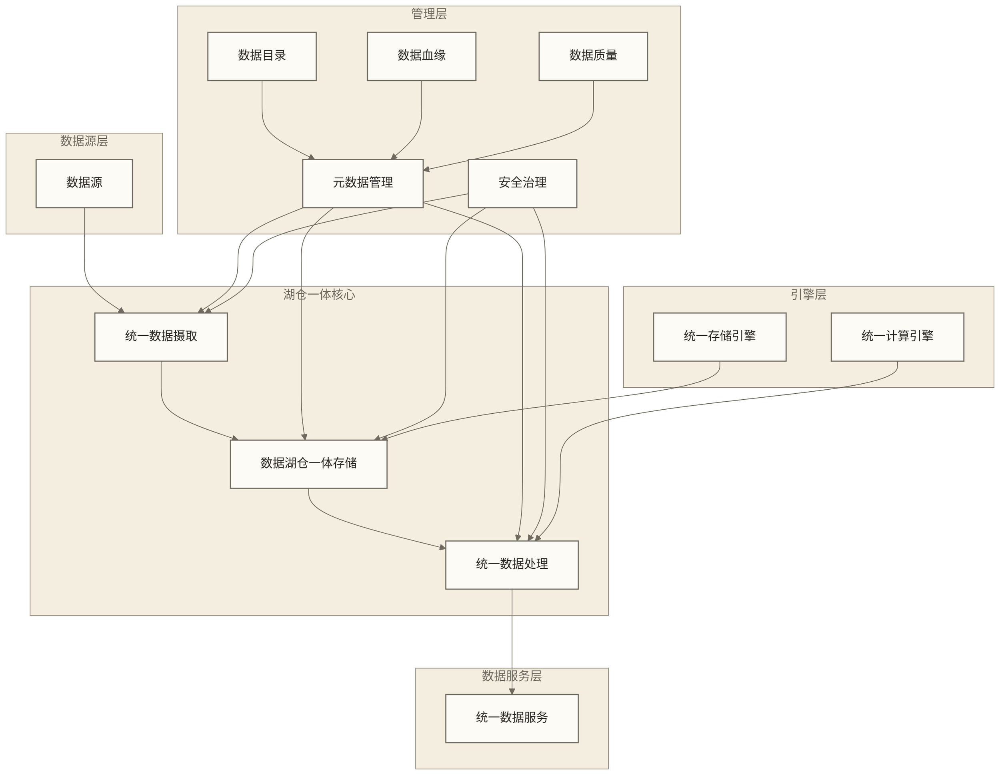

## 🔍 数据湖仓一体设计原则

### 🎯 设计原则

#### 1. **统一性原则**
- 统一数据存储格式
- 统一数据处理引擎
- 统一数据访问接口

#### 2. **兼容性原则**
- 兼容现有数据湖和数据仓库
- 支持渐进式迁移
- 保持向后兼容

#### 3. **性能原则**
- 结合湖和仓的性能优势
- 支持多种工作负载
- 优化查询性能

#### 4. **成本原则**
- 优化存储成本
- 优化计算成本
- 平衡性能和成本

#### 5. **开放性原则**
- 使用开放数据格式
- 支持多种计算引擎
- 避免厂商锁定

### 🎯 架构模式

#### 1. **Delta Lake模式**
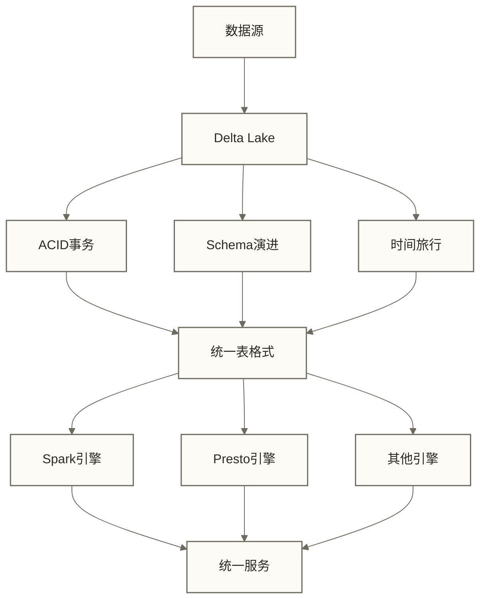

**特点**：
- 基于Delta Lake技术
- 支持ACID事务
- 支持多种计算引擎

#### 2. **Iceberg模式**
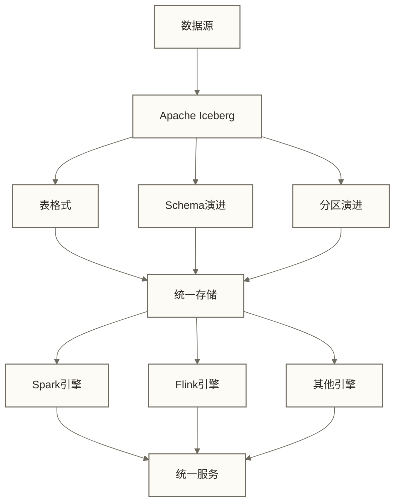

**特点**：
- 基于Apache Iceberg
- 支持Schema和分区演进
- 高性能查询

#### 3. **Hudi模式**
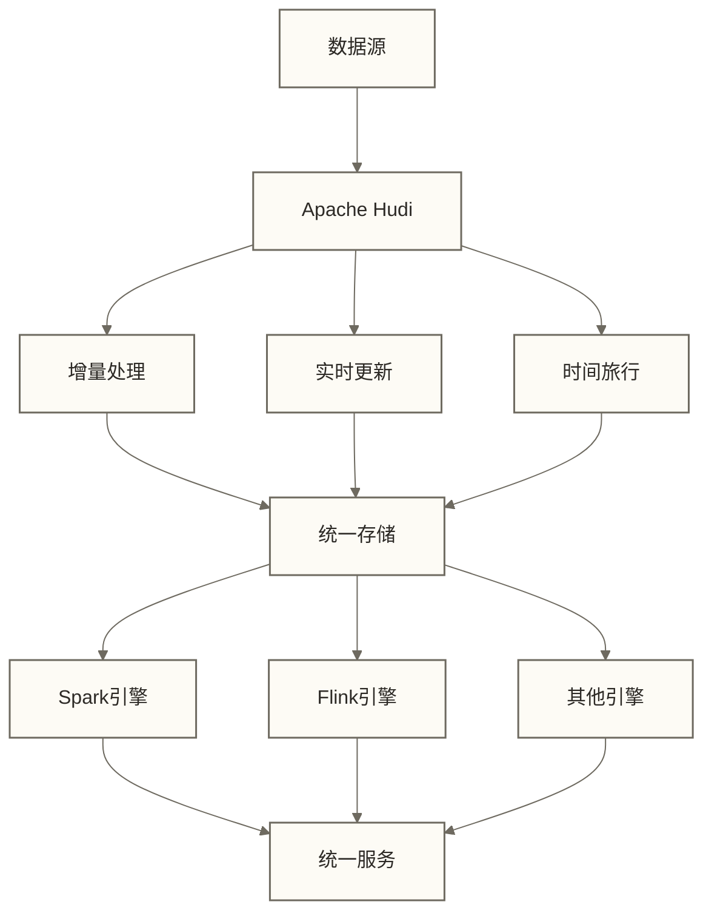

**特点**：
- 基于Apache Hudi
- 支持增量处理
- 支持实时更新

## 🛠️ 技术实现

### 📊 存储技术

#### 1. **统一存储格式**
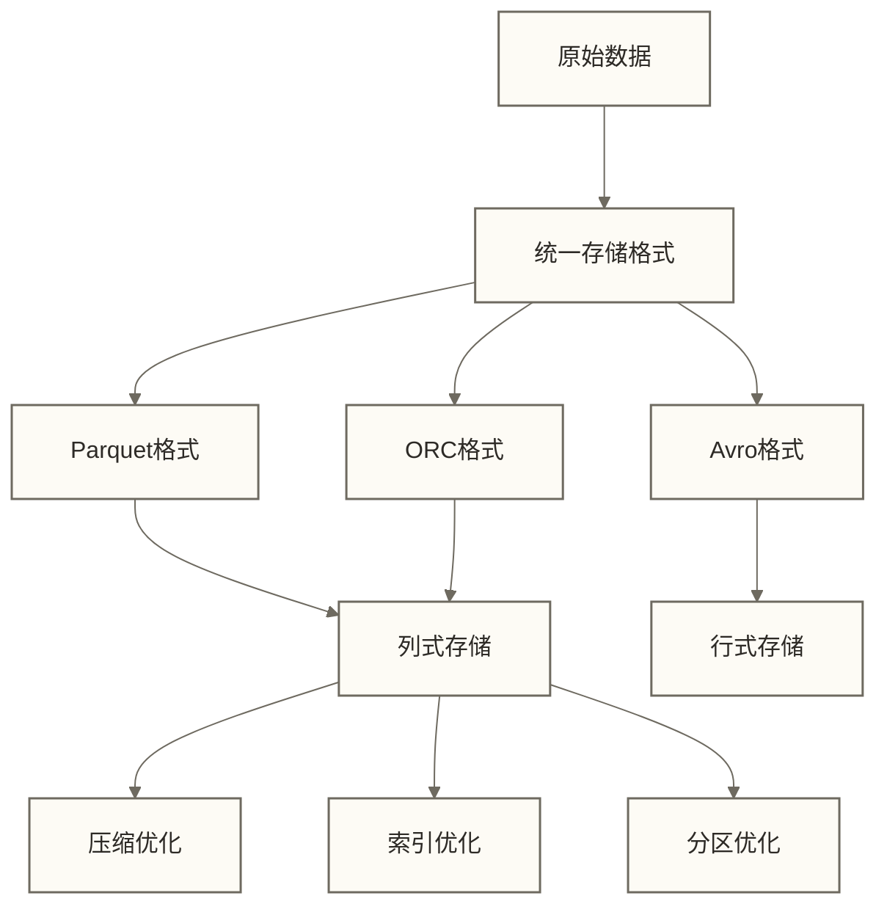

**技术特点**：
- 开放格式：使用开放的数据格式
- 高效压缩：支持多种压缩算法
- 查询优化：支持列式查询优化

#### 2. **事务管理**
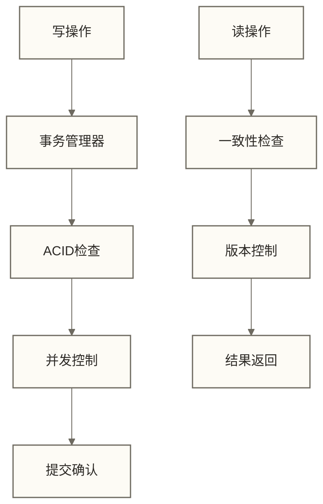

**技术特点**：
- ACID事务：支持ACID事务保证
- 并发控制：支持高并发访问
- 版本控制：支持数据版本管理

#### 3. **Schema管理**
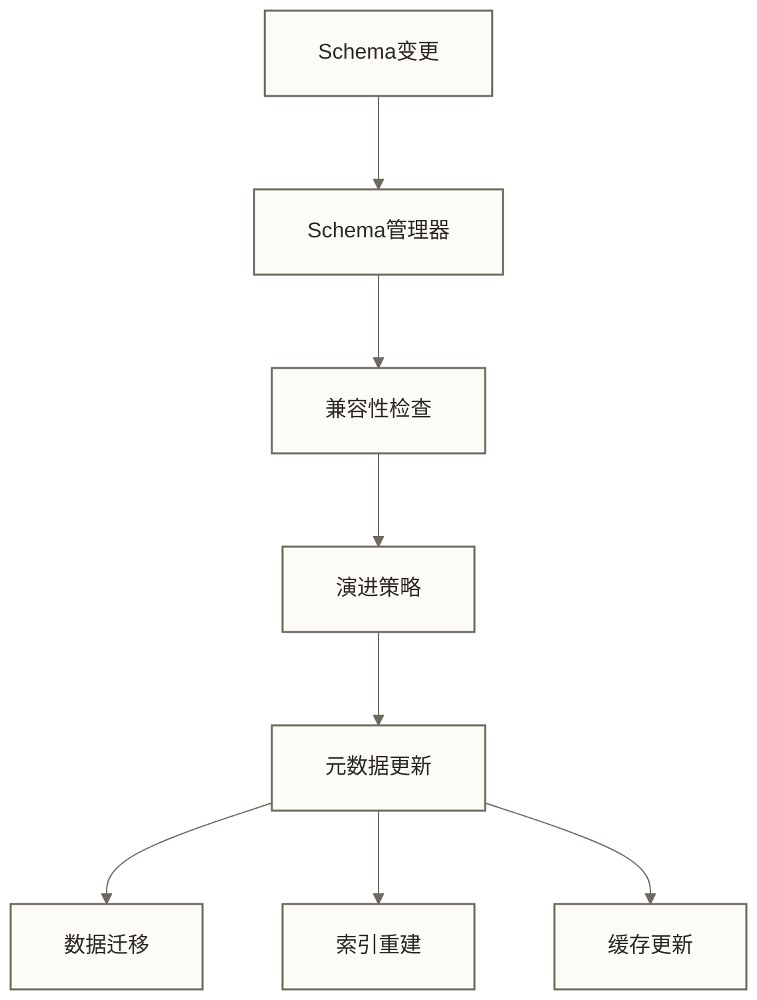

**技术特点**：
- Schema演进：支持Schema灵活演进
- 向后兼容：保持向后兼容性
- 数据迁移：是否需要及能否自动迁移取决于Schema变更类型和具体实现

### 🔄 计算技术

#### 1. **统一计算引擎**
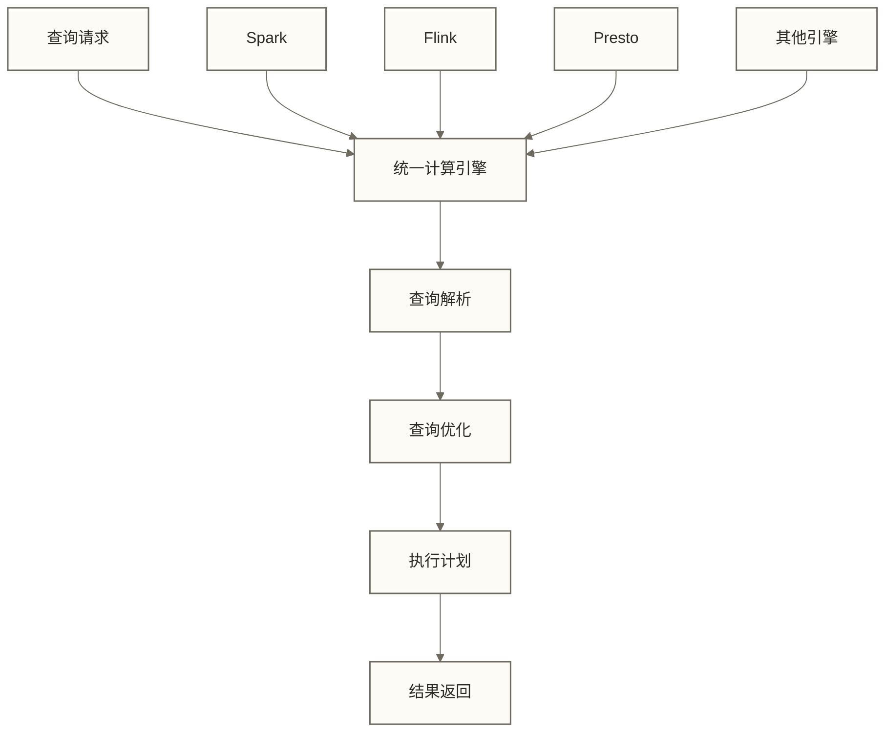

**技术特点**：
- 多引擎支持：支持多种计算引擎
- 统一接口：提供统一的计算接口
- 智能调度：智能选择计算引擎

#### 2. **性能优化**
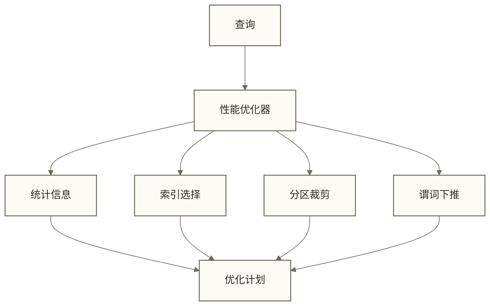

**技术特点**：
- 查询优化：自动优化查询计划
- 索引优化：智能使用索引
- 分区优化：优化分区访问

#### 3. **缓存机制**
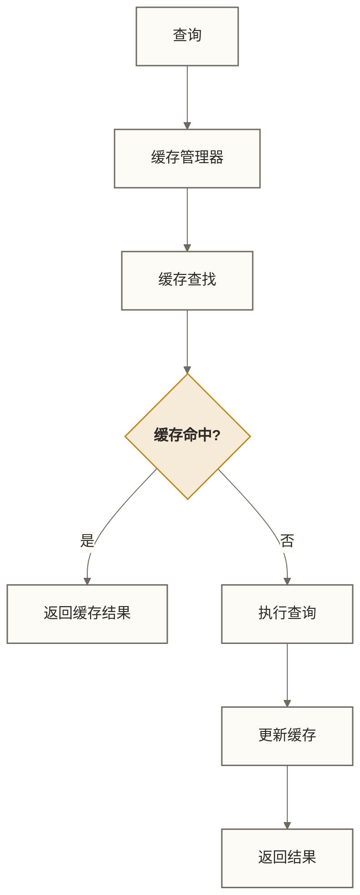

**技术特点**：
- 多级缓存：支持多级缓存机制
- 智能缓存：智能缓存热点数据
- 缓存一致性：保证缓存一致性

### 🎯 治理技术

#### 1. **统一元数据管理**
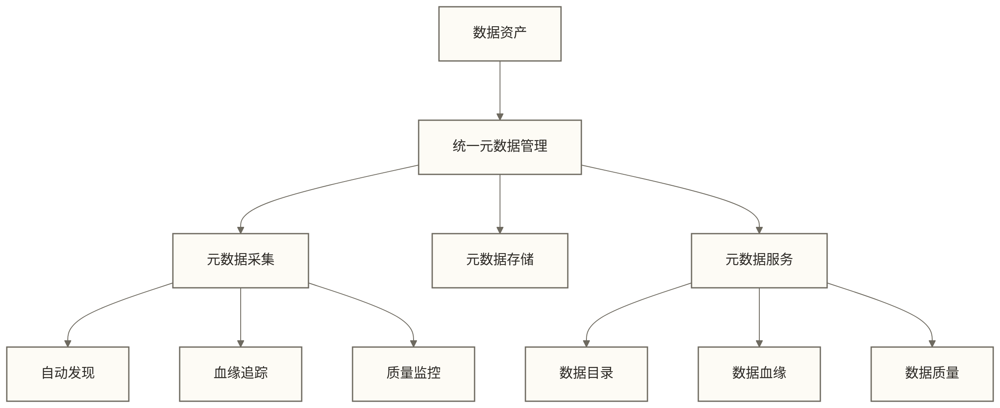

**治理要点**：
- 统一管理：统一管理所有元数据
- 自动采集：自动发现和采集元数据
- 服务化：提供元数据服务接口

#### 2. **统一安全治理**
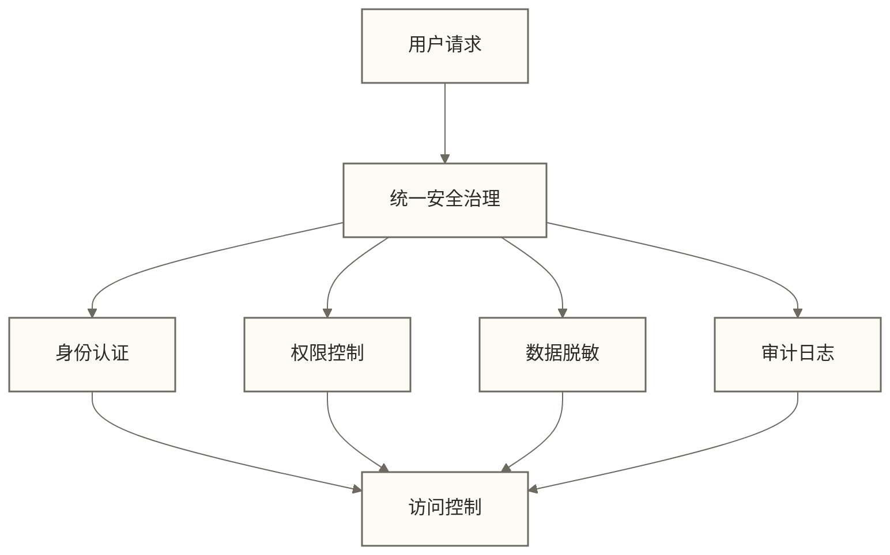

**治理要点**：
- 统一认证：统一身份认证机制
- 细粒度权限：支持细粒度权限控制
- 数据脱敏：支持数据脱敏处理

#### 3. **统一数据质量**
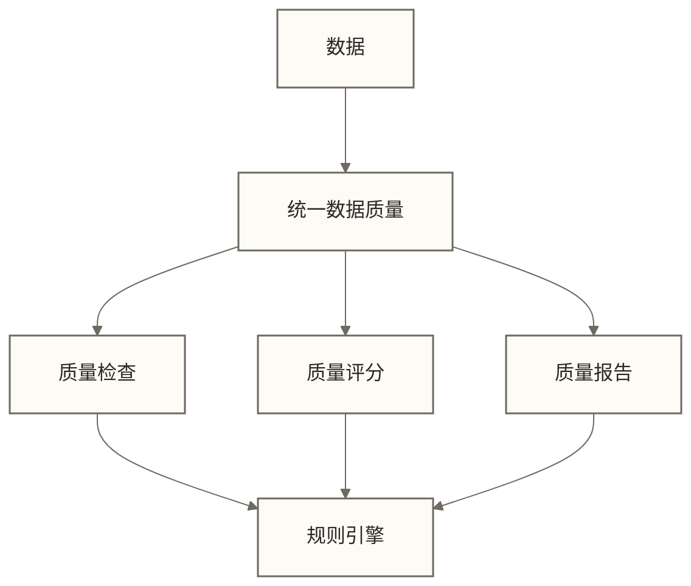

**治理要点**：
- 统一标准：统一数据质量标准
- 自动检查：自动进行质量检查
- 质量报告：生成质量报告

## ✅ 掌握检查

### 🟢 基础检查清单

- [ ] 理解数据湖仓一体的核心概念和特征
- [ ] 掌握数据湖仓一体的设计原则
- [ ] 了解不同的数据湖仓一体架构模式
- [ ] 理解统一存储技术
- [ ] 掌握统一计算技术
- [ ] 了解统一治理技术
- [ ] 能够进行基本的数据湖仓一体设计
- [ ] 具备数据湖仓一体的思维方法

### 🟡 进阶检查清单

- [ ] 能够设计复杂的数据湖仓一体架构
- [ ] 掌握数据湖仓一体性能优化技术
- [ ] 能够进行数据湖仓一体治理设计
- [ ] 掌握数据湖仓一体的运维管理
- [ ] 能够设计高可用的数据湖仓一体系统
- [ ] 掌握数据湖仓一体的监控和调优
- [ ] 具备数据湖仓一体技术选型能力
- [ ] 能够指导团队的数据湖仓一体建设

## 🔗 学习连接

**前置知识**：[[【数据开发与数据架构】/05-数据存储架构/04-数据仓库架构|数据仓库]] 和 [[【数据开发与数据架构】/05-数据存储架构/05-数据湖架构|数据湖]]  
**下一步**：[[【数据开发与数据架构】/05-数据存储架构/07-缓存架构设计|缓存架构]]  
**相关模块**：[[【数据开发与数据架构】/06-数据处理架构/08-数据处理编排|数据处理编排]] 和 [[【数据治理与数据管理】/02-深度研究/03-技术架构/数据架构/02-数据中台/数据中台架构|数据中台]]  

**返回**：[[【数据开发与数据架构】/05-数据存储架构/00-数据存储架构导览|数据存储架构导览]]

---

**创建时间**：2024-12-19  
**最后更新**：2024-12-19

#数据湖仓一体 #Lakehouse #统一数据平台 #数据存储 #数据处理
