# 数据分层存储

> [!abstract] 📋 本节概览
> - 🎯 **学习目标**：掌握数据分层存储的设计方法和最佳实践
> - 📚 **前置知识**：[[【数据开发与数据架构】/05-数据存储架构/01-数据存储架构概述|数据存储架构]] 和 [[【数据开发与数据架构】/05-数据存储架构/07-缓存架构设计|缓存架构]]
> - ⏱️ **预计用时**：25分钟

## 🏗️ 分层存储：数据的"智能分级"

数据分层存储是**现代数据架构的成本优化引擎**，代表了存储策略从单一模式向智能分层的重要演进。

**分层价值的体现**：
- 🎯 **成本优化**：根据数据价值匹配合适的存储成本
- ⚡ **性能均衡**：热数据高速访问，冷数据低成本存储
- 🔍 **自动管理**：智能识别数据访问模式自动分层迁移
- 📊 **生命周期**：完整的数据生命周期管理和治理

从单一存储到智能分层，正在重新定义数据存储的成本效益标准。
## 💡 核心概念解释

### 🎯 什么是数据分层存储？

**数据分层存储**是一种根据数据的访问频率、重要性和业务价值，将数据存储在不同性能、不同成本的存储介质上的技术，以实现存储成本和访问性能的最优平衡。

> [!note] 📖 核心特征
> - **分层管理**：根据数据特征进行分层存储
> - **自动迁移**：根据访问模式自动迁移数据
> - **成本优化**：平衡存储成本和访问性能
> - **生命周期管理**：管理数据的完整生命周期
> - **透明访问**：对应用提供透明的数据访问

### 🏗️ 数据分层存储架构模型

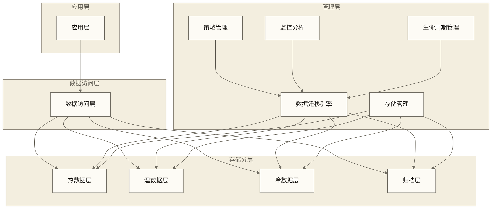

## 🔍 数据分层存储设计原则

### 🎯 设计原则

#### 1. **访问频率原则**
- 高频访问数据使用高性能存储
- 低频访问数据使用低成本存储
- 根据访问模式动态调整

#### 2. **成本效益原则**
- 平衡存储成本和访问性能
- 优化存储资源使用
- 控制总体存储成本

#### 3. **数据价值原则**
- 高价值数据优先使用高性能存储
- 低价值数据使用低成本存储
- 根据业务重要性分层

#### 4. **生命周期原则**
- 新数据优先使用高性能存储
- 老数据逐步迁移到低成本存储
- 支持数据自动归档

#### 5. **透明性原则**
- 对应用提供透明访问
- 隐藏存储分层细节
- 保持接口一致性

### 🎯 分层架构模式

#### 1. **四层架构模式**
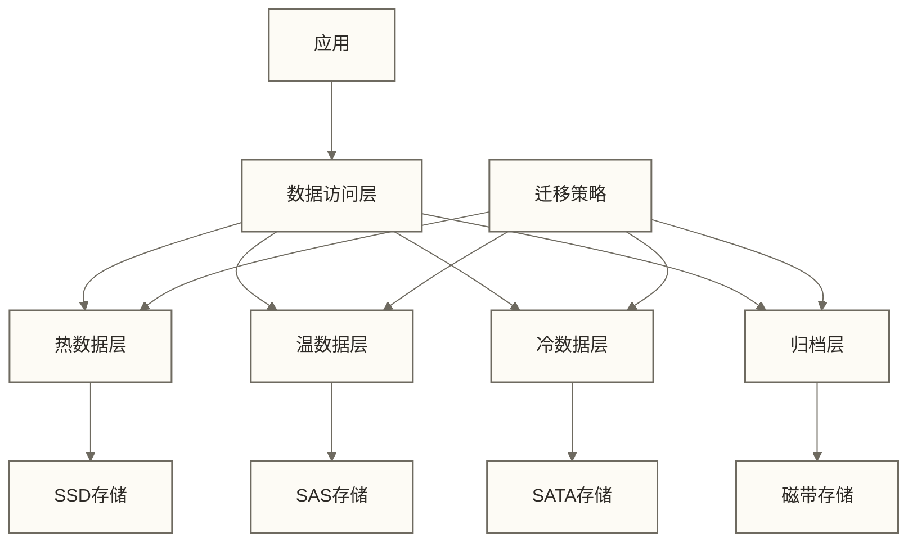

**特点**：
- 四层清晰分层
- 存储介质多样化
- 成本逐层降低

#### 2. **三层架构模式**
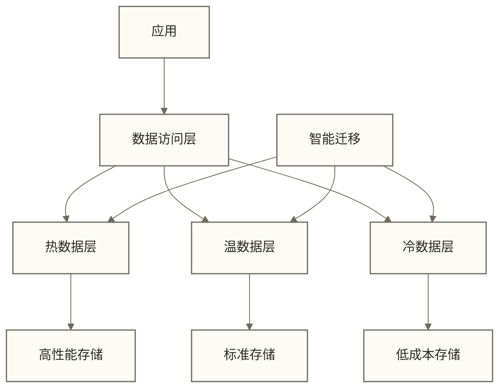

**特点**：
- 三层简化架构
- 易于管理和维护
- 成本控制简单

#### 3. **混合架构模式**
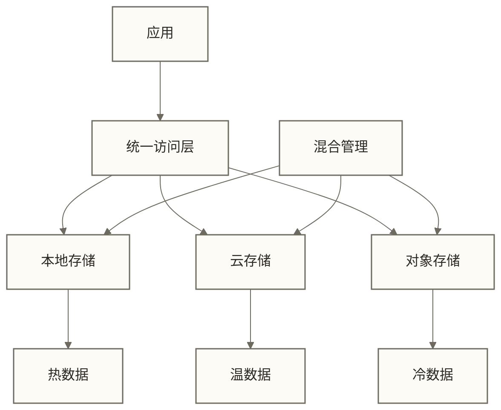

**特点**：
- 混合存储环境
- 支持多云部署
- 灵活扩展

## 🛠️ 技术实现

### 📊 分层策略

#### 1. **基于访问频率的分层**
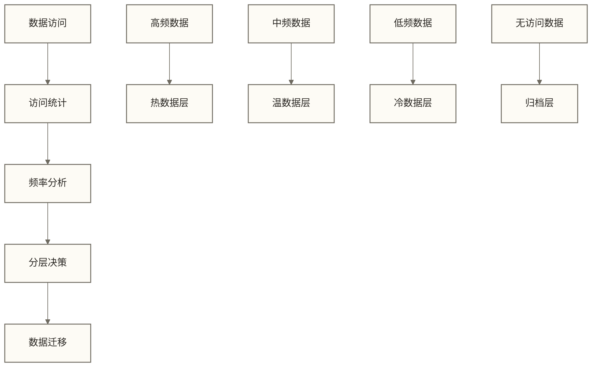

**策略特点**：
- 基于访问频率
- 动态调整分层
- 自动迁移数据

#### 2. **基于时间的分层**
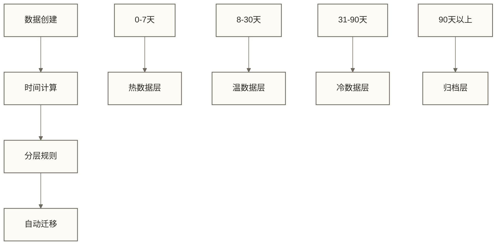

**策略特点**：
- 基于时间规则
- 预测性迁移
- 规则简单明确

#### 3. **基于业务价值的分层**
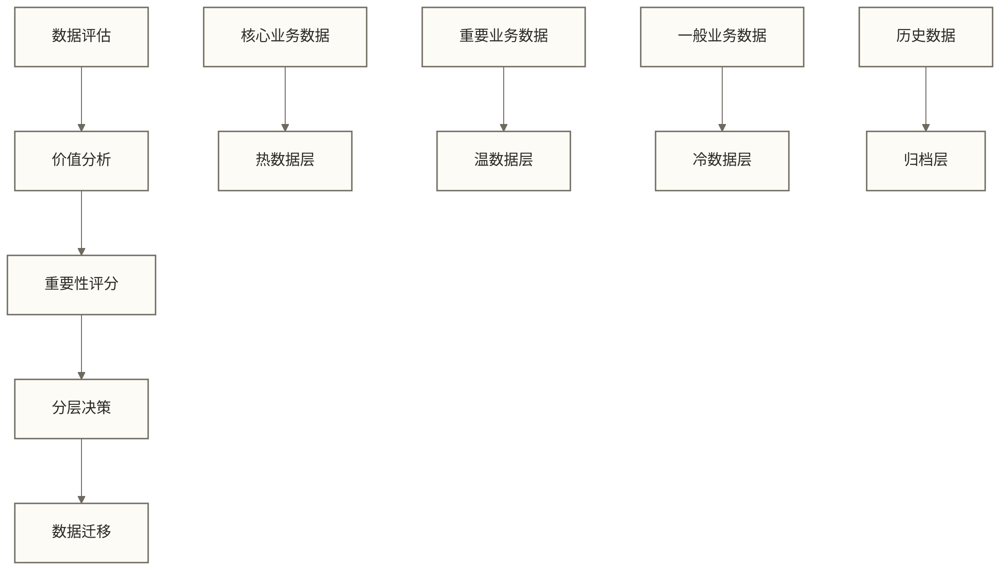

**策略特点**：
- 基于业务价值
- 考虑数据重要性
- 支持业务优先级

### 🔄 数据迁移技术

#### 1. **自动迁移引擎**
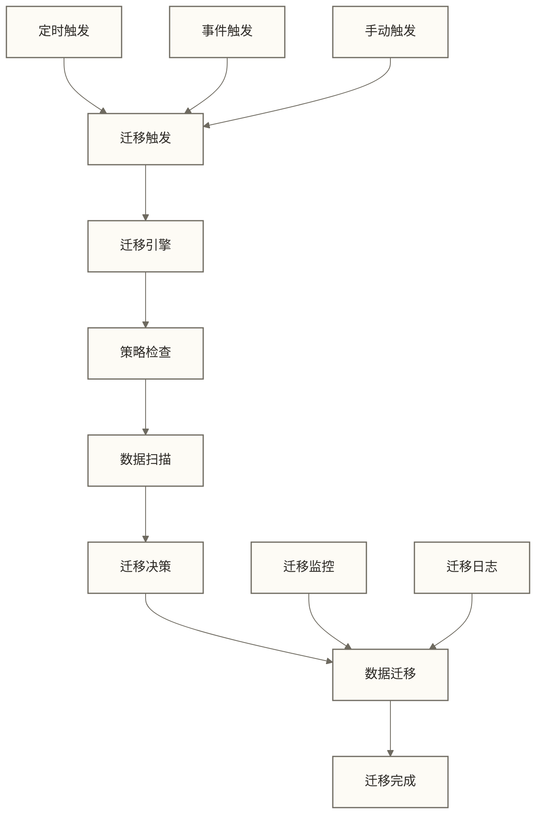

**技术特点**：
- 自动触发迁移
- 支持多种触发方式
- 迁移过程监控

#### 2. **增量迁移技术**
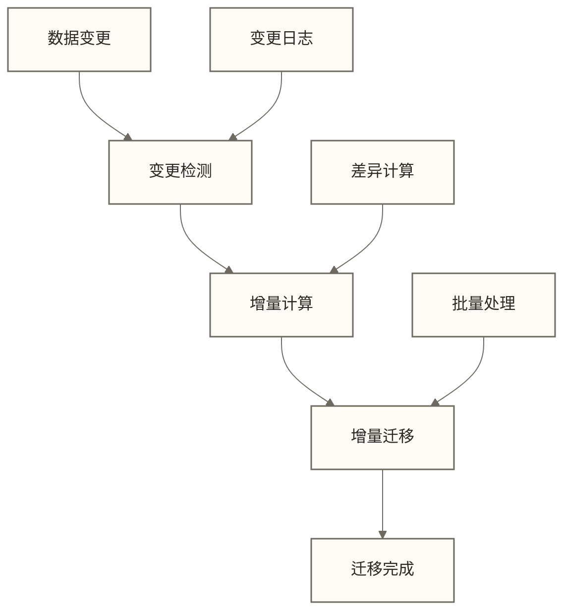

**技术特点**：
- 只迁移变更数据
- 减少迁移开销
- 提高迁移效率

#### 3. **并行迁移技术**
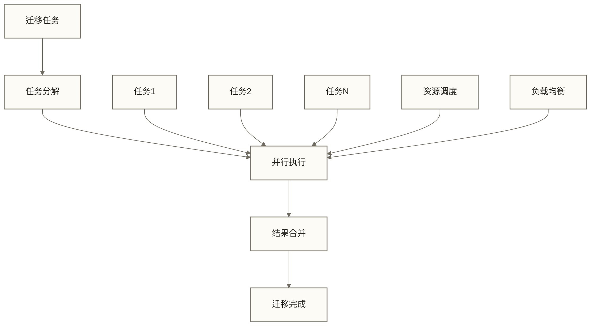

**技术特点**：
- 并行处理迁移
- 提高迁移速度
- 资源利用优化

### 🎯 存储优化技术

#### 1. **压缩技术**
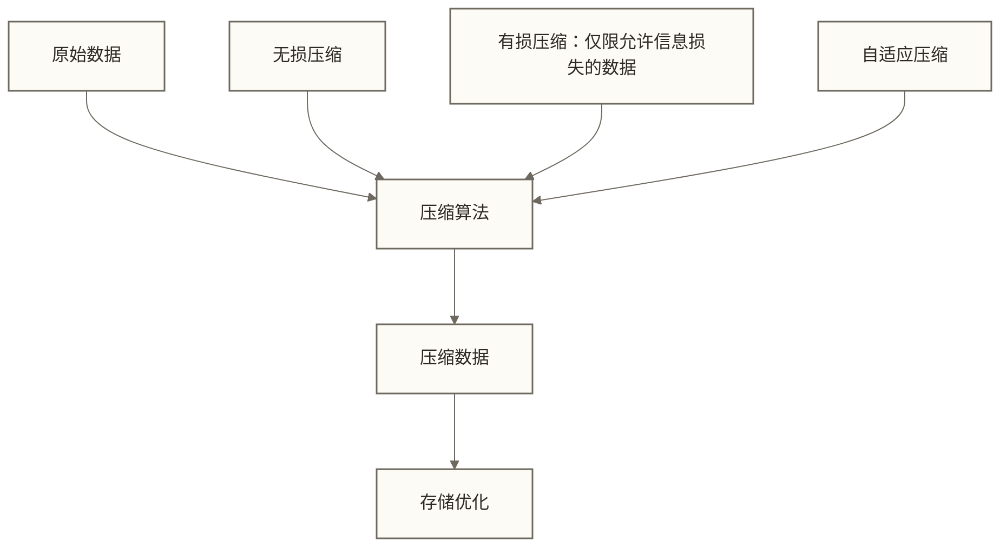

**优化要点**：
- 选择合适的压缩算法
- 平衡压缩率和性能
- 支持解压缩访问

#### 2. **去重技术**
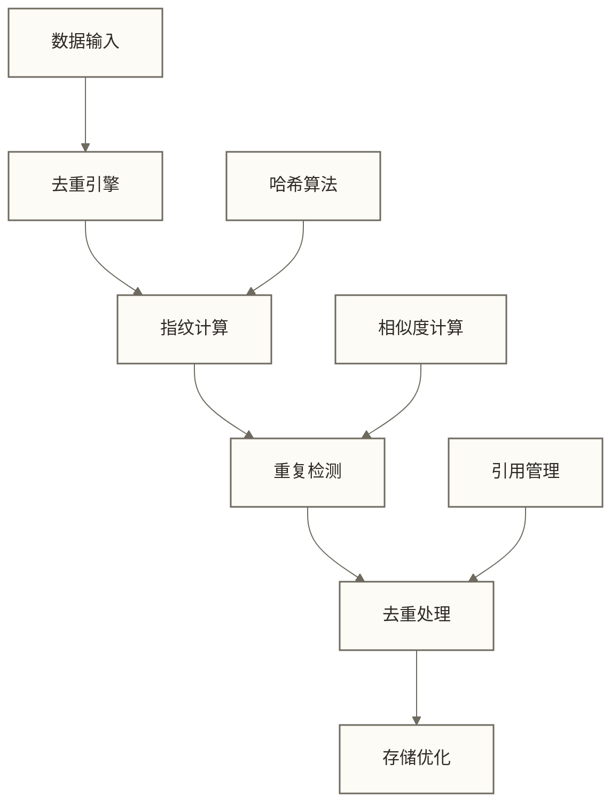

**优化要点**：
- 识别重复数据
- 减少存储空间
- 保持数据完整性

#### 3. **索引优化**
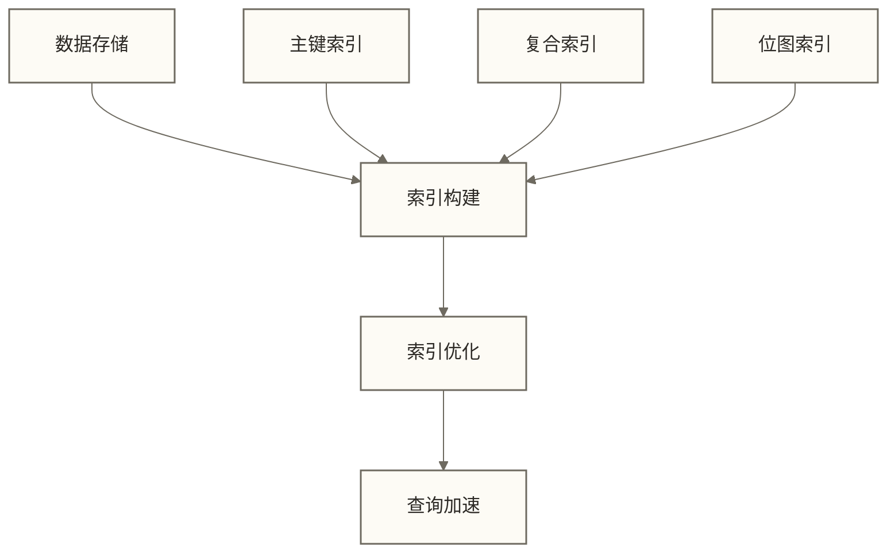

**优化要点**：
- 构建合适索引
- 优化查询性能
- 平衡存储开销

## ✅ 掌握检查

### 🟢 基础检查清单

- [ ] 理解数据分层存储的核心概念和特征
- [ ] 掌握数据分层存储的设计原则
- [ ] 了解不同的分层架构模式
- [ ] 理解分层策略的设计方法
- [ ] 掌握数据迁移技术
- [ ] 了解存储优化技术
- [ ] 能够进行基本的数据分层存储设计
- [ ] 具备数据分层存储的思维方法

### 🟡 进阶检查清单

- [ ] 能够设计复杂的数据分层存储架构
- [ ] 掌握数据分层存储的性能优化技术
- [ ] 能够进行数据生命周期管理设计
- [ ] 掌握数据分层存储的运维管理
- [ ] 能够设计高可用的数据分层存储系统
- [ ] 掌握数据分层存储的监控和调优
- [ ] 具备数据分层存储技术选型能力
- [ ] 能够指导团队的数据分层存储设计

## 🔗 学习连接

**前置知识**：[[【数据开发与数据架构】/05-数据存储架构/01-数据存储架构概述|数据存储架构]] 和 [[【数据开发与数据架构】/05-数据存储架构/07-缓存架构设计|缓存架构]]  
**下一步**：[[【数据开发与数据架构】/06-数据处理架构/08-数据处理编排|数据处理编排]]  
**相关模块**：[[【技术与工具】/PostgreSQL/06-PostgreSQL索引与性能优化|PostgreSQL - PostgreSQL索引与性能优化]] 和 [[【数据治理与数据管理】/02-深度研究/03-技术架构/数据架构/02-数据中台/数据中台架构|数据中台]]  

**返回**：[[【数据开发与数据架构】/05-数据存储架构/00-数据存储架构导览|数据存储架构导览]]

---

**创建时间**：2024-12-19  
**最后更新**：2024-12-19

#数据分层存储 #存储分层 #冷热数据 #数据生命周期 #存储优化
