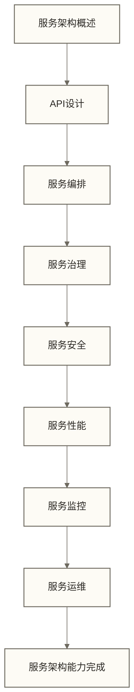

# 数据服务架构导览

> [!abstract] 📋 模块概览
> - 🎯 **数据服务架构导览学习**：掌握数据服务架构的设计方法和最佳实践
> - 📚 **模块内容**：9个核心文档，从API设计到语义层工程全覆盖
> - ⏱️ **学习时长**：预计3-4周完成数据服务架构能力建设
> - 🔗 **前置要求**：[[【数据开发与数据架构】/06-数据处理架构/00-数据处理架构导览|数据处理架构导览]] 和 [[【数据开发与数据架构】/05-数据存储架构/00-数据存储架构导览|数据存储架构导览]]

## 🎯 数据服务架构导览学习

数据服务架构是数据开发与架构知识体系的**服务核心**，是数据价值对外输出的接口和通道设计。

> [!tip] 💡 为什么数据服务架构如此重要？
> 数据服务架构就像**电商平台的物流配送系统**：
> - **商品仓库**：存储各种数据产品（[[【数据开发与数据架构】/09-实时数据架构/04-实时数据存储|实时数据存储]]）
> - **订单系统**：接收用户的数据需求（API接口）
> - **配送网络**：将数据产品送达用户（数据分发）
> - **客服系统**：处理用户反馈和问题（服务监控）
> - **物流追踪**：实时了解配送状态（服务追踪）

在数据驱动的时代，**数据服务架构**决定了：
- **数据价值实现**：如何将数据价值传递给业务用户
- **服务体验**：用户获取数据的便捷性和效率
- **系统集成**：如何与业务系统无缝集成
- **服务治理**：如何管理和监控数据服务

## 📚 模块内容

### 📖 文档清单

本模块包含9个核心文档，形成完整的数据服务架构学习体系。首先通过[[【数据开发与数据架构】/07-数据服务架构/01-数据服务架构概述|数据服务架构]]理解核心概念和设计原则，接着学习具体的服务实现方式，包括[[【数据开发与数据架构】/07-数据服务架构/02-RESTful数据服务|RESTful数据服务]]和[[【数据开发与数据架构】/07-数据服务架构/03-GraphQL数据服务|GraphQL数据服务]]两种主要服务类型。

在掌握基础服务类型后，深入学习[[【数据开发与数据架构】/07-数据服务架构/04-数据API设计|数据API]]，这是构建高质量数据服务的关键技能。随后了解[[【数据开发与数据架构】/07-数据服务架构/05-数据服务网关|数据服务网关]]作为统一入口的重要作用，以及[[【数据开发与数据架构】/07-数据服务架构/06-数据服务编排|数据服务编排]]如何协调多服务协作。

运维层面有两个文档，[[【数据开发与数据架构】/07-数据服务架构/07-数据服务监控|数据服务监控]]确保服务稳定运行，[[【数据开发与数据架构】/07-数据服务架构/08-数据服务部署|数据服务部署]]实现安全高效的服务上线。

面向 Agent 时代的新增篇——[[【数据开发与数据架构】/07-数据服务架构/09-语义层工程实践|语义层工程实践]]——把"业务术语到物理字段"的契约层讲透，是 Text-to-SQL 和数据 Agent 的必修课。

### 🏗️ 学习路径

## 🎯 学习目标

### 🟢 初级目标（完成本模块后）

在知识层面，您将理解数据服务架构的核心概念和设计原则，掌握数据API的设计方法，了解服务治理的基本原理。这些理论知识为实践应用奠定坚实基础。

在技能层面，您将能够设计基本的数据服务架构，掌握API接口的设计方法，能够进行简单的服务性能优化。这些实用技能直接应用于日常工作中。

在能力层面，您将具备服务架构的思维方法，能够根据业务需求设计合适的服务接口，理解服务架构对用户体验的影响。这种系统性思维能力是架构设计的核心竞争力。

### 🟡 中级目标（为后续模块做准备）

为数据中台架构做准备，您需要理解服务架构对中台能力的影响，掌握服务编排的设计方法，了解服务与中台的集成设计。这为构建企业级数据中台提供坚实的架构基础。

为云原生架构做准备，您需要理解服务架构对云原生的影响，掌握微服务架构的设计方法，了解服务与云原生的协同设计。这些技能是现代化数据架构的核心竞争力。

## 🔗 与其他模块的关联

### 前置依赖

本模块基于以下模块的基础知识。数据处理架构为您提供数据处理方式和实时处理能力的理解，这是设计高效数据服务的前提。数据存储架构帮您掌握数据存储方式和访问模式，这直接影响服务的性能设计。数据工程实践涵盖[[【数据治理与数据管理】/01-快速学习/02-实践方法/数据质量评估方法|深度研究 - 数据质量评估]]和数据处理流程，为服务可靠性提供保障。

### 后续延伸

完成本模块后，您将具备进入更高层次架构设计的能力。您可以开始学习数据中台架构，将服务化理念应用到企业级数据平台建设中。同时为云原生架构转型做好准备，掌握现代化数据服务的部署和管理方式。

## 🛠️ 实践建议

### 📚 学习方法

理论结合实践是最有效的学习方式，建议您通过实际项目来理解服务架构设计的核心要点。API设计实践能够帮助您将理论知识转化为实际技能，建议设计并实现真实的API接口。案例学习通过分析成功案例来理解架构设计思路，这有助于形成架构思维。技术选型对比让您了解不同服务技术的优缺点，培养技术决策能力。

### 🎯 重点难点

学习重点包括服务架构的设计原则和方法，这是构建稳定可靠服务的基础。API接口的设计和实现是核心技能，直接影响服务的易用性和可维护性。服务治理和监控方法确保服务在生产环境中的稳定运行。

学习难点主要体现在大规模服务的架构设计，需要考虑分布式环境下的复杂性。服务性能的优化方法涉及多个技术层面的综合考虑。服务安全的实现机制需要在便利性和安全性之间找到平衡。

## ✅ 学习检查点

### 🟢 基础检查清单

- [ ] 理解数据服务架构的核心概念和设计原则
- [ ] 能够设计基本的数据API接口
- [ ] 掌握服务编排的基本方法
- [ ] 理解服务治理的基本原理
- [ ] 能够设计基本的服务安全机制
- [ ] 掌握服务性能优化方法
- [ ] 能够进行服务监控设计
- [ ] 具备服务架构的思维方法

### 🟡 进阶检查清单

- [ ] 能够设计复杂的数据服务架构
- [ ] 掌握大规模服务的治理方法
- [ ] 能够进行深度的服务性能优化
- [ ] 掌握服务安全的高级实现
- [ ] 能够设计高可用的服务架构
- [ ] 掌握服务运维的自动化方法
- [ ] 具备服务技术选型能力
- [ ] 能够指导团队的服务架构设计

## 🔗 快速导航

**开始学习**：[[【数据开发与数据架构】/07-数据服务架构/01-数据服务架构概述|数据服务架构]]
**API设计**：[[【数据开发与数据架构】/07-数据服务架构/04-数据API设计|数据API]]
**服务编排**：[[【数据开发与数据架构】/07-数据服务架构/06-数据服务编排|数据服务编排]]
**服务治理**：数据服务治理
**服务安全**：数据服务安全
**服务性能**：数据服务性能
**服务监控**：[[【数据开发与数据架构】/07-数据服务架构/07-数据服务监控|数据服务监控]]
**服务部署**：[[【数据开发与数据架构】/07-数据服务架构/08-数据服务部署|数据服务部署]]
**语义层工程**：[[【数据开发与数据架构】/07-数据服务架构/09-语义层工程实践|语义层工程实践]]（2026 春季新增）
**Agent数据访问**：[[【数据开发与数据架构】/07-数据服务架构/10-Agent-to-Data访问架构|Agent-to-Data访问架构]]（2026 夏季新增）

**上一步**：[[【数据开发与数据架构】/06-数据处理架构/00-数据处理架构导览|数据处理架构导览]]
**下一步**：[[【数据开发与数据架构】/08-数据中台架构/00-数据中台架构导览|数据中台架构导览]]

---

**历史页尾日期记录**：2024-12-19（来源与含义未核定，不作为本文现行创建时间）
**编辑更新时间**：见元数据 updated；原页尾日期2026-05-18仅保留为历史记录，不作为现行更新时间或事实核验日期。
**预计完成**：3-4周

#数据服务 #API设计 #服务编排 #服务治理 #架构设计
